# Page: NeMo Relay Overview

# NeMo Relay Overview

<details>
<summary>Relevant source files</summary>

The following files were used as context for generating this wiki page:

- [README.md](README.md)
- [crates/cli/README.md](crates/cli/README.md)
- [docs/about-nemo-relay/agent-runtime-primer.mdx](docs/about-nemo-relay/agent-runtime-primer.mdx)
- [docs/about-nemo-relay/architecture.mdx](docs/about-nemo-relay/architecture.mdx)
- [docs/about-nemo-relay/concepts/index.mdx](docs/about-nemo-relay/concepts/index.mdx)
- [docs/about-nemo-relay/concepts/plugins.mdx](docs/about-nemo-relay/concepts/plugins.mdx)
- [docs/about-nemo-relay/ecosystem.mdx](docs/about-nemo-relay/ecosystem.mdx)
- [docs/about-nemo-relay/overview.mdx](docs/about-nemo-relay/overview.mdx)
- [docs/build-plugins/about.mdx](docs/build-plugins/about.mdx)
- [docs/configure-plugins/about.mdx](docs/configure-plugins/about.mdx)
- [docs/configure-plugins/nemo-guardrails/about.mdx](docs/configure-plugins/nemo-guardrails/about.mdx)
- [docs/configure-plugins/nemo-guardrails/configuration.mdx](docs/configure-plugins/nemo-guardrails/configuration.mdx)
- [docs/contribute/runtime-contract-docs.mdx](docs/contribute/runtime-contract-docs.mdx)
- [docs/getting-started/configuration.mdx](docs/getting-started/configuration.mdx)
- [docs/getting-started/quick-start/index.mdx](docs/getting-started/quick-start/index.mdx)
- [docs/index.yml](docs/index.yml)
- [docs/integrate-into-frameworks/about.mdx](docs/integrate-into-frameworks/about.mdx)
- [docs/nemo-relay-cli/about.mdx](docs/nemo-relay-cli/about.mdx)
- [docs/resources/glossary.mdx](docs/resources/glossary.mdx)
- [docs/supported-integrations/about.mdx](docs/supported-integrations/about.mdx)

</details>


NVIDIA NeMo Relay is a portable execution runtime designed for agent systems that already incorporate a framework, model provider, policy layer, or observability backend [README.md:19-22](). It provides a consistent, language-agnostic layer to describe, control, and observe what occurs when an agent crosses boundaries such as requests, tools, or LLM calls [docs/about-nemo-relay/overview.mdx:11-20]().

In modern production stacks, agent applications commonly combine multiple frameworks (e.g., LangChain, LangGraph, Deep Agents), various model providers, and custom harnesses. NeMo Relay operates beneath these layers as a shared runtime contract for scopes, middleware, plugins, lifecycle events, and adaptive behavior [docs/about-nemo-relay/overview.mdx:11-20]().

## Purpose and Scope

The core aim of NeMo Relay is to offer a framework-neutral substrate to unify agent execution [README.md:19-22](). Developers benefit from:

- **Owning Execution Context**: Hierarchical scopes provide parent-child relationships binding tools, LLM calls, and events within the same execution tree [docs/about-nemo-relay/architecture.mdx:131-138]().
- **Packaging Policy Once**: Guardrails and intercepts enable blocking or sanitizing work without needing to rewrite every call site [docs/about-nemo-relay/architecture.mdx:142-146]().
- **Emitting One Lifecycle Stream**: Subscribers consume canonical runtime events and export them as Agent Trajectory Interchange Format (ATIF) trajectories, OpenTelemetry, or OpenInference traces [docs/about-nemo-relay/overview.mdx:61-65]().
- **Installing Reusable Behavior**: Plugins configure middleware, subscribers, adaptive components, and other runtime behavior centrally from configuration [docs/about-nemo-relay/overview.mdx:113-114]().

For technical details on the system design and runtime model, see [Architecture and Runtime Model](#1.1). To begin using the library, visit [Getting Started](#1.2).

Sources: [README.md:19-22](), [docs/about-nemo-relay/architecture.mdx:131-146](), [docs/about-nemo-relay/overview.mdx:11-20,61-65,113-114]()

## Polyglot Architecture

NeMo Relay is powered by a performant **Rust Core Runtime** that implements fundamental logic for scope management, middleware execution, and event dispatching [docs/about-nemo-relay/architecture.mdx:43-53](). This Rust core exposes its functionality via language bindings to several ecosystems to ensure broad usability [docs/about-nemo-relay/overview.mdx:78-81]().

### Runtime Concept to Code Entity Mapping

This diagram bridges high-level runtime concepts to corresponding code entities and repository directories, facilitating grasp of how abstract ideas are realized in code:

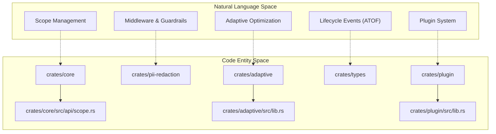

Sources: [README.md:12-14](), [docs/about-nemo-relay/overview.mdx:78-81]()

### Language Support

NeMo Relay maintains strict semantic parity across all primary language bindings ensuring consistent runtime behavior regardless of host environment [docs/about-nemo-relay/overview.mdx:93-97]():

| Binding   | Implementation    | Status        | Source Path           |
|-----------|-------------------|---------------|-----------------------|
| **Rust**  | Native Crate      | ✅ Supported  | `crates/core`         |
| **Python**| PyO3 / Maturin   | ✅ Supported  | `crates/python`       |
| **Node.js**| NAPI-RS           | ✅ Supported  | `crates/node`         |
| **Go**    | CGo / FFI         | 🚧 Experimental| `crates/ffi`          |
| **C FFI** | Raw ABI           | 🚧 Experimental| `crates/ffi`          |

This design ensures that core logic remains implemented once, while enabling wide language accessibility without compromising correctness or concurrency models [docs/about-nemo-relay/overview.mdx:93-97]().

Sources: [README.md:10-14](), [docs/about-nemo-relay/overview.mdx:93-97]()

## Key Subsystems

The NeMo Relay runtime divides into several cooperating subsystems forming a consistent and extensible agent execution environment [docs/about-nemo-relay/architecture.mdx:25-95]():

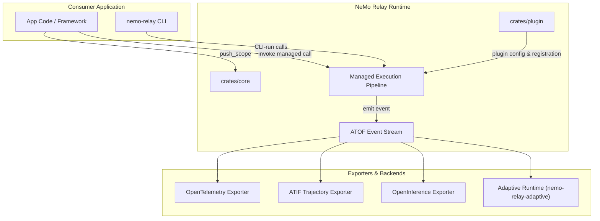

Sources: [docs/about-nemo-relay/architecture.mdx:25-95]()

### Scopes and Events

Scopes establish hierarchical context for all runtime work, providing parent-child relationships for requests, tools, and LLM calls [docs/about-nemo-relay/architecture.mdx:131-138](). Every scope lifecycle and event is recorded as part of the canonical Agent Trajectory Observability Format (ATOF), allowing subscribers to reconstruct precise runtime behavior [docs/about-nemo-relay/overview.mdx:61-62]().

Sources: [docs/about-nemo-relay/architecture.mdx:131-138](), [docs/about-nemo-relay/overview.mdx:61-62]()

### Middleware and Plugins

Middleware wraps managed execution boundaries, enabling request interception, sanitization, conditional guardrails, and execution transformation [docs/about-nemo-relay/architecture.mdx:142-146](). Plugins serve as packaged runtime extensions that configure middleware and subscribers from declarative configuration files like `plugins.toml` [docs/about-nemo-relay/architecture.mdx:153-156]().

Relay discovers and layers `plugins.toml` to configure built-in components and record references to discoverable plugins [crates/cli/README.md:177-180]().

Sources: [crates/cli/README.md:177-180](), [docs/about-nemo-relay/architecture.mdx:142-156]()

### Observability and Adaptive Runtime

Observability subscribers translate ATOF event streams into export formats such as ATIF trajectories, OpenTelemetry traces, or OpenInference traces [docs/about-nemo-relay/overview.mdx:61-65](). The Adaptive Runtime (`nemo-relay-adaptive`) provides algorithms to learn from runtime signals and tune future execution [docs/about-nemo-relay/architecture.mdx:97-98]().

Sources: [docs/about-nemo-relay/architecture.mdx:97-98](), [docs/about-nemo-relay/overview.mdx:61-65]()

### CLI and Gateway

The `nemo-relay` CLI implements a passthrough LLM gateway, forwarding coding agent hook events into the NeMo Relay runtime [crates/cli/README.md:55-56](). This runtime wrapper enables adding observability and security policies around existing agent binaries, such as Claude Code or Codex, without source modification [docs/about-nemo-relay/overview.mdx:48]().

Note: Hermes Agent includes NeMo Relay natively; no separate observability plugin or Relay CLI setup is required when using Hermes Agent [README.md:39-41]().

Sources: [README.md:39-41](), [crates/cli/README.md:55-56](), [docs/about-nemo-relay/overview.mdx:48]()

## Documentation Map

This wiki structures documentation around the request lifecycle and integration layers to guide users of varying backgrounds:

| Section   | Focus Area           | Coverage                                                                                          |
|-----------|---------------------|-------------------------------------------------------------------------------------------------|
| **1**     | Overview and Introduction | High-level concepts, architecture summary, polyglot design, relationships between major components |
| **1.1**   | Architecture and Runtime Model | Layered runtime architecture: core, bindings, plugins, and subscribers; execution pipeline     |
| **1.2**   | Getting Started      | Installation details, prerequisites, quick-start workflows for Rust, Python, Node.js            |
| **1.3**   | Release Notes and Migration Guides | Version history, deprecations, migration guides, and the support matrix. |
| **2**     | Core Runtime (Rust)  | Rust core SDK, adaptive runtime, subsystems deep dives (Scopes, Middleware, Codecs)             |
| **3**     | Plugin System        | Overview of plugin architecture: static plugin components, plugin configuration files, dynamic native plugins, and gRPC worker plugins. |
| **4**     | Language Bindings    | Detailed Python, Node.js, Go, and C FFI API and implementation notes                |
| **5**     | Observability        | Event streaming, exporters (ATOF, ATIF, OTLP), telemetry and plugin configuration                |
| **6**     | NeMo Relay CLI       | The `nemo-relay` CLI binary, gateway request processing, coding agent support (Claude/Codex)    |
| **7**     | Integrations        | Framework integrations (LangChain, LangGraph, Deep Agents), OpenClaw, PII Redaction               |
| **8**     | CI/CD, Build System, and Release | Multi-language CI pipeline, release process, version syncing                                    |
| **9**     | Documentation and Skills | Multi-language API reference generation, consumer skills                                       |
| **10**    | Glossary             | Definitions for repository-specific terminology and concepts                                   |

---

For details on the architecture and runtime model, see [Architecture and Runtime Model](#1.1).

For installation and initial usage, start with [Getting Started](#1.2).

For version history, deprecations, and migration instructions, refer to [Release Notes and Migration Guides](#1.3).

---

Sources: [README.md:19-22,39-41](), [crates/cli/README.md:55-56,177-180](), [docs/about-nemo-relay/architecture.mdx:43-53,97-98,131-156](), [docs/about-nemo-relay/overview.mdx:11-20,48,61-65,78-81,93-97,113-114]()

---

# Page: Architecture and Runtime Model

# Architecture and Runtime Model

<details>
<summary>Relevant source files</summary>

The following files were used as context for generating this wiki page:

- [README.md](README.md)
- [crates/cli/README.md](crates/cli/README.md)
- [crates/core/src/api/registry.rs](crates/core/src/api/registry.rs)
- [crates/core/src/api/runtime.rs](crates/core/src/api/runtime.rs)
- [crates/core/src/api/runtime/callbacks.rs](crates/core/src/api/runtime/callbacks.rs)
- [crates/core/src/api/runtime/scope_stack.rs](crates/core/src/api/runtime/scope_stack.rs)
- [crates/core/src/api/runtime/subscriber_dispatcher.rs](crates/core/src/api/runtime/subscriber_dispatcher.rs)
- [crates/core/src/api/scope.rs](crates/core/src/api/scope.rs)
- [crates/core/src/api/skill_load.rs](crates/core/src/api/skill_load.rs)
- [crates/core/src/context/registries.rs](crates/core/src/context/registries.rs)
- [crates/core/tests/integration/api_surface_tests.rs](crates/core/tests/integration/api_surface_tests.rs)
- [crates/core/tests/integration/scope_local_tests.rs](crates/core/tests/integration/scope_local_tests.rs)
- [crates/core/tests/unit/context_tests.rs](crates/core/tests/unit/context_tests.rs)
- [crates/core/tests/unit/skill_load_tests.rs](crates/core/tests/unit/skill_load_tests.rs)
- [crates/core/tests/unit/subscriber_dispatcher_tests.rs](crates/core/tests/unit/subscriber_dispatcher_tests.rs)
- [crates/ffi/src/api/scope_stack.rs](crates/ffi/src/api/scope_stack.rs)
- [crates/plugin/src/lib.rs](crates/plugin/src/lib.rs)
- [crates/plugin/tests/typed_callbacks.rs](crates/plugin/tests/typed_callbacks.rs)
- [docs/about-nemo-relay/agent-runtime-primer.mdx](docs/about-nemo-relay/agent-runtime-primer.mdx)
- [docs/about-nemo-relay/architecture.mdx](docs/about-nemo-relay/architecture.mdx)
- [docs/about-nemo-relay/concepts/conditional-middleware-guardrails.mdx](docs/about-nemo-relay/concepts/conditional-middleware-guardrails.mdx)
- [docs/about-nemo-relay/concepts/index.mdx](docs/about-nemo-relay/concepts/index.mdx)
- [docs/about-nemo-relay/concepts/scopes.mdx](docs/about-nemo-relay/concepts/scopes.mdx)
- [docs/about-nemo-relay/ecosystem.mdx](docs/about-nemo-relay/ecosystem.mdx)
- [docs/about-nemo-relay/overview.mdx](docs/about-nemo-relay/overview.mdx)
- [docs/contribute/runtime-contract-docs.mdx](docs/contribute/runtime-contract-docs.mdx)
- [docs/getting-started/quick-start/index.mdx](docs/getting-started/quick-start/index.mdx)
- [docs/integrate-into-frameworks/about.mdx](docs/integrate-into-frameworks/about.mdx)
- [docs/nemo-relay-cli/about.mdx](docs/nemo-relay-cli/about.mdx)
- [docs/supported-integrations/about.mdx](docs/supported-integrations/about.mdx)
- [go/nemo_relay/context_test.go](go/nemo_relay/context_test.go)

</details>


NeMo Relay provides a portable execution runtime designed for agentic systems, delivering a consistent abstraction to describe, observe, and manage work that spans requests, tools, and large language model (LLM) invocations. It is framework-neutral, enabling applications to retain their existing orchestration while gaining integrated support for policy enforcement, telemetry, adaptive behavior, and lifecycle event tracking [docs/about-nemo-relay/concepts/conditional-middleware-guardrails.mdx:11-18]().

## Layered Architecture

The architecture of NeMo Relay is composed of multiple layers, each adding specialized capabilities and language ecosystem support:

1.  **Rust Core (`nemo-relay`)**:
    The performant foundation implemented in Rust. It manages the active `ScopeStack`, middleware registries, and emits the canonical event stream in the Agent Trajectory Observability Format (ATOF). The core state is represented by `NemoRelayContextState`, which owns registries for middleware and subscribers used throughout the APIs [crates/core/src/api/runtime/scope_stack.rs:32-38](), [crates/core/src/api/runtime/state.rs:6-17]().

2.  **Language Bindings**:
    Native bindings expose the Rust core APIs to other languages including Python, Node.js, Go, and C FFI. These expose idiomatic access to lifecycle controls, managed calls, middleware registration, and event processing [crates/core/src/api/runtime.rs:13-20]().

3.  **Plugin and Adaptive Layer**:
    A configuration-driven plugin system enables bundling reusable runtime components. Plugins register middleware (guardrails, intercepts), event subscribers, and exporters to extend capabilities without hand-registration. Components include observability exporters, adaptive runtime "learners," and guardrail enforcement [docs/about-nemo-relay/architecture.mdx:109-110](), [crates/core/src/api/registry.rs:1-100]().

4.  **Framework Integrations**:
    Various frameworks (e.g., LangChain, DeepAgents) integrate by mapping their lifecycle hooks into NeMo Relay’s managed execution model. These adapters operate on top of the plugin and middleware layers for extensibility and observability [docs/about-nemo-relay/ecosystem.mdx:111-118]().

5.  **Subscribers and Exporters**:
    Subsystems subscribe to the canonical event stream to transform and export observability data in different formats such as OpenTelemetry traces or ATIF (Agent Trajectory Interchange Format) files. Exporters are installed as subscribers and managed by the plugin system [crates/core/src/api/runtime/subscriber_dispatcher.rs:1-50]().

Sources: [crates/core/src/api/runtime/scope_stack.rs:32-38](), [crates/core/src/api/runtime/state.rs:6-17](), [crates/core/src/api/runtime.rs:13-20](), [docs/about-nemo-relay/architecture.mdx:109-110](), [crates/core/src/api/registry.rs:1-100](), [docs/about-nemo-relay/ecosystem.mdx:111-118](), [crates/core/src/api/runtime/subscriber_dispatcher.rs:1-50]()

### NeMo Relay Code Entity Map

This diagram connects natural language system layers to Rust core code entities for easier navigation and understanding.

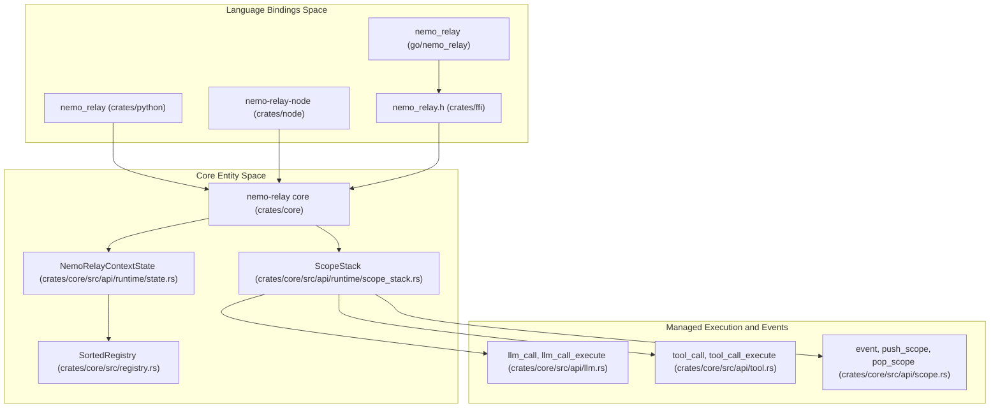

Sources: [crates/core/src/api/runtime/scope_stack.rs:32-38](), [crates/core/src/api/runtime/state.rs:6-17](), [crates/core/src/api/llm.rs:18-33](), [crates/core/src/api/tool.rs:18-33](), [crates/core/src/api/scope.rs:18-33]()

## Managed Execution Pipeline

The heart of NeMo Relay's runtime behavior for tool and LLM calls is the **managed execution pipeline**, enforcing consistent lifecycle management, middleware application, and observability event generation.

### Pipeline Stages

-   **1. Request Intercepts:**
    Middleware that asynchronously transforms or rewrites incoming request payloads before execution (e.g., `LlmRequestInterceptFn` for LLM calls) [crates/core/src/api/runtime/callbacks.rs:16]().

-   **2. Conditional Execution Guardrails:**
    Middleware that decides whether to proceed with execution or reject the call based on policy or runtime conditions (e.g., `LlmConditionalFn`) [crates/core/src/api/runtime/callbacks.rs:15]().

-   **3. Execution Intercepts:**
    Middleware wrappers that surround the actual call, using the provided `next()` continuation to invoke downstream middleware or the final provider. This supports retries, asynchronous wrapping, or even request branching [docs/about-nemo-relay/architecture.mdx:145-148]().

-   **4. Event Sanitization:**
    Middleware that modifies emitted observability events for privacy, redaction, or metadata enrichment, without affecting the true request or result [crates/core/src/api/runtime/callbacks.rs:14]().

-   **5. Event Stream Emission:**
    The runtime emits canonical ATOF lifecycle events (start, end, marks) asynchronously to subscribers and exporters, capturing activity metadata and results [crates/core/src/api/runtime/subscriber_dispatcher.rs:25-28]().

Sources: [crates/core/src/api/runtime/callbacks.rs:14-16](), [docs/about-nemo-relay/architecture.mdx:145-148](), [crates/core/src/api/runtime/subscriber_dispatcher.rs:25-28]()

### Managed Execution Data Flow

Sequence Diagram describing a typical managed LLM call execution:

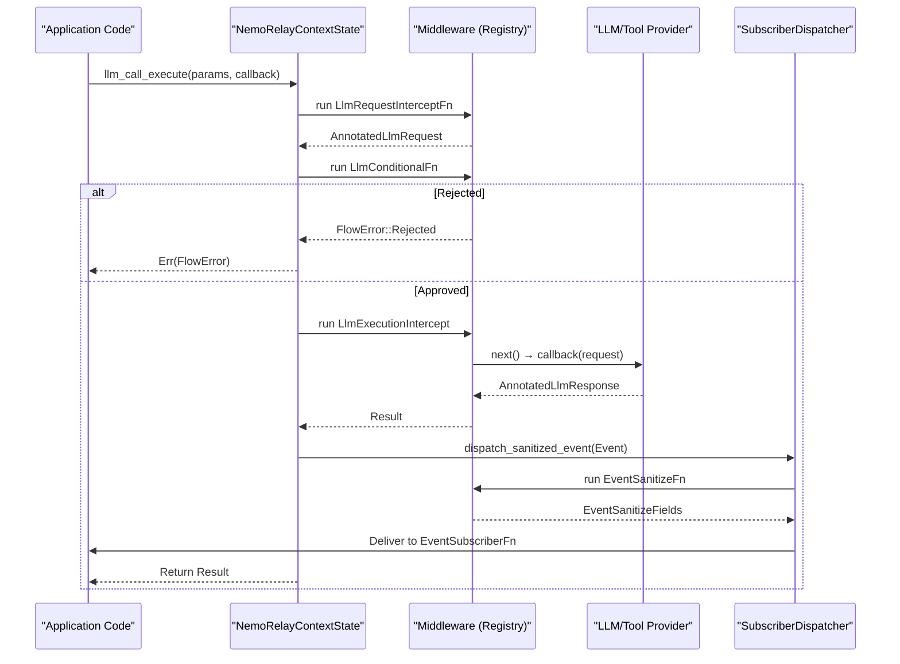

Sources: [crates/core/src/api/runtime/state.rs:34-41](), [crates/core/src/api/llm.rs:18-33](), [docs/about-nemo-relay/architecture.mdx:145-148](), [crates/core/src/api/runtime/subscriber_dispatcher.rs:64-71]()

## Scope Stack and Isolation Model

NeMo Relay maintains a logical stack called the **`ScopeStack`** representing nested units of work (scopes) such as agents, tools, or LLM calls. The stack isolates context, middleware local to scopes, and maintains span parentage for lifecycle events.

### Scope Lifecycle and Behavior

-   **Push/Pop Scopes:**
    Scopes are explicitly pushed with `push_scope` and popped with `pop_scope`. These create paired start and end lifecycle events. Scopes record their type (`ScopeType`) and identifiers for hierarchical provenance [crates/core/src/api/runtime/scope_stack.rs:32-38](), [crates/core/tests/integration/api_surface_tests.rs:63]().

-   **Root Scope:**
    An implicit root scope of type `Agent` is always present. It is the owner of the freshness state and represents top-level unscoped work [crates/core/src/api/runtime/scope_stack.rs:136-141]().

-   **Scope-Local Registries:**
    Each active scope holds isolated middleware and subscriber registries (`ScopeLocalRegistries`) that automatically expire with the scope [crates/core/src/api/runtime/scope_stack.rs:34](), [crates/core/src/context/registries.rs:1-50]().

-   **Propagation Context:**
    For context crossing process boundaries, the `PropagationContext` encodes the `parent_uuid` and optionally a stable `root_uuid`. This enables correlating work across distributed systems [crates/core/src/api/runtime/scope_stack.rs:48-58]().

Sources: [crates/core/src/api/runtime/scope_stack.rs:32-58](), [crates/core/tests/integration/api_surface_tests.rs:63](), [crates/core/src/context/registries.rs:1-50]()

### Concurrency and Context Isolation Mechanisms

-   **Task-Local Storage:**
    The current active `ScopeStackHandle` is stored in async task-local storage (`TASK_SCOPE_STACK`), ensuring each asynchronous task carries its own logical scope chain [crates/core/src/api/runtime/scope_stack.rs:27]().

-   **Contextualized Streams:**
    Streaming LLM calls return a wrapped stream (`LlmStreamWrapper`) that preserves the scope stack at creation and enforces scope isolation when polling asynchronously from other tasks or threads. This ensures correct middleware and event dispatch context [crates/core/src/api/runtime/callbacks.rs:18]().

Sources: [crates/core/src/api/runtime/scope_stack.rs:27](), [crates/core/src/api/runtime/callbacks.rs:18]()

### Scope Hierarchy and Registry Mapping Diagram

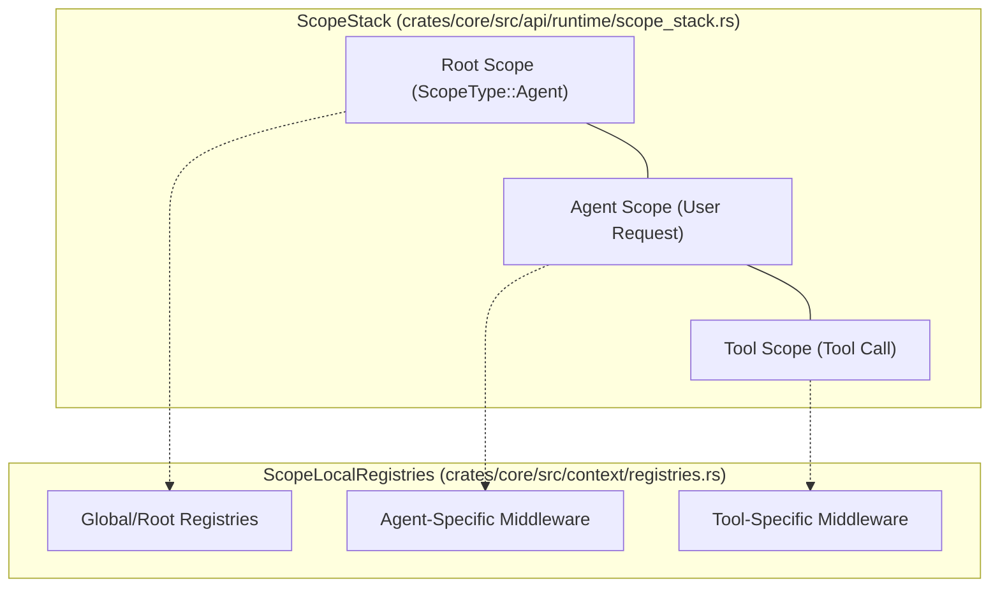

Sources: [crates/core/src/api/runtime/scope_stack.rs:32-38](), [crates/core/src/context/registries.rs:1-50](), [docs/about-nemo-relay/concepts/scopes.mdx:47-50]()

## Runtime State and Key Components

| Entity | Role | Source |
| :----- | :--- | :----- |
| `ScopeStack` | Maintains the active hierarchy of nested scopes and their scope-local registries, enabling context isolation | [crates/core/src/api/runtime/scope_stack.rs:32]() |
| `PropagationContext` | Transport-neutral object encoding a scope's causal context for cross-process continuity | [crates/core/src/api/runtime/scope_stack.rs:48]() |
| `LlmExecutionFn` | Callback type for LLM execution intercepts, allowing custom logic around LLM calls | [crates/core/src/api/runtime/callbacks.rs:16]() |
| `ToolExecutionFn` | Callback type for tool execution intercepts, allowing custom logic around tool calls | [crates/core/src/api/runtime/callbacks.rs:19]() |
| `EventSubscriberFn` | Callback type for subscribers to receive event snapshots | [crates/core/src/api/runtime/callbacks.rs:14]() |
| `NemoRelayContextState` | Process-global state maintaining registries for middleware, subscribers and global runtime state | [crates/core/src/api/runtime/state.rs:6-9]() |

Sources: [crates/core/src/api/runtime/scope_stack.rs:32-48](), [crates/core/src/api/runtime/callbacks.rs:14-19](), [crates/core/src/api/runtime/state.rs:6-9]()

## Summary

NeMo Relay’s runtime architecture layers a core Rust implementation tracking scopes, middleware, and event streams under a rich managed execution model. Language bindings provide access in multiple languages, while the plugin system packages runtime behavior for reusability and adaptive extensions. Framework integrations plug work units into this unified system, enabling consistent telemetry, policy, and observability across the entire agent lifecycle.

Sources: [crates/core/src/api/runtime/scope_stack.rs:1-172](), [crates/core/src/api/runtime/state.rs:1-50](), [crates/core/src/api/llm.rs:1-33](), [crates/core/src/api/tool.rs:1-33](), [crates/core/src/api/runtime/subscriber_dispatcher.rs:1-195](), [crates/core/src/api/runtime/callbacks.rs:1-20](), [docs/about-nemo-relay/architecture.mdx:1-179](), [docs/about-nemo-relay/ecosystem.mdx:1-127](), [docs/about-nemo-relay/concepts/scopes.mdx:1-206]()

---

# Page: Getting Started

# Getting Started

<details>
<summary>Relevant source files</summary>

The following files were used as context for generating this wiki page:

- [.github/nightly-alpha-branches.yaml](.github/nightly-alpha-branches.yaml)
- [Cargo.toml](Cargo.toml)
- [crates/adaptive/README.md](crates/adaptive/README.md)
- [crates/core/README.md](crates/core/README.md)
- [crates/ffi/README.md](crates/ffi/README.md)
- [crates/node/README.md](crates/node/README.md)
- [crates/node/package.json](crates/node/package.json)
- [crates/python/README.md](crates/python/README.md)
- [docs/getting-started/installation.mdx](docs/getting-started/installation.mdx)
- [docs/getting-started/quick-start/python.mdx](docs/getting-started/quick-start/python.mdx)
- [docs/getting-started/quick-start/rust.mdx](docs/getting-started/quick-start/rust.mdx)
- [docs/reference/support-matrix.mdx](docs/reference/support-matrix.mdx)
- [docs/supported-integrations/openclaw-plugin.mdx](docs/supported-integrations/openclaw-plugin.mdx)
- [go/nemo_relay/README.md](go/nemo_relay/README.md)
- [integrations/coding-agents/claude-code/.claude-plugin/plugin.json](integrations/coding-agents/claude-code/.claude-plugin/plugin.json)
- [integrations/coding-agents/codex/.codex-plugin/plugin.json](integrations/coding-agents/codex/.codex-plugin/plugin.json)
- [python/nemo_relay/README.md](python/nemo_relay/README.md)

</details>


The purpose of this page is to outline the installation process, prerequisites, quick start guides per language binding (Rust, Python, Node.js, and Go), essential tooling (`cargo`, `uv`, `just`, and Node.js 24+), and first-run workflows for NeMo Relay `0.9.0` [Cargo.toml:23-23](), [Cargo.toml:28-37]().

NeMo Relay is a polyglot agent runtime designed to provide a consistent execution contract across different programming languages and agent frameworks [Cargo.toml:4-19](). It enables developers to observe and control agent runs—including LLM calls, tool executions, and subagent branching—without rewriting existing application logic [docs/getting-started/installation.mdx:19-22]().

---

## Tooling and Prerequisites

Before installing NeMo Relay, ensure your environment meets the following requirements. The repository uses `just` as the universal task runner and `uv` for Python dependency management.

| Tool       | Version           | Required For                                            |
|------------|-------------------|--------------------------------------------------------|
| **Rust**   | 2024 Edition      | Core runtime, native extensions, CLI [Cargo.toml:24-24]() |
| **Python** | 3.11+             | Python package, PyO3 builds, documentation [docs/getting-started/quick-start/python.mdx:20-20]() |
| **Node.js**| 24+               | Node.js bindings and WASM tests [crates/node/package.json:58-59]() |
| **uv**     | Latest            | Python environment synchronization and dependency management [docs/getting-started/quick-start/python.mdx:23-23]() |
| **just**   | 1.40+             | Canonical build and packaging recipes                   |

### Development Environment Setup

If contributing or building from source, initialize the workspace:

```bash
git clone https://github.com/NVIDIA/NeMo-Relay.git
cd NeMo-Relay

# Synchronize Python environment and build native extensions
uv sync

# Install Node.js dependencies and build the Node.js native addon
npm install
npm run build --workspace=nemo-relay-node
```

Sources: [docs/getting-started/quick-start/python.mdx:37-38](), [crates/node/package.json:65-66]()

---

## Installation Guide

NeMo Relay can be installed via standard package managers or built from source. The examples below use stable version `0.9.0` [Cargo.toml:23-23]().

### 1. Rust

Add the core crates to your `Cargo.toml` dependencies:

```bash
cargo add nemo-relay@0.9.0
cargo add nemo-relay-adaptive@0.9.0
```

- `nemo-relay`: Core Rust runtime for scopes, middleware, events [Cargo.toml:29-29]()
- `nemo-relay-adaptive`: Adaptive runtime primitives and state backends [Cargo.toml:34-34]()

Sources: [Cargo.toml:28-37]()

### 2. Python

Install the NeMo Relay Python binding via `uv` or `pip` from your application project:

```bash
uv add nemo-relay==0.9.0
```

This installs the PyO3 native extension and Python wrapper package [docs/getting-started/quick-start/python.mdx:23-29]().

### 3. Node.js

Install the Node.js binding NAPI native addon for Node.js 24+:

```bash
npm install nemo-relay-node@0.9.0
```

This package exports typed APIs including submodules for plugin support, adaptive runtime, observability, and PII redaction [crates/node/package.json:27-56](), [crates/node/package.json:58-59]().

### 4. CLI

The `nemo-relay` CLI is the primary tool for gateway observability and local coding-agent sessions [docs/getting-started/installation.mdx:28-31]().

Install via PyPI package:

```bash
pip install nemo-relay-cli-bin
```

Or combined Python API and CLI:

```bash
pip install "nemo-relay[cli]"
```

Official installer scripts are also available:

```bash
curl -fsSL https://raw.githubusercontent.com/NVIDIA/NeMo-Relay/main/install.sh | sh
```

Windows PowerShell install:

```powershell
irm https://raw.githubusercontent.com/NVIDIA/NeMo-Relay/main/install.ps1 | iex
```

#### Supported Platforms

| OS            | Architecture   | Release Target                  |
|---------------|----------------|--------------------------------|
| Linux (glibc) | x86_64         | `x86_64-unknown-linux-gnu`     |
| Linux (musl)  | x86_64         | `x86_64-unknown-linux-musl`    |
| macOS         | Apple Silicon  | `aarch64-apple-darwin`          |
| Windows       | x86_64         | `x86_64-pc-windows-msvc`        |
| Windows       | ARM64          | `aarch64-pc-windows-msvc`       |

The installer detects the OS and CPU architecture, downloads the matching binary asset, verifies its SHA-256 checksum, and updates the environment PATH when applicable [docs/getting-started/installation.mdx:67-93]().

#### CLI Installer Data Flow

This diagram illustrates the flow from natural language user steps to the executable code entities managing installation and environment setup, associating system names with code symbols.

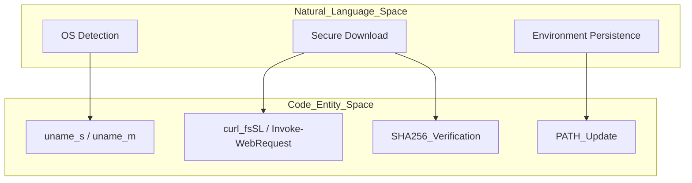

Sources: [docs/getting-started/installation.mdx:28-64](), [docs/getting-started/installation.mdx:95-106]()

---

## Quick Start: Python

The Python binding offers an asynchronous API implemented via PyO3 that bridges into the Rust core runtime. Key modules include `nemo_relay.scope` for managing execution scopes, `nemo_relay.tools` for tool calls, and `nemo_relay.llm` for LLM calls [docs/getting-started/quick-start/python.mdx:117-130]().

### Architecture and Data Flow

- Application calls `nemo_relay.tools.execute()` or `nemo_relay.llm.execute()`, passing callbacks, arguments, and optional scope handles.
- The Rust core invokes the managed execution pipeline applying guardrails and middleware intercepts.
- The Rust runtime asynchronously calls back to the Python async function.
- Results are wrapped in `ToolExecutionResult` or JSON objects, emitting observability events using the ATOF envelope.

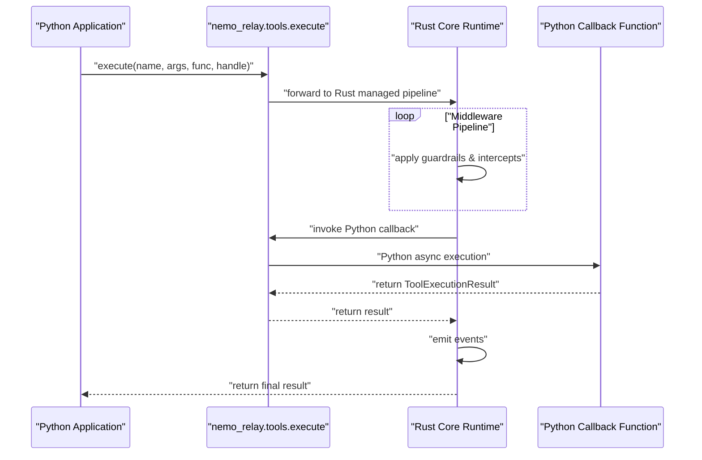

Sources: [docs/getting-started/quick-start/python.mdx:60-96](), [docs/getting-started/quick-start/python.mdx:99-101]()

### First-Run Python Example

```python
import asyncio
import nemo_relay

def on_event(event) -> None:
    print(f"event={event.kind} name={event.name}")

async def search(args):
    return nemo_relay.ToolExecutionResult({"echo": args["query"]})

async def model(request):
    return {"messages": request.content["messages"], "ok": True}

async def main():
    nemo_relay.subscribers.register("quickstart-printer", on_event)

    with nemo_relay.scope.scope("demo-agent", nemo_relay.ScopeType.Agent) as handle:
        nemo_relay.scope.event("initialized", handle=handle, data={"binding": "python"})

        tool_result = await nemo_relay.tools.execute("search", {"query": "hello"}, search, handle=handle)

        llm_result = await nemo_relay.llm.execute(
            "demo-provider",
            nemo_relay.LLMRequest({}, {"messages": [{"role": "user", "content": "hi"}]}),
            model,
            handle=handle,
        )

        print(tool_result.result)
        print(llm_result)

    nemo_relay.subscribers.flush()
    nemo_relay.subscribers.deregister("quickstart-printer")

asyncio.run(main())
```

This example showcases one scope, a tool call, and an LLM call emitting lifecycle events and returning typed results.

Sources: [docs/getting-started/quick-start/python.mdx:60-97]()

---

## Quick Start: Rust

The Rust binding exposes a native API for full control of scopes, events, tools, and LLM calls in a structured manner using builder patterns for typed parameter passing [docs/getting-started/quick-start/rust.mdx:60-134]().

### Core Concepts and Data Flow

- `scope::push_scope` creates a new isolated scope (e.g., agent session).
- `ScopeHandle` represents the live scope for event association.
- Subscribers receive asynchronous observable events emitted from scope and tool lifecycle activity.

```mermaid
graph TD
    subgraph "Natural_Language_Space"
        AS[""Agent Session""]
        LM[""Lifecycle Milestone""]
    end

    subgraph "Code_Entity_Space"
        PS[""scope::push_scope()""]
        PP[""PushScopeParams""]
        SH[""ScopeHandle""]
        EV[""scope::event()""]
        MP[""EmitMarkEventParams""]
    end

    AS --> PS
    PS -.-> PP
    PS --> SH
    LM --> EV
    EV -.-> MP
    SH -.-> EV
```

Sources: [Cargo.toml:29-30](), [docs/getting-started/quick-start/rust.mdx:79-131]()

### First-Run Rust Summary

The Rust quick start creates a scope called `"demo-agent"` of type `Agent`, emits an `"initialized"` mark event within that scope, executes a managed tool call named `"search"` that returns a simple echo response, and then performs a managed LLM call echoing the input messages. After execution, it flushes subscribers to dispatch all events and deregisters the subscriber used for printing event notifications.

Sources: [docs/getting-started/quick-start/rust.mdx:60-134]()

---

## Quick Start: Node.js

The Node.js binding provides idiomatic async APIs over a NAPI-based native extension linking into the Rust core runtime, enabling managed execution and consistent observability [crates/node/package.json:27-63]().

### Binding and Execution Flow

- The API exports functions such as `withScope()`, `event()`, and `registerSubscriber()` that map to Rust core calls.
- The NAPI bridge marshals data asynchronously between JavaScript and Rust.
- Events emitted by the Rust core are propagated back to JavaScript subscribers.

```mermaid
graph LR
    subgraph "JavaScript_Surface"
        JS_S[""withScope()""]
        JS_E[""event()""]
        JS_R[""registerSubscriber()""]
    end

    subgraph "NAPI_Bridge"
        NAPI[""nemo-relay native addon""]
    end

    subgraph "Rust_Core"
        R_S[""push_scope""]
        R_E[""emit_event""]
    end

    JS_S --> NAPI --> R_S
    JS_E --> NAPI --> R_E
    JS_R --> NAPI
```

Sources: [crates/node/package.json:27-56](), [crates/node/package.json:60-63]()

### First-Run Node.js Example

```javascript
const {
  ScopeType,
  registerSubscriber,
  flushSubscribers,
  withScope,
  event
} = require("nemo-relay-node");

async function main() {
  registerSubscriber("printer", (runtimeEvent) => {
    console.log(`${runtimeEvent.kind} ${runtimeEvent.name}`);
  });

  await withScope("demo-agent", ScopeType.Agent, async (handle) => {
    event("initialized", handle, { binding: "node" }, null);
  });

  await flushSubscribers();
}

main().catch(console.error);
```

This example registers a subscriber that prints events, opens a scope, emits an initialization event, then flushes all subscriber events to ensure delivery.

Sources: [crates/node/package.json:27-56]()

---

## Quick Start: Go

The Go binding exposes NeMo Relay runtime APIs through CGo and the raw `nemo-relay-ffi` library [go/nemo_relay/README.md:19-22](). Use it when a Go application or integration needs scope, middleware, lifecycle events, and observability identical to the Rust core runtime.

### Go Binding Flow

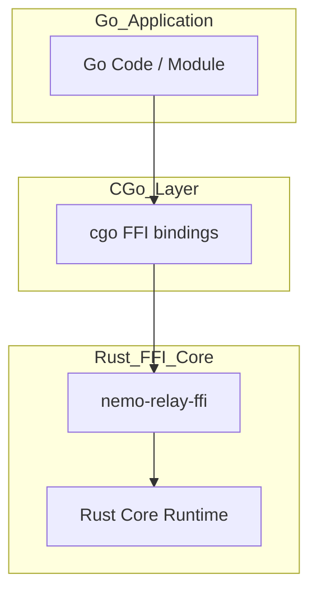

Sources: [go/nemo_relay/README.md:19-22](), [crates/ffi/README.md:19-22]()

### First-Run Go Example

```go
package main

import (
	"encoding/json"
	"log"

	nemo "github.com/NVIDIA/NeMo-Relay/go/nemo_relay"
)

func main() {
	err := nemo.RegisterEventMetadataInjector(
		"application-metadata",
		10,
		func(event nemo.Event) (nemo.EventMetadata, error) {
			return nemo.EventMetadata{
				"application.event_kind": event.Kind(),
			}, nil
		},
	)
	if err != nil {
		log.Fatal(err)
	}
	defer nemo.DeregisterEventMetadataInjector("application-metadata")

	if err := nemo.EmitEvent(
		"cache-nearly-full",
		nemo.WithEventData(json.RawMessage(`{"entries": 900}`)),
		nemo.WithEventDataSchema(nemo.DataSchema{Name: "example.cache", Version: "1"}),
		nemo.WithEventSeverity(nemo.LogSeverityWarn),
	); err != nil {
		log.Fatal(err)
	}
}
```

Sources: [go/nemo_relay/README.md:87-124]()

---

## First-Run Workflows

After installation, you can begin using NeMo Relay.

### CLI First-Run

The `nemo-relay` CLI provides an interactive setup wizard for initial configuration and a `doctor` command for diagnosing readiness.

1.  **Initial Setup**: Running `nemo-relay` without arguments will launch the setup wizard if no configuration exists [crates/cli/README.md:108-111]().
    ```bash
    nemo-relay
    ```
2.  **Enable Local Observability**: Use the `plugins edit` command to configure local observability outputs like ATOF and ATIF [README.md:92-95]().
    ```bash
    nemo-relay plugins edit
    ```
    In the editor, enable the Observability component, then enable ATOF and ATIF sections, specifying output directories and filenames [README.md:99-113]().
3.  **Diagnose Readiness**: After setup, inspect your local environment with `doctor` [crates/cli/README.md:113-116]().
    ```bash
    nemo-relay doctor
    ```
4.  **Run a Coding Agent**: Execute a supported coding agent (e.g., Codex or Claude Code) through the Relay wrapper [README.md:121-133]().
    ```bash
    nemo-relay codex -- exec "Summarize this repository."
    ```
    or
    ```bash
    nemo-relay claude -- "Summarize this repository."
    ```
    This starts a local Relay gateway, injects host-specific hooks, and then shuts down the gateway when the agent exits [README.md:137-139]().
5.  **Verify the Run**: Check the configured output directories for raw events (`events.jsonl`) and trajectory files (`trajectory-{session_id}.json`) [README.md:155-157]().

#### CLI Configuration Layers

NeMo Relay CLI configuration is layered, with user-specific settings typically residing in `~/.config/nemo-relay/config.toml` or `$XDG_CONFIG_HOME/nemo-relay/config.toml` [crates/cli/README.md:145-147](). System-wide configurations are located at `/etc/nemo-relay/config.toml` on Unix or `%ProgramData%\nemo-relay\config.toml` on Windows [crates/cli/README.md:165-167]().

The `plugins.toml` file, which configures observability exporters and other plugin components, is discovered relative to the main `config.toml` or explicitly specified [crates/cli/README.md:175-186]().

```mermaid
graph TD
    UserConfig[""UserConfig(~/.config/nemo-relay/config.toml)""]
    SystemConfig[""SystemConfig(/etc/nemo-relay/config.toml)""]
    ExplicitConfig["""--configpath/to/config.toml""]
    PluginConfig[""plugins.toml(siblingor--plugin-config-path)""]

    ExplicitConfig -->|""Highest Precedence""| ResolvedConfig[""ResolvedConfiguration""]
    UserConfig -->|""Overrides System""| ResolvedConfig
    SystemConfig --> ResolvedConfig
    PluginConfig --> ResolvedConfig
```

Sources: [README.md:92-113](), [crates/cli/README.md:108-186]()

---

## References

- [docs/getting-started/installation.mdx](docs/getting-started/installation.mdx)
- [docs/getting-started/quick-start/python.mdx](docs/getting-started/quick-start/python.mdx)
- [docs/getting-started/quick-start/rust.mdx](docs/getting-started/quick-start/rust.mdx)
- [Cargo.toml](Cargo.toml)
- [crates/node/package.json](crates/node/package.json)
- [go/nemo_relay/README.md](go/nemo_relay/README.md)
- [crates/ffi/README.md](crates/ffi/README.md)

---

Sources:
- [docs/getting-started/installation.mdx:10-180]()
- [docs/getting-started/quick-start/python.mdx:20-126]()
- [docs/getting-started/quick-start/rust.mdx:60-134]()
- [Cargo.toml:1-58]()
- [crates/node/package.json:2-85]()
- [README.md:92-157]()
- [crates/cli/README.md:108-186]()
- [go/nemo_relay/README.md:19-124]()
- [crates/ffi/README.md:19-65]()

---

# Page: Release Notes and Migration Guides

# Release Notes and Migration Guides

<details>
<summary>Relevant source files</summary>

The following files were used as context for generating this wiki page:

- [docs/about-nemo-relay/release-notes/index.mdx](docs/about-nemo-relay/release-notes/index.mdx)
- [docs/instrument-applications/instrument-tool-call.mdx](docs/instrument-applications/instrument-tool-call.mdx)
- [docs/integrate-into-frameworks/wrap-tool-calls.mdx](docs/integrate-into-frameworks/wrap-tool-calls.mdx)
- [docs/reference/migration-guides.mdx](docs/reference/migration-guides.mdx)
- [docs/reference/tool-execution-intercept-outcomes.mdx](docs/reference/tool-execution-intercept-outcomes.mdx)
- [fern/docs.yml](fern/docs.yml)

</details>


This page covers the version history, release notes, deprecation schedules (such as the removal of `nemo_guardrails` and raw tool results), migration guides, and platform support matrices for NVIDIA NeMo Relay. It bridges the system-level release lifecycle with the underlying Rust core classes, binding contracts, and protocol definitions.

Sources:
- [docs/about-nemo-relay/release-notes/index.mdx:1-7]()
- [docs/reference/migration-guides.mdx:1-10]()

## Release 0.9 and Known Issues

NeMo Relay 0.9 tracks user-visible changes, compatibility updates, and known issues across the polyglot runtime stack. 

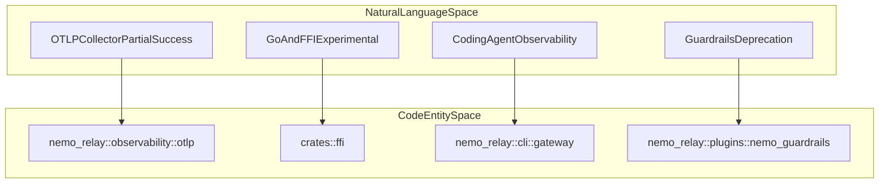
*Figure 1: Mapping high-level release items to underlying code entities.*

Sources:
- [docs/about-nemo-relay/release-notes/index.mdx:28-103]()

### Known Issues in 0.9

- **OTLP Collectors and Partial Successes**: OTLP collectors may return successful HTTP responses while rejecting individual spans, log records, or metric data points [docs/about-nemo-relay/release-notes/index.mdx:35-37](). Managed by `nemo_relay::observability::otlp`.
- **Experimental Go and C FFI**: The Go binding (`go/nemo_relay`) and raw C FFI (`crates/ffi`) remain experimental and source-first [docs/about-nemo-relay/release-notes/index.mdx:40-41]().
- **Local Coding-Agent Observability**: Relies on host hooks and loopback traffic reaching the local gateway managed in `nemo_relay::cli::gateway` [docs/about-nemo-relay/release-notes/index.mdx:42-44]().
- **`nemo_guardrails` Plugin Deprecation**: The built-in `nemo_guardrails` component kind, public Rust module `nemo_relay::plugins::nemo_guardrails`, CLI editor entry, and `guardrails-remote` Cargo feature are deprecated [docs/about-nemo-relay/release-notes/index.mdx:56-62]().
- **OpenTelemetry Endpoint Batch Queues**: Finite queues drop spans on burst without backpressure. Configure parameters independently or via `OTEL_BSP_*` [docs/about-nemo-relay/release-notes/index.mdx:81-88]().

Sources:
- [docs/about-nemo-relay/release-notes/index.mdx:28-103]()

## Previous Releases

For complete historical release notes, release artifacts, and PR-by-PR changes, refer to official GitHub releases.

Sources:
- [docs/about-nemo-relay/release-notes/index.mdx:92-95]()

## Migration Guides

Upgrading to NeMo Relay 0.9 requires addressing specific deprecations and breaking protocol changes, notably the removal of raw tool results and the retirement of the built-in guardrails plugin.

Sources:
- [docs/reference/migration-guides.mdx:1-21]()
- [docs/reference/tool-execution-intercept-outcomes.mdx:1-128]()

### Deprecation of `nemo_guardrails` Plugin

The built-in `nemo_guardrails` plugin is deprecated and scheduled for complete removal. No direct built-in replacement is included in NeMo Relay 0.9. Migration away from this plugin involves decoupling local or remote guardrail calls from the core runtime initialization.

Sources:
- [docs/about-nemo-relay/release-notes/index.mdx:56-62]()

### Raw Tool Results Migration

NeMo Relay 0.8 and later replace raw tool execution results with a canonical `ToolExecutionResult` structure across all language bindings and worker protocols [docs/reference/tool-execution-intercept-outcomes.mdx:119-125]().

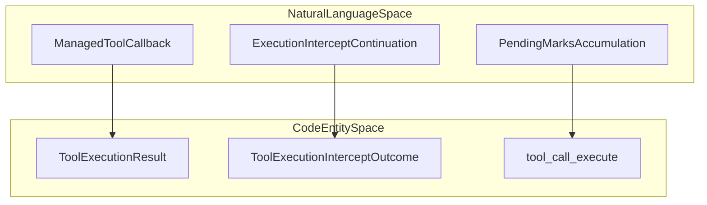
*Figure 2: Tool execution data flow mapping concepts to code entities.*

Sources:
- [docs/reference/tool-execution-intercept-outcomes.mdx:1-154]()

#### Canonical Tool Execution Result Contract

Every managed tool callback and execution intercept continuation returns a strict JSON-compatible result structure:

```json
{
  "result": {},
  "annotation": {"source": "cache"},
  "pending_marks": []
}
```

- `result`: Required application-owned tool payload [docs/reference/tool-execution-intercept-outcomes.mdx:17]()
- `annotation`: Optional opaque adjacent metadata transported without schema interpretation [docs/reference/tool-execution-intercept-outcomes.mdx:18-21]()
- `pending_marks`: Relay-owned lifecycle data containing names, categories, data schemas, and severities [docs/reference/tool-execution-intercept-outcomes.mdx:35-39]()

Sources:
- [docs/reference/tool-execution-intercept-outcomes.mdx:8-39]()

#### Binding Return Types and Intercept Outcomes

| Surface | Managed Callback / Continuation Result | Execution-Intercept Outcome |
| :------ | :------------------------------------- | :-------------------------- |
| Python | `ToolExecutionResult(result, annotation=None)` [docs/reference/tool-execution-intercept-outcomes.mdx:99]() | `ToolExecutionInterceptOutcome` [docs/reference/tool-execution-intercept-outcomes.mdx:109]() |
| Rust | `ToolExecutionResult { result, annotation }` [docs/reference/tool-execution-intercept-outcomes.mdx:100]() | `ToolExecutionInterceptOutcome` [docs/reference/tool-execution-intercept-outcomes.mdx:110]() |
| Go | `ToolExecutionResult { Result, Annotation }` [docs/reference/tool-execution-intercept-outcomes.mdx:101]() | `ToolExecutionInterceptOutcome` [docs/reference/tool-execution-intercept-outcomes.mdx:111]() |
| Node.js | `{ result, annotation? }` [docs/reference/tool-execution-intercept-outcomes.mdx:102]() | `{ result, annotation?, pendingMarks? }` [docs/reference/tool-execution-intercept-outcomes.mdx:112]() |
| `grpc-v1` Worker SDKs | Protobuf `ToolExecutionResult` [docs/reference/tool-execution-intercept-outcomes.mdx:114]() | Protobuf `ToolExecutionInterceptOutcome` [docs/reference/tool-execution-intercept-outcomes.mdx:114]() |

Sources:
- [docs/reference/tool-execution-intercept-outcomes.mdx:92-117]()

## Support Matrix

The support matrix outlines release artifacts, container platforms, worker runtimes, and supported coding agents.

Sources:
- [docs/reference/support-matrix.mdx:1-70]()

### Platforms and Architectures

| Surface | Linux x86_64 | Linux ARM64 | macOS ARM64 | Windows x86_64 | Limitations |
| :------ | :----------- | :---------- | :---------- | :------------- | :---------- |
| Core Library | Required CI | Required CI | Required CI | Non-blocking CI | Rust is source of truth; Go/FFI experimental [docs/reference/support-matrix.mdx:20]() |
| CLI Application | Published GNU/musl | Published GNU/musl | Published Darwin | Published MSVC | Intel macOS has no prebuilt CLI asset [docs/reference/support-matrix.mdx:21]() |
| Native Plugins | Host ABI | Host ABI | Host ABI | Host ABI | Run in-process, un-sandboxed [docs/reference/support-matrix.mdx:22]() |
| gRPC Workers | Host process | Host process | Host process | Host process | Isolated process via `grpc-v1`, not a security sandbox [docs/reference/support-matrix.mdx:23]() |

Sources:
- [docs/reference/support-matrix.mdx:18-23]()

### Worker Runtime Compatibility

| Worker Runtime | Linux x86_64 | Linux ARM64 | macOS ARM64 | Windows x86_64 | Requirements and Limitations |
| :------------- | :----------- | :---------- | :---------- | :------------- | :----------------------------- |
| Python | E2E CI | Validated | E2E CI | E2E CI | Requires `runtime = "python"`, module entrypoint, managed virtualenv [docs/reference/support-matrix.mdx:50]() |
| Rust | Core CI | Core CI | Core CI | Core CI | Requires executable implementing `grpc-v1` [docs/reference/support-matrix.mdx:51]() |
| Command | Core CI | Core CI | Core CI | Core CI | External executable implementing `grpc-v1` [docs/reference/support-matrix.mdx:52]() |

Sources:
- [docs/reference/support-matrix.mdx:43-58]()

### Coding Agents Supported by the CLI

| Agent | Minimum Version | Supported Capabilities | Current Limitations |
| :---- | :-------------- | :--------------------- | :------------------ |
| Claude Code | 2.1.121 | Persistent install, transparent run, lifecycle hooks, gateway routing [docs/reference/support-matrix.mdx:69]() | Desktop/web sessions unsupported without local hooks [docs/reference/support-matrix.mdx:69]() |
| Codex CLI | 0.143.0 | Persistent install, transparent run, 10 plugin hooks, gateway routing [docs/reference/support-matrix.mdx:70]() | No `SessionEnd` hook in 0.143; encrypted multi-agent v2 payloads un-decryptable [docs/reference/support-matrix.mdx:70]() |

Sources:
- [docs/reference/support-matrix.mdx:61-70]()

## Versioning

NeMo Relay adheres to Semantic Versioning. The workspace version is defined in the root manifest (`0.9.0`), synchronized across language binding package files.

Sources:
- [Cargo.toml:23]()
- [crates/node/package.json:2]()

---

# Page: Core Runtime (Rust)

# Core Runtime (Rust)

<details>
<summary>Relevant source files</summary>

The following files were used as context for generating this wiki page:

- [ATTRIBUTIONS-Rust.md](ATTRIBUTIONS-Rust.md)
- [Cargo.lock](Cargo.lock)
- [about.toml](about.toml)
- [crates/cli/Cargo.toml](crates/cli/Cargo.toml)
- [crates/core/Cargo.toml](crates/core/Cargo.toml)
- [crates/core/src/api/llm.rs](crates/core/src/api/llm.rs)
- [crates/core/src/api/runtime/state.rs](crates/core/src/api/runtime/state.rs)
- [crates/core/src/api/shared.rs](crates/core/src/api/shared.rs)
- [crates/core/src/api/tool.rs](crates/core/src/api/tool.rs)
- [crates/core/src/plugin/dynamic.rs](crates/core/src/plugin/dynamic.rs)
- [crates/core/src/stream.rs](crates/core/src/stream.rs)
- [crates/core/tests/integration/middleware_tests.rs](crates/core/tests/integration/middleware_tests.rs)
- [crates/core/tests/integration/pipeline_tests.rs](crates/core/tests/integration/pipeline_tests.rs)
- [crates/core/tests/integration/stream_tests.rs](crates/core/tests/integration/stream_tests.rs)
- [crates/core/tests/unit/stream_tests.rs](crates/core/tests/unit/stream_tests.rs)
- [deny.toml](deny.toml)

</details>


The NeMo Relay Core Runtime is the foundational Rust implementation that underpins the entire NeMo Relay ecosystem’s runtime behavior. It delivers essential capabilities such as hierarchical scope management, an extensible managed execution pipeline for LLM and tool calls, a comprehensive observability event stream, and middleware-driven runtime customization [crates/core/Cargo.toml:5-10]().

This runtime is architected for modularity and portability, providing a stable and performant base for language bindings, plugins, and adaptive machine learning extensions implemented in Rust and other languages.

## Crate Architecture

NeMo Relay’s core Rust functionality is primarily split into core and adaptive crates [crates/core/Cargo.toml:5-10](), [crates/cli/Cargo.toml:31-32]().

| Crate | Role | Key Responsibilities |
|---|---|---|
| `nemo-relay` | **Core SDK** | Implements the core runtime engine: scope stack management, middleware registries, event emission, provider and typed codecs, and base API surface for language bindings. Serves as the foundation for all runtime behavior and instrumentation. [crates/core/Cargo.toml:5-10]() |
| `nemo-relay-adaptive` | **Adaptive Runtime** | Adds adaptive learning features: adaptive configuration, persistent state backends (in-memory, Redis), learners, adaptive hints intercept, and the Adaptive Cache Governor (ACG) for rollout management. [crates/cli/Cargo.toml:32]() |

The core crate is portable across native targets, WebAssembly modules, and C-compatible FFI, enabling multi-language and multi-platform bindings. The adaptive crate builds upon the core runtime, injecting adaptive hints and rollout policies to optimize runtime execution dynamically.

---

### Mapping Runtime Concepts to Code Entities

This diagram illustrates key natural language runtime concepts linked to their Rust code entities within `nemo-relay`:

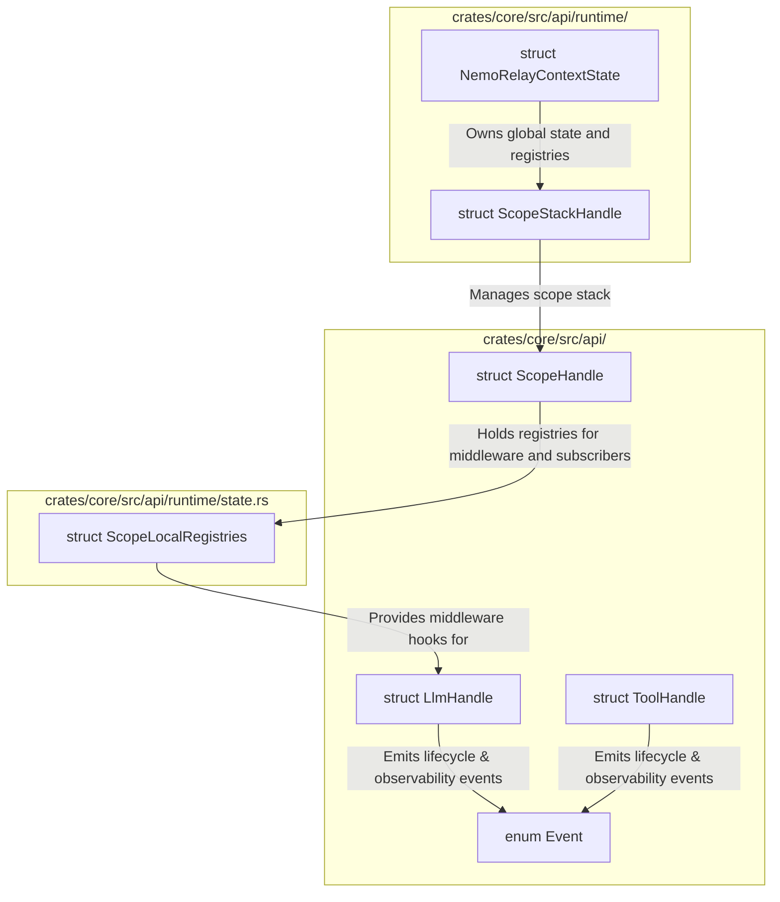

- `NemoRelayContextState` acts as global context managing middleware registries and the scope stack [crates/core/src/api/runtime/state.rs:4-9]().
- `ScopeStackHandle` reflects the thread-local stack of active scopes [crates/core/src/api/runtime/state.rs:33]().
- `ScopeHandle` represents an individual scope with local registries for middleware, intercepts, and subscribers.
- `LlmHandle` and `ToolHandle` represent active calls that emit rich observability events [crates/core/src/api/llm.rs:89-137](), [crates/core/src/api/tool.rs:46-74]().
- `Event` enumerates the lifecycle, mark, LLM, and tool events emitted during execution.

This layered relationship enables state isolation, hierarchical instrumentation, and composable middleware execution.

Sources: [crates/core/src/api/runtime/state.rs:4-9](), [crates/core/src/api/llm.rs:89-137](), [crates/core/src/api/tool.rs:46-74](), [crates/core/Cargo.toml:5-10]()

---

## Scopes, Events, and Lifecycle

The runtime centralizes on a hierarchical **Scope Stack**, whereby every operation—LLM call, tool invocation, or user event—occurs within a named and typed scope.

- **Scope Management**: Scopes are pushed and popped dynamically, tracked via explicit `ScopeHandle` structs with rich types like agent, function, tool, and others. These operations are exposed via synchronous APIs and carefully control the context for all downstream processing.
- **Isolation Model**: Thread-local `ScopeStackHandle` instances encapsulate the scope stack, maintaining isolation via nested scope-local registries for middleware and subscribers. This enhances concurrency safety and fine-grained behavior scoping [crates/core/src/api/runtime/state.rs:33]().
- **Event Emission**: The `Event` enum models lifecycle transitions, marks, and call-specific observations for both LLM and tool scopes. Events get emitted synchronously during scope and call processing and dispatched asynchronously to subscribers.

The hierarchical stack guarantees context propagation and observability tracing across execution boundaries.

For deep technical details, see [Scopes, Events, and Lifecycle](#2.1).

Sources: [crates/core/src/api/runtime/state.rs:33](), [crates/core/src/api/llm.rs:89-137](), [crates/core/src/api/tool.rs:46-74]()

---

## Middleware: Intercepts and Guardrails

NeMo Relay uses flexible middleware registries and guardrails as the core mechanism to dynamically inject behavior into the runtime:

- **Execution Intercepts**: Middleware can register intercepts such as request intercept functions to modify or augment requests before outbound calls to providers, enabling features like request rewriting, metadata injection, or response validation.
- **Guardrails**: Guardrails provide conditional and sanitization rules that can approve, reject, or sanitize event data and execution flows. These guardrails run as ordered chains with priority-based resolution to enforce policies like PII redaction or usage limitations [crates/core/src/api/shared.rs:57-88]().
- **Priority and Ordering**: Middleware components register with explicit priorities to guarantee deterministic execution order within the managed pipeline. This priority framework ensures that requested intercepts and guardrails execute predictably and composably.

For API details and usage patterns, see [Middleware: Intercepts and Guardrails](#2.2).

Sources: [crates/core/src/api/shared.rs:57-88](), [crates/core/src/api/runtime/state.rs:4-9]()

---

## Codecs and Streaming

To unify interfacing with heterogeneous LLM service providers, the core runtime implements codec abstractions:

- **Provider Codecs**: Concrete implementations convert JSON-encoded provider messages into strongly typed `AnnotatedLlmRequest` structures and back, isolating protocol-specific details behind codec traits [crates/core/src/api/llm.rs:43-45](). Examples include codecs for OpenAI Chat and Anthropic message formats [crates/core/tests/integration/pipeline_tests.rs:37-39]().
- **Typed Value Codecs**: These codecs support serialization and deserialization of typed values for parameter passing and internal runtime data exchange.
- **Streaming Execution Helpers**: The runtime supports streaming LLM responses efficiently using patterns like the collector/finalizer, enabling partial results to be processed and emitted incrementally while maintaining scope context [`LlmStreamWrapper` and related streaming utilities] [crates/core/src/stream.rs:6-27]().
- **Cost Estimation Instrumentation**: Utilities provide runtime hooks to attach estimated cost metadata to streaming final events supporting observability and billing integrations [crates/core/src/api/llm.rs:44]().

These codecs maintain high interoperability with provider formats while enabling rich runtime features such as observability and adaptive intercept hooks.

For codec implementations and streaming details, see [Codecs and Streaming](#2.3).

Sources: [crates/core/src/api/llm.rs:43-45](), [crates/core/src/stream.rs:6-27](), [crates/core/tests/integration/pipeline_tests.rs:37-39]()

---

## Operational Logging and Errors

The core runtime provides robust mechanisms for operational logging and error handling:

- **Core Logging Configuration**: The runtime integrates with standard Rust logging frameworks, allowing flexible configuration of log levels and output sinks [crates/core/Cargo.toml:90-91]().
- **Error Type Hierarchy**: A structured error hierarchy, rooted in `FlowError`, provides detailed and actionable error information, facilitating debugging and robust error handling across the system [crates/core/src/error.rs:1-1()]().
- **Size-Rotating File Writer**: For persistent logging, the system can be configured with size-rotating file writers to manage log file growth effectively.
- **Log Level Control**: Log levels can be controlled across different components and language bindings, enabling fine-grained verbosity management.

For detailed information on logging configuration and error handling, see [Operational Logging and Errors](#2.4).

Sources: [crates/core/Cargo.toml:90-91](), [crates/core/src/error.rs:1-1]()

---

## Adaptive Runtime (`nemo-relay-adaptive`)

The `nemo-relay-adaptive` crate extends the core runtime, injecting adaptive learning and optimization via additional layers [crates/cli/Cargo.toml:32]():

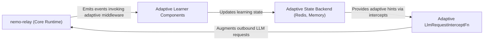

- **Adaptive Learners**: Components analyze historical execution data (e.g., tool parallelism metrics) and contribute adaptive hints to future calls, shaping runtime behavior dynamically.
- **State Backends**: Persistent state storage is available via Redis or in-memory backends, enabling robust, scalable adaptive state management and rollout policies [crates/cli/Cargo.toml:32]().
- **Adaptive Cache Governor (ACG)**: Coordinated rollout of adaptive policies controlling execution experimentation and caching behavior.

The adaptive runtime exposes an additional intercept layer and configuration APIs injecting learned hints into the managed pipeline for optimization.

For comprehensive coverage, see [Adaptive Runtime (nemo-relay-adaptive)](#2.5).

Sources: [crates/cli/Cargo.toml:32]()

---

## Native and WebAssembly Support

The core Rust runtime is designed to be portable across multiple target environments:

- **C FFI Layer**: A generated C interface exports core runtime APIs for consumption by native languages like C and experimental Go bindings.
- **WebAssembly (WASM)**: The runtime builds to WASM modules enabling in-browser and JS runtime support through standard bindings. WASM exposes a nearly identical API surface with some environment-specific limitations.
- **Node.js**: Native bindings are produced via `napi-rs` to provide seamless Node.js integration and npm packaging for JavaScript clients.
- **Go**: The Go binding consumes the `nemo-relay-ffi` layer through CGo.

This multi-target design ensures the core runtime is the trusted provenance layer powering polyglot integrations.

Sources: [crates/core/Cargo.toml:5-10]()

---

# Page: Scopes, Events, and Lifecycle

# Scopes, Events, and Lifecycle

<details>
<summary>Relevant source files</summary>

The following files were used as context for generating this wiki page:

- [crates/core/src/api/runtime.rs](crates/core/src/api/runtime.rs)
- [crates/core/src/api/runtime/scope_stack.rs](crates/core/src/api/runtime/scope_stack.rs)
- [crates/core/src/api/runtime/subscriber_dispatcher.rs](crates/core/src/api/runtime/subscriber_dispatcher.rs)
- [crates/core/src/api/scope.rs](crates/core/src/api/scope.rs)
- [crates/core/tests/integration/atif_storage_tests.rs](crates/core/tests/integration/atif_storage_tests.rs)
- [crates/core/tests/integration/context_isolation_tests.rs](crates/core/tests/integration/context_isolation_tests.rs)
- [crates/core/tests/unit/context_tests.rs](crates/core/tests/unit/context_tests.rs)
- [crates/core/tests/unit/plugins/nemo_guardrails/remote_coverage_tests.rs](crates/core/tests/unit/plugins/nemo_guardrails/remote_coverage_tests.rs)
- [crates/core/tests/unit/registry_tests.rs](crates/core/tests/unit/registry_tests.rs)
- [crates/core/tests/unit/subscriber_dispatcher_tests.rs](crates/core/tests/unit/subscriber_dispatcher_tests.rs)
- [crates/ffi/src/api/scope_stack.rs](crates/ffi/src/api/scope_stack.rs)
- [docs/about-nemo-relay/concepts/events.mdx](docs/about-nemo-relay/concepts/events.mdx)
- [docs/about-nemo-relay/concepts/scopes.mdx](docs/about-nemo-relay/concepts/scopes.mdx)
- [docs/about-nemo-relay/concepts/subscribers.mdx](docs/about-nemo-relay/concepts/subscribers.mdx)
- [docs/configure-plugins/observability/about.mdx](docs/configure-plugins/observability/about.mdx)
- [docs/configure-plugins/observability/atif.mdx](docs/configure-plugins/observability/atif.mdx)
- [docs/configure-plugins/observability/atof.mdx](docs/configure-plugins/observability/atof.mdx)
- [docs/instrument-applications/instrument-llm-call.mdx](docs/instrument-applications/instrument-llm-call.mdx)
- [docs/reference/atof-event-format.mdx](docs/reference/atof-event-format.mdx)
- [docs/reference/performance.mdx](docs/reference/performance.mdx)
- [go/nemo_relay/context_test.go](go/nemo_relay/context_test.go)
- [go/nemo_relay/test_helpers_test.go](go/nemo_relay/test_helpers_test.go)
- [skills/nemo-relay-plugin-observability/references/atif.md](skills/nemo-relay-plugin-observability/references/atif.md)

</details>


This page provides a deep dive into the NeMo Relay core runtime lifecycle management, focusing on the scope stack isolation model, the event system based on the Agent Trajectory Observability Format (ATOF), and the mechanics of scope push/pop operations.

## Purpose and Scope

The Core Runtime (Rust) manages the execution context of agentic workflows through a hierarchical scope system. This system ensures that middleware, guardrails, and observability subscribers are correctly isolated or inherited across different tasks and threads. All lifecycle transitions—from tool calls to LLM requests—are recorded as ATOF events, providing a standardized stream for observability exporters.

This page covers:

- Scope push/pop and scope handle concepts.
- Scope types and their roles in the stack.
- The scope stack isolation and propagation model.
- Mark events and their semantic meaning.
- The ATOF event envelope used for observability.
- The relevant API implementations located in `crates/core/src/api/`.

---

## The Scope Stack Isolation Model

NeMo Relay uses a `ScopeStack` to maintain the hierarchy of active execution spans (scopes) `[crates/core/src/api/runtime/scope_stack.rs:32-38]()`. At initialization, every thread or asynchronous context contains an implicit root scope of type `ScopeType::Agent` `[crates/core/src/api/runtime/scope_stack.rs:133-146]()`. This root acts as the foundation of the scope stack and manages freshness state for all work traces not nested under an explicit agent scope `[crates/core/src/api/runtime/scope_stack.rs:27-29]()`.

### ScopeStack Structure and Tracking

The `ScopeStack` struct holds:

- **`stack`**: a `Vec<ScopeHandle>` representing the nested active scopes `[crates/core/src/api/runtime/scope_stack.rs:33]()`.
- **`scope_registries`**: a map from each scope's UUID to its scope-local registries which include middleware and subscribers `[crates/core/src/api/runtime/scope_stack.rs:34]()`.
- **`fresh_agents`**: a hash set of agent scope UUIDs that track "freshness" for context window purposes `[crates/core/src/api/runtime/scope_stack.rs:35]()`.
- **`propagated_parent_uuid`** and **`propagated_root_uuid`**: optional UUIDs that support cross-process scope propagation `[crates/core/src/api/runtime/scope_stack.rs:36-37]()`.
- **`is_rootless_propagation`**: a boolean indicating if the stack was created from a rootless propagation context `[crates/core/src/api/runtime/scope_stack.rs:38]()`.

### Root and Implicit Scopes

A root scope is created by `ScopeStack::new()`. It is always of type `Agent`, named `"root"`, and represents the implicit root for all work `[crates/core/src/api/runtime/scope_stack.rs:133-146]()`. This root scope cannot be popped and owns the freshness lifecycle state for nested work not under explicit agent scopes:

> "The stack always contains an implicit root agent scope. It owns freshness for work that is not nested under an explicit agent; non-agent scopes inherit their nearest agent's freshness instead of creating a separate budget." `[crates/core/src/api/runtime/scope_stack.rs:27-29]()`

### Standard Scope Types

NeMo Relay defines several standard scope types enumerated in `ScopeType`:

- `Agent`
- `Function`
- `Tool`
- `Llm`
- `Retriever`
- `Embedder`
- `Reranker`
- `Guardrail`
- `Evaluator`
- `Custom`
- `Unknown`

These types help downstream subscribers and exporters understand the semantic nature of scopes `[crates/core/src/api/scope.rs:20]()`, `[docs/about-nemo-relay/concepts/scopes.mdx:54-66]()`.

### Isolation and Context Propagation

The scope stack leverages task-local and thread-local storage to maintain the current active scopes, supporting concurrency and event tree isolation:

- **Task-local storage** ensures asynchronous tasks retain correct active scopes independent of thread scheduling.
- **Forking the stack** produces isolated copies for concurrent branches that preserve event ancestry but not mutable middleware.
- **PropagationContext** is a minimal, versioned envelope that encodes root and parent UUIDs to propagate scope ancestry across process or RPC boundaries `[crates/core/src/api/runtime/scope_stack.rs:47-58]()`.

### PropagationContext Details

`PropagationContext` is a robust, transport-neutral causal context representing:

- `version`: Wire format version (currently 1) `[crates/core/src/api/runtime/scope_stack.rs:51]()`.
- `root_uuid`: Optional stable session root UUID `[crates/core/src/api/runtime/scope_stack.rs:54-56]()`.
- `parent_uuid`: Immediate Relay event or scope UUID causing the boundary crossing `[crates/core/src/api/runtime/scope_stack.rs:58]()`.

It supports JSON serialization and W3C trace-context (`traceparent`) conversion, with strict validation for UUIDs to prevent invalid ancestry `[crates/core/src/api/runtime/scope_stack.rs:48-115]()`.

---

### ScopeStack and PropagationContext Class Diagram

Title: "ScopeStack and PropagationContext Architecture"
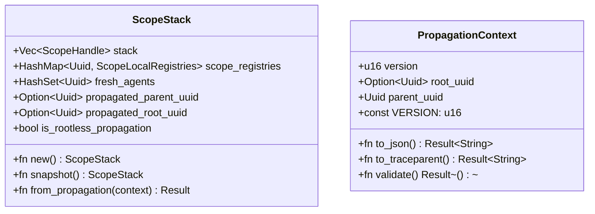

Sources: `[crates/core/src/api/runtime/scope_stack.rs:32-145]()`, `[crates/core/src/api/runtime/scope_stack.rs:148-204]()`, `[crates/core/src/api/runtime/scope_stack.rs:47-115]()`.

---

## Scope Push/Pop Operations and Handles

The public API allows pushing and popping scopes that create lifecycle spans for work. These operations return or consume a `ScopeHandle` which encapsulates scope identity and metadata `[crates/core/src/api/scope.rs:46-63]()`.

- **`ScopeHandle`**: Represents a live active scope with identifiers (`uuid`, `parent_uuid`), type (`ScopeType`), and name. It forms the key event ancestry node for start/end pairs `[crates/core/src/api/scope.rs:32-58]()`.
- **Push operations** create an active scope, push it onto the current `ScopeStack`, and emit a start event using `push_scope` `[crates/core/src/api/scope.rs:71-96]()`.
- **Pop operations** emit a matching end event and remove the scope from the active stack using `pop_scope` `[crates/core/src/api/scope.rs:144-160]()`.

Handles enable explicit lifetime management and lifecycle enforcement.

---

## ATOF Event Envelope and Mark Events

NeMo Relay observability uses the Agent Trajectory Observability Format (ATOF) `0.1` as the canonical event interchange format `[docs/about-nemo-relay/concepts/events.mdx:14-19]()`, `[docs/reference/atof-event-format.mdx:9]()`.

### Event Kinds

- **Scope events** represent work spans with start/end paired by a UUID; their `scope_category` is `"start"` or `"end"` `[docs/about-nemo-relay/concepts/events.mdx:25-31]()`, `[docs/reference/atof-event-format.mdx:29-30]()`.
- **Mark events** represent named instantaneous checkpoints that are not paired `[docs/about-nemo-relay/concepts/events.mdx:32-35]()`, `[docs/reference/atof-event-format.mdx:31]()`. Marks embed logical semantics such as session start or checkpoints without pushing/popping scopes.

### Common Event Fields

Every event carries the following common fields `[docs/about-nemo-relay/concepts/events.mdx:57-67]()`, `[docs/reference/atof-event-format.mdx:39-57]()`:

| Field            | Description                                 |
|------------------|---------------------------------------------|
| `kind`           | `"scope"` or `"mark"`                       |
| `atof_version`   | ATOF format version string (e.g. `"0.1"`)  |
| `uuid`           | Unique event UUID (UUIDv7)                  |
| `parent_uuid`    | Parent event or scope UUID                   |
| `timestamp`      | ISO-8601 timestamp when event occurred      |
| `name`           | Event name or scope name                      |
| `data`           | Semantic input (on start) or output (on end)|
| `data_schema`    | Optional schema for `data` field            |
| `metadata`       | Optional opaque metadata                       |

Scope events also add `scope_category`, `category`, `attributes`, and optionally `category_profile`. Mark events include optional `category` and `category_profile` `[docs/about-nemo-relay/concepts/events.mdx:69-71]()`.

### Event Pairing and Parentage

Start and end events for the same scope share a `uuid` that enables pairing for duration computation and hierarchical tree reconstruction `[docs/about-nemo-relay/concepts/events.mdx:93-97]()`. `parent_uuid` provides lineage within the event tree.

Mark events are unpaired, representing atomic checkpoints or notifications under the current active scope `[docs/about-nemo-relay/concepts/events.mdx:93-105]()`.

---

### Event Class Diagram

Title: "Event Type Hierarchy"
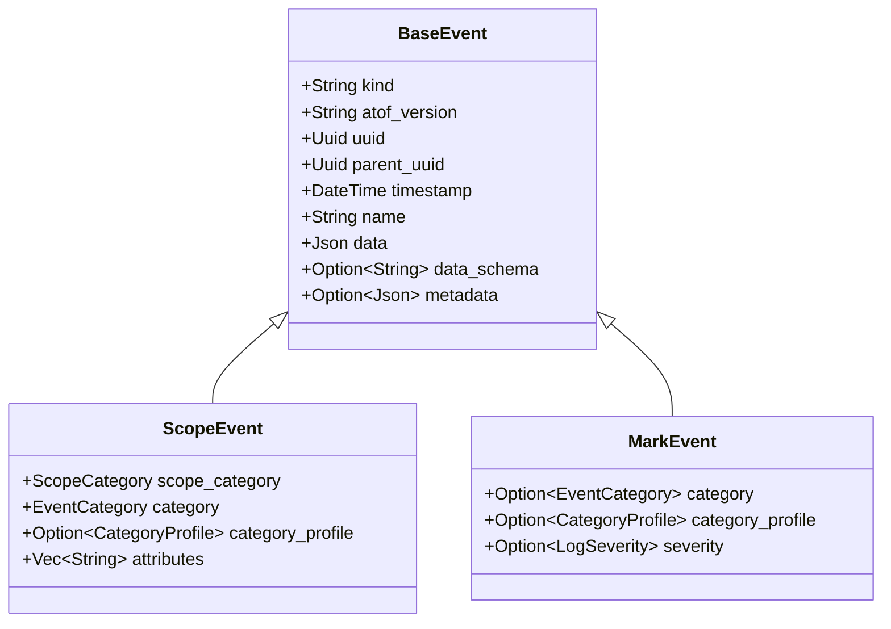

Sources: `[docs/about-nemo-relay/concepts/events.mdx:57-73]()`, `[docs/reference/atof-event-format.mdx:39-57]()`, `[crates/core/src/api/scope.rs:5-8]()`.

---

## Marks and Semantic Use Cases

Mark events are typically used for point-in-time checkpoints not representing full lifecycle spans. For example, the coding-agent CLI emits a `"session.start"` mark to denote the start of a user session lifecycle. The mark carries the session ID and Relay-owned UUIDs but does not open a new scope `[docs/about-nemo-relay/concepts/events.mdx:44-54]()`. Another common mark is `"compaction"`, which indicates that an agent's context has been refreshed `[crates/core/src/api/scope.rs:29]()`.

Marks coexist with scope events and share parentage to active scopes, enabling subscribers to relate brief states or telemetry without managing scope lifetime.

---

## Managed Execution Lifecycle and Event Flow

NeMo Relay provides managed helpers around scope lifecycle for common execution patterns such as tool and LLM calls. These wrappers perform:

1. Pushing a specific scope.
2. Emitting start events with semantic inputs.
3. Executing the target logic.
4. Emitting end events with semantic outputs.
5. Popping the scope.

### Tool Execution Example

The managed tool call lifecycle (`tool_call_execute`) performs:

- Pushes a new `Tool` scope.
- Emits a `scope.start` event recording tool arguments.
- Runs the tool function.
- Emits a `scope.end` event with tool results.
- Pops the tool scope to complete lifetime `[crates/core/src/api/runtime/state.rs:182-192]()`.

### LLM Execution Example

LLM calls follow a similar lifecycle (`llm_call_execute`), with streaming support via a collector/finalizer pattern for chunked response assembly `[crates/core/src/api/runtime/callbacks.rs:15-18]()`.

---

### Event Dispatch and Subscriber Pipeline

Event emission is asynchronous. The `subscriber_dispatcher` module runs a background dispatch thread that:

- Applies metadata injectors to each event before publication `[crates/core/src/api/runtime/subscriber_dispatcher.rs:137-138]()`.
- Runs sanitizers that remove or mask sensitive data `[crates/core/src/api/runtime/subscriber_dispatcher.rs:139-140]()`.
- Notifies all registered `EventSubscriberFn` callbacks of the sanitized event `[crates/core/src/api/runtime/subscriber_dispatcher.rs:141]()`.
- Provides publication receipts through `SubscriberDelivery` for synchronization `[crates/core/src/api/runtime/subscriber_dispatcher.rs:92-115]()`.

The dispatcher uses `PublicationContext` to carry binding-owned task-local state from synchronous emission into queued middleware `[crates/core/src/api/runtime/subscriber_dispatcher.rs:19-24]()`. This context can be captured and propagated for spawned tasks `[crates/core/src/api/runtime/subscriber_dispatcher.rs:51-73]()`.

---

### Managed Execution Sequence Diagram

Title: "Managed Execution Lifecycle Sequence"
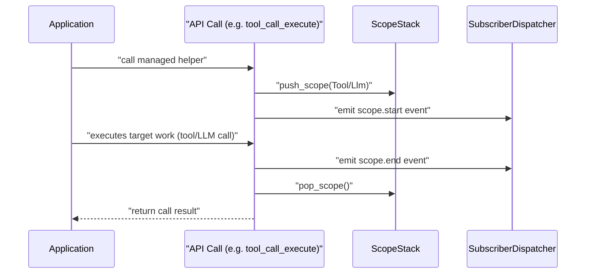

Sources: `[crates/core/src/api/runtime/state.rs:182-192]()`, `[crates/core/src/api/runtime/subscriber_dispatcher.rs:4-115]()`.

---

## API Surface: Scope and Lifecycle Handles

NeMo Relay uses explicit handle types for lifecycle entities available under `crates/core/src/api/`:

| Handle Type       | Role                                            | File                                    |
|-------------------|-------------------------------------------------|-----------------------------------------|
| `ScopeHandle`     | Identity of an active scope with UUIDs and metadata | `crates/core/src/api/scope.rs`          |
| `ScopeStackHandle`| Shared, thread-safe reference to the current active `ScopeStack` | `crates/core/src/api/runtime/scope_stack.rs`          |
| `LlmHandle`       | Specialized lifecycle for LLM call activities   | `crates/core/src/api/llm.rs`             |
| `ToolHandle`      | Specialized lifecycle for tool call activities  | `crates/core/src/api/tool.rs`            |

The `ScopeHandle` treats UUIDs as the core linking identity that pairs start/end events and maintains scope ancestry `[crates/core/src/api/scope.rs:32-58]()`.

---

## Summary Diagram: Natural Language Concepts to Code Entities

Title: "Natural Language to Code Entity Mapping"
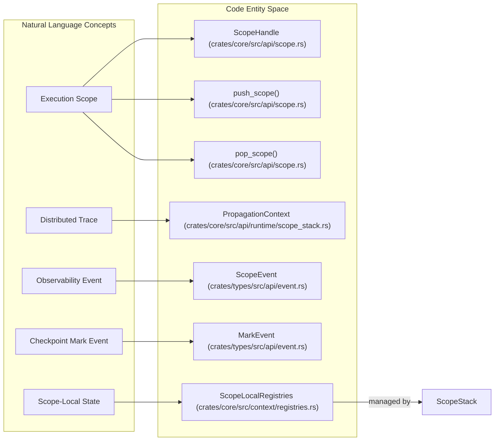

Sources: `[crates/core/src/api/runtime/scope_stack.rs:32-58]()`, `[crates/core/src/api/scope.rs:46-63]()`, `[crates/core/src/api/scope.rs:71-96]()`, `[crates/core/src/api/scope.rs:144-160]()`, `[crates/core/src/api/runtime/scope_stack.rs:34]()`.

---

## Summary Diagram: Event Emission and Dispatch Flow

Title: "Event Emission and Dispatch Pipeline"
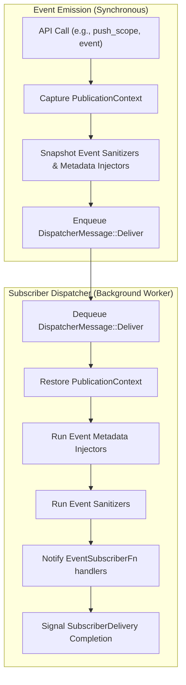

Sources: `[crates/core/src/api/runtime/subscriber_dispatcher.rs:134-160]()`, `[crates/core/src/api/runtime/subscriber_dispatcher.rs:19-24]()`, `[crates/core/src/api/runtime/subscriber_dispatcher.rs:51-73]()`, `[crates/core/src/api/runtime/subscriber_dispatcher.rs:92-115]()`.

---

## References

- `crates/core/src/api/runtime/scope_stack.rs`: Scope stack storage and propagation `[crates/core/src/api/runtime/scope_stack.rs:4-38]()`.
- `crates/core/src/api/runtime/state.rs`: Process-global runtime state and managed execution `[crates/core/src/api/runtime/state.rs:4-192]()`.
- `crates/core/src/api/runtime/subscriber_dispatcher.rs`: Asynchronous subscriber delivery implementation `[crates/core/src/api/runtime/subscriber_dispatcher.rs:4-115]()`.
- `docs/about-nemo-relay/concepts/events.mdx`: ATOF event format specification `[docs/about-nemo-relay/concepts/events.mdx:12-160]()`.
- `docs/about-nemo-relay/concepts/scopes.mdx`: Scope hierarchy and context isolation overview `[docs/about-nemo-relay/concepts/scopes.mdx:11-208]()`.
- `docs/reference/atof-event-format.mdx`: The normative ATOF 0.1 wire format `[docs/reference/atof-event-format.mdx:1-91]()`.

This page serves as the definitive technical deep dive for understanding the lifecycles of scopes and events in NeMo Relay, their runtime encapsulation, and how observability data is produced and propagated.

---

# Page: Middleware: Intercepts and Guardrails

# Middleware: Intercepts and Guardrails

<details>
<summary>Relevant source files</summary>

The following files were used as context for generating this wiki page:

- [crates/core/src/api/llm.rs](crates/core/src/api/llm.rs)
- [crates/core/src/api/runtime/state.rs](crates/core/src/api/runtime/state.rs)
- [crates/core/src/api/shared.rs](crates/core/src/api/shared.rs)
- [crates/core/src/api/tool.rs](crates/core/src/api/tool.rs)
- [crates/core/src/stream.rs](crates/core/src/stream.rs)
- [crates/core/tests/integration/middleware_tests.rs](crates/core/tests/integration/middleware_tests.rs)
- [crates/core/tests/integration/pipeline_tests.rs](crates/core/tests/integration/pipeline_tests.rs)
- [crates/core/tests/integration/stream_tests.rs](crates/core/tests/integration/stream_tests.rs)
- [crates/core/tests/integration/subscriber_dispatcher_tests.rs](crates/core/tests/integration/subscriber_dispatcher_tests.rs)
- [crates/core/tests/unit/llm_api_tests.rs](crates/core/tests/unit/llm_api_tests.rs)
- [crates/core/tests/unit/stream_tests.rs](crates/core/tests/unit/stream_tests.rs)
- [crates/core/tests/unit/tool_api_tests.rs](crates/core/tests/unit/tool_api_tests.rs)
- [docs/about-nemo-relay/concepts/middleware.mdx](docs/about-nemo-relay/concepts/middleware.mdx)
- [docs/instrument-applications/advanced-guide.mdx](docs/instrument-applications/advanced-guide.mdx)
- [docs/instrument-applications/code-examples.mdx](docs/instrument-applications/code-examples.mdx)
- [docs/integrate-into-frameworks/code-examples.mdx](docs/integrate-into-frameworks/code-examples.mdx)
- [docs/integrate-into-frameworks/provider-codecs.mdx](docs/integrate-into-frameworks/provider-codecs.mdx)
- [docs/reference/event-sanitizers.mdx](docs/reference/event-sanitizers.mdx)
- [docs/reference/llm-request-intercept-outcomes.mdx](docs/reference/llm-request-intercept-outcomes.mdx)

</details>


NeMo Relay implements a structured middleware model to control, transform, and observe tool and LLM execution lifecycle. Middleware is categorized by lifecycle role and effect: **intercepts** alter execution results or requests, while **guardrails** protect or sanitize observability data without changing execution outcomes.

---

## Middleware Registry Model

Middleware entries are managed in priority-ordered registries held within the runtime's central state, `NemoRelayContextState` [`crates/core/src/api/runtime/state.rs:1-10`]() (and instantiated via `NemoRelayContextState::new()` [`crates/core/tests/unit/llm_api_tests.rs:47-53`]()). Each registry contains uniquely named middleware entries sorted by ascending priority. NeMo Relay invokes middleware sequentially so later callbacks observe earlier middleware output [`docs/about-nemo-relay/concepts/middleware.mdx:28-30`]().

### Priority and Uniqueness

- **Priority Ordering:** Middleware callbacks are sorted ascending by priority number.
- **Uniqueness:** Middleware names are unique within their registry to enable deterministic registration and deregistration [`docs/reference/event-sanitizers.mdx:136-140`]().
- **Deregistration:** Entries can be removed by name dynamically without disturbing in-flight executions. Both global and scope-local deregistration APIs exist per middleware family [`crates/core/tests/integration/middleware_tests.rs:37-60`]().

### Registration Levels

Middleware and subscribers register at different levels depending on lifetime and scope visibility [`docs/about-nemo-relay/concepts/middleware.mdx:77-99`]():

| Level | Description | Lifetime |
|---|---|---|
| **Global** | Active for the entire process until explicitly removed. Used for default or broad middleware. | Process lifetime |
| **Scope-Local** | Owned by a particular active scope, these registrations automatically disappear when the scope closes. | Scope lifetime |
| **Plugin-Installed** | Middleware installed during plugin initialization via structured configuration. Cleared on plugin deactivation or config reset. | Plugin/component lifetime |

### Middleware Families and Purposes

NeMo Relay defines four principal middleware families, each serving a distinct role in lifecycle and observability management:

| Family | Effect | Changes Real Result? | Details |
|---|---|---|---|
| **Request Intercept** | Transforms incoming request payload before execution | Yes | For header injection, request shaping pre-call [`docs/about-nemo-relay/concepts/middleware.mdx:147-153`]() |
| **Execution Intercept** | Wraps or replaces execution logic around callback | Yes | Receives `next` continuation, supports retries and streaming [`docs/about-nemo-relay/concepts/middleware.mdx:154-167`]() |
| **Conditional Guardrail** | Decides if execution should proceed; can reject calls | Yes (blocks execution) | Returns rejection message to halt processing [`docs/about-nemo-relay/concepts/middleware.mdx:104-105`]() |
| **Sanitize Guardrail** | Rewrites emitted event payload (observability data) only | No | Sanitizes event payloads before delivery to subscribers/exporters [`docs/about-nemo-relay/concepts/middleware.mdx:106-108`]() |

Sources:
- `crates/core/src/api/runtime/state.rs:1-10`
- `docs/about-nemo-relay/concepts/middleware.mdx:28-167`
- `docs/reference/event-sanitizers.mdx:136-140`
- `crates/core/tests/integration/middleware_tests.rs:37-60`

---

## Intercepts vs. Guardrails

NeMo Relay clearly differentiates **intercepts** that alter execution or request flow from **guardrails** that only protect or sanitize observability data without affecting the semantic call results.

### Request Intercepts

- Intercept and modify the outbound `LlmRequest` [`crates/core/src/api/llm.rs:43-52`]() or tool invocation arguments before forwarding to the provider or tool.
- Common use cases include injection/removal of headers, stripping sensitive data (e.g., authorization/API keys) to prevent leakage into observability streams [`crates/core/tests/unit/llm_api_tests.rs:68-99`]() and normalization of requests.
- Runs asynchronously before execution but after conditional guardrails approve the call.

### Execution Intercepts

- Wrap and potentially replace the actual callback execution.
- Receive a `next` continuation that invokes the subsequent middleware chain or the base callback.
- May invoke `next` multiple times to implement retries, branching, or endpoint fallback.
- Each invocation runs with an isolated scope snapshot, preventing cross-branch state mutations [`docs/about-nemo-relay/concepts/middleware.mdx:62-74`].

**Streaming execution intercepts:**
- A streaming intercept returns a wrapped response stream whose lifetime extends until stream termination.
- Lazy stream adapters can call `next` while streaming to continue the underlying call [`docs/about-nemo-relay/concepts/middleware.mdx:70-73`]().

### Sanitize Guardrails

- Control allowed transformations of observability-relevant fields (`data`, `category_profile`, `metadata`) in emitted start and end scope events.
- Use specialized registries: mark sanitizers, scope-start sanitizers, and scope-end sanitizers [`docs/reference/event-sanitizers.mdx:19-24`]() that sanitize emitted events.
- They do **not** affect the actual request, response, or execution results, preserving the real execution semantics [`docs/reference/event-sanitizers.mdx:11-13`]().
- They operate asynchronously on queued events before subscribers and exporters see the data.

Sources:
- `crates/core/src/api/llm.rs:43-52`
- `crates/core/tests/unit/llm_api_tests.rs:68-99`
- `docs/about-nemo-relay/concepts/middleware.mdx:62-74`
- `docs/reference/event-sanitizers.mdx:11-24`

---

## Managed Execution Pipeline Overview

NeMo Relay applies middleware in a strict ordered pipeline, executing them in priority order from request reception through to observability emission.

### Conceptual Pipeline: Natural Language Space → Code Entities

```mermaid
graph TD
    REQ["LlmRequest / Tool Arguments"] --> COND["LlmConditionalFn / ToolConditionalFn"]
    COND -->|"(allowed)"| R_INT["LlmRequestInterceptFn / ToolRequestInterceptFn"]
    R_INT -->|"(transformed)"| S_REQ["LlmSanitizeRequestFn / ToolSanitizeRequestFn"]
    S_REQ --> START["Emit Scope Event Start"]
    START --> E_INT["LlmExecutionInterceptFn / ToolExecutionInterceptFn"]
    E_INT --> NEXT["LlmExecutionNextFn / ToolExecutionNextFn"]
    NEXT --> REAL["Real Provider Call / Tool Logic"]
    REAL --> S_RES["LlmSanitizeResponseFn / ToolSanitizeResponseFn"]
    S_RES --> END["Emit Scope Event End"]
```

Sources:
- `crates/core/src/api/runtime/state.rs:34-40`
- `docs/about-nemo-relay/concepts/middleware.mdx:101-124`
- `docs/reference/event-sanitizers.mdx:11-13`

### Middleware Registry Merging and Execution

- Global and scope-local middleware and subscribers merge at runtime.
- Scope-local registrations are bound to the active `ScopeStackHandle` [`crates/core/src/api/runtime/state.rs:33`]() and vanish automatically when the scope closes [`docs/about-nemo-relay/concepts/middleware.mdx:88-90`]().

```mermaid
sequenceDiagram
    participant S as "ScopeStackHandle"
    participant R as "NemoRelayContextState"
    participant M as "SortedRegistry"
    participant P as "Managed Pipeline Handlers"

    Note over S,R: Collect middleware and subscribers merged from global + scope-local
    S->>M: collect_scope_local_subscribers()
    R->>M: registry_snapshot()
    M->>P: Provide sorted middleware lists, ordered by priority

    P->>P: Sequentially execute middleware callbacks, asynchronously await each

    Note over P: Execution intercepts receive `next()` continuation for chain traversal
```

Middleware callbacks are asynchronous in the Rust runtime. Node.js middleware callbacks may return Promises; Python callbacks accept awaitables when invoked from async APIs [`docs/about-nemo-relay/concepts/middleware.mdx:24-44`]().

Middleware is not re-entrant: callbacks must not invoke Relay middleware APIs or flush exporters recursively, but may push/pop scopes or emit events asynchronously.

Sources:
- `crates/core/src/api/runtime/state.rs:33-40`
- `docs/about-nemo-relay/concepts/middleware.mdx:24-44`
- `crates/core/src/api/shared.rs:40-49`

---

## Detailed Managed Execution Order

An example managed call flow (`llm_call_execute()` or `tool_call_execute()`) proceeds as follows:

1.  **Conditional Execution Guardrails Run**
    -   Middleware of type `LlmConditionalFn` or `ToolConditionalFn` run in ascending priority order.
    -   Any guardrail can reject execution by returning an error, stopping the pipeline, and notifying the caller [`docs/about-nemo-relay/concepts/middleware.mdx:133-135`]().

2.  **Request Intercepts Run**
    -   Intercepts transform the `LlmRequest` or tool arguments (e.g., stripping credential headers like `authorization`, `x-api-key`) to protect observability [`crates/core/src/api/llm.rs:54-62`]().

3.  **Sanitize Request Guardrails Run, Start Event Emitted**
    -   Guardrails sanitize observability fields before emission (`snapshot_event_sanitizers` [`crates/core/src/api/shared.rs:57-60`]).
    -   The sanitized start event is then queued for asynchronous publication [`docs/reference/event-sanitizers.mdx:22,93-97`]().

4.  **Execution Intercept Chain Begins**
    -   Execution intercepts wrap the callback with a provided `next()` continuation.
    -   Each `next()` call receives an isolated snapshot of scope stack state [`docs/about-nemo-relay/concepts/middleware.mdx:65-67`]().

5.  **Execution Proceeds to Real Callback**
    -   The wrapped callback or the real provider/tool call executes, returning a result or a streaming response.

6.  **Sanitize Response Guardrails Run, End Event Emitted**
    -   On completion, response guardrails sanitize observability fields on the end event.
    -   For streaming LLM responses, sanitization is deferred until stream termination using a finalizer callback [`crates/core/src/stream.rs:16-17`]().

### Tool Execution Intercept Outcomes

A tool execution intercept returns a `ToolExecutionInterceptOutcome` which includes the application-owned `result`, an optional opaque `annotation`, and `pending_marks` [`crates/core/src/api/tool.rs:32-35`].

-   `result`: The primary application-visible payload.
-   `annotation`: Optional opaque metadata that Relay transports without interpreting its schema.
-   `pending_marks`: Relay-owned lifecycle data, an empty list by default, containing marks to be materialized after the final outcome succeeds.

The `next(args)` continuation in an intercept returns `ToolExecutionResult` [`crates/core/src/api/tool.rs:32-35`], which contains the `result` and `annotation` from the downstream execution, but not `pending_marks`. An intercept can preserve, replace, or remove the annotation in its returned outcome.

Sources:
- `docs/about-nemo-relay/concepts/middleware.mdx:133-135`
- `crates/core/src/api/llm.rs:54-62`
- `crates/core/src/api/shared.rs:57-60`
- `crates/core/src/stream.rs:16-17`
- `crates/core/src/api/tool.rs:32-35`

---

## Implementation Details

### Core Data Structures

| Entity | Role | Details |
|---|---|---|
| `LlmRequest` | Request payload | Contains headers and JSON content [`crates/core/src/api/llm.rs:43-52`]() |
| `LlmHandle` | Runtime handle for an active LLM call | Stores unique call UUID, captured scope snapshot, and optimization recorder [`crates/core/src/api/llm.rs:89-131`]() |
| `ToolHandle` | Runtime handle for active tool call | Holds UUID, tool name, correlation ID, parent UUID [`crates/core/src/api/tool.rs:47-74`]() |
| `LlmStreamWrapper` | Stream adapter managing chunk collection and final event emission | Wraps raw LLM chunk stream with collector and finalizer [`crates/core/src/stream.rs:76-90`]() |

### Streaming Pipeline Middleware

Streaming LLM responses yield chunks progressively. Middleware applies as follows [`crates/core/src/stream.rs:12-26`]() :

1.  **Collector:**
    -   Per-chunk callback accumulates or transforms stream chunks.
    -   Returning `Err` causes stream termination.

2.  **Finalizer:**
    -   One-shot callback invoked upon stream termination that produces aggregated JSON response.

3.  **Sanitize Response Guardrails:**
    -   Post-aggregation, the response passes through sanitize guardrails before end event emission.
    -   `LlmStreamWrapper` preserves the originating scope stack to apply correct scope-local middleware at stream end even if polled elsewhere [`crates/core/src/stream.rs:71-75`]() (`LlmStreamWrapper::new` [`crates/core/src/stream.rs:127-156`]).

### Conditional Middleware Guardrails

A conditional middleware guardrail enables temporary exclusion of existing global subscribers or middleware from runtime snapshots without changing ownership or registration [`docs/about-nemo-relay/concepts/middleware.mdx:105-112`]().

This dynamic gating mechanism supports health-checking, feature flags, or adaptive policy-driven control of middleware activation.

Sources:
- `crates/core/src/api/llm.rs:43-131`
- `crates/core/src/api/tool.rs:47-74`
- `crates/core/src/stream.rs:12-90, 127-156`
- `docs/about-nemo-relay/concepts/middleware.mdx:105-112`

---

## Summary Diagrams

### Middleware Registry Concept to Code Entities

```mermaid
graph TD
  A["MiddlewareLifecycleConcepts"] --> B["NEMORelayContextState"]
  B --> C["SortedRegistry"]

  subgraph MiddlewareFamilies
    RI["LlmRequestInterceptFn / ToolRequestInterceptFn"]
    EI["LlmExecutionInterceptFn / ToolExecutionInterceptFn"]
    CG["LlmConditionalFn / ToolConditionalFn"]
    SG["LlmSanitizeRequestFn / ToolSanitizeRequestFn"]
  end

  C --> RI
  C --> EI
  C --> CG
  C --> SG
```

### Managed Execution Pipeline Coverage by Code

```mermaid
graph TD
  REQ["LlmRequest / Tool Args"] --> COND["LlmConditionalFn"]
  COND --> RINT["LlmRequestInterceptFn"]
  RINT --> SREQ["LlmSanitizeRequestFn"]
  SREQ --> START["ScopeEventStart"]
  START --> EINT["LlmExecutionInterceptFn"]
  EINT --> NXT["LlmExecutionNextFn"]
  NXT --> REAL["RealProviderCall"]
  REAL --> SRES["LlmSanitizeResponseFn"]
  SRES --> END["ScopeEventEnd"]
```

Sources:
- `crates/core/src/api/runtime/state.rs:1-45`
- `crates/core/src/api/llm.rs:43-52`
- `crates/core/src/api/tool.rs:47-74`
- `crates/core/src/stream.rs:12-90`

---

# Page: Codecs and Streaming

# Codecs and Streaming

<details>
<summary>Relevant source files</summary>

The following files were used as context for generating this wiki page:

- [crates/adaptive/src/acg/request_surfaces/mod.rs](crates/adaptive/src/acg/request_surfaces/mod.rs)
- [crates/cli/tests/coverage/commands/model_pricing_tests.rs](crates/cli/tests/coverage/commands/model_pricing_tests.rs)
- [crates/core/src/api/optimization.rs](crates/core/src/api/optimization.rs)
- [crates/core/src/codec/anthropic.rs](crates/core/src/codec/anthropic.rs)
- [crates/core/src/codec/gemini_generate_content.rs](crates/core/src/codec/gemini_generate_content.rs)
- [crates/core/src/codec/mod.rs](crates/core/src/codec/mod.rs)
- [crates/core/src/codec/model_pricing.rs](crates/core/src/codec/model_pricing.rs)
- [crates/core/src/codec/openai_chat.rs](crates/core/src/codec/openai_chat.rs)
- [crates/core/src/codec/openai_responses.rs](crates/core/src/codec/openai_responses.rs)
- [crates/core/src/codec/resolve.rs](crates/core/src/codec/resolve.rs)
- [crates/core/tests/unit/codec/anthropic_tests.rs](crates/core/tests/unit/codec/anthropic_tests.rs)
- [crates/core/tests/unit/codec/gemini_generate_content_tests.rs](crates/core/tests/unit/codec/gemini_generate_content_tests.rs)
- [crates/core/tests/unit/codec/openai_chat_tests.rs](crates/core/tests/unit/codec/openai_chat_tests.rs)
- [crates/core/tests/unit/codec/parity_tests.rs](crates/core/tests/unit/codec/parity_tests.rs)
- [crates/core/tests/unit/codec/resolve_tests.rs](crates/core/tests/unit/codec/resolve_tests.rs)
- [crates/core/tests/unit/codec/response_tests.rs](crates/core/tests/unit/codec/response_tests.rs)
- [crates/core/tests/unit/optimization_tests.rs](crates/core/tests/unit/optimization_tests.rs)
- [crates/pii-redaction/tests/coverage/overlay_tests.rs](crates/pii-redaction/tests/coverage/overlay_tests.rs)
- [crates/types/src/codec/response.rs](crates/types/src/codec/response.rs)
- [docs/about-nemo-relay/concepts/codecs.mdx](docs/about-nemo-relay/concepts/codecs.mdx)
- [docs/configure-plugins/model-pricing.mdx](docs/configure-plugins/model-pricing.mdx)
- [docs/integrate-into-frameworks/provider-response-codecs.mdx](docs/integrate-into-frameworks/provider-response-codecs.mdx)

</details>


## Purpose and Scope
This page details the codec and streaming subsystems in the NeMo Relay core crate (`nemo-relay-core`). It covers provider codecs (OpenAI Chat, OpenAI Responses, Anthropic Messages, Gemini generateContent, OCI GenAI), typed value codecs, automatic surface resolution, model pricing catalogs and resolvers, streaming helper architectures (the collector/finalizer pattern via `StreamingCodec`), and stream execution intercepts.

---

## Provider Codecs

Provider codecs implement the traits [`LlmCodec`](crates/core/src/codec/traits.rs#L19-L36)() (request decode/encode) and [`LlmResponseCodec`](crates/core/src/codec/traits.rs#L19-L36)() (response decode) to translate between provider-specific JSON payloads and normalized NeMo Relay entities: `AnnotatedLlmRequest` [crates/core/src/codec/request.rs#L10]() and `AnnotatedLlmResponse` [crates/types/src/codec/response.rs#L42-L43]().

The built-in provider codecs in NeMo Relay include:

| Codec | Provider API | Key Characteristics |
| :-------------------------- | :---------------------- | :------------------------------------------------------------------------------------------------------------------------------------------------------------ |
| `OpenAIChatCodec` | OpenAI Chat Completions | Standard `messages` array in requests; responses include `choices[0].message`. Handles content, tool calls, usage, and finish reasons [crates/core/src/codec/openai_chat.rs:33-45](). |
| `OpenAIResponsesCodec` | OpenAI Responses API | Distinctive heterogeneous `output` array including message, function calls, reasoning parts; finish reason derived from `status` and `incomplete_details.reason` fields [crates/core/src/codec/openai_responses.rs:9-17](), [crates/core/src/codec/openai_responses.rs:42-57](). |
| `AnthropicMessagesCodec` | Anthropic Messages | Top-level `system` prompt separate from messages; content represented as heterogeneous blocks (text, tool use, thinking); tooling uses `input_schema` [crates/core/src/codec/anthropic.rs:9-18](), [crates/core/src/codec/anthropic.rs:43-65](). |
| `GeminiGenerateContentCodec` | Google Gemini | Uses `contents` array in request and `candidates` array in response; normalizes Gemini function-call IDs to tool call IDs [crates/core/src/codec/gemini_generate_content.rs:40-53](). |
| `OCIGenAIChatCodec` | OCI Generative AI | Chat request bodies with `messages` field; positioned to detect before OpenAI chat for disambiguation [crates/core/src/codec/resolve.rs:70-79](). |

### Codec Implementation Patterns

Each codec handles:
- **Request Decoding and Encoding**: They decode raw provider requests into `AnnotatedLlmRequest` instances for middleware and encode edits back into provider payloads before forwarding upstream.
- **Response Decoding**: They decode raw provider responses into `AnnotatedLlmResponse` with normalized semantic fields (model, finish reason, usage, tool calls).
- **Field Preservation and Lossless Patch Semantics**: They preserve unknown or unmodeled fields within an `extra` map, ensuring unknown fields pass through unchanged unless explicitly edited [docs/about-nemo-relay/concepts/codecs.mdx:93-98]().
- **Provider-Specific Metadata**: Exposed in `api_specific` fields to allow provider-centric details with extended semantics [docs/about-nemo-relay/concepts/codecs.mdx:105-109]().
- **Tool Call Argument Parsing**: Many codecs parse stringified JSON arguments from tool call requests into structured JSON, with fallback to string on parse failure [crates/core/src/codec/openai_chat.rs:129-131](), [crates/core/src/codec/openai_responses.rs:133-136]().

Sources:
[crates/core/src/codec/openai_chat.rs:33-45](), [crates/core/src/codec/openai_responses.rs:9-17](), [crates/core/src/codec/openai_responses.rs:42-57](), [crates/core/src/codec/anthropic.rs:9-18](), [crates/core/src/codec/anthropic.rs:43-65](), [crates/core/src/codec/gemini_generate_content.rs:40-53](), [crates/core/src/codec/resolve.rs:70-79](), [crates/core/src/codec/traits.rs:19-36](), [crates/types/src/codec/response.rs:42-43](), [crates/core/src/codec/request.rs:10](), [docs/about-nemo-relay/concepts/codecs.mdx:93-98](), [docs/about-nemo-relay/concepts/codecs.mdx:105-109](), [crates/core/src/codec/openai_chat.rs:129-131](), [crates/core/src/codec/openai_responses.rs:133-136]()

---

## Automatic Surface Resolution and Provider Detection

NeMo Relay supports best-effort detection of the provider format from a raw JSON payload, determining which built-in codec to apply. This is managed in the `resolve` module [crates/core/src/codec/resolve.rs:4-157]().

### Detection Priorities and Logic

- **Request Detection Priority**: OpenAI Responses (keys `input` or `instructions`) > Anthropic Messages (key `system`) > OCI GenAI (early detection for `messages`) > OpenAI Chat (`messages`) > Gemini (`contents`) [crates/core/src/codec/resolve.rs:70-79]().
- **Disambiguation**: Anthropic requests without a `system` prompt are structurally identical to OpenAI Chat requests. The detection logic allows supplying a provider hint (`"anthropic"` or `"anthropic.messages"`) to clarify the intended codec [crates/core/src/codec/resolve.rs:93-102]().
- **Response Detection**: Classifies response payloads only if exactly one descriptor matches, minimizing ambiguity from minimal or overlapping JSON structures [crates/core/src/codec/resolve.rs:110-112]().

### Diagram: Natural Language Space to Code Entity Space (Surface Resolution)

```mermaid
graph TD
    subgraph "Natural_Language_Space_Raw_JSON"
        RawReq["Raw Request Body JSON"]
        RawResp["Raw Response Body JSON"]
    end

    subgraph "Code_Entity_Space_nemo_relay_core"
        Resolve["resolve::BUILTIN_PROVIDER_SURFACES"]
        DetectReq["detect_request_surface_with_hint()"]
        DetectResp["detect_response_surface()"]
        NormReq["normalize_request_with_hint()"]
        NormResp["normalize_response()"]
        AnnotatedReq["AnnotatedLlmRequest"]
        AnnotatedResp["AnnotatedLlmResponse"]
    end

    RawReq --> DetectReq
    DetectReq --> NormReq
    NormReq --> AnnotatedReq

    RawResp --> DetectResp
    DetectResp --> NormResp
    NormResp --> AnnotatedResp

    AnnotatedReq -- "processed_by" --> Resolve
    AnnotatedResp -- "processed_by" --> Resolve
```

Sources:
[crates/core/src/codec/resolve.rs:4-157](), [crates/core/src/codec/resolve.rs:70-79](), [crates/core/src/codec/resolve.rs:93-102](), [crates/core/src/codec/resolve.rs:110-112](), [crates/core/tests/unit/codec/resolve_tests.rs:1-210]()

---

## Typed Value Codecs

Typed value codecs translate application-facing objects into JSON-compatible values and vice versa for public wrapper APIs or rich middleware workflows [docs/about-nemo-relay/concepts/codecs.mdx:146-150](). They complement provider codecs by maintaining a stable serialized payload while exposing native types to application code.

Sources:
[docs/about-nemo-relay/concepts/codecs.mdx:146-150]()

---

## Cost Estimation and Model Pricing

When providers do not report cost data directly, Relay estimates usage cost via a model pricing system:

- **Pricing Catalogs**: Declarative JSON catalogs define pricing entries with per-provider, per-model token rates (input/output) and cache accounting rules [crates/core/src/codec/model_pricing.rs:4-150]().
- **Pricing Resolver**: The `PricingResolver` contains multiple catalogs prioritized for lookup. Lookup keys include provider and model aliases [crates/core/src/codec/model_pricing.rs:180-210]().
- **Integration**: Price estimation is layered into response codec output; clients can configure sources via the `pricing` plugin to supply inline catalogs or file-backed catalogs [docs/configure-plugins/model-pricing.mdx:10-71]().
- **Usage Cost**: The `Usage` struct in `AnnotatedLlmResponse` can include a `cost` field, which can be `ProviderReported` or `Estimated` [crates/types/src/codec/response.rs:100-101]().
- **Testing**: Unit tests verify the correct calculation of costs based on various pricing catalog configurations, including flat rates and threshold-based pricing [crates/core/tests/unit/codec/response_tests.rs:83-147]().

Sources:
[docs/configure-plugins/model-pricing.mdx:10-71](), [crates/core/src/codec/model_pricing.rs:4-150](), [crates/core/src/codec/model_pricing.rs:180-210](), [crates/types/src/codec/response.rs:100-101](), [crates/core/tests/unit/codec/response_tests.rs:83-147]()

---

## Streaming Helpers and Stream Execution Intercepts

LLM interaction often involves streaming token chunks rather than all-at-once responses. NeMo Relay manages streaming with a collector/finalizer pattern implemented by `StreamingCodec` objects, which accumulate incremental chunks and produce an aggregated final output.

### Pattern Description

- **Collector**: Invoked for each partial chunk received from the upstream API. It accumulates state like concatenated text content and partial tool call fragments.
- **Finalizer**: Called when the stream ends or closes. It produces a single `Json` object representing the full aggregated and normalized response, suitable for processing by middleware, subscribers, and exporters.

### Diagram: Streaming & Codec Architecture

```mermaid
graph TD
    subgraph "Codecs_nemo_relay_core"
        OpenAIChatCodec["OpenAIChatCodec"]
        OpenAIResponsesCodec["OpenAIResponsesCodec"]
        AnthropicMessagesCodec["AnthropicMessagesCodec"]
        GeminiGenerateContentCodec["GeminiGenerateContentCodec"]
    end

    subgraph "Execution_and_Registry_nemo_relay_core"
        LlmStreamWrapper["LlmStreamWrapper"]
        LlmStreamExecutionIntercept["LlmStreamExecutionIntercept"]
        LlmCodecTrait["LlmCodec (trait)"]
        LlmResponseCodecTrait["LlmResponseCodec (trait)"]
        StreamingCodecTrait["StreamingCodec (trait)"]
    end

    OpenAIChatCodec -- "implements" --> LlmCodecTrait
    OpenAIChatCodec -- "implements" --> LlmResponseCodecTrait
    OpenAIChatCodec -- "provides" --> StreamingCodecTrait

    OpenAIResponsesCodec -- "implements" --> LlmCodecTrait
    OpenAIResponsesCodec -- "implements" --> LlmResponseCodecTrait
    OpenAIResponsesCodec -- "provides" --> StreamingCodecTrait

    AnthropicMessagesCodec -- "implements" --> LlmCodecTrait
    AnthropicMessagesCodec -- "implements" --> LlmResponseCodecTrait
    AnthropicMessagesCodec -- "provides" --> StreamingCodecTrait

    GeminiGenerateContentCodec -- "implements" --> LlmCodecTrait
    GeminiGenerateContentCodec -- "implements" --> LlmResponseCodecTrait
    GeminiGenerateContentCodec -- "provides" --> StreamingCodecTrait

    LlmStreamWrapper -- "uses" --> StreamingCodecTrait
    LlmStreamWrapper -- "applies" --> LlmStreamExecutionIntercept
    LlmStreamExecutionIntercept -- "transforms" --> LlmStreamWrapper
```

Sources:
[crates/core/src/api/optimization.rs:10-11](), [crates/core/src/codec/openai_chat.rs:44](), [crates/core/src/codec/resolve.rs:61]()

---

# Page: Operational Logging and Errors

# Operational Logging and Errors

<details>
<summary>Relevant source files</summary>

The following files were used as context for generating this wiki page:

- [crates/adaptive/src/error.rs](crates/adaptive/src/error.rs)
- [crates/adaptive/tests/coverage/error_tests.rs](crates/adaptive/tests/coverage/error_tests.rs)
- [crates/core/src/error.rs](crates/core/src/error.rs)
- [crates/core/src/logging/config.rs](crates/core/src/logging/config.rs)
- [crates/core/src/logging/mod.rs](crates/core/src/logging/mod.rs)
- [crates/core/src/logging/sink.rs](crates/core/src/logging/sink.rs)
- [crates/core/src/plugin/dynamic/manifest.rs](crates/core/src/plugin/dynamic/manifest.rs)
- [crates/core/tests/coverage/error_tests.rs](crates/core/tests/coverage/error_tests.rs)
- [crates/core/tests/coverage/logging_sink_tests.rs](crates/core/tests/coverage/logging_sink_tests.rs)
- [crates/core/tests/coverage/logging_tests.rs](crates/core/tests/coverage/logging_tests.rs)
- [crates/core/tests/unit/shared_tests.rs](crates/core/tests/unit/shared_tests.rs)
- [crates/ffi/src/error.rs](crates/ffi/src/error.rs)
- [crates/ffi/tests/coverage/error_tests.rs](crates/ffi/tests/coverage/error_tests.rs)
- [crates/node/tests/logging_tests.mjs](crates/node/tests/logging_tests.mjs)
- [docs/reference/operational-logging.mdx](docs/reference/operational-logging.mdx)
- [go/nemo_relay/logging_test.go](go/nemo_relay/logging_test.go)
- [python/tests/test_logging.py](python/tests/test_logging.py)

</details>


This page details the operational logging system within NeMo Relay, covering its configuration, various output sinks, file rotation mechanisms, and how log levels are managed across different language bindings. It also describes the error type hierarchy used throughout the codebase. Operational logging is distinct from agent observability features like ATOF, ATIF, OpenTelemetry, or OpenInference, focusing instead on diagnostics related to the Relay process itself, including startup, configuration, plugin management, gateway behavior, and runtime failures [docs/reference/operational-logging.mdx:9-12]().

## Logging Configuration

NeMo Relay's logging can be configured through several methods, with a clear precedence order for CLI processes:
1. CLI options (`--log-*` or `--log-config-path`)
2. Environment variables (`NEMO_RELAY_LOG*`)
3. `[logging]` section in the resolved `config.toml`
4. Built-in defaults [docs/reference/operational-logging.mdx:39-43]()

Language bindings (Python, Node.js, Go) typically install a process-lifetime `LoggingRuntime` [`crates/core/src/logging/mod.rs:99`] using environment configuration or built-in defaults when the binding loads [docs/reference/operational-logging.mdx:45-47](). Rust applications explicitly choose the `LoggingRuntime` initialization method [docs/reference/operational-logging.mdx:47-48]().

### Default Behavior

By default, NeMo Relay logs `error` level messages and above to `stderr` in a human-readable format, with no file sinks configured [docs/reference/operational-logging.mdx:22-25]().

### Configuration Sources

#### CLI Options

The `nemo-relay` CLI supports direct logging configuration:
* `--log-level <level>`: Sets the minimum log level (e.g., `debug`, `info`, `warn`, `error`, `trace`) [docs/reference/operational-logging.mdx:54]().
* `--log-stderr-format <format>`: Sets the `stderr` output format (e.g., `human`, `jsonl`) [docs/reference/operational-logging.mdx:54]().
* `--log-config-path <path>`: Specifies an absolute path to a TOML file for comprehensive logging configuration [docs/reference/operational-logging.mdx:59](). This option is mutually exclusive with `--log-level` and `--log-stderr-format` [docs/reference/operational-logging.mdx:64-65]().

#### Environment Variables

Logging can be controlled via environment variables, which are particularly useful for language bindings and CLI processes [docs/reference/operational-logging.mdx:68-71]():
* `NEMO_RELAY_LOG`: Sets the minimum log level [docs/reference/operational-logging.mdx:81]().
* `NEMO_RELAY_LOG_STDERR`: Enables or disables `stderr` output (`true` or `false`) [docs/reference/operational-logging.mdx:82]().
* `NEMO_RELAY_LOG_STDERR_FORMAT`: Sets the `stderr` output format (`human` or `jsonl`) [docs/reference/operational-logging.mdx:83]().
* `NEMO_RELAY_LOG_CONFIG_PATH`: Specifies an absolute path to a TOML configuration file [docs/reference/operational-logging.mdx:88](). This variable cannot be combined with the other `NEMO_RELAY_LOG` variables [docs/reference/operational-logging.mdx:90-91]().

If no logging environment variables are set, Python, Node.js, and Go bindings will install Relay's built-in default logger, unless the Rust `log` facade is already owned by another logger [docs/reference/operational-logging.mdx:94-98]().

#### TOML Configuration

A `[logging]` table in a TOML file provides comprehensive configuration options [docs/reference/operational-logging.mdx:111-112]().

```toml
[logging]
level = "info"
stderr_enabled = false
stderr_format = "human"
flush_interval_millis = 1000

[[logging.sinks]]
path = ".nemo-relay/logs/relay.log.jsonl"
format = "jsonl"
level = "debug"
queue_capacity = 1024
max_file_size_bytes = 10485760
retained_files = 5
```
[docs/reference/operational-logging.mdx:114-133]()

Key fields include:
* `level`: The process-wide minimum severity [docs/reference/operational-logging.mdx:116]().
* `stderr_enabled`: Whether to enable the `stderr` sink [docs/reference/operational-logging.mdx:117]().
* `stderr_format`: Format for `stderr` output [docs/reference/operational-logging.mdx:118]().
* `flush_interval_millis`: Periodic flush interval for file sinks (`0` disables periodic flushing) [docs/reference/operational-logging.mdx:119]().
* `sinks`: An array of file sink configurations [docs/reference/operational-logging.mdx:121]().
    * `path`: Absolute or relative path to the log file [docs/reference/operational-logging.mdx:122]().
    * `format`: Output format for the file sink [docs/reference/operational-logging.mdx:123]().
    * `level`: Minimum severity for this specific file sink [docs/reference/operational-logging.mdx:124]().
    * `queue_capacity`: Asynchronous queue capacity for the file sink. Cannot exceed `MAX_FILE_SINK_QUEUE_ENTRIES` (8,192) [crates/core/src/logging/config.rs:30-31](), [docs/reference/operational-logging.mdx:125]().
    * `max_file_size_bytes`: Maximum size of a log file before rotation. Requires `retained_files` [docs/reference/operational-logging.mdx:126]().
    * `retained_files`: Number of backup files to keep during rotation. Cannot exceed `MAX_FILE_SINK_RETAINED_FILES` (9) [crates/core/src/logging/config.rs:37](), [docs/reference/operational-logging.mdx:127]().

File sink paths are resolved relative to the process working directory [docs/reference/operational-logging.mdx:130](). When `config.toml` files are layered, distinct paths create separate sinks, while matching paths are merged [docs/reference/operational-logging.mdx:138-143]().

#### Rust Library API

Rust applications initialize logging programmatically using `LoggingRuntime` [`crates/core/src/logging/mod.rs:99`]:
* `LoggingRuntime::configure(config)` [`crates/core/src/logging/mod.rs:115`]
* `LoggingRuntime::configure_from_environment()` [`crates/core/src/logging/mod.rs:153`]
* `LoggingRuntime::configure_from_file_path(path)` [`crates/core/src/logging/mod.rs:148`]

```rust
let _logging_runtime =
    nemo_relay::logging::LoggingRuntime::configure_from_environment()?;
```
[docs/reference/operational-logging.mdx:158-160]()

Sources: [docs/reference/operational-logging.mdx:1-163](), [crates/core/src/logging/config.rs:30-37](), [crates/core/src/logging/mod.rs:99-153]()

---

### Logging Runtime and Sinks

The core logging functionality is managed by `LoggingRuntime` [`crates/core/src/logging/mod.rs:99`], which owns the `spdlog` logger instance and thread pools for asynchronous sinks [crates/core/src/logging/mod.rs:103-105]().

Diagram: Logging Initialization Flow
```mermaid
graph TD
    subgraph "Configuration Space"
      A["LoggingConfig::from_environment"] --> B["LoggingRuntime::configure"]
      C["LoggingConfig::from_file_path"] --> B
    end
    subgraph "Code Entity Space"
      B --> D["lock_logger_lifecycle"]
      D --> E["Uuid::now_v7"]
      E --> F["build_logger"]
      F --> G["StdStreamSink"]
      F --> H["SizeRotatingFileWriter"]
      H --> I["AsyncPoolSink"]
      I --> J["spdlog::Logger"]
      J --> K["spdlog::init_log_crate_proxy"]
      K --> L["log::set_max_level"]
    end
```
Sources: [crates/core/src/logging/mod.rs:115-144](), [crates/core/src/logging/sink.rs:23-165](), [crates/core/src/logging/config.rs:76-157]()

#### `LoggingRuntime` Structure and Lifecycle
`LoggingRuntime` [`crates/core/src/logging/mod.rs:99-105`] contains:
* `root_relay_id`: A unique string ID attached to all operational records [crates/core/src/logging/mod.rs:100]().
* `logger`: An `Arc<Logger>` instance [crates/core/src/logging/mod.rs:103]().
* `_thread_pools`: A vector of `Arc<ThreadPool>` instances keeping asynchronous sinks active [crates/core/src/logging/mod.rs:105]().

When dropped, `LoggingRuntime` flushes buffered sinks and detaches the logger from the global `log` facade [crates/core/src/logging/mod.rs:170-179]().

#### Size-Rotating File Writer
File sinks use `SizeRotatingFileWriter` [`crates/core/src/logging/rotation.rs:19`] when size-based rotation is configured. When active file size exceeds `max_file_size_bytes`, existing backups are rotated up to `retained_files` (max 9) [crates/core/src/logging/config.rs:37](). Individual records larger than the limit are kept intact rather than split [docs/reference/operational-logging.mdx:135-136]().

Sources: [crates/core/src/logging/mod.rs:99-179](), [crates/core/src/logging/sink.rs:23-165](), [crates/core/src/logging/rotation.rs:19]()

---

## Log Level Control and Binding Behavior

Log levels (`Error`, `Warn`, `Info`, `Debug`, `Trace`) are controlled process-wide and per-sink via `LogLevel` [`crates/core/src/logging/config.rs:162`]. The helper `log_level_filter` [`crates/core/src/logging/sink.rs:30`] maps levels to `spdlog::LevelFilter` and `log::LevelFilter`.

Binding-specific initialization and teardown:
* **Python**: Initializes on import using environment variables or defaults; drains file sinks during teardown [python/tests/test_logging.py:31-39](), [docs/reference/operational-logging.mdx:104-106]().
* **Node.js**: Initializes on import and flushes file sinks during environment cleanup [crates/node/tests/logging_tests.mjs:34-42](), [docs/reference/operational-logging.mdx:104-106]().
* **Go**: Applications configuring file sinks must explicitly call `nemo_relay.ShutdownLogging()` before `main` returns [go/nemo_relay/logging_test.go:39-42](), [docs/reference/operational-logging.mdx:106-109]().

Sources: [crates/core/src/logging/config.rs:162](), [crates/core/src/logging/sink.rs:30](), [python/tests/test_logging.py:31-78](), [crates/node/tests/logging_tests.mjs:34-88](), [go/nemo_relay/logging_test.go:39-135]()

---

## Error Type Hierarchy

NeMo Relay uses `FlowError` [`crates/core/src/error.rs:85`] as the central error type for all fallible runtime operations.

Diagram: `FlowError` and Upstream Mapping
```mermaid
graph TD
    subgraph "Error Hierarchy"
      A["FlowError"] --> B["AlreadyExists"]
      A --> C["NotFound"]
      A --> D["InvalidArgument"]
      A --> E["ScopeStackEmpty"]
      A --> F["GuardrailRejected"]
      A --> G["Upstream"]
      A --> H["Internal"]
      A --> I["CallbackException"]
    end
    subgraph "Upstream Failures"
      G --> J["UpstreamFailure"]
      J --> K["UpstreamFailureClass"]
      K --> L["Connection / Timeout / RetryableStatus / ContextWindow / ModelUnavailable / Authentication / InvalidRequest / Other"]
    end
```
Sources: [crates/core/src/error.rs:16-141]()

### `FlowError` Variants
* `AlreadyExists(String)`: Resource is already registered [crates/core/src/error.rs:93]().
* `NotFound(String)`: Requested resource or scope handle not found [crates/core/src/error.rs:99]().
* `InvalidArgument(String)`: Precondition violation or malformed parameter [crates/core/src/error.rs:107]().
* `ScopeStackEmpty`: Operation attempted on an empty scope stack [crates/core/src/error.rs:114]().
* `GuardrailRejected(String)`: Operation rejected by a conditional execution guardrail [crates/core/src/error.rs:122]().
* `Upstream(UpstreamFailure)`: Structured failure from an upstream provider attempt [crates/core/src/error.rs:127]().
* `Internal(String)`: Unexpected internal runtime error [crates/core/src/error.rs:131]().
* `CallbackException`: Exception raised by a language-binding callback [crates/core/src/error.rs:135-140]().

### OpenTelemetry Error Mapping
`FlowError` implements `otel_error_type()` [`crates/core/src/error.rs:153`] to map variants to stable low-cardinality strings for OpenTelemetry attributes (e.g., `already_exists`, `not_found`, `invalid_argument`, `guardrail_rejected`, `internal_error`, and upstream classes like `connection_error`, `timeout`, `context_window`) [crates/core/src/error.rs:153-172]().

Sources: [crates/core/src/error.rs:16-172](), [crates/core/tests/coverage/error_tests.rs:58-113]()

---

# Page: Adaptive Runtime (nemo-relay-adaptive)

# Adaptive Runtime (nemo-relay-adaptive)

<details>
<summary>Relevant source files</summary>

The following files were used as context for generating this wiki page:

- [crates/adaptive/Cargo.toml](crates/adaptive/Cargo.toml)
- [crates/adaptive/src/acg/ir_builder.rs](crates/adaptive/src/acg/ir_builder.rs)
- [crates/adaptive/src/acg_component.rs](crates/adaptive/src/acg_component.rs)
- [crates/adaptive/src/acg_profile.rs](crates/adaptive/src/acg_profile.rs)
- [crates/adaptive/src/config.rs](crates/adaptive/src/config.rs)
- [crates/adaptive/src/lib.rs](crates/adaptive/src/lib.rs)
- [crates/adaptive/src/response_cache/config.rs](crates/adaptive/src/response_cache/config.rs)
- [crates/adaptive/src/response_cache/intercept.rs](crates/adaptive/src/response_cache/intercept.rs)
- [crates/adaptive/src/response_cache/key.rs](crates/adaptive/src/response_cache/key.rs)
- [crates/adaptive/src/response_cache/mark.rs](crates/adaptive/src/response_cache/mark.rs)
- [crates/adaptive/src/response_cache/mod.rs](crates/adaptive/src/response_cache/mod.rs)
- [crates/adaptive/src/response_cache/tool.rs](crates/adaptive/src/response_cache/tool.rs)
- [crates/adaptive/src/runtime/features.rs](crates/adaptive/src/runtime/features.rs)
- [crates/adaptive/src/runtime/validation.rs](crates/adaptive/src/runtime/validation.rs)
- [crates/adaptive/src/subscriber.rs](crates/adaptive/src/subscriber.rs)
- [crates/adaptive/tests/coverage/subscriber_tests.rs](crates/adaptive/tests/coverage/subscriber_tests.rs)
- [crates/adaptive/tests/integration/acg_module_surface_tests.rs](crates/adaptive/tests/integration/acg_module_surface_tests.rs)
- [crates/adaptive/tests/integration/redis_tests.rs](crates/adaptive/tests/integration/redis_tests.rs)
- [crates/adaptive/tests/integration/response_cache_tests.rs](crates/adaptive/tests/integration/response_cache_tests.rs)
- [crates/adaptive/tests/integration/runtime_integration_tests.rs](crates/adaptive/tests/integration/runtime_integration_tests.rs)
- [crates/adaptive/tests/unit/acg/ir_builder_tests.rs](crates/adaptive/tests/unit/acg/ir_builder_tests.rs)
- [crates/adaptive/tests/unit/acg_component_tests.rs](crates/adaptive/tests/unit/acg_component_tests.rs)
- [crates/adaptive/tests/unit/acg_learner_tests.rs](crates/adaptive/tests/unit/acg_learner_tests.rs)
- [crates/adaptive/tests/unit/acg_profile_tests.rs](crates/adaptive/tests/unit/acg_profile_tests.rs)
- [crates/adaptive/tests/unit/cache_diagnostics_tests.rs](crates/adaptive/tests/unit/cache_diagnostics_tests.rs)
- [crates/adaptive/tests/unit/config_tests.rs](crates/adaptive/tests/unit/config_tests.rs)
- [crates/adaptive/tests/unit/plugin_component_tests.rs](crates/adaptive/tests/unit/plugin_component_tests.rs)
- [crates/adaptive/tests/unit/response_cache/intercept_tests.rs](crates/adaptive/tests/unit/response_cache/intercept_tests.rs)
- [crates/adaptive/tests/unit/response_cache/key_tests.rs](crates/adaptive/tests/unit/response_cache/key_tests.rs)
- [crates/adaptive/tests/unit/response_cache/mark_tests.rs](crates/adaptive/tests/unit/response_cache/mark_tests.rs)
- [crates/adaptive/tests/unit/response_cache/store_tests.rs](crates/adaptive/tests/unit/response_cache/store_tests.rs)
- [crates/adaptive/tests/unit/runtime_features_tests.rs](crates/adaptive/tests/unit/runtime_features_tests.rs)
- [crates/adaptive/tests/unit/runtime_tests.rs](crates/adaptive/tests/unit/runtime_tests.rs)
- [crates/node/Cargo.toml](crates/node/Cargo.toml)
- [crates/node/adaptive.d.ts](crates/node/adaptive.d.ts)
- [crates/node/adaptive.js](crates/node/adaptive.js)
- [crates/python/Cargo.toml](crates/python/Cargo.toml)
- [docs/configure-plugins/adaptive/about.mdx](docs/configure-plugins/adaptive/about.mdx)
- [docs/configure-plugins/adaptive/configuration.mdx](docs/configure-plugins/adaptive/configuration.mdx)
- [docs/configure-plugins/adaptive/response-cache.mdx](docs/configure-plugins/adaptive/response-cache.mdx)
- [go/nemo_relay/adaptive_runtime_test.go](go/nemo_relay/adaptive_runtime_test.go)

</details>


The Adaptive Runtime is a first-party plugin component (`kind: adaptive`) in NeMo Relay that enables runtime signal collection and activation of adaptive behaviors. It leverages the core runtime's scope and event system to observe agent trajectories and apply optimizations including prompt cache planning (Adaptive Cache Governor), tool parallelism, and exact-match LLM response caching.

This page covers the detailed implementation of the `nemo-relay-adaptive` crate, focusing on configuration, state backends, learners, adaptive hints, the Adaptive Cache Governor (ACG), PromptIR, response cache components, and rollout policies.

---

## Architecture and Data Flow

The adaptive crate primarily acts as middleware intercepts, event subscribers, and stateful runtime components. It maintains a pluggable state backend used by learners and adaptive intercepts to persist learned signals.

### Natural Language to Code Entity Mapping

The following diagram maps important adaptive runtime concepts to the corresponding code entities in `nemo-relay-adaptive`:

```mermaid
graph TD
    subgraph "NaturalLanguageSpace" ["Natural Language Space"]
        Learner["Learner"]
        AdaptiveState["Adaptive State Backend"]
        Optimization["Adaptive Optimizations"]
        PromptPlanning["Prompt Planning and IR"]
        ResponseCache["LLM Response Caching"]
    end

    subgraph "CodeEntitySpace" ["Code Entity Space (nemo-relay-adaptive)"]
        AcgLearner["acg_learner::AcgLearner"]
        StorageBackendDyn["storage::traits::StorageBackendDyn"]
        InMemoryBackend["storage::in_memory::InMemoryBackend"]
        RedisBackend["storage::redis::RedisBackend"]
        AdaptiveHintsIntercept["adaptive_hints_intercept::AdaptiveHintsIntercept"]
        ToolParallelismConfig["config::ToolParallelismComponentConfig"]
        AcgComponentConfig["config::AcgComponentConfig"]
        PromptIR["acg::ir_builder::PromptIR"]
        ResponseCacheConfig["response_cache::config::ResponseCacheConfig"]
        ResponseCacheIntercept["response_cache::intercept::ResponseCacheIntercept"]
        HotCache["types::cache::HotCache"]
    end

    Learner --- AcgLearner
    AdaptiveState --- StorageBackendDyn
    AdaptiveState --- InMemoryBackend
    AdaptiveState --- RedisBackend
    Optimization --- AdaptiveHintsIntercept
    Optimization --- ToolParallelismConfig
    PromptPlanning --- AcgComponentConfig
    PromptPlanning --- PromptIR
    ResponseCache --- ResponseCacheConfig
    ResponseCache --- ResponseCacheIntercept
    ResponseCache --- HotCache
```

Sources:  
[crates/adaptive/src/config.rs:13-44](), [crates/adaptive/src/acg_component.rs:38-40](), [crates/adaptive/src/storage/traits.rs:1-20](), [docs/configure-plugins/adaptive/configuration.mdx:23-51]()

---

### Adaptive Execution Data Flow

Adaptive intercepts are installed in the managed execution pipeline during plugin initialization. The flow for an LLM call with adaptive features enabled resembles:

```mermaid
sequenceDiagram
    participant Scope as "Scope (nemo-relay)"
    participant ResponseCache as "ResponseCacheIntercept"
    participant Hints as "AdaptiveHintsIntercept"
    participant ACG as "AcgComponent (Adaptive Cache Governor)"
    participant Upstream as "Upstream LLM Provider"

    Scope->>ResponseCache: LlmExecutionInterceptFn(Request)
    Note over ResponseCache: Check exact-match cache hit (build_cache_key)
    alt Cache Hit
        ResponseCache-->>Scope: Replay Cached Response Stream
    else Cache Miss
        ResponseCache->>Hints: LlmRequestInterceptFn(AnnotatedRequest)
        Note over Hints: Inject adaptive hints header/body path
        Hints->>ACG: Forward AnnotatedLlmRequest
        Note over ACG: Apply PromptIR transforms & stability checks
        ACG->>Upstream: Final Provider Request
        Upstream-->>ACG: LlmResponse
        ACG-->>ResponseCache: AnnotatedLlmResponse (for caching)
        ResponseCache-->>Scope: AnnotatedLlmResponse (live or cached)
    end
```

Sources:  
[docs/configure-plugins/adaptive/response-cache.mdx:10-24](), [crates/adaptive/src/acg_component.rs:26-35](), [crates/adaptive/src/response_cache/intercept.rs:10-50](), [crates/adaptive/src/config.rs:118-133]()

---

## Adaptive Configuration (`AdaptiveConfig`)

The `AdaptiveConfig` struct is the canonical configuration for the adaptive plugin component. It controls which adaptive features and learners are active and how.

| Field | Type | Description |
|---|---|---|
| `version` | `u32` | Schema version (defaults to `1`). |
| `agent_id` | `Option<String>` | Fallback agent ID used when no Agent scope is active. Scoped runtime calls use the active Agent scope name instead. [crates/adaptive/src/config.rs:18-21]() |
| `state` | `Option<StateConfig>` | Shared state backend configuration. [crates/adaptive/src/config.rs:23-24]() |
| `telemetry` | `Option<TelemetryComponentConfig>` | Built-in adaptive telemetry settings. [crates/adaptive/src/config.rs:26-27]() |
| `adaptive_hints` | `Option<AdaptiveHintsComponentConfig>` | Built-in LLM hint injection settings. [crates/adaptive/src/config.rs:29-30]() |
| `tool_parallelism` | `Option<ToolParallelismComponentConfig>` | Built-in tool scheduling settings. [crates/adaptive/src/config.rs:32-33]() |
| `acg` | `Option<AcgComponentConfig>` | Adaptive Cache Governor settings. [crates/adaptive/src/config.rs:35-36]() |
| `response_cache` | `Option<ResponseCacheConfig>` | Opt-in LLM response and tool-result cache. When present, the adaptive plugin installs the response-cache execution intercept(s). [crates/adaptive/src/config.rs:38-41]() |
| `policy` | `ConfigPolicy` | Adaptive-local unsupported-config policy. [crates/adaptive/src/config.rs:43-44]() |

The config uses Serde for serialization and deserialization with sensible defaults.

Sources:  
[crates/adaptive/src/config.rs:13-44](), [docs/configure-plugins/adaptive/configuration.mdx:23-51]()

---

## State Backends

Adaptive features requiring persistent storage use the `StorageBackendDyn` trait abstraction and select a backend based on `BackendSpec` in the `state` section of `AdaptiveConfig`.

- **In-Memory Backend**: Provided primarily for ephemeral local use and tests. Created by default with no config. Not durable across process restarts.  
  Factory method: `BackendSpec::in_memory()` creates a spec with `"kind": "in_memory"`. [crates/adaptive/src/config.rs:86-92]()

- **Redis Backend**: Durable, shared state backend leveraging Redis, enabled via the `redis-backend` feature flag.  
  Created with `BackendSpec::redis(url, key_prefix)` specifying connection URL and optional key prefix (default `"nemo_relay:"`). [crates/adaptive/src/config.rs:94-104]()

Sources:  
[crates/adaptive/src/config.rs:70-105](), [crates/adaptive/tests/unit/config_tests.rs:56-102]()

---

## Learners

The adaptive runtime features pluggable learners that process telemetry and execution events to tune runtime behavior.
- **Latency Sensitivity Learner**: Analyzes request and response metrics to adapt latency sensitivity thresholds dynamically (`LatencySensitivityLearner`). [crates/adaptive/src/learner/latency.jl:1-30](), [crates/adaptive/src/runtime/features.rs:43-44]()
- **Tool Parallelism Learner**: Evaluates tool-call traces to recommend scheduling adjustments or parallel groups (`ToolParallelismLearner`). [crates/adaptive/src/tool_parallelism_learner.rs:1-30](), [crates/adaptive/src/runtime/features.rs:52]()
- **Learner Registration**: Learners are activated by listing their identifiers inside `telemetry.learners` in `AdaptiveConfig`. [crates/adaptive/src/config.rs:107-116]()

Sources:  
[crates/adaptive/src/config.rs:107-116](), [crates/adaptive/src/runtime/features.rs:43-52]()

---

## Adaptive Hints Intercept

The `AdaptiveHintsIntercept` is a request-level middleware intercept responsible for injecting optimization hints into LLM execution payloads.

- **Configuration**: Governed by `AdaptiveHintsComponentConfig`, which sets intercept `priority` (default `100`), `break_chain` flags, `inject_header` toggles, and `inject_body_path` (default `"nvext.agent_hints"`). [crates/adaptive/src/config.rs:119-144]()
- **Operation**: It decorates incoming or translated request payloads with metadata headers (`x-nemo-relay-agent-hints`) or JSON fields so that downstream providers or proxies can alter behavior.

Sources:  
[crates/adaptive/src/config.rs:119-144](), [crates/adaptive/src/adaptive_hints_intercept.rs:1-10]()

---

## Adaptive Cache Governor (ACG) and PromptIR

The Adaptive Cache Governor is a built-in adaptive runtime component responsible for intelligent request prefix stability learning, hint injection, and cache policy rollout.

- **PromptIR**: A concise intermediate representation of an LLM request prompt, breaking down the input into a sequence of `PromptBlock`s, each annotated by role (System, User, Assistant) and message content. This enables precise reasoning about prompt stability and cache breakpoints. [crates/adaptive/src/acg/ir_builder.rs:1-10]()
- **Stability Thresholds**: Configured by `StabilityThresholds` nested inside `AcgComponentConfig`, this defines cutoffs for classifying prompts as stable, semi-stable, or unstable based on observed runtime signals. [crates/adaptive/src/config.rs:178-181]()
- **Provider Plugins**: To support different LLM providers (e.g., Anthropic, OpenAI), ACG has provider-specific modules that translate cache intent into intercepted request forms suitable for that provider. [crates/adaptive/src/acg_component.rs:73-85]()
- **Fingerprinting Gate**: To avoid harmful or unsafe preemptive cache hits, the ACG computes and compares a `stable_prefix_fingerprint` of the request prefix. If the fingerprint mismatches a known stability profile, the system skips injection and marks that event as skipped telemetry (`build_intent_bundle_skipped`). [crates/adaptive/src/acg_component.rs:156-182]()

Sources:  
[crates/adaptive/src/acg_component.rs:109-182](), [crates/adaptive/src/config.rs:167-181](), [docs/configure-plugins/adaptive/configuration.mdx:84-93]()

---

## Response Cache

The response cache provides exact-match caching for managed LLM calls and optionally tool results, identifying cached responses by normalized request fingerprints.

- **Cache Key Derivation**: The `build_cache_key` function derives a fingerprint key from LLM requests by normalizing, canonicalizing, and removing non-answer-determining noise fields (e.g., `user`, `stream`, `metadata`, `store`). It normalizes tool-call IDs and includes allowlisted HTTP headers and Relay routing headers in the key. Field order and formatting variance do not affect the fingerprint. [crates/adaptive/src/response_cache/key.rs:50-118]()
- **Eligibility and Bypass**: By default, only deterministic requests (`temperature=0`) are cacheable unless `cache_nondeterministic = true`. Requests with stateful flags (e.g., `store`, `conversation`) bypass the cache to maintain correctness. Namespace boundaries identify trusted cache-sharing domains required for multi-tenant safety. [docs/configure-plugins/adaptive/response-cache.mdx:10-48]()
- **Store and Replay**: The response cache store manages entry storage, TTL enforcement, and stream chunk buffering or stream reconstruction (`response_cache::store`). [crates/adaptive/src/response_cache/store.rs:1-50]()
- **Marks**: Cache activities emit specific `CacheReason` marks and telemetry events to audit hits, misses, and bypasses (`response_cache::mark`). [crates/adaptive/src/response_cache/mark.rs:1-40]()

Sources:  
[docs/configure-plugins/adaptive/response-cache.mdx:10-48](), [crates/adaptive/src/response_cache/key.rs:50-118](), [crates/adaptive/src/response_cache/config.rs:4-120]()

---

## Rollout Policies

Adaptive config includes the `ConfigPolicy` field to specify behavior on unsupported config components and rollout strategies. Rollout decisions and hint injections are governed by learned stability stats and configurable thresholds.

Sources:  
[crates/adaptive/src/config.rs:43-44]()

---

## Summary Diagram: Component Interactions in Code

```mermaid
graph LR
    subgraph "nemo-relay-adaptive"
        AdaptiveConfig["AdaptiveConfig (config.rs)"]
        AdaptiveRuntime["AdaptiveRuntime (runtime/features.rs)"]
        AcgComponent["AcgComponent (acg_component.rs)"]
        ResponseCache["ResponseCache (response_cache/mod.rs)"]
        Storage["StorageBackendDyn (storage/traits.rs)"]
        HintsIntercept["AdaptiveHintsIntercept (adaptive_hints_intercept.rs)"]
        ToolParallelism["ToolParallelismComponentConfig (config.rs)"]
    end

    subgraph "nemo-relay (core runtime)"
        PluginContext["PluginContext"]
        LlmIntercepts["LLM intercepts"]
    end

    AdaptiveConfig --> AdaptiveRuntime
    AdaptiveRuntime --> AcgComponent
    AdaptiveRuntime --> ResponseCache
    AdaptiveRuntime --> Storage
    AdaptiveRuntime --> HintsIntercept
    AdaptiveRuntime --> ToolParallelism
    AdaptiveRuntime -->|registers| LlmIntercepts
    AdaptiveRuntime -->|attached via| PluginContext
```

Sources:  
[crates/adaptive/src/config.rs:13-44](), [crates/adaptive/src/runtime/features.rs:57-77](), [crates/adaptive/src/acg_component.rs:26-35](), [crates/adaptive/src/response_cache/mod.rs:1-10](), [crates/adaptive/src/storage/traits.rs:1-20](), [crates/adaptive/src/adaptive_hints_intercept.rs:1-10](), [crates/adaptive/src/config.rs:147-155]()

---

## References to Source Files

- Adaptive configuration and defaults: [crates/adaptive/src/config.rs:13-210]()
- State backend specs: [crates/adaptive/src/config.rs:70-105]()
- Response cache backend and keying: [crates/adaptive/src/response_cache/config.rs:1-120](), [crates/adaptive/src/response_cache/key.rs:50-118]()
- Adaptive Cache Governor: [crates/adaptive/src/acg_component.rs:109-182]()
- Adaptive hints request intercept: [crates/adaptive/src/adaptive_hints_intercept.rs:1-10]()
- Tool parallelism config and learner: [crates/adaptive/src/config.rs:147-155]()
- Plugin initialization and runtime features: [crates/adaptive/src/runtime/features.rs:20-75]()

---

# Page: Plugin System

# Plugin System

<details>
<summary>Relevant source files</summary>

The following files were used as context for generating this wiki page:

- [crates/core/src/plugin.rs](crates/core/src/plugin.rs)
- [crates/core/tests/unit/plugin_tests.rs](crates/core/tests/unit/plugin_tests.rs)
- [docs/about-nemo-relay/concepts/plugins.mdx](docs/about-nemo-relay/concepts/plugins.mdx)
- [docs/build-plugins/about.mdx](docs/build-plugins/about.mdx)
- [docs/configure-plugins/about.mdx](docs/configure-plugins/about.mdx)
- [docs/configure-plugins/nemo-guardrails/about.mdx](docs/configure-plugins/nemo-guardrails/about.mdx)
- [docs/configure-plugins/nemo-guardrails/configuration.mdx](docs/configure-plugins/nemo-guardrails/configuration.mdx)
- [docs/configure-plugins/plugin-configuration-files.mdx](docs/configure-plugins/plugin-configuration-files.mdx)
- [docs/getting-started/configuration.mdx](docs/getting-started/configuration.mdx)
- [docs/index.yml](docs/index.yml)
- [docs/resources/glossary.mdx](docs/resources/glossary.mdx)

</details>


The NeMo Relay plugin system provides a modular architecture to manage reusable runtime behaviors—such as custom middleware, execution intercepts, and telemetry subscribers—through declarative configuration files and programmatic registrations [crates/core/src/plugin.rs:4-10](). By abstracting configuration validation, activation lifecycles, and rollback bookkeeping, plugins allow applications and CLI gateways to extend Relay uniformly across languages and execution models [crates/core/src/plugin.rs:4-10]().

This page serves as a high-level overview of the plugin subsystem, covering static components, configuration formats, native dynamic plugins, and gRPC worker plugins. For in-depth technical details, refer to the child pages linked throughout.

---

## 3.1. Plugin Registration and Configuration

The NeMo Relay plugin infrastructure relies on a canonical configuration document type, `PluginConfig`, which structures the schema version, an ordered list of components, and fallback policies for unrecognized options [crates/core/src/plugin.rs:139-153](). Each entry in the component list is represented by a `PluginComponentSpec`, identifying its stable string kind, enablement status, and configuration payload [crates/core/src/plugin.rs:166-172]().

Plugins implement the core `Plugin` trait, which defines configuration validation (`validate`) and runtime registration (`register`) methods [crates/core/tests/unit/plugin_tests.rs:177-196](). During startup, Relay passes a `PluginRegistrationContext` to enabled components, safely tracking all installed middleware and subscribers to support atomic rollbacks if setup fails [crates/core/src/plugin.rs:408-415]().

For detailed information on the `Plugin` trait, `PluginConfig`, `ComponentSpec`, `PluginContext`, activation reports, validation policies, configuration editors, and `plugins.toml` file discovery rules, see [Plugin Registration and Configuration](#3.1).

Sources:
- [crates/core/src/plugin.rs:4-10]()
- [crates/core/src/plugin.rs:139-153]()
- [crates/core/src/plugin.rs:166-172]()
- [crates/core/src/plugin.rs:408-415]()
- [crates/core/tests/unit/plugin_tests.rs:177-196]()

---

## 3.2. Dynamic Plugins (Native)

NeMo Relay supports dynamic native plugins that extend the core runtime with functionality packaged inside external shared libraries [crates/core/src/plugin/dynamic/native.rs:4-5](). These components load directly into the Relay host process via `libloading`, eliminating inter-process serialization overhead and providing minimal callback latency for performance-critical middleware [docs/build-plugins/about.mdx:39-40]().

The control plane uses `DynamicPluginRecord` entries [docs/configure-plugins/plugin-configuration-files.mdx:145-153]() and `relay-plugin.toml` manifests to manage binary compatibility contracts, attestation modes, startup entry points, and lifecycle reconciliation between the registry and the host [docs/about-nemo-relay/concepts/plugins.mdx:44-45]().

For detailed coverage of `DynamicPluginRecord`, `relay-plugin.toml` manifests, compatibility contracts, attestation modes, startup classes, registry/host reconciliation, and in-process native shared-library loading, see [Dynamic Plugins (Native)](#3.2).

Sources:
- [crates/core/src/plugin/dynamic/native.rs:4-5]()
- [docs/about-nemo-relay/concepts/plugins.mdx:44-45]()
- [docs/build-plugins/about.mdx:39-40]()
- [docs/configure-plugins/plugin-configuration-files.mdx:145-153]()

---

## 3.3. Worker Plugins and the gRPC Protocol

Worker plugins execute in isolated separate processes, communicating with the NeMo Relay core over a language-neutral gRPC interface [docs/build-plugins/about.mdx:39-41](). This delivery model provides strict dependency isolation and robust crash boundaries, making it ideal for plugins written in Python or other runtimes that should not risk destabilizing the main application process [docs/build-plugins/about.mdx:42-43]().

Communication follows the `grpc-v1` worker protocol (`nemo.relay.worker.v1`), supported by dedicated developer kits such as the Rust `crates/worker` SDK and the Python `nemo-relay-plugin` SDK [docs/build-plugins/about.mdx:65-66](). These libraries handle the underlying worker lifecycle, protocol serialization, codec identity, and asynchronous event streams.

For complete specifications on the `grpc-v1` worker protocol, `crates/worker` SDK, `worker-proto`, Python plugin SDK (`nemo-relay-plugin`), worker lifecycle, and codec identity, see [Worker Plugins and the gRPC Protocol](#3.3).

Sources:
- [crates/core/src/plugin/dynamic/worker.rs:4-5]()
- [docs/build-plugins/about.mdx:39-43]()
- [docs/build-plugins/about.mdx:65-66]()

---

## 3.4. Plugin Examples and Language-Binding Plugins

Language-binding plugins run directly inside the application process using host bindings for Rust, Python, or Node.js [docs/build-plugins/about.mdx:38-40](). They provide the simplest authoring and distribution experience for application-owned hooks, interceptors, and custom event observers [docs/build-plugins/about.mdx:48-52]().

The codebase provides concrete implementations under `examples/` demonstrating these various approaches, including `rust-native-plugin`, `rust-grpc-worker-plugin`, `python-grpc-worker-plugin`, and multi-language `language-binding-plugin` packages [docs/build-plugins/about.mdx:38-48]().

For a full walkthrough of these example projects, multi-language bindings, and registration behavior guides, see [Plugin Examples and Language-Binding Plugins](#3.4).

Sources:
- [docs/build-plugins/about.mdx:38-48]()

---

## Plugin Architecture Overview

Title: "Plugin Architecture Component Flow"
```mermaid
flowchart TB
subgraph "Configuration Space"
    PC[""PluginConfig (crates/core/src/plugin.rs:139-153)""]
    PCS[""PluginComponentSpec (crates/core/src/plugin.rs:166-172)""]
    PC --> PCS
end
subgraph "Core Runtime"
    PT[""Plugin Trait (crates/core/tests/unit/plugin_tests.rs:177-196)""]
    PRC[""PluginRegistrationContext (crates/core/src/plugin.rs:408-415)""]
    PCS --> PT
    PT --> PRC
end
subgraph "Dynamic and Worker Layer"
    DPR[""DynamicPluginRecord (crates/core/src/plugin/dynamic/native.rs:4-5)""]
    WPA[""WorkerPluginActivation (crates/core/src/plugin/dynamic/worker.rs:153-156)""]
end
PC -.-> DPR
```

Sources:
- [crates/core/src/plugin.rs:139-153]()
- [crates/core/src/plugin.rs:166-172]()
- [crates/core/src/plugin.rs:408-415]()
- [crates/core/src/plugin/dynamic/native.rs:4-5]()
- [crates/core/src/plugin/dynamic/worker.rs:153-156]()
- [crates/core/tests/unit/plugin_tests.rs:177-196]()

---

## Plugin Execution Models

Title: "Plugin Execution Models"
```mermaid
flowchart LR
subgraph "Host Process"
    A[""Language-Binding / Native Plugin (crates/core/src/plugin.rs:58-62)""]
end
subgraph "Worker Process"
    B[""gRPC Worker Plugin (nemo.relay.worker.v1)""]
end
A -->|"In-Process Call"| C[""Runtime API Registry (crates/core/src/api/registry.rs)""]
B -->|"gRPC Transport"| C
```

Sources:
- [crates/core/src/plugin.rs:58-62]()

---

# Page: Plugin Registration and Configuration

# Plugin Registration and Configuration

<details>
<summary>Relevant source files</summary>

The following files were used as context for generating this wiki page:

- [crates/cli/src/events/mod.rs](crates/cli/src/events/mod.rs)
- [crates/cli/tests/coverage/shared/events_tests.rs](crates/cli/tests/coverage/shared/events_tests.rs)
- [crates/core/src/api/registry.rs](crates/core/src/api/registry.rs)
- [crates/core/src/api/runtime/callbacks.rs](crates/core/src/api/runtime/callbacks.rs)
- [crates/core/src/api/skill_load.rs](crates/core/src/api/skill_load.rs)
- [crates/core/src/context/registries.rs](crates/core/src/context/registries.rs)
- [crates/core/src/plugin.rs](crates/core/src/plugin.rs)
- [crates/core/src/plugin/dynamic/host.rs](crates/core/src/plugin/dynamic/host.rs)
- [crates/core/src/plugins/model_pricing.rs](crates/core/src/plugins/model_pricing.rs)
- [crates/core/tests/integration/api_surface_tests.rs](crates/core/tests/integration/api_surface_tests.rs)
- [crates/core/tests/integration/scope_local_tests.rs](crates/core/tests/integration/scope_local_tests.rs)
- [crates/core/tests/unit/plugin_dynamic_host_tests.rs](crates/core/tests/unit/plugin_dynamic_host_tests.rs)
- [crates/core/tests/unit/plugin_tests.rs](crates/core/tests/unit/plugin_tests.rs)
- [crates/core/tests/unit/plugins/nemo_guardrails/local_python_tests.rs](crates/core/tests/unit/plugins/nemo_guardrails/local_python_tests.rs)
- [crates/core/tests/unit/skill_load_tests.rs](crates/core/tests/unit/skill_load_tests.rs)
- [crates/plugin/src/lib.rs](crates/plugin/src/lib.rs)
- [crates/plugin/tests/typed_callbacks.rs](crates/plugin/tests/typed_callbacks.rs)
- [docs/about-nemo-relay/concepts/conditional-middleware-guardrails.mdx](docs/about-nemo-relay/concepts/conditional-middleware-guardrails.mdx)
- [docs/configure-plugins/plugin-configuration-files.mdx](docs/configure-plugins/plugin-configuration-files.mdx)
- [go/nemo_relay/scope/error_coverage_test.go](go/nemo_relay/scope/error_coverage_test.go)

</details>


## Purpose and Scope

This page details the NeMo Relay plugin system's core components and mechanisms for registration and configuration. It covers the `Plugin` trait, `PluginConfig` structure, `PluginComponentSpec`, `PluginContext`, activation reports, configuration validation, the configuration editor, and the discovery and merging behavior of `plugins.toml` files.

Sources:
* [crates/core/src/plugin.rs:4-11]()
* [docs/configure-plugins/plugin-configuration-files.mdx:10-20]()

## The Plugin Trait

The `Plugin` trait is the fundamental interface for all plugins in NeMo Relay. It defines the contract that any plugin must implement to be recognized and activated by the runtime.

```rust
pub trait Plugin: Send + Sync + 'static {
    /// Returns the canonical kind string for this plugin.
    fn plugin_kind(&self) -> &str;

    /// Validates the provided plugin configuration.
    fn validate(&self, plugin_config: &Map<String, Json>) -> Vec<ConfigDiagnostic>;

    /// Registers the plugin's runtime behavior.
    fn register<'a>(
        &'a self,
        plugin_config: &Map<String, Json>,
        ctx: &'a mut PluginRegistrationContext,
    ) -> Pin<Box<dyn Future<Output = Result<()>> + Send + 'a>>;

    /// Deregisters the plugin's runtime behavior.
    fn deregister<'a>(
        &'a self,
        ctx: &'a mut PluginRegistrationContext,
    ) -> Pin<Box<dyn Future<Output = Result<()>> + Send + 'a>>;
}
```

The key methods of the `Plugin` trait are:
*   `plugin_kind()`: Returns a unique string identifier for the plugin type [crates/core/src/plugin.rs:177-179]().
*   `validate()`: Performs structural and semantic checks on the plugin's configuration, returning a list of `ConfigDiagnostic`s [crates/core/src/plugin.rs:181-190](). This happens before any activation.
*   `register()`: Activates the plugin's runtime behavior. This method receives the plugin's configuration and a `PluginRegistrationContext` to register middleware, subscribers, and other runtime components [crates/core/src/plugin.rs:192-207]().
*   `deregister()`: Cleans up any runtime behavior registered by the plugin. This is crucial for proper shutdown and resource management.

Sources:
* [crates/core/src/plugin.rs:58-60]()
* [crates/core/src/plugin.rs:177-179]()
* [crates/core/src/plugin.rs:181-190]()
* [crates/core/src/plugin.rs:192-207]()

## PluginConfig

The `PluginConfig` struct is the canonical representation of a plugin configuration document. It defines the overall structure for configuring one or more plugin components.

```rust
#[derive(Debug, Clone, Serialize, Deserialize)]
#[cfg_attr(feature = "schema", derive(schemars::JsonSchema))]
pub struct PluginConfig {
    /// Plugin config schema version.
    #[serde(default = "default_plugin_config_version")]
    pub version: u32,
    /// Ordered list of top-level plugin components to validate and activate.
    #[serde(default)]
    pub components: Vec<PluginComponentSpec>,
    /// Plugin-level policy for unsupported plugin kinds, fields, and values.
    ///
    /// Non-default field values override the corresponding component policy.
    #[serde(default)]
    pub policy: ConfigPolicy,
}
```

A `PluginConfig` consists of:
*   `version`: The schema version of the plugin configuration [crates/core/src/plugin.rs:143-144]().
*   `components`: A list of `PluginComponentSpec`s, each defining a specific plugin instance to be activated [crates/core/src/plugin.rs:146-147]().
*   `policy`: A `ConfigPolicy` that dictates how the plugin system handles unsupported configurations, such as unknown components or fields [crates/core/src/plugin.rs:149-153]().

Sources:
* [crates/core/src/plugin.rs:139-153]()
* [crates/core/src/plugin.rs:143-144]()
* [crates/core/src/plugin.rs:146-147]()
* [crates/core/src/plugin.rs:149-153]()

## PluginComponentSpec

The `PluginComponentSpec` struct describes a single plugin component within a `PluginConfig`.

```rust
#[derive(Debug, Clone, Serialize, Deserialize)]
#[cfg_attr(feature = "schema", derive(schemars::JsonSchema))]
pub struct PluginComponentSpec {
    /// Registered plugin kind string.
    pub kind: String,
    /// Whether the component should be activated.
    pub enabled: bool,
    /// Component-local configuration object.
    pub config: Map<String, Json>,
}
```

Key fields include:
*   `kind`: The registered string identifier for the plugin type (e.g., `observability`, `adaptive`) [crates/core/src/plugin.rs:169-170]().
*   `enabled`: A boolean indicating whether the component should be activated. Even if `false`, the component's configuration is still validated [crates/core/src/plugin.rs:171-172]().
*   `config`: A JSON object containing the component-specific configuration [docs/configure-plugins/plugin-configuration-files.mdx:130]().

Sources:
* [crates/core/src/plugin.rs:166-172]()
* [docs/configure-plugins/plugin-configuration-files.mdx:130]()

## PluginContext

The `PluginRegistrationContext` is the API provided to plugins during their `register()` and `deregister()` methods [crates/core/src/plugin.rs:192-207](). It allows plugins to interact with the NeMo Relay runtime and install or remove various runtime behaviors.

Plugins use the `PluginRegistrationContext` to:
*   Register LLM request intercepts [crates/core/src/plugin.rs:198-207]().
*   Register LLM execution intercepts [crates/core/src/plugin.rs:32]().
*   Register tool request intercepts [crates/core/src/plugin.rs:33]().
*   Register tool execution intercepts [crates/core/src/plugin.rs:32]().
*   Register various guardrails (e.g., `llm_sanitize_request_guardrail`, `tool_conditional_execution_guardrail`) [crates/core/src/plugin.rs:28-42]().
*   Register event subscribers [crates/core/src/plugin.rs:50]().
*   Register event metadata injectors [crates/core/src/plugin.rs:45]().

Each registration method in `PluginRegistrationContext` returns a unique `RuntimeRegistrationKind` [crates/core/src/plugin.rs:26](), which is then used by the `deregister()` methods to clean up specific registrations.

Sources:
* [crates/core/src/plugin.rs:26-43]()
* [crates/core/src/plugin.rs:45-50]()
* [crates/core/src/plugin.rs:192-207]()

## Activation Reports

An `ActivationReport` provides structured diagnostics about the outcome of plugin validation and activation [docs/resources/glossary.mdx:43-46](). It distinguishes between configuration problems and runtime behavior issues.

The report includes:
*   `diagnostics`: A list of `ConfigDiagnostic`s, which can be warnings or errors related to the configuration itself [crates/core/src/plugin.rs:146-155]().
*   `runtime_diagnostics`: Diagnostics specifically from the runtime during activation.

The `has_errors()` method on `ConfigReport` indicates if any errors were found during validation or activation [crates/core/tests/unit/plugin_tests.rs:145]().

Sources:
* [crates/core/src/plugin.rs:146-155]()
* [crates/core/tests/unit/plugin_tests.rs:145]()

## Configuration Validation

Plugin configuration undergoes a two-stage validation process:
1.  **Static Validation**: The `validate()` method of each `Plugin` implementation is called with its specific configuration [crates/core/src/plugin.rs:181-190](). This checks the structural and semantic correctness of the component's `config` object.
2.  **Policy-based Validation**: The global `ConfigPolicy` and component-specific policies determine how to handle unknown fields, unsupported values, or unrecognized plugin kinds [crates/core/src/plugin.rs:149-153](). This allows for flexible error handling, from warnings to hard errors [crates/core/tests/unit/plugin_tests.rs:158-167]().

The `ConfigDiagnostic` struct captures validation issues, including their `DiagnosticLevel` (Warning or Error), a `code`, and a `message` [crates/core/src/plugin.rs:51]().

Sources:
* [crates/core/src/plugin.rs:51]()
* [crates/core/src/plugin.rs:149-153]()
* [crates/core/src/plugin.rs:181-190]()
* [crates/core/tests/unit/plugin_tests.rs:158-167]()

## Configuration Editor

The NeMo Relay CLI provides an interactive configuration editor for `plugins.toml` files. This editor leverages static metadata defined by the `EditorConfig` trait and associated structs like `EditorFieldSpec` and `EditorSchema` [crates/core/src/config_editor.rs:44-66]() [crates/core/src/config_editor.rs:146-150]() [crates/core/src/config_editor.rs:160-162]().

The `editor_config!` macro is used to define this metadata directly within the Rust configuration structs, ensuring that the editor's understanding of the configuration is always in sync with the code [crates/core/src/config_editor.rs:170-194]().

The editor supports various field kinds, including `Boolean`, `String`, `Integer`, `Enum`, `List`, `Map`, `Section`, and `TaggedUnion` [crates/core/src/config_editor.rs:13-41](). This allows the CLI to present a user-friendly interface for modifying complex plugin configurations.

Sources:
* [crates/core/src/config_editor.rs:13-41]()
* [crates/core/src/config_editor.rs:44-66]()
* [crates/core/src/config_editor.rs:146-150]()
* [crates/core/src/config_editor.rs:160-162]()
* [crates/core/src/config_editor.rs:170-194]()

## `plugins.toml` Discovery and Merge Behavior

The `plugins.toml` file is the primary mechanism for configuring plugins from a file [docs/configure-plugins/plugin-configuration-files.mdx:10-14](). NeMo Relay discovers and layers these files for direct Rust, Python, and Node.js integrations, as well as for the `nemo-relay` CLI gateway.

### Discovery Locations and Precedence

The runtime searches for `plugins.toml` in several locations, with a defined precedence:
1.  **Explicit Path**: If an explicit path is provided (e.g., via `--config` in the CLI), that file is used [docs/configure-plugins/plugin-configuration-files.mdx:64-68]().
2.  **User Configuration Directory**: The user's XDG configuration directory (e.g., `~/.config/nemo-relay/plugins.toml` on Linux) [docs/configure-plugins/plugin-configuration-files.mdx:75]().
3.  **System Configuration Directory**: A system-wide configuration directory (e.g., `/etc/xdg/nemo-relay/plugins.toml` on Linux).

### Merge Behavior

When multiple `plugins.toml` files are discovered, their contents are merged. The merge strategy prioritizes configurations from higher-precedence files. For `components`, the order in the `plugins.toml` file is significant [crates/core/src/plugin.rs:146-147]().

### Dynamic Plugin Records

`plugins.toml` can also contain `[[plugins.dynamic]]` sections to configure dynamic plugins (native shared libraries or gRPC worker plugins) [docs/configure-plugins/plugin-configuration-files.mdx:145-146](). These records specify the `manifest` file for the dynamic plugin and optional `config` specific to that dynamic plugin instance [docs/configure-plugins/plugin-configuration-files.mdx:147-153]().

Sources:
* [crates/core/src/plugin.rs:146-147]()
* [docs/configure-plugins/plugin-configuration-files.mdx:10-14]()
* [docs/configure-plugins/plugin-configuration-files.mdx:64-68]()
* [docs/configure-plugins/plugin-configuration-files.mdx:75]()
* [docs/configure-plugins/plugin-configuration-files.mdx:145-153]()

## Plugin System Architecture and Flows

### Diagram: Plugin Configuration and Activation Flow

```mermaid
graph TD
    subgraph "Configuration Input"
        A["plugins.toml File"]
        B["Binding API PluginConfig"]
    end

    subgraph "Plugin Configuration Processing"
        C["Load & Merge PluginConfig"]
        D["PluginConfig Object"]
        E["PluginComponentSpec List"]
        F["ConfigPolicy"]
    end

    subgraph "Component Lifecycle"
        G["For Each PluginComponentSpec"]
        H["Plugin::validate()"]
        I["Validation Result"]
        J["Plugin::register()"]
        K["PluginRegistrationContext"]
        L["Runtime Registrations"]
        M["ActivationReport"]
    end

    subgraph "Runtime Behavior"
        N["Middleware Registry"]
        O["Subscriber Dispatcher"]
        P["Guardrails"]
        Q["Intercepts"]
        R["Subscribers"]
    end

    A --> C
    B --> C
    C --> D
    D --> E
    D --> F
    E --> G
    G --> H
    H --> I
    I -- "Success" --> J
    I -- "Failure" --> M
    J --> K
    K --> L
    L --> N
    L --> O
    N --> P
    N --> Q
    O --> R
    J --> M
```

Sources:
* [crates/core/src/plugin.rs:139-153]()
* [crates/core/src/plugin.rs:166-172]()
* [crates/core/src/plugin.rs:181-190]()
* [crates/core/src/plugin.rs:192-207]()

### Diagram: Plugin Trait and Registration Context Code Entity Mapping

```mermaid
classDiagram
    direction LR

    class Plugin {
        <<trait>>
        +plugin_kind(): &str
        +validate(config: &Map<String, Json>): Vec<ConfigDiagnostic>
        +register(config: &Map<String, Json>, ctx: &mut PluginRegistrationContext): Future<Result<()>>
        +deregister(ctx: &mut PluginRegistrationContext): Future<Result<()>>
    }

    class PluginRegistrationContext {
        -registrations: Vec<RuntimeRegistrationKind>
        +register_llm_request_intercept(...)
        +register_tool_execution_intercept(...)
        +register_llm_sanitize_request_guardrail(...)
        +register_subscriber(...)
        +register_event_metadata_injector(...)
        +deregister_all()
    }

    class RuntimeRegistrationKind {
        <<enum>>
        LlmRequestIntercept(u64)
        ToolExecutionIntercept(u64)
        LlmSanitizeRequestGuardrail(u64)
        EventSubscriber(u64)
        EventMetadataInjector(u64)
    }

    class LlmRequestInterceptFn {
        <<type>>
    }
    class ToolExecutionFn {
        <<type>>
    }
    class LlmSanitizeRequestFn {
        <<type>>
    }
    class EventSubscriberFn {
        <<type>>
    }
    class EventMetadataInjectorFn {
        <<type>>
    }

    Plugin ..> PluginRegistrationContext : "uses to register"
    PluginRegistrationContext --> RuntimeRegistrationKind : "manages"

    PluginRegistrationContext ..> LlmRequestInterceptFn : "registers"
    PluginRegistrationContext ..> ToolExecutionFn : "registers"
    PluginRegistrationContext ..> LlmSanitizeRequestFn : "registers"
    PluginRegistrationContext ..> EventSubscriberFn : "registers"
    PluginRegistrationContext ..> EventMetadataInjectorFn : "registers"

    RuntimeRegistrationKind ..> LlmRequestInterceptFn : "identifies"
    RuntimeRegistrationKind ..> ToolExecutionFn : "identifies"
    RuntimeRegistrationKind ..> LlmSanitizeRequestFn : "identifies"
    RuntimeRegistrationKind ..> EventSubscriberFn : "identifies"
    RuntimeRegistrationKind ..> EventMetadataInjectorFn : "identifies"
```

Sources:
* [crates/core/src/plugin.rs:26-43]()
* [crates/core/src/plugin.rs:45-50]()
* [crates/core/src/plugin.rs:58-60]()

---

# Page: Dynamic Plugins (Native)

# Dynamic Plugins (Native)

<details>
<summary>Relevant source files</summary>

The following files were used as context for generating this wiki page:

- [ATTRIBUTIONS-Rust.md](ATTRIBUTIONS-Rust.md)
- [Cargo.lock](Cargo.lock)
- [about.toml](about.toml)
- [crates/cli/Cargo.toml](crates/cli/Cargo.toml)
- [crates/cli/src/plugins/lifecycle/responses.rs](crates/cli/src/plugins/lifecycle/responses.rs)
- [crates/core/Cargo.toml](crates/core/Cargo.toml)
- [crates/core/src/plugin/dynamic.rs](crates/core/src/plugin/dynamic.rs)
- [crates/core/src/plugin/dynamic/native.rs](crates/core/src/plugin/dynamic/native.rs)
- [crates/core/src/plugin/dynamic/registry.rs](crates/core/src/plugin/dynamic/registry.rs)
- [crates/core/tests/fixtures/native_plugin/src/lib.rs](crates/core/tests/fixtures/native_plugin/src/lib.rs)
- [crates/core/tests/integration/native_plugin_tests.rs](crates/core/tests/integration/native_plugin_tests.rs)
- [crates/core/tests/unit/native_plugin_tests.rs](crates/core/tests/unit/native_plugin_tests.rs)
- [crates/core/tests/unit/plugin_dynamic_tests.rs](crates/core/tests/unit/plugin_dynamic_tests.rs)
- [crates/plugin/src/async_sdk.rs](crates/plugin/src/async_sdk.rs)
- [crates/plugin/tests/unit/async_sdk_tests.rs](crates/plugin/tests/unit/async_sdk_tests.rs)
- [crates/types/src/codec/identity.rs](crates/types/src/codec/identity.rs)
- [crates/types/src/codec/mod.rs](crates/types/src/codec/mod.rs)
- [crates/types/tests/codec_identity_tests.rs](crates/types/tests/codec_identity_tests.rs)
- [crates/worker/tests/unit/codec_identity_tests.rs](crates/worker/tests/unit/codec_identity_tests.rs)
- [deny.toml](deny.toml)

</details>


Purpose and scope: This page details the implementation of native dynamic plugins within NeMo Relay. It covers the `DynamicPluginRecord` control plane, `relay-plugin.toml` manifests, compatibility contracts, attestation modes, startup classes, the reconciliation process between the registry and the host, and the in-process loading of native shared libraries.

## DynamicPluginRecord Control Plane

The `DynamicPluginRecord` [crates/core/tests/unit/plugin_dynamic_tests.rs:23-74]() is the canonical identifier for a dynamic plugin. It encapsulates all metadata, source information, specification, compatibility, load contract, and runtime status of a dynamic plugin. This record is central to how NeMo Relay manages and tracks dynamic plugins throughout their lifecycle.

The `DynamicPluginRecord` includes:
*   `metadata`: Basic information like `id`, `name`, `version`, `kind` (e.g., `Native` or `Worker`), `generation`, and timestamps. [crates/core/tests/unit/plugin_dynamic_tests.rs:24-32]()
*   `source`: Details about where the plugin artifacts are located, including `manifest_ref`, `artifact_ref`, `environment_ref`, and `artifact_digest`. [crates/core/tests/unit/plugin_dynamic_tests.rs:33-37]()
*   `spec`: User-defined configuration for the plugin, such as `present`, `enabled`, and `config_ref`. [crates/core/tests/unit/plugin_dynamic_tests.rs:38-41]()
*   `compatibility`: Defines the compatibility requirements of the plugin with the Relay runtime, specific to its `kind`. For native plugins, this is `DynamicPluginRustCompatibility`. [crates/core/src/plugin/dynamic.rs:16-17]()
*   `load`: Specifies how the plugin should be loaded and executed. For native plugins, this is `DynamicPluginNativeLoadContract`. [crates/core/src/plugin/dynamic.rs:16-17]()
*   `status`: Tracks the current validation and runtime state of the plugin, including `validation` checks (manifest, compatibility, integrity, environment, authenticity, policy) and `runtime` state (running, stopped, observed generation). [crates/core/tests/unit/plugin_dynamic_tests.rs:52-73]()

The `DynamicPluginRegistry` [crates/core/tests/unit/plugin_dynamic_tests.rs:129-130]() manages these records, allowing for addition, listing, and reconciliation of dynamic plugins. It ensures that only one live plugin with a given ID is registered at a time [crates/core/tests/unit/plugin_dynamic_tests.rs:141-155]().

### DynamicPluginRecord Structure

```mermaid
graph TD
    A["DynamicPluginRecord"] --> B["metadata: DynamicPluginMetadata"]
    A --> C["source: DynamicPluginSource"]
    A --> D["spec: DynamicPluginSpec"]
    A --> E["compatibility: DynamicPluginCompatibility"]
    A --> F["load: DynamicPluginLoadContract"]
    A --> G["status: DynamicPluginStatus"]

    B --> B1["id: String"]
    B --> B2["name: Option<String>"]
    B --> B3["version: Option<String>"]
    B --> B4["kind: DynamicPluginKind"]
    B --> B5["generation: u64"]
    B --> B6["created_at: Option<String>"]
    B --> B7["updated_at: Option<String>"]

    C --> C1["manifest_ref: Option<String>"]
    C --> C2["artifact_ref: Option<String>"]
    C --> C3["environment_ref: Option<String>"]
    C --> C4["artifact_digest: Option<String>"]

    D --> D1["present: bool"]
    D --> D2["enabled: bool"]
    D --> D3["config_ref: Option<String>"]

    E --> E1["Native: DynamicPluginRustCompatibility"]
    E --> E2["Worker: DynamicPluginWorkerCompatibility"]

    F --> F1["Native: DynamicPluginNativeLoadContract"]
    F --> F2["Worker: DynamicPluginWorkerLoadContract"]

    G --> G1["validation: DynamicPluginValidationStatus"]
    G --> G2["runtime: DynamicPluginRuntimeStatus"]
    G --> G3["startup_class: Option<DynamicPluginStartupClass>"]
    G --> G4["attestation_mode: Option<DynamicPluginAttestationMode>"]
    G --> G5["last_error: Option<String>"]

    G1 --> G1a["manifest: DynamicPluginCheckState"]
    G1 --> G1b["compatibility: DynamicPluginCheckState"]
    G1 --> G1c["integrity: DynamicPluginCheckState"]
    G1 --> G1d["environment: DynamicPluginCheckState"]
    G1 --> G1e["authenticity: DynamicPluginCheckState"]
    G1 --> G1f["policy_satisfied: DynamicPluginCheckState"]
    G1 --> G1g["checked_at: Option<String>"]
    G1 --> G1h["message: Option<String>"]

    G2 --> G2a["state: DynamicPluginRuntimeState"]
    G2 --> G2b["observed_generation: u64"]
    G2 --> G2c["started_at: Option<String>"]
    G2 --> G2d["updated_at: Option<String>"]
    G2 --> G2e["message: Option<String>"]
```
Title: DynamicPluginRecord Structure
Sources: [crates/core/tests/unit/plugin_dynamic_tests.rs:23-74]()

## `relay-plugin.toml` Manifests

Dynamic plugins are defined by `relay-plugin.toml` manifest files [crates/core/src/plugin/dynamic.rs:24](). These TOML files specify the plugin's metadata, compatibility requirements, and how it should be loaded. The `DynamicPluginManifest` struct [crates/core/src/plugin/dynamic/manifest.rs:19-30]() represents the parsed content of this file.

Key fields in `relay-plugin.toml` include:
*   `id`: A unique identifier for the plugin.
*   `name`: A human-readable name.
*   `version`: The plugin's version.
*   `kind`: Specifies if it's a `Native` or `Worker` plugin.
*   `compat`: Defines compatibility requirements, notably `relay` version and `native_api` version for native plugins. [crates/core/src/plugin/dynamic/manifest.rs:26-27]()
*   `load`: Specifies the `artifact` path and `entrypoint` for native plugins. [crates/core/src/plugin/dynamic/manifest.rs:28-29]()

The `DynamicPluginManifestLoad` [crates/core/src/plugin/dynamic/manifest.rs:100-104]() struct is used to load and parse these manifests, handling potential errors during deserialization.

Sources: [crates/core/src/plugin/dynamic.rs:24](), [crates/core/src/plugin/dynamic/manifest.rs:19-30](), [crates/core/src/plugin/dynamic/manifest.rs:100-104]()

## Compatibility Contracts

Compatibility contracts ensure that a dynamic plugin can safely interact with the NeMo Relay runtime. For native plugins, this is primarily defined by the `compat.relay` and `compat.native_api` fields in the `relay-plugin.toml` manifest.

*   **`compat.relay`**: This field specifies the semantic version range of the NeMo Relay core runtime that the plugin is compatible with. The `parse_dynamic_plugin_relay_requirement` function [crates/core/src/plugin/dynamic.rs:132-155]() validates this requirement, ensuring it declares a minimum version of `>=0.8.0`.
*   **`compat.native_api`**: This field indicates the version of the native ABI (Application Binary Interface) that the plugin was built against. The `NEMO_RELAY_NATIVE_ABI_VERSION` constant [crates/plugin/src/async_sdk.rs:20]() defines the current ABI version. The `validate_dynamic_plugin_relay_compatibility` function [crates/core/src/plugin/dynamic/native.rs:88]() checks if the plugin's declared ABI version matches the host's.

If a plugin declares an `LLM` request intercept, it must declare `compat.relay = ">=0.6,<1.0"` or a similar range that excludes Relay 0.5, due to changes in the `AnnotatedLlmRequest` structure [crates/core/src/plugin/dynamic.rs:117-128]().

Sources: [crates/core/src/plugin/dynamic.rs:117-155](), [crates/core/src/plugin/dynamic/native.rs:88](), [crates/plugin/src/async_sdk.rs:20]()

## Attestation Modes

Attestation modes define the level of trust and verification applied to dynamic plugins. The `DynamicPluginAttestationMode` enum [crates/core/tests/unit/plugin_dynamic_tests.rs:71]() is part of the `DynamicPluginStatus` and indicates how the plugin's integrity and authenticity are verified. Examples include `IntegrityOnly` [crates/core/tests/unit/plugin_dynamic_tests.rs:71]() which involves checking artifact digests (e.g., SHA256 hashes [crates/core/src/plugin/dynamic/manifest.rs:117-120]()), and additional validation modes for runtime security.

Sources: [crates/core/tests/unit/plugin_dynamic_tests.rs:71](), [crates/core/src/plugin/dynamic/manifest.rs:117-120]()

## Startup Classes

The `DynamicPluginStartupClass` [crates/core/tests/unit/plugin_dynamic_tests.rs:70]() enum, also part of `DynamicPluginStatus`, indicates the plugin's startup behavior. An `Optional` startup class [crates/core/tests/unit/plugin_dynamic_tests.rs:70]() suggests that the plugin can be loaded and activated if available, but its absence won't prevent the system from starting. Other startup classes dictate mandatory loading semantics.

Sources: [crates/core/tests/unit/plugin_dynamic_tests.rs:70]()

## Registry/Host Reconciliation

The reconciliation process ensures that the active plugin configuration in the host matches the desired state defined in the `DynamicPluginRegistry`.

1.  **Configuration Resolution**: The `resolve_plugin_host_config` function [crates/core/src/plugin/dynamic/host.rs:28]() takes the current `PluginConfig` and any additional `plugins.toml` files to determine the set of dynamic plugins to be loaded.
2.  **Validation**: Before activation, dynamic plugin specifications are validated using `validate_dynamic_plugin_specs` [crates/core/src/plugin/dynamic/host.rs:122](). This includes checking compatibility contracts and other manifest details.
3.  **Activation**: The `PluginHostActivation::activate_validated` method [crates/core/src/plugin/dynamic/host.rs:45-49]() orchestrates the loading of native and worker plugins. It acquires a process-wide lease to ensure only one activation is active at a time [crates/core/src/plugin/dynamic/host.rs:156]().
4.  **Native Plugin Loading**: For native plugins, `load_native_plugins` [crates/core/src/plugin/dynamic/host.rs:29]() is called. This function iterates through `NativePluginLoadSpec` [crates/core/src/plugin/dynamic/native.rs:93-98]() entries, loads each shared library, and registers its components.
5.  **Registration Tracking**: The `NativePluginActivation` [crates/core/src/plugin/dynamic/native.rs:105-108]() struct tracks the loaded native plugins and their registrations. When `NativePluginActivation` is dropped, it automatically deregisters the plugin kinds [crates/core/src/plugin/dynamic/native.rs:133-137](), ensuring a clean shutdown.
6.  **Reconciliation Status**: The `DynamicPluginRecord::is_reconciled` method [crates/core/tests/unit/plugin_dynamic_tests.rs:100-105]() checks if the `observed_generation` in the runtime status matches the `generation` in the metadata, indicating whether the host's state is synchronized with the registry.

### Plugin Host Activation Flow

```mermaid
graph TD
    A["PluginConfig + additional_plugins.toml"] --> B["resolve_plugin_host_config"]
    B --> C["Resolved Plugin Host Config"]
    C --> D["validate_dynamic_plugin_specs"]
    D -- "Validated Specs" --> E["PluginHostActivation::activate_validated"]
    E -- "Acquire Lease" --> F["run_owned_plugin_mutation"]
    F --> G["activate_inner"]
    G -- "Native Plugins" --> H["load_native_plugins"]
    H --> I["NativePluginActivation"]
    G -- "Worker Plugins" --> J["load_worker_plugins"]
    J --> K["WorkerPluginActivation"]
    I & K --> L["PluginHostActivation"]
    L -- "Drop" --> M["Deregister Plugin Kinds"]
```
Title: Plugin Host Activation Flow
Sources: [crates/core/src/plugin/dynamic/host.rs:39-56](), [crates/core/src/plugin/dynamic/host.rs:115-142](), [crates/core/src/plugin/dynamic/native.rs:144-155]()

## In-Process Native Shared-Library Loading

Native dynamic plugins are loaded as shared libraries (e.g., `.so` on Linux, `.dll` on Windows, `.dylib` on macOS) directly into the NeMo Relay process. This is handled by the `libloading` crate [crates/core/Cargo.toml:75]().

The `load_one_native_plugin` function [crates/core/src/plugin/dynamic/native.rs:144-155]() is responsible for:
1.  **Loading the Library**: It uses `libloading::Library::new` to load the shared library specified by `artifact_ref` in the manifest.
2.  **Symbol Resolution**: It then resolves specific symbols from the loaded library, such as `nemo_relay_plugin_entry` [crates/plugin/src/async_sdk.rs:100](), which is the entry point for the native plugin.
3.  **ABI Version Check**: The plugin's declared ABI version is checked against the host's `NEMO_RELAY_NATIVE_ABI_VERSION` [crates/plugin/src/async_sdk.rs:20]() to ensure compatibility.
4.  **Plugin Initialization**: The `NemoRelayNativePluginEntry` function is called, which returns a `NemoRelayNativePluginV1` [crates/plugin/src/async_sdk.rs:73]() struct containing function pointers for `plugin_kind`, `validate`, and `register`.
5.  **Host API Provision**: The host provides a `NemoRelayNativeHostApiV4` [crates/plugin/src/async_sdk.rs:69]() (or earlier versions like `V1` [crates/plugin/src/async_sdk.rs:67()] or `V3` [crates/plugin/src/async_sdk.rs:68()]) to the plugin, allowing the plugin to interact with the Relay runtime (e.g., registering subscribers, middleware, or emitting events).
6.  **Registration**: The plugin's `register` function is invoked, allowing it to register its components (e.g., LLM codecs, tool intercepts, subscribers) with the Relay runtime.
7.  **Activation Tracking**: The `NativePluginActivation` [crates/core/src/plugin/dynamic/native.rs:105-108]() struct holds `Arc<NativePluginInstance>` [crates/core/src/plugin/dynamic/native.rs:106]() references, ensuring the loaded library remains in memory as long as the activation is alive.

The `NativePluginAdapter` [crates/core/src/plugin/dynamic/native.rs:153]() wraps the native plugin's functions, providing a safe Rust interface to the C ABI. This adapter handles conversions between Rust types and the C-compatible types defined in `nemo-relay-plugin` [crates/plugin/src/async_sdk.rs:1-78]().

### Native Plugin Loading Process

```mermaid
graph TD
    A["NativePluginLoadSpec"] --> B["load_one_native_plugin"]
    B --> C["Load Shared Library libloading::Library"]
    C --> D["Resolve Symbol: nemo_relay_plugin_entry"]
    D --> E["Call nemo_relay_plugin_entry"]
    E -- "Returns NemoRelayNativePluginV1" --> F["Check ABI Version"]
    F -- "ABI Match" --> G["Create NativePluginAdapter"]
    G --> H["Provide NemoRelayNativeHostApiV4 to Plugin"]
    H --> I["Call Plugin's register function"]
    I -- "Registers Components" --> J["NativePluginActivation holds Arc<NativePluginInstance>"]
    J -- "Drop" --> K["Deregister Plugin Kinds & Unload Library"]
```
Title: Native Plugin Loading Process
Sources: [crates/core/src/plugin/dynamic/native.rs:144-155](), [crates/plugin/src/async_sdk.rs:1-78](), [crates/core/src/plugin/dynamic/native.rs:105-108]()

Sources:
*   [Cargo.lock:1-257]()
*   [crates/core/Cargo.toml:1-160]()
*   [ATTRIBUTIONS-Rust.md:1-135]()
*   [crates/cli/Cargo.toml:1-90]()
*   [crates/core/src/plugin/dynamic/native.rs:1-155]()
*   [crates/core/tests/integration/native_plugin_tests.rs:1-210]()
*   [crates/core/tests/fixtures/native_plugin/src/lib.rs:1-167]()
*   [deny.toml:1-44]()
*   [crates/core/src/plugin/dynamic/host.rs:1-169]()
*   [crates/core/tests/unit/native_plugin_tests.rs:1-195]()
*   [crates/core/src/plugin/dynamic.rs:1-199]()
*   [crates/core/tests/unit/plugin_dynamic_tests.rs:1-188]()
*   [crates/core/src/plugin/dynamic/registry.rs]()
*   [crates/plugin/src/async_sdk.rs]()

---

# Page: Worker Plugins and the gRPC Protocol

# Worker Plugins and the gRPC Protocol

<details>
<summary>Relevant source files</summary>

The following files were used as context for generating this wiki page:

- [crates/core/src/plugin/dynamic/worker.rs](crates/core/src/plugin/dynamic/worker.rs)
- [crates/core/tests/fixtures/worker_plugin/Cargo.lock](crates/core/tests/fixtures/worker_plugin/Cargo.lock)
- [crates/core/tests/fixtures/worker_plugin/src/main.rs](crates/core/tests/fixtures/worker_plugin/src/main.rs)
- [crates/core/tests/integration/worker_plugin_tests.rs](crates/core/tests/integration/worker_plugin_tests.rs)
- [crates/core/tests/unit/dynamic_worker_tests.rs](crates/core/tests/unit/dynamic_worker_tests.rs)
- [crates/worker-proto/README.md](crates/worker-proto/README.md)
- [crates/worker-proto/proto/nemo/relay/worker/v1/plugin_worker.proto](crates/worker-proto/proto/nemo/relay/worker/v1/plugin_worker.proto)
- [crates/worker-proto/tests/proto_tests.rs](crates/worker-proto/tests/proto_tests.rs)
- [crates/worker/src/lib.rs](crates/worker/src/lib.rs)
- [crates/worker/tests/worker_sdk_tests.rs](crates/worker/tests/worker_sdk_tests.rs)
- [docs/build-plugins/workers/about.mdx](docs/build-plugins/workers/about.mdx)
- [python/plugin/README.md](python/plugin/README.md)
- [python/plugin/src/nemo_relay_plugin/__init__.py](python/plugin/src/nemo_relay_plugin/__init__.py)
- [python/plugin/src/nemo_relay_plugin/_api.py](python/plugin/src/nemo_relay_plugin/_api.py)
- [python/tests/plugin/test_worker_sdk.py](python/tests/plugin/test_worker_sdk.py)

</details>


This page details the NeMo Relay gRPC worker plugin system, focusing on the `grpc-v1` worker protocol, the Rust `crates/worker` SDK, the Python `nemo-relay-plugin` SDK, and the lifecycle and codec identity mechanisms. Worker plugins allow extending NeMo Relay's functionality by running custom logic in a separate process, communicating with the core runtime via gRPC.

Sources:
- [crates/worker/tests/worker_sdk_tests.rs:1-3509]()
- [crates/core/tests/unit/dynamic_worker_tests.rs:1-3119]()
- [crates/core/src/plugin/dynamic/worker.rs:1-3890]()
- [crates/core/tests/integration/worker_plugin_tests.rs:1-1878]()
- [crates/worker/src/lib.rs:1-3412]()
- [python/tests/plugin/test_worker_sdk.py:1-3456]()
- [python/plugin/src/nemo_relay_plugin/_api.py:1-3065]()
- [python/plugin/src/nemo_relay_plugin/__init__.py:1-209]()
- [crates/core/tests/fixtures/worker_plugin/src/main.rs:1-454]()
- [python/plugin/README.md:1-195]()
- [crates/worker-proto/proto/nemo/relay/worker/v1/plugin_worker.proto:1-491]()

## gRPC-v1 Worker Protocol

The `grpc-v1` worker protocol (`nemo.relay.worker.v1`) defines the communication contract between the NeMo Relay host and worker plugins. This protocol is specified using Protocol Buffers and gRPC, enabling polyglot worker implementations. The core services are `PluginWorker` (worker-to-host) and `RelayHostRuntime` (host-to-worker).

The `PluginWorker` service exposes methods for the host to interact with the worker, including:
- `Handshake`: Initiates communication and verifies compatibility. [crates/worker-proto/proto/nemo/relay/worker/v1/plugin_worker.proto:9]()
- `Health`: Checks the worker's health status. [crates/worker-proto/proto/nemo/relay/worker/v1/plugin_worker.proto:10]()
- `Validate`: Requests the worker to validate its configuration. [crates/worker-proto/proto/nemo/relay/worker/v1/plugin_worker.proto:11]()
- `Register`: Instructs the worker to register its capabilities with the host. [crates/worker-proto/proto/nemo/relay/worker/v1/plugin_worker.proto:12]()
- `Invoke` / `InvokeStream`: Triggers a unary or streaming invocation of a worker-defined callback. [crates/worker-proto/proto/nemo/relay/worker/v1/plugin_worker.proto:13-14]()
- `CancelInvocation`: Notifies the worker to cancel an ongoing invocation. [crates/worker-proto/proto/nemo/relay/worker/v1/plugin_worker.proto:15]()
- `Shutdown`: Requests the worker to shut down. [crates/worker-proto/proto/nemo/relay/worker/v1/plugin_worker.proto:16]()

The `RelayHostRuntime` service allows the worker to call back into the host for runtime operations, such as:
- `EmitMark`: Emits a mark event. [crates/worker-proto/proto/nemo/relay/worker/v1/plugin_worker.proto:20]()
- `GetRuntimeDiagnostics`: Retrieves host runtime diagnostics. [crates/worker-proto/proto/nemo/relay/worker/v1/plugin_worker.proto:21]()
- `PushScope` / `PopScope`: Manages the scope stack. [crates/worker-proto/proto/nemo/relay/worker/v1/plugin_worker.proto:22-23]()
- `CreateScopeStack` / `DropScopeStack`: Manages scope stack instances. [crates/worker-proto/proto/nemo/relay/worker/v1/plugin_worker.proto:24-25]()
- `ToolNext` / `LlmNext` / `LlmStreamNext`: Continues middleware execution for tools and LLMs. [crates/worker-proto/proto/nemo/relay/worker/v1/plugin_worker.proto:26-28]()
- `DecodeLlmCodecRequest` / `EncodeLlmCodecRequest` / `DecodeLlmCodecResponse`: Handles LLM codec operations. [crates/worker-proto/proto/nemo/relay/worker/v1/plugin_worker.proto:29-31]()
- `ListRuntimeRegistrations`: Lists active runtime registrations. [crates/worker-proto/proto/nemo/relay/worker/v1/plugin_worker.proto:32-33]()
- `RegisterConditionalMiddlewareGuardrail` / `DeregisterConditionalMiddlewareGuardrail`: Manages conditional middleware guardrails. [crates/worker-proto/proto/nemo/relay/worker/v1/plugin_worker.proto:34-37]()

Data is exchanged using `JsonEnvelope` and `JsonValue` messages, which encapsulate JSON data with an optional schema identifier. [crates/worker-proto/proto/nemo/relay/worker/v1/plugin_worker.proto:40-46]()

### Diagram: gRPC Worker Protocol Services

```mermaid
graph TD
    subgraph "NeMo Relay Host"
        HostRuntimeServer["RelayHostRuntimeServer"]
    end

    subgraph "Worker Plugin"
        PluginWorkerClient["PluginWorkerClient"]
        PluginWorkerServer["PluginWorkerServer"]
        HostRuntimeClient["RelayHostRuntimeClient"]
    end

    PluginWorkerClient -- "Handshake, Health, Validate, Register, Invoke, InvokeStream, CancelInvocation, Shutdown" --> PluginWorkerServer
    HostRuntimeClient -- "EmitMark, GetRuntimeDiagnostics, PushScope, PopScope, CreateScopeStack, DropScopeStack, ToolNext, LlmNext, LlmStreamNext, DecodeLlmCodecRequest, EncodeLlmCodecRequest, DecodeLlmCodecResponse, ListRuntimeRegistrations, RegisterConditionalMiddlewareGuardrail, DeregisterConditionalMiddlewareGuardrail" --> HostRuntimeServer

    style HostRuntimeServer fill:#fff,stroke:#333,stroke-width:2px
    style PluginWorkerClient fill:#fff,stroke:#333,stroke-width:2px
    style PluginWorkerServer fill:#fff,stroke:#333,stroke-width:2px
    style HostRuntimeClient fill:#fff,stroke:#333,stroke-width:2px
```
Sources:
- [crates/worker-proto/proto/nemo/relay/worker/v1/plugin_worker.proto:8-38]()

## Rust Worker SDK (`crates/worker`)

The `crates/worker` crate provides a Rust SDK for authoring gRPC worker plugins. It abstracts away the gRPC communication details, allowing plugin developers to focus on implementing their business logic.

Key components of the Rust worker SDK include:
- `WorkerPlugin` trait: Defines the contract for a worker plugin, including `plugin_id`, `validate`, and `register` methods. [crates/core/tests/fixtures/worker_plugin/src/main.rs:19-24]()
- `PluginContext`: Provides methods for registering various callbacks (subscribers, middleware, guardrails) with the host. [crates/worker/src/lib.rs:62]()
- `PluginRuntime`: An interface to interact with the Relay host runtime, offering functions like `emit_mark`, `push_scope`, `pop_scope`, and `runtime_diagnostics`. [crates/worker/src/lib.rs:62]()
- `serve_plugin`: A function to start the gRPC worker server, listening for requests from the Relay host. [crates/worker/src/lib.rs:27]()

The SDK handles authentication using an `activation_id` and `auth_token` provided by the host. [crates/worker/tests/worker_sdk_tests.rs:64-65]() It also manages invocation cancellation, aborting async tasks when a `CancelInvocation` request is received. [crates/worker/src/lib.rs:8-20]()

### Example: Rust Worker Plugin Structure

```rust
struct MyWorkerPlugin;

impl WorkerPlugin for MyWorkerPlugin {
    fn plugin_id(&self) -> &str {
        "my_worker_plugin"
    }

    fn validate(&self, config: &Json) -> Vec<ConfigDiagnostic> {
        // Validate plugin configuration
        Vec::new()
    }

    fn register(&self, ctx: &mut PluginContext, config: &Json) -> Result<()> {
        // Register callbacks and middleware
        ctx.register_subscriber("my_subscriber", |event| async move {
            // Handle event
        });
        Ok(())
    }
}

#[tokio::main]
async fn main() -> Result<()> {
    serve_plugin(MyWorkerPlugin).await
}
```
Sources:
- [crates/core/tests/fixtures/worker_plugin/src/main.rs:19-163]()
- [crates/worker/src/lib.rs:27]()

## Python Plugin SDK (`nemo-relay-plugin`)

The `nemo-relay-plugin` package provides a high-level Python API for authoring `grpc-v1` worker plugins. It wraps the underlying gRPC communication and provides Pythonic interfaces for interacting with the Relay host.

Key features of the Python SDK:
- `WorkerPlugin` class: The base class for Python worker plugins, similar to its Rust counterpart, defining `plugin_id`, `validate`, and `register` methods. [python/plugin/src/nemo_relay_plugin/__init__.py:76]()
- `PluginContext`: Provides methods to register various callbacks (e.g., `register_tool_request_intercept`, `register_subscriber`). [python/plugin/src/nemo_relay_plugin/__init__.py:77]()
- `PluginRuntime`: An object accessible via `ctx.runtime` that allows workers to interact with the host, e.g., `emit_mark`, `runtime_diagnostics`. [python/plugin/src/nemo_relay_plugin/__init__.py:78]()
- `serve_plugin`: A function to start the AsyncIO gRPC server for the worker plugin. [python/plugin/src/nemo_relay_plugin/__init__.py:84]()
- Typed runtime helpers: The SDK exposes Python types for JSON, events, scopes, middleware, continuations, and diagnostics, ensuring type safety and clarity. [python/plugin/README.md:38]()

The Python SDK handles the lifecycle of the worker process, including authentication, JSON serialization/deserialization, and task-local scope-stack propagation. [python/plugin/src/nemo_relay_plugin/__init__.py:7-9]()

### Example: Python Worker Plugin Structure

```python
from nemo_relay_plugin import Json, PluginContext, WorkerPlugin, serve_plugin

class PolicyPlugin(WorkerPlugin):
    plugin_id = "acme.policy"

    def register(self, ctx: PluginContext, config: Json) -> None:
        async def tag_tool_request(tool_name: str, args: Json) -> Json:
            await ctx.runtime.emit_mark("acme.policy.tool_request", {"tool_name": tool_name})
            if isinstance(args, dict):
                return {**args, "policy": "checked"}
            return {"value": args, "policy": "checked"}

        ctx.register_tool_request_intercept("tag_tool_request", tag_tool_request)

async def main() -> None:
    await serve_plugin(PolicyPlugin())
```
Sources:
- [python/plugin/README.md:77-96]()
- [python/plugin/src/nemo_relay_plugin/__init__.py:76-84]()

## Worker Lifecycle

The lifecycle of a worker plugin is managed by the NeMo Relay host.

1.  **Installation**: Worker plugins are installed via the CLI using `nemo-relay plugins add`. This command provisions a managed virtual environment for Python workers and records the environment for activation. [python/plugin/README.md:60-67]()
2.  **Loading**: When the host activates a worker plugin, it creates a `WorkerPluginActivation` instance. This involves:
    *   Resolving the worker's executable and environment. For Python workers, this includes ensuring the executable is within a lifecycle-managed path and not a symlink. [crates/core/tests/unit/dynamic_worker_tests.rs:130-163]()
    *   Launching the worker process. For Python, a bootstrap script (`PYTHON_WORKER_BOOTSTRAP`) is used to invoke the plugin's entrypoint. [crates/core/src/plugin/dynamic/worker.rs:116-131]()
    *   Establishing a gRPC channel to the worker.
    *   Performing a `Handshake` with the worker to verify compatibility and exchange metadata. [crates/worker/tests/worker_sdk_tests.rs:125-136]()
3.  **Validation**: The host calls the worker's `Validate` method, passing the plugin's configuration. The worker returns `ConfigDiagnostic` messages for any issues. [crates/worker-proto/proto/nemo/relay/worker/v1/plugin_worker.proto:187-197]()
4.  **Registration**: The host calls the worker's `Register` method. The worker uses its `PluginContext` to register its various callbacks (e.g., subscribers, intercepts, guardrails) with the host. [crates/worker-proto/proto/nemo/relay/worker/v1/plugin_worker.proto:199-210]()
5.  **Invocation**: Once registered, the worker's callbacks can be invoked by the host for events, LLM requests, tool executions, etc. These invocations can be unary (`Invoke`) or streaming (`InvokeStream`). [crates/worker-proto/proto/nemo/relay/worker/v1/plugin_worker.proto:13-14]()
6.  **Cancellation**: The host can send `CancelInvocation` to terminate an ongoing worker invocation. [crates/worker-proto/proto/nemo/relay/worker/v1/plugin_worker.proto:15]()
7.  **Shutdown**: When the plugin is disabled or the host shuts down, the host sends a `Shutdown` request to the worker. [crates/worker-proto/proto/nemo/relay/worker/v1/plugin_worker.proto:16]() The `WorkerPluginActivation` is responsible for deregistering worker plugin kinds and shutting down worker processes. [crates/core/src/plugin/dynamic/worker.rs:148-153]()

### Diagram: Worker Plugin Lifecycle

```mermaid
graph TD
    CLI[CLI: plugins add] --> HostInit[WorkerPluginActivation]
    HostInit --> Resolve[Resolve Executable/Environment]
    Resolve --> Launch[Launch Worker Process]
    Launch --> Channel[Establish gRPC Channel]
    Channel -- HandshakeRequest --> Handshake[HandshakeResponse]
    Handshake -- ValidateRequest --> Validate[ValidateResponse]
    Validate -- RegisterRequest --> Register[RegisterResponse]
    Register --> Active[Worker Active]
    Active -- InvokeRequest --> Invoke[Execute Callback]
    Invoke -- EmitMark --> HostRuntime[RelayHostRuntimeServer]
    Active -- CancelInvocation --> Cancel[Abort Task]
    Active --> Shutdown[ShutdownRequest]
    Shutdown --> Terminate[Terminate]
    Terminate --> Deregister[Deregister Plugin]

    style CLI fill:#fff,stroke:#333,stroke-width:2px
    style HostInit fill:#fff,stroke:#333,stroke-width:2px
    style Resolve fill:#fff,stroke:#333,stroke-width:2px
    style Launch fill:#fff,stroke:#333,stroke-width:2px
    style Channel fill:#fff,stroke:#333,stroke-width:2px
    style Handshake fill:#fff,stroke:#333,stroke-width:2px
    style Validate fill:#fff,stroke:#333,stroke-width:2px
    style Register fill:#fff,stroke:#333,stroke-width:2px
    style Active fill:#fff,stroke:#333,stroke-width:2px
    style Invoke fill:#fff,stroke:#333,stroke-width:2px
    style HostRuntime fill:#fff,stroke:#333,stroke-width:2px
    style Cancel fill:#fff,stroke:#333,stroke-width:2px
    style Shutdown fill:#fff,stroke:#333,stroke-width:2px
    style Terminate fill:#fff,stroke:#333,stroke-width:2px
    style Deregister fill:#fff,stroke:#333,stroke-width:2px
```
Sources:
- [crates/cli/tests/coverage/shared/plugins_lifecycle_tests.rs:19-202]()
- [crates/core/src/plugin/dynamic/worker.rs:148-153]()
- [crates/core/tests/unit/dynamic_worker_tests.rs:130-163]()
- [crates/worker-proto/proto/nemo/relay/worker/v1/plugin_worker.proto:9-16]()
- [crates/worker-proto/proto/nemo/relay/worker/v1/plugin_worker.proto:187-197]()
- [crates/worker-proto/proto/nemo/relay/worker/v1/plugin_worker.proto:199-210]()
- [python/plugin/README.md:60-67]()

## Codec Identity

LLM codecs are crucial for translating between different LLM provider formats and NeMo Relay's internal representations. Worker plugins can interact with these codecs through the `RelayHostRuntime` service.

The `LlmCodecIdentity` struct (Rust) or class (Python) represents the structured identity of the codec active for a particular worker invocation. It consists of a `kind` (e.g., `Builtin`, `Runtime`, `Opaque`) and an optional `id`. [crates/worker/src/lib.rs:49]() [python/plugin/src/nemo_relay_plugin/_api.py:110-113]()

Worker plugins can request the host to perform codec operations:
- `DecodeLlmCodecRequest`: Decodes an LLM request from a specific codec format into a canonical JSON representation. [crates/worker-proto/proto/nemo/relay/worker/v1/plugin_worker.proto:29]()
- `EncodeLlmCodecRequest`: Encodes a canonical JSON LLM request into a specific codec format. [crates/worker-proto/proto/nemo/relay/worker/v1/plugin_worker.proto:30]()
- `DecodeLlmCodecResponse`: Decodes an LLM response from a specific codec format. [crates/worker-proto/proto/nemo/relay/worker/v1/plugin_worker.proto:31]()

This allows worker plugins to work with LLM requests and responses in a standardized way, regardless of the underlying provider's specific API.

### Diagram: LLM Codec Interaction

```mermaid
graph TD
    Worker[Worker Plugin] --> HostClient[RelayHostRuntimeClient]
    HostClient -- "DecodeLlmCodecRequest(LlmCodecIdentity, RawRequest)" --> HostRuntime[RelayHostRuntimeServer]
    HostRuntime -- "Decoded JSON" --> HostClient
    HostClient -- "EncodeLlmCodecRequest(LlmCodecIdentity, CanonicalJSON)" --> HostRuntime
    HostRuntime -- "Encoded Request" --> HostClient
    HostClient -- "DecodeLlmCodecResponse(LlmCodecIdentity, RawResponse)" --> HostRuntime
    HostRuntime -- "Decoded JSON" --> HostClient

    style Worker fill:#fff,stroke:#333,stroke-width:2px
    style HostClient fill:#fff,stroke:#333,stroke-width:2px
    style HostRuntime fill:#fff,stroke:#333,stroke-width:2px
```
Sources:
- [crates/worker/src/lib.rs:49]()
- [crates/worker-proto/proto/nemo/relay/worker/v1/plugin_worker.proto:29-31]()
- [python/plugin/src/nemo_relay_plugin/_api.py:110-113]()

---

# Page: Plugin Examples and Language-Binding Plugins

# Plugin Examples and Language-Binding Plugins

<details>
<summary>Relevant source files</summary>

The following files were used as context for generating this wiki page:

- [crates/plugin/Cargo.toml](crates/plugin/Cargo.toml)
- [crates/python/src/py_plugin.rs](crates/python/src/py_plugin.rs)
- [crates/python/tests/coverage/nemo_guardrails_coverage_tests.rs](crates/python/tests/coverage/nemo_guardrails_coverage_tests.rs)
- [crates/python/tests/coverage/py_plugin_coverage_tests.rs](crates/python/tests/coverage/py_plugin_coverage_tests.rs)
- [docs/build-plugins/language-binding/about.mdx](docs/build-plugins/language-binding/about.mdx)
- [docs/build-plugins/language-binding/advanced-configuration.mdx](docs/build-plugins/language-binding/advanced-configuration.mdx)
- [docs/build-plugins/language-binding/code-examples.mdx](docs/build-plugins/language-binding/code-examples.mdx)
- [docs/build-plugins/language-binding/register-behavior.mdx](docs/build-plugins/language-binding/register-behavior.mdx)
- [docs/build-plugins/native/runtime-events-and-scopes.mdx](docs/build-plugins/native/runtime-events-and-scopes.mdx)
- [docs/build-plugins/plugin-context.mdx](docs/build-plugins/plugin-context.mdx)
- [docs/configure-plugins/adaptive/acg.mdx](docs/configure-plugins/adaptive/acg.mdx)
- [docs/configure-plugins/adaptive/adaptive-hints.mdx](docs/configure-plugins/adaptive/adaptive-hints.mdx)
- [docs/instrument-applications/adding-scopes-and-marks.mdx](docs/instrument-applications/adding-scopes-and-marks.mdx)
- [examples/language-binding-plugin/node/main.mjs](examples/language-binding-plugin/node/main.mjs)
- [examples/language-binding-plugin/node/test-plugin.mjs](examples/language-binding-plugin/node/test-plugin.mjs)
- [examples/python-grpc-worker-plugin/README.md](examples/python-grpc-worker-plugin/README.md)
- [examples/python-grpc-worker-plugin/nemo_relay_python_grpc_worker_example/worker.py](examples/python-grpc-worker-plugin/nemo_relay_python_grpc_worker_example/worker.py)
- [examples/python-grpc-worker-plugin/relay-plugin.toml](examples/python-grpc-worker-plugin/relay-plugin.toml)
- [examples/python-grpc-worker-plugin/tests/test_worker.py](examples/python-grpc-worker-plugin/tests/test_worker.py)
- [examples/rust-grpc-worker-plugin/README.md](examples/rust-grpc-worker-plugin/README.md)
- [examples/rust-grpc-worker-plugin/src/lib.rs](examples/rust-grpc-worker-plugin/src/lib.rs)
- [examples/rust-grpc-worker-plugin/tests/lifecycle.rs](examples/rust-grpc-worker-plugin/tests/lifecycle.rs)
- [examples/rust-native-plugin/Cargo.toml](examples/rust-native-plugin/Cargo.toml)
- [examples/rust-native-plugin/README.md](examples/rust-native-plugin/README.md)
- [examples/rust-native-plugin/relay-plugin.toml](examples/rust-native-plugin/relay-plugin.toml)
- [examples/rust-native-plugin/src/lib.rs](examples/rust-native-plugin/src/lib.rs)
- [python/nemo_relay/plugin.py](python/nemo_relay/plugin.py)
- [python/nemo_relay/plugin.pyi](python/nemo_relay/plugin.pyi)
- [python/tests/test_adaptive.py](python/tests/test_adaptive.py)
- [python/tests/test_dynamic_plugin_host.py](python/tests/test_dynamic_plugin_host.py)

</details>


This section walks through the reference plugin examples provided in the `examples/` directory of the codebase: `rust-native-plugin` [examples/rust-native-plugin/src/lib.rs:1-103](), `rust-grpc-worker-plugin` [examples/rust-grpc-worker-plugin/src/lib.rs](), `python-grpc-worker-plugin` [examples/python-grpc-worker-plugin/nemo_relay_python_grpc_worker_example/worker.py](), and the polyglot `language-binding-plugin` implementations (Rust, Python, Node.js). It also covers registration behavior mechanics as detailed in `docs/build-plugins/language-binding/register-behavior.mdx` [docs/build-plugins/language-binding/register-behavior.mdx:1-355]().

---

## 1. Rust Native Plugin Example (`rust-native-plugin`)

The `rust-native-plugin` example demonstrates how to author a dynamic native shared library plugin in Rust [examples/rust-native-plugin/README.md:6-13](). Native plugins load directly into the Relay host process via `libloading`, offering zero-copy telemetry and direct in-process middleware registration.

### Implementation and Manifest Structure

The core plugin logic is implemented in `examples/rust-native-plugin/src/lib.rs` [examples/rust-native-plugin/src/lib.rs:10-103]() by implementing the `NativePlugin` trait [examples/rust-native-plugin/src/lib.rs:25-86](). The exported symbol is generated using the `nemo_relay_plugin!` macro [examples/rust-native-plugin/src/lib.rs:103]():

- `plugin_kind()`: Returns the unique identifier `"examples.rust_native_policy"` [examples/rust-native-plugin/src/lib.rs:26-29]().
- `executor_config()`: Configures a `NativeExecutorConfig` with `worker_threads: 2` [examples/rust-native-plugin/src/lib.rs:30-33]().
- `allows_multiple_components()`: Returns `false` to enforce a singleton constraint [examples/rust-native-plugin/src/lib.rs:34-37]().
- `validate()`: Delegates component-local configuration checks to `config::validate()` [examples/rust-native-plugin/src/lib.rs:38-49]().
- `register()`: Invokes registration submodules for observation, requests, and execution [examples/rust-native-plugin/src/lib.rs:51-86]().

The manifest file `examples/rust-native-plugin/relay-plugin.toml` [examples/rust-native-plugin/relay-plugin.toml:1-35]() defines the metadata:
- `plugin.kind = "rust_dynamic"` [examples/rust-native-plugin/relay-plugin.toml:8]()
- `compat.relay = ">=0.8.0,<1.0"` [examples/rust-native-plugin/relay-plugin.toml:11]()
- `load.symbol = "nemo_relay_register_plugin"` [examples/rust-native-plugin/relay-plugin.toml:35]()

### Diagram: Native Plugin Natural Language to Code Entity Mapping

Title: "Rust Native Plugin Architecture Entity Mapping"

```mermaid
graph TD
    NL_Host[""Relay Host Process""] -->|""Loads Shared Library""| CE_Lib[""examples/rust-native-plugin/src/lib.rs""]
    NL_Macro[""Plugin Registration Macro""] -->|""Expands To""| CE_Macro[""nemo_relay_plugin!() macro""]
    NL_Trait[""Native Plugin Definition""] -->|""Implements Trait""| CE_Trait[""ExampleNativePlugin struct""]
    NL_Register[""Runtime Registration Function""] -->|""Executes Method""| CE_Reg[""ExampleNativePlugin::register()""]
    
    CE_Lib ==> CE_Macro
    CE_Macro ==> CE_Trait
    CE_Trait ==> CE_Reg
```

Sources:
- `examples/rust-native-plugin/src/lib.rs`
- `examples/rust-native-plugin/relay-plugin.toml`
- `examples/rust-native-plugin/README.md`

---

## 2. Rust gRPC Worker Plugin Example (`rust-grpc-worker-plugin`)

The `rust-grpc-worker-plugin` demonstrates process isolation via gRPC worker plugins [examples/rust-grpc-worker-plugin/README.md](). Unlike native plugins that run within the host process, worker plugins execute as external subprocesses and communicate using the `grpc-v1` worker protocol (`nemo.relay.worker.v1`) [examples/python-grpc-worker-plugin/README.md:14]().

### Implementation Mechanics

- The worker implements the SDK-provided worker interfaces (`WorkerPlugin`) [examples/rust-grpc-worker-plugin/src/lib.rs]().
- Lifecycle integration, handshake, and test assertions are verified via `examples/rust-grpc-worker-plugin/tests/lifecycle.rs` [examples/rust-grpc-worker-plugin/tests/lifecycle.rs]().
- Configuration validation ensures that worker capabilities align with the host's expected protocol version [examples/rust-grpc-worker-plugin/README.md]().

### Diagram: gRPC Worker Process Lifecycle

Title: "gRPC Worker Process Data Flow and Initialization"

```mermaid
graph TD
    Host[""Relay Host Process""] -->|""Spawns Process""| WorkerProc[""rust-grpc-worker-plugin Binary""]
    WorkerProc -->|""gRPC Handshake""| Protocol[""grpc-v1 Protocol (nemo.relay.worker.v1)""]
    Protocol -->|""Initialize Request""| Reg[""WorkerPlugin::register()""]
    Reg -->|""Registers Intercepts""| HostState[""Host Middleware Registry""]
```

Sources:
- `examples/rust-grpc-worker-plugin/README.md`
- `examples/rust-grpc-worker-plugin/src/lib.rs`
- `examples/rust-grpc-worker-plugin/tests/lifecycle.rs`

---

## 3. Python gRPC Worker Plugin Example (`python-grpc-worker-plugin`)

The `python-grpc-worker-plugin` package provides a reference implementation of a gRPC worker written in Python [examples/python-grpc-worker-plugin/README.md:6-12]().

### Configuration and Entry Point

The manifest `examples/python-grpc-worker-plugin/relay-plugin.toml` specifies:
- `kind = "worker"` [examples/python-grpc-worker-plugin/relay-plugin.toml]()
- `worker_protocol = "grpc-v1"` [examples/python-grpc-worker-plugin/README.md:14]()
- `load.runtime = "python"` [examples/python-grpc-worker-plugin/relay-plugin.toml]()
- `load.entrypoint = "nemo_relay_python_grpc_worker_example.worker:main"` [examples/python-grpc-worker-plugin/relay-plugin.toml]()

The worker logic in `examples/python-grpc-worker-plugin/nemo_relay_python_grpc_worker_example/worker.py` validates shared configuration, registers safe `grpc-v1` surfaces, preserves annotations and Relay-owned accounting, and manages isolated task scopes [examples/python-grpc-worker-plugin/README.md:8-12](). Comprehensive tests reside in `examples/python-grpc-worker-plugin/tests/test_worker.py` [examples/python-grpc-worker-plugin/tests/test_worker.py]().

### Diagram: Python Worker Process Execution Flow

Title: "Python gRPC Worker Execution Model"

```mermaid
graph TD
    Host[""Relay Host Process""] -->|""Invokes Python Interpreter""| WorkerScript[""nemo_relay_python_grpc_worker_example/worker.py""]
    WorkerScript -->|""Initializes SDK""| SDK[""nemo-relay-plugin SDK""]
    SDK -->|""gRPC Callbacks""| Reg[""register(plugin_config, context)""]
    Reg -->|""Tool Intercepts""| ToolExec[""ToolExecutionResult""]
```

Sources:
- `examples/python-grpc-worker-plugin/README.md`
- `examples/python-grpc-worker-plugin/relay-plugin.toml`
- `examples/python-grpc-worker-plugin/nemo_relay_python_grpc_worker_example/worker.py`
- `examples/python-grpc-worker-plugin/tests/test_worker.py`

---

## 4. Language-Binding Plugins (Rust, Python, Node.js)

The `examples/language-binding-plugin` directory contains language-specific plugin hosts that share a common configuration and behavior model [docs/build-plugins/language-binding/code-examples.mdx:9-12]().

### Shared Workflow across Bindings
1. **Validation**: Validate JSON-compatible component settings against schema [docs/build-plugins/language-binding/code-examples.mdx:34-36]().
2. **Registration**: Install equivalent event subscribers, request intercepts, tool conditional execution guardrails, and stream execution intercepts via `PluginContext` [docs/build-plugins/language-binding/register-behavior.mdx:32-70]().
3. **Execution**: Exercise managed tool execution results, LLM header rewrites, and stream chunk transformations [docs/build-plugins/language-binding/code-examples.mdx:111-125]().
4. **Teardown**: Await pending flush operations, close the activation handle, and deregister the plugin kind [docs/build-plugins/language-binding/code-examples.mdx:75-78]().

Sources:
- `docs/build-plugins/language-binding/code-examples.mdx`
- `examples/language-binding-plugin/node/main.mjs`
- `examples/language-binding-plugin/node/test-plugin.mjs`

---

## 5. Register Behavior and Registration Mechanics

Registration converts a valid component configuration document into owned runtime behavior through `PluginContext` [docs/build-plugins/language-binding/register-behavior.mdx:9-13]().

### Key Registration Surfaces

- **Activation-Owned Conditional Middleware Guardrails**: Registered via `context.register_conditional_middleware_guardrail()` [docs/build-plugins/language-binding/register-behavior.mdx:34-39](). These gates are automatically removed upon plugin rollback or teardown.
- **Event Metadata Injectors**: Registered via `context.register_event_metadata_injector()` [docs/build-plugins/language-binding/register-behavior.mdx:89-93]() to inject flat metadata dictionaries into events before sanitizers execute.
- **Request and Stream Intercepts**: Installed using `context.register_llm_request_intercept()` [docs/build-plugins/language-binding/register-behavior.mdx:185-190](), `context.register_tool_request_intercept()` [docs/build-plugins/language-binding/register-behavior.mdx:170-175](), and `context.register_llm_stream_execution_intercept()` [docs/build-plugins/language-binding/register-behavior.mdx:196]().

### Diagram: Registration Context Mapping to Code Entities

Title: "Plugin Context API Entity Mapping"

```mermaid
graph TD
    NL_Context[""Plugin Context Registration Interface""] -->|""Python Binding""| CE_Py[""python/nemo_relay/plugin.py:PluginContext""]
    NL_Context -->|""Rust PyO3 Bridge""| CE_Rust[""crates/python/src/py_plugin.rs:PyPluginContext""]
    NL_Context -->|""Guardrail Registration""| CE_Guard[""nemo_relay::api::registry::register_conditional_middleware_guardrail""]
    NL_Context -->|""Subscriber Registration""| CE_Sub[""nemo_relay::api::subscriber::register_subscriber""]

    CE_Py ==> CE_Guard
    CE_Rust ==> CE_Sub
```

Sources:
- `docs/build-plugins/language-binding/register-behavior.mdx`
- `python/nemo_relay/plugin.py`
- `crates/python/src/py_plugin.rs`

---

# Page: Language Bindings

# Language Bindings

<details>
<summary>Relevant source files</summary>

The following files were used as context for generating this wiki page:

- [.pre-commit-config.yaml](.pre-commit-config.yaml)
- [ATTRIBUTIONS-Node.md](ATTRIBUTIONS-Node.md)
- [ATTRIBUTIONS-Python.md](ATTRIBUTIONS-Python.md)
- [crates/adaptive/README.md](crates/adaptive/README.md)
- [crates/core/README.md](crates/core/README.md)
- [crates/ffi/README.md](crates/ffi/README.md)
- [crates/node/README.md](crates/node/README.md)
- [crates/python/README.md](crates/python/README.md)
- [fern/fern.config.json](fern/fern.config.json)
- [go/nemo_relay/README.md](go/nemo_relay/README.md)
- [integrations/openclaw/package.json](integrations/openclaw/package.json)
- [integrations/openclaw/scripts/check-pack-payload.mjs](integrations/openclaw/scripts/check-pack-payload.mjs)
- [package-lock.json](package-lock.json)
- [package.json](package.json)
- [pyproject.toml](pyproject.toml)
- [python/nemo_relay/README.md](python/nemo_relay/README.md)
- [python/plugin/pyproject.toml](python/plugin/pyproject.toml)
- [uv.lock](uv.lock)

</details>


The NeMo Relay project provides a multi-language ecosystem built around a central Rust core. By using native extensions and FFI layers, the project ensures that Python, Node.js, and Go applications can access the same execution scopes, middleware registries, and observability models without reimplementing the core runtime logic [crates/node/README.md:19-21](), [python/nemo_relay/README.md:24-25]().

The Rust core (`nemo-relay`) serves as the source of truth for all runtime behavior [crates/ffi/README.md:19-21](). Language-specific bindings wrap this core to provide idiomatic APIs tailored for their ecosystems.

Sources: [crates/node/README.md:19-21](), [python/nemo_relay/README.md:24-25](), [crates/ffi/README.md:19-21]()

---

## Binding Architecture Overview

The following diagram illustrates how the various language bindings interface with the Rust core and the C FFI layer. It clarifies the roles of native extension crates, packaging layers, and the shared runtime:

**System Binding Topology**
```mermaid
graph TD
    subgraph LanguageSpace
        PY["Python (nemo-relay)"]
        JS["Node.js (nemo-relay-node)"]
        GO["Go (nemo_relay)"]
    end

    subgraph BindingLayer
        PYO3["PyO3 / Maturin"]
        NAPI["napi-rs"]
        CGO["CGo / FFI"]
    end

    subgraph CoreSpace
        CORE["Rust Core (nemo-relay)"]
        ADAPTIVE["Adaptive (nemo-relay-adaptive)"]
        FFI["C FFI (nemo-relay-ffi)"]
    end

    PY --> PYO3
    JS --> NAPI
    GO --> CGO

    PYO3 --> CORE
    NAPI --> CORE
    CGO --> FFI
    FFI --> CORE
    CORE <--> ADAPTIVE
```

This layered architecture ensures all language surfaces share a consistent, robust, and high-performance runtime while enabling idiomatic exposure and integration patterns per ecosystem.

Sources: [python/nemo_relay/README.md:24-25](), [crates/node/README.md:23-25](), [crates/ffi/README.md:19-25](), [go/nemo_relay/README.md:19-22]()

---

## Python Binding

The Python binding is designed for Python applications and AI frameworks seeking native integration with the NeMo Relay runtime. It uses **PyO3** and **Maturin** to create a native Rust extension that owns the scope stack, lifecycle handles, events, middleware registries, and adaptive runtime hooks [python/nemo_relay/README.md:24-25]().

- **Distribution**: Published as the `nemo-relay` package on PyPI, installable via `pip` or `uv` package manager [python/nemo_relay/README.md:65-77]().
- **Capabilities**: Provides managed execution scopes, tool and LLM call boundaries, middleware APIs (guardrails, intercepts, sanitization), event subscribers, exporters, and optional integrations with LangChain, LangGraph, and DeepAgents [python/nemo_relay/README.md:43-63]().
- **Implementation**: The native Rust extension (`nemo_relay._native`) underpins the Python API surface, with higher-level Python wrapper modules exposing idiomatic access [python/nemo_relay/README.md:24-25](), [pyproject.toml:101-104]().

For detailed technical coverage, see [Python Binding](#4.1).

Sources: [python/nemo_relay/README.md:24-63](), [pyproject.toml:101-104]()

---

## Node.js Binding

The Node.js binding exposes NeMo Relay functionality through a native extension built with **napi-rs**, targeting Node.js v24 or later. It is packaged as the `nemo-relay-node` module on npm [crates/node/README.md:23-25, 44-45]().

- **Distribution**: Installable from npm as `nemo-relay-node` [crates/node/README.md:61-67]().
- **Entry Points & Features**:
  - Main runtime API exposing scope stack, lifecycle events, and middleware [crates/node/README.md:19-22]().
  - Submodules for typed helpers (`/typed`), plugin integration (`/plugin`), adaptive runtime (`/adaptive`), and observability (`/observability`) [crates/node/README.md:55-59]().
- **Use Cases**: Aggregate agent, tool, and LLM work under coherent scopes, apply guardrails and intercepts around calls, and produce unified lifecycle event streams for observability [crates/node/README.md:28-38]().

For full technical details, see [Node.js Binding](#4.2).

Sources: [crates/node/README.md:19-67]()

---

## Go Binding and C FFI

Native applications and the Go ecosystem can access NeMo Relay via a C-compatible FFI layer and a Go wrapper:

- **C FFI (`nemo-relay-ffi`)**: Provides C ABI symbols for the full runtime API surface—scope stack, tool/LLM calls, middleware, subscribers, and observability. The crate produces a generated C header (`nemo_relay.h`) and static/shared libraries for consumption [crates/ffi/README.md:42-65]().
- **Go Binding (`go/nemo_relay`)**: Wraps the C ABI with idiomatic Go APIs via CGo. This exposes the same hierarchical scope management, middleware registration, event subscribers, and typed OpenTelemetry export helpers [go/nemo_relay/README.md:19-22, 47-70]().
- **Integration**: The Go binding is experimental and source-first, requiring building the underlying FFI library before usage [go/nemo_relay/README.md:71-72]().

Together, the C FFI and Go wrapper enable native, source-first reuse of the NeMo Relay runtime in non-Rust hosting environments, preserving the JSON payload contract for structured data exchange [crates/ffi/README.md:42-65]().

For comprehensive instructions and design notes, see [Go Binding and C FFI](#4.3).

Sources: [crates/ffi/README.md:42-65](), [go/nemo_relay/README.md:19-72]()

---

## Binding Entity Map

This diagram maps code artifacts and modules to their respective language ecosystems, illustrating the multi-layered binding structure:

**Binding Entity Map**
```mermaid
graph LR
    subgraph crates_python
        PY_EXT["crates/python (PyO3 extension)"]
        PY_WRAP["python/nemo_relay/ (Python wrapper modules)"]
        PY_SCOPE["nemo_relay.scope"]
        PY_LLM["nemo_relay.llm"]
        PY_TOOLS["nemo_relay.tools"]
        PY_TYPED["nemo_relay.typed"]
        PY_INTERCEPTS["nemo_relay.intercepts"]
        PY_OBSERVABILITY["nemo_relay.observability"]
        PY_PII["nemo_relay.pii_redaction"]
        PY_PLUGIN["nemo_relay.plugin"]
    end

    subgraph crates_node
        JS_EXT["crates/node (napi-rs native extension)"]
        JS_EP_MAIN["nemo-relay-node (main entry)"]
        JS_EP_TYPED["nemo-relay-node/typed"]
        JS_EP_PLUGIN["nemo-relay-node/plugin"]
        JS_EP_ADAPTIVE["nemo-relay-node/adaptive"]
        JS_EP_OBSERVABILITY["nemo-relay-node/observability"]
        JS_EP_PII["nemo-relay-node/pii_redaction"]
    end

    subgraph crates_ffi
        C_HDR["crates/ffi/nemo_relay.h (generated C header)"]
        C_LIB["crates/ffi (shared/static C library)"]
    end

    subgraph go_nemo_relay
        GO_SRC["go/nemo_relay/ (Go wrapper binding using CGo)"]
        GO_SCOPE["go/nemo_relay/scope"]
        GO_LLM["go/nemo_relay/llm"]
        GO_TOOLS["go/nemo_relay/tools"]
        GO_ADAPTIVE["go/nemo_relay/adaptive"]
        GO_SUBSCRIBERS["go/nemo_relay/subscribers"]
        GO_PII["go/nemo_relay/pii_redaction"]
        GO_GUARDRAILS["go/nemo_relay/guardrails"]
    end

    PY_EXT --> PY_WRAP
    PY_WRAP --> PY_SCOPE
    PY_WRAP --> PY_LLM
    PY_WRAP --> PY_TOOLS
    PY_WRAP --> PY_TYPED
    PY_WRAP --> PY_INTERCEPTS
    PY_WRAP --> PY_OBSERVABILITY
    PY_WRAP --> PY_PII
    PY_WRAP --> PY_PLUGIN

    JS_EXT --> JS_EP_MAIN
    JS_EP_MAIN --> JS_EP_TYPED
    JS_EP_MAIN --> JS_EP_PLUGIN
    JS_EP_MAIN --> JS_EP_ADAPTIVE
    JS_EP_MAIN --> JS_EP_OBSERVABILITY
    JS_EP_MAIN --> JS_EP_PII

    C_HDR --> GO_SRC
    C_LIB --> GO_SRC
    GO_SRC --> GO_SCOPE
    GO_SRC --> GO_LLM
    GO_SRC --> GO_TOOLS
    GO_SRC --> GO_ADAPTIVE
    GO_SRC --> GO_SUBSCRIBERS
    GO_SRC --> GO_PII
    GO_SRC --> GO_GUARDRAILS
```

This structure elucidates:
- The Python binding uses a Rust native extension built with PyO3, wrapped by Python modules [python/nemo_relay/README.md:24-25]().
- The Node.js binding uses a Rust napi-rs native extension exposing multiple npm entry points [crates/node/README.md:55-59]().
- The Go binding leverages the C FFI via CGo with its wrapper API [go/nemo_relay/README.md:19-22]().
- The raw C FFI forms an implementation foundation linking tightly to the Rust core [crates/ffi/README.md:19-21]().

Sources: [python/nemo_relay/README.md:24-25](), [crates/node/README.md:55-59](), [crates/ffi/README.md:19-21](), [go/nemo_relay/README.md:19-22]()

---

For technical depth, usage instructions, build guidance, and testing details, consult the respective child pages:

- [Python Binding](#4.1)
- [Node.js Binding](#4.2)
- [Go Binding and C FFI](#4.3)

---

# References

- Python Binding: [python/nemo_relay/README.md](), [pyproject.toml](), [crates/python/README.md]()
- Node.js Binding: [crates/node/README.md]()
- Go Binding and C FFI: [go/nemo_relay/README.md](), [crates/ffi/README.md]()

---

# Page: Python Binding

# Python Binding

<details>
<summary>Relevant source files</summary>

The following files were used as context for generating this wiki page:

- [crates/python/src/py_api/mod.rs](crates/python/src/py_api/mod.rs)
- [crates/python/src/py_types/codecs.rs](crates/python/src/py_types/codecs.rs)
- [crates/python/src/py_types/core.rs](crates/python/src/py_types/core.rs)
- [crates/python/src/py_types/mod.rs](crates/python/src/py_types/mod.rs)
- [crates/python/tests/coverage/coverage_tests.rs](crates/python/tests/coverage/coverage_tests.rs)
- [crates/python/tests/coverage/py_api_coverage_tests.rs](crates/python/tests/coverage/py_api_coverage_tests.rs)
- [go/nemo_relay/llm_test.go](go/nemo_relay/llm_test.go)
- [go/nemo_relay/scope_local_test.go](go/nemo_relay/scope_local_test.go)
- [go/nemo_relay/tools_test.go](go/nemo_relay/tools_test.go)
- [python/nemo_relay/__init__.py](python/nemo_relay/__init__.py)
- [python/nemo_relay/__init__.pyi](python/nemo_relay/__init__.pyi)
- [python/nemo_relay/_context.py](python/nemo_relay/_context.py)
- [python/nemo_relay/integrations/langchain/middleware.py](python/nemo_relay/integrations/langchain/middleware.py)
- [python/nemo_relay/intercepts.py](python/nemo_relay/intercepts.py)
- [python/nemo_relay/llm.py](python/nemo_relay/llm.py)
- [python/nemo_relay/scope.py](python/nemo_relay/scope.py)
- [python/nemo_relay/tools.py](python/nemo_relay/tools.py)
- [python/nemo_relay/typed.py](python/nemo_relay/typed.py)
- [python/tests/test_builtin_codecs.py](python/tests/test_builtin_codecs.py)
- [python/tests/test_context_isolation.py](python/tests/test_context_isolation.py)
- [python/tests/test_llm.py](python/tests/test_llm.py)
- [python/tests/test_scope.py](python/tests/test_scope.py)
- [python/tests/test_scope_local.py](python/tests/test_scope_local.py)
- [python/tests/test_typed.py](python/tests/test_typed.py)

</details>


The NeMo Relay Python binding provides a high-performance bridge between the Rust core runtime and the Python ecosystem. It leverages the `PyO3` and `maturin` toolchain to expose the core agentic runtime, scope stack management, middleware (guardrails and intercepts), and observability features as a native Python extension (`crates/python`) wrapped by the `nemo_relay` Python package [python/nemo_relay/__init__.py:3-34](), [crates/python/src/py_api/mod.rs:4-10]().

---

## Architecture and Data Flow

The Python binding architecture bridges asynchronous Python applications with the Rust core runtime.

### Diagram: Python-Rust Execution Flow
```mermaid
graph TD
    subgraph "Natural_Language_Space"
        [ExecuteLLMCall]
    end

    subgraph "Code_Entity_Space"
        [nemo_relay_llm_execute] --> [nemo_context_ensure_scope_stack]
        [nemo_context_ensure_scope_stack] --> [nemo_native_llm_call_execute]
        [nemo_native_llm_call_execute] --> [py_api_llm_call_execute]
        [py_api_llm_call_execute] --> [convert_py_to_json]
        [convert_py_to_json] --> [core_api_llm_execute]
    end

    [ExecuteLLMCall] --- [nemo_relay_llm_execute]

    Sources: [python/nemo_relay/__init__.py:3-34](), [python/nemo_relay/__init__.pyi:33-33](), [crates/python/src/py_api/mod.rs:53-53]()
```

Sources: [python/nemo_relay/__init__.py:3-34](), [python/nemo_relay/__init__.pyi:33-33](), [crates/python/src/py_api/mod.rs:53-53]()

---

## Native Extension (`crates/python`)

The native extension is implemented as a Rust crate using `PyO3` and built via `maturin`, compiling into the `nemo_relay._native` submodule [python/nemo_relay/__init__.py:94-137](), [crates/python/src/py_api/mod.rs:4-10]().

### Key Modules and Responsibilities

| Rust Module | Path | Description |
| :--- | :--- | :--- |
| `py_api` | [crates/python/src/py_api/mod.rs:1-184]() | Exposes `#[pyfunction]` bindings for core APIs, lifecycle methods, and registry management. |
| `py_types` | [crates/python/src/py_types/core.rs:1-182]() | Defines `#[pyclass]` wrapper types like `PyLlmStream`, `PyLlmCodecIdentity`, and `PyLlmSanitizeRequestContext`. |
| `convert` | [crates/python/src/py_api/mod.rs:53-54]() | Bridges Python objects with Rust `serde_json::Value` structures. |

### Async Bridging and Safe Future Management
The native module handles async bridging between Tokio runtimes and Python's `asyncio` event loop using `SafeFutureCompleter` and `SafeFutureCanceller` [crates/python/src/py_api/mod.rs:160-182](). These classes intercept future completion, settlement of Rust panics, and task cancellation [crates/python/tests/coverage/py_api_coverage_tests.rs:95-177]().

Sources: [crates/python/src/py_api/mod.rs:1-184](), [crates/python/src/py_types/core.rs:1-182](), [crates/python/tests/coverage/py_api_coverage_tests.rs:95-177]()

---

## The `nemo_relay` Python Package

The Python wrapper package exposes ergonomic modules corresponding to core runtime domains [python/nemo_relay/__init__.py:3-34]():

*   `nemo_relay.scope`: Manages scope pushes, pops, mark events, and metrics [python/nemo_relay/scope.py:48-199]().
*   `nemo_relay.tools`: Handles tool executions, handles, and return wrappers.
*   `nemo_relay.llm`: Manages LLM requests, streaming responses, and execution lifecycle [python/tests/test_llm.py:58-90]().
*   `nemo_relay.typed`: Provides codec-based typed wrappers.
*   `nemo_relay.intercepts` and `nemo_relay.guardrails`: Configure global and scope-local middleware.
*   `nemo_relay.observability`: Configures Atof and Atif exporters and OTLP subscribers.
*   `nemo_relay.pii_redaction`: Configures PII redaction component rules.
*   `nemo_relay.plugin`: Manages plugin registrations and host initializations.

### Scope-Local Middleware
Scope-local registrations bind guardrails, intercepts, and subscribers directly to a `ScopeHandle`, ensuring automatic cleanup upon scope exit [python/tests/test_scope_local.py:60-113](), [python/tests/test_scope_local.py:119-175]().

Sources: [python/nemo_relay/__init__.py:3-34](), [python/nemo_relay/scope.py:48-199](), [python/tests/test_llm.py:58-90](), [python/tests/test_scope_local.py:60-175]()

---

## Entity Mapping: Subsystems to Code Entities

### Diagram: Subsystem Entity Mapping
```mermaid
graph LR
    subgraph "Natural_Language_Space"
        [ScopeManagement]
        [LLMLifecycle]
        [AsyncStreaming]
    end

    subgraph "Code_Entity_Space"
        [ScopeManagement] --- [python_nemo_relay_scope]
        [LLMLifecycle] --- [python_nemo_relay_llm]
        [AsyncStreaming] --- [PyLlmStream]
    end

    Sources: [python/nemo_relay/__init__.py:10-12](), [crates/python/src/py_types/core.rs:119-125]()
```

Sources: [python/nemo_relay/__init__.py:10-12](), [crates/python/src/py_types/core.rs:119-125]()

---

## Type Stubs and Python Test Suite

### Type Stubs (`__init__.pyi`)
The package provides complete type stubs (`__init__.pyi`) to support static analysis and type checking across all public classes, type aliases (such as `JsonValue` and `JsonPrimitive`), and module facades [python/nemo_relay/__init__.pyi:1-206]().

### Python Test Suite
The test suite resides in `python/tests/` and Rust-side coverage tests in `crates/python/tests/`:
*   `python/tests/test_llm.py`: Tests LLM execution, sanitizers, and context isolation [python/tests/test_llm.py:91-170]().
*   `python/tests/test_scope_local.py`: Validates scope-local guardrail auto-cleanup [python/tests/test_scope_local.py:119-175]().
*   `crates/python/tests/coverage/py_api_coverage_tests.rs`: Tests async futures, panic propagation, and loop closure [crates/python/tests/coverage/py_api_coverage_tests.rs:95-177]().

Sources: [python/nemo_relay/__init__.pyi:1-206](), [python/tests/test_llm.py:91-170](), [python/tests/test_scope_local.py:119-175](), [crates/python/tests/coverage/py_api_coverage_tests.rs:95-177]()

---

# Page: Node.js Binding

# Node.js Binding

<details>
<summary>Relevant source files</summary>

The following files were used as context for generating this wiki page:

- [crates/ffi/Cargo.toml](crates/ffi/Cargo.toml)
- [crates/ffi/tests/integration/plugin_activation_tests.rs](crates/ffi/tests/integration/plugin_activation_tests.rs)
- [crates/node/plugin.d.ts](crates/node/plugin.d.ts)
- [crates/node/plugin.js](crates/node/plugin.js)
- [crates/node/src/api/mod.rs](crates/node/src/api/mod.rs)
- [crates/node/src/callable.rs](crates/node/src/callable.rs)
- [crates/node/src/callback_factory.rs](crates/node/src/callback_factory.rs)
- [crates/node/src/promise_call.rs](crates/node/src/promise_call.rs)
- [crates/node/src/types/mod.rs](crates/node/src/types/mod.rs)
- [crates/node/tests/adaptive_tests.mjs](crates/node/tests/adaptive_tests.mjs)
- [crates/node/tests/dynamic_plugin_tests.mjs](crates/node/tests/dynamic_plugin_tests.mjs)
- [crates/node/tests/event_sanitizers_tests.mjs](crates/node/tests/event_sanitizers_tests.mjs)
- [crates/node/tests/llm_tests.mjs](crates/node/tests/llm_tests.mjs)
- [crates/node/tests/scope_local_tests.mjs](crates/node/tests/scope_local_tests.mjs)
- [crates/node/tests/scope_tests.mjs](crates/node/tests/scope_tests.mjs)
- [crates/node/tests/tools_tests.mjs](crates/node/tests/tools_tests.mjs)
- [crates/node/tests/types_tests.mjs](crates/node/tests/types_tests.mjs)
- [crates/python/src/py_callable.rs](crates/python/src/py_callable.rs)
- [crates/python/tests/coverage/py_callable_coverage_tests.rs](crates/python/tests/coverage/py_callable_coverage_tests.rs)
- [go/nemo_relay/plugin_activation_test.go](go/nemo_relay/plugin_activation_test.go)
- [python/tests/test_tools.py](python/tests/test_tools.py)

</details>


The Node.js binding provides a comprehensive integration layer exposing the full NeMo Relay Rust core runtime API to JavaScript and TypeScript environments. It is implemented as a native extension using `napi-rs` to ensure performance and seamless interoperability between Node.js’s event loop and the async Rust runtime. This binding supports management of the scope stack lifecycle, registration and deregistration of middleware and subscribers, execution of tools and LLMs, plugin component activation, and observability features [crates/node/src/api/mod.rs:4-10]().

---

## Architecture and Package Structure

The Node.js binding is published as the `nemo-relay-node` npm package. It provides multiple entry points aggregated in a modular manner, enabling fine-grained imports and lean dependency surfaces.

| Entry Point       | Description                                        | Key Contents                                                                                                     |
|-------------------|----------------------------------------------------|-----------------------------------------------------------------------------------------------------------------|
| `nemo-relay-node` | Core runtime primitives                            | Scope stack management, event lifecycle, LLM and tool handles, subscriber APIs [crates/node/src/api/mod.rs:6-10]() |
| `/typed`          | Typed helpers                                      | Codec-specific wrappers and utilities such as `JsonPassthrough`                                                |
| `/plugin`         | Plugin system API                                 | Plugin lifecycle, configurations, `DynamicPluginActivationSpec`, and host activation [crates/node/src/api/mod.rs:60-71]() |
| `/adaptive`       | Adaptive runtime extensions                       | Adaptive Runtime configuration, ACG settings, learners, and state backends [crates/node/src/api/mod.rs:73-78]() |
| `/observability`  | Observability API                                 | Helpers for event subscribers and exporters (ATOF, ATIF, OTLP) [crates/node/src/api/mod.rs:34-36]()             |
| `/pii_redaction`  | PII Redaction Component                           | PII detection and redaction component registration [crates/node/src/api/mod.rs:79]()                             |

The package is built via the `napi-rs` Rust-to-Node native interface, generating the compiled extension. The workspace configuration mandates Node.js version 24 or higher for compatibility.

### Initialization and Environment Lifecycle

- The native extension initializes shared runtime ownership during module load via `initialize_shared_runtime_binding("node")` [crates/node/src/api/mod.rs:150-151]().

- Registers adaptive and PII redaction components immediately after initialization [crates/node/src/api/mod.rs:152-156]().

- Maintains reference counting of active Node.js environments for safe global state management:

  - `register_node_environment()` initializes logging and increments environment count [crates/node/src/api/mod.rs:101-108]().

  - `cleanup_node_environment()` decrements the count and cleans up logging resources on the last exit [crates/node/src/api/mod.rs:110-119]().

This lifecycle orchestration provides a stable Node.js binding environment across multiple runtime instantiations.

Sources: [crates/node/src/api/mod.rs:101-156]()

---

## Data Flow: JavaScript to Rust Core

The binding uses `#[napi]` annotated Rust functions (in `crates/node/src/api/mod.rs`) to expose native API surfaces callable from JavaScript. These low-level functions manage scope stacks, Tool/LLM lifecycle calls, intercepts, and subscribers.

Middleware and subscriber callbacks from JavaScript are wrapped in `napi::ThreadsafeFunction` structures to enable safe asynchronous invocation from Rust’s multi-threaded async runtime context [crates/node/src/callable.rs:7-30](). The layers handle serialization of function arguments and results, ensure JS Promise-aware call bridging via `crates/node/src/promise_call.rs`, and guard against callback exceptions crossing mode boundaries.

### Diagram: JavaScript to Rust Core Request Flow

```mermaid
graph TD
    subgraph "Node.js (V8)"
        JSApp["JS Application Code"]
        JSBinding["index.js (npm package entry)"]
    end

    subgraph "Native Extension (crates/node)"
        ApiMod["src/api/mod.rs"]
        Callable["src/callable.rs"]
        PromiseCall["src/promise_call.rs"]
        Convert["src/convert.rs"]
    end

    subgraph "Rust Core (nemo-relay)"
        CoreRuntime["nemo_relay::api::runtime"]
        TaskStack["TASK_SCOPE_STACK (thread-local)"]
    end

    JSApp -->|Calls API| JSBinding
    JSBinding -->|#[napi] fn calls| ApiMod
    ApiMod -->|Wraps JS callbacks| Callable
    Callable -->|Async bridge & Promise handling| PromiseCall
    PromiseCall -->|Serialization & type conversions| Convert
    Convert -->|Invokes core runtime| CoreRuntime
    CoreRuntime --> TaskStack
```

This architecture ensures non-blocking, thread-safe asynchronous execution of the NeMo Relay runtime with full event tracking, middleware chaining, and interpolated callbacks originating from JavaScript.

Sources: [crates/node/src/api/mod.rs:31-51](), [crates/node/src/callable.rs:7-30](), [crates/node/src/promise_call.rs:1-20]()

---

## Core Runtime Surface

### Scope Stack and Handle

- `ScopeStack`: Represents an isolated execution context stack, allowing nested logical scopes. Created via the Rust `create_scope_stack` API, exposed in Node.js wrapper as `ScopeStack` [crates/node/src/api/mod.rs:46-46]().
- `ScopeHandle`: JavaScript-visible reference to individual scope instances. Properties include `uuid`, `name`, and `scopeType` (e.g., Agent, Function, Tool, LLM) [crates/node/src/api/mod.rs:94-96]().
- `ScopeType`: Enum that covers predefined scope kinds to categorize lifecycles and event emissions [crates/node/tests/llm_tests.mjs:43-43]().

### Tool and LLM Execution Handles

The binding provides JavaScript-facing APIs to manage Tool and LLM calls lifecycle:

- `toolCall`, `toolCallEnd`, `toolCallExecute`, `toolCallExecuteAsync` for tool executions with optional attributes and metadata [crates/node/tests/tools_tests.mjs:15-18]().
- `llmCall`, `llmCallEnd`, `llmCallExecute`, `llmCallExecuteAsync` for LLM execution flows supporting streaming, attributes, and parent scopes [crates/node/tests/llm_tests.mjs:19-24]().

Handles encapsulate runtime state, UUIDs, and hierarchical parent-child relationships.

### Middleware and Guardrails

Supports registering middleware callbacks from Node.js to implement sanitization, intercepts, and conditional guards over scopes, tools, and LLMs:

- Sanitize guardrails operate on requests/responses to clean or redact sensitive data [crates/node/tests/llm_tests.mjs:26-37](), [crates/node/tests/tools_tests.mjs:21-30]().
- Execution intercepts and conditional guards intervene in call execution or alter arguments.
- Callbacks wrap JavaScript functions safely using `safe_middleware_callback` to trap errors as data, ensuring Node stability [crates/node/src/callable.rs:183-196]().

### Subscriber Management

JavaScript code can register subscribers to receive runtime events:

- `registerSubscriber` and `deregisterSubscriber` manage subscriber callback lifecycle [crates/node/tests/llm_tests.mjs:38-39]().
- `flushSubscribers` allows awaiting completion of all pending subscriber callbacks, useful for graceful shutdown and deterministic event processing [crates/node/tests/llm_tests.mjs:40-40]().
- Internal synchronization tracks subscriber callback IDs and pending status to avoid race conditions [crates/node/src/callable.rs:52-90]().

Sources: [crates/node/src/api/mod.rs:31-57](), [crates/node/src/callable.rs:52-196](), [crates/node/tests/llm_tests.mjs:15-44](), [crates/node/tests/tools_tests.mjs:15-37]()

---

## Plugin System Integration

The binding exposes full plugin system features compatible with the Rust core:

- Defines `DynamicPluginActivationSpec` objects representing dynamic plugins with kinds such as `rust_dynamic` and `worker` [crates/node/plugin.d.ts:86-88]().
- Provides API surface for plugin initialization, validation, list retrieval, and deregistration via `crates/node/src/api/mod.rs` [crates/node/src/api/mod.rs:60-71]().
- Registered plugins receive full contextual access to middleware registrations and manage their lifecycle through `PluginContext` arguments during activation.
- Supports promise-based asynchronous resource cleanup leveraging `Symbol.asyncDispose` interface (`PluginHostActivation`), ensuring safe lifecycle management in Node.js environments [crates/node/plugin.d.ts:89-98]().

Sources: [crates/node/src/api/mod.rs:60-71](), [crates/node/plugin.d.ts:86-98]()

---

## Package Build, Multi-Platform Targets, and Tests

- The package builds as a Rust crate (`crates/node`) compiled into a native Node.js extension using `napi-rs`.
- Enforces Node.js v24+ compatibility to avail modern V8 and N-API guarantees.
- The workspace contains parallel bindings for Python and other target languages, ensuring consistent versioning and dependency resolution.
- Automated CI/CD ensures native build reproducibility, integration test coverage, and release packaging.

### Test Suites

The Node.js binding includes extensive test suites using the built-in `node:test` harness:

- **Scope Lifecycle:** Creation, nesting, attributes, parent-child relations, and metadata merging scenarios are tested [crates/node/tests/scope_tests.mjs:116-185]().
- **Tool Lifecycle:** Validates tool call creation, execution paths, synchronous and asynchronous providers, error handling, and event generation [crates/node/tests/tools_tests.mjs:73-236]().
- **LLM Lifecycle:** Ensures LLM call lifecycle, streaming calls, callback error isolation, and Promise handling correctness [crates/node/tests/llm_tests.mjs:114-247]().
- **Subscriber Isolation:** Confirms subscriber callback exceptions propagate as recorded errors without destabilizing the host process [crates/node/src/callable.rs:183-196]().

Test coverage includes helper utilities like `flushSubscribers()` to await async subscriber callbacks and verify lifecycle event emission order.

Sources: [crates/node/src/callable.rs:183-196](), [crates/node/tests/scope_tests.mjs:116-185](), [crates/node/tests/tools_tests.mjs:73-236](), [crates/node/tests/llm_tests.mjs:114-247]()

---

## Summary Diagrams Bridging Language and Code Entities

### Node.js Binding API Entities to Rust Core Types

```mermaid
graph LR
    subgraph "JavaScript API Entities"
        JS_ScopeHandle["ScopeHandle (uuid, name, scopeType)"]
        JS_ScopeStack["ScopeStack (opaque)"]
        JS_LlmHandle["LlmHandle (call handle)"]
        JS_ToolHandle["ToolHandle (call handle)"]
        JS_Callback["JS Function (middleware, subscriber)"]
    end

    subgraph "Node.js Native Binding (crates/node)"
        RB_ScopeHandle["ScopeHandle (struct)"]
        RB_ScopeStack["ScopeStack (struct)"]
        RB_Callables["PromiseAwareFn / Callable wrappers"]
        RB_Subscriber["JsSubscriberCallbackState registry"]
    end

    subgraph "NeMo Relay Rust Core"
        Core_ScopeStack["CoreScopeStackHandle (runtime)"]
        Core_ScopeHandle["core_scope_api::ScopeHandle"]
        Core_LlmExec["LlmExecutionNextFn"]
        Core_ToolExec["ToolExecutionNextFn"]
        Core_Subscriber["EventSubscriberFn"]
    end

    JS_ScopeHandle --> RB_ScopeHandle --> Core_ScopeHandle
    JS_ScopeStack --> RB_ScopeStack --> Core_ScopeStack
    JS_Callback --> RB_Callables --> Core_LlmExec
    JS_Callback --> RB_Callables --> Core_ToolExec
    JS_Callback --> RB_Subscriber --> Core_Subscriber
```

Sources: [crates/node/src/api/mod.rs:31-57](), [crates/node/src/callable.rs:52-90]()

### Package Entry Points and Modules in `nemo-relay-node`

```mermaid
graph TD
    NemoRelayRoot["nemo-relay-node (package root)"]
    Typed["/typed (typed helpers)"]
    Plugin["/plugin (plugin API)"]
    Adaptive["/adaptive (adaptive runtime)"]
    Observability["/observability (observability support)"]
    PiiRedaction["/pii_redaction (PII redaction component)"]

    NemoRelayRoot --> Typed
    NemoRelayRoot --> Plugin
    NemoRelayRoot --> Adaptive
    NemoRelayRoot --> Observability
    NemoRelayRoot --> PiiRedaction
```

Sources: [crates/node/src/api/mod.rs:6-79]()

---

# Page: Go Binding and C FFI

# Go Binding and C FFI

<details>
<summary>Relevant source files</summary>

The following files were used as context for generating this wiki page:

- [crates/ffi/nemo_relay.h](crates/ffi/nemo_relay.h)
- [crates/ffi/src/api/event_registry.rs](crates/ffi/src/api/event_registry.rs)
- [crates/ffi/src/api/mod.rs](crates/ffi/src/api/mod.rs)
- [crates/ffi/src/api/plugin.rs](crates/ffi/src/api/plugin.rs)
- [crates/ffi/src/api/scope.rs](crates/ffi/src/api/scope.rs)
- [crates/ffi/src/callable.rs](crates/ffi/src/callable.rs)
- [crates/ffi/src/types/mod.rs](crates/ffi/src/types/mod.rs)
- [crates/ffi/tests/integration/api_tests.rs](crates/ffi/tests/integration/api_tests.rs)
- [crates/ffi/tests/unit/api/core_tests.rs](crates/ffi/tests/unit/api/core_tests.rs)
- [crates/ffi/tests/unit/api/plugin_tests.rs](crates/ffi/tests/unit/api/plugin_tests.rs)
- [crates/ffi/tests/unit/api/registry_tests.rs](crates/ffi/tests/unit/api/registry_tests.rs)
- [crates/ffi/tests/unit/api_tests.rs](crates/ffi/tests/unit/api_tests.rs)
- [crates/ffi/tests/unit/callable_tests.rs](crates/ffi/tests/unit/callable_tests.rs)
- [go/nemo_relay/adaptive_plugin_test.go](go/nemo_relay/adaptive_plugin_test.go)
- [go/nemo_relay/callbacks.go](go/nemo_relay/callbacks.go)
- [go/nemo_relay/coverage_gap_test.go](go/nemo_relay/coverage_gap_test.go)
- [go/nemo_relay/event_sanitizers_test.go](go/nemo_relay/event_sanitizers_test.go)
- [go/nemo_relay/nemo_relay.go](go/nemo_relay/nemo_relay.go)
- [go/nemo_relay/otel_signals_test.go](go/nemo_relay/otel_signals_test.go)
- [go/nemo_relay/plugin.go](go/nemo_relay/plugin.go)
- [go/nemo_relay/scope/scope.go](go/nemo_relay/scope/scope.go)
- [go/nemo_relay/scope/shorthand_test.go](go/nemo_relay/scope/shorthand_test.go)
- [go/nemo_relay/scope_test.go](go/nemo_relay/scope_test.go)
- [go/nemo_relay/subscribers/subscribers_test.go](go/nemo_relay/subscribers/subscribers_test.go)
- [go/nemo_relay/timestamp_test.go](go/nemo_relay/timestamp_test.go)
- [go/nemo_relay/top_level_coverage_test.go](go/nemo_relay/top_level_coverage_test.go)
- [go/nemo_relay/wrapper_coverage_test.go](go/nemo_relay/wrapper_coverage_test.go)

</details>


### Purpose and Scope

This section covers the Go CGo binding (`go/nemo_relay`) and the underlying C Foreign Function Interface (FFI) layer (`crates/ffi`, `nemo_relay.h`) for NeMo Relay. It details the hierarchical scope stack, tool and LLM call lifecycle execution, adaptive runtime wrappers, event subscribers, PII redaction integration, priority-ordered guardrails, the callback trampoline mechanism, FFI error handling, status code translation, and the test coverage strategy.

Sources: [go/nemo_relay/nemo_relay.go:4-23](), [crates/ffi/src/api/mod.rs:1-165](), [crates/ffi/nemo_relay.h:1-60]()

---

### Architectural Overview

The NeMo Relay polyglot architecture relies on a compiled Rust core (`crates/core`), exposed through a C-compatible FFI abi (`crates/ffi`), which is consumed by the Go binding via CGo (`go/nemo_relay`). 

```mermaid
graph TD
    subgraph "Go Code Space"
        G_Pkg["go/nemo_relay"]
        G_CB["callbacks.go (closureRegistry)"]
    end

    subgraph "C FFI Boundary Layer"
        FFI_H["nemo_relay.h"]
        FFI_API["crates/ffi/src/api/mod.rs"]
        FFI_Types["crates/ffi/src/types/mod.rs"]
    end

    subgraph "Rust Core Runtime"
        Core_API["nemo_relay::api"]
        Core_RT["nemo_relay::shared_runtime"]
    end

    G_Pkg -- "#cgo LDFLAGS & extern C" --> FFI_H
    FFI_H --> FFI_API
    FFI_API --> FFI_Types
    FFI_API --> Core_API
    Core_API --> Core_RT
    G_CB -- "Integer ID user_data ptr" --> FFI_API
```

Sources: [go/nemo_relay/nemo_relay.go:25-52](), [crates/ffi/src/api/mod.rs:1-165](), [crates/ffi/nemo_relay.h:1-50]()

---

### The C FFI Layer (`crates/ffi`)

The FFI layer wraps internal Rust types in opaque pointer wrappers (`Box`-allocated structures) and exposes synchronous and asynchronous execution paths. All functions return an `NemoRelayStatus` status code [crates/ffi/src/api/mod.rs:6-8]().

#### Opaque Handles and Type Mapping

| C Handle Type | Rust Core Equivalent | Description |
| :--- | :--- | :--- |
| `FfiScopeHandle` | `ScopeHandle` | Represents an active execution scope [crates/ffi/src/types/mod.rs:43-43]() |
| `FfiScopeStack` | `ScopeStackHandle` | Isolated scope stack for thread/task isolation [crates/ffi/src/types/mod.rs:57-57]() |
| `FfiToolHandle` | `ToolHandle` | Active tool invocation [crates/ffi/src/types/mod.rs:45-45]() |
| `FfiLLMHandle` | `LlmHandle` | Active LLM model call [crates/ffi/src/types/mod.rs:47-47]() |
| `FfiCodecHandle` | `Arc<dyn LlmCodec>` / `Arc<dyn LlmResponseCodec>` | LLM provider codec container [crates/ffi/src/types/mod.rs:99-103]() |
| `FfiAdaptiveRuntime` | `AdaptiveRuntime` | Owned adaptive runtime instance [crates/ffi/src/types/mod.rs:75-75]() |
| `FfiPluginContext` | `PluginRegistrationContext` | Borrowed pointer for plugin registration [crates/ffi/src/types/mod.rs:91-91]() |

Sources: [crates/ffi/src/types/mod.rs:38-103](), [crates/ffi/nemo_relay.h:135-247]()

#### Memory Management and Thread Safety

- **String Returns:** Foreign callers must release allocated C strings by calling `nemo_relay_string_free` [crates/ffi/src/convert.go]().
- **Handle Destructors:** Each opaque handle exposes a dedicated release function (e.g., `nemo_relay_scope_handle_free`, `nemo_relay_llm_handle_free`) [crates/ffi/src/types/mod.rs:8-11]().
- **SIGPIPE Handling:** On Linux, `ignore_sigpipe` prevents closed worker sockets from crashing the embedding Go process [crates/ffi/src/api/mod.rs:115-121]().

Sources: [crates/ffi/src/api/mod.rs:99-125](), [crates/ffi/src/types/mod.rs:4-12]()

---

### Go Binding Subsystems (`go/nemo_relay`)

The Go binding package organizes features across specialized sub-packages and files:

- **`scope`**: Manages push/pop hierarchies, attributes, timestamps, and thread-local scope stack binding [go/nemo_relay/nemo_relay.go:56-61]().
- **`llm`**: Wraps LLM invocation handles, streaming, request/response codecs, and token accounting [go/nemo_relay/nemo_relay.go:97-113]().
- **`tools`**: Provides tool registration, tool execution, and argument sanitization [go/nemo_relay/nemo_relay.go:63-80]().
- **`adaptive`**: Interfaces with the Adaptive Cache Governor (ACG) and PromptIR layers.
- **`subscribers`**: Handles OpenTelemetry and event subscription routing.
- **`pii_redaction`**: Exposes redaction profiles and scrubbing integrations.
- **`guardrails`**: Registers sanitize and conditional-execution interceptors [go/nemo_relay/nemo_relay.go:48-52]().

Sources: [go/nemo_relay/nemo_relay.go:4-23](), [go/nemo_relay/nemo_relay.go:48-113]()

---

### Entity Association Across Layers (Natural Language Space to Code Entity Space)

The following diagram bridges the abstract concepts of scopes and tool execution in Go to their exact C FFI declarations and Rust core implementations.

```mermaid
graph LR
    subgraph "Go Natural Language Space"
        G_Push["PushScope()"]
        G_Tool["ToolCallExecute()"]
        G_Sub["RegisterSubscriber()"]
    end

    subgraph "C FFI Code Entity Space"
        C_Push["nemo_relay_push_scope()"]
        C_Tool["nemo_relay_tool_call_execute_v2()"]
        C_Sub["nemo_relay_plugin_context_register_subscriber()"]
    end

    subgraph "Rust Core Code Entity Space"
        R_Push["nemo_relay::api::scope::push_scope()"]
        R_Tool["nemo_relay::api::tool::ToolExecutionNextFn"]
        R_Sub["nemo_relay::api::subscriber"]
    end

    G_Push -->|CGo linkage| C_Push
    C_Push -->|FFI dispatch| R_Push
    
    G_Tool -->|CGo linkage| C_Tool
    C_Tool -->|FFI dispatch| R_Tool

    G_Sub -->|CGo linkage| C_Sub
    C_Sub -->|FFI dispatch| R_Sub
```

Sources: [go/nemo_relay/nemo_relay.go:57-80](), [go/nemo_relay/plugin.go:47-63](), [crates/ffi/src/api/mod.rs:51-64]()

---

### Callback Trampoline and Closure Registry

Because C function pointers cannot directly reference Go stack allocations or closures with captured variables, the Go binding employs an integer-keyed global closure registry and C export trampolines.

```mermaid
sequenceDiagram
    participant GoApp as "Go Application"
    participant Reg as "closureRegistry (callbacks.go)"
    participant CGo as "C FFI Trampoline (goEventSubscriberTrampoline)"
    participant Core as "Rust Core Runtime"

    GoApp->>Reg: "registerClosure(fn)"
    Reg-->>GoApp: "Unsafe pointer containing uint64 ID"
    GoApp->>Core: "nemo_relay_plugin_context_register_subscriber(..., user_data)"
    Core->>CGo: "Invoke C function pointer callback"
    CGo->>Reg: "lookupClosure(user_data)"
    Reg-->>CGo: "Go closure (func(Event))"
    CGo->>GoApp: "Execute closure with native arguments"
```

Sources: [go/nemo_relay/callbacks.go:100-152](), [go/nemo_relay/plugin.go:64-69]()

---

### Registry, Error Handling, and Status Codes

Every FFI function returns a `NemoRelayStatus` integer. Thread-local error messages are managed via `set_last_error` and retrieved using `nemo_relay_last_error`.

| Status Enum | Value | Description |
| :--- | :--- | :--- |
| `NEMO_RELAY_STATUS_OK` | 0 | Operation completed successfully [crates/ffi/nemo_relay.h:21-21]() |
| `NEMO_RELAY_STATUS_ALREADY_EXISTS` | 1 | Resource already exists [crates/ffi/nemo_relay.h:25-25]() |
| `NEMO_RELAY_STATUS_NOT_FOUND` | 2 | Requested resource not found [crates/ffi/nemo_relay.h:29-29]() |
| `NEMO_RELAY_STATUS_SCOPE_STACK_EMPTY` | 3 | Scope stack is empty [crates/ffi/nemo_relay.h:33-33]() |
| `NEMO_RELAY_STATUS_GUARDRAIL_REJECTED` | 4 | Guardrail rejected operation [crates/ffi/nemo_relay.h:37-37]() |
| `NEMO_RELAY_STATUS_INTERNAL` | 5 | Internal runtime error [crates/ffi/nemo_relay.h:41-41]() |
| `NEMO_RELAY_STATUS_NULL_POINTER` | 6 | Null pointer argument received [crates/ffi/nemo_relay.h:45-45]() |
| `NEMO_RELAY_STATUS_INVALID_JSON` | 7 | JSON parsing failure [crates/ffi/nemo_relay.h:49-49]() |
| `NEMO_RELAY_STATUS_INVALID_UTF8` | 8 | Invalid UTF-8 in C string [crates/ffi/nemo_relay.h:53-53]() |
| `NEMO_RELAY_STATUS_INVALID_ARG` | 9 | Invalid argument value [crates/ffi/nemo_relay.h:57-57]() |

Sources: [crates/ffi/nemo_relay.h:17-59](), [crates/ffi/src/error.rs:1-80]()

---

### Coverage Test Strategy

The test suite ensures robust boundary validation between Go, CGo, FFI, and the Rust core:
- **`coverage_gap_test.go`**: Tests nil pointer fallbacks, malformed JSON serialization payloads, closed exporter handle behavior, and error paths [go/nemo_relay/coverage_gap_test.go:1-192]().
- **`event_sanitizers_test.go`**: Validates event sanitizer chains, scope-local sanitizer inheritance, and deregistration correctness [go/nemo_relay/event_sanitizers_test.go:1-197]().
- **FFI Unit Tests (`crates/ffi/tests/unit/api/registry_tests.rs`)**: Exercises callback registration, metadata injection failure paths, and OTLP collector mock loops [crates/ffi/tests/unit/api/registry_tests.rs:1-194]().

Sources: [go/nemo_relay/coverage_gap_test.go:1-192](), [go/nemo_relay/event_sanitizers_test.go:1-197](), [crates/ffi/tests/unit/api/registry_tests.rs:1-194]()

---

# Page: Observability

# Observability

<details>
<summary>Relevant source files</summary>

The following files were used as context for generating this wiki page:

- [crates/core/src/observability/atif.rs](crates/core/src/observability/atif.rs)
- [crates/core/src/observability/atof.rs](crates/core/src/observability/atof.rs)
- [crates/core/src/observability/mod.rs](crates/core/src/observability/mod.rs)
- [crates/core/src/observability/openinference.rs](crates/core/src/observability/openinference.rs)
- [crates/core/tests/integration/atif_storage_tests.rs](crates/core/tests/integration/atif_storage_tests.rs)
- [crates/core/tests/unit/atif_tests.rs](crates/core/tests/unit/atif_tests.rs)
- [crates/core/tests/unit/observability/atof_tests.rs](crates/core/tests/unit/observability/atof_tests.rs)
- [crates/core/tests/unit/observability/exporter_parity_tests.rs](crates/core/tests/unit/observability/exporter_parity_tests.rs)
- [crates/core/tests/unit/observability/openinference_tests.rs](crates/core/tests/unit/observability/openinference_tests.rs)
- [docs/about-nemo-relay/concepts/events.mdx](docs/about-nemo-relay/concepts/events.mdx)
- [docs/configure-plugins/observability/about.mdx](docs/configure-plugins/observability/about.mdx)
- [docs/configure-plugins/observability/atif.mdx](docs/configure-plugins/observability/atif.mdx)
- [docs/configure-plugins/observability/atof.mdx](docs/configure-plugins/observability/atof.mdx)
- [docs/instrument-applications/instrument-llm-call.mdx](docs/instrument-applications/instrument-llm-call.mdx)
- [docs/reference/atof-event-format.mdx](docs/reference/atof-event-format.mdx)
- [skills/nemo-relay-plugin-observability/references/atif.md](skills/nemo-relay-plugin-observability/references/atif.md)

</details>


NeMo Relay provides a unified observability subsystem designed to capture agent activity at the execution boundary. Instead of manual instrumentation scattered across application code, NeMo Relay emits a canonical event stream that can be consumed in-process or exported to various industry-standard backends.

The observability system starts with **Events** generated by the core runtime during the lifecycle of scopes, tools, and LLM calls [crates/core/src/api/event.rs:7-10](). These events follow the **Agent Trajectory Observability Format (ATOF)**, providing a framework-neutral representation of agent work [crates/core/src/observability/plugin_component.rs:11-19]().

### System Architecture

The following diagram illustrates the flow from runtime execution to various observability exporters.

**Observability Data Flow**
```mermaid
graph TD
    subgraph "Natural-Language-Space"
        Work["Agent Work"]
        Trajectory["Agent Trajectory"]
        Trace["Execution Trace"]
    end

    subgraph "Code-Entity-Space"
        Core["nemo_relay::api::runtime::global_context"]
        Events["nemo_relay::api::event::Event"]
        Sub["nemo_relay::api::runtime::EventSubscriberFn"]
        
        Plugin["nemo_relay::observability::plugin_component::OBSERVABILITY_PLUGIN_KIND"]
        
        ATOF_Exp["nemo_relay::observability::atof::AtofExporter"]
        ATIF_Exp["nemo_relay::observability::atif::AtifExporter"]
        OTEL_Sub["nemo_relay::observability::otel::OpenTelemetrySubscriber"]
        OTEL_Log_Sub["nemo_relay::observability::otel_logs::OpenTelemetryLogSubscriber"]
    end

    Work --> Core
    Core -->|emits| Events
    Events --> Sub
    Sub --> ATOF_Exp
    Sub --> ATIF_Exp
    Sub --> OTEL_Sub
    Sub --> OTEL_Log_Sub
    
    Plugin -->|configures| ATOF_Exp
    Plugin -->|configures| ATIF_Exp
    Plugin -->|configures| OTEL_Sub
```
**Sources:** [crates/core/src/api/runtime/mod.rs:1-30](), [crates/core/src/observability/plugin_component.rs:4-19](), [crates/core/src/observability/otel.rs:12-17]()

---

### Core Components

#### 1. ATOF Event Stream
The **Agent Trajectory Observability Format (ATOF)** is the internal canonical representation of all lifecycle events [crates/core/src/observability/plugin_component.rs:11-19](). Every managed tool call, LLM interaction, and scope change emits an ATOF record via the `Event` enum [crates/core/src/api/event.rs:7-10]().
*   **Purpose**: Provides a single source of truth for what happened during execution.
*   **Consumption**: Subscribers receive these native objects asynchronously via a background dispatcher on native targets [crates/core/src/api/runtime/mod.rs:1-30]().

#### 2. Subscribers and Exporters
**Subscribers** are the primary mechanism for watching the event stream without affecting execution.
*   **Global Subscribers**: Registered via `register_subscriber`, these are active process-wide [crates/core/src/api/subscriber.zrs:1-50]() (or `crates/core/src/api/subscriber.rs`).
*   **Scope-Local Subscribers**: Tied to a specific `Scope` and automatically removed when the scope closes.
*   **Exporters**: Specialized subscribers that translate ATOF events into external formats like JSONL, ATIF, or OTLP [crates/core/src/observability/plugin_component.rs:51-68]().

#### 3. The Observability Plugin
The `observability` plugin component allows users to activate and configure multiple exporters through a single TOML or JSON configuration [crates/core/src/observability/plugin_component.rs:85-91](). This avoids the need for manual registration code in the application, simplifying adoption across bindings.

**Observability Plugin Configuration Structure**
```mermaid
classDiagram
    class ObservabilityConfig {
        +u32 version
        +AtofSectionConfig atof
        +AtifSectionConfig atif
        +OpenTelemetrySectionConfig opentelemetry
        +ConfigPolicy policy
        +bool enable_full_payloads
    }
    class AtofSectionConfig {
        +bool enabled
        +Vec~AtofSinkConfig~ sinks
    }
    class AtofSinkConfig {
        <<enum>>
        +File(AtofFileSinkConfig)
        +Stream(AtofStreamSinkConfig)
    }
    class AtifSectionConfig {
        +bool enabled
        +String agent_name
        +String filename_template
        +Vec~StorageConfig~ storage
    }
    class OpenTelemetrySectionConfig {
        +bool enabled
        +Vec~OpenTelemetryEndpointConfig~ endpoints
        +OpenTelemetryLogSectionConfig logs
        +OpenTelemetryMetricSectionConfig metrics
    }
    class OpenTelemetryEndpointConfig {
        +OpenTelemetryType type
        +String endpoint
        +MarkProjection mark_projection
        +OtlpTransport transport
    }
    
    ObservabilityConfig --* AtofSectionConfig
    ObservabilityConfig --* AtifSectionConfig
    ObservabilityConfig --* OpenTelemetrySectionConfig
    AtofSectionConfig --* AtofSinkConfig
    OpenTelemetrySectionConfig --* OpenTelemetryEndpointConfig
```
**Sources:** [crates/core/src/observability/plugin_component.rs:133-168]()

---

### Exporter Formats

NeMo Relay supports four primary export formats, each serving different downstream analysis or observability needs:

| Format | Purpose | Details |
| :--- | :--- | :--- |
| **ATOF (JSONL)** | Raw, line-delimited lifecycle events for local debugging or streaming to HTTP/WebSocket endpoints | Emits the original lifecycle event stream for inspection or ingestion [crates/core/src/observability/atof.rs:4-10](). Read more in [ATOF and ATIF Exporters](#5.1). |
| **ATIF** | High-level agent trajectories for evaluation, replay, and storage, conforming to ATIF v1.7 schema | Processes lifecycle events into structured trajectories with step-level messages, tool calls, and observations [crates/core/src/observability/atif.rs:4-14](). See [ATOF and ATIF Exporters](#5.1) for details. |
| **OpenTelemetry** | OTLP spans for integration with standard APM backends using GenAI semantics | Adapts lifecycle events into OTLP spans with `full`, `gen_ai`, or `openinference` semantic projections [crates/core/src/observability/mod.rs:133-142](). See [OpenTelemetry and OpenInference Exporters](#5.2). |
| **OpenInference** | LLM-specific semantic spans formatted per OpenInference conventions | A semantic projection layered on top of OpenTelemetry focusing on detailed LLM request/response attributes [crates/core/src/observability/openinference.rs:4-7](). Covered in [OpenTelemetry and OpenInference Exporters](#5.2). |

---

### Correlation and Context

A key feature of the observability subsystem is the ability to correlate data across different formats using unique identifiers:

*   **UUIDs**: Every event and scope has a unique deterministic UUID v7 used as the canonical identity [crates/core/src/api/event.rs:7-10]().
*   **Lineage**: Parent-child relationships are preserved in the event hierarchy and translated to span and trace structures in OTLP exporters [crates/core/src/observability/otel.rs:27-30]().
*   **Session Identification**: The top-level agent scope UUID typically corresponds to a `session_id` used for grouping trajectories in ATIF exporters [crates/core/src/observability/atif.rs:50-55]().
*   **Deterministic Trace and Span IDs**: The `RelayIdGenerator` derives OTLP-compliant trace and span IDs from these UUIDs to ensure consistent correlation across different observability backends [crates/core/src/observability/mod.rs:151-158]().

---

### Child Pages

- **[ATOF and ATIF Exporters](#5.1)**  
  Deep dive into the Agent Trajectory Observability Format (ATOF) event stream and the Agent Trajectory Interchange Format (ATIF) export. Covers file sinks, streaming endpoints, session/window correlation, and ATIF v1.7 schema details.  
  [crates/core/src/observability/atif.rs:4-13](), [crates/core/src/observability/atof.rs:4-20]()

- **[OpenTelemetry and OpenInference Exporters](#5.2)**  
  Explains OpenTelemetry Protocol (OTLP) trace export, semantic convention selections (full, gen_ai, openinference), span attribute mappings including `nemo_relay.uuid` and `nemo_relay.parent_uuid`, and how to correlate ATIF trajectories with OTLP spans.  
  [crates/core/src/observability/otel.rs:4-17](), [crates/core/src/observability/openinference.rs:4-17](), [crates/core/src/observability/mod.rs:128-140]()

- **[Observability Plugin Configuration](#5.3)**  
  Documents the `observability` plugin component configuration including its TOML schema, how to enable and customize ATOF, ATIF, OTLP, and OpenInference exporters, as well as sanitize guardrails for PII. Also covers the discovery and merge behavior of `plugins.toml`.  
  [crates/core/src/observability/plugin_component.rs:133-154]()

- **[PII Redaction Plugin](#5.4)**  
  Details the `nemo-relay-pii-redaction` crate, its configuration (`PiiRedactionConfig`), built-in detectors, redaction actions, and how it integrates with the observability subsystem to sanitize sensitive data.

---

**Sources:**
* `crates/core/src/api/event.rs` [7-10]()
* `crates/core/src/observability/atif.rs` [4-14](), [50-55]()
* `crates/core/src/observability/atof.rs` [4-20]()
* `crates/core/src/observability/otel.rs` [4-17](), [27-30]()
* `crates/core/src/observability/openinference.rs` [4-7]()
* `crates/core/src/observability/mod.rs` [128-140](), [133-142](), [151-158]()
* `crates/core/src/observability/plugin_component.rs` [4-19](), [11-19](), [51-68](), [85-91](), [133-168]()

---

# Page: ATOF and ATIF Exporters

# ATOF and ATIF Exporters

<details>
<summary>Relevant source files</summary>

The following files were used as context for generating this wiki page:

- [crates/core/src/observability/atif.rs](crates/core/src/observability/atif.rs)
- [crates/core/src/observability/atof.rs](crates/core/src/observability/atof.rs)
- [crates/core/src/observability/mod.rs](crates/core/src/observability/mod.rs)
- [crates/core/src/observability/openinference.rs](crates/core/src/observability/openinference.rs)
- [crates/core/tests/integration/atif_storage_tests.rs](crates/core/tests/integration/atif_storage_tests.rs)
- [crates/core/tests/unit/atif_tests.rs](crates/core/tests/unit/atif_tests.rs)
- [crates/core/tests/unit/observability/atof_tests.rs](crates/core/tests/unit/observability/atof_tests.rs)
- [crates/core/tests/unit/observability/exporter_parity_tests.rs](crates/core/tests/unit/observability/exporter_parity_tests.rs)
- [crates/core/tests/unit/observability/openinference_tests.rs](crates/core/tests/unit/observability/openinference_tests.rs)
- [docs/about-nemo-relay/concepts/events.mdx](docs/about-nemo-relay/concepts/events.mdx)
- [docs/configure-plugins/observability/about.mdx](docs/configure-plugins/observability/about.mdx)
- [docs/configure-plugins/observability/atif.mdx](docs/configure-plugins/observability/atif.mdx)
- [docs/configure-plugins/observability/atof.mdx](docs/configure-plugins/observability/atof.mdx)
- [docs/instrument-applications/instrument-llm-call.mdx](docs/instrument-applications/instrument-llm-call.mdx)
- [docs/reference/atof-event-format.mdx](docs/reference/atof-event-format.mdx)
- [skills/nemo-relay-plugin-observability/references/atif.md](skills/nemo-relay-plugin-observability/references/atif.md)

</details>


This page details the Agent Trajectory Observability Format (ATOF) and Agent Trajectory Interchange Format (ATIF) exporters within NeMo Relay core and plugin subsystems [docs/about-nemo-relay/concepts/events.mdx:15-19](), [crates/core/src/observability/atif.rs:4-8](). It covers how these exporters capture and format runtime events, including JSONL/stream export for ATOF, trajectory export for ATIF v1.7, collection windows, session correlation, cost estimation, token accounting, and supported storage backends.

## ATOF JSONL/Stream Export

The Agent Trajectory Observability Format (ATOF) is the canonical event format used by NeMo Relay to record runtime activities [docs/about-nemo-relay/concepts/events.mdx:15-19](). The `AtofExporter` is an event subscriber that writes each canonical ATOF event as a single JSON object per line in a JSONL file [crates/core/src/observability/atof.rs:7-9](). ATOF events represent the runtime record of what happened, including lifecycle events from scopes, managed execution helpers, manual lifecycle APIs, and more [docs/about-nemo-relay/concepts/events.mdx:12-15]().

ATOF defines two primary event kinds [docs/about-nemo-relay/concepts/events.mdx:23-35]():
*   **Scope Events**: Emitted when lifecycle work starts or ends, identified by `scope_category` (either `start` or `end`) and `category` (e.g., `agent`, `tool`, `llm`) [docs/about-nemo-relay/concepts/events.mdx:26-30](). Scope events have a duration and are paired by a shared `uuid` [docs/about-nemo-relay/concepts/events.mdx:38-40]().
*   **Mark Events**: Emitted for named runtime checkpoints that are not full start/end lifecycle pairs [docs/about-nemo-relay/concepts/events.mdx:34-35](). Marks represent a single point in time and do not have a paired event [docs/about-nemo-relay/concepts/events.mdx:39-40]().

Every ATOF event includes a shared envelope with fields such as `kind`, `atof_version`, `uuid`, `parent_uuid`, `timestamp`, `name`, `data`, `data_schema`, and `metadata` [docs/about-nemo-relay/concepts/events.mdx:56-67]().

The ATOF exporter is configured via the `atof` section within the observability plugin configuration [docs/configure-plugins/observability/atof.mdx:10-11](). It supports both file sinks and stream sinks [docs/configure-plugins/observability/atof.mdx:68-69]().

File sinks write the raw event stream to a JSONL file [docs/configure-plugins/observability/atof.mdx:72-73](). Key fields include `output_directory`, `filename`, and `mode` (which can be `append` or `overwrite`) [crates/core/src/observability/atof.rs:79-82](), [docs/configure-plugins/observability/atof.mdx:78-81]().

Stream sinks send events to collectors in near real-time and can transform dotted object keys before delivery [docs/configure-plugins/observability/atof.mdx:98-101](). Configuration fields include `url`, `transport` (`http_post`, `websocket`, or `ndjson`), `headers`, `header_env`, `timeout_millis`, and `field_name_policy` (`preserve` or `replace_dots`) [crates/core/src/observability/atof.rs:109-190]().

Diagram: ATOF Code Entity Architecture and Data Flow
```mermaid
graph TD
    RuntimeEventStream[EventStream] -->|Dispatches Event| AtofExporterStruct["AtofExporter"]
    AtofExporterStruct -->|Evaluates Mode| ExporterModeEnum["AtofExporterMode"]
    ExporterModeEnum -->|Append| FileSinkAppend["FileSink (Append Mode)"]
    ExporterModeEnum -->|Overwrite| FileSinkOverwrite["FileSink (Overwrite Mode)"]
    
    AtofExporterStruct -->|Evaluates Transport| TransportEnum["AtofEndpointTransport"]
    TransportEnum -->|HttpPost| StreamHttpPost["StreamSink (HttpPost / Ndjson)"]
    TransportEnum -->|Websocket| StreamWebsocket["StreamSink (Websocket)"]
    
    FileSinkAppend -->|Writes JSONL| LocalFile["Local Disk File"]
    FileSinkOverwrite -->|Writes JSONL| LocalFile
    
    StreamHttpPost -->|Applies Policy| PolicyEnum["AtofEndpointFieldNamePolicy"]
    StreamWebsocket -->|Applies Policy| PolicyEnum
    PolicyEnum -->|ReplaceDots| RemoteCollector["Remote Collector Endpoint"]
    PolicyEnum -->|Preserve| RemoteCollector

    style RuntimeEventStream fill:#f9f,stroke:#333,stroke-width:2px
    style AtofExporterStruct fill:#bbf,stroke:#333,stroke-width:2px
    style LocalFile fill:#ccf,stroke:#333,stroke-width:2px
    style RemoteCollector fill:#ccf,stroke:#333,stroke-width:2px
```

Sources:
*   [crates/core/src/observability/atof.rs:7-9]()
*   [crates/core/src/observability/atof.rs:79-82]()
*   [crates/core/src/observability/atof.rs:109-190]()
*   [docs/about-nemo-relay/concepts/events.mdx:12-15]()
*   [docs/about-nemo-relay/concepts/events.mdx:15-19]()
*   [docs/about-nemo-relay/concepts/events.mdx:23-35]()
*   [docs/about-nemo-relay/concepts/events.mdx:26-30]()
*   [docs/about-nemo-relay/concepts/events.mdx:34-35]()
*   [docs/about-nemo-relay/concepts/events.mdx:38-40]()
*   [docs/about-nemo-relay/concepts/events.mdx:56-67]()
*   [docs/configure-plugins/observability/atof.mdx:10-11]()
*   [docs/configure-plugins/observability/atof.mdx:68-69]()
*   [docs/configure-plugins/observability/atof.mdx:72-73]()
*   [docs/configure-plugins/observability/atof.mdx:78-81]()
*   [docs/configure-plugins/observability/atof.mdx:98-101]()

## ATIF v1.7 Trajectory Export

The Agent Trajectory Interchange Format (ATIF) exporter collects lifecycle events and converts them into ATIF trajectories conforming to the ATIF v1.7 schema [crates/core/src/observability/atif.rs:6-8](). The `AtifExporter` registers as an event subscriber, collects all events, and can export them as an `AtifTrajectory` via `AtifExporter::export` [crates/core/src/observability/atif.rs:12-13](). The ATIF schema version constant is `ATIF_SCHEMA_VERSION` (`"ATIF-v1.7"`) [crates/core/src/observability/atif.rs:51-55]().

The core conversion from NeMo Relay events to ATIF steps follows specific rules [crates/core/src/observability/atif.rs:15-27]():
*   **LLM Start**: Maps to a `user` step for fresh user turns [crates/core/src/observability/atif.rs:19-21]().
*   **LLM End**: Maps to an `agent` step, promoting response content and tool calls [crates/core/src/observability/atif.rs:22]().
*   **Tool Start**: Skipped (tool calls come from LLM End instead) [crates/core/src/observability/atif.rs:23]().
*   **Tool End**: Maps to an agent observation, correlated by `source_call_id` [crates/core/src/observability/atif.rs:24]().
*   **Mark / Scope Start/End**: Skipped as structural or point-in-time telemetry [crates/core/src/observability/atif.rs:25-26]().

An `AtifTrajectory` contains `AtifAgentInfo` (agent name, version, model, tool definitions, extra) [crates/core/src/observability/atif.rs:61-77]() and a sequence of `AtifStep` objects [crates/core/src/observability/atif.rs:80-117](). Each `AtifStep` includes fields like `step_id`, `source`, `message`, `timestamp`, `model_name`, `tool_calls`, `observation`, and `metrics` [crates/core/src/observability/atif.rs:80-117]().

Diagram: ATIF Code Entity Architecture and Data Flow
```mermaid
graph TD
    EventStreamSub[EventSubscriberFn] -->|Collects Events| AtifExporterStruct["AtifExporter"]
    AtifExporterStruct -->|Builds Trajectory| AtifTrajectoryStruct["AtifTrajectory"]
    
    AtifTrajectoryStruct --> AgentInfo["AtifAgentInfo"]
    AtifTrajectoryStruct --> StepList["Vec<AtifStep>"]
    AtifTrajectoryStruct --> FinalMetrics["AtifFinalMetrics"]

    StepList --> StepUser["AtifStep (User Turn)"]
    StepList --> StepAgent["AtifStep (Agent Response)"]
    StepList --> StepObs["AtifStep (Agent Observation)"]

    StepAgent --> ToolCalls["Vec<AtifToolCall>"]
    StepObs --> Observation["AtifObservation"]
    StepAgent --> StepMetrics["AtifMetrics"]

    AtifTrajectoryStruct --> StorageBackend["Remote Storage / S3 / HTTP / Local File"]

    style EventStreamSub fill:#f9f,stroke:#333,stroke-width:2px
    style AtifExporterStruct fill:#bbf,stroke:#333,stroke-width:2px
    style AtifTrajectoryStruct fill:#ccf,stroke:#333,stroke-width:2px
    style StorageBackend fill:#ccf,stroke:#333,stroke-width:2px
```

Sources:
*   [crates/core/src/observability/atif.rs:6-8]()
*   [crates/core/src/observability/atif.rs:12-13]()
*   [crates/core/src/observability/atif.rs:15-27]()
*   [crates/core/src/observability/atif.rs:51-55]()
*   [crates/core/src/observability/atif.rs:61-77]()
*   [crates/core/src/observability/atif.rs:80-117]()

## Collection Windows and Session Correlation

ATIF trajectories are collected per top-level Agent scope or supported coding-agent turn scope [docs/configure-plugins/observability/atif.mdx:14-16](). The plugin-managed ATIF dispatcher creates a scope-local exporter for each such scope and writes the trajectory when that root scope ends [docs/configure-plugins/observability/atif.mdx:14-17](). Nested Agent scopes remain within the parent trajectory [docs/configure-plugins/observability/atif.mdx:17-18]().

Session correlation is managed through several identifiers exposed under `extra.nemo_relay` and trajectory fields [docs/configure-plugins/observability/atif.mdx:51-55]():
*   `session_id`: The logical harness session ID, derived from the propagation root when a run identifier like an upstream UUID `request_id` is present [docs/configure-plugins/observability/atif.mdx:51-53]().
*   `session_instance_id`: Relay's root scope UUID [docs/configure-plugins/observability/atif.mdx:49]().
*   `trajectory_id`: The top-level ATIF `trajectory_id` is the Agent scope UUID, ensuring unique artifact identities [docs/configure-plugins/observability/atif.mdx:53-55]().
*   `user_id`: Present if session metadata contains a top-level string value [docs/configure-plugins/observability/atif.mdx:49-50]().

The `filename_template` for ATIF export can use `{session_id}` and `{metadata.<path>}` placeholders for dynamic routing and naming of trajectory files [docs/configure-plugins/observability/atif.mdx:71-72](). For example, `trajectory-{session_id}.json` or `{metadata.atif_prefix:-unassigned}/trajectory-{session_id}.json` [docs/configure-plugins/observability/atif.mdx:39, 103]().

Sources:
*   [docs/configure-plugins/observability/atif.mdx:14-16]()
*   [docs/configure-plugins/observability/atif.mdx:14-17]()
*   [docs/configure-plugins/observability/atif.mdx:17-18]()
*   [docs/configure-plugins/observability/atif.mdx:39]()
*   [docs/configure-plugins/observability/atif.mdx:49]()
*   [docs/configure-plugins/observability/atif.mdx:49-50]()
*   [docs/configure-plugins/observability/atif.mdx:51-53]()
*   [docs/configure-plugins/observability/atif.mdx:53-55]()
*   [docs/configure-plugins/observability/atif.mdx:71-72]()
*   [docs/configure-plugins/observability/atif.mdx:103]()

## Cost Estimation and Token Accounting

Both ATOF and ATIF exporters provide mechanisms for cost estimation and token accounting.

Each `AtifStep` can include `AtifMetrics` detailing token usage and cost [crates/core/src/observability/atif.rs:106-107]():
*   `prompt_tokens`: Number of prompt tokens [crates/core/src/observability/atif.rs:124]().
*   `completion_tokens`: Number of completion tokens [crates/core/src/observability/atif.rs:126]().
*   `cached_tokens`: Number of cached tokens [crates/core/src/observability/atif.rs:128]().
*   `cost_usd`: Estimated cost in USD [crates/core/src/observability/atif.rs:130]().
*   `prompt_token_ids`, `completion_token_ids`, `logprobs`: Detailed token tracking arrays [crates/core/src/observability/atif.rs:135-143]().

`AtifFinalMetrics` provides aggregate statistics for the entire trajectory, including `total_prompt_tokens`, `total_completion_tokens`, and `total_cached_tokens` [crates/core/src/observability/atif.rs:151-163]().

NeMo Relay uses `PricingCatalog` and `PricingResolver` to determine costs [crates/core/tests/unit/atif_tests.rs:37-61](). The `PricingCatalog` defines rates for input, output, and cache read tokens per million associated with models and providers [crates/core/tests/unit/atif_tests.rs:37-59](). Cost estimates can come from `CostSource::ProviderReported` or be calculated from pricing catalogs [crates/core/tests/unit/atif_tests.rs:117-130]().

The observability module provides helper functions for token accounting across providers:
*   `input_tokens_including_cache`: Returns provider-independent input totals, accounting for how different providers (e.g., Anthropic vs. OpenAI) report cached tokens [crates/core/src/observability/mod.rs:60-73]().
*   `total_tokens_including_cache`: Returns provider-independent prompt-plus-completion totals [crates/core/src/observability/mod.rs:77-91]().
*   `uses_separate_anthropic_cache_tokens`: Determines if a provider reports cache tokens separately [crates/core/src/observability/mod.rs:94-107]().

Sources:
*   [crates/core/src/observability/atif.rs:106-107]()
*   [crates/core/src/observability/atif.rs:124]()
*   [crates/core/src/observability/atif.rs:126]()
*   [crates/core/src/observability/atif.rs:128]()
*   [crates/core/src/observability/atif.rs:130]()
*   [crates/core/src/observability/atif.rs:135-143]()
*   [crates/core/src/observability/atif.rs:151-163]()
*   [crates/core/src/observability/mod.rs:60-73]()
*   [crates/core/src/observability/mod.rs:77-91]()
*   [crates/core/src/observability/mod.rs:94-107]()
*   [crates/core/tests/unit/atif_tests.rs:37-59]()
*   [crates/core/tests/unit/atif_tests.rs:37-61]()
*   [crates/core/tests/unit/atif_tests.rs:117-130]()

## Storage Backends

Both ATOF and ATIF exporters support various storage backends for their output.

For ATOF, events can be written to local JSONL files via file sinks or streamed to remote endpoints via stream sinks using `http_post`, `websocket`, or `ndjson` transports [crates/core/src/observability/atof.rs:44-56](), [crates/core/src/observability/atof.rs:109-117]().

For ATIF, trajectories can be uploaded to remote storage destinations configured under the `storage` field [docs/configure-plugins/observability/atif.mdx:73-74](). If `storage` is non-empty, trajectories are uploaded to every configured backend [docs/configure-plugins/observability/atif.mdx:136-137](). If all remote writes fail for a trajectory, Relay writes a local recovery copy to `output_directory` [docs/configure-plugins/observability/atif.mdx:137-140]().

Supported remote storage types include:
*   **S3-Compatible Storage**: Configured with `type = "s3"`, `bucket`, and `key_prefix` [docs/configure-plugins/observability/atif.mdx:156-159]().
*   **HTTP Endpoint Storage**: Configured with `type = "http"`, `endpoint`, `headers`, `header_env`, and `timeout_millis` [crates/core/tests/integration/atif_storage_tests.rs:139-145]().

Sources:
*   [crates/core/src/observability/atof.rs:44-56]()
*   [crates/core/src/observability/atof.rs:109-117]()
*   [crates/core/tests/integration/atif_storage_tests.rs:139-145]()
*   [docs/configure-plugins/observability/atif.mdx:73-74]()
*   [docs/configure-plugins/observability/atif.mdx:136-137]()
*   [docs/configure-plugins/observability/atif.mdx:137-140]()
*   [docs/configure-plugins/observability/atif.mdx:156-159]()

---

# Page: OpenTelemetry and OpenInference Exporters

# OpenTelemetry and OpenInference Exporters

<details>
<summary>Relevant source files</summary>

The following files were used as context for generating this wiki page:

- [clippy.toml](clippy.toml)
- [crates/adaptive/src/plugin_component.rs](crates/adaptive/src/plugin_component.rs)
- [crates/adaptive/src/response_cache/replay.rs](crates/adaptive/src/response_cache/replay.rs)
- [crates/core/src/observability/otel.rs](crates/core/src/observability/otel.rs)
- [crates/core/src/observability/otel_genai.rs](crates/core/src/observability/otel_genai.rs)
- [crates/core/src/observability/otel_logs.rs](crates/core/src/observability/otel_logs.rs)
- [crates/core/src/observability/otel_metrics.rs](crates/core/src/observability/otel_metrics.rs)
- [crates/core/src/observability/otel_signal.rs](crates/core/src/observability/otel_signal.rs)
- [crates/core/src/observability/plugin_component.rs](crates/core/src/observability/plugin_component.rs)
- [crates/core/tests/unit/observability/otel_logs_tests.rs](crates/core/tests/unit/observability/otel_logs_tests.rs)
- [crates/core/tests/unit/observability/otel_metrics_tests.rs](crates/core/tests/unit/observability/otel_metrics_tests.rs)
- [crates/core/tests/unit/observability/otel_tests.rs](crates/core/tests/unit/observability/otel_tests.rs)
- [crates/core/tests/unit/observability/plugin_component_tests.rs](crates/core/tests/unit/observability/plugin_component_tests.rs)
- [crates/ffi/tests/integration/api/coverage_sweeps_tests.rs](crates/ffi/tests/integration/api/coverage_sweeps_tests.rs)
- [crates/ffi/tests/support/ffi_coverage.rs](crates/ffi/tests/support/ffi_coverage.rs)
- [crates/ffi/tests/unit/api/coverage_sweeps_tests.rs](crates/ffi/tests/unit/api/coverage_sweeps_tests.rs)
- [crates/node/tests/otel_tests.mjs](crates/node/tests/otel_tests.mjs)
- [crates/node/tests/public_observability_api_fixture.ts](crates/node/tests/public_observability_api_fixture.ts)
- [crates/python/tests/coverage/py_types_coverage_tests.rs](crates/python/tests/coverage/py_types_coverage_tests.rs)
- [docs/configure-plugins/observability/configuration.mdx](docs/configure-plugins/observability/configuration.mdx)
- [docs/configure-plugins/observability/openinference.mdx](docs/configure-plugins/observability/openinference.mdx)
- [docs/configure-plugins/observability/opentelemetry.mdx](docs/configure-plugins/observability/opentelemetry.mdx)
- [skills/nemo-relay-plugin-observability/BENCHMARK.md](skills/nemo-relay-plugin-observability/BENCHMARK.md)
- [skills/nemo-relay-plugin-observability/SKILL.md](skills/nemo-relay-plugin-observability/SKILL.md)
- [skills/nemo-relay-plugin-observability/evals/evals.json](skills/nemo-relay-plugin-observability/evals/evals.json)
- [skills/nemo-relay-plugin-observability/references/openinference.md](skills/nemo-relay-plugin-observability/references/openinference.md)
- [skills/nemo-relay-plugin-observability/references/opentelemetry.md](skills/nemo-relay-plugin-observability/references/opentelemetry.md)
- [skills/nemo-relay-plugin-observability/skill-card.md](skills/nemo-relay-plugin-observability/skill-card.md)
- [skills/nemo-relay-plugin-observability/skill.oms.sig](skills/nemo-relay-plugin-observability/skill.oms.sig)

</details>


This page covers the integration of NeMo Relay with the OpenTelemetry (OTLP) ecosystem. It details how lifecycle events are transformed into OTLP trace spans, independent log and metric pipelines, trace projections (`full`, `gen_ai`, `openinference`), the custom `RelayIdGenerator`, batch processors, span attribute mapping, and metadata promotion.

## Overview

NeMo Relay provides a unified observability subsystem supporting multiple OTLP-based semantic projections. All OpenTelemetry and OpenInference exporter functionality is consolidated within the `opentelemetry` section of the observability plugin [crates/core/src/observability/plugin_component.rs:146-148](). This enables flexible instrumentations with consistent attribute schemas and trace behavior.

### Supported Semantic Projections

Each OTLP endpoint configured in NeMo Relay selects one fixed semantic projection enumeration `OpenTelemetryType` [crates/core/src/observability/mod.rs:131-140]():

| Projection | Description | Reference |
|-------------|-------------|-----------|
| **Full** | Complete NeMo Relay lifecycle with full `nemo_relay.*` attributes, including rich managed execution lifecycle data and native mark handling. | [crates/core/src/observability/mod.rs:132-134]() |
| **GenAI** | Conforms to the OpenTelemetry GenAI semantic conventions. Standardizes LLM operation names and attribute schemas. | [crates/core/src/observability/mod.rs:135-136](), [crates/core/src/observability/otel_genai.rs:1-119]() |
| **OpenInference** | Applies OpenInference-compatible projections emphasizing model-centric payloads such as input/output, token counts, and cost. | [crates/core/src/observability/mod.rs:137-139](), [docs/configure-plugins/observability/openinference.md:9-11]() |

Sources: [crates/core/src/observability/mod.rs:131-140](), [crates/core/src/observability/otel_genai.rs:1-119](), [crates/core/src/observability/plugin_component.rs:146-148](), [docs/configure-plugins/observability/openinference.md:9-11]()

## Implementation Details

### Data Flow: Event to Span

NeMo Relay manages lifecycle events internally as `Event` objects tied to `BaseEvent`s with stable UUIDs. The mapping to OTLP trace spans follows this lifecycle:

| NeMo Relay Event | OTLP Action | Attributes Populated |
|------------------|-------------|---------------------|
| `ScopeCategory::Start` | Start Span | Attributes like `nemo_relay.uuid`, `nemo_relay.parent_uuid`, `input.value` (OpenInference) [crates/core/src/observability/otel_genai.rs:121-171]() |
| `ScopeCategory::End` | End Span | Attributes such as `output.value`, `llm.token_count.*`, `otel.status_code` (OpenInference) [crates/core/src/observability/otel_genai.rs:173-223]() |
| `MarkEvent` (point-in-time) | Add Span Event | Rendered according to configured `MarkProjection`; may emit as event or zero-duration span [crates/core/src/observability/otel.rs:8-10](), [crates/core/src/observability/mod.rs:112-125]() |

Sources: [crates/core/src/observability/otel.rs:8-10](), [crates/core/src/observability/otel_genai.rs:121-223](), [crates/core/src/observability/mod.rs:112-125]()

### OTLP ID Generation

To ensure deterministic OTLP spans linked to NeMo Relay’s event model, a custom `RelayIdGenerator` [crates/core/src/observability/otel.rs:76-90]() reuses Relay UUIDs for trace and span IDs:

- **Trace ID:** Derived from the full 16 bytes of the Relay `Uuid` [crates/core/src/observability/mod.rs:151-153]().
- **Span ID:** Derived from the last 8 bytes of the Relay `Uuid` [crates/core/src/observability/mod.rs:155-159]().

Internally, `PENDING_RELAY_IDS` are stored thread-locally during span creation via `with_relay_ids` to override default random IDs [crates/core/src/observability/otel.rs:72-112]().

Sources: [crates/core/src/observability/otel.rs:71-112](), [crates/core/src/observability/mod.rs:151-159]()

### OpenInference Semantic Mapping

The `openinference` projection, part of the unified OpenTelemetry exporter, provides a key semantic layer. Key features include:

- **Input and Output Value Attributes:** Extracts `input.value` and `output.value` from event payloads [crates/core/src/observability/otel_genai.rs:144-155](), [crates/core/src/observability/otel_genai.rs:186-189]().
- **Token Usage Attributes:** Emits token counts including prompt, completion, and cached tokens [crates/core/src/observability/otel_genai.rs:225-243]().
- **Cost Estimation:** Uses `estimate_cost_for_response_or_requested_model` to project `llm.cost.total` [crates/core/src/observability/otel_genai.rs:215-220]().
- **Optimization Summaries:** Projects detailed savings and optimization info under the `nemo_relay.llm.optimization.*` namespace [crates/core/src/observability/mod.rs:176-185](), [crates/core/tests/unit/observability/otel_tests.rs:2020-2066]().

Sources: [crates/core/src/observability/otel_genai.rs:144-243](), [crates/core/src/observability/mod.rs:176-185](), [crates/core/tests/unit/observability/otel_tests.rs:2020-2066]()

### Diagram: Event to OTLP Span Transformation Pipeline

```mermaid
graph TD
  subgraph "Relay_Core ["crates/core/src/api/event.rs"]"
    Event["Event"]
    BaseEvent["BaseEvent"]
    Event --> BaseEvent
  end

  subgraph "OTLP_Layer ["crates/core/src/observability/otel.rs"]"
    RelayIdGen["RelayIdGenerator"]
    RelayIdGen --> OtelIds["TraceId / SpanId"]
    OpenTelemetrySubscriber["OpenTelemetrySubscriber"]
    OpenTelemetrySubscriber --> Event
  end

  subgraph "Semantic_Projection ["crates/core/src/observability/otel_genai.rs"]"
    GenAISemantics["otel_genai::start_attributes"]
    GenAISemantics --> KeyValue["opentelemetry::KeyValue"]
    OpenTelemetrySubscriber --> GenAISemantics
  end

  subgraph "OTLP_SDK ["opentelemetry_sdk"]"
    SdkTracer["SdkTracer"]
    SdkTracer --> Span["Span"]
    OpenTelemetrySubscriber --> SdkTracer
  end

  Event --> OpenTelemetrySubscriber
  OtelIds --> Event
```

Sources: [crates/core/src/observability/otel.rs:71-110](), [crates/core/src/observability/otel_genai.rs:121-223](), [crates/core/src/api/event.rs:1-54]()

## OTLP Trace, Log, and Metric Pipelines

NeMo Relay classifies sanitized events before OTLP signal fan-out [docs/configure-plugins/observability/opentelemetry.md:13-20]():

| Signal | Relay Input | OTLP Destination |
|---|---|---|
| Traces | Scope lifecycles and projection-specific non-metric mark handling | `/v1/traces` |
| Logs | Non-metric marks | `/v1/logs` |
| Metrics | Marks with the Relay-owned `nemo.relay.metric_measurements` schema | `/v1/metrics` |

Scope events maintain lineage for log correlation, but Relay does not export them as log records or metric measurements. Metric marks with the reserved schema `nemo.relay.metric_measurements` [crates/core/src/observability/otel_signal.rs:16-19]() route exclusively to metrics. Other marks retain projection-specific trace behavior and can be exported as logs.

#### Log Configuration

The `opentelemetry.logs` section configures log export [crates/core/src/observability/plugin_component.rs:390-400](). Key fields include:
- `minimum_severity`: Filters logs by severity level [crates/core/src/observability/otel_logs.rs:151-154]().
- `completed_span_context_ttl_millis`: Duration for retaining completed scopes' trace context for late marks [crates/core/src/observability/otel_logs.rs:88-89]().

#### Metric Configuration

The `opentelemetry.metrics` section configures metric export [crates/core/src/observability/plugin_component.rs:402-412](). Key fields include:
- `temporality`: Preferred aggregation temporality (`cumulative`, `delta`, `low_memory`) [crates/core/src/observability/otel_metrics.rs:49-59]().
- `export_interval_millis`: How often metrics are exported [crates/core/src/observability/otel_metrics.rs:108-108]().

Sources: [crates/core/src/observability/otel_logs.rs:88-89](), [crates/core/src/observability/otel_logs.rs:151-154](), [crates/core/src/observability/otel_metrics.rs:49-59](), [crates/core/src/observability/otel_metrics.rs:108-108](), [crates/core/src/observability/otel_signal.rs:16-19](), [crates/core/src/observability/plugin_component.rs:390-412](), [docs/configure-plugins/observability/opentelemetry.md:13-20]()

## Span Attribute Mapping and Metadata Promotion

### Attribute Mapping and Aliasing

`OtlpAttributeMapping` allows copying projected attributes to additional names [crates/core/src/observability/mod.rs:16-29]() via configuration:

```toml
[[components.config.opentelemetry.endpoints]]
type = "full"
endpoint = "http://localhost:4318/v1/traces"
attribute_mappings = [
  { key = "nemo_relay.uuid", alias = "custom.event.id" }
]
```

Sources: [crates/core/src/observability/mod.rs:16-31]()

### Metadata Promotion

The `promote_metadata_prefixes` and `promote_resource_metadata_prefixes` fields allow promoting event metadata attributes to span attributes or resource attributes, respectively [docs/configure-plugins/observability/opentelemetry.md:94-95](). This is useful for adding custom context to traces.

Sources: [docs/configure-plugins/observability/opentelemetry.md:94-95]()

## Batch Processors and Capacity/Sizing

- **Batch Processing:** Uses `BatchSpanProcessor` with `BatchConfigBuilder` to manage export efficiency [crates/core/src/observability/otel.rs:58-61]() and configure max queue size, max export batch size, and scheduled delay [docs/configure-plugins/observability/opentelemetry.md:142-144]().
- **Resource Isolation:** Each endpoint uses its own `SdkTracerProvider` and processor instance to ensure diagnostic isolation [crates/core/src/observability/otel.rs:135-137]().
- **Runtime Diagnostics:** The `SignalRuntimeDiagnostics` records delivery failures and provider errors [crates/core/src/observability/otel_signal.rs:71-125]().

Sources: [crates/core/src/observability/otel.rs:58-61](), [crates/core/src/observability/otel.rs:135-137](), [crates/core/src/observability/otel_signal.rs:71-125](), [docs/configure-plugins/observability/opentelemetry.md:142-144]()

## Correlating ATIF and OTLP

NeMo Relay correlates OTLP trace spans with ATIF trajectory steps using shared identifiers.

- The `AtifExporter` records events into `AtifStep` objects, embedding identifiers like `step_id` and metrics [crates/core/src/observability/atif.rs:81-118]().
- OTLP spans include `nemo_relay.uuid` and `nemo_relay.parent_uuid` [crates/core/src/observability/otel.rs:24-32]().

### Diagram: ATIF Trajectory and OTLP Trace Correlation

```mermaid
graph LR
  subgraph "Event_Source ["crates/core/src/api/event.rs"]"
    BaseEvent["BaseEvent"]
    EventUuid["Event UUID"]
  end

  subgraph "ATIF_Exporter ["crates/core/src/observability/atif.rs"]"
    AtifExporter["AtifExporter"]
    AtifStep["AtifStep"]
  end

  subgraph "OTLP_Trace ["crates/core/src/observability/otel.rs"]"
    OTELSubscriber["OpenTelemetrySubscriber"]
    OtelSpan["Span"]
    NemoRelayUuidAttr["nemo_relay.uuid"]
    NemoRelayParentUuidAttr["nemo_relay.parent_uuid"]
  end

  BaseEvent --> AtifExporter
  BaseEvent --> OTELSubscriber
  EventUuid -.-> AtifStep
  EventUuid -.-> NemoRelayUuidAttr
  EventUuid -.-> NemoRelayParentUuidAttr
```

Sources: [crates/core/src/observability/atif.rs:12-118](), [crates/core/src/observability/otel.rs:24-32](), [crates/core/src/api/event.rs:7-10]()

---

# Appendix: Key Functions and Classes

| Symbol/Type                      | Location                                              | Role                                                    |
|---------------------------------|-------------------------------------------------------|---------------------------------------------------------|
| `OpenTelemetrySubscriber`       | `crates/core/src/observability/otel.rs:15`            | Subscriber managing OTLP span lifecycle and exports.    |
| `RelayIdGenerator`              | `crates/core/src/observability/otel.rs:76`            | Custom OTLP ID generator using Relay UUIDs.             |
| `start_attributes`              | `crates/core/src/observability/otel_genai.rs:121`     | Maps event start attributes to OTLP KeyValue pairs for GenAI. |
| `end_attributes`                | `crates/core/src/observability/otel_genai.rs:173`     | Maps event end attributes to OTLP KeyValue pairs for GenAI. |
| `OpenTelemetryLogSubscriber`    | `crates/core/src/observability/otel_logs.rs:31`       | Subscriber for exporting log records.                   |
| `OpenTelemetryMetricSubscriber` | `crates/core/src/observability/otel_metrics.rs:31`    | Subscriber for exporting metric measurements.           |
| `AtifExporter`                  | `crates/core/src/observability/atif.rs:12`            | Collects events to export as ATIF trajectories.          |
| `OtlpAttributeMapping`          | `crates/core/src/observability/mod.rs:16`             | Configures attribute copy mappings for OTLP export.     |

Sources: Cited in table rows.

---

# Page: Observability Plugin Configuration

# Observability Plugin Configuration

<details>
<summary>Relevant source files</summary>

The following files were used as context for generating this wiki page:

- [crates/core/src/observability/otel.rs](crates/core/src/observability/otel.rs)
- [crates/core/src/observability/plugin_component.rs](crates/core/src/observability/plugin_component.rs)
- [crates/core/tests/unit/observability/otel_tests.rs](crates/core/tests/unit/observability/otel_tests.rs)
- [crates/core/tests/unit/observability/plugin_component_tests.rs](crates/core/tests/unit/observability/plugin_component_tests.rs)
- [crates/node/observability.d.ts](crates/node/observability.d.ts)
- [crates/node/observability.js](crates/node/observability.js)
- [crates/node/tests/observability_plugin_tests.mjs](crates/node/tests/observability_plugin_tests.mjs)
- [crates/python/src/py_types/observability.rs](crates/python/src/py_types/observability.rs)
- [docs/configure-plugins/observability/configuration.mdx](docs/configure-plugins/observability/configuration.mdx)
- [docs/configure-plugins/observability/opentelemetry.mdx](docs/configure-plugins/observability/opentelemetry.mdx)
- [go/nemo_relay/observability_plugin.go](go/nemo_relay/observability_plugin.go)
- [go/nemo_relay/observability_plugin_test.go](go/nemo_relay/observability_plugin_test.go)
- [go/nemo_relay/openinference_test.go](go/nemo_relay/openinference_test.go)
- [go/nemo_relay/otel_test.go](go/nemo_relay/otel_test.go)
- [python/nemo_relay/_native.pyi](python/nemo_relay/_native.pyi)
- [python/nemo_relay/observability.py](python/nemo_relay/observability.py)
- [python/nemo_relay/observability.pyi](python/nemo_relay/observability.pyi)
- [python/tests/test_observability_plugin.py](python/tests/test_observability_plugin.py)
- [python/tests/test_types.py](python/tests/test_types.py)

</details>


The **observability plugin** (plugin kind: `observability`) is a built-in NeMo Relay component designed to export internal runtime telemetry data [crates/core/src/observability/plugin_component.rs:85-86](). It transforms lifecycle and instrumentation events into standardized downstream formats including:

- **Agent Trajectory Observability Format (ATOF)**: Raw event stream export, file- or streaming-based [crates/core/src/observability/plugin_component.rs:52-56]().
- **Agent Trajectory Interchange Format (ATIF)**: Structured trajectory export per agent session or turn [crates/core/src/observability/plugin_component.rs:51-51]().
- **OpenTelemetry (OTLP)**: Exported traces, logs, and metrics in typed semantic projections including `full`, `gen_ai`, and `openinference` [crates/core/src/observability/plugin_component.rs:57-68]().

This component consolidates multi-exporter support behind a unified plugin configuration, allows transactional activation, and integrates sanitization guardrails for PII redaction [crates/core/src/observability/plugin_component.rs:6-20]().

Sources: [crates/core/src/observability/plugin_component.rs:6-20](), [crates/core/src/observability/plugin_component.rs:51-68](), [crates/core/src/observability/plugin_component.rs:85-86]()

---

## Plugin Discovery and Merge Behavior

### Discovery Paths and Precedence

NeMo Relay discovers and layers configuration from system and user locations. The typical precedence is:
1. **System Config**: Platform-specific system path.
2. **User Config**: User XDG config (e.g., `~/.config/nemo-relay/plugins.toml`).
3. **Explicit Overrides**: CLI flags or programmatic initialization.

### Merging Component and Destination Lists

- The top-level plugin document merges the `components` array by concatenating arrays from different layers in precedence order.
- Within the observability plugin's config section, destination lists (e.g., `atof.sinks`, `opentelemetry.endpoints`, and `atif.storage`) concatenate: higher-precedence entries come first [docs/configure-plugins/observability/configuration.mdx:128-132]().
- Nested objects inside destination entries are replaced, not merged item-by-item [docs/configure-plugins/observability/configuration.mdx:137-138]().
- An explicitly empty higher-precedence log or metric `endpoints` list clears inherited explicit endpoints for that signal [docs/configure-plugins/observability/configuration.mdx:134-136]().

Sources: [docs/configure-plugins/observability/configuration.mdx:128-138]()

---

## Configuration Shape and Versions (v3 / v4)

The observability plugin configuration adheres to schema version **4**, while version **3** remains supported for trace-only backwards compatibility [crates/core/src/observability/plugin_component.rs:136-139](), [docs/configure-plugins/observability/configuration.mdx:18-19](). It is identified by the constant `OBSERVABILITY_PLUGIN_KIND = "observability"` [crates/core/src/observability/plugin_component.rs:85-86]().

### Top-Level Plugin Component Structure

```toml
[[components]]
kind = "observability"
enabled = true

[components.config]
version = 4
enable_full_payloads = false
# Sections: atof, atif, opentelemetry
```

Here, `enabled` enables or disables the entire observability component, while `enable_full_payloads` toggles whether LLM start events carry complete sanitized request payloads (defaults to `false`) [crates/core/src/observability/plugin_component.rs:152-154]().

Sources: [crates/core/src/observability/plugin_component.rs:85-86](), [crates/core/src/observability/plugin_component.rs:136-154](), [docs/configure-plugins/observability/configuration.mdx:18-19]()

---

## Exporter Sections

### ATOF Section (Agent Trajectory Observability Format)
Exports raw lifecycle events in JSONL format or streams them to HTTP or WebSocket sinks [crates/core/src/observability/plugin_component.rs:52-56]().

```toml
[components.config.atof]
enabled = true

[[components.config.atof.sinks]]
type = "file"                   # AtofFileSinkConfig
output_directory = "./logs"
filename = "events.jsonl"
mode = "append"                 # "append" or "overwrite"

[[components.config.atof.sinks]]
type = "stream"                 # AtofStreamSinkConfig
url = "http://stream-endpoint"
transport = "http_post"         # "http_post", "websocket", "ndjson"
field_name_policy = "preserve"  # "preserve" or "replace_dots"
```

Sources: [python/nemo_relay/observability.py](), [crates/node/observability.d.ts:16-32](), [go/nemo_relay/observability_plugin.go]()

### ATIF Section (Agent Trajectory Interchange Format)
Reconstructs full trajectories scoped per top-level agent or turn [crates/core/src/observability/plugin_component.rs:51-51]().

```toml
[components.config.atif]
enabled = true
agent_name = "NeMo Relay"
model_name = "unknown"
output_directory = "./observability"
filename_template = "trajectory-{session_id}.json"
```

Sources: [python/nemo_relay/observability.py](), [crates/node/observability.d.ts:57-67]()

### OpenTelemetry Section (OTLP)
Configures independent OTLP trace, log, and metric pipelines [crates/core/src/observability/plugin_component.rs:57-68]().

```toml
[components.config.opentelemetry]
enabled = true

[[components.config.opentelemetry.endpoints]]
type = "full" | "gen_ai" | "openinference"
endpoint = "http://localhost:4318/v1/traces"
transport = "http_binary"       # or "grpc"
service_name = "agent-service"
promote_metadata_prefixes = ["app."]

[components.config.opentelemetry.logs]
enabled = true
minimum_severity = "info"

[components.config.opentelemetry.metrics]
enabled = true
temporality = "cumulative"
```

Sources: [crates/core/src/observability/plugin_component.rs:57-68](), [crates/node/observability.d.ts:69-128]()

---

## Sanitize Guardrails and PII Redaction

Before data reaches observability exporters, it passes through sanitizers. The plugin respects `enable_full_payloads` to determine if LLM start events retain the complete request or just the latest turn, but credential removal and PII sanitizers always apply [docs/configure-plugins/observability/configuration.mdx:93-98]().

### PII Redaction Interception Data Flow

```mermaid
graph LR
    subgraph "ManagedExecutionLayer"
        LlmRequest["LlmRequest"]
        LlmResponse["LlmResponse"]
        MarkEvent["MarkEvent"]
    end

    subgraph "SanitizationMiddleware"
        Sanitizer["EventSanitizeFn"]
    end

    subgraph "ObservabilitySubscribers"
        Subscriber["EventSubscriberFn"]
        AtofExporter["AtofExporter"]
        OtelSub["OpenTelemetrySubscriber"]
    end

    LlmRequest --> Sanitizer
    LlmResponse --> Sanitizer
    MarkEvent --> Sanitizer
    Sanitizer -- "RedactedEvents" --> Subscriber
    Subscriber --> AtofExporter
    Subscriber --> OtelSub
```
Sources: [crates/core/src/observability/plugin_component.rs:38-44](), [crates/core/src/api/runtime.rs:37-38]()

---

## Implementation and Data Flow

### Configuration to Code Entity Mapping

The configuration maps directly to Rust structs, with mirrored definitions in Python, Node.js, and Go bindings.

```mermaid
graph TD
    subgraph "NaturalLanguageSpace"
        TOML["plugins.toml"]
        ObsCfg["ObservabilityConfig"]
        AtifCfg["AtifSectionConfig"]
        OtelCfg["OpenTelemetrySectionConfig"]
    end

    subgraph "CodeEntitySpace"
        PluginCfg["PluginComponentSpec"]
        ObsSpec["ComponentSpec"]
        ObsConfigRust["ObservabilityConfigRust"]
        AtifRust["AtifSectionConfigRust"]
        OtelRust["OpenTelemetrySectionConfigRust"]
        ObsConfigPy["ObservabilityConfigPy"]
        ObsConfigNode["ConfigNode"]
        ObsConfigGo["ObservabilityConfigGo"]
    end

    TOML --> PluginCfg
    PluginCfg --> ObsSpec
    ObsSpec --> ObsConfigRust
    ObsConfigRust --> AtifRust
    ObsConfigRust --> OtelRust
    ObsConfigRust -.-> ObsConfigPy
    ObsConfigRust -.-> ObsConfigNode
    ObsConfigRust -.-> ObsConfigGo
```
Sources: [crates/core/src/observability/plugin_component.rs:93-164](), [python/nemo_relay/observability.py](), [crates/node/observability.d.ts:130-138](), [go/nemo_relay/observability_plugin.go:12-20]()

### Observability Signal Routing

NeMo Relay classifies events before OTLP fan-out [docs/configure-plugins/observability/opentelemetry.mdx:13-19]():

| Signal | Relay Input | OTLP Destination |
|---|---|---|
| **Traces** | Scope lifecycles and non-metric marks | `/v1/traces` |
| **Logs** | Non-metric marks | `/v1/logs` |
| **Metrics** | Marks with `nemo.relay.metric_measurements` schema | `/v1/metrics` |

Relay derives `/v1/logs` and `/v1/metrics` from the trace endpoint if they are enabled but lack explicit endpoints [docs/configure-plugins/observability/opentelemetry.mdx:117-122]().

Sources: [docs/configure-plugins/observability/opentelemetry.mdx:13-19](), [docs/configure-plugins/observability/opentelemetry.mdx:117-122]()

---

## Binding-Level APIs

The observability configuration structures are exposed across all supported language bindings, allowing programmatic component construction alongside TOML configuration files.

- **Python**: Provided via the `nemo_relay.observability` module, exposing dataclasses such as `ObservabilityConfig`, `AtofConfig`, `AtifConfig`, and `OpenTelemetrySectionConfig` [python/nemo_relay/observability.pyi:32-154]().
- **Node.js**: Provided via the TypeScript declarations in `crates/node/observability.d.ts`, mirroring the configuration interfaces and builder functions (`opentelemetryConfig`, `atofConfig`, etc.) [crates/node/observability.d.ts:9-174]().
- **Go**: Provided via `go/nemo_relay/observability_plugin.go`, exposing builder functions like `NewObservabilityConfig()` and component wrappers [go/nemo_relay/observability_plugin.go:12-20]().

Sources: [python/nemo_relay/observability.pyi:32-154](), [crates/node/observability.d.ts:9-174](), [go/nemo_relay/observability_plugin.go:12-20]()

---

## Validation and Diagnostics

- **Structural Validation**: Ensures required fields (like `type` and `endpoint` for OTLP) are present and valid [crates/core/src/observability/plugin_component.rs:70-75]().
- **Activation Lifecycle**: Construction is isolated; one invalid endpoint produces a warning but doesn't block valid endpoints from activating [crates/core/src/observability/plugin_component.rs:77-83]().
- **Teardown**: Relay attempts to shut down every endpoint sequentially during teardown, observing SDK shutdown bounds [crates/core/tests/unit/observability/plugin_component_tests.rs:48-65]().

Sources: [crates/core/src/observability/plugin_component.rs:70-83](), [crates/core/tests/unit/observability/plugin_component_tests.rs:48-65]()

---

# Page: PII Redaction Plugin

# PII Redaction Plugin

<details>
<summary>Relevant source files</summary>

The following files were used as context for generating this wiki page:

- [crates/node/pii_redaction.d.ts](crates/node/pii_redaction.d.ts)
- [crates/node/tests/pii_redaction_tests.mjs](crates/node/tests/pii_redaction_tests.mjs)
- [crates/pii-redaction/Cargo.toml](crates/pii-redaction/Cargo.toml)
- [crates/pii-redaction/README.md](crates/pii-redaction/README.md)
- [crates/pii-redaction/src/builtin.rs](crates/pii-redaction/src/builtin.rs)
- [crates/pii-redaction/src/component.rs](crates/pii-redaction/src/component.rs)
- [crates/pii-redaction/src/detectors.rs](crates/pii-redaction/src/detectors.rs)
- [crates/pii-redaction/src/lib.rs](crates/pii-redaction/src/lib.rs)
- [crates/pii-redaction/src/local.rs](crates/pii-redaction/src/local.rs)
- [crates/pii-redaction/src/trajectory.rs](crates/pii-redaction/src/trajectory.rs)
- [crates/pii-redaction/src/trajectory_projection.rs](crates/pii-redaction/src/trajectory_projection.rs)
- [crates/pii-redaction/tests/unit/component_tests.rs](crates/pii-redaction/tests/unit/component_tests.rs)
- [crates/types/src/api/registry.rs](crates/types/src/api/registry.rs)
- [crates/types/tests/registry_tests.rs](crates/types/tests/registry_tests.rs)
- [docs/configure-plugins/pii-redaction/about.mdx](docs/configure-plugins/pii-redaction/about.mdx)
- [docs/configure-plugins/pii-redaction/configuration.mdx](docs/configure-plugins/pii-redaction/configuration.mdx)
- [go/nemo_relay/pii_redaction.go](go/nemo_relay/pii_redaction.go)
- [go/nemo_relay/pii_redaction/pii_redaction_test.go](go/nemo_relay/pii_redaction/pii_redaction_test.go)
- [go/nemo_relay/pii_redaction_test.go](go/nemo_relay/pii_redaction_test.go)
- [python/nemo_relay/pii_redaction.py](python/nemo_relay/pii_redaction.py)
- [python/nemo_relay/pii_redaction.pyi](python/nemo_relay/pii_redaction.pyi)
- [python/tests/test_pii_redaction_plugin.py](python/tests/test_pii_redaction_plugin.py)

</details>


The `nemo-relay-pii-redaction` crate provides a declarative, config-driven privacy redaction mechanism for LLM, tool, mark, and generic scope observability payloads in NeMo Relay [crates/pii-redaction/README.md:8-12](). It uses NeMo Relay's underlying sanitize-guardrail middleware system to offer a standardized privacy policy without requiring custom callback code [docs/configure-plugins/pii-redaction/about.mdx:45-50]().

Sources:
- [crates/pii-redaction/README.md:8-12]()
- [docs/configure-plugins/pii-redaction/about.mdx:10-15]()
- [docs/configure-plugins/pii-redaction/about.mdx:45-50]()

---

## PiiRedactionConfig

The primary configuration contract for the plugin is `PiiRedactionConfig` [crates/pii-redaction/src/component.rs:72-120](). It governs backend modes, redaction surfaces, profiles, priorities, and per-backend settings.

| Field | Purpose |
| --- | --- |
| `version` | PII redaction config schema version. Defaults to `1` [crates/pii-redaction/src/component.rs:75](). |
| `mode` | Backend mode: `"builtin"` (deterministic Rust backend) or `"local_model"` (future model-backed backend) [crates/pii-redaction/src/component.rs:79](). |
| `input` | Enables managed LLM request sanitization and non-tool, non-LLM scope-start field sanitization [crates/pii-redaction/src/component.rs:82](). |
| `output` | Enables managed LLM response sanitization and non-tool, non-LLM scope-end field sanitization [crates/pii-redaction/src/component.rs:85](). |
| `mark` | Enables mark `data`, `category_profile`, and `metadata` sanitization [crates/pii-redaction/src/component.rs:88](). |
| `tool_input` | Enables sanitization of emitted tool request payloads [crates/pii-redaction/src/component.rs:91](). |
| `tool_output` | Enables sanitization of emitted tool response results and annotations [crates/pii-redaction/src/component.rs:94](). |
| `priority` | Guardrail priority. Lower values run earlier. Defaults to `100` [crates/pii-redaction/src/component.rs:100](). |
| `codec` | Compatibility fallback codec for LLM-managed surfaces without an active per-call codec [crates/pii-redaction/src/component.rs:105](). |
| `profiles` | Ordered redaction profiles covering all supported sanitization surfaces [crates/pii-redaction/src/component.rs:110](). |
| `builtin` | Built-in backend settings used when `mode = "builtin"` [crates/pii-redaction/src/component.rs:113](). |
| `local` | Local-backend settings used when `mode = "local_model"` [crates/pii-redaction/src/component.rs:116](). |
| `policy` | Component-local handling for unknown fields and unsupported values [crates/pii-redaction/src/component.rs:119](). |

Users can specify either legacy single-policy fields or an array of `profiles`, but not both simultaneously [docs/configure-plugins/pii-redaction/configuration.mdx:83-86]().

Sources:
- [crates/pii-redaction/src/component.rs:72-120]()
- [docs/configure-plugins/pii-redaction/configuration.mdx:63-82]()
- [docs/configure-plugins/pii-redaction/configuration.mdx:83-86]()

---

### PiiRedactionProfile

`PiiRedactionProfile` configures individual ordered redaction policies within the singleton PII component [crates/pii-redaction/src/component.rs:145-162]().

| Field | Description |
| --- | --- |
| `enabled` | Whether this profile registers runtime sanitizers. Defaults to `true` [crates/pii-redaction/src/component.rs:148](). |
| `mode` | Backend mode: `"builtin"` or `"local_model"` [crates/pii-redaction/src/component.rs:152](). |
| `priority` | Guardrail priority. Ascending execution order [crates/pii-redaction/src/component.rs:155](). |
| `builtin` | Built-in backend settings when `mode = "builtin"` [crates/pii-redaction/src/component.rs:158](). |
| `local` | Local-backend settings when `mode = "local_model"` [crates/pii-redaction/src/component.rs:161](). |

Profiles execute by ascending priority, using array order to break ties [docs/configure-plugins/pii-redaction/configuration.mdx:87-92](). Disabled profiles undergo validation but do not register runtime guardrail callbacks.

Sources:
- [crates/pii-redaction/src/component.rs:145-162]()
- [crates/pii-redaction/src/component.rs:109-110]()
- [docs/configure-plugins/pii-redaction/configuration.mdx:87-92]()

---

### BuiltinBackendConfig and LocalBackendConfig

`BuiltinBackendConfig` specifies deterministic redaction rules and parameters:

| Field | Purpose |
| --- | --- |
| `preset` | Optional semantic preset such as `"trajectory_context"` [crates/pii-redaction/src/component.rs:183](). |
| `action` | Action on matching leaves: `"remove"`, `"redact"`, `"regex_replace"`, `"hash"`, `"mask"` [crates/pii-redaction/src/component.rs:187](). |
| `detector` | Optional detector preset such as `"email"` or `"api_key"` [crates/pii-redaction/src/component.rs:192](). |
| `pattern` | Optional regular expression pattern [crates/pii-redaction/src/component.rs:196](). |
| `target_paths` | JSON Pointer paths to target for redaction [crates/pii-redaction/src/component.rs:200](). |
| `replacement` | Replacement string for applicable actions [crates/pii-redaction/src/component.rs:204](). |
| `mask_char` | Character used for masking [crates/pii-redaction/src/component.rs:208](). |
| `unmasked_prefix` | Number of prefix characters left unmasked [crates/pii-redaction/src/component.rs:212](). |
| `unmasked_suffix` | Number of suffix characters left unmasked [crates/pii-redaction/src/component.rs:216](). |
| `custom_mark_payload_policy` | Policy controlling custom mark payload redaction: `"preserve"` or `"redact_all_leaves"` [crates/pii-redaction/src/component.rs:220](). |

`LocalBackendConfig` acts as an extension schema for future model-backed detection engines [crates/pii-redaction/src/component.rs:222-232]().

Sources:
- [crates/pii-redaction/src/component.rs:179-232]()
- [crates/pii-redaction/src/component.rs:390-400]()

---

## Redaction Actions

The `BuiltinAction` enum implements five deterministic actions executed on matching JSON leaves [crates/pii-redaction/src/builtin.rs:169-189]():

| Action | Behavior |
| --- | --- |
| `remove` | Deletes the matching leaf from the JSON payload [crates/pii-redaction/src/builtin.rs:170](). |
| `redact` | Replaces the matching string leaf with a static replacement string (default `[REDACTED]`) [crates/pii-redaction/src/builtin.rs:181](). |
| `regex_replace` | Replaces regular expression matches within the string [crates/pii-redaction/src/builtin.rs:185](). |
| `hash` | Computes a SHA256 hex digest of the string leaf [crates/pii-redaction/src/builtin.rs:174](). |
| `mask` | Partially masks characters using `mask_char`, preserving prefix and suffix lengths [crates/pii-redaction/src/builtin.rs:177](). |

Sources:
- [crates/pii-redaction/README.md:172-178]()
- [crates/pii-redaction/src/builtin.rs:169-189]()

---

## Built-in Detector Presets

The plugin provides pre-compiled detector regex patterns via `BuiltinDetector` [crates/pii-redaction/src/detectors.rs:19-40]() and `detector_regex_pattern()` [crates/pii-redaction/src/detectors.rs:100-136]():

| Category | Detector Presets |
| --- | --- |
| Common PII | `email`, `phone`, `ip_address`, `ipv6`, `url` |
| Structured Secrets | `api_key`, `uuid`, `bearer_token`, `jwt`, `credit_card` |
| Cloud Credentials | `aws_access_key_id`, `aws_secret_access_key`, `gcp_api_key`, `azure_storage_account_key` |

Sources:
- [crates/pii-redaction/README.md:180-188]()
- [crates/pii-redaction/src/detectors.rs:19-40]()
- [crates/pii-redaction/src/detectors.rs:100-136]()

---

## Trajectory Context Preset

The `trajectory_context` preset is implemented by `TrajectorySanitizer` [crates/pii-redaction/src/trajectory.rs:49-60]() to strip conversational, reasoning, and tool payload data while preserving analytical metadata, usage metrics, model identifiers, and cost calculations.

- **Structure Preservation**: Strips message text while maintaining structural annotations and execution counts [crates/pii-redaction/src/trajectory.rs:83-113]().
- **Custom Mark Policy**: `custom_mark_payload_policy` supports `"preserve"` (default) or `"redact_all_leaves"` for unknown custom mark payloads [crates/pii-redaction/src/trajectory.rs:33-46]().

Sources:
- [crates/pii-redaction/README.md:113-118]()
- [crates/pii-redaction/src/trajectory.rs:33-60]()
- [crates/pii-redaction/src/trajectory.rs:83-113]()

---

## Surface Flags and Overlay

Surface flags (`input`, `output`, `mark`, `tool_input`, `tool_output`) control which event streams receive sanitization guardrails [crates/pii-redaction/src/component.rs:82-96](). Managed LLM codecs (`openai_chat`, `openai_responses`, `anthropic_messages`, `oci_genai`, `gemini_generate_content`) use overlay resolution to normalize provider payloads prior to redaction targeting [docs/configure-plugins/pii-redaction/about.mdx:94-98]().

Sources:
- [crates/pii-redaction/src/component.rs:82-96]()
- [docs/configure-plugins/pii-redaction/about.mdx:94-98]()

---

## Registration and Implementation Data Flow

The PII redaction plugin registers component hooks via `register_pii_redaction_component()` [crates/pii-redaction/src/component.rs:15-31]().

Title: "PII Redaction Registration Flow"
```mermaid
graph TD
    A["ApplicationStartup"] --> B["register_pii_redaction_component"]
    B --> C["PluginRegistrationContext"]
    C --> D["register_plugin(PII_REDACTION_PLUGIN_KIND)"]
    D --> E["InitializePiiRedactionConfig"]
    E --> F["llm_sanitize_request_callback"]
    E --> G["llm_sanitize_response_callback"]
    E --> H["tool_sanitize_callback"]
```
Sources:
- [crates/pii-redaction/src/component.rs:15-31]()
- [crates/pii-redaction/src/lib.rs:25-45]()

Title: "Redaction Data Flow"
```mermaid
graph TD
    A["EventGeneration"] --> B["EventSanitizeFields"]
    B --> C["CompiledBuiltinBackend"]
    C --> D["TargetPathMatcher"]
    D --> E["BuiltinAction Execution"]
    E --> F["SanitizedJsonPayload"]
    F --> G["SubscriberDispatcher"]
```
Sources:
- [crates/pii-redaction/src/builtin.rs:35-42]()
- [crates/pii-redaction/src/builtin.rs:104-149]()

---

## Entity and Architecture Mapping

Title: "Natural Language to Code Entity Space"
```mermaid
flowchart TD
    subgraph "Natural Language Space"
        NL1["RedactionProfile"]
        NL2["DetectorPreset"]
        NL3["RedactionAction"]
        NL4["TrajectoryPreset"]
    end

    subgraph "Code Entity Space"
        C1["PiiRedactionProfile"]
        C2["BuiltinDetector"]
        C3["BuiltinAction"]
        C4["TrajectorySanitizer"]
        C5["PiiRedactionConfig"]
    end

    NL1 <--> C1
    NL2 <--> C2
    NL3 <--> C3
    NL4 <--> C4
    C5 -- "contains" --> C1
    C1 -- "configures" --> C2
    C1 -- "defines" --> C3
    C5 -- "preset" --> C4
```
Sources:
- [crates/pii-redaction/src/component.rs:72-162]()
- [crates/pii-redaction/src/builtin.rs:169-189]()
- [crates/pii-redaction/src/detectors.rs:19-40]()
- [crates/pii-redaction/src/trajectory.rs:49-60]()

Title: "Sanitization Surface Binding"
```mermaid
flowchart TD
    S1["input surface"] --> CB1["llm_sanitize_request_callback"]
    S2["output surface"] --> CB2["llm_sanitize_response_callback"]
    S3["tool_input/tool_output"] --> CB3["tool_sanitize_callback"]
    S4["mark surface"] --> CB4["EventSanitizeFn"]

    CB1 & CB2 & CB3 & CB4 --> CBB["CompiledBuiltinBackend"]
    CBB --> PROC["collect_matching_paths"]
    PROC --> RES["SanitizedJsonOutput"]
```
Sources:
- [crates/pii-redaction/src/builtin.rs:15-25]()
- [crates/pii-redaction/src/builtin.rs:117-149]()
- [crates/pii-redaction/src/component.rs:82-96]()

---

## Binding Wrappers

Language bindings (Go, Node.js, Python) expose type-safe wrappers for configuration and validation [go/nemo_relay/pii_redaction.go:32-67](), [crates/node/pii_redaction.d.ts:34-47]():
- **Go**: `PiiRedactionConfig`, `PiiRedactionBuiltinConfig`, `NewPiiRedactionConfig()` [go/nemo_relay/pii_redaction.go:32-67]()
- **Node.js**: `Config`, `BuiltinConfig`, `ComponentSpec` [crates/node/pii_redaction.d.ts:34-53]()
- **Python**: `PiiRedactionConfig` module helpers.

Sources:
- [go/nemo_relay/pii_redaction.go:32-67]()
- [crates/node/pii_redaction.d.ts:34-53]()

---

# Page: NeMo Relay CLI

# NeMo Relay CLI

<details>
<summary>Relevant source files</summary>

The following files were used as context for generating this wiki page:

- [crates/cli/src/commands/diagnostics.rs](crates/cli/src/commands/diagnostics.rs)
- [crates/cli/src/commands/install.rs](crates/cli/src/commands/install.rs)
- [crates/cli/src/commands/logging.rs](crates/cli/src/commands/logging.rs)
- [crates/cli/src/commands/mod.rs](crates/cli/src/commands/mod.rs)
- [crates/cli/src/commands/root.rs](crates/cli/src/commands/root.rs)
- [crates/cli/src/installation/mod.rs](crates/cli/src/installation/mod.rs)
- [crates/cli/src/main.rs](crates/cli/src/main.rs)
- [crates/cli/tests/coverage/commands/main_tests.rs](crates/cli/tests/coverage/commands/main_tests.rs)
- [docs/nemo-relay-cli/basic-usage.mdx](docs/nemo-relay-cli/basic-usage.mdx)
- [docs/nemo-relay-cli/claude-code.mdx](docs/nemo-relay-cli/claude-code.mdx)
- [docs/nemo-relay-cli/codex.mdx](docs/nemo-relay-cli/codex.mdx)
- [integrations/coding-agents/README.md](integrations/coding-agents/README.md)
- [integrations/coding-agents/claude-code/README.md](integrations/coding-agents/claude-code/README.md)
- [integrations/coding-agents/codex/README.md](integrations/coding-agents/codex/README.md)

</details>


The `nemo-relay` binary is the primary Rust-based execution and management entry point for NeMo Relay. It provides a local passthrough gateway proxy for LLM requests, embeds native lifecycle support for coding agents (such as Claude Code and Codex), handles layered configuration management, and drives diagnostic verification. By bridging natural language interactions from coding agents with structured runtime execution, the CLI acts as a unified orchestrator for observability, guardrails, and plugin ecosystems [docs/nemo-relay-cli/basic-usage.mdx:10-17]().

Conceptually, the CLI bridges the "Natural Language Space"—where developers and coding agents express prompts and tool directives—with the "Code Entity Space," where the Rust core runtime executes middleware, streams responses, and records structured ATIF trajectories and ATOF events [docs/nemo-relay-cli/basic-usage.mdx:10-17]().

---

## CLI Architecture and Command Dispatch

The command-line interface is structured using `clap` [crates/cli/src/main.rs:8-10](), mapping high-level user commands to specific operational modules under `crates/cli/src/commands/`. The CLI supports running as a long-lived server/gateway daemon, transparent agent wrappers (`nemo-relay codex`, `nemo-relay claude`, `nemo-relay pi`), configuration wizards (`nemo-relay config`), interactive plugin editors (`nemo-relay plugins edit`), and diagnostic suites (`nemo-relay doctor`) [docs/nemo-relay-cli/basic-usage.mdx:64-169](), [crates/cli/src/commands/root.rs:40-139]().

### Diagram: Natural Language Space to Code Entity Space (CLI Dispatch)

```mermaid
graph TD
    subgraph "NaturalLanguageSpace"
        NL_Codex["UserPromptSubmit / codex CLI"]
        NL_Claude["claude-code chat / --prompt"]
        NL_Gateway["POST /v1/chat/completions"]
    end

    subgraph "CodeEntitySpace"
        MainEntry["crates/cli/src/main.rs: main()"]
        CliParser["crates/cli/src/commands/root.rs: Cli::parse()"]
        CommandDispatcher["crates/cli/src/commands/mod.rs: dispatch()"]
        ServeHandler["crates/cli/src/commands/serve.rs"]
        RunHandler["crates/cli/src/commands/run.rs"]
        DoctorHandler["crates/cli/src/commands/diagnostics.rs"]
    end

    NL_Codex --> MainEntry
    NL_Claude --> MainEntry
    NL_Gateway --> MainEntry

    MainEntry --> CliParser
    CliParser --> CommandDispatcher
    CommandDispatcher -->|Gateway Mode| ServeHandler
    CommandDispatcher -->|Transparent Run| RunHandler
    CommandDispatcher -->|Doctor / Diagnostics| DoctorHandler
```
Sources: [crates/cli/src/main.rs:8-10](), [crates/cli/src/commands/root.rs:40-139](), [crates/cli/src/commands/mod.rs:131-191]()

---

## Passthrough Gateway and Server

The gateway mode runs an `axum`-based HTTP server that acts as a transparent proxy for LLM endpoints (such as OpenAI `/v1/chat/completions`, `/v1/responses`, and Anthropic `/v1/messages`) [docs/nemo-relay-cli/basic-usage.mdx:45-55](). It forwards raw provider JSON without rewriting schemas while stripping hop-by-hop transport headers, streaming Server-Sent Events (SSE), and emitting NeMo Relay LLM start and end events under active session scopes [docs/nemo-relay-cli/basic-usage.mdx:57-61]().

For details on the `axum` server lifecycle, routing states, provider authentication, bootstrap challenges, and idle session sweeping, see [Passthrough Gateway and Server](#6.1).

Sources: [docs/nemo-relay-cli/basic-usage.mdx:45-61]()

---

## Coding Agent Support

NeMo Relay integrates with coding agents like Claude Code, Codex, and pi via specialized hook endpoints (`POST /hooks/codex`, `POST /hooks/claude-code`, `POST /hooks/pi`) and transparent launchers (`nemo-relay codex`, `nemo-relay claude`) [docs/nemo-relay-cli/basic-usage.mdx:18-34, 58-78](). These wrappers inject gateway configurations, handle process-tree lifecycle management, and collect agent transcripts without mutating user profile states [docs/nemo-relay-cli/basic-usage.mdx:64-73]().

### Diagram: Natural Language Space to Code Entity Space (Agent Hooks & Adapters)

```mermaid
graph TD
    subgraph "NaturalLanguageSpace"
        AgentHook["Agent Hook JSON /hooks/codex"]
        AgentPrompt["UserPromptSubmit / PreToolUse"]
    end

    subgraph "CodeEntitySpace"
        GatewayRouter["crates/cli/src/commands/gateway.rs"]
        HookForward["crates/cli/src/commands/hook_forward.rs"]
        AgentAdapters["crates/cli/src/agents/shared/adapters.rs"]
        SessionMgr["nemo_relay::sessions::SessionManager"]
    end

    AgentHook --> GatewayRouter
    AgentPrompt --> HookForward
    GatewayRouter --> AgentAdapters
    HookForward --> AgentAdapters
    AgentAdapters --> SessionMgr
```
Sources: [docs/nemo-relay-cli/basic-usage.mdx:18-34](), [crates/cli/src/commands/root.rs:40-121]()

For details on launchers, plugin hosts, hook forwarding, filesystem snapshots, and bootstrap state, see [Coding Agent Support](#6.2).

Sources: [docs/nemo-relay-cli/basic-usage.mdx:18-78](), [crates/cli/src/commands/root.rs:40-121]()

---

## CLI Configuration, Diagnostics, and Plugin Editor

Configuration management is handled through layered TOML files (system, user, and project scopes) resolved via `load_shared_config` and `resolve_server_config` [docs/nemo-relay-cli/basic-usage.mdx:157-177](). The CLI provides `nemo-relay config` for interactive setup, `nemo-relay plugins edit` for editing component configurations (`plugins.toml`), and `nemo-relay doctor` for running comprehensive diagnostic checks [crates/cli/src/commands/diagnostics.rs:14-42](), [crates/cli/src/commands/root.rs:124-137]().

For details on config precedence resolution, logging configuration, the doctor diagnostic report, atomic config I/O, and the interactive plugin editor, see [CLI Configuration, Diagnostics, and Plugin Editor](#6.3).

Sources: [docs/nemo-relay-cli/basic-usage.mdx:157-177](), [crates/cli/src/commands/diagnostics.rs:14-42](), [crates/cli/src/commands/root.rs:124-137]()

---

## Plugin Installation and Marketplace

The `nemo-relay install` command configures persistent host integration for coding agents by generating marketplace manifests, establishing MCP communication, and provisioning provider routing [docs/nemo-relay-cli/basic-usage.mdx:141-164](), [crates/cli/src/commands/install.rs:12-24](). It verifies host prerequisites and supports uninstallation (`nemo-relay uninstall`) and integrity checks (`nemo-relay doctor --plugin`) [docs/nemo-relay-cli/basic-usage.mdx:165-170](), [crates/cli/src/commands/install.rs:26-37]().

For details on the marketplace host, install generations, operation locks, integrity checks, and installation state commands, see [Plugin Installation and Marketplace](#6.4).

Sources: [docs/nemo-relay-cli/basic-usage.mdx:141-170](), [crates/cli/src/commands/install.rs:12-37]()

---

## Summary

The NeMo Relay CLI provides an integrated control plane for LLM gateway operations, coding agent observation, configuration governance, and plugin deployment.

- [Passthrough Gateway and Server](#6.1) — Axum proxy server lifecycle, routing, and session management.
- [Coding Agent Support](#6.2) — Launchers, adapters, and hook handlers for Claude Code, Codex, and pi.
- [CLI Configuration, Diagnostics, and Plugin Editor](#6.3) — Layered configuration resolution, logging, doctor reports, and plugins editor.
- [Plugin Installation and Marketplace](#6.4) — Persistent host installation flows, attestation checks, and CLI commands.

Sources: [docs/nemo-relay-cli/basic-usage.mdx:10-182](), [crates/cli/src/commands/root.rs:40-139]()

---

# Page: Passthrough Gateway and Server

# Passthrough Gateway and Server

<details>
<summary>Relevant source files</summary>

The following files were used as context for generating this wiki page:

- [crates/cli/src/agents/pi/alignment.rs](crates/cli/src/agents/pi/alignment.rs)
- [crates/cli/src/agents/shared/adapters.rs](crates/cli/src/agents/shared/adapters.rs)
- [crates/cli/src/bootstrap/mod.rs](crates/cli/src/bootstrap/mod.rs)
- [crates/cli/src/bootstrap/state.rs](crates/cli/src/bootstrap/state.rs)
- [crates/cli/src/commands/integrations.rs](crates/cli/src/commands/integrations.rs)
- [crates/cli/src/configuration/types.rs](crates/cli/src/configuration/types.rs)
- [crates/cli/src/gateway/client.rs](crates/cli/src/gateway/client.rs)
- [crates/cli/src/gateway/mod.rs](crates/cli/src/gateway/mod.rs)
- [crates/cli/src/gateway/request.rs](crates/cli/src/gateway/request.rs)
- [crates/cli/src/gateway/response.rs](crates/cli/src/gateway/response.rs)
- [crates/cli/src/gateway/routes.rs](crates/cli/src/gateway/routes.rs)
- [crates/cli/src/installation/operation_lock.rs](crates/cli/src/installation/operation_lock.rs)
- [crates/cli/src/mcp/mod.rs](crates/cli/src/mcp/mod.rs)
- [crates/cli/src/mcp_environment.rs](crates/cli/src/mcp_environment.rs)
- [crates/cli/src/provider_auth.rs](crates/cli/src/provider_auth.rs)
- [crates/cli/src/server/mod.rs](crates/cli/src/server/mod.rs)
- [crates/cli/src/sessions/idle.rs](crates/cli/src/sessions/idle.rs)
- [crates/cli/src/sessions/mod.rs](crates/cli/src/sessions/mod.rs)
- [crates/cli/src/sessions/routing.rs](crates/cli/src/sessions/routing.rs)
- [crates/cli/tests/coverage/agents/adapters_tests.rs](crates/cli/tests/coverage/agents/adapters_tests.rs)
- [crates/cli/tests/coverage/shared/bootstrap_state_tests.rs](crates/cli/tests/coverage/shared/bootstrap_state_tests.rs)
- [crates/cli/tests/coverage/shared/gateway_client_tests.rs](crates/cli/tests/coverage/shared/gateway_client_tests.rs)
- [crates/cli/tests/coverage/shared/gateway_tests.rs](crates/cli/tests/coverage/shared/gateway_tests.rs)
- [crates/cli/tests/coverage/shared/mcp_tests.rs](crates/cli/tests/coverage/shared/mcp_tests.rs)
- [crates/cli/tests/coverage/shared/server_tests.rs](crates/cli/tests/coverage/shared/server_tests.rs)
- [crates/cli/tests/coverage/shared/session_tests.rs](crates/cli/tests/coverage/shared/session_tests.rs)
- [integrations/coding-agents/codex/.mcp.json](integrations/coding-agents/codex/.mcp.json)

</details>


The Passthrough Gateway and Server component of NeMo Relay provides an `axum`-based HTTP server that acts as an LLM proxy. Its primary purpose is to intercept and manage large language model (LLM) traffic originating from coding agents (e.g., Claude Code, Codex, Pi) and destined for upstream LLM providers (e.g., OpenAI, Anthropic). This component integrates NeMo Relay's core runtime into the request flow, offering managed execution, rich observability, guardrails, and alignment adapters without requiring modifications to client applications [crates/cli/src/gateway/mod.rs:145-163]().

---

## Axum Server Lifecycle

The NeMo Relay CLI server is built on the `axum` web framework. The server lifecycle involves binding to a network address, registering dynamic plugins, and serving HTTP requests.

### `serve_with_dynamic`

The `serve_with_dynamic` function is the entry point for starting the HTTP server [crates/cli/src/server/mod.rs:85-91](). It performs initial setup, including:
- Validating that the configured bind address is a loopback address for security [crates/cli/src/server/mod.rs:92-97]().
- Binding a `TcpListener` to the specified address, with error handling for common issues like `AddrInUse` via `bind_listener` [crates/cli/src/server/mod.rs:105-146]().
- Printing startup status via `print_startup_status` [crates/cli/src/server/mod.rs:148-178]().
- Activating any enabled dynamic plugins before serving requests [crates/cli/src/server/mod.rs:85-91]().

### `router_with_state`

The router constructs the `axum::Router` that defines the server's HTTP endpoints. It attaches the `AppState` to the router, making shared state available to all handlers [crates/cli/src/server/mod.rs:20-22]().

### `AppState`

The `AppState` struct holds the shared, immutable, and mutable state required by the server's request handlers [crates/cli/src/server/mod.rs:50-67](). Key fields include:
- `config`: The `GatewayConfig` containing server settings [crates/cli/src/server/mod.rs:51-51]().
- `bootstrap_challenge_key`: An optional key used for bootstrap authentication [crates/cli/src/server/mod.rs:54-54]().
- `transparent_proxy_credential`: An optional credential for transparent proxy authentication [crates/cli/src/server/mod.rs:56-57]().
- `http`, `http_no_redirect`: `reqwest::Client` instances for making upstream HTTP requests [crates/cli/src/server/mod.rs:58-60]().
- `sessions`: A `SessionManager` for managing LLM sessions [crates/cli/src/server/mod.rs:61-61]().
- `last_activity`: An `Arc<Mutex<Instant>>` to track the last activity time for idle sweeping [crates/cli/src/server/mod.rs:62-62]().
- `bootstrap_shutdown`: An optional `BootstrapShutdown` struct for managed server shutdown [crates/cli/src/server/mod.rs:63-63]().

### Server Lifecycle Diagram

```mermaid
graph TD
    A["CLI nemo-relay command"] --> B["serve_with_dynamic()"]
    B --> C["Validate Loopback Bind Address"]
    C --> D["bind_listener()"]
    D --> E["print_startup_status()"]
    E --> F["router_with_state()"]
    F --> G["Create AppState"]
    G --> H["Register Hook Routes"]
    G --> I["Register Gateway Routes"]
    H & I --> J["Start axum Server"]
    J --> K["Request Received"]
    K --> L["Middleware Processing"]
    L --> M["Route Handler: passthrough()"]
    M --> N["Update last_activity"]
    N --> O["Process Request"]
    O --> P["Send Response"]
    J --> Q["Shutdown Signal / Idle Timeout"]
    Q --> R["Managed Shutdown"]
```
Sources: [crates/cli/src/server/mod.rs:85-146](), [crates/cli/src/server/mod.rs:148-178](), [crates/cli/src/server/mod.rs:50-67]()

---

## Request Lifecycle

The Passthrough Gateway employs a multi-stage lifecycle to ensure that each request is prepared, aligned, executed, and forwarded with correct telemetry and security.

### 1. Prepare
- The gateway resolves the `ProviderRoute` enum based on the request URI path [crates/cli/src/gateway/request.rs:50-52]().
- It buffers the entire request body using `axum::body::to_bytes` up to `max_passthrough_body_bytes` [crates/cli/src/gateway/request.rs:53-55]().
- If the request includes `Content-Encoding: zstd`, the body is decoded for observability inspection while keeping the compressed payload intact [crates/cli/src/gateway/request.rs:150-157]().
- The streaming flag is extracted from the JSON payload (`"stream": true`) [crates/cli/src/gateway/request.rs:128-131]().

### 2. Align
- Alignment adapters recover contextual identity such as session IDs, turn indices, and subagent IDs from HTTP headers or request body fields [crates/cli/src/gateway/request.rs:20-24]().
- The `SessionManager` prepares a scoped metadata structure capturing task scope stacks (`TASK_SCOPE_STACK`) [crates/cli/src/gateway/mod.rs:28-30](), [crates/cli/src/sessions/mod.rs:45-46]().

### 3. Managed Execution
- Requests are executed under the NeMo Relay runtime via `llm_call_execute` or `llm_stream_call_execute` [crates/cli/src/gateway/mod.rs:24-27]().
- The runtime receives callback functions (`LlmExecutionNextFn` or `LlmStreamExecutionNextFn`) that perform upstream forwarding when invoked [crates/cli/src/gateway/mod.rs:28-30]().

### 4. Upstream Forwarding
- Requests are forwarded using `reqwest::Client` [crates/cli/src/server/mod.rs:58-58]().
- Hop-by-hop headers are stripped, and provider authentication tokens are injected [crates/cli/src/gateway/request.rs:49-50](), [crates/cli/src/gateway/request.rs:119-124]().
- Streaming responses are re-encoded from parsed JSON events to preserve telemetry granularity [crates/cli/src/gateway/mod.rs:66-70]().

### Gateway Request Flow (Code Entity Space)
```mermaid
graph TD
    Client["Client Request"] --> Router["axum::Router"]
    Router --> PT["gateway::passthrough"]

    subgraph "Preparation & Alignment"
        PT --> PREP["prepare_gateway_request()"]
        PREP --> ROUTE["ProviderRoute::from_path()"]
        PT --> SESSION["SessionManager::prepare_gateway_call()"]
        SESSION --> ALIGN["alignment::GatewayRouteKind"]
    end

    subgraph "Managed Execution"
        PT --> EXEC["llm_call_execute / llm_stream_call_execute"]
        EXEC --> CORE["nemo_relay::api::runtime"]
    end

    subgraph "Upstream Interaction"
        CORE --> FWD["forward_upstream_request()"]
        FWD --> REQW["reqwest::Client"]
        REQW --> UPSTREAM["Upstream Provider"]
    end

    UPSTREAM --> RESP["response::build_response()"]
    RESP --> PT
    PT --> Client
```
Sources: [crates/cli/src/gateway/mod.rs:158-163](), [crates/cli/src/gateway/request.rs:43-144](), [crates/cli/src/gateway/mod.rs:24-30]()

---

## Provider Routing and Alignment

The gateway uses the `ProviderRoute` enum to categorize inbound requests into well-known LLM API endpoint variants.

### Supported `ProviderRoute` Variants

| Variant | Example Path | Alignment Kind |
| :--- | :--- | :--- |
| `OpenAiChatCompletions` | `/v1/chat/completions` | `GatewayRouteKind::OpenAiChatCompletions` |
| `OpenAiResponses` | `/v1/responses` | `GatewayRouteKind::OpenAiResponses` |
| `AnthropicMessages` | `/v1/messages` | `GatewayRouteKind::AnthropicMessages` |
| `AnthropicCountTokens` | `/v1/messages/count_tokens` | `GatewayRouteKind::AnthropicCountTokens` |

Sources: [crates/cli/src/gateway/routes.rs:8-16](), [crates/cli/src/gateway/routes.rs:160-165]()

---

## Managed Execution Pipeline

The gateway integrates NeMo Relay's managed execution runtime into the LLM proxy path.

### Streaming (SSE) Execution Handling
Streaming responses use an "Option B" re-encoding approach:
1. Upstream byte stream chunks are parsed into JSON events [crates/cli/src/gateway/mod.rs:66-70]().
2. Structured JSON values are passed to the runtime collector for aggregate observability [crates/cli/src/gateway/mod.rs:66-70]().
3. Outbound SSE frames are re-encoded from the processed JSON values and streamed to the client [crates/cli/src/gateway/mod.rs:66-70]().

### Managed Streaming Logic (Code Entity Space)
```mermaid
sequenceDiagram
    participant G as "gateway::run_managed_streaming()"
    participant R as "nemo_relay::api::llm_stream_call_execute()"
    participant C as "StreamingCodec"
    participant U as "Upstream Provider"

    G->>R: "llm_stream_call_execute(params)"
    R->>G: "LlmStreamExecutionNextFn"
    G->>U: "HTTP POST Upstream Request"
    U-->>G: "Byte Stream Response"
    G->>G: "Decode SSE to JSON"
    G->>C: "collector(json_value)"
    G-->>R: "Yield collected JSON chunk"
    R-->>G: "Final SSE stream"
    G->>Client: "Re-encoded SSE frames"
```
Sources: [crates/cli/src/gateway/mod.rs:60-70](), [crates/cli/tests/coverage/shared/gateway_tests.rs:124-155]()

---

## Provider Authentication and Proxy Credentials

### Bootstrap Challenge
The `BootstrapChallengeKey` authenticates clients connecting to the NeMo Relay gateway [crates/cli/src/server/mod.rs:54-54](). Clients sign a server-provided nonce to prove their identity [crates/cli/src/gateway/client.rs:108-112]().

### Transparent Proxy Credential
For transparent runs, a `TransparentProxyCredential` authenticates requests originating from wrapped agents [crates/cli/src/provider_auth.rs:29-39](). It is passed via environment variables (`NEMO_RELAY_PROXY_CREDENTIAL`) or custom headers (`x-nemo-relay-proxy-token`) [crates/cli/src/provider_auth.rs:19-20]().

### Header Sanitization
- Hop-by-hop headers (`connection`, `host`, `upgrade`, `keep-alive`, `x-nemo-relay-bootstrap-client-token`) are stripped before forwarding [crates/cli/tests/coverage/shared/gateway_tests.rs:41-53]().
- Sensitive credential headers (`authorization`, `x-api-key`, `anthropic-api-key`, `cookie`) are sanitized from telemetry exports [crates/cli/tests/coverage/shared/gateway_tests.rs:58-82]().

Sources: [crates/cli/src/provider_auth.rs:29-39](), [crates/cli/src/server/mod.rs:54-54](), [crates/cli/tests/coverage/shared/gateway_tests.rs:41-82]()

---

## Sessions and Idle Sweeping

- The `SessionManager` tracks active sessions, client ownership, and subagent correlations [crates/cli/src/sessions/mod.rs:45-46]().
- An idle sweeping mechanism monitors `last_activity` timestamps in `AppState` and closes inactive sessions to reclaim resources [crates/cli/src/sessions/idle.rs:10-10](), [crates/cli/src/server/mod.rs:62-62]().

Sources: [crates/cli/src/sessions/mod.rs:45-46](), [crates/cli/src/sessions/idle.rs:10-10](), [crates/cli/src/server/mod.rs:50-67]()

---

## Gateway Client and MCP

- The `gateway::client` module provides health probes (`probe`) and verified HTTP request mechanics for administrative commands and managed shutdown [crates/cli/src/gateway/client.rs:29-34]().
- The MCP protocol implementation handles initialization, tool listing, and agent-gateway interactions over standard I/O or loopback channels [crates/cli/src/mcp/mod.rs:10-10](), [crates/cli/tests/coverage/shared/mcp_tests.rs:144-201]().

Sources: [crates/cli/src/gateway/client.rs:29-34](), [crates/cli/src/mcp/mod.rs:10-10](), [crates/cli/tests/coverage/shared/mcp_tests.rs:144-201]()

---

# Page: Coding Agent Support

# Coding Agent Support

<details>
<summary>Relevant source files</summary>

The following files were used as context for generating this wiki page:

- [crates/cli/src/agents/claude/host.rs](crates/cli/src/agents/claude/host.rs)
- [crates/cli/src/agents/claude/launch.rs](crates/cli/src/agents/claude/launch.rs)
- [crates/cli/src/agents/codex/alignment.rs](crates/cli/src/agents/codex/alignment.rs)
- [crates/cli/src/agents/codex/host.rs](crates/cli/src/agents/codex/host.rs)
- [crates/cli/src/agents/codex/launch.rs](crates/cli/src/agents/codex/launch.rs)
- [crates/cli/src/agents/codex/mod.rs](crates/cli/src/agents/codex/mod.rs)
- [crates/cli/src/agents/shared/alignment.rs](crates/cli/src/agents/shared/alignment.rs)
- [crates/cli/src/agents/shared/host.rs](crates/cli/src/agents/shared/host.rs)
- [crates/cli/src/commands/hook_forward.rs](crates/cli/src/commands/hook_forward.rs)
- [crates/cli/src/commands/install.rs](crates/cli/src/commands/install.rs)
- [crates/cli/src/commands/logging.rs](crates/cli/src/commands/logging.rs)
- [crates/cli/src/diagnostics/model.rs](crates/cli/src/diagnostics/model.rs)
- [crates/cli/src/diagnostics/render.rs](crates/cli/src/diagnostics/render.rs)
- [crates/cli/src/filesystem/mod.rs](crates/cli/src/filesystem/mod.rs)
- [crates/cli/src/filesystem/snapshots.rs](crates/cli/src/filesystem/snapshots.rs)
- [crates/cli/src/hooks/delivery.rs](crates/cli/src/hooks/delivery.rs)
- [crates/cli/src/hooks/encoding.rs](crates/cli/src/hooks/encoding.rs)
- [crates/cli/src/hooks/mod.rs](crates/cli/src/hooks/mod.rs)
- [crates/cli/src/hooks/types.rs](crates/cli/src/hooks/types.rs)
- [crates/cli/src/installation/mod.rs](crates/cli/src/installation/mod.rs)
- [crates/cli/src/process/launcher.rs](crates/cli/src/process/launcher.rs)
- [crates/cli/tests/coverage/agents/launcher_tests.rs](crates/cli/tests/coverage/agents/launcher_tests.rs)
- [crates/cli/tests/coverage/agents/plugin_host_tests.rs](crates/cli/tests/coverage/agents/plugin_host_tests.rs)
- [crates/cli/tests/coverage/shared/file_io_tests.rs](crates/cli/tests/coverage/shared/file_io_tests.rs)
- [crates/cli/tests/coverage/shared/installer_tests.rs](crates/cli/tests/coverage/shared/installer_tests.rs)
- [docs/nemo-relay-cli/basic-usage.mdx](docs/nemo-relay-cli/basic-usage.mdx)
- [docs/nemo-relay-cli/claude-code.mdx](docs/nemo-relay-cli/claude-code.mdx)
- [docs/nemo-relay-cli/codex.mdx](docs/nemo-relay-cli/codex.mdx)
- [integrations/coding-agents/README.md](integrations/coding-agents/README.md)
- [integrations/coding-agents/claude-code/README.md](integrations/coding-agents/claude-code/README.md)
- [integrations/coding-agents/codex/README.md](integrations/coding-agents/codex/README.md)

</details>


The NeMo Relay CLI provides specialized support for autonomous coding agents, specifically **Claude Code**, **Codex**, and **pi**. This integration includes launcher logic, plugin hosts, hook forwarding/delivery, agent-specific alignment adapters, filesystem snapshots, bootstrap state, and the pi extension assets to ensure smooth observability and lifecycle management.

**Note:** Hermes Agent support was removed in version 0.8 as NeMo Relay is now built directly into Hermes Agent, eliminating the need for a separate Relay CLI integration [integrations/coding-agents/README.md:33-35]().

---

## Launcher Architecture and Execution Flow

The `nemo-relay run` command and its shortcuts `nemo-relay claude`, `nemo-relay codex`, and `nemo-relay pi` leverage a `TransparentRun` orchestrator [crates/cli/src/process/launcher.rs:47-56]() that wraps the agent process transparently. This orchestrator configures ephemeral local gateway routing, injects hooks, and supervises the agent process lifecycle.

### Launch Lifecycle Detailed Steps
1. **Configuration Resolution**  
   The CLI merges runtime overrides (CLI arguments and environment) with persistent configurations to determine launch parameters.
2. **Ephemeral Gateway Binding**  
   A `TcpListener` binds to a dynamic loopback port (`127.0.0.1:0`) [crates/cli/src/process/launcher.rs:95-98](), guaranteeing session isolation and preventing port conflicts.
3. **Hook Injection and Setup**  
   Agent-specific configuration adapters generate temporary plugin or config directories with hooks wired to route lifecycle events back to the ephemeral gateway URL. For Claude Code, environment variables like `ANTHROPIC_BASE_URL` are overridden to point to the gateway [integrations/coding-agents/claude-code/README.md:58-62](). For Codex, `--config` arguments are injected to enable hooks and configure the provider [crates/cli/src/agents/codex/launch.rs:36-51](). For pi, the `NEMO_RELAY_PI_GATEWAY_URL` environment variable is set, and the pi extension is loaded.
4. **Agent Process Spawn**  
   The target agent process is spawned with the injected configuration and environment. The launcher supervises this process, capturing its lifecycle and termination.
5. **Cleanup on Exit**  
   Once the agent exits, the launcher cleans up ephemeral artifacts like cache or temporary plugin directories to maintain system hygiene [integrations/coding-agents/claude-code/README.md:63-65]().

### Agent Inference
The `resolve_agent_and_argv` function [crates/cli/tests/coverage/agents/launcher_tests.rs:88-88]() determines the `CodingAgent` type (e.g., `CodingAgent::Codex`, `CodingAgent::ClaudeCode`, `CodingAgent::Pi`) based on the command-line arguments or an explicit `--agent` flag. This allows `nemo-relay run -- codex` or `nemo-relay run -- pi` to automatically infer the agent type [crates/cli/tests/coverage/agents/launcher_tests.rs:76-90](), [crates/cli/tests/coverage/agents/launcher_tests.rs:106-112]().

### Diagram: Launcher Execution Flow Bridging Natural Language to Code Entities

```mermaid
graph TD
    subgraph "NaturalLanguageSpace"
        UserCmd["UserCommand: nemo-relay claude / codex / pi"] --> Shortcut["Shortcut: run --agent claude/codex/pi"]
        Shortcut --> Launcher["TransparentRun Orchestrator"]
    end

    subgraph "CodeEntitySpace: crates/cli/src/process/launcher.rs"
        Launcher --> ResolveAgent["resolve_agent_and_argv()"]
        ResolveAgent --> PrepareLaunch["PreparedAgentLaunch::from_invocation()"]
        PrepareLaunch --> Gateway["Gateway Runtime"]
    end

    subgraph "ProcessManagement"
        Gateway --> AgentProc["Child Process: CodingAgent"]
    end

    subgraph "FilesystemHooks"
        PrepareLaunch -.-> TempConfig["Ephemeral Plugin Config / Hook Injection"]
        AgentProc -- "Triggers Hook" --> TempConfig
        TempConfig -- "nemo-relay hook-forward" --> Gateway
    end
```

Sources:  
[crates/cli/src/process/launcher.rs:38-112](), [crates/cli/tests/coverage/agents/launcher_tests.rs:76-112](), [integrations/coding-agents/claude-code/README.md:52-67](), [integrations/coding-agents/codex/README.md:134-148](), [crates/cli/src/agents/codex/launch.rs:36-51]()

---

## Persistent Integration and MCP Lifecycle

Users preferring persistent integration install the coding agents via `nemo-relay install <agent>` [integrations/coding-agents/README.md:15-17](). This approach launches a Model Context Protocol (MCP) lifecycle client (`nemo-relay mcp`) that manages the local gateway lifecycle and plugin hooks persistently.

### MCP Lifecycle Client Attributes
- Starts or reuses a dedicated Relay sidecar gateway bound to a fixed address (`127.0.0.1:47632`) [integrations/coding-agents/claude-code/README.md:183-186]().
- Performs health checks against the local gateway to verify identity, version, and bootstrap protocol readiness before accepting connections [integrations/coding-agents/codex/README.md:64-70]().
- Enforces a lease model—the sidecar remains available for an idle timeout (300 seconds) after the last client closes and can restart automatically if needed [integrations/coding-agents/codex/README.md:78-82]().

| Agent         | Install Command                | Hook Route           | Lifecycle Manager                   |
|---------------|-------------------------------|----------------------|-----------------------------------|
| Claude Code   | `nemo-relay install claude-code` | `/hooks/claude-code`  | `nemo-relay mcp` (alwaysLoad=true) [integrations/coding-agents/claude-code/README.md:79-84]() |
| Codex         | `nemo-relay install codex`        | `/hooks/codex`        | `nemo-relay mcp` [integrations/coding-agents/codex/README.md:64-67]() |
| pi            | `nemo-relay install pi`           | `/hooks/pi`           | pi extension (no MCP) [docs/nemo-relay-cli/basic-usage.mdx:153-155]() |

Sources:  
[integrations/coding-agents/claude-code/README.md:179-190](), [integrations/coding-agents/codex/README.md:64-82](), [integrations/coding-agents/README.md:8-17](), [docs/nemo-relay-cli/basic-usage.mdx:147-156]()

---

## Agent Adapters and Hook Forwarding

NeMo Relay uses an **adapter pattern** to translate unique agent hook JSON payloads into normalized Relay events and integrate them into the observability pipeline.

### Hook Forwarding Command

The `nemo-relay hook-forward <agent>` command acts as the primary entry point for agent lifecycle hooks, received as shell hook triggers:

- Hooks authenticate to the gateway before forwarding payloads, preventing duplication and ensuring trust [integrations/coding-agents/codex/README.md:106-110]().
- The gateway translates these canonical hooks—such as `SessionStart`, `PreToolUse`, or `SubagentStart`—into standard internal scope, tool call, or mark events [integrations/coding-agents/claude-code/README.md:27-32]().
- For pi, the extension acts as a thin HTTP client, forwarding pi's lifecycle events to `/hooks/pi` and gating tool calls based on the gateway's verdict [docs/nemo-relay-cli/basic-usage.mdx:28-33]().

### Correlation and Turn-Oriented Tracing

Coding agent sessions are turn-oriented, correlating user inputs and agent lifecycle events efficiently.

- For example, **Claude Code** creates a root span called `claude-code-turn` per user turn [integrations/coding-agents/claude-code/README.md:39-41]().
- Relay filters out startup probes and uncorrelatable late stop-hooks to avoid generating "null" or empty turns [integrations/coding-agents/claude-code/README.md:41-44]().
- Correlation leverages header fields like `x-nemo-relay-subagent-id` or shared identifiers (`conversation_id`, `generation_id`) between hook payloads and provider requests [integrations/coding-agents/claude-code/README.md:150-154]().

### Diagram: Session Correlation Logic Bridging Hooks to Observability

```mermaid
graph TD
    subgraph "NaturalLanguageSpace (Agent Hooks)"
        HookSessionStart["Hook: SessionStart"]
        HookPreToolUse["Hook: PreToolUse"]
        HookPiToolCall["Hook: pi tool_call"]
        HookSessionStart -->|Forwards| Gateway[/"Gateway Hook Route"/]
        HookPreToolUse -->|Forwards| Gateway
        HookPiToolCall -->|Forwards| Gateway
    end

    subgraph "CodeEntitySpace (crates/cli/src/sessions/mod.rs)"
        Gateway -->|NormalizedEvent| SessionMgr["SessionManager::apply_authenticated_events()"]
        SessionMgr -->|Correlation| Subagent["Subagent Tracking"]
    end

    subgraph "Correlation Attributes"
        Subagent --> SubagentID["x-nemo-relay-subagent-id"]
        Subagent --> ConvID["conversation_id"]
        Subagent --> Status["llm_correlation_status"]
    end

    Status --> ATOF["ATOF JSONL Event Emission"]
    ConvID --> ATIF["Finalize ATIF Trajectory"]
```

Sources:  
[integrations/coding-agents/claude-code/README.md:27-48](), [integrations/coding-agents/claude-code/README.md:150-163](), [integrations/coding-agents/codex/README.md:106-110](), [docs/nemo-relay-cli/basic-usage.mdx:23-34]()

---

## Filesystem Management and Snapshots

To ensure safe configuration of coding agents, NeMo Relay employs a filesystem snapshot and restore mechanism. This is critical for persistent installations where Relay modifies agent configuration files like `config.toml` (Codex) or installs extensions.

- **Snapshotting**: Before modification, Relay takes a `FileSnapshot` of the current state via `snapshot_codex_setup()` [crates/cli/src/agents/codex/host.rs:45-59]() or `snapshot_optional_file()` [crates/cli/src/filesystem/mod.rs:24-27]().
- **Restoration**: If an installation fails or during uninstallation, `restore_codex_setup()` [crates/cli/src/agents/codex/host.rs:61-86]() or `restore_file_snapshot()` [crates/cli/src/filesystem/mod.rs:24-27]() reverts the files to their original state.
- **Atomic Writes**: All configuration updates use atomic write operations to prevent file corruption, such as `atomic_write()` [crates/cli/src/filesystem/mod.rs:15-15]() and `atomic_write_preserving_symlink()` [crates/cli/src/filesystem/mod.rs:24-27]().
- **Backup**: The `backup()` function [crates/cli/src/filesystem/mod.rs:24-27]() creates backups of files before modifications, and `backup_path()` [crates/cli/src/filesystem/mod.rs:24-27]() determines the backup location.

Sources:
[crates/cli/src/agents/codex/host.rs:45-86](), [crates/cli/src/filesystem/mod.rs:14-27]()

---

## Bootstrap State

The bootstrap module handles the lifecycle of the Relay gateway, especially for persistent installations. It manages the state of the gateway, including instance identification and compatibility verification.

- **State Management**: Gateway lifecycle and bootstrap fingerprints ensure that active persistent clients connect to compatible sidecar instances [docs/nemo-relay-cli/codex.mdx:146-152]().
- **Recovery**: Automatic recovery and sidecar supervision handle unhealthy or expired gateway instances under bounded idle timeouts [integrations/coding-agents/codex/README.md:78-82]().

Sources:
[docs/nemo-relay-cli/codex.mdx:146-152](), [integrations/coding-agents/codex/README.md:78-82]()

---

## pi Extension Assets

The pi integration is implemented as an extension shipped directly within the `nemo-relay` binary.

- **Extension Installation**: `nemo-relay install pi` copies this extension into pi's auto-discovery directory [docs/nemo-relay-cli/basic-usage.mdx:153-156]().
- **Gateway Client & Redirect**: The extension handles communication with the Relay gateway for lifecycle events and redirects model traffic to observe and potentially gate LLM calls [docs/nemo-relay-cli/basic-usage.mdx:28-33]().

Sources:
[docs/nemo-relay-cli/basic-usage.mdx:28-33](), [docs/nemo-relay-cli/basic-usage.mdx:153-156]()

---

## Diagnostic Command (`doctor`)

The CLI offers the `nemo-relay doctor` command to perform a comprehensive health check of the environment, configuration, agent readiness, and observability plugin states.

### Key Features
- **Agent Scope Support**  
  Users can limit diagnostics to a specific coding agent or plugin via flags such as `--plugin codex` [docs/nemo-relay-cli/basic-usage.mdx:167-170]().
- **Integration Readiness Verification**  
  The command verifies the presence of persistent integration metadata, including MCP lifecycle client entries and hook trust states [crates/cli/src/agents/codex/host.rs:52-58]().
- **Generation Fencing**  
  Confirms the presence of internal version consistency markers for installed plugins [integrations/coding-agents/codex/README.md:112-116]().

Sources:  
[docs/nemo-relay-cli/basic-usage.mdx:167-170](), [crates/cli/src/agents/codex/host.rs:52-58](), [integrations/coding-agents/codex/README.md:112-116]()

---

# Summary Table of Key Code Entities

| Feature                  | Code Entity/Function/Path                       | Role/Description                                  |
|--------------------------|------------------------------------------------|---------------------------------------------------|
| Launcher Entrypoint      | `TransparentRun` [crates/cli/src/process/launcher.rs:47-56]() | Orchestrator for ephemeral agent runs             |
| Agent Inference          | `resolve_agent_and_argv` [crates/cli/tests/coverage/agents/launcher_tests.rs:88-88]() | Determines agent type from command or flag        |
| Codex Hook Metadata      | `CodexHookMetadata` [crates/cli/src/agents/codex/app_server.rs]() | Data structure for Codex plugin hook registration |
| Hook Trust Management    | `auto_trust_codex_hooks` [crates/cli/src/agents/codex/host.rs:109-109]() | Automatically trusts Relay hooks in Codex         |
| Agent Hook Forwarding    | `hook-forward` [docs/nemo-relay-cli/claude-code.mdx:23-23]() | CLI command branch for hook payload delivery      |
| Filesystem Snapshots     | `FileSnapshot` [crates/cli/src/filesystem/snapshots.rs:24-27]() | Captures file state for rollback safety           |

Sources:  
[crates/cli/src/process/launcher.rs:47-56](), [crates/cli/tests/coverage/agents/launcher_tests.rs:88-88](), [crates/cli/src/agents/codex/host.rs:109-109](), [docs/nemo-relay-cli/claude-code.mdx:23-23](), [crates/cli/src/filesystem/snapshots.rs:24-27]()

---

# Page: CLI Configuration, Diagnostics, and Plugin Editor

# CLI Configuration, Diagnostics, and Plugin Editor

<details>
<summary>Relevant source files</summary>

The following files were used as context for generating this wiki page:

- [codecov.yml](codecov.yml)
- [crates/cli/src/commands/configure/editor.rs](crates/cli/src/commands/configure/editor.rs)
- [crates/cli/src/commands/configure/mod.rs](crates/cli/src/commands/configure/mod.rs)
- [crates/cli/src/commands/configure/model.rs](crates/cli/src/commands/configure/model.rs)
- [crates/cli/src/commands/configure/wizard.rs](crates/cli/src/commands/configure/wizard.rs)
- [crates/cli/src/configuration/logging.rs](crates/cli/src/configuration/logging.rs)
- [crates/cli/src/configuration/mod.rs](crates/cli/src/configuration/mod.rs)
- [crates/cli/src/diagnostics/mod.rs](crates/cli/src/diagnostics/mod.rs)
- [crates/cli/src/filesystem/atomic.rs](crates/cli/src/filesystem/atomic.rs)
- [crates/cli/src/hooks/config.rs](crates/cli/src/hooks/config.rs)
- [crates/cli/src/plugins/config_io.rs](crates/cli/src/plugins/config_io.rs)
- [crates/cli/src/plugins/dynamic_editor.rs](crates/cli/src/plugins/dynamic_editor.rs)
- [crates/cli/src/plugins/editor_model.rs](crates/cli/src/plugins/editor_model.rs)
- [crates/cli/src/plugins/mod.rs](crates/cli/src/plugins/mod.rs)
- [crates/cli/src/plugins/prompt.rs](crates/cli/src/plugins/prompt.rs)
- [crates/cli/tests/cli_tests.rs](crates/cli/tests/cli_tests.rs)
- [crates/cli/tests/coverage/commands/configure_editor_tests.rs](crates/cli/tests/coverage/commands/configure_editor_tests.rs)
- [crates/cli/tests/coverage/shared/config_tests.rs](crates/cli/tests/coverage/shared/config_tests.rs)
- [crates/cli/tests/coverage/shared/doctor_tests.rs](crates/cli/tests/coverage/shared/doctor_tests.rs)
- [crates/cli/tests/coverage/shared/plugins_tests.rs](crates/cli/tests/coverage/shared/plugins_tests.rs)
- [crates/cli/tests/coverage/shared/setup_tests.rs](crates/cli/tests/coverage/shared/setup_tests.rs)
- [crates/core/src/config_editor.rs](crates/core/src/config_editor.rs)
- [crates/core/src/logging/rotation.rs](crates/core/src/logging/rotation.rs)

</details>


The NeMo Relay CLI (`nemo-relay`) provides a robust system for managing runtime configuration, interactive editing of static and dynamic plugins, and executing diagnostic probes via `nemo-relay doctor`. This page details the configuration scoping model, precedence resolution algorithms (`load_shared_config`, `resolve_server_config`), operational logging configurations, diagnostic health check reports, the interactive plugin editor, schema definitions, and atomic configuration I/O operations.

## Setup Wizard and Configuration Scoping

The setup wizard command `nemo-relay config` provides users an interactive approach to bootstrap and modify `config.toml` files that define gateway and upstream settings, including coding agent shortcuts. The wizard manages file discovery, layered config merges, and user interaction for configuration creation or reset.

### Configuration Scope Model

NeMo Relay supports at most two main configuration scopes:

| Scope | Location | Description |
|---|---|---|
| **User** | `~/.config/nemo-relay/config.toml` (XDG config home) | Per-user default scope for config and plugins. Primary user-level path starting from version 0.8. [crates/cli/src/diagnostics/mod.rs:168-171]() |
| **Global** | `/etc/nemo-relay/config.toml` (or system equivalent) | System-wide config accessible to all users. [crates/cli/src/diagnostics/mod.rs:172-172]() |

The deprecated project-scoped configuration under `.nemo-relay/config.toml` relative to a project directory was removed in release 0.8 [crates/cli/tests/coverage/shared/config_tests.rs:156-182](). The runtime ignores project-local configuration files, warning users about legacy fallbacks but no longer auto-activating or discovering them [crates/cli/src/diagnostics/mod.rs:190-198]().

The CLI uses strict validation to ensure only one scope is targeted per operation [crates/cli/tests/coverage/shared/plugins_tests.rs:169-187](). Explicit configuration paths and plugin configuration files resolve following this precedence hierarchy:

1. Explicit CLI-provided configuration path via `--config` [crates/cli/src/configuration/mod.rs:118-120]()
2. User XDG configuration path (default) [crates/cli/src/configuration/mod.rs:172-175]()
3. System configuration path [crates/cli/src/configuration/mod.rs:179-181]()

Sources:
[crates/cli/src/configuration/mod.rs:95-182]()
[crates/cli/tests/coverage/shared/config_tests.rs:156-182]()
[crates/cli/src/diagnostics/mod.rs:168-198]()
[crates/cli/tests/coverage/shared/plugins_tests.rs:169-187]()

---

## Config Resolution and Logging

The CLI provides specific functions for resolving configuration, particularly for server mode and logging.

### Config Resolution Precedence (`load_shared_config`, `resolve_server_config`)

The `nemo-relay` CLI resolves configuration from multiple sources with a defined precedence:

1.  **Explicit CLI arguments**: Overrides specified directly on the command line [crates/cli/src/configuration/mod.rs:100-102]().
2.  **User configuration**: Files located in the user's XDG config directory (e.g., `~/.config/nemo-relay/config.toml`) [crates/cli/src/configuration/mod.rs:172-175]().
3.  **System configuration**: Files located in the system-wide config directory (e.g., `/etc/nemo-relay/config.toml`) [crates/cli/src/configuration/mod.rs:179-181]().

The `resolve_server_config` function [crates/cli/src/configuration/mod.rs:100-114]() loads shared configuration using `load_shared_config` and applies server-specific overrides from `GatewayOverrides`. It also enforces required dynamic plugin startup configurations.

### Logging Configuration

Operational logging configuration is resolved separately using `resolve_logging_config` [crates/cli/src/configuration/mod.rs:163-182](), ensuring logging can be initialized prior to operational command dispatch. If no `[logging]` section is found, built-in defaults are applied.

The logging configuration is defined by `FileLoggingConfig` [crates/cli/src/configuration/logging.rs:20-29]`, which parses `level`, `stderr_enabled`, `stderr_format`, `flush_interval_millis`, and structured sinks (`[[logging.sinks]]`) containing `path`, `level`, `format`, `queue_capacity`, and rotation policies (`max_file_size_bytes`, `retained_files`) [crates/cli/src/configuration/logging.rs:31-43]().

Diagram: Configuration Resolution and Logging Flow (Natural Language to Code Space)
```mermaid
graph TD
    CLIArgs["CLI Arguments (GatewayOverrides)"] -->|Calls| ResolveServerConfig["resolve_server_config()"]
    UserConfig["User Config (~/.config/nemo-relay/config.toml)"] -->|Loaded via| LoadSharedConfig["load_shared_config()"]
    SystemConfig["System Config (/etc/nemo-relay/config.toml)"] -->|Loaded via| LoadSharedConfig
    LoadSharedConfig --> ResolveServerConfig
    ResolveServerConfig --> ResolvedConfig["ResolvedConfig"]

    CLIArgs -->|Calls| ResolveLogging["resolve_logging_config()"]
    UserConfig --> ResolveLogging
    SystemConfig --> ResolveLogging
    ResolveLogging --> LoggingConfig["LoggingConfig (FileLoggingConfig)"]
```
Sources:
[crates/cli/src/configuration/mod.rs:100-182]()
[crates/cli/src/configuration/logging.rs:20-73]()

---

## Doctor Diagnostic Report

The `nemo-relay doctor` command executes health checks across the NeMo Relay environment, configuration layers, agent bindings, and observability pipelines, producing a structured `DoctorReport` [crates/cli/src/diagnostics/mod.rs:74-154]().

### Report Structure and Collection

The `collect_report` function [crates/cli/src/diagnostics/mod.rs:74-154]() aggregates diagnostic sections:
- **Environment**: OS architecture and shell environment details [crates/cli/src/diagnostics/mod.rs:139]().
- **Configuration**: Validation of explicit, user, and system config layers alongside plugin manifests [crates/cli/src/diagnostics/mod.rs:140-148]().
- **Agents**: Verification of target coding agent readiness [crates/cli/src/diagnostics/mod.rs:149]().
- **Observability**: Probing observability sinks and OTLP/ATOF endpoints under bounded network timeouts (`NETWORK_TIMEOUT`) [crates/cli/src/diagnostics/mod.rs:46]().

### Doctor Probe Modes

`DoctorProbeMode` controls network check execution [crates/cli/src/diagnostics/mod.rs:49-53]():
- `Live`: Performs live network checks and HTTP/TCP probes.
- `Offline`: Bypasses external network probes for air-gapped environments.

Sources:
[crates/cli/src/diagnostics/mod.rs:46-154]()
[crates/cli/tests/coverage/shared/doctor_tests.rs:135-149]()

---

## Plugin Configuration Editor

`plugins.toml` files specify static components (observability, adaptive runtime, guardrails). The CLI provides a TTY interactive editor backed by type-safe reflection.

### Editor Model and Key Types

- **`EditorConfig` trait**: Implemented by config structs (e.g., `ObservabilityConfig`, `AdaptiveConfig`) to return static `EditorSchema` metadata via `editor_schema()` [crates/core/src/config_editor.rs:160-163]().
- **`EditorFieldSpec` & `EditorFieldKind`**: Define control shapes (Boolean, String, Integer, Section, List, Map, TaggedUnion) [crates/core/src/config_editor.rs:13-41]().
- **`EditableComponent` enum**: Wraps state instances for component types keyed by plugin kind strings [crates/cli/src/plugins/editor_model.rs:47-52]().

### Interactive Editor Workflow

When invoking `nemo-relay plugins edit`, the CLI executes the following pipeline:
1. Resolves target plugin configuration path based on user scope [crates/cli/tests/coverage/shared/plugins_tests.rs:191-200]().
2. Reads and parses `plugins.toml` into a `PluginConfigDocument` [crates/cli/src/plugins/config_io.rs:50-58]().
3. Displays a main menu loop navigating editable component sections.
4. Validates modifications against `validate_static_plugin_config` [crates/cli/src/plugins/config_io.rs:9]().
5. Prunes undefined fields, patches updates, and writes back atomically.

Diagram: Plugin Editor Persistence Data Flow (Code Entities)
```mermaid
graph TD
    UIState["ComponentEditorState<T>"] -->|Stores via| DocStore["PluginConfigDocument::set_config()"]
    DocStore --> DocStruct["PluginConfigDocument"]
    DocStruct --> PatchDynamic["patch_dynamic_config()"]
    PatchDynamic --> RenderTOML["PluginConfigDocument::render()"]
    RenderTOML --> AtomicWrite["atomic_write() / atomic_write_system_readable()"]
```
Sources:
[crates/cli/src/plugins/editor_model.rs:36-186]()
[crates/core/src/config_editor.rs:14-163]()
[crates/cli/src/plugins/config_io.rs:9-171]()

---

## Dynamic Plugin Editor

Dynamic plugins declared under `[[plugins.dynamic]]` in `plugins.toml` are managed via `DynamicPluginConfigEntry` and `DynamicPluginEditorState` [crates/cli/src/plugins/config_io.rs:38-46]().

### Dynamic Plugin Operations

- `PluginConfigDocument::dynamic_entries()`: Discovers and parses dynamic plugin references and resolved manifest paths [crates/cli/src/plugins/config_io.rs:76-107]().
- `PluginConfigDocument::patch_dynamic_config()`: Updates specific dynamic plugin configurations while retaining raw TOML structure and native formatting [crates/cli/src/plugins/config_io.rs:131-157]().

Sources:
[crates/cli/src/plugins/config_io.rs:38-157]()
[crates/cli/src/plugins/dynamic_editor.rs:26-33]()

---

## Schema and Atomic Config IO

To prevent partial writes or data corruption, configuration persistence relies on atomic file replacement primitives provided in `crates/cli/src/filesystem/atomic.rs`.

### Atomic Write Implementations

- **`atomic_write`**: Standard atomic replacement creating parent directories and utilizing temporary files in the same directory (`.filename.<uuid>.tmp`) before replacing the target [crates/cli/src/filesystem/atomic.rs:13-19]().
- **`atomic_write_private`**: Sets secret-bearing files (e.g., API keys, auth tokens) with strict owner-only access (`0o600` on Unix) at creation time [crates/cli/src/filesystem/atomic.rs:26-47]().
- **`atomic_write_system_readable`**: Sets system configuration files with owner-writable and world-readable permissions (`0o644`) [crates/cli/src/filesystem/atomic.rs:50-67]().

Sources:
[crates/cli/src/filesystem/atomic.rs:6-110]()

---

# Page: Plugin Installation and Marketplace

# Plugin Installation and Marketplace

<details>
<summary>Relevant source files</summary>

The following files were used as context for generating this wiki page:

- [crates/cli/src/agents/mod.rs](crates/cli/src/agents/mod.rs)
- [crates/cli/src/installation/generation.rs](crates/cli/src/installation/generation.rs)
- [crates/cli/src/installation/marketplace/host.rs](crates/cli/src/installation/marketplace/host.rs)
- [crates/cli/src/installation/marketplace/mod.rs](crates/cli/src/installation/marketplace/mod.rs)
- [crates/cli/src/installation/marketplace/state.rs](crates/cli/src/installation/marketplace/state.rs)
- [crates/cli/src/plugins/lifecycle/mod.rs](crates/cli/src/plugins/lifecycle/mod.rs)
- [crates/cli/tests/coverage/agents/plugin_install_tests.rs](crates/cli/tests/coverage/agents/plugin_install_tests.rs)
- [crates/cli/tests/coverage/shared/install_generation_tests.rs](crates/cli/tests/coverage/shared/install_generation_tests.rs)
- [crates/cli/tests/coverage/shared/plugins_lifecycle_tests.rs](crates/cli/tests/coverage/shared/plugins_lifecycle_tests.rs)
- [docs/build-plugins/native/build-and-package.mdx](docs/build-plugins/native/build-and-package.mdx)
- [docs/build-plugins/workers/python.mdx](docs/build-plugins/workers/python.mdx)
- [docs/build-plugins/workers/rust.mdx](docs/build-plugins/workers/rust.mdx)
- [docs/nemo-relay-cli/plugin-installation.mdx](docs/nemo-relay-cli/plugin-installation.mdx)
- [scripts/test-claude-plugin-e2e.sh](scripts/test-claude-plugin-e2e.sh)
- [scripts/test-codex-plugin-e2e.sh](scripts/test-codex-plugin-e2e.sh)

</details>


This page details the installation and management of NeMo Relay plugins, focusing on the CLI commands and underlying mechanisms for integrating with coding agents like Claude Code, Codex, and pi. It covers marketplace host interactions, generation of install artifacts, operation locks, integrity and attestation checks, and the overall state management of installed plugins.

## Persistent Integration Installation

NeMo Relay provides CLI commands to install persistent integrations with coding agents. These integrations allow agents to load NeMo Relay without requiring a `nemo-relay` wrapper command. The installation process differs based on the target agent.

For Claude Code and Codex, the installation involves generating a marketplace plugin that includes an MCP (Managed Control Plane) server to carry the gateway. This process leverages the host's plugin marketplace mechanisms. For `pi`, which lacks a plugin marketplace, `nemo-relay install pi` writes an extension directly into pi's auto-discovery directory, communicating with the gateway over plain HTTP [docs/nemo-relay-cli/plugin-installation.mdx:10-21]().

The installed integrations forward lifecycle signals from the host agent (e.g., agent, subagent, tool, prompt, compaction, stop events) to the shared NeMo Relay gateway [docs/nemo-relay-cli/plugin-installation.mdx:22-26](). Model-provider routing, when configured, directs LLM traffic through this local gateway [docs/nemo-relay-cli/plugin-installation.mdx:28-36]().

### Requirements

To install a persistent integration, `nemo-relay` must be installed and available on the system's `PATH`. The installer does not download a separate Relay binary or install a daemon [docs/nemo-relay-cli/plugin-installation.mdx:42-47]().

The target coding agent's CLI must also be available and meet specific version requirements [docs/nemo-relay-cli/plugin-installation.mdx:48-52]():
* Claude Code 2.1.121 or newer (via `claude`) [docs/nemo-relay-cli/plugin-installation.mdx:50-50]().
* `codex-cli` 0.143.0 or newer (via `codex`) [docs/nemo-relay-cli/plugin-installation.mdx:51-51]().
* pi 0.84.x (via `pi`) [docs/nemo-relay-cli/plugin-installation.mdx:52-52]().

For Claude Code and Codex, Relay validates the CLI version before modifying agent configuration [docs/nemo-relay-cli/plugin-installation.mdx:54-56](). `nemo-relay install pi` does not perform version checks on `pi` itself during installation, as it only writes files to an auto-discovery location [docs/nemo-relay-cli/plugin-installation.mdx:58-60](). Version checks for `pi` occur during `nemo-relay doctor pi` or transparent launch [docs/nemo-relay-cli/plugin-installation.mdx:60-61]().

Sources: [docs/nemo-relay-cli/plugin-installation.mdx:10-62]()

### CLI Commands

To install a persistent integration, use the `nemo-relay install` command followed by the agent name [docs/nemo-relay-cli/plugin-installation.mdx:63-71]():

```bash
nemo-relay install claude-code
nemo-relay install codex
nemo-relay install pi
```

To install all supported agents detected on the machine [docs/nemo-relay-cli/plugin-installation.mdx:73-77]():

```bash
nemo-relay install all
```

`install all` only targets supported agents whose CLI is present. It will fail if no supported agents are found [docs/nemo-relay-cli/plugin-installation.mdx:79-80]().

The `--dry-run` flag can be used to preview the installation without making any changes [docs/nemo-relay-cli/plugin-installation.mdx:88-94]():

```bash
nemo-relay install codex --dry-run
```

For Claude Code and Codex, a non-default installation directory can be specified using `--install-dir`. The default plugin directories are platform-specific [docs/nemo-relay-cli/plugin-installation.mdx:95-104]():

| Platform | Default Plugin Install Directory |
| --- | --- |
| macOS | `~/Library/Application Support/nemo-relay/plugins` |
| Linux | `${XDG_DATA_HOME:-~/.local/share}/nemo-relay/plugins` |
| Windows | `%LOCALAPPDATA%\nemo-relay\plugins` |

Sources: [docs/nemo-relay-cli/plugin-installation.mdx:64-104]()

### Installation Changes

For Claude Code and Codex, `nemo-relay install` writes a local marketplace named `nemo-relay-local`, then registers the generated `nemo-relay-plugin` package with the host agent [docs/nemo-relay-cli/plugin-installation.mdx:147-151]().

**Claude Code Specifics:**
* Registers the local marketplace.
* Installs `nemo-relay-plugin@nemo-relay-local` at user scope.
* Enables provider routing through the local NeMo Relay sidecar.

**Codex Specifics:**
* Registers the local marketplace.
* Installs `nemo-relay-plugin@nemo-relay-local`.
* Enables Codex hooks and configures the `nemo-relay-openai` provider alias at `http://127.0.0.1:47632/v1`.

Sources: [docs/nemo-relay-cli/plugin-installation.mdx:110-149]()

## Marketplace Host

The `nemo-relay` CLI interacts with coding agent CLIs to register and manage marketplace plugins through host-specific commands [crates/cli/src/installation/marketplace/host.rs:4-4]().

The `MarketplaceHost` trait [crates/cli/src/installation/marketplace/spec.rs:12-12]() defines the interface for host-specific operations. Implementations are provided for `CodingAgent::ClaudeCode` and `CodingAgent::Codex` [crates/cli/src/agents/mod.rs:14-20]().

### Host Registration and Removal

The function `run_host_marketplace_registration` [crates/cli/src/installation/marketplace/host.rs:17-34]() executes the host's command to add a marketplace (e.g., `plugin marketplace add <path>`) [crates/cli/src/installation/marketplace/host.rs:23-33]().

Similarly, `run_host_plugin_registration` [crates/cli/src/installation/marketplace/host.rs:52-63]() registers the `nemo-relay-plugin` with the host using `plugin install` [crates/cli/src/installation/marketplace/host.rs:57-62]().

Removal functions `run_host_plugin_removal` [crates/cli/src/installation/marketplace/host.rs:65-77]() and `run_host_marketplace_removal` [crates/cli/src/installation/marketplace/host.rs:79-95]() handle unregistering plugins and marketplaces.

The function `marketplace_path_argument_for_platform` [crates/cli/src/installation/marketplace/host.rs:36-50]() formats platform-specific paths, handling Windows verbatim paths correctly [crates/cli/tests/coverage/agents/plugin_install_tests.rs:113-132]().

Sources: [crates/cli/src/installation/marketplace/host.rs:1-96](), [crates/cli/src/installation/marketplace/spec.rs:12-12]()

### Host Registration Report

The struct `HostRegistrationReport` [crates/cli/src/installation/marketplace/host.rs:97-106]() captures the registration status of the plugin and marketplace with the host. It includes fields such as `host_plugin_registered`, `host_marketplace_registered`, and `host_marketplace_unloadable` [crates/cli/src/installation/marketplace/host.rs:98-106]().

The function `host_registration_report` [crates/cli/src/installation/marketplace/host.rs:162-178]() queries the host CLI, delegating to `claude_registration_report` [crates/cli/src/installation/marketplace/host.rs:179-189]() or `codex_registration_report` [crates/cli/src/installation/marketplace/host.rs:191-209]() depending on the agent.

Sources: [crates/cli/src/installation/marketplace/host.rs:97-209]()

## Install Generation

NeMo Relay uses install generations to manage plugin installations, supporting seamless updates and rollbacks. An `InstallGeneration` [crates/cli/src/installation/generation.rs:33-41]() represents a specific lifecycle generation backed by a marker file (`GENERATION_FILE_NAME`) [crates/cli/src/installation/generation.rs:22-22]() and a shared lock [crates/cli/src/installation/generation.rs:48-51]().

When a refresh or update is triggered, `prepare_integrations_for_refresh` [crates/cli/src/installation/marketplace/mod.rs:141-147]() validates targets and retires existing generations before promoting new artifacts.

Sources: [crates/cli/src/installation/generation.rs:10-51](), [crates/cli/src/installation/marketplace/mod.rs:141-147]()

## Operation Locks

To prevent concurrent modifications to plugin state across CLI invocations, NeMo Relay employs operation locks via `PluginOperationLock` [crates/cli/src/installation/operation_lock.rs:10-10](). These locks ensure that only one installation, force-installation, rollback, or uninstallation proceeds for a given user and host at a time [docs/nemo-relay-cli/plugin-installation.mdx:105-108]().

If another operation remains active past `DEFAULT_OPERATION_LOCK_TIMEOUT` [crates/cli/src/installation/operation_lock.rs:12-12](), the command fails with a timeout error rather than modifying state concurrently [docs/nemo-relay-cli/plugin-installation.mdx:107-108](). Operation lock files are stored in `~/.nemo-relay/plugin-operations` [crates/cli/src/installation/marketplace/mod.rs:59-69]().

Sources: [crates/cli/src/installation/marketplace/mod.rs:59-69](), [crates/cli/src/installation/operation_lock.rs:10-12](), [docs/nemo-relay-cli/plugin-installation.mdx:105-108]()

## Integrity and Attestation Checks

NeMo Relay performs integrity and attestation checks for dynamic and worker plugins to guarantee trustworthiness and prevent tampering.

### Dynamic Plugin Policy and Trust Evaluation

The struct `DynamicPluginHostPolicy` [crates/cli/src/plugins/policy.rs:10-10]() defines host rules for dynamic plugins. The function `evaluate_dynamic_plugin_host_policy` [crates/cli/src/plugins/policy.rs:12-12]() checks manifests against these policies, while `evaluate_dynamic_plugin_trust` [crates/cli/src/plugins/lifecycle/trust.rs:10-10]() verifies attestation modes (`DynamicPluginAttestationMode`) [nemo-relay/src/plugin/dynamic.rs:10-10]().

If a plugin fails policy or trust verification, the registration or add command aborts with a refusal error [crates/cli/src/plugins/lifecycle/mod.rs:141-161]().

Sources: [crates/cli/src/plugins/lifecycle/mod.rs:141-161](), [crates/cli/src/plugins/policy.rs:10-12](), [crates/cli/src/plugins/lifecycle/trust.rs:10-10]()

### Activation Snapshots and Integrity Verification

When a worker plugin is initialized, Relay copies its runtime closure into an isolated activation snapshot [docs/build-plugins/workers/rust.mdx:18-19](). The snapshot root is controlled by `NEMO_RELAY_PLUGIN_SNAPSHOT_DIR` [docs/build-plugins/workers/rust.mdx:19-21]().

Before starting the worker, Relay checks the expected SHA256 artifact digest specified in the `[integrity]` section of `relay-plugin.toml` using the `sha2` crate [docs/build-plugins/workers/rust.mdx:86-87](), ensuring that the executable matches its registered manifest [docs/build-plugins/workers/rust.mdx:99-100]().

Sources: [docs/build-plugins/workers/rust.mdx:18-21](), [docs/build-plugins/workers/rust.mdx:86-87](), [docs/build-plugins/workers/rust.mdx:99-100]()

## Install State

NeMo Relay tracks installation state across filesystems to support diagnostics and lifecycle operations.

### PluginLayout and PluginState

The struct `PluginLayout` [crates/cli/src/installation/marketplace/state.rs:41-54]() defines the file layout for a plugin installation, including marketplace and plugin root paths. 

The struct `PluginState` [crates/cli/src/installation/marketplace/state.rs:145-153]() holds persisted state information, managed via helper functions such as `read_state` and `write_state` [crates/cli/src/installation/marketplace/state.rs:48-52]().

The struct `HostRegistrationProgress` [crates/cli/src/installation/marketplace/state.rs:28-32]() tracks individual registration steps for plugins and marketplaces.

Sources: [crates/cli/src/installation/marketplace/state.rs:28-54](), [crates/cli/src/installation/marketplace/state.rs:145-153]()

## CLI Commands for Plugin Management

The `nemo-relay` binary provides a comprehensive command set for managing marketplace and dynamic plugins.

* `nemo-relay install`: Installs persistent coding-agent integrations [docs/nemo-relay-cli/plugin-installation.mdx:63-71]().
* `nemo-relay uninstall`: Removes persistent integrations.
* `nemo-relay doctor --plugin`: Diagnoses integration state, checking host registration and marketplace health via `collect_marketplace_readiness` [crates/cli/tests/coverage/agents/plugin_install_tests.rs:135-143]().
* `nemo-relay plugins add`: Registers a dynamic plugin [crates/cli/src/plugins/lifecycle/mod.rs:96-97]().
* `nemo-relay plugins enable` / `disable`: Controls dynamic plugin activation states [crates/cli/src/plugins/lifecycle/mod.rs:2458]().
* `nemo-relay plugins validate`: Validates dynamic plugin manifests [crates/cli/src/plugins/lifecycle/mod.rs:2458]().

Sources: [docs/nemo-relay-cli/plugin-installation.mdx:63-71](), [crates/cli/src/plugins/lifecycle/mod.rs:96-97](), [crates/cli/tests/coverage/agents/plugin_install_tests.rs:135-143]()

## Diagram: Plugin Installation Flow

Diagram title: Plugin Installation Lifecycle

```mermaid
graph TD
    UserAction["nemo-relay install <agent>"] --> AgentType{"Target Agent?"}
    AgentType -- "Claude Code / Codex" --> Lock["Acquire PluginOperationLock"]
    AgentType -- "pi" --> PiInstall["Write Extension to pi Auto-Discovery Dir"]
    Lock --> VersionCheck["Validate Host CLI Version"]
    VersionCheck --> GenArtifacts["Generate Marketplace Manifest & Plugin Artifacts"]
    GenArtifacts --> WriteMarketplace["Write Local Marketplace nemo-relay-local"]
    WriteMarketplace --> RegMarketplace["Register Marketplace with Host CLI"]
    RegMarketplace --> RegPlugin["Register nemo-relay-plugin with Host CLI"]
    RegPlugin --> IntegrityCheck["Perform Integrity / Attestation Checks"]
    IntegrityCheck -- "Passed" --> MarkInstalled["Mark Plugin Setup Installed"]
    IntegrityCheck -- "Failed" --> Rollback["Rollback to Previous State"]
    MarkInstalled --> ReleaseLock["Release Operation Lock"]
    Rollback --> ReleaseLock
    PiInstall --> ReleaseLock
```

Sources: [crates/cli/src/installation/marketplace/mod.rs:1-3470](), [docs/nemo-relay-cli/plugin-installation.mdx:1-149]()

## Diagram: Code Entities for Plugin Installation

Diagram title: Plugin Installation Code Architecture

```mermaid
graph TD
    CliCommand["Cli::Command"] --> InstallCommand["Command::Install"]
    CliCommand --> DoctorCommand["Command::Doctor"]
    CliCommand --> PluginsCommand["Command::Plugins"]

    subgraph InstallationCore ["crates/cli/src/installation"]
        InstallCommand --> InstallFn["install::install()"]
        InstallFn --> OperationLock["PluginOperationLock"]
        InstallFn --> MarketplaceMod["marketplace::mod"]
        MarketplaceMod --> MarketplaceHostTrait["MarketplaceHost"]
        MarketplaceMod --> PluginInstallOptions["PluginInstallOptions"]
        MarketplaceMod --> PluginLayout["PluginLayout"]
        MarketplaceMod --> PluginState["PluginState"]
        MarketplaceMod --> InstallGeneration["InstallGeneration"]
        MarketplaceMod --> HostRegistrationReport["HostRegistrationReport"]
    end

    subgraph HostInteraction ["crates/cli/src/installation/marketplace/host.rs"]
        MarketplaceHostTrait --> RunMarketplaceReg["run_host_marketplace_registration()"]
        MarketplaceHostTrait --> RunPluginReg["run_host_plugin_registration()"]
        MarketplaceHostTrait --> HostRegReportFn["host_registration_report()"]
    end

    subgraph PluginLifecycle ["crates/cli/src/plugins/lifecycle"]
        PluginsCommand --> AddRequest["PluginsAddRequest"]
        AddRequest --> AddWithEnv["add_with_environment_runner()"]
        AddWithEnv --> EvaluatePolicy["evaluate_dynamic_plugin_host_policy()"]
        AddWithEnv --> EvaluateTrust["evaluate_dynamic_plugin_trust()"]
        AddWithEnv --> ProvisionEnv["provision_python_environment()"]
    end

    subgraph Diagnostics ["crates/cli/src/commands/diagnostics"]
        DoctorCommand --> ExecDoctor["execute_plugin_doctor()"]
        ExecDoctor --> CollectReadiness["collect_marketplace_readiness()"]
    end
```

Sources: [crates/cli/src/commands/mod.rs:1-304](), [crates/cli/src/installation/marketplace/mod.rs:1-187](), [crates/cli/src/installation/marketplace/host.rs:1-209](), [crates/cli/src/plugins/lifecycle/mod.rs:1-178](), [crates/cli/src/commands/diagnostics.rs:1-129]()

---

# Page: Integrations

# Integrations

<details>
<summary>Relevant source files</summary>

The following files were used as context for generating this wiki page:

- [README.md](README.md)
- [crates/cli/README.md](crates/cli/README.md)
- [docs/about-nemo-relay/agent-runtime-primer.mdx](docs/about-nemo-relay/agent-runtime-primer.mdx)
- [docs/about-nemo-relay/architecture.mdx](docs/about-nemo-relay/architecture.mdx)
- [docs/about-nemo-relay/concepts/index.mdx](docs/about-nemo-relay/concepts/index.mdx)
- [docs/about-nemo-relay/ecosystem.mdx](docs/about-nemo-relay/ecosystem.mdx)
- [docs/about-nemo-relay/overview.mdx](docs/about-nemo-relay/overview.mdx)
- [docs/contribute/runtime-contract-docs.mdx](docs/contribute/runtime-contract-docs.mdx)
- [docs/getting-started/quick-start/index.mdx](docs/getting-started/quick-start/index.mdx)
- [docs/integrate-into-frameworks/about.mdx](docs/integrate-into-frameworks/about.mdx)
- [docs/nemo-relay-cli/about.mdx](docs/nemo-relay-cli/about.mdx)
- [docs/supported-integrations/about.mdx](docs/supported-integrations/about.mdx)
- [integrations/openclaw/README.md](integrations/openclaw/README.md)
- [integrations/openclaw/openclaw.plugin.json](integrations/openclaw/openclaw.plugin.json)
- [integrations/openclaw/src/modules.ts](integrations/openclaw/src/modules.ts)
- [integrations/openclaw/src/openclaw-hook-types.ts](integrations/openclaw/src/openclaw-hook-types.ts)
- [integrations/openclaw/src/runtime-state.ts](integrations/openclaw/src/runtime-state.ts)
- [integrations/openclaw/test/config.test.ts](integrations/openclaw/test/config.test.ts)
- [integrations/openclaw/test/failure-model.test.ts](integrations/openclaw/test/failure-model.test.ts)
- [integrations/openclaw/test/live-smoke.test.ts](integrations/openclaw/test/live-smoke.test.ts)

</details>


NeMo Relay provides a framework-neutral substrate for agent execution, allowing developers to maintain their orchestration models while standardizing runtime behavior. This section covers the supported framework integrations and specialized plugins that bridge NeMo Relay with the broader agent ecosystem.

## Overview

Integrations in NeMo Relay are designed to sit below the choices an application already makes, such as the model provider, orchestration framework, or policy layer [docs/about-nemo-relay/ecosystem.mdx:111-113](). By instrumenting at the framework boundary, NeMo Relay preserves parent-child event relationships and ensures consistent middleware execution without requiring a full framework migration [docs/about-nemo-relay/ecosystem.mdx:119-127]().

### Integration Strategy

The codebase supports several integration patterns depending on who owns the call boundary [docs/integrate-into-frameworks/about.mdx:29-36]():

1.  **Managed Execution Wrappers**: Preferred for frameworks with stable callback boundaries. These wrap the real tool or LLM callback, handling lifecycle pairing, the complete middleware pipeline, timing, and event parentage [docs/integrate-into-frameworks/about.mdx:38-42]().
2.  **Explicit Lifecycle Calls**: Used when a framework provides reliable lifecycle hooks but owns callback execution. The integration must explicitly emit start and end events and retain the returned handle [docs/integrate-into-frameworks/about.mdx:45-54]().
3.  **Hook Forwarding and Replay**: Specialized for gateway-level environments such as OpenClaw, where the plugin uses a `HookReplayBackend` to reconstruct agent spans and execution trees from a stream of asynchronous hooks [integrations/openclaw/src/runtime-state.ts:22-24]().

Sources: [docs/about-nemo-relay/ecosystem.mdx:111-113](), [docs/about-nemo-relay/ecosystem.mdx:119-127](), [docs/integrate-into-frameworks/about.mdx:29-36](), [docs/integrate-into-frameworks/about.mdx:38-42](), [docs/integrate-into-frameworks/about.mdx:45-54](), [integrations/openclaw/src/runtime-state.ts:22-24]()

### Integration Landscape

The following diagram maps the relationship between natural language framework concepts and their corresponding code entities in NeMo Relay.

**Framework to Code Entity Mapping**

```mermaid
graph TD
    subgraph NaturalLanguageFrameworkSpace["Natural Language Framework Space"]
    A["LangChain / LangGraph"]
    B["DeepAgents"]
    C["OpenClaw Gateway"]
    D["pi CLI Extension"]
    end

    subgraph CodeEntitySpace["Code Entity Space"]
    direction TB
    subgraph PythonIntegrations["python/nemo_relay/integrations"]
    E1["NemoRelayMiddleware"]
    E2["NemoRelayCallbackHandler"]
    E3["NemoRelayDeepAgentsMiddleware"]
    E4["NemoRelayDeepAgentsCallbackHandler"]
    end
    
    subgraph OpenClawSrc["integrations/openclaw/src"]
    F1["HookReplayBackend"]
    F2["onLlmInput"]
    F3["onLlmOutput"]
    F4["onAfterToolCall"]
    end

    subgraph PiSrc["integrations/pi/src"]
    G1["PiGatewayClient"]
    G2["PiExtension"]
    end

    subgraph NemoRelayNode["nemo-relay-node"]
    H1["llmCall"]
    H2["toolCall"]
    H3["pushScope"]
    end
    end

    A -->|"uses"| E1
    A -->|"triggers"| E2
    B -->|"uses"| E3
    B -->|"triggers"| E4
    C -->|"dispatches to"| F1
    F1 -->|"correlates"| F2
    F1 -->|"correlates"| F3
    F1 -->|"replays"| F4
    D -->|"uses"| G1
    D -->|"implements"| G2
    E2 -->|"manages"| H3
    F3 -->|"emits"| H1
    F4 -->|"emits"| H2
    G1 -->|"calls"| H1
    G1 -->|"calls"| H2
```

Sources: [docs/about-nemo-relay/ecosystem.mdx:111-113](), [docs/integrate-into-frameworks/about.mdx:29-36](), [integrations/openclaw/src/runtime-state.ts:22-24]()

---

## Python Framework Integrations

The Python binding includes first-class support for popular agent orchestration frameworks leveraging the `nemo_relay.scope` module for tracking scopes and managing middleware execution.

*   **LangChain**: Provides `NemoRelayMiddleware` and `NemoRelayCallbackHandler` to instrument LLM and tool calls within a managed execution scope, ensuring tracking of request lifecycles and tool invocations.
*   **LangGraph**: Implements `NemoRelayCallbackHandler` to trace graph node execution, managing lifecycle callbacks and correctly propagating callback handlers through nested LangChain agents inside workflows. It also includes `create_tool_node` for managed tool execution.
*   **DeepAgents**: Builds on LangChain and LangGraph support by adding `NemoRelayDeepAgentsCallbackHandler`, which emits human-in-the-loop (HITL) lifecycle marks, skill loading events, and subagent summaries to enrich observability data.

For full details, see [Python Framework Integrations (LangChain, LangGraph, DeepAgents)](#7.1).

Sources: [docs/supported-integrations/about.mdx:20-41]()

---

## OpenClaw Plugin

The `nemo-relay-openclaw` plugin is a Node.js package designed to integrate with the OpenClaw gateway, providing deep observability by replaying hooks [integrations/openclaw/README.md:7-12]().

*   **Hook Replay Backend**: The `HookReplayBackend` receives OpenClaw lifecycle events such as `llm_input`, `llm_output`, and tool call notifications, reconstructing correlated sessions and scopes to emit standard NeMo Relay events [integrations/openclaw/src/runtime-state.ts:171-176]().
*   **Correlation Logic**: Due to asynchronous and potentially out-of-order hook delivery, the backend buffers `llm_output` events within a configurable grace window (`llmOutputGraceMs`) to reliably correlate outputs with their inputs [integrations/openclaw/README.md:135-139](), [integrations/openclaw/test/config.test.ts:42-44]().
*   **PII Protection Options**: Options like `stripToolArgs` and `stripToolResults` allow sanitizing tool call data during replay to prevent leaking sensitive information [integrations/openclaw/README.md:129-134](), [integrations/openclaw/test/config.test.ts:37-40]().
*   **Gateway Status Method**: Exposes a scoped admin RPC method `nemoRelay.status()` which reports integration health and replay statistics [integrations/openclaw/README.md:40-41]().

For full details, see [OpenClaw Plugin](#7.2).

Sources: [integrations/openclaw/README.md:7-41](), [integrations/openclaw/src/runtime-state.ts:171-176]()

---

## pi Integration

The `integrations/pi` npm package and the `pi-extension` CLI provide integration with the `pi` coding agent. This integration focuses on enabling NeMo Relay's observability and adaptive features within the `pi` environment.

*   **Gateway Client**: The `PiGatewayClient` facilitates communication with the NeMo Relay gateway, allowing `pi` to leverage NeMo Relay's LLM and tool call management.
*   **Provider Redirect and Argument Transform**: This handles redirecting LLM calls to NeMo Relay and transforming arguments to align with NeMo Relay's expected formats.
*   **Tool Result Handling**: Manages the processing and reporting of tool execution results back through NeMo Relay.
*   **Lifecycle Tests and `pi doctor` Checks**: Includes specific tests to ensure the integration's lifecycle is correctly managed and `pi doctor` checks for diagnostic purposes.

For full details, see [pi Integration](#7.3).

Sources: [docs/nemo-relay-cli/about.mdx:57-61]()

---

## NeMo Guardrails Plugin (Deprecated)

NeMo Relay previously included a built-in component for integrating with NeMo Guardrails, demonstrating how to implement input/output rails around LLM and tool calls.

*   **Local Python Worker**: The integration utilized a local Python worker to execute guardrails.
*   **Remote Mode**: Supported a remote mode for guardrail execution.
*   **Input/Output Rails**: Enabled the configuration of input and output rails to enforce safety and content policies.
*   **Configuration**: Guardrails were configured through the NeMo Relay plugin system.

This component was deprecated in version 0.9 and has a removal plan.

For full details, see [NeMo Guardrails Plugin (Deprecated)](#7.4).

Sources: [docs/about-nemo-relay/ecosystem.mdx:37-37]()

---

## System Integration Flow

The following sequence diagram illustrates how the OpenClaw plugin reconstructs agent trajectories by consuming a stream of disconnected hooks and replaying them into NeMo Relay’s core runtime.

**OpenClaw Hook Correlation and Replay Flow**

```mermaid
sequenceDiagram
    participant OpenClawHooks as "OpenClaw Hooks"
    participant HookReplayBackend as "HookReplayBackend"
    participant NemoRelayNode as "nemo-relay-node"
    participant NeMoRelayCore as "NeMo Relay Core"

    OpenClawHooks->>HookReplayBackend: "session_start(sessionId)"
    HookReplayBackend->>NemoRelayNode: "pushScope('openclaw.session')"

    OpenClawHooks->>HookReplayBackend: "llm_input(runId, prompt)"
    Note over HookReplayBackend: "Buffer LlmInputEvent"

    OpenClawHooks->>HookReplayBackend: "llm_output(runId, text)"
    HookReplayBackend->>NemoRelayNode: "llmCall(request)"
    NemoRelayNode->>NeMoRelayCore: "LLM Start Event"
    HookReplayBackend->>NemoRelayNode: "llmCallEnd(response)"
    NemoRelayNode->>NeMoRelayCore: "LLM End Event"

    OpenClawHooks->>HookReplayBackend: "after_tool_call(toolName)"
    HookReplayBackend->>NemoRelayNode: "toolCall()"
    HookReplayBackend->>NemoRelayNode: "toolCallEnd()"

    OpenClawHooks->>HookReplayBackend: "session_end(sessionId)"
    HookReplayBackend->>NemoRelayNode: "popScope()"
```

Sources: [integrations/openclaw/src/modules.ts:14-26](), [integrations/openclaw/src/runtime-state.ts:171-176]()

---

## Integration Summary Table

| Integration | Mechanism | Code Entity | Purpose |
| :--- | :--- | :--- | :--- |
| **LangChain** | Middleware & Callbacks | `NemoRelayMiddleware` | Managed execution and observability |
| **LangGraph** | Callback Handler | `NemoRelayCallbackHandler` | Graph lifecycle and state tracking |
| **DeepAgents** | Middleware & Callbacks | `NemoRelayDeepAgentsCallbackHandler` | HITL marks and skill summaries |
| **OpenClaw** | Hook Backend | `HookReplayBackend` | Span reconstruction from gateway hooks [integrations/openclaw/src/runtime-state.ts:171-176]() |
| **pi** | Gateway Client & Extension | `PiGatewayClient`, `PiExtension` | Coding agent integration for observability and adaptive features |
| **NeMo Guardrails** (Deprecated) | Built-in Component | (Removed) | Input/output rails for policy enforcement |

Sources: [integrations/openclaw/src/runtime-state.ts:171-176](), [docs/supported-integrations/about.mdx:20-41]()

---

# Page: Python Framework Integrations (LangChain, LangGraph, DeepAgents)

# Python Framework Integrations (LangChain, LangGraph, DeepAgents)

<details>
<summary>Relevant source files</summary>

The following files were used as context for generating this wiki page:

- [docs/getting-started/quick-start/nodejs.mdx](docs/getting-started/quick-start/nodejs.mdx)
- [docs/supported-integrations/deepagents.mdx](docs/supported-integrations/deepagents.mdx)
- [docs/supported-integrations/langchain.mdx](docs/supported-integrations/langchain.mdx)
- [docs/supported-integrations/langgraph.mdx](docs/supported-integrations/langgraph.mdx)
- [python/nemo_relay/integrations/deepagents/callbacks.py](python/nemo_relay/integrations/deepagents/callbacks.py)
- [python/nemo_relay/integrations/langchain/_serialization.py](python/nemo_relay/integrations/langchain/_serialization.py)
- [python/nemo_relay/integrations/langchain/callbacks.py](python/nemo_relay/integrations/langchain/callbacks.py)
- [python/nemo_relay/integrations/langgraph/__init__.py](python/nemo_relay/integrations/langgraph/__init__.py)
- [python/nemo_relay/integrations/langgraph/callbacks.py](python/nemo_relay/integrations/langgraph/callbacks.py)
- [python/nemo_relay/integrations/langgraph/tool_node.py](python/nemo_relay/integrations/langgraph/tool_node.py)
- [python/tests/integrations/deepagents_tests/test_deepagents_integration.py](python/tests/integrations/deepagents_tests/test_deepagents_integration.py)
- [python/tests/integrations/langchain_tests/test_callbacks.py](python/tests/integrations/langchain_tests/test_callbacks.py)
- [python/tests/integrations/langchain_tests/test_callbacks_scope_stack.py](python/tests/integrations/langchain_tests/test_callbacks_scope_stack.py)
- [python/tests/integrations/langchain_tests/test_middleware.py](python/tests/integrations/langchain_tests/test_middleware.py)
- [python/tests/integrations/langgraph_tests/test_langgraph_integration.py](python/tests/integrations/langgraph_tests/test_langgraph_integration.py)

</details>


This leaf page details the implementation, data flow, key classes, and integration test suites for the NeMo Relay Python framework integrations. These components allow developers to bridge LangChain [python/nemo_relay/integrations/langchain/callbacks.py:73-74](), LangGraph [python/nemo_relay/integrations/langgraph/callbacks.py:7-7](), and DeepAgents [python/nemo_relay/integrations/deepagents/callbacks.py:18-19]() application lifecycles directly into NeMo Relay's managed execution pipeline, telemetry, and observability stream [python/tests/integrations/langchain_tests/test_middleware.py:112-115]().

Sources:
[python/nemo_relay/integrations/langchain/callbacks.py:73-74](),
[python/nemo_relay/integrations/langgraph/callbacks.py:7-7](),
[python/nemo_relay/integrations/deepagents/callbacks.py:18-19](),
[python/tests/integrations/langchain_tests/test_middleware.py:112-115]()

---

## Overview of Integrations

The Python integration layer maps framework-specific callbacks and middleware hooks into NeMo Relay's core scope stack and execution primitives (`nemo_relay.llm.execute` and `nemo_relay.tools.execute`).

### Data Flow: Framework to Relay

The following diagram bridges natural language framework concepts to specific code entities in the NeMo Relay codebase.

**Framework Integration Data Flow**
```mermaid
graph TD
    subgraph NaturalLanguageSpace["Natural Language Concepts"]
        LC_Agent[""LangChain Agent Runs""]
        LG_Graph[""LangGraph State Workflows""]
        DA_Agent[""DeepAgents Orchestrators""]
    end

    subgraph CodeEntitySpace["Code Entity Space"]
        NRM[""NemoRelayMiddleware"""]
        LCCB[""NemoRelayCallbackHandler"""]
        DAMW[""NemoRelayDeepAgentsMiddleware"""]
        DACB[""NemoRelayDeepAgentsCallbackHandler"""]
        TOOL_NODE[""create_tool_node() / wrap_tool_call()"""]
        CORE_LLM[""nemo_relay.llm.execute()"""]
        CORE_TOOL[""nemo_relay.typed.tool_execute()"""]
        CORE_SCOPE[""nemo_relay.scope.push() / pop()"""]
        CORE_STREAM[""nemo_relay._native.EventStream""]
    end

    LC_Agent --> NRM
    LC_Agent --> LCCB
    LG_Graph --> LCCB
    LG_Graph --> TOOL_NODE
    DA_Agent --> DAMW
    DA_Agent --> DACB

    NRM --> CORE_LLM
    TOOL_NODE --> CORE_TOOL
    LCCB --> CORE_SCOPE
    DACB --> CORE_SCOPE
    DAMW --> CORE_SCOPE

    CORE_LLM --> CORE_STREAM
    CORE_TOOL --> CORE_STREAM
    CORE_SCOPE --> CORE_STREAM
```

Sources:
[python/nemo_relay/integrations/langchain/callbacks.py:73-74](),
[python/nemo_relay/integrations/langgraph/callbacks.py:7-7](),
[python/nemo_relay/integrations/deepagents/callbacks.py:18-19](),
[python/nemo_relay/integrations/langchain/_serialization.py:58-59](),
[python/nemo_relay/integrations/langgraph/tool_node.py:19-21]()

---

## LangChain Integration

The LangChain integration package (`nemo_relay.integrations.langchain`) provides model/tool interception and run correlation [python/tests/integrations/langchain_tests/test_middleware.py:112-115](), [python/nemo_relay/integrations/langchain/callbacks.py:73-74]().

### NemoRelayMiddleware: Agent Middleware

`NemoRelayMiddleware` implements LangChain's agent middleware specification, intercepting requests before they reach chat models or tools [python/tests/integrations/langchain_tests/test_middleware.py:112-115]().
- **Model Interception**: `wrap_model_call` and `awrap_model_call` transform LangChain `ModelRequest` payloads using `LangChainCodec`, invoking `nemo_relay.llm.execute` under the hood [python/tests/integrations/langchain_tests/test_middleware.py:187-200]().
- **Tool Interception**: Delegates tool execution to Relay's tool validation pipeline [python/tests/integrations/langchain_tests/test_middleware.py:82-88]().

### LangChainCodec: Serialization

`LangChainCodec` subclasses `LlmCodec` to convert framework message objects (`HumanMessage`, `AIMessage`, `SystemMessage`, `ToolMessage`) into normalized `AnnotatedLLMRequest` structures [python/nemo_relay/integrations/langchain/_serialization.py:58-59]().
- **Content Blocks**: Normalizes text and tool call parts across different provider schemas [python/nemo_relay/integrations/langchain/_serialization.py:60-168]().

### NemoRelayCallbackHandler: Scope Management

`NemoRelayCallbackHandler` inherits from `BaseCallbackHandler` to bind LangChain run IDs to NeMo Relay `Agent` scopes [python/nemo_relay/integrations/langchain/callbacks.py:73-74]().
- **Stack Ordering**: Maintains a `_completed` dictionary and thread lock (`threading.RLock`) to safely handle sibling runs completing out of strict LIFO order [python/nemo_relay/integrations/langchain/callbacks.py:25-86]().

Sources:
[python/nemo_relay/integrations/langchain/callbacks.py:25-86](),
[python/nemo_relay/integrations/langchain/_serialization.py:58-168](),
[python/tests/integrations/langchain_tests/test_middleware.py:82-200]()

---

## LangGraph Integration

LangGraph integration (`nemo_relay.integrations.langgraph`) extends LangChain primitives to handle state graph flows and tool node execution [python/nemo_relay/integrations/langgraph/callbacks.py:7-7](), [python/nemo_relay/integrations/langgraph/tool_node.py:4-8]().

### NemoRelayCallbackHandler for LangGraph

Inheriting from the LangChain handler, this component maps graph transitions, interrupts, and resumes into NeMo Relay scopes and mark events [python/nemo_relay/integrations/langgraph/callbacks.py:7-7]().

### Managed ToolNode Execution

`create_tool_node`, `wrap_tool_call`, and `awrap_tool_call` inject NeMo Relay's managed execution pipeline into LangGraph `ToolNode` instances [python/nemo_relay/integrations/langgraph/tool_node.py:8-19]().
- **Graph Bubble Preservation**: Catches `GraphBubbleUp` exceptions during tool execution, saves them locally, and re-raises them after managed execution completes [python/nemo_relay/integrations/langgraph/tool_node.py:112-139]().
- **Result Codec**: `_ToolNodeResultCodec` restores `ToolMessage` objects nested inside LangGraph `Command` updates [python/nemo_relay/integrations/langgraph/tool_node.py:24-49]().

**LangGraph Integration Sequence Diagram**
```mermaid
sequenceDiagram
    participant LG as "langgraph.graph.CompiledStateGraph"
    participant CB as "NemoRelayCallbackHandler"
    participant CORE as "nemo_relay.scope"

    LG->>CB: on_chain_start(run_id)
    CB->>CORE: push("LangGraph", ScopeType.Agent)
    LG->>CB: on_interrupt(GraphInterruptEvent)
    CB->>CORE: MarkEvent("Graph Interrupt", data)
    LG->>CB: on_resume(GraphResumeEvent)
    CB->>CORE: MarkEvent("Graph Resume", data)
    LG->>CB: on_chain_end(run_id)
    CB->>CORE: pop(handle)
```

Sources:
[python/nemo_relay/integrations/langgraph/callbacks.py:7-7](),
[python/nemo_relay/integrations/langgraph/tool_node.py:24-139]()

---

## DeepAgents Integration

The DeepAgents integration (`nemo_relay.integrations.deepagents`) adds semantic agent naming, skill configuration hooks, and Human-In-The-Loop (HITL) detection [python/nemo_relay/integrations/deepagents/callbacks.py:18-19]().

### NemoRelayDeepAgentsMiddleware

Emits a configuration `MarkEvent` upon agent initialization containing active skills, subagent definitions, and state backend identifiers [python/tests/integrations/deepagents_tests/test_deepagents_integration.py:189-198]().

### NemoRelayDeepAgentsCallbackHandler

Extends the LangGraph callback handler to normalize agent scopes and parse HITL interrupt payloads [python/nemo_relay/integrations/deepagents/callbacks.py:18-19]().
- **Semantic Naming**: Derives roles (`orchestrator` vs `subagent`) from metadata dictionaries such as `lc_agent_name` and `ls_integration` [python/nemo_relay/integrations/deepagents/callbacks.py:37-89]().
- **HITL Detection**: Identifies interrupt phases by validating `action_requests` and `review_configs` within graph interrupt payloads [python/nemo_relay/integrations/deepagents/callbacks.py:130-157]().

Sources:
[python/nemo_relay/integrations/deepagents/callbacks.py:18-157](),
[python/tests/integrations/deepagents_tests/test_deepagents_integration.py:189-198]()

---

## Integration Test Suites

The test suite validates integration behavior across asynchronous boundaries, exception handling, and serialization correctness:
- `python/tests/integrations/langchain_tests/test_middleware.py`: Verifies `NemoRelayMiddleware` execution routing and sync/async model request handlers [python/tests/integrations/langchain_tests/test_middleware.py:43-116]().
- `python/tests/integrations/langgraph_tests/test_langgraph_integration.py`: Validates `create_tool_node` argument rewriting and standalone tool execution tracking [python/tests/integrations/langgraph_tests/test_langgraph_integration.py:95-160]().
- `python/tests/integrations/deepagents_tests/test_deepagents_integration.py`: Asserts configuration mark emission and OpenTelemetry span attribute mapping [python/tests/integrations/deepagents_tests/test_deepagents_integration.py:111-206]().

Sources:
[python/tests/integrations/langchain_tests/test_middleware.py:43-200](),
[python/tests/integrations/langgraph_tests/test_langgraph_integration.py:95-160](),
[python/tests/integrations/deepagents_tests/test_deepagents_integration.py:111-206]()

---

## Summary of Integration Classes

| Framework | Integration Class | Primary Role | Source Location |
| :--- | :--- | :--- | :--- |
| **LangChain** | `NemoRelayMiddleware` | Intercepts model/tool calls via `AgentMiddleware`. | [python/tests/integrations/langchain_tests/test_middleware.py:112-115]() |
| **LangChain** | `LangChainCodec` | Translates LC messages to NeMo Relay requests. | [python/nemo_relay/integrations/langchain/_serialization.py:58-59]() |
| **LangChain** | `NemoRelayCallbackHandler` | Maps chain runs to NeMo Relay Agent scopes. | [python/nemo_relay/integrations/langchain/callbacks.py:73-74]() |
| **LangGraph** | `NemoRelayCallbackHandler` | Captures graph lifecycle and HITL interrupts/resumes. | [python/nemo_relay/integrations/langgraph/callbacks.py:7-7]() |
| **LangGraph** | `create_tool_node` | Factory for managed `ToolNode` instances. | [python/nemo_relay/integrations/langgraph/tool_node.py:19-21]() |
| **DeepAgents** | `NemoRelayDeepAgentsMiddleware` | Emits configuration marks for skills and subagents. | [python/tests/integrations/deepagents_tests/test_deepagents_integration.py:189-198]() |
| **DeepAgents** | `NemoRelayDeepAgentsCallbackHandler` | Bridges semantic agent runs and HITL events. | [python/nemo_relay/integrations/deepagents/callbacks.py:18-19]() |

Sources:
[python/nemo_relay/integrations/langchain/_serialization.py:58-59](),
[python/nemo_relay/integrations/langchain/callbacks.py:73-74](),
[python/nemo_relay/integrations/langgraph/tool_node.py:19-21](),
[python/nemo_relay/integrations/deepagents/callbacks.py:18-19]()

---

# Page: OpenClaw Plugin

# OpenClaw Plugin

<details>
<summary>Relevant source files</summary>

The following files were used as context for generating this wiki page:

- [integrations/openclaw/README.md](integrations/openclaw/README.md)
- [integrations/openclaw/openclaw.plugin.json](integrations/openclaw/openclaw.plugin.json)
- [integrations/openclaw/src/hook-replay/llm.ts](integrations/openclaw/src/hook-replay/llm.ts)
- [integrations/openclaw/src/hook-replay/marks.ts](integrations/openclaw/src/hook-replay/marks.ts)
- [integrations/openclaw/src/hook-replay/session.ts](integrations/openclaw/src/hook-replay/session.ts)
- [integrations/openclaw/src/hook-replay/tool.ts](integrations/openclaw/src/hook-replay/tool.ts)
- [integrations/openclaw/src/hooks-backend.ts](integrations/openclaw/src/hooks-backend.ts)
- [integrations/openclaw/src/modules.ts](integrations/openclaw/src/modules.ts)
- [integrations/openclaw/src/openclaw-hook-types.ts](integrations/openclaw/src/openclaw-hook-types.ts)
- [integrations/openclaw/src/runtime-state.ts](integrations/openclaw/src/runtime-state.ts)
- [integrations/openclaw/test/config.test.ts](integrations/openclaw/test/config.test.ts)
- [integrations/openclaw/test/failure-model.test.ts](integrations/openclaw/test/failure-model.test.ts)
- [integrations/openclaw/test/hooks-backend.test.ts](integrations/openclaw/test/hooks-backend.test.ts)
- [integrations/openclaw/test/live-smoke.test.ts](integrations/openclaw/test/live-smoke.test.ts)
- [integrations/openclaw/test/llm-replay.test.ts](integrations/openclaw/test/llm-replay.test.ts)
- [integrations/openclaw/test/tool-replay.test.ts](integrations/openclaw/test/tool-replay.test.ts)

</details>


The `nemo-relay-openclaw` package provides observability and adaptive telemetry integration for the OpenClaw agent framework using NeMo Relay [integrations/openclaw/README.md:6-14](). It intercepts public OpenClaw hook events—such as LLM requests, responses, tool executions, message writes, and session lifecycles—and replays them into the NeMo Relay runtime as structured sessions, LLM spans, tool spans, and lifecycle marks [integrations/openclaw/src/hooks-backend.ts:79-185](), [integrations/openclaw/README.md:8-13](). Downstream NeMo Relay observability components then export this telemetry as ATIF JSON and OpenTelemetry OTLP traces, including OpenInference projections [integrations/openclaw/README.md:8-14]().

---

## Architecture and Data Flow

The integration bridges OpenClaw's hook system and the NeMo Relay core via its Node.js native bindings (`nemo-relay-node`) [integrations/openclaw/src/modules.ts:10-26](). Asynchronous and out-of-order OpenClaw events are buffered, correlated, and transformed through a dedicated replay backend before reaching the core runtime [integrations/openclaw/src/hooks-backend.ts:5-10]().

### Key Code Entities

- **`HookReplayBackend`**: Central dispatcher receiving hook events and coordinating dispatch to sub-modules [integrations/openclaw/src/hooks-backend.ts:80-95]().
- **`SessionManager`**: Manages session identity, aliases, bounded replay queues, and root scope lifecycles [integrations/openclaw/src/hook-replay/session.ts:25-37]().
- **`recordLlmInput` / `recordLlmOutput`**: Correlates and reconstructs NeMo Relay LLM spans from fragmented OpenClaw hooks [integrations/openclaw/src/hook-replay/llm.ts:44-157]().
- **`guardBeforeToolCall` / `replayAfterToolCall`**: Executes adaptive conditional guardrails and replays tool execution spans [integrations/openclaw/src/hook-replay/tool.ts:20-136]().
- **`NemoRelayRuntimeModule`**: Dynamic module interface wrapping native bindings (`pushScope`, `popScope`, `llmCall`, `toolCall`) [integrations/openclaw/src/modules.ts:39-46]().

### Diagram: OpenClaw Plugin Entity Mapping

```mermaid
graph TD
    subgraph "OpenClaw_Plugin_Hooks"
        OC_Hooks["PluginHookEvent (llm_input, llm_output, after_tool_call, session_start)"]
        OC_Ctx["PluginHookAgentContext (sessionKey, runId, agentId)"]
    end

    subgraph "nemo_relay_openclaw_Core"
        H_Backend["HookReplayBackend (hooks-backend.ts)"]
        H_Sess["SessionManager (session.ts)"]
        H_LLM["LLM Replay Module (llm.ts)"]
        H_Tool["Tool Replay Module (tool.ts)"]
    end

    subgraph "nemo_relay_node_Binding"
        NR_Module["NemoRelayRuntimeModule (modules.ts)"]
        NR_Methods["pushScope / llmCall / toolCall / event"]
    end

    OC_Hooks -->|"Dispatch event"| H_Backend
    OC_Ctx -->|"Context metadata"| H_Backend
    H_Backend -->|"ensureSession()"| H_Sess
    H_Backend -->|"recordLlmInput() / recordLlmOutput()"| H_LLM
    H_Backend -->|"replayAfterToolCall()"| H_Tool
    H_LLM -->|"Call runtime"| NR_Module
    H_Tool -->|"Call runtime"| NR_Module
    NR_Module -->|"Native execution"| NR_Methods
```

Sources:
[integrations/openclaw/src/hooks-backend.ts:79-95](), [integrations/openclaw/src/hook-replay/session.ts:25-37](), [integrations/openclaw/src/hook-replay/llm.ts:44-157](), [integrations/openclaw/src/hook-replay/tool.ts:20-136](), [integrations/openclaw/src/modules.ts:39-46]()

---

## Hook Types and Replay Logic

The plugin subscribes to public OpenClaw hooks, transforming them into NeMo Relay operational primitives [integrations/openclaw/README.md:15-39]().

| OpenClaw Hook | Replay Function | Description |
|---|---|---|
| `llm_input` | `recordLlmInput` | Buffers prompt snapshots and matches with pending outputs [integrations/openclaw/src/hook-replay/llm.ts:44-96](). |
| `llm_output` | `recordLlmOutput` | Replays LLM outputs immediately or buffers within grace window [integrations/openclaw/src/hook-replay/llm.ts:104-157](). |
| `before_message_write` | `recordBeforeMessageWrite` | Captures assistant message persistence for higher-fidelity text/tool reconstruction [integrations/openclaw/src/hook-replay/llm.ts:165-215](). |
| `before_tool_call` | `guardBeforeToolCall` | Runs conditional-execution adaptive guardrails before tool invocation [integrations/openclaw/src/hook-replay/tool.ts:20-47](). |
| `after_tool_call` | `replayAfterToolCall` | Replays tool execution spans or emits `openclaw.tool_blocked` marks [integrations/openclaw/src/hook-replay/tool.ts:50-136](). |
| `session_start` | `onSessionStart` | Opens root session scope and records session aliases [integrations/openclaw/src/hooks-backend.ts:109-123](). |
| `session_end` | `onSessionEnd` | Drains replay buffers and closes session root scope [integrations/openclaw/src/hooks-backend.ts:126-149](). |
| `model_call_started` | `recordModelCallStarted` | Tracks provider-call start timing for correlation [integrations/openclaw/src/hook-replay/llm.ts:200-225](). |
| `model_call_ended` | `recordModelCallEnded` | Tracks provider-call completion timing [integrations/openclaw/src/hook-replay/llm.ts:226-265](). |

Sources:
[integrations/openclaw/src/hooks-backend.ts:109-170](), [integrations/openclaw/src/hook-replay/llm.ts:44-265](), [integrations/openclaw/src/hook-replay/tool.ts:20-136]()

---

### Correlation and Grace Window

Because OpenClaw hook emissions can arrive asynchronously or out of order (for instance, `llm_output` arriving prior to `llm_input`), the plugin relies on bounded in-memory correlation mechanisms [integrations/openclaw/src/hook-replay/llm.ts:5-13]():

- **Grace Window Delay**: When an `llm_output` arrives without a preceding `llm_input`, `recordLlmOutput` holds the record for `llmOutputGraceMs` (default `250ms`) to allow late inputs to arrive [integrations/openclaw/README.md:136](), [integrations/openclaw/src/hook-replay/llm.ts:141-157]().
- **Record TTL and Bounded Queues**: Correlation items expire after `recordTtlMs` (default `600,000ms`), and individual hash keys retain a maximum of `maxRecordsPerKey` entries (default `32`) to prevent memory exhaustion [integrations/openclaw/README.md:137-138](), [integrations/openclaw/src/hook-replay/correlation.ts:38-60]().
- **Token Accounting Normalization**: Token counts across diverse provider schemas are normalized into standard prompt, completion, and cached token fields [integrations/openclaw/test/llm-replay.test.ts:76-205]().

Sources:
[integrations/openclaw/README.md:135-140](), [integrations/openclaw/src/hook-replay/llm.ts:141-157](), [integrations/openclaw/src/hook-replay/correlation.ts:38-60](), [integrations/openclaw/test/llm-replay.test.ts:76-205]()

---

## Implementation Detail: `HookReplayBackend`

The `HookReplayBackend` class in `integrations/openclaw/src/hooks-backend.ts` serves as the primary coordination engine [integrations/openclaw/src/hooks-backend.ts:80-95](). It maintains fail-open error semantics so that telemetry exceptions never abort the host agent process [integrations/openclaw/src/hooks-backend.ts:5-10]().

### Diagram: Hook Replay Sequence

```mermaid
sequenceDiagram
    participant OC as "OpenClaw_HookEmitter"
    participant HB as "HookReplayBackend"
    participant SM as "SessionManager"
    participant LLM as "LLMReplay"
    participant NR as "NemoRelayRuntimeModule"

    OC->>HB: "onSessionStart(event, ctx)"
    HB->>SM: "ensureSession()"
    SM->>NR: "pushScope(Agent)"

    OC->>HB: "onLlmInput(event, ctx)"
    HB->>LLM: "recordLlmInput()"
    
    OC->>HB: "onLlmOutput(event, ctx)"
    HB->>LLM: "recordLlmOutput()"
    LLM->>NR: "llmCall(request)"
    LLM->>NR: "llmCallEnd(response)"

    OC->>HB: "onAfterToolCall(event, ctx)"
    HB->>NR: "toolCall() / toolCallEnd()"

    OC->>HB: "onSessionEnd(event, ctx)"
    HB->>SM: "drainSession() / closeSessionRoot()"
    SM->>NR: "popScope()"
```

Sources:
[integrations/openclaw/src/hooks-backend.ts:80-185](), [integrations/openclaw/src/hook-replay/session.ts:25-68](), [integrations/openclaw/src/hook-replay/llm.ts:44-157](), [integrations/openclaw/src/hook-replay/tool.ts:50-136]()

---

## Session Replay and Correlation Logic

Session tracking and correlation are managed within `integrations/openclaw/src/hook-replay/session.ts` and `integrations/openclaw/src/hook-replay/correlation.ts` [integrations/openclaw/src/hook-replay/session.ts:5-10](), [integrations/openclaw/src/hook-replay/correlation.ts:4-13]().

- `ensureSession()`: Resolves session identifiers (`sessionId`, `sessionKey`, `runId`), provisions a `SessionState` structure, and opens the root session scope via `NemoRelayRuntimeModule` [integrations/openclaw/src/hook-replay/session.ts:34-68]().
- `lookupSessionKeys()`: Aggregates alternative lookup strings to associate fragmented hook callbacks with their parent session [integrations/openclaw/src/hook-replay/session.ts:189-192]().
- Bounded FIFO queues (`insertBoundedRecord`, `shiftOldest`) manage pending input/output mappings and model call durations [integrations/openclaw/src/hook-replay/session.ts:180-220]().

Sources:
[integrations/openclaw/src/hook-replay/session.ts:25-68](), [integrations/openclaw/src/hook-replay/correlation.ts:38-60]()

---

## Plugin Lifecycle, Configuration, and Packaging Checks

### Initialization and Module Loading
The plugin package dynamically loads native NeMo Relay bindings through `defaultNemoRelayModuleLoader` in `integrations/openclaw/src/modules.ts` [integrations/openclaw/src/modules.ts:69-81](). If native binaries are absent, registration degrades gracefully without crashing the gateway [integrations/openclaw/src/modules.ts:5-9]().

### Configuration Schema
OpenClaw configures the plugin under `plugins.entries["nemo-relay"].config` [integrations/openclaw/README.md:63-75](). Supported schema properties include:
- `backend`: Must be set to `"hooks"` [integrations/openclaw/README.md:158]().
- `capture`: Controls PII redaction and argument stripping (`includePrompts`, `includeResponses`, `stripToolArgs`, `stripToolResults`) [integrations/openclaw/README.md:129-134]().
- `plugins`: Generic NeMo Relay component configuration (e.g., `observability` with ATIF/OTLP endpoints, and `adaptive` learners) [integrations/openclaw/README.md:78-128]().
- `correlation`: Tuning parameters for `llmOutputGraceMs`, `recordTtlMs`, and `maxRecordsPerKey` [integrations/openclaw/README.md:135-139]().

### Packaging Checks
The packaging validation script (`integrations/openclaw/scripts/check-pack-payload.mjs`) verifies npm distribution integrity by ensuring that:
- Production source files and compiled bundles in `dist/` are packaged while test files and sourcemaps are excluded.
- Metadata fields in `package.json` and OpenClaw extension manifests align with peer dependencies [integrations/openclaw/scripts/check-pack-payload.mjs:98-158]().

### Gateway Status API
The plugin registers a health inspection endpoint (`nemoRelay.status`) providing operational counters for replayed LLM spans, tool spans, active session counts, and replay error rates [integrations/openclaw/README.md:40]().

Sources:
[integrations/openclaw/src/modules.ts:5-81](), [integrations/openclaw/README.md:63-140](), [integrations/openclaw/scripts/check-pack-payload.mjs:98-158]()

---

# Page: pi Integration

# pi Integration

<details>
<summary>Relevant source files</summary>

The following files were used as context for generating this wiki page:

- [.config/nextest.toml](.config/nextest.toml)
- [crates/cli/assets/pi-extension/index.ts](crates/cli/assets/pi-extension/index.ts)
- [crates/cli/assets/pi-extension/src/argument-transform.ts](crates/cli/assets/pi-extension/src/argument-transform.ts)
- [crates/cli/assets/pi-extension/src/gateway-client.ts](crates/cli/assets/pi-extension/src/gateway-client.ts)
- [crates/cli/assets/pi-extension/src/provider-redirect.ts](crates/cli/assets/pi-extension/src/provider-redirect.ts)
- [crates/cli/src/agents/pi/doctor.rs](crates/cli/src/agents/pi/doctor.rs)
- [crates/cli/src/agents/pi/launch.rs](crates/cli/src/agents/pi/launch.rs)
- [crates/cli/src/agents/pi/mod.rs](crates/cli/src/agents/pi/mod.rs)
- [crates/node/tests/index_loader_tests.mjs](crates/node/tests/index_loader_tests.mjs)
- [docs/nemo-relay-cli/pi.mdx](docs/nemo-relay-cli/pi.mdx)
- [integrations/pi/README.md](integrations/pi/README.md)
- [integrations/pi/test/gateway-client.test.mjs](integrations/pi/test/gateway-client.test.mjs)
- [integrations/pi/test/lifecycle.test.mjs](integrations/pi/test/lifecycle.test.mjs)
- [integrations/pi/test/provider-redirect.test.mjs](integrations/pi/test/provider-redirect.test.mjs)
- [integrations/pi/test/tool-result.test.mjs](integrations/pi/test/tool-result.test.mjs)

</details>


This page details the integration of NeMo Relay with the `pi` coding agent. It covers the `integrations/pi` npm package, which provides the `pi-extension`, and its role in facilitating communication between `pi` and the NeMo Relay CLI gateway (`crates/cli/assets/pi-extension/index.ts` [crates/cli/assets/pi-extension/index.ts:1-10]()). Key aspects include the gateway client (`gateway-client.ts`), provider redirection (`provider-redirect.ts`), argument transformation (`argument-transform.ts`), handling of tool results, lifecycle event mapping, and diagnostic checks provided by `nemo-relay doctor` (`crates/cli/src/agents/pi/doctor.rs` [crates/cli/src/agents/pi/doctor.rs:4-10]()).

The `pi` integration is a proof of concept (`integrations/pi/README.md` [integrations/pi/README.md:17-19]()). Tool and turn activity reach Relay when the gateway is reachable and no other `pi` extension preempts the hook first (`docs/nemo-relay-cli/pi.mdx:10-18` [docs/nemo-relay-cli/pi.mdx:10-18]()). The extension defaults to failing **open**, meaning an unavailable gateway allows `pi` to continue unrecorded (`integrations/pi/README.md` [integrations/pi/README.md:138]()). `pi` runs every extension's handler for a hook, so an extension registered ahead of the NeMo Relay one can decide a tool call before Relay's gate ever sees it (`docs/nemo-relay-cli/pi.mdx:10-18` [docs/nemo-relay-cli/pi.mdx:10-18]()).

Model traffic reaches Relay when the gateway forwards to the endpoint the selected model would otherwise call, as explained in the Model Redirection section (`docs/nemo-relay-cli/pi.mdx:19-22` [docs/nemo-relay-cli/pi.mdx:19-22]()).

`pi` has no native hook-configuration file, and its external event stream is observation-only, so hook calls cannot be injected from outside the process (`docs/nemo-relay-cli/pi.mdx:23-25` [docs/nemo-relay-cli/pi.mdx:23-25]()). They originate inside a `pi` *extension*, which NeMo Relay ships in this repository (`docs/nemo-relay-cli/pi.mdx:23-25` [docs/nemo-relay-cli/pi.mdx:23-25]()). The extension is a thin HTTP client: it forwards `pi`'s lifecycle to `POST /hooks/pi` and gates tool calls on the gateway's verdict (`docs/nemo-relay-cli/pi.mdx:26-29` [docs/nemo-relay-cli/pi.mdx:26-29]()). All policy and all span construction stay in the gateway (`docs/nemo-relay-cli/pi.mdx:26-29` [docs/nemo-relay-cli/pi.mdx:26-29]()).

<Warning>
`pi` ships breaking changes through *minor* releases and has no major-release channel (`docs/nemo-relay-cli/pi.mdx:30-35` [docs/nemo-relay-cli/pi.mdx:30-35]()). The integration is verified against `pi v0.84.0` (`docs/nemo-relay-cli/pi.mdx:30-35` [docs/nemo-relay-cli/pi.mdx:30-35]()). Re-verify hook signatures after a `pi` upgrade; a silent shape change appears as missing spans, not as an error (`docs/nemo-relay-cli/pi.mdx:30-35` [docs/nemo-relay-cli/pi.mdx:30-35]()).
</Warning>

Sources:
- [docs/nemo-relay-cli/pi.mdx:1-35]()
- [integrations/pi/README.md:1-16]()
- [crates/cli/assets/pi-extension/index.ts:1-10]()
- [crates/cli/src/agents/pi/doctor.rs:4-10]()

## Requirements

Install `pi 0.84.x` (`docs/nemo-relay-cli/pi.mdx:37-39` [docs/nemo-relay-cli/pi.mdx:37-39]()). Anything below `0.84.0` is rejected; anything above `0.84.x` is accepted but reported as **unverified**, because `pi` can change a hook shape in a minor release and the symptom is missing spans rather than an error (`docs/nemo-relay-cli/pi.mdx:37-45` [docs/nemo-relay-cli/pi.mdx:37-45]()). `nemo-relay doctor pi` reports this in its output; the launcher records it as a warning-level log line, so `nemo-relay pi` shows it only at `--log-level warn` or lower (`docs/nemo-relay-cli/pi.mdx:37-45` [docs/nemo-relay-cli/pi.mdx:37-45]()).

```bash
nemo-relay doctor pi
```

This command reports two things nothing else can: which path the extension will load from and whether `pi` will trust it, and whether the gateway is answering at the URL the extension posts to (`docs/nemo-relay-cli/pi.mdx:46-54` [docs/nemo-relay-cli/pi.mdx:46-54]()). Run it first whenever Relay does not seem to be doing anything (`docs/nemo-relay-cli/pi.mdx:46-54` [docs/nemo-relay-cli/pi.mdx:46-54]()).

Sources:
- [docs/nemo-relay-cli/pi.mdx:37-53]()

## Install The Extension

Install the extension once. The install is **persistent**: `pi` loads the extension on every later run, and both `nemo-relay pi` and `nemo-relay run --agent pi` find it without any variable being set (`docs/nemo-relay-cli/pi.mdx:55-60` [docs/nemo-relay-cli/pi.mdx:55-60]()).

```bash
nemo-relay install pi
```

This writes the extension into `~/.pi/agent/extensions/nemo-relay`, which `pi` auto-discovers (`docs/nemo-relay-cli/pi.mdx:61-68` [docs/nemo-relay-cli/pi.mdx:61-68]()). The `nemo-relay` binary carries the extension, so no repository checkout is needed (`docs/nemo-relay-cli/pi.mdx:61-68` [docs/nemo-relay-cli/pi.mdx:61-68]()). `pi` does not have to be on `PATH` either — the install writes a directory rather than driving `pi` (`docs/nemo-relay-cli/pi.mdx:61-68` [docs/nemo-relay-cli/pi.mdx:61-68]()).

You may not need to run it explicitly (`docs/nemo-relay-cli/pi.mdx:69-75` [docs/nemo-relay-cli/pi.mdx:69-75]()). When `nemo-relay pi` or `nemo-relay config` runs the first-time setup wizard and `pi` is among the selected agents, setup offers this install if `pi` has no copy of the extension (`docs/nemo-relay-cli/pi.mdx:69-75` [docs/nemo-relay-cli/pi.mdx:69-75]()). The wizard only runs when no Relay configuration exists yet, so on a machine already configured for another agent, run the command above (`docs/nemo-relay-cli/pi.mdx:69-75` [docs/nemo-relay-cli/pi.mdx:69-75]()).

`pi` has no plugin marketplace — no marketplace manifest, no `pi plugin` verb, and no MCP client for a plugin-owned server to serve — so this is not a marketplace install like the Claude Code and Codex ones (`docs/nemo-relay-cli/pi.mdx:76-81` [docs/nemo-relay-cli/pi.mdx:76-81]()). `--install-dir` therefore does not apply: `pi` decides where its extensions live (`docs/nemo-relay-cli/pi.mdx:76-81` [docs/nemo-relay-cli/pi.mdx:76-81]()). Set `PI_CODING_AGENT_DIR` to move `pi`'s whole configuration (`docs/nemo-relay-cli/pi.mdx:76-81` [docs/nemo-relay-cli/pi.mdx:76-81]()).

Remove it with:

```bash
nemo-relay uninstall pi
```

Uninstall removes only the files the install recorded, and only while they still match what was written (`docs/nemo-relay-cli/pi.mdx:82-87` [docs/nemo-relay-cli/pi.mdx:82-87]()). A file you edited is kept, and so is the directory holding it (`docs/nemo-relay-cli/pi.mdx:82-90` [docs/nemo-relay-cli/pi.mdx:82-90]()).

Sources:
- [docs/nemo-relay-cli/pi.mdx:55-87]()
- [integrations/pi/README.md:48-60]()

### Install It Yourself Instead

Two manual routes, both untrusted-project-proof, if you would rather manage the extension yourself (`docs/nemo-relay-cli/pi.mdx:92-103` [docs/nemo-relay-cli/pi.mdx:92-103]()):

```bash
# 1 · file drop
cp -r crates/cli/assets/pi-extension ~/.pi/agent/extensions/nemo-relay

# 2 · pi install, from a LOCAL PATH -- never with --local
pi install /path/to/NeMo-Relay/crates/cli/assets/pi-extension
```

Both copy from `crates/cli/assets/pi-extension`, which is where the extension's source lives and the only self-contained copy of it (`docs/nemo-relay-cli/pi.mdx:104-108` [docs/nemo-relay-cli/pi.mdx:104-108]()). `integrations/pi` holds the extension's README, TypeScript configuration and test suite, and reaches the source through symlinks that a copy may or may not follow (`docs/nemo-relay-cli/pi.mdx:104-108` [docs/nemo-relay-cli/pi.mdx:104-108]()).

Relay resolves either route too — or `NEMO_RELAY_PI_EXTENSION`, if you set it — and passes what it finds to `-e`, which loads first and is never trust-gated (`docs/nemo-relay-cli/pi.mdx:109-112` [docs/nemo-relay-cli/pi.mdx:109-112]()). It needs one of them: it never promotes a project-scoped install to `-e` (`docs/nemo-relay-cli/pi.mdx:109-112` [docs/nemo-relay-cli/pi.mdx:109-112]()).

<Warning>
**Do not install a second copy.** `pi` de-duplicates its extension set by path rather than by package, so a copy in one place and a copy in another are two packages: both register hooks, every turn, tool and inline-shell event is reported twice, each turn closes as superseded by its own duplicate, and the inline-shell gate decides one command twice (`docs/nemo-relay-cli/pi.mdx:114-122` [docs/nemo-relay-cli/pi.mdx:114-122]()). `nemo-relay install pi` refuses when another copy would load beside it, and the launcher refuses to start (`docs/nemo-relay-cli/pi.mdx:114-122` [docs/nemo-relay-cli/pi.mdx:114-122]()). Keep one copy (`docs/nemo-relay-cli/pi.mdx:114-122` [docs/nemo-relay-cli/pi.mdx:114-122]()).

**Project scope is the exception, and the two commands treat it differently.** `nemo-relay install pi` refuses when the current directory holds a project-scoped copy, because installing would be the act that creates the second one (`docs/nemo-relay-cli/pi.mdx:123-132` [docs/nemo-relay-cli/pi.mdx:123-132]()). The launcher does *not* refuse over it — it launches and prints a note — because a project copy loads only in a trusted project, and refusing would block every launch in an untrusted one over a copy that will not run (`docs/nemo-relay-cli/pi.mdx:123-132` [docs/nemo-relay-cli/pi.mdx:123-132]()).

Both checks read only the current directory, `nemo-relay doctor pi` included (`docs/nemo-relay-cli/pi.mdx:123-132` [docs/nemo-relay-cli/pi.mdx:123-132]()). Run from outside the project, none of the three sees the copy (`docs/nemo-relay-cli/pi.mdx:123-132` [docs/nemo-relay-cli/pi.mdx:123-132]()).
</Warning>

Because the manual routes look exactly like the managed one, `nemo-relay install pi` never overwrites a directory it did not write, `--force` included, and `nemo-relay uninstall pi` never removes one (`docs/nemo-relay-cli/pi.mdx:133-141` [docs/nemo-relay-cli/pi.mdx:133-141]()). Every managed install records what it wrote, and anything without that record is left alone — whether it is a package with its own `package.json`, a bare `index.ts` (which `pi` loads too), or leftovers `pi` would not load at all (`docs/nemo-relay-cli/pi.mdx:133-141` [docs/nemo-relay-cli/pi.mdx:133-141]()). The recovery in every case is to remove the directory yourself (`docs/nemo-relay-cli/pi.mdx:133-141` [docs/nemo-relay-cli/pi.mdx:133-141]()).

<Warning>
**Do not install from a git URL.** `pi` has no subdirectory syntax for a git source: it clones the repository root and looks there for a `pi` manifest key or a top-level `extensions/` directory (`docs/nemo-relay-cli/pi.mdx:142-150` [docs/nemo-relay-cli/pi.mdx:142-150]()). This extension lives further down the tree, so the install reports success and loads nothing — while the clone's root `skills/` directory *is* picked up, giving you NeMo Relay's skills in `pi` and none of the gating (`docs/nemo-relay-cli/pi.mdx:142-150` [docs/nemo-relay-cli/pi.mdx:142-150]()).
</Warning>

The extension is **not published to npm**, deliberately: `nemo-relay install pi` and the two manual routes already cover user scope, and publishing would add a build step, a `files` allowlist and release wiring for one more route to the same files (`docs/nemo-relay-cli/pi.mdx:151-152` [docs/nemo-relay-cli/pi.mdx:151-152]()). It is `private: true` for that reason, not by oversight — and it carries a `pi.extensions` manifest key so both working routes resolve explicitly rather than relying on `pi`'s directory fallback (`integrations/pi/README.md` [integrations/pi/README.md:105-113]()).

Sources:
- [docs/nemo-relay-cli/pi.mdx:92-152]()
- [integrations/pi/README.md:61-113]()

## Environment Variables

The `pi` extension uses several environment variables for configuration:

| Variable | Default | Meaning |
|---|---|---|
| `NEMO_RELAY_PI_EXTENSION` | unset | The first place the launcher looks for this extension. A path that exists **and** whose `package.json` names `nemo-relay-pi` is used; anything else is ignored and resolution falls through to a user-scope install. Set by the launcher from what it resolved (`docs/nemo-relay-cli/pi.mdx:131-135` [docs/nemo-relay-cli/pi.mdx:131-135]()). |
| `NEMO_RELAY_PI_GATEWAY_URL` | `http://127.0.0.1:4040` | Gateway base URL (`docs/nemo-relay-cli/pi.mdx:136` [docs/nemo-relay-cli/pi.mdx:136]()). |
| `NEMO_RELAY_PI_TIMEOUT_MS` | `5000` | Per-request timeout. Posts are serialized, so a gating hook also waits out everything queued ahead of it — an unresponsive gateway costs this once per queued post, not once (`docs/nemo-relay-cli/pi.mdx:137` [docs/nemo-relay-cli/pi.mdx:137]()). |
| `NEMO_RELAY_PI_FAIL` | `open` | `closed` blocks tool calls and inline shell commands when the gateway is unreachable (`docs/nemo-relay-cli/pi.mdx:138` [docs/nemo-relay-cli/pi.mdx:138]()). |
| `NEMO_RELAY_PI_REDIRECT` | `match` | `force` redirects without checking the upstream; `off` disables redirection (`docs/nemo-relay-cli/pi.mdx:139` [docs/nemo-relay-cli/pi.mdx:139]()). |
| `NEMO_RELAY_PI_OPENAI_UPSTREAM` | unset | What the gateway forwards OpenAI-compatible traffic to. Set by the launcher (`docs/nemo-relay-cli/pi.mdx:140` [docs/nemo-relay-cli/pi.mdx:140]()). |
| `NEMO_RELAY_PI_ANTHROPIC_UPSTREAM` | unset | What the gateway forwards Anthropic traffic to. Set by the launcher (`integrations/pi/README.md` [integrations/pi/README.md:141-143]()). |

Sources:
- [docs/nemo-relay-cli/pi.mdx:131-140]()
- [integrations/pi/README.md:132-140]()
- [crates/cli/assets/pi-extension/index.ts:50-57]()
- [crates/cli/src/agents/pi/launch.rs:27-36]()
- [crates/cli/src/agents/pi/doctor.rs:24]()

## Gateway Client

The `pi` extension acts as an HTTP client for the NeMo Relay CLI gateway's `/hooks/pi` endpoint (`crates/cli/assets/pi-extension/src/gateway-client.ts:5-6` [crates/cli/assets/pi-extension/src/gateway-client.ts:5-6]()). This client handles the wire contract for communication between `pi` and the gateway (`crates/cli/assets/pi-extension/src/gateway-client.ts:7-25` [crates/cli/assets/pi-extension/src/gateway-client.ts:7-25]()).

The `postHook` function (`crates/cli/assets/pi-extension/src/gateway-client.ts:99-102` [crates/cli/assets/pi-extension/src/gateway-client.ts:99-102]()) is used for gating hooks (like `tool_call`), where `pi` awaits the extension handler (`crates/cli/assets/pi-extension/src/gateway-client.ts:22-25` [crates/cli/assets/pi-extension/src/gateway-client.ts:22-25]()). For observability-only hooks, `postAndForget` (`crates/cli/assets/pi-extension/src/gateway-client.ts:151-155` [crates/cli/assets/pi-extension/src/gateway-client.ts:151-155]()) is used to avoid blocking `pi`'s critical path (`crates/cli/assets/pi-extension/src/gateway-client.ts:22-25` [crates/cli/assets/pi-extension/src/gateway-client.ts:22-25]()).

### Wire Contract

-   **Allow**: Any `2xx` HTTP status code (`crates/cli/assets/pi-extension/src/gateway-client.ts:9` [crates/cli/assets/pi-extension/src/gateway-client.ts:9]()). The body is `{}` unless a request intercept rewrote the arguments, in which case it carries `{"tool_call": {"tool_call_id": "...", "input": {...}}}` (`crates/cli/assets/pi-extension/src/gateway-client.ts:9-12` [crates/cli/assets/pi-extension/src/gateway-client.ts:9-12]()). The caller is expected to execute these rewritten arguments (`crates/cli/assets/pi-extension/src/gateway-client.ts:9-12` [crates/cli/assets/pi-extension/src/gateway-client.ts:9-12]()).
-   **Block**: `403` HTTP status code with `{"error": {"type": "nemo_relay_guardrail_rejected", "reason": "<why>"}}` (`crates/cli/assets/pi-extension/src/gateway-client.ts:13-18` [crates/cli/assets/pi-extension/src/gateway-client.ts:13-18]()). The rejection originates from the tool conditional-execution guardrail chain in the gateway (`crates/cli/assets/pi-extension/src/gateway-client.ts:13-18` [crates/cli/assets/pi-extension/src/gateway-client.ts:13-18]()). `error.reason` contains the guardrail's message, which `pi` passes verbatim to the model as an error tool result (`crates/cli/assets/pi-extension/src/gateway-client.ts:13-18` [crates/cli/assets/pi-extension/src/gateway-client.ts:13-18]()).
-   **Fault**: Anything else (e.g., `5xx` errors, network issues, timeouts, malformed responses) is considered a transport or gateway fault (`crates/cli/assets/pi-extension/src/gateway-client.ts:19-21` [crates/cli/assets/pi-extension/src/gateway-client.ts:19-21]()). This is resolved by the configured failure policy (`onFault`) rather than being reported as a policy decision (`crates/cli/assets/pi-extension/src/gateway-client.ts:19-21` [crates/cli/assets/pi-extension/src/gateway-client.ts:19-21]()).

The `HookOutcome` type (`crates/cli/assets/pi-extension/src/gateway-client.ts:28-40` [crates/cli/assets/pi-extension/src/gateway-client.ts:28-40]()) defines the possible results of posting a hook. `FaultOrigin` (`crates/cli/assets/pi-extension/src/gateway-client.ts:42-51` [crates/cli/assets/pi-extension/src/gateway-client.ts:42-51]()) specifies where a fault occurred, aiding in debugging.

Title for Diagram: "pi Extension Gateway Client Interaction"
```mermaid
graph TD
    subgraph piExtension ["nemoRelayExtension"]
        A["PiHookEvent"] --> B{"IsGatingHook"}
        B -- Yes --> C["postHook"]
        B -- No --> D["postAndForget"]
    end

    subgraph NeMoRelayGateway ["NeMo Relay Gateway"]
        E["POST /hooks/pi"] --> F{"ProcessHook"}
        F -- GuardrailBlocks --> G["HTTP403nemo_relay_guardrail_rejected"]
        F -- RequestInterceptRewritesArgs --> H["HTTP2xx_tool_call_input"]
        F -- NoPolicyDecision --> I["HTTP2xx_empty"]
        F -- OtherError --> J["HTTP5xx"]
    end

    C --> K{"ReceiveResponse"}
    K -- 2xx --> L["HookOutcomeAllow"]
    K -- 2xxRewrite --> M["HookOutcomeAllowWithBody"]
    K -- 403 --> N["HookOutcomeBlockWithReason"]
    K -- OtherHTTP --> O["HookOutcomeFaultResponse"]
    K -- NetworkTimeout --> P["HookOutcomeFaultTransport"]

    M --> Q["applyTransform"]
    Q -- Success --> R["ExecuteTool"]
    Q -- Refused --> S["BlockToolCall"]

    N --> S
    P --> T{"ResolveFaultPolicy"}
    T -- onFaultOpen --> R
    T -- onFaultClosed --> S

    D --> U["FireAndForget"]
```

Sources:
- [crates/cli/assets/pi-extension/src/gateway-client.ts:5-25]()
- [crates/cli/assets/pi-extension/src/gateway-client.ts:28-51]()
- [crates/cli/assets/pi-extension/src/gateway-client.ts:99-128]()
- [crates/cli/assets/pi-extension/src/gateway-client.ts:151-155]()
- [integrations/pi/test/gateway-client.test.mjs:4-14]()

## Provider Redirection

`pi` has no base-URL flag and no generic environment override; it resolves a base URL per model from a generated catalog (`crates/cli/assets/pi-extension/src/provider-redirect.ts:4-9` [crates/cli/assets/pi-extension/src/provider-redirect.ts:4-9]()). Therefore, redirection must happen inside the extension (`crates/cli/assets/pi-extension/src/provider-redirect.ts:4-9` [crates/cli/assets/pi-extension/src/provider-redirect.ts:4-9]()). The mechanism involves `pi.registerProvider(providerId, { baseUrl: gatewayUrl })` (`crates/cli/assets/pi-extension/src/provider-redirect.ts:10-13` [crates/cli/assets/pi-extension/src/provider-redirect.ts:10-13]()).

With `baseUrl` and no `models`, `pi` rewrites the URL of every existing model for that provider (`crates/cli/assets/pi-extension/src/provider-redirect.ts:14-20` [crates/cli/assets/pi-extension/src/provider-redirect.ts:14-20]()). This is cheaper than `pi`'s own `custom-provider-*` examples, which re-implement a provider protocol (`crates/cli/assets/pi-extension/src/provider-redirect.ts:14-20` [crates/cli/assets/pi-extension/src/provider-redirect.ts:14-20]()).

The gateway needs to know where to forward requests (`crates/cli/assets/pi-extension/src/provider-redirect.ts:21-26` [crates/cli/assets/pi-extension/src/provider-redirect.ts:21-26]()). This can happen in two ways (`crates/cli/assets/pi-extension/src/provider-redirect.ts:27-35` [crates/cli/assets/pi-extension/src/provider-redirect.ts:27-35]()):
1.  **The endpoint already matches**: The launcher passes the gateway's own upstreams (`NEMO_RELAY_PI_OPENAI_UPSTREAM`, `NEMO_RELAY_PI_ANTHROPIC_UPSTREAM`) (`crates/cli/assets/pi-extension/src/provider-redirect.ts:27-32` [crates/cli/assets/pi-extension/src/provider-redirect.ts:27-32]()). A model already targeting one of these is redirected as is (`crates/cli/assets/pi-extension/src/provider-redirect.ts:27-32` [crates/cli/assets/pi-extension/src/provider-redirect.ts:27-32]()).
2.  **The endpoint is named**: If the current run holds the launcher's proxy credential, the redirect carries `x-nemo-relay-upstream-base-url`, and the gateway forwards there instead (`crates/cli/assets/pi-extension/src/provider-redirect.ts:33-35` [crates/cli/assets/pi-extension/src/provider-redirect.ts:33-35]()). This allows `pi`'s arbitrary providers to be reachable (`crates/cli/assets/pi-extension/src/provider-redirect.ts:33-35` [crates/cli/assets/pi-extension/src/provider-redirect.ts:33-35]()). Without this credential, the header is ignored, and a standalone daemon redirects only on a match (`crates/cli/assets/pi-extension/src/provider-redirect.ts:36-40` [crates/cli/assets/pi-extension/src/provider-redirect.ts:36-40]()).

The `RedirectConfig` type (`crates/cli/assets/pi-extension/src/provider-redirect.ts:59-87` [crates/cli/assets/pi-extension/src/provider-redirect.ts:59-87]()) defines the configuration for redirection, including the gateway URL, upstream URLs, redirection mode, and proxy token. The `decideRedirect` function (`crates/cli/assets/pi-extension/src/provider-redirect.ts:200-399` [crates/cli/assets/pi-extension/src/provider-redirect.ts:200-399]()) determines whether a model should be redirected and how.

Title for Diagram: "Model Redirection Flow"
```mermaid
graph TD
    subgraph piExtension ["piExtension"]
        A["ModelSelectEvent"] --> B["decideRedirect"]
        B -- "kind: skip" --> C["NoRedirection"]
        B -- "kind: redirect" --> D["piRegisterProvider"]
        D --> E["SetHeaderUpstreamBaseUrl"]
    end

    subgraph NeMoRelayGateway ["NeMo Relay Gateway"]
        F["IncomingModelRequest"] --> G{"CheckHeader"}
        G -- PresentAndCredentialValid --> H["ForwardToNamedUpstream"]
        G -- MissingOrInvalid --> I{"CheckConfiguredUpstreams"}
        I -- OpenAI --> J["ForwardOpenAIUpstream"]
        I -- Anthropic --> K["ForwardAnthropicUpstream"]
        I -- NoMatch --> L["RejectRequest"]
    end

    E --> F
```

Sources:
- [crates/cli/assets/pi-extension/src/provider-redirect.ts:5-39]()
- [crates/cli/assets/pi-extension/src/provider-redirect.ts:59-87]()
- [crates/cli/assets/pi-extension/src/provider-redirect.ts:200-399]()
- [integrations/pi/test/provider-redirect.test.mjs]()

## Argument Transformation

A NeMo Relay request intercept can rewrite a tool's arguments (`crates/cli/assets/pi-extension/src/argument-transform.ts:5-9` [crates/cli/assets/pi-extension/src/argument-transform.ts:5-9]()). The gateway never runs the tool, so the rewrite comes back in the hook response, and the `argument-transform.ts` module applies it to `event.input` (`crates/cli/assets/pi-extension/src/argument-transform.ts:7-10` [crates/cli/assets/pi-extension/src/argument-transform.ts:7-10]()).

The `pi` agent has specific behaviors that influence this (`crates/cli/assets/pi-extension/src/argument-transform.ts:11-26` [crates/cli/assets/pi-extension/src/argument-transform.ts:11-26]()):
1.  `pi` validates arguments before the hook and never re-validates (`crates/cli/assets/pi-extension/src/argument-transform.ts:12-17` [crates/cli/assets/pi-extension/src/argument-transform.ts:12-17]()). `validateToolArguments` returns a `structuredClone`, which is what `tool_call` receives (`crates/cli/assets/pi-extension/src/argument-transform.ts:12-17` [crates/cli/assets/pi-extension/src/argument-transform.ts:12-17]()). `pi`'s types state that "later `tool_call` handlers see earlier mutations. No re-validation is performed after mutation." This means arguments violating the tool's schema will execute (`crates/cli/assets/pi-extension/src/argument-transform.ts:12-17` [crates/cli/assets/pi-extension/src/argument-transform.ts:12-17]()).
2.  The tool's schema is reachable via `pi.getAllTools()`, but it is deliberately not used for validation (`crates/cli/assets/pi-extension/src/argument-transform.ts:18-25` [crates/cli/assets/pi-extension/src/argument-transform.ts:18-25]()). The tool set is per-session mutable (`setActiveTools`, `registerTool`), so a forwarded schema can go stale mid-session (`crates/cli/assets/pi-extension/src/argument-transform.ts:18-25` [crates/cli/assets/pi-extension/src/argument-transform.ts:18-25]()).

Therefore, the transform is **constrained rather than validated**: it may only rewrite the values of existing keys, preserving each value's JSON type, recursively (`crates/cli/assets/pi-extension/src/argument-transform.ts:27-31` [crates/cli/assets/pi-extension/src/argument-transform.ts:27-31]()). Adding a key, removing a key, changing a type, or changing an array's length is refused (`crates/cli/assets/pi-extension/src/argument-transform.ts:27-31` [crates/cli/assets/pi-extension/src/argument-transform.ts:27-31]()). An object that satisfied the schema before will still have the required keys of the required types afterward (`crates/cli/assets/pi-extension/src/argument-transform.ts:27-31` [crates/cli/assets/pi-extension/src/argument-transform.ts:27-31]()). Value-level constraints (e.g., `pattern`, `enum`, `minimum`, `format`) are not checked (`crates/cli/assets/pi-extension/src/argument-transform.ts:32-37` [crates/cli/assets/pi-extension/src/argument-transform.ts:32-37]()).

A refused transform **blocks the call** (`crates/cli/assets/pi-extension/src/argument-transform.ts:38-43` [crates/cli/assets/pi-extension/src/argument-transform.ts:38-43]()). Running the original arguments would silently discard a policy decision (`crates/cli/assets/pi-extension/src/argument-transform.ts:38-43` [crates/cli/assets/pi-extension/src/argument-transform.ts:38-43]()).

The `decideTransform` function (`crates/cli/assets/pi-extension/src/argument-transform.ts:118-148` [crates/cli/assets/pi-extension/src/argument-transform.ts:118-148]()) determines whether to apply a transform, refuse it, or do nothing. The `shapeViolation` function (`crates/cli/assets/pi-extension/src/argument-transform.ts:69-78` [crates/cli/assets/pi-extension/src/argument-transform.ts:69-78]()) checks if the transformed arguments maintain the original shape.

Sources:
- [crates/cli/assets/pi-extension/src/argument-transform.ts:5-43]()
- [crates/cli/assets/pi-extension/src/argument-transform.ts:69-78]()
- [crates/cli/assets/pi-extension/src/argument-transform.ts:118-148]()

## Tool Result Handling

The `pi` extension projects `pi`'s structured tool results into Relay hooks (`integrations/pi/test/tool-result.test.mjs:4` [integrations/pi/test/tool-result.test.mjs:4]()). The `project` function in `integrations/pi/test/tool-result.test.mjs` simulates this process (`integrations/pi/test/tool-result.test.mjs:30-40` [integrations/pi/test/tool-result.test.mjs:30-40]()).

Key behaviors:
-   **Text Preservation**: Text content from `pi`'s `Read` results is preserved (`integrations/pi/test/tool-result.test.mjs:42-51` [integrations/pi/test/tool-result.test.mjs:42-51]()). For example, `content: [{ type: 'text', text: 'line one\nline two\n' }]` becomes `post.result.content = 'line one\nline two\n'` (`integrations/pi/test/tool-result.test.mjs:42-51` [integrations/pi/test/tool-result.test.mjs:42-51]()).
-   **Diagnostic Preservation**: Diagnostic messages from failed `pi` `Bash` results are preserved (`integrations/pi/test/tool-result.test.mjs:53-64` [integrations/pi/test/tool-result.test.mjs:53-64]()). For example, an error message like `Command exited with code 42` is retained (`integrations/pi/test/tool-result.test.mjs:53-64` [integrations/pi/test/tool-result.test.mjs:53-64]()).
-   **Unsupported Result Types**: If `pi` returns an unsupported result type, the extension reports a generic error message like `Tool failed with an unsupported result type.` (`integrations/pi/test/tool-result.test.mjs:66-71` [integrations/pi/test/tool-result.test.mjs:66-71]()).
-   **Content Aggregation and Truncation**: The extension joins text content in order, omits images, and bounds the aggregate result (`integrations/pi/test/tool-result.test.mjs:73-86` [integrations/pi/test/tool-result.test.mjs:73-86]()). It also handles Unicode surrogate pairs correctly at truncation boundaries (`integrations/pi/test/tool-result.test.mjs:88-97` [integrations/pi/test/tool-result.test.mjs:88-97]()).

Sources:
- [integrations/pi/test/tool-result.test.mjs:4-97]()

## Lifecycle Tests

The `pi` extension maps `pi`'s lifecycle events to NeMo Relay hooks (`crates/cli/assets/pi-extension/index.ts:7-10` [crates/cli/assets/pi-extension/index.ts:7-10]()). This involves handling `pi`'s re-entry behavior and concurrent tool execution (`crates/cli/assets/pi-extension/index.ts:25-42` [crates/cli/assets/pi-extension/index.ts:25-42]()).

-   **Agent-run re-entry**: `pi` can re-enter an agent run multiple times within one prompt, resetting `turnIndex` to 0 (`crates/cli/assets/pi-extension/index.ts:25-38` [crates/cli/assets/pi-extension/index.ts:25-38]()). The extension addresses this by carrying an `attemptIndex` and a `turnSeq` (session-monotonic turn counter) in the payload (`crates/cli/assets/pi-extension/index.ts:109-112` [crates/cli/assets/pi-extension/index.ts:109-112]()). These are promoted to event metadata by the gateway to ensure correct correlation across spans (`crates/cli/assets/pi-extension/index.ts:34-38` [crates/cli/assets/pi-extension/index.ts:34-38]()).
-   **Concurrent tools**: `pi` preflights sibling calls sequentially but executes them concurrently, leading to `tool_execution_end` events arriving out of submission order (`crates/cli/assets/pi-extension/index.ts:39-42` [crates/cli/assets/pi-extension/index.ts:39-42]()). The extension uses `toolCallId` for correlation, as it's the only identifier `pi` provides (`crates/cli/assets/pi-extension/index.ts:41-42` [crates/cli/assets/pi-extension/index.ts:41-42]()).
-   **Serialization**: All posts to the gateway are serialized using a `chain` promise (`crates/cli/assets/pi-extension/index.ts:140-155` [crates/cli/assets/pi-extension/index.ts:140-155]()) to ensure hook order is preserved (`crates/cli/assets/pi-extension/index.ts:126-139` [crates/cli/assets/pi-extension/index.ts:126-139]()). This is crucial because the gateway derives session and turn boundaries from arrival order (`crates/cli/assets/pi-extension/index.ts:126-139` [crates/cli/assets/pi-extension/index.ts:126-139]()).

The `lifecycle.test.mjs` file (`integrations/pi/test/lifecycle.test.mjs` [integrations/pi/test/lifecycle.test.mjs]()) contains tests that verify the correct mapping and handling of these lifecycle events.

Sources:
- [crates/cli/assets/pi-extension/index.ts:25-40]()
- [crates/cli/assets/pi-extension/index.ts:140-155]()
- [integrations/pi/test/lifecycle.test.mjs]()

## pi Doctor Checks

The `nemo-relay doctor pi` command provides diagnostics for the `pi` integration (`crates/cli/src/agents/pi/doctor.rs:4-10` [crates/cli/src/agents/pi/doctor.rs:4-10]()). This is crucial because `pi`'s extension loading mechanism can lead to silent failures (`crates/cli/src/agents/pi/doctor.rs:11-20` [crates/cli/src/agents/pi/doctor.rs:11-20]()).

The `doctor` command checks:
-   **Extension Location and Scope**: Where the NeMo Relay `pi` extension is located and how `pi` would reach it (e.g., `Explicit`, `User`, `Project` scope) (`crates/cli/src/agents/pi/doctor.rs:48-56` [crates/cli/src/agents/pi/doctor.rs:48-56]()).
    -   `Explicit`: Passed with `-e`, loads first, never trust-gated (`crates/cli/src/agents/pi/doctor.rs:49-51` [crates/cli/src/agents/pi/doctor.rs:49-51]()).
    -   `User`: Auto-discovered under `~/.pi/agent/extensions/`, not trust-gated (`crates/cli/src/agents/pi/doctor.rs:52-53` [crates/cli/src/agents/pi/doctor.rs:52-53]()).
    -   `Project`: Auto-discovered under `.pi/extensions/` within a project (`crates/cli/src/agents/pi/doctor.rs:54-56` [crates/cli/src/agents/pi/doctor.rs:54-56]()). **Trust-gated**, meaning it's silently skipped in non-interactive modes if the project is not trusted (`crates/cli/src/agents/pi/doctor.rs:54-56` [crates/cli/src/agents/pi/doctor.rs:54-56]()).
-   **Gateway Reachability**: Whether the gateway is answering at the URL the extension posts to (`crates/cli/src/agents/pi/doctor.rs:136-146` [crates/cli/src/agents/pi/doctor.rs:136-146]()). The `gateway_url` function (`crates/cli/src/agents/pi/doctor.rs:147-153` [crates/cli/src/agents/pi/doctor.rs:147-153]()) determines the URL based on environment variables and configured bind addresses.
-   **Duplicate Extensions**: Warns if multiple copies of the NeMo Relay `pi` extension would load, as this can lead to duplicated events and incorrect behavior (`crates/cli/src/agents/pi/launch.rs:72-87` [crates/cli/src/agents/pi/launch.rs:72-87]()).

The `hook_status` function (`crates/cli/src/agents/pi/doctor.rs:99-112` [crates/cli/src/agents/pi/doctor.rs:99-112]()) provides a human-readable status report.

Title for Diagram: "nemo-relay doctor pi Flow"
```mermaid
graph TD
    subgraph doctorPi ["nemo-relay doctor pi"]
        A["StartDoctorCheck"] --> B{"CheckEnvNEMO_RELAY_PI_EXTENSION"}
        B -- Set --> C["IdentifyExplicitExtensionPath"]
        B -- NotSet --> D{"ScanUserScope"}
        D -- Found --> E["IdentifyUserScopePath"]
        D -- NotFound --> F{"ScanProjectScope"}
        F -- Found --> G["IdentifyProjectScopePath"]
        F -- NotFound --> H["ReportExtensionNotLocated"]

        C --> I{"ValidateNemoRelayPi"}
        E --> I
        G --> I

        I -- Valid --> J["DetermineExtensionScope"]
        I -- Invalid --> H

        J --> K{"CheckDuplicateExtensions"}
        K -- Found --> L["ReportConflictingExtensions"]
        K -- None --> M["ReportExtensionConfigured"]

        M --> N["DetermineGatewayUrl"]
        N --> O["ProbeGatewayUrl"]
        O -- Success --> P["ReportGatewayReachable"]
        O -- Failure --> Q["ReportGatewayUnreachable"]

        L --> N
        H --> N
    end
```

Sources:
- [crates/cli/src/agents/pi/doctor.rs:11-20]()
- [crates/cli/src/agents/pi/doctor.rs:48-56]()
- [crates/cli/src/agents/pi/doctor.rs:99-112]()
- [crates/cli/src/agents/pi/doctor.rs:147-153]()
- [crates/cli/src/agents/pi/launch.rs:72-87]()

---

# Page: NeMo Guardrails Plugin (Deprecated)

# NeMo Guardrails Plugin (Deprecated)

<details>
<summary>Relevant source files</summary>

The following files were used as context for generating this wiki page:

- [crates/core/src/plugins/nemo_guardrails/component.rs](crates/core/src/plugins/nemo_guardrails/component.rs)
- [crates/core/src/plugins/nemo_guardrails/mod.rs](crates/core/src/plugins/nemo_guardrails/mod.rs)
- [crates/core/src/plugins/nemo_guardrails/python.rs](crates/core/src/plugins/nemo_guardrails/python.rs)
- [crates/core/src/plugins/nemo_guardrails/remote.rs](crates/core/src/plugins/nemo_guardrails/remote.rs)
- [crates/core/tests/unit/plugins/nemo_guardrails/component_tests.rs](crates/core/tests/unit/plugins/nemo_guardrails/component_tests.rs)
- [crates/pii-redaction/src/overlay.rs](crates/pii-redaction/src/overlay.rs)
- [docs/about-nemo-relay/release-notes/index.mdx](docs/about-nemo-relay/release-notes/index.mdx)
- [docs/instrument-applications/instrument-tool-call.mdx](docs/instrument-applications/instrument-tool-call.mdx)
- [docs/integrate-into-frameworks/wrap-tool-calls.mdx](docs/integrate-into-frameworks/wrap-tool-calls.mdx)
- [docs/reference/migration-guides.mdx](docs/reference/migration-guides.mdx)
- [docs/reference/tool-execution-intercept-outcomes.mdx](docs/reference/tool-execution-intercept-outcomes.mdx)
- [fern/docs.yml](fern/docs.yml)

</details>


## Purpose and Scope

This page documents the built-in `nemo_guardrails` plugin component within NeMo Relay, which integrated the [NeMo Guardrails](https://github.com/NVIDIA/NeMo-Guardrails) framework into the core execution pipeline. It details the component architecture, local Python worker mode (`LocalGuardrailsRuntime`), remote HTTP mode (`RemoteBackendRuntime`), input/output rail registration, configuration structs, and the 0.9 deprecation and removal plan.

> [!WARNING]
> The built-in `nemo_guardrails` plugin is deprecated as of NeMo Relay 0.8.0 and is scheduled for removal in version 0.9.0. No replacement is included. Until removal, the remote backend inherits its configured service's availability, latency, and policy behavior, and the local backend requires Python 3.11 or later and `nemoguardrails==0.22.0`. Removal will include the built-in component kind, the public `nemo_relay::plugins::nemo_guardrails` Rust module, its CLI editor entry, and the `guardrails-remote` Cargo feature. [docs/about-nemo-relay/release-notes/index.mdx:54-62]()

Sources: [docs/about-nemo-relay/release-notes/index.mdx:54-62]()

---

## Implementation Overview

The plugin was structured around the `nemo_guardrails` component kind defined in `crates/core/src/plugins/nemo_guardrails/component.rs` [crates/core/src/plugins/nemo_guardrails/component.rs:35-40](). It registered execution intercepts into NeMo Relay's middleware engine to enforce safety policies around LLM requests, streams, and tool executions [crates/core/src/plugins/nemo_guardrails/python.rs:57-117]().

The component configuration is represented by `NeMoGuardrailsConfig`, supporting `local` and `remote` backend modes [crates/core/src/plugins/nemo_guardrails/component.rs:105-112]().

### Natural Language to Code Entity Mapping

Diagram title: "Natural Language Space to Code Entity Space: Guardrails Intercept Pipeline"

```mermaid
flowchart TD
  subgraph NaturalLanguageSpace["Natural Language Space"]
    NL_Prompt["User Prompt / Agent Request"]
    NL_Output["LLM Response / Tool Result"]
  end

  subgraph CodeEntitySpace["Code Entity Space"]
    ComponentSpec["ComponentSpec (crates/core/src/plugins/nemo_guardrails/component.rs)"]
    RegisterLocal["register_local_backend (crates/core/src/plugins/nemo_guardrails/python.rs)"]
    RegisterRemote["register_remote_backend (crates/core/src/plugins/nemo_guardrails/remote.rs)"]
    LocalRuntime["LocalGuardrailsRuntime"]
    RemoteRuntime["RemoteBackendRuntime"]
    LlmExec["LlmExecutionFn / LlmStreamExecutionFn"]
    ToolExec["ToolExecutionFn"]
  end

  NL_Prompt --> ComponentSpec
  ComponentSpec -->|"mode = local"| RegisterLocal
  ComponentSpec -->|"mode = remote"| RegisterRemote
  RegisterLocal --> LocalRuntime
  RegisterRemote --> RemoteRuntime
  LocalRuntime --> LlmExec
  LocalRuntime --> ToolExec
  RemoteRuntime --> LlmExec
  NL_Output --> LlmExec
```

Sources: [crates/core/src/plugins/nemo_guardrails/component.rs:35-112](), [crates/core/src/plugins/nemo_guardrails/python.rs:57-117](), [crates/core/src/plugins/nemo_guardrails/remote.rs:25-34]().

---

## Local Backend (Python Worker) Details

The local backend was orchestrated by `LocalGuardrailsRuntime`, which spawned and managed a Python subprocess executing `local_worker.py` [crates/core/src/plugins/nemo_guardrails/python.rs:45-133](). 

### Architecture and Execution Flow

The runtime registered sync LLM execution intercepts, streaming LLM execution intercepts, and tool execution intercepts with the registration context `PluginRegistrationContext` [crates/core/src/plugins/nemo_guardrails/python.rs:57-117]().

Diagram title: "Local Guardrails Worker Data Flow"

```mermaid
flowchart LR
  subgraph RustCore["Rust Core Runtime"]
    Req["LlmRequest"] --> LlmInter["LlmExecutionFn"]
    LlmInter --> Prep["LocalGuardrailsRuntime::execute_llm"]
    Prep --> Bridge["LocalGuardrailsBridge"]
  end

  subgraph PythonProcess["Python Subprocess"]
    Bridge --> Worker["local_worker.py"]
    Worker --> Rails["nemoguardrails.LLMRails"]
    Rails --> Worker
  end

  Bridge --> Next["Next Middleware / Provider"]
  Next --> Resp["Response JSON"]
  Resp --> LlmInter
```

Sources: [crates/core/src/plugins/nemo_guardrails/python.rs:45-143]().

---

## Remote Backend Implementation

The `RemoteBackendRuntime` communicated directly with a hosted Guardrails HTTP service using `reqwest::Client` [crates/core/src/plugins/nemo_guardrails/remote.rs:25-34]().

### Request and Response Validation

1. **Input Rails**: Outbound chat completions requests were posted to check input policies [crates/core/src/plugins/nemo_guardrails/remote.rs:116-122]().
2. **Output Rails**: Completed responses were evaluated via remote checks before returning to the caller [crates/core/src/plugins/nemo_guardrails/remote.rs:124-126]().

Diagram title: "Remote Guardrails Sequence and Code Entities"

```mermaid
sequenceDiagram
    participant Relay as "NeMo Relay Core"
    participant Runtime as "RemoteBackendRuntime (crates/core/src/plugins/nemo_guardrails/remote.rs)"
    participant HTTP as "reqwest::Client"
    participant Service as "Remote Guardrails Service"

    Relay->>Runtime: "execute(request, stream)"
    Runtime->>HTTP: "post(endpoint).json(&body)"
    HTTP->>Service: "POST /v1/chat/completions"
    Service-->>HTTP: "200 OK (Validated)"
    HTTP-->>Runtime: "Response"
    Runtime-->>Relay: "Response JSON"
```

Sources: [crates/core/src/plugins/nemo_guardrails/remote.rs:25-34](), [crates/core/src/plugins/nemo_guardrails/remote.rs:116-139]().

---

## Configuration and Editor Support

Configuration is defined by `NeMoGuardrailsConfig` [crates/core/src/plugins/nemo_guardrails/component.rs:105-156]().

| Field | Type | Description |
| --- | --- | --- |
| `version` | `u32` | Schema version [crates/core/src/plugins/nemo_guardrails/component.rs:107-108](). |
| `mode` | `String` | Backend mode (`local` or `remote`) [crates/core/src/plugins/nemo_guardrails/component.rs:110-112](). |
| `config_path` | `Option<String>` | Path to native configuration directory [crates/core/src/plugins/nemo_guardrails/component.rs:113-115](). |
| `codec` | `Option<String>` | LLM request/response codec [crates/core/src/plugins/nemo_guardrails/component.rs:123-125](). |
| `input` / `output` | `bool` | Toggle LLM input/output rails [crates/core/src/plugins/nemo_guardrails/component.rs:126-131](). |
| `tool_input` / `tool_output` | `bool` | Toggle tool input/output rails [crates/core/src/plugins/nemo_guardrails/component.rs:132-137](). |
| `priority` | `i32` | Middleware execution priority [crates/core/src/plugins/nemo_guardrails/component.rs:138-140](). |
| `remote` | `Option<RemoteBackendConfig>` | Remote backend endpoints and headers [crates/core/src/plugins/nemo_guardrails/component.rs:141-143](). |
| `local` | `Option<LocalBackendConfig>` | Local execution settings [crates/core/src/plugins/nemo_guardrails/component.rs:144-146](). |

Sources: [crates/core/src/plugins/nemo_guardrails/component.rs:105-156]().

---

## Test Harness Overview

Unit tests validate configuration schemas, mock HTTP responders, and event emissions.

- **Mock HTTP Server**: Spawns a `TcpListener` to capture `CapturedHttpRequest` instances for remote verification [crates/core/tests/unit/plugins/nemo_guardrails/component_tests.rs:98-116]().
- **Event Capture**: Registers test subscribers via `register_subscriber` to assert guardrail mark emission [crates/core/tests/unit/plugins/nemo_guardrails/component_tests.rs:202-211]().
- **Static Validation**: Uses `test_validate_static_plugin_config` to ensure schema constraints are enforced [crates/core/tests/unit/plugins/nemo_guardrails/component_tests.rs:36]().

Sources: [crates/core/tests/unit/plugins/nemo_guardrails/component_tests.rs:36](), [crates/core/tests/unit/plugins/nemo_guardrails/component_tests.rs:98-116](), [crates/core/tests/unit/plugins/nemo_guardrails/component_tests.rs:202-211]().

---

## Deprecation and Removal Plan (0.9)

The built-in `nemo_guardrails` component is scheduled for complete removal in NeMo Relay 0.9 [docs/about-nemo-relay/release-notes/index.mdx:54-62](). 

Removal scope includes:
- The component kind string `nemo_guardrails` [crates/core/src/plugins/nemo_guardrails/component.rs:35-39]().
- The `nemo_relay::plugins::nemo_guardrails` public Rust module.
- Associated CLI editor entries and validation logic.
- The `guardrails-remote` Cargo feature flag.

Sources: [docs/about-nemo-relay/release-notes/index.mdx:54-62](), [crates/core/src/plugins/nemo_guardrails/component.rs:35-39]().

---

# Page: CI/CD, Build System, and Release

# CI/CD, Build System, and Release

<details>
<summary>Relevant source files</summary>

The following files were used as context for generating this wiki page:

- [.coderabbit.yaml](.coderabbit.yaml)
- [.github/ci-path-filters.yml](.github/ci-path-filters.yml)
- [.github/workflows/ci.yaml](.github/workflows/ci.yaml)
- [.gitlab-ci.yml](.gitlab-ci.yml)
- [RELEASING.md](RELEASING.md)
- [justfile](justfile)

</details>


This page provides a high-level overview of the polyglot build, test, and release automation for the NeMo Relay codebase. It introduces the core components and processes involved in developing, testing, and releasing the project across Rust, Python, Node.js, and Go ecosystems. Detailed information on each topic is provided in linked child pages.

## Task Orchestration with Justfile

The `justfile` serves as the central command runner for the NeMo Relay project, defining recipes that encapsulate common development and CI/CD tasks [justfile:1-8](). It provides a unified interface for building, testing, packaging, and managing workspace versions across different language runtimes. Helper functions such as `export_uv_python_runtime` and `prepend_ziglang_to_path` establish consistent environments for Python execution and cross-compilation [justfile:24-59](), [justfile:113-135]().

Key `justfile` recipes include:
*   `build-all`: Compiles workspace targets.
*   `test-*`: Executes ecosystem-specific test suites (e.g., `test-rust`, `test-python`, `test-node`, `test-go`) [justfile:89](), [justfile:116](), [justfile:125](), [justfile:159]().
*   `package-*`: Generates distribution artifacts.
*   `set-version`: Synchronizes version identifiers across workspace manifests [RELEASING.md:118-121]().
*   `coverage`: Collects and aggregates code coverage metrics.
*   `docs`: Validates and builds documentation artifacts [justfile:191-197]().

For a detailed breakdown of `justfile` recipes and the helper environment, see [Justfile and Build Recipes](#8.1).

Sources: [justfile:1-216](), [RELEASING.md:118-121]()

## GitHub Actions CI Pipeline

Continuous integration is orchestrated via GitHub Actions through `[ .github/workflows/ci.yaml ]()`, executing validation checks, tests, and packaging tasks on every push and pull request [.github/workflows/ci.yaml:4-14](). The workflow is structured as a Directed Acyclic Graph (DAG) of jobs designed for selective change detection and parallel execution.

**CI Workflow Execution Graph (`ci.yaml`)**
```mermaid
graph TD
    prepare["Job: prepare (.github/workflows/ci.yaml)"] --> ci_changes["Job: ci_changes (.github/workflows/ci_changes.yml)"]
    ci_changes --> ci_check["Job: ci_check (.github/workflows/ci_check.yml)"]
    ci_changes --> ci_rust["Job: ci_rust (.github/workflows/ci_rust.yml)"]
    ci_changes --> ci_go["Job: ci_go (.github/workflows/ci_go.yml)"]
    ci_changes --> ci_node["Job: ci_node (.github/workflows/ci_node.yml)"]
    ci_changes --> ci_python["Job: ci_python (.github/workflows/ci_python.yml)"]
    ci_check --> ci_required["Job: ci_required (.github/workflows/ci.yaml)"]
    ci_rust --> ci_required
    ci_go --> ci_required
    ci_node --> ci_required
    ci_python --> ci_required
    ci_required --> pr_builder["Job: pr-builder (pr-builder.yaml)"]
```

The pipeline stages encompass:
*   **`prepare`**: Evaluates workflow policies, determines full CI invocation versus conditional runs, and validates release tag formats [.github/workflows/ci.yaml:39-97]().
*   **`ci_changes`**: Computes changed file paths using `[ .github/ci-path-filters.yml ]()` to optimize downstream job execution [.github/workflows/ci.yaml:99-112](), [.github/ci-path-filters.yml:1-224]().
*   **`ci_check`**: Executes static analysis, linting, and installer verification [.github/workflows/ci.yaml:114-125]().
*   **`ci_license_diff`**: Audits dependency license alterations against reference baselines [.github/workflows/ci.yaml:127-141]().
*   **Per-language jobs (`ci_rust`, `ci_go`, `ci_node`, `ci_python`)**: Run ecosystem unit tests, integration suites, and report coverage data via Codecov [.github/workflows/ci.yaml:143-194]().
*   **`ci_required` & `pr-builder`**: Enforce merge gatekeeper requirements and aggregate status reporting [.github/workflows/ci.yaml:22-38](), [.github/workflows/ci.yaml:196-197]().

For an in-depth look at the CI workflow, including path filters and job matrices, see [GitHub Actions CI Pipeline](#8.2).

Sources: [.github/workflows/ci.yaml:1-197](), [.github/ci-path-filters.yml:1-224]()

## Release Process, Versioning, and Packaging

Releases are driven by semantic versioning principles anchored on the root `Cargo.toml` workspace version and published across `crates.io`, PyPI, and npm [RELEASING.md:33-35](), [RELEASING.md:49-51]().

**Release & Packaging Pipeline (`RELEASING.md`, `gitlab-ci.yml`)**
```mermaid
graph TD
    tag["SemVer Tag Push (RELEASING.md)"] --> gh_workflow["Workflow: ci.yaml"]
    gh_workflow --> pkg_jobs["Publish Jobs: crates.io, PyPI, npm"]
    gh_workflow --> gitlab_mirror["Pipeline: .gitlab-ci.yml"]
    gitlab_mirror --> collect_job["Job: collect:github-artifacts"]
    collect_job --> publish_artifactory["Job: publish:artifactory:wheels"]
```

Key aspects of the release lifecycle include:
*   **Versioning Alignment**: Workspace crates, Python packages (PEP 440 compliant), and Node.js manifests are kept synchronized using `just set-version` [RELEASING.md:49-72]().
*   **Release Tags**: Tags must follow raw SemVer format (e.g., `0.1.0` or `0.1.0-rc.1`) without any leading `v` prefix [.github/workflows/ci.yaml:52-64](), [RELEASING.md:81-86]().
*   **Code Freeze & Branching**: Release branches (`release/*`) isolate stabilization lines while `main` receives subsequent development [RELEASING.md:94-128]().
*   **Trusted Publishing**: Public package registries utilize OpenID Connect (OIDC) token exchange via GitHub Actions `id-token: write` permissions [RELEASING.md:139-154]().
*   **Artifact Mirroring**: The mirrored GitLab pipeline (`[.gitlab-ci.yml]()`) collects published GitHub Actions artifacts and syncs them to NVIDIA Artifactory [.gitlab-ci.yml:51-175](), [RELEASING.md:45-46]().

For a comprehensive guide to version synchronization, publishing credentials, and packaging manifests, see [Release Process, Versioning, and Packaging](#8.3).

Sources: [.github/workflows/ci.yaml:52-64](), [.gitlab-ci.yml:51-175](), [RELEASING.md:27-154]()

## Code Quality, Licensing, and Scripts

Ensuring code health, static correctness, and legal compliance across polyglot components is managed through integrated automated gates:

*   **Pre-commit Hooks**: Enforce style consistency and localized sanity checks before changes enter the repository tree [.github/workflows/ci.yaml:1-197]().
*   **Rust Tooling**: `clippy` performs strict linting and `nextest` accelerates test execution across crates [.coderabbit.yaml:99-119]().
*   **Dependency Auditing**: `cargo-deny` checks security advisories and license compliance, while `cargo-about` compiles dependency attributions.
*   **Helper Utilities & Benchmarks**: The `scripts/` directory houses documentation generators, packaging helpers, and latency benchmark harnesses [justfile:191-197]().

For more details on code quality tools, auditing practices, and repository helper scripts, see [Code Quality, Licensing, and Scripts](#8.4).

Sources: [.coderabbit.yaml:1-143](), [justfile:191-197]()

---

# Page: Justfile and Build Recipes

# Justfile and Build Recipes

<details>
<summary>Relevant source files</summary>

The following files were used as context for generating this wiki page:

- [.coderabbit.yaml](.coderabbit.yaml)
- [.github/ci-path-filters.yml](.github/ci-path-filters.yml)
- [.github/workflows/ci.yaml](.github/workflows/ci.yaml)
- [.gitlab-ci.yml](.gitlab-ci.yml)
- [.pre-commit-config.yaml](.pre-commit-config.yaml)
- [ATTRIBUTIONS-Node.md](ATTRIBUTIONS-Node.md)
- [ATTRIBUTIONS-Python.md](ATTRIBUTIONS-Python.md)
- [RELEASING.md](RELEASING.md)
- [fern/fern.config.json](fern/fern.config.json)
- [integrations/openclaw/package.json](integrations/openclaw/package.json)
- [integrations/openclaw/scripts/check-pack-payload.mjs](integrations/openclaw/scripts/check-pack-payload.mjs)
- [justfile](justfile)
- [package-lock.json](package-lock.json)
- [package.json](package.json)
- [pyproject.toml](pyproject.toml)
- [python/plugin/pyproject.toml](python/plugin/pyproject.toml)
- [uv.lock](uv.lock)

</details>


This page details the polyglot build system of NeMo Relay, which uses `just` as the task runner to orchestrate Rust, Python, Node.js, WebAssembly, and Go toolchains [justfile:1-20](). The `justfile` provides a unified developer interface while managing environment requirements such as `uv` runtime discovery, `zig` cross-compilation, and PyO3 environment variables.

---

## Bash Helpers and Environment Setup

The `justfile` defines a `bash_helpers` block that standardizes environment variables and tool execution across recipes [justfile:21-22](). This guarantees that build backends locate correct headers and binaries.

### Key Environment Functions
*   **`export_uv_python_runtime`**: Discovers the Python executable via `uv_python_executable` [justfile:61-70]() and exports `PYO3_PYTHON`, `PYTHON_EXE_DIR`, `PYTHONHOME`, `PYTHON_PATHSEP`, `PYTHON_STDLIB`, `PYTHON_PLATSTDLIB`, `PYTHON_LIBDIR`, and updates `PATH`, `PYTHONPATH`, `LD_LIBRARY_PATH`, and `DYLD_LIBRARY_PATH` [justfile:24-59]().
*   **`activate_project_venv`**: Sources the virtual environment under `.venv` to add its `bin` or `Scripts` directory to the `PATH` [justfile:72-93]().
*   **`prepend_ziglang_to_path`**: Locates the `zig` binary bundled within the `ziglang` Python package and prepends its parent directory to the `PATH` [justfile:113-135](). This allows `maturin` and `napi-rs` to leverage Zig for glibc-compatible cross-compilation.
*   **`use_project_python_source`**: Prepends the local `python` source directory to `PYTHONPATH` [justfile:137-151]().

**Environment Preparation Flow**
```mermaid
graph TD
    subgraph "BashHelpers"
        A["uv_python_executable"] --> B["export_uv_python_runtime"]
        B --> C["PYO3_PYTHON_and_PYTHONHOME"]
        D["activate_project_venv"] --> E["VIRTUAL_ENV_and_PATH"]
        E --> F["prepend_ziglang_to_path"]
    end

    subgraph "BuildToolchain"
        C --> G["maturin_python_build"]
        C --> H["napi_rs_node_build"]
        F --> G
        F --> H
        F --> I["cargo_rust_build"]
    end

    G --> J["PythonWheelArtifacts"]
    H --> K["NPMNodeArtifacts"]
    I --> L["RustBinariesAndLibs"]
```
Sources: [justfile:21-151]()

---

## Core Build and Test Recipes

The `justfile` includes tasks for building and testing individual components or the entire workspace. CI pipelines invoke these targets [ci-path-filters.yml:4-199]() to execute verification steps.

| Recipe | Description | Implementation Target |
| :--- | :--- | :--- |
| `build-all` | Builds all language bindings and the CLI. | Sequentially executes workspace build workflows. |
| `test-all` | Runs the full test suite for all language bindings. | Executes Rust, Python, Node.js, and Go test runners. |
| `test-rust` | Tests the Rust core, adaptive, and FFI crates. | Invokes `cargo nextest` or `cargo test` [.github/workflows/ci_rust.yml:157](). |
| `test-python` | Tests the Python bindings and optional modules. | Invokes `uv run pytest` targeting `python/tests` [.github/workflows/ci_python.yml:114](). |
| `test-node` | Tests the Node.js NAPI bindings. | Invokes `npm test --workspace=nemo-relay-node` [.github/workflows/ci_node.yml:118](). |
| `test-go` | Tests the experimental Go C FFI bindings. | Invokes `go test` with `CGO_ENABLED=1` [.github/workflows/ci_go.yml:87](). |

Sources: [justfile:4-20](), [.github/workflows/ci_rust.yml:136-157](), [.github/workflows/ci_python.yml:112-114](), [.github/workflows/ci_node.yml:116-118](), [.github/workflows/ci_go.yml:83-87](), [.github/ci-path-filters.yml:4-198]()

---

## Language-Specific Packaging

Packaging recipes assemble compiled binaries, native extensions, and metadata into redistributable artifacts.

### Python Packaging
*   **`package-python`**: Uses `maturin` as the build backend for `crates/python/Cargo.toml` [pyproject.toml:101-105]() to generate wheels and source distributions.
*   **Compatibility**: Respects `linux_glibc_version` (default `2.17`) [justfile:15]() during cross-compilation.
*   **Version Dynamic Injection**: `pyproject.toml` retains a dynamic version field [pyproject.toml:10](), which packaging scripts populate at build time [RELEASING.md:68-72]().

### Node.js Packaging
*   **`package-node`**: Packages `napi-rs` binaries built under `crates/node` into native npm targets across supported platforms [RELEASING.md:150-154]().

Sources: [RELEASING.md:31-72](), [RELEASING.md:150-154](), [justfile:15](), [pyproject.toml:10](), [pyproject.toml:101-105]()

---

## Versioning and Metadata Targets

The `set-version` recipe maintains version synchronization across the polyglot workspace.

### Implementation Details
*   **Workspace SemVer**: Updates the root `Cargo.toml` `workspace.package.version` and all internal workspace crate dependencies [RELEASING.md:54-60]().
*   **PEP 440 Normalization**: Converts SemVer prerelease tags (e.g., `0.2.0-rc.1`) into PEP 440-compatible strings (`0.2.0rc1`) for Python packages [RELEASING.md:76-78]().
*   **Validation**: CI workflows reject tags that include a leading `v` or violate strict SemVer formatting rules [.github/workflows/ci.yaml:52-64]().

Sources: [RELEASING.md:49-80](), [.github/workflows/ci.yaml:52-64]()

---

## Documentation and Coverage Targets

The build harness provides routines to compile documentation sites and collect code coverage metrics across runtimes.

### Documentation Targets
*   **`docs`**: Builds documentation via `ensure_docs_dependencies` [justfile:164-172](), which triggers `uv sync` and `npm install`.
*   **`ensure_node_docs_declarations`**: Compiles TypeScript type definitions in `crates/node/index.d.ts` if source files are newer [justfile:174-189]().
*   **`generate_docs_api_references`**: Executes Python scripts such as `generate_python_library_reference.py`, `generate_node_library_reference.py`, and `generate_rust_library_reference.py` [justfile:191-197]().

### Coverage Targets
*   **Rust**: Uses `cargo-llvm-cov` for workspace code coverage reports [.github/workflows/ci_rust.yml:157]().
*   **Python**: Configured via `tool.coverage.run` in `pyproject.toml` to omit integration test paths [pyproject.toml:128-133]().
*   **Node.js**: Utilizes `c8` as a development coverage dependency for `nemo-relay-node` [package-lock.json:175]().
*   **Artifact Standardization**: Helper functions `artifact_path` and `prepare_artifact` normalize output directories to `target/coverage` [justfile:203-214]().

**Build System to Implementation Code Mapping**
```mermaid
graph LR
    subgraph "JustfileRecipes"
        RT1["build-python"]
        RT2["build-node"]
        RT3["set-version"]
        RT4["docs"]
    end

    subgraph "CodeEntities"
        CE1["maturin_build_backend"]
        CE2["napi_rs_cargo_workspace"]
        CE3["read_npm_package_version"]
        CE4["generate_docs_api_references"]
    end

    RT1 --> CE1
    RT2 --> CE2
    RT3 --> CE3
    RT4 --> CE4
```
Sources: [justfile:164-214](), [.github/workflows/ci_rust.yml:136-157](), [pyproject.toml:128-133](), [package-lock.json:175]()

---

# Page: GitHub Actions CI Pipeline

# GitHub Actions CI Pipeline

<details>
<summary>Relevant source files</summary>

The following files were used as context for generating this wiki page:

- [.github/CODEOWNERS](.github/CODEOWNERS)
- [.github/actions/load-ci-tool-versions/action.yml](.github/actions/load-ci-tool-versions/action.yml)
- [.github/ci-tool-versions.env](.github/ci-tool-versions.env)
- [.github/release.yml](.github/release.yml)
- [.github/workflows/ci_changes.yml](.github/workflows/ci_changes.yml)
- [.github/workflows/ci_check.yml](.github/workflows/ci_check.yml)
- [.github/workflows/ci_go.yml](.github/workflows/ci_go.yml)
- [.github/workflows/ci_license_diff.yml](.github/workflows/ci_license_diff.yml)
- [.github/workflows/ci_node.yml](.github/workflows/ci_node.yml)
- [.github/workflows/ci_python.yml](.github/workflows/ci_python.yml)
- [.github/workflows/ci_rust.yml](.github/workflows/ci_rust.yml)
- [.github/workflows/fern-docs.yml](.github/workflows/fern-docs.yml)
- [.github/workflows/pr-labels.yaml](.github/workflows/pr-labels.yaml)
- [codecov.yml](codecov.yml)
- [crates/cli/src/filesystem/atomic.rs](crates/cli/src/filesystem/atomic.rs)
- [crates/cli/src/hooks/config.rs](crates/cli/src/hooks/config.rs)
- [docs/contribute/development-setup.mdx](docs/contribute/development-setup.mdx)
- [scripts/docs/sync_fern_docs_branch.py](scripts/docs/sync_fern_docs_branch.py)
- [scripts/generate_attributions.sh](scripts/generate_attributions.sh)

</details>


The NeMo Relay CI pipeline is a sophisticated Directed Acyclic Graph (DAG) designed to validate a polyglot codebase across multiple operating systems and CPU architectures. It utilizes path-based filtering to optimize execution time, ensuring that only relevant language bindings and integration tests are run based on the specific files modified in a Pull Request.

## Pipeline Architecture

The pipeline is defined in `.github/workflows/ci.yaml` and orchestrates several specialized sub-workflows. It follows a staged execution model: preparation, change detection, linting/static analysis, language-specific testing, and finally a gatekeeper check before any publishing occurs [.github/workflows/ci.yaml:20-210]().

### CI Workflow DAG
The following diagram illustrates the job dependencies and data flow within the `ci.yaml` workflow.

**CI Job Dependency Graph**
```mermaid
graph TD
  subgraph "Stage 1: Initialization"
    PREP["prepare"]
    CHANGES["ci_changes"]
  end

  subgraph "Stage 2: Validation & Static Analysis"
    CHECK["ci_check"]
    LICENSE["ci_license_diff"]
  end

  subgraph "Stage 3: Polyglot Test Matrix"
    RUST["ci_rust"]
    PY["ci_python"]
    NODE["ci_node"]
    GO["ci_go"]
  end

  subgraph "Stage 4: Gatekeeping"
    REQ["ci_required"]
  end

  subgraph "Stage 5: Distribution"
    PRB["pr-builder"]
  end

  PREP --> CHANGES
  CHANGES --> CHECK
  CHECK --> RUST
  CHECK --> PY
  CHECK --> NODE
  CHECK --> GO
  CHECK --> LICENSE

  RUST --> REQ
  PY --> REQ
  NODE --> REQ
  GO --> REQ
  LICENSE --> REQ

  REQ --> PRB
  PREP --> PRB
```
**Sources:** [.github/workflows/ci.yaml:20-210](), [.github/workflows/ci_check.yml:4-23]()

---

## Change Detection and Path Filtering

To minimize resource consumption, NeMo Relay uses path-based filtering logic in the `ci_changes` job [.github/workflows/ci_changes.yml:71-92](). This job maps modified file paths to specific CI flags [.github/workflows/ci_changes.yml:78-91]().

### Path Mapping Logic
The mapping is defined in `.github/ci-path-filters.yml`. Key filters include:
*   **`shared`**: Changes to `crates/core`, `crates/adaptive`, or `crates/types` trigger tests for ALL language bindings.
*   **`python`**: Changes to `python/nemo_relay/**` or `crates/python/**` trigger Python-specific jobs.
*   **`node`**: Changes to `crates/node/**` trigger Node.js jobs.
*   **`rust`**: Changes to any `.rs` files or Cargo manifests trigger Rust jobs.
*   **`docs`**: Changes to documentation, `fern/**`, or source code comments trigger documentation-related workflows.

The `ci_changes` job outputs booleans like `run_rust`, `run_python`, and `run_node_package` which are used as `if` conditionals for subsequent jobs in the main pipeline [.github/workflows/ci_changes.yml:26-69]().

**Sources:** [.github/workflows/ci_changes.yml:1-132](), [.github/workflows/ci_changes.yml:78-91]()

---

## Language-Specific Test Matrices and Containers

Each language binding (`ci_rust.yml`, `ci_python.yml`, `ci_node.yml`, etc.) implements a cross-platform matrix covering:
*   **Linux**: `ubuntu-latest` (amd64) and `ubuntu-24.04-arm` (arm64) [.github/workflows/ci_rust.yml:61-68]().
*   **macOS**: `macos-15` (Apple Silicon) [.github/workflows/ci_rust.yml:73-75]().
*   **Windows**: `windows-2022` (amd64) and `windows-11-arm` (arm64) [.github/workflows/ci_rust.yml:79-90]().

Container images are utilized for specific packaging targets, such as `musllinux` images (`quay.io/pypa/musllinux_1_2_x86_64`) for Python musl wheels [.github/workflows/ci_python.yml:166-172]() and Alpine containers (`node:24-alpine3.22`) for Node.js musl bindings [.github/workflows/ci_node.yml:170-178]().

### Execution Flow within Language Jobs
Every language job follows a standard sequence:
1.  **Tooling Setup**: Uses `.github/actions/load-ci-tool-versions` to ensure consistent versions of `rust`, `uv`, `node`, and `go` across the entire pipeline [.github/workflows/ci_rust.yml:106-109](). Versions are sourced from `.github/ci-tool-versions.env` [.github/ci-tool-versions.env:1-14]().
2.  **Environment Setup**: Configures language-specific caches (e.g., `Swatinem/rust-cache` for Cargo, `astral-sh/setup-uv` for Python) [.github/workflows/ci_rust.yml:115-127]().
3.  **Testing**: Executes tests via `just` recipes (e.g., `just test-rust`, `just test-python`) [.github/workflows/ci_python.yml:114-116](), [.github/workflows/ci_rust.yml:140-161]().
4.  **Coverage**: Collects coverage data and uploads to Codecov using `codecov/codecov-action`. Codecov is configured to receive files such as `rust-workspace.xml` or `python-coverage.xml` [.github/workflows/ci_rust.yml:163-173](), [.github/workflows/ci_python.yml:131-139]().
5.  **Packaging**: If the `run_package` input is true, builds distribution artifacts (Wheels, NPM tarballs, or Rust binaries) [.github/workflows/ci_node.yml:147-149]().

**Binding-to-Code Mapping**
```mermaid
graph LR
  subgraph "CI Workflow File"
    CJ["ci_python.yml"]
  end

  subgraph "CI Action Composite"
    LOAD_TOOL["load-ci-tool-versions"]
  end

  subgraph "Action Script / Tooling"
    CI_ENV["ci-tool-versions.env"]
    JUST["justfile"]
  end

  subgraph "Code Entities"
    PY_EXT["crates/python"]
    PY_WRAP["python/nemo_relay"]
  end

  CJ -- "uses action" --> LOAD_TOOL
  LOAD_TOOL -- "sources" --> CI_ENV
  CJ -- "executes recipe" --> JUST
  JUST -- "validates" --> PY_WRAP
  JUST -- "compiles" --> PY_EXT
```
**Sources:** [.github/workflows/ci_python.yml:43-190](), [.github/workflows/ci_rust.yml:140-161](), [.github/ci-tool-versions.env:1-14]()

---

## Integration and Specialized Checks

### Python Integration Tests
The `ci_python` job includes optional steps for heavyweight integration tests with LangChain, LangGraph, and DeepAgents. These are triggered if `run_integration_langchain` is true [.github/workflows/ci_python.yml:126-129]().

### License and Dependency Auditing
The `ci_check` job runs `cargo-deny` and `cargo-about` to ensure all dependencies comply with the project's license policy [.github/workflows/ci_check.yml:173-181](). It also executes `pre-commit` hooks across the workspace [.github/workflows/ci_check.yml:183-189](). The `ci_license_diff` workflow also performs a license diff against the base branch using `scripts/licensing/license_diff.py` and comments on the PR if changes are detected [.github/workflows/ci_license_diff.yml:66-156]().

### Installer Validation
The `ci_check` job includes specific stages for validating the `install.sh` and `install.ps1` scripts across Linux, macOS, and Windows [.github/workflows/ci_check.yml:42-120]().

### S3 and Redis Integration
The Rust CI job (`ci_rust.yml`) spins up `redis` and `adobe/s3mock` services for `linux-amd64` runners to validate adaptive state backends and ATIF storage exporters [.github/workflows/ci_rust.yml:37-57]().

### PR Labeling and CODEOWNERS
The `pr-labels.yaml` workflow automatically applies labels to Pull Requests based on changed files, lines, commit message prefixes (e.g., `feat:`, `fix:`), and affected languages (e.g., `lang:python`, `lang:rust`) [.github/workflows/pr-labels.yaml:31-191](). This helps categorize PRs and drives automation.
Additionally, `.github/CODEOWNERS` defines file-level ownership for code reviews, enforcing that attribution changes (`ATTRIBUTIONS-*.md`) require `@nvidia/nemo-relay-dep-approvers` and documentation requires `@nvidia/nemo-relay-docs-reviewers` [.github/CODEOWNERS:1-15]().

**Governance and Labeling Mapping**
```mermaid
graph TD
  subgraph "GitHub Event Trigger"
    PR_EVENT["pull_request_target"]
  end

  subgraph "Workflow / Policy Files"
    LABEL_YML["pr-labels.yaml"]
    OWNERS_FILE["CODEOWNERS"]
  end

  subgraph "Target Entities & Actions"
    GH_API["GitHub API Labels REST"]
    REVIEWERS["NVIDIA Code Owners"]
  end

  PR_EVENT -- "triggers" --> LABEL_YML
  LABEL_YML -- "queries files and applies" --> GH_API
  PR_EVENT -- "assigns reviewers via" --> OWNERS_FILE
  OWNERS_FILE -- "enforces review on paths" --> REVIEWERS
```
**Sources:** [.github/workflows/pr-labels.yaml:31-191](), [.github/CODEOWNERS:1-15](), [.github/workflows/ci_check.yml:173-189](), [.github/workflows/ci_license_diff.yml:66-156]()

---

## Artifact Lifecycle, Codecov, and Publishing

The pipeline distinguishes between "Internal CI" and "Release" runs. Versioning is handled automatically based on the context of the run.

### Codecov Integration
Codecov is configured via `codecov.yml` to require 17 separate build uploads before reporting a final status [.codecov.yml:15](). It defines specific coverage targets for components like `rust_runtime` (95%) and `cli` (90%) [.codecov.yml:45-75]().

### Documentation Previews
The `fern-docs.yml` workflow generates previews for Fern-based documentation. It syncs the layout using `scripts/docs/sync_fern_docs_branch.py` and posts a preview URL back to the Pull Request [.github/workflows/fern-docs.yml:144-180]().

**Pipeline Artifact Flow**
```mermaid
graph LR
  subgraph "GitHub Actions"
    GHA_BUILD["ci.yaml (Package Job)"]
    GHA_ART["GitHub Artifacts"]
  end

  subgraph "GitLab CI"
    GL_COLLECT["collect:github-artifacts"]
    GL_PUBLISH["publish:artifactory"]
  end

  subgraph "Distribution"
    ARTIFACTORY["NVIDIA Artifactory"]
  end

  GHA_BUILD -- "uploads" --> GHA_ART
  GL_COLLECT -- "downloads via gh-cli" --> GHA_ART
  GL_COLLECT -- "stages" --> GL_PUBLISH
  GL_PUBLISH -- "uploads via uv/npm" --> ARTIFACTORY
```

**Sources:** [.github/workflows/ci.yaml:52-64](), [.codecov.yml:4-121](), [.github/release.yml:41](), [.github/workflows/fern-docs.yml:144-180]()

---

# Page: Release Process, Versioning, and Packaging

# Release Process, Versioning, and Packaging

<details>
<summary>Relevant source files</summary>

The following files were used as context for generating this wiki page:

- [.agents/skills/README.md](.agents/skills/README.md)
- [.agents/skills/add-binding-feature/SKILL.md](.agents/skills/add-binding-feature/SKILL.md)
- [.agents/skills/add-middleware/SKILL.md](.agents/skills/add-middleware/SKILL.md)
- [.agents/skills/contribute-integration/SKILL.md](.agents/skills/contribute-integration/SKILL.md)
- [.agents/skills/draft-release-notes/SKILL.md](.agents/skills/draft-release-notes/SKILL.md)
- [.agents/skills/maintain-observability/SKILL.md](.agents/skills/maintain-observability/SKILL.md)
- [.agents/skills/maintain-optimizer/SKILL.md](.agents/skills/maintain-optimizer/SKILL.md)
- [.agents/skills/prepare-code-freeze/SKILL.md](.agents/skills/prepare-code-freeze/SKILL.md)
- [.agents/skills/rename-surfaces/SKILL.md](.agents/skills/rename-surfaces/SKILL.md)
- [.agents/skills/update-project-version/SKILL.md](.agents/skills/update-project-version/SKILL.md)
- [.coderabbit.yaml](.coderabbit.yaml)
- [.github/ci-path-filters.yml](.github/ci-path-filters.yml)
- [.github/nightly-alpha-branches.yaml](.github/nightly-alpha-branches.yaml)
- [.github/workflows/ci.yaml](.github/workflows/ci.yaml)
- [.github/workflows/nightly-alpha-tag.yaml](.github/workflows/nightly-alpha-tag.yaml)
- [.gitlab-ci.yml](.gitlab-ci.yml)
- [.pre-commit-config.yaml](.pre-commit-config.yaml)
- [ATTRIBUTIONS-Node.md](ATTRIBUTIONS-Node.md)
- [ATTRIBUTIONS-Python.md](ATTRIBUTIONS-Python.md)
- [Cargo.toml](Cargo.toml)
- [RELEASING.md](RELEASING.md)
- [crates/node/package.json](crates/node/package.json)
- [docs/getting-started/installation.mdx](docs/getting-started/installation.mdx)
- [docs/getting-started/quick-start/python.mdx](docs/getting-started/quick-start/python.mdx)
- [docs/getting-started/quick-start/rust.mdx](docs/getting-started/quick-start/rust.mdx)
- [docs/reference/support-matrix.mdx](docs/reference/support-matrix.mdx)
- [docs/supported-integrations/openclaw-plugin.mdx](docs/supported-integrations/openclaw-plugin.mdx)
- [fern/fern.config.json](fern/fern.config.json)
- [integrations/coding-agents/claude-code/.claude-plugin/plugin.json](integrations/coding-agents/claude-code/.claude-plugin/plugin.json)
- [integrations/coding-agents/codex/.codex-plugin/plugin.json](integrations/coding-agents/codex/.codex-plugin/plugin.json)
- [integrations/openclaw/package.json](integrations/openclaw/package.json)
- [integrations/openclaw/scripts/check-pack-payload.mjs](integrations/openclaw/scripts/check-pack-payload.mjs)
- [justfile](justfile)
- [package-lock.json](package-lock.json)
- [package.json](package.json)
- [pyproject.toml](pyproject.toml)
- [python/plugin/pyproject.toml](python/plugin/pyproject.toml)
- [uv.lock](uv.lock)

</details>


This page documents the release lifecycle for NeMo Relay, covering version synchronization across polyglot workspaces, automated nightly tagging, the code freeze procedure, packaging manifests, lockfiles, and the multi-stage publishing pipeline to upstream registries and internal mirrors.

Sources: [RELEASING.md:1-48](), [.github/workflows/ci.yaml:1-97]()

## Versioning Model

NeMo Relay uses Semantic Versioning (SemVer) anchored by the Rust workspace. The source of truth for the project version is the `workspace.package.version` field in the repository-root `Cargo.toml`.

### Synchronized Versioning across Workspaces
The project maintains strict version alignment across multiple ecosystem manifests and configuration surfaces:

| Ecosystem | Manifest File | Version Binding Mechanism |
| :--- | :--- | :--- |
| **Rust** | `Cargo.toml` | `workspace.package.version` (canonical source) [RELEASING.md:54-55]() |
| **Node.js** | `crates/node/package.json` | Explicitly aligned with workspace version [RELEASING.md:62-64]() |
| **OpenClaw** | `integrations/openclaw/package.json` | Explicitly aligned with workspace version [RELEASING.md:65-67]() |
| **Python Core** | `pyproject.toml` | Dynamic versioning; written during packaging [RELEASING.md:68-72]() |
| **Python CLI Bin** | `python/cli-bin/pyproject.toml` | PEP 440 spelling of release version [RELEASING.md:67-68]() |

### PEP 440 and Prerelease Mapping
For non-tag CI builds and prereleases, versions are dynamically adapted to comply with ecosystem-specific standards:
*   **Python (PEP 440):** Prerelease labels like `0.2.0-rc.1` are converted to PEP 440 form (`0.2.0rc1`). Development builds append `+<short_sha>` [RELEASING.md:76-78]().
*   **Node.js:** Development builds append `-<short_sha>` [RELEASING.md:75-76]().

Sources: [RELEASING.md:49-79](), [pyproject.toml:1-120]()

## The `set-version` Workflow

The primary mechanism for updating project versions across the polyglot codebase is the `just set-version <version>` task runner recipe.

```mermaid
graph TD
    subgraph NaturalLanguageSpace["Natural Language Space"]
        MaintainerIntent["Maintainer Version Intent"] --> TaskInvocation["Execute just set-version"]
    end

    subgraph CodeEntitySpace["Code Entity Space"]
        TaskInvocation --> JustfileRecipe["justfile: set-version recipe"]
        JustfileRecipe --> BashHelpers["bash_helpers: export_uv_python_runtime / set_versions"]
        BashHelpers --> CargoToml["Cargo.toml: workspace.package.version"]
        BashHelpers --> NodePackageJson["crates/node/package.json"]
        BashHelpers --> OpenclawPackageJson["integrations/openclaw/package.json"]
        BashHelpers --> PyprojectToml["python/cli-bin/pyproject.toml"]
    end

    subgraph LockfileSpace["Lockfile Sync"]
        CargoToml -.-> CargoLock["Cargo.lock"]
        NodePackageJson -.-> PackageLock["package-lock.json"]
        PyprojectToml -.-> UvLock["uv.lock"]
    end
```

Sources: [justfile:1-216](), [RELEASING.md:54-72]()

## Release Lifecycle and Code Freeze

NeMo Relay follows a structured release lifecycle involving branch isolation for stabilization.

### Nightly Alpha Tagging
Nightly builds create automated tags to facilitate testing of the latest changes on active branches.
*   **Target Branches:** Controlled by `.github/nightly-alpha-branches.yaml`, which lists active branches like `main` receiving automated alpha releases [RELEASING.md:114-116]().
*   **Validation:** The CI `prepare` job in `.github/workflows/ci.yaml` validates that release tags do not start with `v` and match the strict SemVer pattern `^[0-9]+\.[0-9]+\.[0-9]+(-((alpha|beta|rc)\.[0-9]+))?$` [.github/workflows/ci.yaml:52-64]().

### Code Freeze Procedure
When a release cycle enters code freeze:
1.  **Branch Creation:** A branch `release/X.Y` is branched from `main` [RELEASING.md:97-109]().
2.  **Nightly Tracking:** The new release branch is added to `.github/nightly-alpha-branches.yaml` [.github/nightly-alpha-branches.yaml:1-5]().
3.  **Main Bump:** The `main` branch version is incremented to the next development version using `just set-version <next-version>` [RELEASING.md:117-121]().

Sources: [RELEASING.md:94-129](), [.github/workflows/ci.yaml:39-97](), [.github/nightly-alpha-branches.yaml:1-5]()

## Packaging Manifests and Lockfiles

The repository relies on explicit manifests and lockfiles to ensure reproducible builds across disparate language ecosystems.

### Python Packaging
*   `pyproject.toml`: Defines Python project metadata and build system requirements via `maturin` [pyproject.toml:4-10]() with `dynamic = ["version"]`.
*   `uv.lock`: Locks Python dependency trees and pinning hashes [uv.lock:1-57]().

### Node.js Packaging
*   `crates/node/package.json`: Defines the `nemo-relay-node` napi-rs package configuration and dependencies [crates/node/package.json:1-44]().
*   `integrations/openclaw/package.json`: Defines the OpenClaw integration package metadata [integrations/openclaw/package.json:1-73]().
*   `package-lock.json`: Lockfile for npm workspace dependencies [package-lock.json:1-21]().

### Attribution Generation
Third-party software attributions for regulatory compliance are generated via automated scripts into `ATTRIBUTIONS-Node.md` and `ATTRIBUTIONS-Python.md` [ATTRIBUTIONS-Node.md:1-13](), [ATTRIBUTIONS-Python.md:1-13]().

Sources: [pyproject.toml:4-120](), [uv.lock:1-57](), [integrations/openclaw/package.json:1-73](), [package-lock.json:1-21](), [ATTRIBUTIONS-Node.md:1-13](), [ATTRIBUTIONS-Python.md:1-13]()

## Publishing Pipeline and Artifact Mirroring

Publishing is triggered by pushing a valid Git tag (e.g., `0.8.0`) matching the SemVer format [.github/workflows/ci.yaml:52-83]().

```mermaid
sequenceDiagram
    participant GH as ".github/workflows/ci.yaml"
    participant GL as ".gitlab-ci.yml"
    participant ART as "NVIDIA Artifactory"

    Note over GH: "Tag push triggers CI package build"
    GH->>GH: "Build wheels, sdists, npm tarballs"
    
    Note over GL: "Pipeline: collect:github-artifacts"
    GL->>GH: "gh run watch / gh run download"
    
    Note over GL: "Pipeline: publish:artifactory"
    GL->>ART: "uv publish / cargo publish (Internal Mirror)"
```

Sources: [.github/workflows/ci.yaml:66-97](), [.gitlab-ci.yml:51-174](), [RELEASING.md:27-48]()

### Multi-Registry Publication Surfaces
The top-level release pipeline publishes artifacts to:
*   **crates.io:** Core crates (`nemo-relay-types`, `nemo-relay-plugin`, `nemo-relay`, `nemo-relay-cli`, etc.) using OIDC trusted publishing [RELEASING.md:33-33]().
*   **PyPI:** `nemo-relay` wheels/sdists and plugin/CLI binaries [RELEASING.md:34-34]().
*   **npm:** `nemo-relay-node` platform packages and `nemo-relay-openclaw` [RELEASING.md:35-35]().
*   **GitLab Artifactory Mirror:** Mirrored via `.gitlab-ci.yml` collecting GitHub Actions outputs [.gitlab-ci.yml:51-174]().

Sources: [RELEASING.md:27-48](), [.gitlab-ci.yml:51-174]()

---

# Page: Code Quality, Licensing, and Scripts

# Code Quality, Licensing, and Scripts

<details>
<summary>Relevant source files</summary>

The following files were used as context for generating this wiki page:

- [.gitignore](.gitignore)
- [.pre-commit-config.yaml](.pre-commit-config.yaml)
- [ATTRIBUTIONS-Node.md](ATTRIBUTIONS-Node.md)
- [ATTRIBUTIONS-Python.md](ATTRIBUTIONS-Python.md)
- [ATTRIBUTIONS-Rust.md](ATTRIBUTIONS-Rust.md)
- [Cargo.lock](Cargo.lock)
- [about.toml](about.toml)
- [crates/cli/Cargo.toml](crates/cli/Cargo.toml)
- [crates/core/Cargo.toml](crates/core/Cargo.toml)
- [crates/core/src/plugin/dynamic.rs](crates/core/src/plugin/dynamic.rs)
- [deny.toml](deny.toml)
- [fern/fern.config.json](fern/fern.config.json)
- [integrations/openclaw/package.json](integrations/openclaw/package.json)
- [integrations/openclaw/scripts/check-pack-payload.mjs](integrations/openclaw/scripts/check-pack-payload.mjs)
- [package-lock.json](package-lock.json)
- [package.json](package.json)
- [pyproject.toml](pyproject.toml)
- [python/plugin/pyproject.toml](python/plugin/pyproject.toml)
- [scripts/latency_benchmark/src/report/report.js](scripts/latency_benchmark/src/report/report.js)
- [scripts/latency_benchmark/src/servers.py](scripts/latency_benchmark/src/servers.py)
- [scripts/test-support/codex_mock_provider.py](scripts/test-support/codex_mock_provider.py)
- [uv.lock](uv.lock)

</details>


This page documents the tooling and processes used to maintain code quality, manage third-party licenses, and automate maintenance tasks across the NeMo Relay polyglot codebase. It covers the pre-commit infrastructure, the license auditing pipeline, attributions generation, helper scripts, the latency benchmark harness, and test-support mocks.

## Pre-commit Hooks and Linting

NeMo Relay uses `pre-commit` to enforce consistency across Rust, Python, Node.js, and Go. The configuration is centralized in `.pre-commit-config.yaml` and includes both standard community hooks and project-specific local hooks [.pre-commit-config.yaml:7-13]().

### Core Quality Checks
*   **Copyright Headers**: A local Python script `scripts/lint/check_copyright.py` ensures every source file contains the required SPDX copyright notice [.pre-commit-config.yaml:11-13](). It targets a wide range of extensions including `.rs`, `.go`, `.py`, `.toml`, and `.ts`, while excluding generated artifacts like `node_modules/` or `target/` [.pre-commit-config.yaml:15-16]().
*   **Rust**: Standard `cargo fmt` and `cargo clippy` (configured to deny warnings) are run on every commit [.pre-commit-config.yaml:141-153](). A specific hook `ffi-header-sync` ensures the C FFI header `nemo_relay.h` is synchronized with Rust definitions by checking the `nemo-relay-ffi` package [.pre-commit-config.yaml:134-139]().
*   **Python**: Uses `ruff` for both linting and formatting [.pre-commit-config.yaml:46-52](), along with custom `uv run ty check` commands for static type checking across the workspace and specific plugin examples [.pre-commit-config.yaml:54-67]().
*   **Node.js**: Employs a lockfile check to ensure `package-lock.json` remains fresh by running `npm install --package-lock-only` [.pre-commit-config.yaml:124-129]().
*   **GitHub Actions**: Uses `actionlint` to validate workflow semantics in `.github/workflows/` [.pre-commit-config.yaml:38-43]().
*   **Documentation**: Uses `lychee` to validate external markdown links, excluding local dev endpoints and specific project URLs [.pre-commit-config.yaml:70-98]().

### Lockfile Integrity
To prevent unexpected dependency modifications, the pre-commit pipeline validates that all lockfiles are synchronized with their respective manifests:
*   **Rust**: `cargo-lockfile-check` runs `cargo metadata` to ensure `Cargo.lock` is up to date [.pre-commit-config.yaml:103-108]().
*   **Python**: `uv-lockfile-check` runs `uv lock` [.pre-commit-config.yaml:110-115]().
*   **Node.js**: `node-lockfile-check` ensures the npm lockfile matches `package.json` [.pre-commit-config.yaml:124-129]().
*   **Protobuf**: `python-worker-proto-check` ensures Python worker bindings are compatible with the core `.proto` definitions via `just check-python-worker-proto` [.pre-commit-config.yaml:117-122]().

Sources: [.pre-commit-config.yaml:7-160]()

## License Auditing and Attributions

NeMo Relay automates the generation of third-party attribution files (`ATTRIBUTIONS-*.md`) to comply with open-source licensing requirements.

### License Policies
Rust dependencies are audited using `cargo-deny`. The configuration in `deny.toml` defines allowed licenses—including `Apache-2.0`, `MIT`, `BSD-3-Clause`, and `MPL-2.0`—and manages explicit bans or skips for duplicate internal dependencies [deny.toml:30-43](). The `cargo-deny` pre-commit hook ensures this check is performed [.pre-commit-config.yaml:162-167]().

### Attribution Generation
The script `scripts/generate_attributions.sh` acts as a dispatcher for generating attribution documents for each language ecosystem [.pre-commit-config.yaml:169-188](). The Python script `scripts/licensing/attributions_lockfile_md.py` is responsible for parsing lockfiles and generating the markdown content for Python and Node.js [scripts/licensing/attributions_lockfile_md.py:1-203]().

| Target | Input Lockfile | Tooling Used | Output File |
| :--- | :--- | :--- | :--- |
| **Rust** | `Cargo.lock` | `cargo-about` | `ATTRIBUTIONS-Rust.md` |
| **Python** | `uv.lock` | `scripts/licensing/attributions_lockfile_md.py` | `ATTRIBUTIONS-Python.md` |
| **Node.js** | `package-lock.json` | `scripts/generate_attributions.sh` | `ATTRIBUTIONS-Node.md` |

The generated `ATTRIBUTIONS-Rust.md` includes the package name, version, repository URL, and the full text of the license associated with each dependency [ATTRIBUTIONS-Rust.md:1-135]().

### License Diff CI Job
For every Pull Request, the `ci_license_diff.yml` workflow runs `scripts/licensing/license_diff.py` to compare dependency license changes against the base branch [.github/workflows/ci_license_diff.yml:91-92](). This job captures license additions or removals and posts them as a PR comment using `marocchino/sticky-pull-request-comment` [.github/workflows/ci_license_diff.yml:148-155]().

Sources: [.pre-commit-config.yaml:162-188](), [deny.toml:30-43](), [scripts/licensing/attributions_lockfile_md.py:1-203](), [ATTRIBUTIONS-Rust.md:1-135](), [.github/workflows/ci_license_diff.yml:1-155]()

### Attribution Logic Entity Map
This diagram shows how the attribution scripts interact with package managers and the file system.

```mermaid
graph TD
    subgraph "Logic_Layer"
        A["scripts/generate_attributions.sh"]
        C["scripts/licensing/attributions_lockfile_md.py"]
    end

    subgraph "External_Tools"
        B["cargo-about"]
        D["npm"]
    end

    subgraph "Source_Artifacts"
        E["Cargo.lock"]
        F["uv.lock"]
        G["package-lock.json"]
    end

    subgraph "Generated_Docs"
        H["ATTRIBUTIONS-Rust.md"]
        I["ATTRIBUTIONS-Python.md"]
        J["ATTRIBUTIONS-Node.md"]
    end

    A -->|"rust"| B
    A -->|"python"| C
    A -->|"node"| D
    
    B -.-> E
    C -.-> F
    D -.-> G
    
    B ==> H
    C ==> I
    D ==> J
```
Sources: [.pre-commit-config.yaml:169-188]()

## Third-Party Patch and Version Management

NeMo Relay manages a complex set of dependencies across multiple languages, often requiring specific versions or internal compatibility checks.

*   **Rust Dependencies**: The CI pipeline uses a matrix strategy to test across `linux-amd64`, `linux-arm64`, `macos-arm64`, and `windows` platforms [.github/workflows/ci_rust.yml:60-91]().
*   **Dependency Auditing**: `cargo-deny` is run during pre-commit to ensure all Rust crates meet project license and security standards [.pre-commit-config.yaml:162-167]().
*   **Lockfile Freshness**: Pre-commit hooks specifically monitor `Cargo.lock`, `uv.lock`, and `package-lock.json` to ensure they are never out of sync with their manifests [.pre-commit-config.yaml:101-130]().

Sources: [.github/workflows/ci_rust.yml:60-91](), [.pre-commit-config.yaml:101-167]()

## Versioning and Release Scripts

### Version Management
The codebase uses a "source of truth" model where `Cargo.toml` dictates the project version. Maintenance tasks are defined as "Agent Skills" in the `.agents/skills/` directory.

*   **Update Project Version**: The `update-project-version` skill provides a standardized way to bump versions across `Cargo.toml`, `pyproject.toml`, and `package.json` [.agents/skills/update-project-version/SKILL.md:1-25]().
*   **Nightly Tags**: A GitHub Action `nightly-alpha-tag.yaml` automates the creation of alpha tags (e.g., `0.8.0-alpha.20260101`) for nightly builds by reading the version from `Cargo.toml` [.github/workflows/nightly-alpha-tag.yaml:67-78]().
*   **Change Detection**: The `ci_changes.yml` workflow uses `dorny/paths-filter` to determine which language-specific CI jobs (Rust, Python, Node, Go) need to run based on modified files [.github/workflows/ci_changes.yml:122-129]().

Sources: [.github/workflows/nightly-alpha-tag.yaml:67-78](), [.github/workflows/ci_changes.yml:122-129](), [.agents/skills/update-project-version/SKILL.md:1-25]()

### Task Flow: CI Tool Versions and Pre-commit
This diagram maps how tool versions are centralized for consistency across local development and CI environments.

```mermaid
graph TD
    subgraph "Version_Definition"
        A["load-ci-tool-versions"]
    end

    subgraph "Consumption"
        B["GitHub_Actions_Workflows"]
        C["justfile_recipes"]
        D["pre-commit_hooks"]
    end

    subgraph "Tools_Managed"
        E["Rust_Toolchain"]
        F["Python_uv"]
        G["Node.js"]
        H["Go"]
        I["cargo-deny"]
    end

    A --> B
    A --> C
    
    B --> E
    B --> F
    B --> G
    B --> H
    
    C --> F
    
    D -.-> I
```
Sources: [.github/workflows/ci_check.yml:135-182](), [.github/workflows/ci_rust.yml:106-137]()

## Latency Benchmark Harness

The `scripts/latency_benchmark` directory contains a harness for measuring the performance of NeMo Relay components, particularly focusing on the impact of observability features.

### Architecture
The benchmark harness is primarily written in Rust and JavaScript.
*   **Rust Core**: The `latency_benchmark` crate executes the benchmark scenarios [scripts/latency_benchmark/src/main.rs]().
*   **Python Servers**: `scripts/latency_benchmark/src/servers.py` defines mock HTTP servers for various LLM providers (e.g., OpenAI, Anthropic) to simulate external API calls without actual network latency [scripts/latency_benchmark/src/servers.py]().
*   **Report Generation**: `scripts/latency_benchmark/src/report/report.js` processes the benchmark results and renders an interactive HTML report [scripts/latency_benchmark/src/report/report.js:1-199]().

### Key Components
*   **`benchmark-data`**: An embedded JSON object in the HTML report that contains the raw benchmark results, including environment details, parameters, and test outcomes [scripts/latency_benchmark/src/report/report.js:8]().
*   **`labelName(value)`**: A JavaScript function in `report.js` that normalizes and humanizes scenario names for display in the report [scripts/latency_benchmark/src/report/report.js:40-70]().
*   **`formatMs(value)`**: Formats millisecond values for readability [scripts/latency_benchmark/src/report/report.js:72-84]().
*   **`formatBytes(value)`**: Formats byte values into human-readable units [scripts/latency_benchmark/src/report/report.js:86-99]().
*   **`renderTable` / `renderKeyValueTable`**: Functions to dynamically generate HTML tables for displaying benchmark data [scripts/latency_benchmark/src/report/report.js:124-137]().
*   **`drawLineChart`**: Renders SVG line charts to visualize performance trends [scripts/latency_benchmark/src/report/report.js:186-199]().

### Benchmark Scenarios
The benchmark can compare different Relay configurations, such as:
*   `direct`: Baseline without Relay.
*   `relay-minimal`: Relay with minimal overhead.
*   `relay-file`: Relay with ATOF file exporter enabled.
*   `relay-otlp`: Relay with OTLP exporter enabled.

The report also calculates deltas between these scenarios (e.g., `relay-minimal_vs_direct`) to highlight performance impacts [scripts/latency_benchmark/src/report/report.js:40-70]().

Sources: [scripts/latency_benchmark/src/report/report.js:1-199](), [scripts/latency_benchmark/src/servers.py]()

## Test-Support Mocks

The `scripts/test-support` directory provides mock implementations of external services to facilitate testing without relying on live external APIs.

### `codex_mock_provider.py`
This Python script implements a local HTTP server that mimics the behavior of OpenAI and Anthropic LLM providers, specifically designed for coding-agent plugin end-to-end tests [scripts/test-support/codex_mock_provider.py:1-5]().

*   **`response_events(request)`**: Generates a sequence of mock streaming events for a text-based LLM response, simulating creation, updates, and completion [scripts/test-support/codex_mock_provider.py:19-126]().
*   **`response_tool_events(request)`**: Generates mock streaming events for a tool call response, including the function call ID, name, and arguments [scripts/test-support/codex_mock_provider.py:129-206]().
*   **`MockHandler`**: An `http.server.BaseHTTPRequestHandler` subclass that processes incoming requests and dispatches them to the appropriate mock response generator based on the request path [scripts/test-support/codex_mock_provider.py:208-573]().
*   **`run_server(port)`**: Starts the `ThreadingHTTPServer` on a specified port, making the mock provider accessible for tests [scripts/test-support/codex_mock_provider.py:559-573]().

This mock provider ensures consistent and reproducible test results for components that interact with LLMs and tools without incurring rate limits or costs from actual API calls.

Sources: [scripts/test-support/codex_mock_provider.py:1-573]()

---

# Page: Documentation and Skills

# Documentation and Skills

<details>
<summary>Relevant source files</summary>

The following files were used as context for generating this wiki page:

- [docs/about-nemo-relay/release-notes/index.mdx](docs/about-nemo-relay/release-notes/index.mdx)
- [docs/instrument-applications/instrument-tool-call.mdx](docs/instrument-applications/instrument-tool-call.mdx)
- [docs/integrate-into-frameworks/wrap-tool-calls.mdx](docs/integrate-into-frameworks/wrap-tool-calls.mdx)
- [docs/reference/migration-guides.mdx](docs/reference/migration-guides.mdx)
- [docs/reference/tool-execution-intercept-outcomes.mdx](docs/reference/tool-execution-intercept-outcomes.mdx)
- [fern/docs.yml](fern/docs.yml)
- [skills/README.md](skills/README.md)
- [skills/nemo-relay-get-started/BENCHMARK.md](skills/nemo-relay-get-started/BENCHMARK.md)
- [skills/nemo-relay-get-started/SKILL.md](skills/nemo-relay-get-started/SKILL.md)
- [skills/nemo-relay-get-started/evals/evals.json](skills/nemo-relay-get-started/evals/evals.json)
- [skills/nemo-relay-get-started/references/cli-try-now.md](skills/nemo-relay-get-started/references/cli-try-now.md)
- [skills/nemo-relay-get-started/skill-card.md](skills/nemo-relay-get-started/skill-card.md)
- [skills/nemo-relay-get-started/skill.oms.sig](skills/nemo-relay-get-started/skill.oms.sig)
- [skills/nemo-relay-plugin-observability/references/atof.md](skills/nemo-relay-plugin-observability/references/atof.md)

</details>


The purpose of this page is to provide a high-level overview of the NeMo Relay documentation system published via Fern, the generated API reference tooling across polyglot bindings, and the two distinct skill directories (`skills/` and `.agents/skills/`) used by developers and AI agents. 

For deep technical details, see the child pages:
- [Fern Docs Site and API Reference Generation](#9.1)
- [Consumer Skills (skills)](#9.2)
- [Maintainer Skills and Contribution Workflow](#9.3)

---

## Documentation Architecture

The documentation is authored within the `docs/` and `fern/` directories. The system uses specialized generators to extract metadata and documentation directly from source code to build a comprehensive API reference [scripts/docs/generate_rust_library_reference.py:4-13]().

| Component | Purpose |
| :--- | :--- |
| `docs/` | Contains Markdown and MDX page source for high-level concepts and guides [docs/about-nemo-relay/release-notes/index.mdx:1-7](). |
| `fern/` | Stores Fern configuration (`docs.yml`), navigation, and global theme settings [fern/docs.yml:9-15](). |
| `scripts/docs/` | Contains generators for Rust, Python, and Node.js API references [scripts/docs/generate_rust_library_reference.py:23-36](). |
| `skills/` | Task-oriented guides for common user workflows [skills/README.md:6-11](). |

### API Reference Generation Pipeline

The system generates reference pages by extracting docstrings and type definitions directly from the polyglot codebase.

**Documentation Data Flow**
```mermaid
graph TD
    subgraph "SourceSpace"
        PY_SRC["python_nemo_relay"]
        RS_SRC["crates_core_src"]
        NODE_SRC["crates_node"]
    end

    subgraph "ReferenceGenerators"
        RS_GEN["generate_rust_library_reference.py"]
        PY_GEN["generate_python_library_reference.py"]
        NODE_GEN["generate_node_library_reference.py"]
    end

    subgraph "DocumentationOutput"
        REF_PAGES["ReferenceAPIPages"]
        FERN_CONFIG["fern_docs.yml"]
    end

    PY_SRC --> PY_GEN
    RS_SRC --> RS_GEN
    NODE_SRC --> NODE_GEN

    PY_GEN --> REF_PAGES
    RS_GEN --> REF_PAGES
    NODE_GEN --> REF_PAGES
    
    REF_PAGES --- FERN_CONFIG
```
Sources: [scripts/docs/generate_rust_library_reference.py:23-36](), [scripts/docs/generate_python_library_reference.py:28-42](), [scripts/docs/generate_node_library_reference.py:42-59]()

For details on the Fern configuration, MDX layout, and generation scripts, see [Fern Docs Site and API Reference Generation](#9.1).

---

## Consumer Skills (skills)

User-facing skills inside the `skills/` directory provide executable and readable guidance for installing, trying, integrating, configuring, and troubleshooting NeMo Relay [skills/README.md:6-11](). These are intended for application developers, framework integrators, and operators applying Relay to their own agents [skills/README.md:9-11]().

Key consumer skills include:
- `nemo-relay-install`: Choosing and installing the CLI, language packages, or framework integrations [skills/README.md:53]().
- `nemo-relay-get-started`: Reaching a first observable Relay result [skills/README.md:54]().
- `nemo-relay-instrument-calls`: Wrapping tool or LLM calls with scopes and managed execution [skills/README.md:62]().
- `nemo-relay-plugin-observability`: Inspecting or exporting Relay activity through subscribers and OTLP [skills/README.md:73]().

For details, see [Consumer Skills (skills)](#9.2).

---

## Maintainer Skills and Contribution Workflow

Located in `.agents/skills/`, maintainer instructions help AI coding agents perform repository maintenance, version updates, and PR preparation [skills/README.md:13-18](). These skills are intended for those developing NeMo Relay itself, changing core or binding APIs, maintaining repository infrastructure, or preparing contributions [skills/README.md:13-16]().

For details, see [Maintainer Skills and Contribution Workflow](#9.3).

---

## Documentation Hierarchy and Code Mapping

The following diagram bridges high-level documentation concepts to the underlying code entities in the repository.

**Concept to Code Entity Mapping**
```mermaid
graph LR
    subgraph "NaturalLanguageConcepts"
        FERN_DOCS["FernDocsSite"]
        API_REF_GEN["APIReferenceGeneration"]
        CONSUMER_SKILLS["ConsumerSkills"]
        MAINTAINER_SKILLS["MaintainerSkills"]
    end

    subgraph "CodeEntitySpace"
        FERN_YML["fern_docs.yml"]
        DOCS_MDX["docs_mdx_files"]
        SYNC_SCRIPT["sync_fern_docs_branch.py"]
        GEN_RUST_REF["generate_rust_library_reference.py"]
        GEN_PY_REF["generate_python_library_reference.py"]
        GEN_NODE_REF["generate_node_library_reference.py"]
        SKILLS_DIR["skills_directory"]
        AGENTS_SKILLS_DIR["agents_skills_directory"]
    end

    FERN_DOCS --> FERN_YML
    FERN_DOCS --> DOCS_MDX
    FERN_DOCS --> SYNC_SCRIPT

    API_REF_GEN --> GEN_RUST_REF
    API_REF_GEN --> GEN_PY_REF
    API_REF_GEN --> GEN_NODE_REF
    API_REF_GEN --> FERN_YML

    CONSUMER_SKILLS --> SKILLS_DIR
    MAINTAINER_SKILLS --> AGENTS_SKILLS_DIR
```
Sources: [fern/docs.yml:1-119](), [scripts/docs/sync_fern_docs_branch.py:1-100](), [scripts/docs/generate_rust_library_reference.py:1-100](), [scripts/docs/generate_python_library_reference.py:1-100](), [scripts/docs/generate_node_library_reference.py:1-100](), [skills/README.md:1-11]()

---

## Versioning and Publishing

NeMo Relay uses `fern/docs.yml` to manage versioned instances, custom domains, and documentation redirects [fern/docs.yml:4-6]().
* **Redirects**: A comprehensive redirect list handles concept relocations and API path changes across versions [fern/docs.yml:20-36]().
* **Versioning**: Release-specific API references are explicitly mapped to versioned paths (e.g., `/v0.5.0/`) to ensure documentation aligns with installed package releases [fern/docs.yml:38-81]().

Sources:
* `scripts/docs/generate_rust_library_reference.py` [23-37]()
* `scripts/docs/generate_python_library_reference.py` [28-42]()
* `scripts/docs/generate_node_library_reference.py` [42-60]()
* `fern/docs.yml` [4-119]()
* `skills/README.md` [1-11]()

---

# Page: Fern Docs Site and API Reference Generation

# Fern Docs Site and API Reference Generation

<details>
<summary>Relevant source files</summary>

The following files were used as context for generating this wiki page:

- [.github/workflows/ci_changes.yml](.github/workflows/ci_changes.yml)
- [.github/workflows/ci_check.yml](.github/workflows/ci_check.yml)
- [.github/workflows/ci_go.yml](.github/workflows/ci_go.yml)
- [.github/workflows/ci_license_diff.yml](.github/workflows/ci_license_diff.yml)
- [.github/workflows/ci_node.yml](.github/workflows/ci_node.yml)
- [.github/workflows/ci_python.yml](.github/workflows/ci_python.yml)
- [.github/workflows/ci_rust.yml](.github/workflows/ci_rust.yml)
- [.github/workflows/fern-docs.yml](.github/workflows/fern-docs.yml)
- [crates/core/src/plugins/nemo_guardrails/local_worker.py](crates/core/src/plugins/nemo_guardrails/local_worker.py)
- [docs/about-nemo-relay/concepts/plugins.mdx](docs/about-nemo-relay/concepts/plugins.mdx)
- [docs/build-plugins/about.mdx](docs/build-plugins/about.mdx)
- [docs/configure-plugins/about.mdx](docs/configure-plugins/about.mdx)
- [docs/configure-plugins/nemo-guardrails/about.mdx](docs/configure-plugins/nemo-guardrails/about.mdx)
- [docs/configure-plugins/nemo-guardrails/configuration.mdx](docs/configure-plugins/nemo-guardrails/configuration.mdx)
- [docs/getting-started/configuration.mdx](docs/getting-started/configuration.mdx)
- [docs/index.yml](docs/index.yml)
- [docs/resources/glossary.mdx](docs/resources/glossary.mdx)
- [docs/resources/troubleshooting/index.mdx](docs/resources/troubleshooting/index.mdx)
- [scripts/docs/fern_cleanup.py](scripts/docs/fern_cleanup.py)
- [scripts/docs/generate_node_library_reference.py](scripts/docs/generate_node_library_reference.py)
- [scripts/docs/generate_python_library_reference.py](scripts/docs/generate_python_library_reference.py)
- [scripts/docs/generate_rust_library_reference.py](scripts/docs/generate_rust_library_reference.py)
- [scripts/docs/sync_fern_docs_branch.py](scripts/docs/sync_fern_docs_branch.py)
- [scripts/licensing/attributions_lockfile_md.py](scripts/licensing/attributions_lockfile_md.py)

</details>


## Purpose and Scope

This page details the implementation and automation of the NVIDIA NeMo Relay documentation site and its corresponding API references. It covers the Fern configuration (`docs/index.yml`), the structure and layout of MDX documentation pages (`docs/about-nemo-relay/concepts/plugins.mdx`), the branch synchronization engine (`scripts/docs/sync_fern_docs_branch.py`), and the automated code generators responsible for transforming raw language-specific documentation tools into Fern-compatible Markdown (.mdx) files.

Sources:
- [docs/index.yml]()
- [scripts/docs/sync_fern_docs_branch.py]()

## Fern Configuration and Navigation

The NeMo Relay documentation site structure is defined declaratively using Fern configuration manifests. The top-level navigation, grouping, and ordering are maintained in `docs/index.yml` [docs/index.yml:4-24](). This file establishes whether a navigation node evaluates as a directory `folder` or an explicit `section` with nested entries.

- **`folder`**: Maps to a physical documentation directory. Titles and slugs are resolved automatically from frontmatter or explicit properties [docs/index.yml:5-8]().
- **`section`**: Groups heterogeneous pages under a common sidebar heading with a custom `contents` array [docs/index.yml:25-27]().

The following diagram maps the high-level documentation navigation structure to the underlying file system configuration and code entities:

<div style={{ textAlign: "center" }}>

```mermaid
graph TD
    subgraph "Natural Language Space"
        A["Root Navigation"] --> B["About NVIDIA NeMo Relay"]
        A --> C["Configure Plugins"]
        A --> D["Build Plugins"]
    end

    subgraph "Code Entity Space"
        E["docs/index.yml"] --> F["docs/about-nemo-relay/"]
        E --> G["docs/configure-plugins/about.mdx"]
        E --> H["docs/build-plugins/about.mdx"]
    end

    B -.-> F
    C -.-> G
    D -.-> H

    classDef default fill:#fff,stroke:#333,stroke-width:1px;
    class A,B,C,D,E,F,G,H default;
```

</div>

**Navigation Mapping**
```mermaid
graph TD
    A[docs/index.yml] -->|Folder Node| B[docs/about-nemo-relay/]
    A -->|Section Node| C[docs/configure-plugins/]
    C --> D[docs/configure-plugins/about.mdx]
```

Sources:
- [docs/index.yml:4-52]()

## Docs MDX Layout and Content Model

Documentation pages utilize MDX (Markdown with JSX extensions), enabling rich interactivity and embedded styling via components such as `<MermaidStyles />` [docs/about-nemo-relay/concepts/plugins.mdx:6](). Every document starts with a frontmatter block defining metadata such as `title`, `description`, and sidebar `position` [docs/about-nemo-relay/concepts/plugins.mdx:1-5]().

The structure of a conceptual documentation document is demonstrated by the plugin configuration page:

```mdx
---
title: "Plugins"
description: "Understand NeMo Relay plugin configuration, lifecycle, ownership, and built-in components."
position: 4
---
```

Sources:
- [docs/about-nemo-relay/concepts/plugins.mdx:1-5]()

## Branch Synchronization: `sync_fern_docs_branch.py`

The script `scripts/docs/sync_fern_docs_branch.py` manages the propagation of documentation artifacts from the source repository checkout to the dedicated `docs-website` publishing branch. It operates in distinct execution modes to support pull request previews and release tagging.

### `sync-dev` Mode

In `sync-dev` mode, the script copies the documentation root, `fern/` configurations, supporting `README.md` files, and `uv.lock` from the source workspace to the target workspace. This is invoked automatically in `.github/workflows/fern-docs.yml` during pull request validation [.github/workflows/fern-docs.yml:141-146]().

### `release-version` Mode

In `release-version` mode, the script mirrors documentation assets while injecting or updating version markers inside `docs/index.yml`, enabling multi-version documentation hosting on the publishing target.

The synchronization pipeline correlates workflow triggers with code entities as illustrated below:

<div style={{ textAlign: "center" }}>

```mermaid
graph TD
    subgraph "Natural Language Space"
        A["Pull Request Docs Preview"] --> B["Release Version Tagging"]
    end

    subgraph "Code Entity Space"
        C[".github/workflows/fern-docs.yml"] -->|Executes| D["scripts/docs/sync_fern_docs_branch.py"]
        D -->|Reads Source| E["docs/ & fern/"]
        D -->|Synchronizes Target| F["docs-website Branch"]
    end

    A -.-> C
    B -.-> C

    classDef default fill:#fff,stroke:#333,stroke-width:1px;
    class A,B,C,D,E,F default;
```

</div>

**Documentation Synchronization Workflow**
```mermaid
graph TD
    A[Source Repository] --> B[.github/workflows/fern-docs.yml];
    B --> C[scripts/docs/sync_fern_docs_branch.py];
    C -->|sync-dev / release-version| D[docs-website Branch];
    D --> E[Fern Docs Generation Engine];
```

Sources:
- [scripts/docs/sync_fern_docs_branch.py]()
- [.github/workflows/fern-docs.yml:141-146]()

## Generated Rust/Python/Node Library Reference Scripts

NeMo Relay automates API documentation generation across polyglot boundaries by invoking native doc tools and post-processing their outputs into Fern-compliant MDX format.

### Rust Library Reference Generation

The script `scripts/docs/generate_rust_library_reference.py` discovers and parses HTML documentation produced by `cargo doc`.

1. **`_run_cargo_doc`**: Invokes `cargo doc --no-deps` with `RUSTDOCFLAGS` configured via `--cap-lints allow` [scripts/docs/generate_rust_library_reference.py:154-169]().
2. **`CRATES`**: Defines the target crate tuple (`nemo-relay`, `nemo-relay-adaptive`, `nemo-relay-pii-redaction`, `nemo-relay-ffi`, `nemo-relay-types`, `nemo-relay-plugin`, `nemo-relay-worker-proto`, `nemo-relay-worker`) [scripts/docs/generate_rust_library_reference.py:23-35]().
3. **Parsing & Formatting**: Utilizes `BeautifulSoup` to clean HTML entities and maps signatures using helper functions such as `_escape_text`, `_clean_text`, `_clean_code`, `_mdx_safe_code`, `_inline_code`, and `_rust_fence` [scripts/docs/generate_rust_library_reference.py:90-127]().

### Python and Node.js Reference Scripts

Companion generators (`scripts/docs/generate_python_library_reference.py` and `scripts/docs/generate_node_library_reference.py`) ingest docstrings or JSDoc comments from Python and Node.js bindings respectively, normalizing them into structured MDX pages mapped under `/reference/api/`.

**API Reference Generation Pipeline**
```mermaid
graph TD
    subgraph "Rust Path"
        A[Rust Source] -->|cargo doc --no-deps| B[rustdoc HTML]
        B --> C[scripts/docs/generate_rust_library_reference.py]
    end

    subgraph "Python Path"
        D[Python Source] --> E[pydoc / Sphinx]
        E --> F[scripts/docs/generate_python_library_reference.py]
    end

    subgraph "Node.js Path"
        G[Node.js Source] --> H[JSDoc / TypeDoc]
        H --> I[scripts/docs/generate_node_library_reference.py]
    end

    C & F & I --> J[Fern-compatible MDX Files]
    J --> K[docs-website Branch]
```

Sources:
- [scripts/docs/generate_rust_library_reference.py:23-35]()
- [scripts/docs/generate_rust_library_reference.py:90-169]()
- [scripts/docs/generate_python_library_reference.py]()
- [scripts/docs/generate_node_library_reference.py]()

---

# Page: Consumer Skills (skills)

# Consumer Skills (skills)

<details>
<summary>Relevant source files</summary>

The following files were used as context for generating this wiki page:

- [docs/configure-plugins/observability/openinference.mdx](docs/configure-plugins/observability/openinference.mdx)
- [skills/README.md](skills/README.md)
- [skills/nemo-relay-debug-runtime-integration/BENCHMARK.md](skills/nemo-relay-debug-runtime-integration/BENCHMARK.md)
- [skills/nemo-relay-debug-runtime-integration/SKILL.md](skills/nemo-relay-debug-runtime-integration/SKILL.md)
- [skills/nemo-relay-debug-runtime-integration/skill-card.md](skills/nemo-relay-debug-runtime-integration/skill-card.md)
- [skills/nemo-relay-debug-runtime-integration/skill.oms.sig](skills/nemo-relay-debug-runtime-integration/skill.oms.sig)
- [skills/nemo-relay-get-started/BENCHMARK.md](skills/nemo-relay-get-started/BENCHMARK.md)
- [skills/nemo-relay-get-started/SKILL.md](skills/nemo-relay-get-started/SKILL.md)
- [skills/nemo-relay-get-started/evals/evals.json](skills/nemo-relay-get-started/evals/evals.json)
- [skills/nemo-relay-get-started/references/cli-try-now.md](skills/nemo-relay-get-started/references/cli-try-now.md)
- [skills/nemo-relay-get-started/skill-card.md](skills/nemo-relay-get-started/skill-card.md)
- [skills/nemo-relay-get-started/skill.oms.sig](skills/nemo-relay-get-started/skill.oms.sig)
- [skills/nemo-relay-migrate-from-flow/BENCHMARK.md](skills/nemo-relay-migrate-from-flow/BENCHMARK.md)
- [skills/nemo-relay-migrate-from-flow/SKILL.md](skills/nemo-relay-migrate-from-flow/SKILL.md)
- [skills/nemo-relay-migrate-from-flow/evals/evals.json](skills/nemo-relay-migrate-from-flow/evals/evals.json)
- [skills/nemo-relay-migrate-from-flow/scripts/migrate_from_nemo_flow.py](skills/nemo-relay-migrate-from-flow/scripts/migrate_from_nemo_flow.py)
- [skills/nemo-relay-migrate-from-flow/skill-card.md](skills/nemo-relay-migrate-from-flow/skill-card.md)
- [skills/nemo-relay-migrate-from-flow/skill.oms.sig](skills/nemo-relay-migrate-from-flow/skill.oms.sig)
- [skills/nemo-relay-plugin-adaptive-tuning/BENCHMARK.md](skills/nemo-relay-plugin-adaptive-tuning/BENCHMARK.md)
- [skills/nemo-relay-plugin-adaptive-tuning/SKILL.md](skills/nemo-relay-plugin-adaptive-tuning/SKILL.md)
- [skills/nemo-relay-plugin-adaptive-tuning/evals/evals.json](skills/nemo-relay-plugin-adaptive-tuning/evals/evals.json)
- [skills/nemo-relay-plugin-adaptive-tuning/skill-card.md](skills/nemo-relay-plugin-adaptive-tuning/skill-card.md)
- [skills/nemo-relay-plugin-adaptive-tuning/skill.oms.sig](skills/nemo-relay-plugin-adaptive-tuning/skill.oms.sig)
- [skills/nemo-relay-plugin-build/BENCHMARK.md](skills/nemo-relay-plugin-build/BENCHMARK.md)
- [skills/nemo-relay-plugin-build/SKILL.md](skills/nemo-relay-plugin-build/SKILL.md)
- [skills/nemo-relay-plugin-build/evals/evals.json](skills/nemo-relay-plugin-build/evals/evals.json)
- [skills/nemo-relay-plugin-build/skill-card.md](skills/nemo-relay-plugin-build/skill-card.md)
- [skills/nemo-relay-plugin-build/skill.oms.sig](skills/nemo-relay-plugin-build/skill.oms.sig)
- [skills/nemo-relay-plugin-observability/BENCHMARK.md](skills/nemo-relay-plugin-observability/BENCHMARK.md)
- [skills/nemo-relay-plugin-observability/SKILL.md](skills/nemo-relay-plugin-observability/SKILL.md)
- [skills/nemo-relay-plugin-observability/evals/evals.json](skills/nemo-relay-plugin-observability/evals/evals.json)
- [skills/nemo-relay-plugin-observability/references/atof.md](skills/nemo-relay-plugin-observability/references/atof.md)
- [skills/nemo-relay-plugin-observability/references/openinference.md](skills/nemo-relay-plugin-observability/references/openinference.md)
- [skills/nemo-relay-plugin-observability/references/opentelemetry.md](skills/nemo-relay-plugin-observability/references/opentelemetry.md)
- [skills/nemo-relay-plugin-observability/skill-card.md](skills/nemo-relay-plugin-observability/skill-card.md)
- [skills/nemo-relay-plugin-observability/skill.oms.sig](skills/nemo-relay-plugin-observability/skill.oms.sig)

</details>


Consumer skills are self-contained, task-oriented guides and automation scripts located in the `skills/` directory. They are designed for application developers, framework integrators, operators, and end users to facilitate the adoption, installation, instrumentation, configuration, and optimization of NeMo Relay [skills/README.md:8-11]().

Sources: [skills/README.md:8-11]()

## Directory Overview and Conventions

The `skills/` directory follows structural conventions to ensure portability, discoverability, and safety:
*   **Naming Conventions**: Public skill directories use a `nemo-relay-` prefix to remain recognizable and collision-resistant when exported outside the repository [skills/nemo-relay-migrate-from-flow/SKILL.md:2]().
*   **Self-Containment**: Each skill is autonomous. While skills may reference shared concepts or external documentation, they embed critical workflow instructions directly within their `SKILL.md` or associated `references/` directories [skills/nemo-relay-get-started/SKILL.md:20-38]().
*   **Skill Card Structure**: Each skill includes a `skill-card.md` file detailing its description, owner, license, use case, requirements, known risks, references, output format, evaluation metrics, and benchmark results [skills/nemo-relay-get-started/skill-card.md:1-86]().
*   **Benchmarking**: Skills maintain a `BENCHMARK.md` file recording evaluation metadata, execution provenance, and comparative agent scores across dimensions such as Security, Correctness, Discoverability, Effectiveness, and Efficiency [skills/nemo-relay-get-started/BENCHMARK.md:1-111]().
*   **Eager Skill Loading**: When an agent reads a complete `SKILL.md`, the runtime automatically emits `skill.load` marks under the active tool span. The payload records only the `skill_name`, while metadata tracks the load source and tool name [skills/nemo-relay-plugin-observability/SKILL.md:86-89]().

Sources: [skills/nemo-relay-migrate-from-flow/SKILL.md:2](), [skills/nemo-relay-get-started/SKILL.md:20-38](), [skills/nemo-relay-get-started/skill-card.md:1-86](), [skills/nemo-relay-get-started/BENCHMARK.md:1-111](), [skills/nemo-relay-plugin-observability/SKILL.md:86-89]()

## Available Consumer Skills

The `skills/` directory includes nine core consumer skills covering onboarding, instrumentation, plugins, migration, and debugging:

| Skill Directory | Primary Purpose |
|:---|:---|
| `nemo-relay-get-started` | Initial trial selection, coding-agent CLI try-now guidance (Codex, Claude Code), and first-run verification [skills/nemo-relay-get-started/SKILL.md:15-39](). |
| `nemo-relay-install` | Installation management for the `nemo-relay` CLI, language packages, and maintained framework integrations [skills/README.md:53](). |
| `nemo-relay-instrument-calls` | Guidance for wrapping application-owned tool and LLM calls with scopes and managed execution APIs [skills/README.md:61-62](). |
| `nemo-relay-plugin-observability` | Configuring canonical event subscribers and exporters (ATOF, ATIF, OpenTelemetry, OpenInference) [skills/README.md:71-72](). |
| `nemo-relay-plugin-adaptive-tuning` | Configuration of adaptive runtime behavior, hints, parallelism, and caching [skills/README.md:74-75](). |
| `nemo-relay-plugin-build` | Packaging reusable runtime behavior as a configuration-driven plugin [skills/README.md:75](). |
| `nemo-relay-integrate-upstream` | Assessing, implementing, and qualifying Relay integrations in unsupported agent frameworks or harnesses [skills/README.md:64-65](). |
| `nemo-relay-debug-runtime-integration` | Diagnosing loading failures, inactive scopes, missing events, and plugin wiring problems [skills/README.md:84](). |
| `nemo-relay-migrate-from-flow` | Mechanical renaming and automation script for converting NeMo Flow codebases to NeMo Relay [skills/nemo-relay-migrate-from-flow/SKILL.md:11-13](). |

Sources: [skills/README.md:53-84](), [skills/nemo-relay-get-started/SKILL.md:15-39](), [skills/nemo-relay-migrate-from-flow/SKILL.md:11-13]()

## Observability and Exporters

The `nemo-relay-plugin-observability` skill manages event consumption, distinguishing between NeMo Relay 0.6 and 0.7 configuration models [skills/nemo-relay-plugin-observability/SKILL.md:20-33]().

### Version-Specific Configuration Models
*   **Relay 0.6**: Uses observability configuration version 2. OpenTelemetry and OpenInference are distinct exporters initialized via separate classes (`OpenTelemetryConfig`, `OpenInferenceConfig`) [skills/nemo-relay-plugin-observability/SKILL.md:27-30]().
*   **Relay 0.7**: Uses observability configuration version 3. A unified `OpenTelemetrySubscriber` supports typed projections: `full`, `gen_ai`, and `openinference` [skills/nemo-relay-plugin-observability/SKILL.md:31-32]().

### Exporter Types
*   **ATOF**: Raw JSONL lifecycle events for local debugging and offline audit [skills/nemo-relay-plugin-observability/SKILL.md:40-41]().
*   **ATIF**: Portable execution trajectories capturing agent roots and turns [skills/nemo-relay-plugin-observability/SKILL.md:42-43]().
*   **OpenTelemetry**: OTLP tracing for distributed backends via `http_binary` or `grpc` transports [skills/nemo-relay-plugin-observability/references/opentelemetry.md:56-60]().
*   **OpenInference**: Model-centric tracing projections compatible with Arize Phoenix and related backends [docs/configure-plugins/observability/openinference.mdx:9-11]().

Sources: [skills/nemo-relay-plugin-observability/SKILL.md:20-55](), [skills/nemo-relay-plugin-observability/references/opentelemetry.md:56-60](), [docs/configure-plugins/observability/openinference.mdx:9-11]()

## Migration from NeMo Flow (`migrate_from_nemo_flow.py`)

The `nemo-relay-migrate-from-flow` skill provides a mechanical rename map and an automation script to convert legacy codebases [skills/nemo-relay-migrate-from-flow/SKILL.md:11-13]().

### Mechanical Rename Map
*   **Brand and Repository**: `NeMo Flow` → `NeMo Relay`, `NeMo-Flow` → `NeMo-Relay` [skills/nemo-relay-migrate-from-flow/SKILL.md:37-38]()
*   **Python Package**: `nemo-flow` → `nemo-relay`, `nemo_flow` → `nemo_relay` [skills/nemo-relay-migrate-from-flow/SKILL.md:39-40]()
*   **Rust Crates**: `nemo-flow` → `nemo-relay`, `nemo-flow-adaptive` → `nemo-relay-adaptive` [skills/nemo-relay-migrate-from-flow/SKILL.md:41-42]()
*   **C FFI Header**: `nemo_flow.h` → `nemo_relay.h`, `nemo_flow_*` → `nemo_relay_*` [skills/nemo-relay-migrate-from-flow/SKILL.md:49-51]()

### Automation Script Implementation
The script located at `skills/nemo-relay-migrate-from-flow/scripts/migrate_from_nemo_flow.py` executes dry runs and writes updates under strict safety constraints:
*   **Directory Anchoring**: Uses low-level directory descriptors (`os.O_DIRECTORY`, `os.O_NOFOLLOW`) to prevent symbolic-link substitution attacks [skills/nemo-relay-migrate-from-flow/SKILL.md:94-96]().
*   **Exclusions**: Skips standard vendor, build, cache, and hidden directories [skills/nemo-relay-migrate-from-flow/SKILL.md:86]().
*   **Legacy Configuration Handling**: Detects project-local `.nemo-flow/config.toml` and `.nemo-flow/plugins.toml`, leaves them untouched, and reports that they require manual migration to supported user paths [skills/nemo-relay-migrate-from-flow/SKILL.md:89-91]().

Sources: [skills/nemo-relay-migrate-from-flow/SKILL.md:11-96]()

## Data Flow: Migration Execution

The following diagram bridges the natural language migration request to the underlying script execution and code entity space.

Title: "Migration Skill Execution Flow"
```mermaid
graph TD
    UserReq["UserRequest: 'Migrate my Flow project'"] --> SkillMd["SKILL.md: nemo-relay-migrate-from-flow"]
    SkillMd --> PyScript["migrate_from_nemo_flow.py"]
    
    subgraph "Code Entity Space"
        PyScript --> DryRun["DryRun: Proposed Edits Report"]
        DryRun --> Confirm["User Confirmation (--confirm-root)"]
        Confirm --> WriteMode["Write Mode (--write --rename-paths)"]
        
        WriteMode --> PyMod["Update pyproject.toml & imports"]
        WriteMode --> RsMod["Update Cargo.toml & nemo_relay::"]
        WriteMode --> GoMod["Update go.mod & import paths"]
    end
    
    PyMod --> LockRegen["Regenerate Lockfiles (uv sync / go mod tidy)"]
    RsMod --> LockRegen
    GoMod --> LockRegen
```
Sources: [skills/nemo-relay-migrate-from-flow/SKILL.md:16-30](), [skills/nemo-relay-migrate-from-flow/evals/evals.json:1-46]()

## Natural Language to Code Entity Mapping

The following diagram bridges natural language consumer intents to specific code entities and components in the repository.

Title: "Consumer Task to Code Entity Mapping"
```mermaid
graph LR
    subgraph "Natural Language Space"
        TaskMigrate["'Migrate legacy code'"]
        TaskInstrument["'Instrument my tools'"]
        TaskInstall["'Install CLI'"]
        TaskOtel["'Setup OTLP tracing'"]
        TaskAdaptive["'Tune performance'"]
        TaskBuild["'Build a custom plugin'"]
    end

    subgraph "Code Entity Space"
        subgraph "Migration"
            PyMigrate["migrate_from_nemo_flow.py"]
        end
        
        subgraph "Observability Subsystem"
            OtelSub["OpenTelemetrySubscriber"]
            OiSub["OpenInferenceSubscriber"]
            AtifExp["AtifExporter"]
            AtofExp["AtofExporter"]
        end
        
        subgraph "CLI Gateway"
            CliBin["nemo-relay (binary)"]
            ConfigCmd["nemo-relay config"]
            DoctorCmd["nemo-relay doctor"]
        end

        subgraph "Adaptive Runtime"
            AdaptiveSkill["nemo-relay-plugin-adaptive-tuning"]
        end

        subgraph "Plugin Host"
            PluginBuild["nemo-relay-plugin-build"]
            PluginContext["PluginContext"]
        end
    end

    TaskMigrate --> PyMigrate
    TaskInstrument --> AtifExp
    TaskInstrument --> AtofExp
    TaskInstall --> CliBin
    CliBin --> ConfigCmd
    TaskOtel --> OtelSub
    TaskOtel --> OiSub
    TaskAdaptive --> AdaptiveSkill
    TaskInstall --> DoctorCmd
    TaskBuild --> PluginBuild
    PluginBuild --> PluginContext
```
Sources: [skills/nemo-relay-migrate-from-flow/SKILL.md:2-3](), [skills/nemo-relay-plugin-observability/SKILL.md:104-112](), [skills/nemo-relay-get-started/references/cli-try-now.md:98-101](), [skills/README.md:74-75](), [skills/nemo-relay-get-started/references/cli-try-now.md:164-167](), [skills/nemo-relay-plugin-build/SKILL.md:1-107]()

---

# Page: Maintainer Skills and Contribution Workflow

# Maintainer Skills and Contribution Workflow

<details>
<summary>Relevant source files</summary>

The following files were used as context for generating this wiki page:

- [.agents/skills/README.md](.agents/skills/README.md)
- [.agents/skills/add-binding-feature/SKILL.md](.agents/skills/add-binding-feature/SKILL.md)
- [.agents/skills/add-middleware/SKILL.md](.agents/skills/add-middleware/SKILL.md)
- [.agents/skills/contribute-docs/SKILL.md](.agents/skills/contribute-docs/SKILL.md)
- [.agents/skills/contribute-integration/SKILL.md](.agents/skills/contribute-integration/SKILL.md)
- [.agents/skills/draft-release-notes/SKILL.md](.agents/skills/draft-release-notes/SKILL.md)
- [.agents/skills/maintain-ci/SKILL.md](.agents/skills/maintain-ci/SKILL.md)
- [.agents/skills/maintain-dynamic-plugins/SKILL.md](.agents/skills/maintain-dynamic-plugins/SKILL.md)
- [.agents/skills/maintain-observability/SKILL.md](.agents/skills/maintain-observability/SKILL.md)
- [.agents/skills/maintain-optimizer/SKILL.md](.agents/skills/maintain-optimizer/SKILL.md)
- [.agents/skills/maintain-packaging/SKILL.md](.agents/skills/maintain-packaging/SKILL.md)
- [.agents/skills/prepare-code-freeze/SKILL.md](.agents/skills/prepare-code-freeze/SKILL.md)
- [.agents/skills/prepare-pr/SKILL.md](.agents/skills/prepare-pr/SKILL.md)
- [.agents/skills/rename-surfaces/SKILL.md](.agents/skills/rename-surfaces/SKILL.md)
- [.agents/skills/update-project-version/SKILL.md](.agents/skills/update-project-version/SKILL.md)
- [.github/workflows/nightly-alpha-tag.yaml](.github/workflows/nightly-alpha-tag.yaml)
- [AGENTS.md](AGENTS.md)
- [CONTRIBUTING.md](CONTRIBUTING.md)
- [docs/contribute/testing-and-docs.mdx](docs/contribute/testing-and-docs.mdx)
- [docs/contribute/workflow-and-reviews.mdx](docs/contribute/workflow-and-reviews.mdx)
- [docs/resources/support-and-faqs.mdx](docs/resources/support-and-faqs.mdx)

</details>


The `.agents/skills/` directory contains machine-readable and human-navigable guidance designed for AI agents (such as Claude Code, Cursor, or Codex) and repository maintainers to ensure strict consistency across the polyglot NeMo Relay codebase. These skills define operational workflows for project versioning, code freezes, pull request preparation, packaging audits, CI maintenance, and cross-binding validation.

## Purpose and Scope

As a multi-language project coordinating a Rust core runtime (`crates/core`), Python wrappers (`python/nemo_relay`), Node.js native extensions (`crates/node`), Go bindings (`go/nemo_relay`), and dynamic plugin architectures, NeMo Relay requires adherence to strict synchronization and testing rules. The agent skills act as executable documentation bridging natural language tasks to concrete shell commands, configuration files, and validation matrices.

- **Project Operations**: Automate version updates (`update-project-version`) and release branching (`prepare-code-freeze`) [ [.agents/skills/update-project-version/SKILL.md:1-5](), [.agents/skills/prepare-code-freeze/SKILL.md:1-5]() ].
- **Maintainer Skills**: Manage CI/CD security (`maintain-ci`), packaging metadata (`maintain-packaging`), and dynamic plugin ABIs (`maintain-dynamic-plugins`) [ [.agents/skills/maintain-ci/SKILL.md:1-10](), [.agents/skills/maintain-packaging/SKILL.md:1-10](), [.agents/skills/maintain-dynamic-plugins/SKILL.md:1-10]() ].
- **Validation and Review**: Define testing matrices (`validate-change`), Python binding test rules (`test-python-binding`), documentation standards (`contribute-docs`), and pull request hygiene (`prepare-pr`) [ [.agents/skills/validate-change/SKILL.md:1-10](), [.agents/skills/contribute-docs/SKILL.md:1-10](), [.agents/skills/prepare-pr/SKILL.md:1-10]() ].

Sources: [AGENTS.md:36-37](), [.agents/skills/update-project-version/SKILL.md:1-15](), [.agents/skills/prepare-code-freeze/SKILL.md:1-15]()

---

## Development Setup and Environment

Contributor and maintainer environments rely on standardized toolchains for Rust, Python, Node.js, and Go. The repository uses `just` as the unified command runner for all build, test, and release recipes.

### Prerequisites and Tooling
Before building or testing NeMo Relay from source, ensure the following tools are installed [ [CONTRIBUTING.md:28-38]() ]:
- **Rust**: Stable toolchain installed via `rustup` [ [CONTRIBUTING.md:30-30]() ].
- **Python**: Python >= 3.11 managed via `uv` [ [CONTRIBUTING.md:31-31]() ].
- **just**: Task runner installed via `cargo install just --locked` [ [CONTRIBUTING.md:32-32]() ].
- **Go**: Go >= 1.21 [ [CONTRIBUTING.md:33-33]() ].
- **Node.js**: LTS release [ [CONTRIBUTING.md:34-34]() ].
- **Testing & Auditing**: `cargo-nextest` 0.9.133, `cargo-deny`, and `cargo-about` 0.9.1 [ [CONTRIBUTING.md:35-37]() ].

### Initial Workspace Bootstrap
Clone the repository and initialize the development workspace using the workspace sync and build recipes [ [CONTRIBUTING.md:42-55]() ]:

```bash
git clone https://github.com/NVIDIA/NeMo-Relay.git && cd NeMo-Relay
uv sync
cargo install just --locked
cargo install cargo-nextest --version 0.9.133 --locked
uv run pre-commit install
just build-rust
just build-python
just build-node
```

Sources: [CONTRIBUTING.md:10-68](), [docs/contribute/testing-and-docs.mdx:9-50]()

---

## Project Versioning and Code Freeze

Releasing new versions across the polyglot workspace requires strict adherence to version automation rules and branch lifecycles.

### Project Versioning (`update-project-version`)
The `update-project-version` skill governs version synchronization across the workspace [ [.agents/skills/update-project-version/SKILL.md:1-5]() ]:
- **Source of Truth**: `Cargo.toml` `[workspace.package].version` acts as the single Rust and project-level version source [ [.agents/skills/update-project-version/SKILL.md:14-14]() ].
- **Single Entrypoint**: `just set-version <version>` is the sole repository command for updating normal project-version surfaces across manifests, lockfiles, and plugins [ [.agents/skills/update-project-version/SKILL.md:15-17]() ].
- **Translation Rules**: Python packages translate workspace SemVer to valid PEP 440 forms where required, while Cargo, npm, and plugin manifests retain SemVer [ [.agents/skills/update-project-version/SKILL.md:21-23]() ].

### Code Freeze Execution (`prepare-code-freeze`)
The `prepare-code-freeze` skill coordinates cutting release branches and preparing `main` for the next development cycle [ [.agents/skills/prepare-code-freeze/SKILL.md:1-5]() ]:
1. **Derive Release Branch**: Cut `release/<major>.<minor>` from `upstream/main` [ [.agents/skills/prepare-code-freeze/SKILL.md:17-27]() ].
2. **Configure Nightly Alphas**: Update `.github/nightly-alpha-branches.yaml` to include the new release branch for automated nightly builds managed by `.github/workflows/nightly-alpha-tag.yaml` [ [.agents/skills/prepare-code-freeze/SKILL.md:31-34](), [.github/workflows/nightly-alpha-tag.yaml:17-45]() ].
3. **Bump Main Version**: Run `just set-version <next-version>` on `main` and regenerate lockfiles for fixtures such as `crates/core/tests/fixtures/worker_plugin/Cargo.toml` [ [.agents/skills/prepare-code-freeze/SKILL.md:35-43]() ].
4. **Documentation Updates**: Update version references across `README.md`, `docs/`, and `fern/` [ [.agents/skills/prepare-code-freeze/SKILL.md:44-54]() ].

Sources: [.agents/skills/update-project-version/SKILL.md:1-65](), [.agents/skills/prepare-code-freeze/SKILL.md:1-76](), [.github/workflows/nightly-alpha-tag.yaml:1-102]()

---

## Core Maintainer Skills

### CI/CD Maintenance (`maintain-ci`)
The `maintain-ci` skill ensures the security, integrity, and determinism of GitHub Actions workflows.
- **Permission Model**: Every workflow job must declare an explicit `permissions:` block. `contents: read` is the baseline minimum for checkout-based jobs [ [.agents/skills/maintain-ci/SKILL.md:23-25]() ].
- **Action Pinning**: Third-party GitHub Actions must be pinned to immutable commit SHAs accompanied by readable version comments [ [.agents/skills/maintain-ci/SKILL.md:26-27]() ].
- **Tagging & Labels**: Release tags must use raw SemVer without a leading `v`, aligning with Cargo and registry expectations [ [.agents/skills/maintain-ci/SKILL.md:35-36]() ].

### Packaging Maintenance (`maintain-packaging`)
The `maintain-packaging` skill audits how NeMo Relay packages are defined, named, and built outside the source tree [ [.agents/skills/maintain-packaging/SKILL.md:1-12]() ].
- **Audit Scope**: Covers root `Cargo.toml`, `pyproject.toml`, `python/plugin/pyproject.toml`, `go/nemo_relay/go.mod`, workspace `package.json`, `package-lock.json`, and FFI header outputs [ [.agents/skills/maintain-packaging/SKILL.md:15-24]() ].
- **Unified Release**: New packages or plugins must explicitly integrate with `set_project_version` in the `justfile` to ensure version pins remain synchronized [ [.agents/skills/maintain-packaging/SKILL.md:29-38]() ].

### Dynamic Plugin Maintenance (`maintain-dynamic-plugins`)
Governs the ABI and protocol boundaries for native (`rust_dynamic`) and worker (`worker`) plugins [ [.agents/skills/maintain-dynamic-plugins/SKILL.md:1-11]() ]:
- **Stable Boundaries**: Native plugins cross a C ABI (ABI v4 with append-only host tables); worker plugins communicate over `grpc-v1` (`nemo.relay.worker.v1`) [ [.agents/skills/maintain-dynamic-plugins/SKILL.md:15-16](), [.agents/skills/maintain-dynamic-plugins/SKILL.md:33-35]() ].
- **Compatibility Declarations**: Plugins must declare a `compat.relay` range (e.g., `>=0.8.0,<1.0`) excluding pre-0.8 versions [ [.agents/skills/maintain-dynamic-plugins/SKILL.md:27-30]() ].

**Data Flow: Version and Packaging Synchronization**
The following diagram maps high-level maintainer requests to the concrete configuration files and build recipes audited during packaging and version updates.

```mermaid
graph TD
    subgraph "Natural-Language-Space"
        A[""Update project version and packaging for 0.8.0""] -- "invokes" --> B1["update-project-version skill"]
        A -- "invokes" --> B2["maintain-packaging skill"]
    end

    subgraph "Code-Entity-Space"
        B1 -- "edits" --> C1["Cargo.toml: [workspace.package].version"]
        B1 -- "edits" --> C2["pyproject.toml"]
        B1 -- "edits" --> C3["go/nemo_relay/go.mod"]
        B2 -- "audits" --> C4["crates/node/package.json"]
        B2 -- "checks" --> J["justfile: set-version recipes"]
        B2 -- "verifies" --> CI[".github/workflows/ci.yaml"]
    end
```
Sources: [.agents/skills/maintain-packaging/SKILL.md:1-58](), [.agents/skills/update-project-version/SKILL.md:1-65](), [.agents/skills/maintain-dynamic-plugins/SKILL.md:1-45]()

---

## Validation and Testing Matrix

Changes to the codebase must be validated using the narrowest focused test suite possible before handoff, followed by canonical surface suites when public contracts are affected [ [AGENTS.md:39-50](), [CONTRIBUTING.md:170-177]() ].

### Validation Dispatcher (`validate-change`)
The `validate-change` skill determines the required verification steps based on the shape of the change [ [.agents/skills/validate-change/SKILL.md:1-19]() ]:

| Change Shape | Mandatory Command / Skill | Execution Surface & Scope |
| :--- | :--- | :--- |
| Core Runtime / Adaptive | `just test-rust` | Full Rust test suite via `cargo-nextest` [ [CONTRIBUTING.md:181-182]() ]. |
| Python Binding & Wrapper | `just test-python` | `uv run pytest` across `python/nemo_relay` and `crates/python` [ [docs/contribute/testing-and-docs.mdx:28-28]() ]. |
| Node.js Binding | `just test-node` | `npm test --workspace=nemo-relay-node` and NAPI tests [ [CONTRIBUTING.md:185-185](), [docs/contribute/testing-and-docs.mdx:98-98]() ]. |
| Go Binding & FFI | `just test-go` | CGo binding tests against `crates/ffi` [ [CONTRIBUTING.md:60-63](), [CONTRIBUTING.md:184-184]() ]. |
| Dynamic Plugins | `just build-test-plugin-fixtures` + test | Compiles test fixtures before running plugin integration suites [ [docs/contribute/testing-and-docs.mdx:37-43]() ]. |

### Pre-commit Hooks and Quality Checks
Pre-commit hooks configured in `.pre-commit-config.yaml` run automatically on `git commit` or manually via `uv run pre-commit run` [ [CONTRIBUTING.md:143-163]() ]:
- **General**: Trailing whitespace, YAML/TOML validity, 500 KB large file checks [ [CONTRIBUTING.md:153-153]() ].
- **Rust**: `cargo fmt`, `cargo clippy -- -D warnings`, FFI header sync for `crates/ffi/nemo_relay.h`, and `cargo deny check` [ [CONTRIBUTING.md:156-156]() ].
- **Python**: Ruff linting/formatting and `ty` type checking [ [CONTRIBUTING.md:155-155]() ].
- **Documentation**: Fern validation and `lychee` link checking [ [CONTRIBUTING.md:154-154]() ].

**System Interaction: Validation Flow**
The diagram below maps validation intent to repository build tools, test runners, and static analysis hooks.

```mermaid
graph LR
    subgraph "Natural-Language-Space"
        P[""Validate core runtime and bindings change""] -- "invokes" --> S["validate-change skill"]
    end

    subgraph "Code-Entity-Space"
        S -- "dispatches" --> J["justfile"]
        J -- "runs" --> R["just test-rust"]
        J -- "runs" --> PY["just test-python"]
        J -- "runs" --> G["just test-go"]
        J -- "runs" --> N["just test-node"]
        S -- "triggers" --> PC[".pre-commit-config.yaml"]
        PC -- "executes" --> RF["ruff (Python lint)"]
        PC -- "executes" --> CL["cargo clippy (Rust lints)"]
        PC -- "executes" --> DC["cargo deny (Audit)"]
    end
```
Sources: [AGENTS.md:39-54](), [CONTRIBUTING.md:143-187](), [docs/contribute/testing-and-docs.mdx:9-65]()

---

## Documentation and Pull Request Workflow

Contributions must follow rigorous formatting, documentation hygiene, and pull request structure guidelines.

### Documentation Contributions (`contribute-docs`)
When authoring or updating docs in `docs/` or `fern/`, maintainers must adhere to the `contribute-docs` skill [ [.agents/skills/contribute-docs/SKILL.md:1-12]() ]:
- **Public API**: Prefer documented public APIs over internal implementation shortcuts [ [.agents/skills/contribute-docs/SKILL.md:14-14]() ].
- **MDX Hygiene**: Top-of-file comments in MDX files must use JSX comment delimiters (`{/* ... */}`) rather than HTML comments for SPDX headers [ [.agents/skills/contribute-docs/SKILL.md:29-31]() ].
- **Docs Validation**: Run `just docs` to validate the Fern documentation site and regenerate API references [ [docs/contribute/testing-and-docs.mdx:116-124]() ].

### Pull Request Preparation (`prepare-pr`)
The `prepare-pr` skill governs the creation and formatting of pull requests [ [.agents/skills/prepare-pr/SKILL.md:1-12]() ]:
- **Conventional Commits**: PR titles must follow Conventional Commit format (`<type>: <concise imperative summary>`) [ [.agents/skills/prepare-pr/SKILL.md:30-34]() ]. The `fix` type is strictly reserved for user-facing or runtime product bug fixes [ [.agents/skills/prepare-pr/SKILL.md:37-40]() ].
- **Template Source of Truth**: Pull request bodies must use `.github/pull_request_template.md`, preserving required sections for Overview, Details, Reviewer starting points, and Related Issues [ [.agents/skills/prepare-pr/SKILL.md:54-84]() ].

Sources: [.agents/skills/contribute-docs/SKILL.md:1-50](), [.agents/skills/prepare-pr/SKILL.md:1-92](), [docs/contribute/testing-and-docs.mdx:102-124]()

---

# Page: Glossary

# Glossary

<details>
<summary>Relevant source files</summary>

The following files were used as context for generating this wiki page:

- [ATTRIBUTIONS-Rust.md](ATTRIBUTIONS-Rust.md)
- [Cargo.lock](Cargo.lock)
- [about.toml](about.toml)
- [crates/cli/Cargo.toml](crates/cli/Cargo.toml)
- [crates/core/Cargo.toml](crates/core/Cargo.toml)
- [crates/core/src/observability/atif.rs](crates/core/src/observability/atif.rs)
- [crates/core/src/observability/atof.rs](crates/core/src/observability/atof.rs)
- [crates/core/src/observability/mod.rs](crates/core/src/observability/mod.rs)
- [crates/core/src/observability/openinference.rs](crates/core/src/observability/openinference.rs)
- [crates/core/src/plugin/dynamic.rs](crates/core/src/plugin/dynamic.rs)
- [crates/core/tests/integration/atif_storage_tests.rs](crates/core/tests/integration/atif_storage_tests.rs)
- [crates/core/tests/unit/atif_tests.rs](crates/core/tests/unit/atif_tests.rs)
- [crates/core/tests/unit/observability/atof_tests.rs](crates/core/tests/unit/observability/atof_tests.rs)
- [crates/core/tests/unit/observability/exporter_parity_tests.rs](crates/core/tests/unit/observability/exporter_parity_tests.rs)
- [crates/core/tests/unit/observability/openinference_tests.rs](crates/core/tests/unit/observability/openinference_tests.rs)
- [deny.toml](deny.toml)
- [docs/about-nemo-relay/concepts/events.mdx](docs/about-nemo-relay/concepts/events.mdx)
- [docs/about-nemo-relay/concepts/plugins.mdx](docs/about-nemo-relay/concepts/plugins.mdx)
- [docs/build-plugins/about.mdx](docs/build-plugins/about.mdx)
- [docs/configure-plugins/about.mdx](docs/configure-plugins/about.mdx)
- [docs/configure-plugins/nemo-guardrails/about.mdx](docs/configure-plugins/nemo-guardrails/about.mdx)
- [docs/configure-plugins/nemo-guardrails/configuration.mdx](docs/configure-plugins/nemo-guardrails/configuration.mdx)
- [docs/configure-plugins/observability/about.mdx](docs/configure-plugins/observability/about.mdx)
- [docs/configure-plugins/observability/atif.mdx](docs/configure-plugins/observability/atif.mdx)
- [docs/configure-plugins/observability/atof.mdx](docs/configure-plugins/observability/atof.mdx)
- [docs/getting-started/configuration.mdx](docs/getting-started/configuration.mdx)
- [docs/index.yml](docs/index.yml)
- [docs/instrument-applications/instrument-llm-call.mdx](docs/instrument-applications/instrument-llm-call.mdx)
- [docs/reference/atof-event-format.mdx](docs/reference/atof-event-format.mdx)
- [docs/resources/glossary.mdx](docs/resources/glossary.mdx)
- [skills/nemo-relay-plugin-observability/references/atif.md](skills/nemo-relay-plugin-observability/references/atif.md)

</details>


This wiki page defines NeMo Relay-specific terms, abbreviations, and domain concepts across the polyglot runtime (Rust core, Python, Node.js, Go bindings, and CLI gateway), complete with code pointers and data flow mappings.

## Core Runtime Concepts

### Scope
A **Scope** is the fundamental unit of work isolation. Scopes are organized in a hierarchical **Scope Stack**, preserving parent-child relationships across requests, agent runs, and tool/LLM calls [crates/core/src/api/scope.rs:12-14]().
*   **Root Scope**: The implicit bottom of every stack, typically representing an entire agent session or process [crates/core/src/api/runtime.rs:11-12]().
*   **Scope Handle**: A stable identifier (`Uuid`) and metadata container for an active scope [crates/core/src/api/scope.rs:12-13]().
*   **Scope Category**: Distinguishes between the `Start` and `End` of a logical work block [crates/core/src/api/event.rs:8-9]().

### Work
In the NeMo Relay runtime model, **Work** refers to the scoped execution path. Managed tool and LLM helpers attach work to the active scope, ensuring that lifecycle events and middleware are correctly associated with the logical context [crates/core/src/api/event.rs:54]().

### Middleware
Logic that runs around managed execution. Middleware is categorized into three families:
1.  **Execution Intercept**: Wraps or replaces the real callback (e.g., for retries or routing) [crates/core/src/api/llm.rs:31-32]().
2.  **Request Intercept**: Transforms the request payload before it reaches the provider [crates/core/src/api/llm.rs:31-32]().
3.  **Guardrail**: Middleware that blocks execution (`conditional`) or sanitizes observability data (`sanitize`) [crates/core/src/api/registry.rs:26-34]().

### Registry
A container for middleware and subscribers. Registries can be **Global** (process-wide) or **Scope-Local** (cleaned up when the owning scope closes) [crates/core/src/api/subscriber.rs:30-31]().

Sources: [crates/core/src/api/scope.rs:12-14](), [crates/core/src/api/runtime.rs:11-12](), [crates/core/src/api/event.rs:7-10](), [crates/core/src/api/subscriber.rs:30-31](), [crates/core/src/api/llm.rs:31-32]()

---

## Code Entity Mapping: Runtime Flow

The following diagram bridges the natural language concepts of "starting work" to the specific Rust code entities that manage the lifecycle.

Title: "Scope and Middleware Execution Flow"
```mermaid
graph TD
    subgraph "Natural_Language_Space"
        StartAgentRun["Start Agent Run"] --> CallLLM["Call LLM"]
        CallLLM --> EmitTelemetry["Emit Telemetry"]
    end

    subgraph "Code_Entity_Space"
        direction TB
        push_scope["`push_scope()`"] --> NemoRelayContextState["`NemoRelayContextState`"]
        NemoRelayContextState --> managed_llm_call["`managed_llm_call`"]
        managed_llm_call --> LlmExecutionFn["`LlmExecutionFn`"]
        LlmExecutionFn --> ProviderCallback["Provider Callback"]
        ProviderCallback --> EventScope["`Event::Scope`"]
        EventScope --> EventSubscriberFn["`EventSubscriberFn`"]
    end

    StartAgentRun -.-> push_scope
    CallLLM -.-> managed_llm_call
    EmitTelemetry -.-> EventScope
```
Sources: [crates/core/src/api/scope.rs:14](), [crates/core/src/api/runtime.rs:11-12](), [crates/core/src/api/event.rs:54](), [crates/core/src/api/runtime.rs:37]()

---

## Observability Terms

### ATOF (Agent Trajectory Observability Format)
The canonical internal event format emitted by NeMo Relay. It includes fields for identifiers, timestamps, and parent linkage (the **Event Envelope**) [crates/core/src/api/event.rs:7-10](). ATOF events are exported to JSONL files or remote streams [crates/core/src/observability/atof.rs:38-40]().

### ATIF (Agent Trajectory Interchange Format)
An external-facing trajectory format (v1.7) used for offline analysis and replay. The `AtifExporter` translates ATOF event streams into structured trajectories [crates/core/src/observability/atif.rs:4-9](), [crates/core/src/observability/atif.rs:52-55]().

### OpenInference and OpenTelemetry
NeMo Relay supports industry-standard trace formats. The `openinference` projection maps internal `Event` objects to spans with semantic conventions for GenAI [crates/core/src/observability/openinference.rs:31-42](). OpenTelemetry support includes `full`, `gen_ai`, and `openinference` trace projections [crates/core/src/observability/mod.rs:133-141]().

### Subscriber vs. Exporter
*   **Subscriber**: An in-process function (`EventSubscriberFn`) that reacts to lifecycle events in real-time [crates/core/src/api/runtime.rs:37]().
*   **Exporter**: A specialized subscriber that writes data to external systems, such as OTLP backends or JSONL files [crates/core/src/observability/atif.rs:12-13](), [crates/core/src/plugin.rs:9-10]().

### Sanitize Guardrail
A specific type of middleware that redacts or transforms sensitive data (PII) in the event stream *before* it reaches subscribers [crates/core/src/plugin.rs:27-39]().

Sources: [crates/core/src/api/event.rs:7-10](), [crates/core/src/observability/atif.rs:4-9](), [crates/core/src/observability/openinference.rs:31-42](), [crates/core/src/api/runtime.rs:37](), [crates/core/src/plugin.rs:9-10](), [crates/core/src/observability/mod.rs:133-141]()

---

## Adaptive Runtime Terms

### ACG (Adaptive Cache Governor)
The subsystem responsible for analyzing prompt structure and planning provider-specific prompt-cache breakpoints to optimize latency and cost.

### Adaptive Hint
Metadata (e.g., priority, latency sensitivity) injected into an outgoing request by an adaptive intercept to signal downstream provider adapters.

### Pricing Catalog
A registry of model-specific token rates used to calculate `CostEstimate` for LLM responses [crates/core/src/codec/response.rs:20-22]().

Sources: [crates/core/src/codec/response.rs:20-22]()

---

## CLI and Gateway Concepts

### Passthrough Gateway
An `axum`-based proxy that intercepts LLM traffic from coding agents. It performs request alignment, managed execution, and event forwarding [crates/cli/src/gateway/mod.rs:59-64]().

### Coding Agent Support
Launcher logic for specific agents like `Claude Code` and `Codex`.

### Provider Route
A specific API endpoint within the gateway that handles requests for a particular LLM provider or service (e.g., `/v1/chat/completions`) [crates/cli/src/gateway/routes.rs:10-11]().

### Bootstrap Proof
A cryptographic proof (e.g., HMAC-SHA256) used by a client to authenticate with the NeMo Relay gateway during initial connection or session establishment [crates/cli/src/configuration.rs:38-39](), passed via the `x-nemo-relay-client-token` header [crates/cli/src/gateway/request.rs:102-108]().

### Tool Execution Result
Tool execution returns a canonical `ToolExecutionResult` shape containing the application-owned `result` and an optional opaque `annotation` [docs/about-nemo-relay/release-notes/index.mdx:45-49]().

Sources: [crates/cli/src/gateway/mod.rs:59-64](), [crates/cli/src/gateway/routes.rs:10-11](), [crates/cli/src/configuration.rs:38-39](), [crates/cli/src/gateway/request.rs:102-108](), [docs/about-nemo-relay/release-notes/index.mdx:45-49]()

---

## Plugin System Concepts

### Plugin
A loadable component that extends NeMo Relay's functionality, such as adding new middleware, exporters, or adaptive behaviors. Configured via `PluginConfig` [crates/core/src/plugin.rs:142-154]().

### Plugin Kind
A unique string identifier for a type of plugin, e.g., `observability` or `pii_redaction` [crates/core/src/plugin.rs:170]().

### PluginComponentSpec
A configuration entry for a single plugin instance, specifying its `kind`, `enabled` status, and component-specific `config` [crates/core/src/plugin.rs:167-181]().

### ConfigPolicy
Defines how the plugin system handles unsupported configuration values or unknown fields (`Error`, `Warn`, or `Ignore`) [crates/core/src/plugin.rs:153]().

### Dynamic Plugin
A plugin loaded at runtime from a shared library (`.so`, `.dylib`, `.dll`) managed by `PluginHostActivation` [crates/core/src/plugin/dynamic.rs:12-13]().

### Attestation Mode
A security mechanism defining how plugin integrity and authenticity are verified before loading [docs/build-plugins/about.mdx:10-11]().

### Worker Plugin
A plugin running in a separate process that communicates via gRPC (`worker-grpc`) [crates/core/Cargo.toml:40-52]().

Sources: [crates/core/src/plugin.rs:142-181](), [crates/core/src/plugin/dynamic.rs:12-13](), [crates/build-plugins/about.mdx:10-11](), [crates/core/Cargo.toml:40-52]()

---

## Code Entity Mapping: Observability & Adaptive

The following diagram bridges natural language data collection requests to the underlying observability and adaptive code entities.

Title: "Event Distribution to Exporters and Resolvers"
```mermaid
graph LR
    subgraph "Natural_Language_Space"
        CaptureEvents["Capture Execution Events"] --> ExportTelemetry["Export Telemetry & Costs"]
    end

    subgraph "Code_Entity_Space"
        EventATOF["`Event` (ATOF)"] --> register_subscriber["`register_subscriber()`"]
        register_subscriber --> AtifExporter["`AtifExporter`"]
        register_subscriber --> OpenTelemetrySubscriber["`OpenTelemetrySubscriber`"]
        register_subscriber --> PricingResolver["`PricingResolver`"]
        AtifExporter --> AtifTrajectory["`AtifTrajectory`"]
        OpenTelemetrySubscriber --> OTLPSpan["OTLP Span"]
        PricingResolver --> CostEstimate["`CostEstimate`"]
    end

    CaptureEvents -.-> EventATOF
    ExportTelemetry -.-> AtifTrajectory
    ExportTelemetry -.-> CostEstimate
```
Sources: [crates/core/src/observability/atif.rs:12-13](), [crates/core/src/observability/otel.rs:15-16](), [crates/core/src/api/subscriber.rs:50](), [crates/core/src/codec/response.rs:20-22]()

---

## Summary Table of Key Symbols

| Term | Code Symbol / Path | Description |
| :--- | :--- | :--- |
| **Scope Stack** | `NemoRelayContextState` [crates/core/src/api/runtime.rs:11]() | Manages active scope hierarchy for the current context. |
| **Event** | `Event` [crates/core/src/api/event.rs:8]() | Data structure representing a lifecycle milestone (Scope/Mark). |
| **Subscriber** | `EventSubscriberFn` [crates/core/src/api/runtime.rs:37]() | Callback type for consuming the ATOF event stream. |
| **Annotated Request** | `AnnotatedLlmRequest` [crates/core/src/codec/request.rs:10]() | Normalized representation of an LLM call for codecs and intercepts. |
| **Pricing Catalog** | `PricingCatalog` [crates/core/src/codec/response.rs:22]() | Registry of model-specific token rates for cost estimation. |
| **ATIF Step** | `AtifStep` [crates/core/src/observability/atif.rs:81]() | Single logical step in an exported trajectory. |
| **Plugin Config** | `PluginConfig` [crates/core/src/plugin.rs:142]() | Canonical plugin configuration document. |
| **Diagnostic** | `ConfigDiagnostic` [crates/core/src/plugin.rs:51]() | Reports validation issues in plugin configuration. |
| **PII Redaction Profile** | `PiiRedactionProfile` [crates/pii-redaction/src/lib.rs:34]() | Configuration profile for PII redaction rules and backends. |

Sources: [crates/core/src/api/runtime.rs](), [crates/core/src/observability/atif.rs](), [crates/core/src/api/event.rs](), [crates/core/src/codec/request.rs](), [crates/core/src/codec/response.rs](), [crates/core/src/plugin.rs](), [crates/pii-redaction/src/lib.rs]()