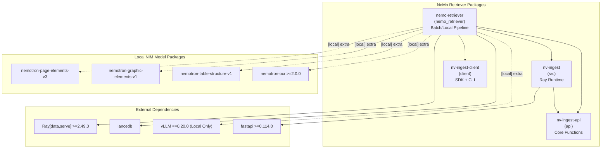
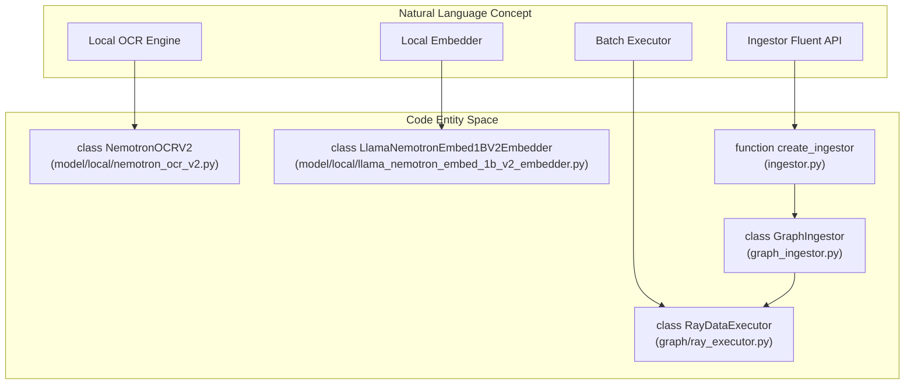

<!-- source: DeepWiki mcp.deepwiki.com · repo NVIDIA/NeMo-Retriever · page 1.2 Package Structure · fetched 2026-10-26 -->

# Package Structure

Relevant source files

The following files were used as context for generating this wiki page:

- [.github/workflows/huggingface-nightly.yml](.github/workflows/huggingface-nightly.yml)
- [.gitignore](.gitignore)
- [ci/scripts/nightly_build_publish.py](ci/scripts/nightly_build_publish.py)
- [ci/tests/test_huggingface_release_workflow.py](ci/tests/test_huggingface_release_workflow.py)
- [docker/scripts/post_build_triggers.py](docker/scripts/post_build_triggers.py)
- [nemo_retriever/pyproject.toml](nemo_retriever/pyproject.toml)
- [nemo_retriever/src/nemo_retriever/__init__.py](nemo_retriever/src/nemo_retriever/__init__.py)
- [nemo_retriever/src/nemo_retriever/examples/graph_pipeline.py](nemo_retriever/src/nemo_retriever/examples/graph_pipeline.py)
- [nemo_retriever/src/nemo_retriever/graph/__init__.py](nemo_retriever/src/nemo_retriever/graph/__init__.py)
- [nemo_retriever/src/nemo_retriever/graph/webhook_operator.py](nemo_retriever/src/nemo_retriever/graph/webhook_operator.py)
- [nemo_retriever/src/nemo_retriever/ingestor.py](nemo_retriever/src/nemo_retriever/ingestor.py)
- [nemo_retriever/src/nemo_retriever/model/local/llama_nemotron_embed_1b_v2_embedder.py](nemo_retriever/src/nemo_retriever/model/local/llama_nemotron_embed_1b_v2_embedder.py)
- [nemo_retriever/src/nemo_retriever/model/local/nemotron_ocr_v2.py](nemo_retriever/src/nemo_retriever/model/local/nemotron_ocr_v2.py)
- [nemo_retriever/src/nemo_retriever/model/local/nemotron_parse_v1_2.py](nemo_retriever/src/nemo_retriever/model/local/nemotron_parse_v1_2.py)
- [nemo_retriever/src/nemo_retriever/params/__init__.py](nemo_retriever/src/nemo_retriever/params/__init__.py)
- [nemo_retriever/src/nemo_retriever/text_embed/vllm.py](nemo_retriever/src/nemo_retriever/text_embed/vllm.py)
- [nemo_retriever/src/nemo_retriever/txt/split.py](nemo_retriever/src/nemo_retriever/txt/split.py)
- [nemo_retriever/tests/test_nemotron_ocr_v2_nightly.py](nemo_retriever/tests/test_nemotron_ocr_v2_nightly.py)
- [nemo_retriever/tests/test_vllm_embed.py](nemo_retriever/tests/test_vllm_embed.py)
- [nemo_retriever/tests/test_webhook_operator.py](nemo_retriever/tests/test_webhook_operator.py)
- [nemo_retriever/uv.lock](nemo_retriever/uv.lock)

This document describes the Python packages that compose the NeMo Retriever Library system, their relationships, directory organization, and build/release architecture.

## Overview

The NeMo Retriever system is organized into three primary internal packages and integrates several specialized NVIDIA NIM model packages. The `nemo-retriever` package acts as the high-level entry point, providing the `GraphIngestor` and the `retriever` CLI.

| Package | Directory | PyPI Name | Purpose |
|---------|-----------|-----------|---------|
| API | `api/` | `nv-ingest-api` | Core document processing functions and task definitions. |
| Client | `client/` | `nv-ingest-client` | Python SDK and CLI tools for job submission and result retrieval. |
| Service | `src/` | `nv-ingest` | Ray-based microservice runtime and orchestration layer. |
| Retriever | `nemo_retriever/` | `nemo-retriever` | High-level batch/in-process pipeline with local NIM execution capabilities. |

**Sources:** [nemo_retriever/pyproject.toml:19-76](), [nemo_retriever/src/nemo_retriever/ingestor.py:5-14]()

## Package Dependency Graph

The following diagram illustrates how the `nemo-retriever` package aggregates the core ingestion logic and provides interfaces for both local and remote execution.

The `nemo-retriever` package uses `uv` workspace sources to depend on the other three internal packages during development [nemo_retriever/pyproject.toml:204-208](). It provides several "extras" to keep the core installation lightweight, such as `[local]` for GPU-accelerated inference and `[multimedia]` for audio/video processing [nemo_retriever/pyproject.toml:106-151]().

**Sources:** [nemo_retriever/pyproject.toml:78-195](), [nemo_retriever/src/nemo_retriever/ingestor.py:58-83]()

## Source Layout and Key Modules

The `nemo_retriever` package is structured to support multiple execution modes (run modes) and a wide variety of document modalities.

### Execution Entry Points
The system-facing interface is defined in `nemo_retriever.ingestor` [nemo_retriever/src/nemo_retriever/ingestor.py:1-83](). The `create_ingestor` factory function instantiates either a `GraphIngestor` (for `inprocess` or `batch` modes) or a `ServiceIngestor` (for remote `service` mode) [nemo_retriever/src/nemo_retriever/ingestor.py:43-83]().

### Local Model Wrappers
For `run_mode='inprocess'` or `run_mode='batch'`, the system can invoke models locally without a remote NIM endpoint. These are housed in `nemo_retriever.model.local`:
* **`NemotronOCRV2`**: Wraps the `nemotron_ocr` package for local text detection and recognition [nemo_retriever/src/nemo_retriever/model/local/nemotron_ocr_v2.py:21-37]().
* **`LlamaNemotronEmbed1BV2Embedder`**: Uses vLLM's pooling runner for high-throughput local text embedding [nemo_retriever/src/nemo_retriever/model/local/llama_nemotron_embed_1b_v2_embedder.py:24-45]().
* **`NemotronParseV1_2`**: Local implementation of the visual document parser [nemo_retriever/src/nemo_retriever/model/local/nemotron_parse_v1_2.py:1-10]().

### Configuration and Parameters
All pipeline stages are configured using Pydantic models defined in `nemo_retriever.params`. This ensures type safety across the library and API boundaries.
* **`ExtractParams`**: Configuration for document parsing (OCR, tables, etc.) [nemo_retriever/src/nemo_retriever/params/models.py:13]().
* **`EmbedParams`**: Configuration for text and multimodal embedding [nemo_retriever/src/nemo_retriever/params/models.py:12]().
* **`VdbUploadParams`**: Settings for LanceDB or Milvus ingestion [nemo_retriever/src/nemo_retriever/params/models.py:34]().

**Sources:** [nemo_retriever/src/nemo_retriever/params/__init__.py:1-78](), [nemo_retriever/src/nemo_retriever/ingestor.py:21-30]()

## Code Entity Relationship Diagram

This diagram maps natural language system concepts to their specific code implementations and locations.

**Sources:** [nemo_retriever/src/nemo_retriever/ingestor.py:43-83](), [nemo_retriever/src/nemo_retriever/model/local/nemotron_ocr_v2.py:21](), [nemo_retriever/src/nemo_retriever/model/local/llama_nemotron_embed_1b_v2_embedder.py:24]()

## Build and Release System

The library uses a specialized build system to manage nightly releases and local GPU dependencies.

### Versioning and Build Logic
The `nemo-retriever` version is dynamic, calculated via `nemo_retriever.version.get_build_version` [nemo_retriever/pyproject.toml:202](). For nightly builds, the `nightly_build_publish.py` script patches PEP 440 dev versions into `pyproject.toml` using a UTC timestamp suffix [ci/scripts/nightly_build_publish.py:77-88]().

### Dependency Management
The system relies on `uv` for dependency resolution [nemo_retriever/pyproject.toml:5-16](). It includes specific overrides to handle platform-specific wheel availability, such as constraining `fastparquet` and suppressing `opencv-python` in favor of `opencv-python-headless` [nemo_retriever/pyproject.toml:10-16]().

### Nightly Workflows
The `.github/workflows/huggingface-nightly.yml` workflow coordinates the building of the core library and specialized NIM packages like `nemotron-ocr-v2` [.github/workflows/huggingface-nightly.yml:1-197]().
* **`build_ocr_cuda`**: Specifically builds the OCR package on `x86_64` and `aarch64` runners to ensure CUDA extension compatibility [.github/workflows/huggingface-nightly.yml:175-193]().
* **`nightly_coordinate`**: Generates a synchronized timestamp suffix so all packages in a single run share the same version [.github/workflows/huggingface-nightly.yml:52-80]().

**Sources:** [ci/scripts/nightly_build_publish.py:126-160](), [nemo_retriever/pyproject.toml:1-8]()

## CLI Entry Points

The `nemo-retriever` package exposes two primary CLI tools:

| Command | Entry Point | Purpose |
|---------|-------------|---------|
| `retriever` | `nemo_retriever.__main__:main` | Primary CLI for running ingestion pipelines and managing services. |
| `retriever-harness` | `nemo_retriever.harness:main` | Benchmarking and evaluation tool for testing recall and performance. |

**Sources:** [nemo_retriever/pyproject.toml:198-199](), [nemo_retriever/src/nemo_retriever/examples/graph_pipeline.py:34-45]()

---

