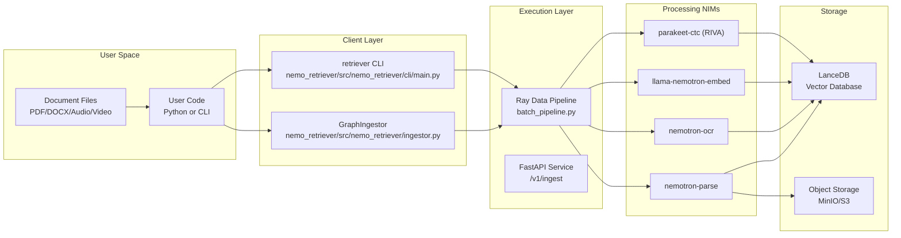
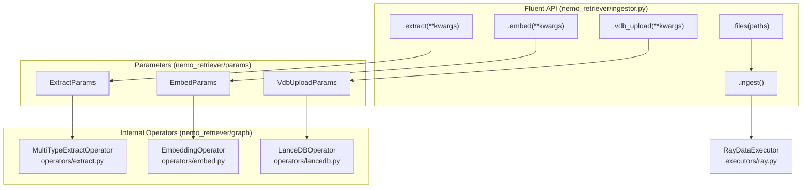

<!-- source: DeepWiki mcp.deepwiki.com · repo NVIDIA/NeMo-Retriever · page 3 User Guide · fetched 2026-10-26 -->

# User Guide

<details>
<summary>Relevant source files</summary>

The following files were used as context for generating this wiki page:

- [README.md](README.md)
- [docs/docs/extraction/audio-video.md](docs/docs/extraction/audio-video.md)
- [docs/docs/extraction/concepts.md](docs/docs/extraction/concepts.md)
- [docs/docs/extraction/getting-started-about.md](docs/docs/extraction/getting-started-about.md)
- [docs/docs/extraction/overview.md](docs/docs/extraction/overview.md)
- [docs/mkdocs.yml](docs/mkdocs.yml)
- [nemo_retriever/README.md](nemo_retriever/README.md)
- [nemo_retriever/docs/cli/README.md](nemo_retriever/docs/cli/README.md)

</details>


This guide explains how to use NeMo Retriever Library to process documents and extract multimodal content for RAG applications. It covers the primary user-facing interfaces—the Python API and command-line tools—and demonstrates the core workflow for submitting jobs, configuring extraction tasks, and retrieving results.

For deployment instructions and initial setup, see [Getting Started](#2). For advanced features like batch pipelines and GPU optimization, see [Advanced Topics](#5).

---

## Overview of User Interfaces

NeMo Retriever Library provides two primary interfaces for document processing:

1. **Python API**: The `Ingestor` class provides a fluent, chainable interface for building document processing pipelines programmatically. It supports `run_mode="batch"` for local Ray-based scaling and `run_mode="service"` for remote API calls. [README.md:32-61]()
2. **Command-Line Interface (CLI)**: The `retriever` command enables quick document processing from the terminal, replacing legacy ingestion-service tools. [nemo_retriever/docs/cli/README.md:1-34]()

Both interfaces submit jobs to the underlying service layer or local Ray-based execution graph and retrieve structured results containing extracted text, tables, charts, images, and embeddings. [docs/docs/extraction/concepts.md:5-16]()

---

## Core User Workflow



**Figure 1: High-Level User Workflow**

The typical workflow follows these stages:

1. **Configure Pipeline**: User code creates an `Ingestor` instance via `create_ingestor()` and chains task methods (`.extract()`, `.embed()`, etc.). [README.md:37-57]()
2. **Submit Jobs**: The `.ingest()` method executes the pipeline (locally via Ray or remotely via API). [README.md:59-61]()
3. **Process**: The system orchestrates NIMs or local models to extract, detect, and embed content. [docs/docs/extraction/overview.md:1-20]()
4. **Store**: Results are optionally uploaded to LanceDB and object storage. [docs/docs/extraction/concepts.md:17-20]()
5. **Retrieve**: The client receives a `pandas.DataFrame` or `Ray Dataset` containing extracted content and metadata. [docs/docs/extraction/concepts.md:13-16]()

**Sources:** [README.md:32-61](), [docs/docs/extraction/overview.md:1-20](), [docs/docs/extraction/concepts.md:5-20]()

---

## Task Chaining and Pipeline Building

The `Ingestor` implements a fluent interface where each method returns a modified ingestor instance, allowing for lazy definition of tasks. [README.md:45-57]()

### Ingestor Method to Code Entity Mapping



**Figure 2: API Methods to Internal Operators**

**Key Methods:**

| Method | Purpose | Key Parameters | Detail Link |
|--------|---------|----------------|-------------|
| `.files(paths)` | Specify input files | `List[str]` or glob patterns | [Ingestor Python API](#3.1) |
| `.extract(...)` | Configure parsing | `extract_text`, `extract_tables`, `extract_method` | [Extraction Configuration](#3.3) |
| `.embed(...)` | Configure vectors | `model_name`, `embed_modality` | [Embedding Configuration](#3.4) |
| `.vdb_upload(...)` | Vector DB storage | `vdb_op='lancedb'`, `collection_name` | [Vector Database Upload](#3.5) |
| `.ingest()` | Execute pipeline | N/A (returns DataFrame) | [Ingestor Python API](#3.1) |

**Sources:** [README.md:46-61](), [nemo_retriever/README.md:94-116](), [docs/docs/extraction/concepts.md:21-30]()

---

## Command-Line Interface (CLI)

The `retriever` CLI provides a Typer-based interface for running pipelines and querying results. It replaces the legacy `ingestion-service` CLI. [nemo_retriever/docs/cli/README.md:27-34]()

### CLI Command Structure

| Subcommand | Purpose | Primary Use Case |
|------------|---------|------------------|
| `retriever ingest` | Ingest docs to LanceDB | Quick start and simple local indexing. |
| `retriever pipeline run` | Run full graph pipeline | Batch processing with fine-grained control. |
| `retriever query` | Search LanceDB | Testing retrieval and recall. |
| `retriever eval run` | Run QA evaluation | Measuring RAG quality with LLM-as-judge. |

**Example Command:**
```bash
retriever pipeline run ./data/multimodal_test.pdf \
  --input-type pdf \
  --method pdfium \
  --extract-text --extract-tables --extract-charts \
  --store-images-uri ./processed_docs/images
```
[nemo_retriever/docs/cli/README.md:74-81]()

For details, see [Command Line Interface](#3.2).

---

## Core Configuration Topics

### Extraction and Parsing
NeMo Retriever supports multiple extraction methods per document type. For example, PDFs can use standard `pdfium` or the advanced `nemotron_parse` NIM for complex layouts. [docs/docs/extraction/overview.md:14-20]()
For details, see [Extraction Configuration](#3.3).

### Multimodal Embeddings
The system can compute embeddings for text, images, or combined text+image elements using `llama-nemotron-embed` models. [docs/docs/extraction/concepts.md:17-20]()
For details, see [Embedding Configuration](#3.4).

### Vector Database Upload
Extracted elements and their embeddings are stored in LanceDB by default. The system supports metadata sidecars for filtered retrieval. [README.md:20-21](), [docs/docs/extraction/overview.md:5-7]()
For details, see [Vector Database Upload](#3.5).

### RAG Integration
The library integrates with LangChain and LlamaIndex, allowing the ingested content to be used directly in generative AI applications. [docs/docs/extraction/overview.md:53-54]()
For details, see [RAG Integration Examples](#3.6).

---

## Next Steps

- **[Ingestor Python API](#3.1)** — Document the fluent Ingestor API for configuring and executing ingestion pipelines.
- **[Command Line Interface](#3.2)** — Document the retriever CLI commands and options.
- **[Extraction Configuration](#3.3)** — Guide for configuring document extraction across different formats.
- **[Embedding Configuration](#3.4)** — Document embedding generation and modality control.
- **[Vector Database Upload](#3.5)** — Guide for uploading embeddings to LanceDB or Milvus.
- **[RAG Integration Examples](#3.6)** — Demonstrate integration with popular LLM frameworks.

**Sources:** [docs/mkdocs.yml:75-120](), [nemo_retriever/docs/cli/README.md:50-59]()

---

