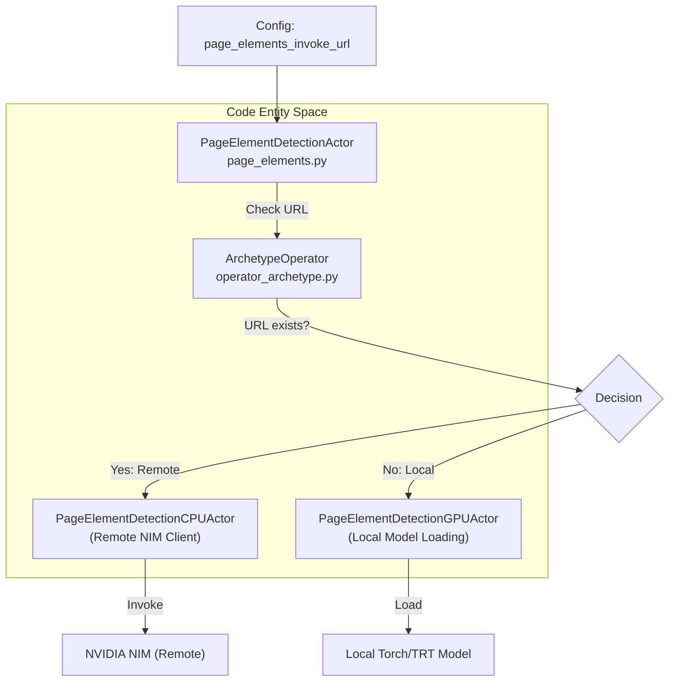

<!-- source: DeepWiki mcp.deepwiki.com · repo NVIDIA/NeMo-Retriever · page 4.1 NVIDIA NIMs (Inference Microservices) · fetched 2026-10-26 -->

# NVIDIA NIMs (Inference Microservices)

<details>
<summary>Relevant source files</summary>

The following files were used as context for generating this wiki page:

- [docs/docs/extraction/nimclient.md](docs/docs/extraction/nimclient.md)
- [nemo_retriever/src/nemo_retriever/api/__init__.py](nemo_retriever/src/nemo_retriever/api/__init__.py)
- [nemo_retriever/src/nemo_retriever/api/internal/primitives/nim/default_values.py](nemo_retriever/src/nemo_retriever/api/internal/primitives/nim/default_values.py)
- [nemo_retriever/src/nemo_retriever/api/internal/primitives/nim/model_interface/ocr.py](nemo_retriever/src/nemo_retriever/api/internal/primitives/nim/model_interface/ocr.py)
- [nemo_retriever/src/nemo_retriever/api/internal/primitives/nim/model_interface/yolox.py](nemo_retriever/src/nemo_retriever/api/internal/primitives/nim/model_interface/yolox.py)
- [nemo_retriever/src/nemo_retriever/api/internal/primitives/nim/nim_client.py](nemo_retriever/src/nemo_retriever/api/internal/primitives/nim/nim_client.py)
- [nemo_retriever/src/nemo_retriever/api/util/pdf/pdfium.py](nemo_retriever/src/nemo_retriever/api/util/pdf/pdfium.py)
- [nemo_retriever/src/nemo_retriever/graph/gpu_operator.py](nemo_retriever/src/nemo_retriever/graph/gpu_operator.py)
- [nemo_retriever/src/nemo_retriever/nim/nim.py](nemo_retriever/src/nemo_retriever/nim/nim.py)
- [nemo_retriever/src/nemo_retriever/ocr/__init__.py](nemo_retriever/src/nemo_retriever/ocr/__init__.py)
- [nemo_retriever/src/nemo_retriever/page_elements/page_elements.py](nemo_retriever/src/nemo_retriever/page_elements/page_elements.py)
- [nemo_retriever/tests/test_slim_imports_no_triton.py](nemo_retriever/tests/test_slim_imports_no_triton.py)

</details>


This page describes the NVIDIA Inference Microservices (NIMs) that power the document processing capabilities of NeMo Retriever Library. NIMs are containerized AI models optimized for production deployment, providing specialized capabilities for extraction, embedding, and captioning tasks.

For details on specific NIM categories, see [Document Processing NIMs](#4.1.1) and [Embedding and Reranking NIMs](#4.1.2).

---

## Overview

NVIDIA NIMs are pre-packaged, optimized inference containers that encapsulate state-of-the-art AI models with production-ready inference servers. In the NeMo Retriever architecture, NIMs serve as the specialized processing engines that analyze documents, extract structured content, generate embeddings, and perform other AI-powered transformations.

Each NIM is deployed as an independent microservice that exposes standardized APIs (HTTP and gRPC) for inference requests. The main `nv-ingest-ms-runtime` service orchestrates calls to these NIMs as part of the document processing pipeline.

**Key Characteristics:**

- **Containerized**: Each NIM runs in its own Docker/Kubernetes container with all dependencies bundled.
- **GPU-Accelerated**: NIMs leverage NVIDIA GPUs via the Triton Inference Server backend.
- **Unified Client Interface**: The system uses a specialized `NimClient` to abstract communication details.
- **Scalable**: Support dynamic batching, concurrent requests, and horizontal scaling.

---

## NIM Client Architecture

The interaction between the NeMo Retriever Library and NIMs is managed by the `NimClient` and `ModelInterface` abstractions. This architecture allows the system to support multiple protocols and model types through a consistent interface.

**Figure 1: NIM Client Architecture and Entity Mapping**

```mermaid
graph TD
    subgraph "Code Entity Space (nemo_retriever/api/internal/primitives/nim)"
        NC["NimClient Class<br/>nim_client.py"]
        MI["ModelInterface (Abstract)<br/>model_interface/"]
        OCR_MI["OCRModelInterfaceBase<br/>model_interface/ocr.py"]
        YOLOX_MI["YoloxModelInterfaceBase<br/>model_interface/yolox.py"]
    end

    subgraph "Inference Protocol Space"
        GRPC["gRPC (Triton)<br/>Port 8001"]
        HTTP["HTTP/REST<br/>Port 8000"]
    end

    subgraph "NIM Microservices (Remote/Local)"
        NIM_OCR["nemotron-ocr-v1"]
        NIM_PAGE["nemotron-page-elements-v3"]
    end

    NC -->|Uses| MI
    MI <|-- OCR_MI
    MI <|-- YOLOX_MI

    NC -->|tritonclient.grpc| GRPC
    NC -->|requests| HTTP

    GRPC --> NIM_OCR
    HTTP --> NIM_PAGE
```

**Sources:** [nemo_retriever/src/nemo_retriever/api/internal/primitives/nim/nim_client.py:47-135](), [docs/docs/extraction/nimclient.md:6-12](), [nemo_retriever/src/nemo_retriever/api/internal/primitives/nim/model_interface/ocr.py:33-45]()

### NimClient and ModelInterface
The `NimClient` handles the low-level communication (retries, timeouts, protocol selection), while the `ModelInterface` implementation defines how data is prepared, formatted for the specific model, and parsed upon return.
- **NimClient**: Manages `ThreadPoolExecutor` for concurrent requests and handles `429` (Rate Limit) backoff [nemo_retriever/src/nemo_retriever/api/internal/primitives/nim/nim_client.py:52-96]().
- **ModelInterface**: Provides methods like `format_input` and `parse_output` to translate between internal Python objects and NIM-specific payloads [docs/docs/extraction/nimclient.md:61-83]().

---

## NIM Selection Logic: Remote vs. Local Inference

The library dynamically selects between remote NIM microservices and local GPU inference based on the provided configuration (specifically the `invoke_url`).

**Figure 2: Inference Routing Logic**



**Sources:** [nemo_retriever/src/nemo_retriever/page_elements/page_elements.py:24-42](), [nemo_retriever/src/nemo_retriever/graph/gpu_operator.py:8-20]()

**Selection Mechanism:**
- **Remote NIM**: Triggered if an `invoke_url` is provided in the operator keywords. The system routes the task to a "CPU" variant actor (e.g., `PageElementDetectionCPUActor`) which acts as a client to the remote microservice [nemo_retriever/src/nemo_retriever/page_elements/page_elements.py:27-36]().
- **Local Inference**: If no URL is provided, the system defaults to a `GPUOperator` variant (e.g., `PageElementDetectionGPUActor`) which loads the model directly into local GPU memory using Torch or TensorRT [nemo_retriever/src/nemo_retriever/page_elements/page_elements.py:38-42]().

---

## Core NIMs Catalog

The following table lists the primary NIMs used in NeMo Retriever Library:

| NIM Name | Purpose | Model Interface Class | Protocol Preference |
|----------|---------|-----------------------|---------------------|
| **nemotron-page-elements-v3** | Detects page elements (text, tables, charts) | `YoloxModelInterfaceBase` | gRPC [nemo_retriever/src/nemo_retriever/api/internal/primitives/nim/model_interface/yolox.py:112-115]() |
| **nemotron-ocr-v1** | Optical Character Recognition | `OCRModelInterfaceBase` | gRPC/HTTP [nemo_retriever/src/nemo_retriever/api/internal/primitives/nim/model_interface/ocr.py:33-45]() |
| **nemotron-table-structure-v1** | Analyzes table cells and rows | `YoloxModelInterfaceBase` | gRPC |
| **llama-nemotron-embed** | Text and multimodal embeddings | `EmbeddingModelInterface` | HTTP |

---

## Communication Protocols and Batching

### HTTP and gRPC
NIMs support both HTTP and gRPC. gRPC is generally preferred for high-throughput image processing (like OCR and Page Detection) because it avoids the overhead of large JSON payloads.
- **gRPC**: Uses `tritonclient.grpc` to communicate with the Triton Inference Server inside the NIM [nemo_retriever/src/nemo_retriever/api/internal/primitives/nim/nim_client.py:101-112]().
- **HTTP**: Uses the `requests` library for RESTful communication, often used for embedding and VLM models [nemo_retriever/src/nemo_retriever/api/internal/primitives/nim/nim_client.py:113-122]().

### Dynamic Batching
The `NimClient` implements a dynamic batching mechanism to optimize GPU utilization. It collects multiple individual inference requests and groups them into a single batch before sending them to the NIM, respecting a `dynamic_batch_timeout` and `max_batch_size` [nemo_retriever/src/nemo_retriever/api/internal/primitives/nim/nim_client.py:125-135]().

**Sources:** [nemo_retriever/src/nemo_retriever/api/internal/primitives/nim/nim_client.py:125-168](), [nemo_retriever/src/nemo_retriever/nim/nim.py:178-190]()

---

## Summary

NVIDIA NIMs provide the specialized intelligence required for complex document ingestion. By abstracting these services through a unified `NimClient` and providing a fallback to local inference, NeMo Retriever ensures flexibility across different deployment environments.

For details on specific NIM categories and their usage, see:
- [Document Processing NIMs](#4.1.1) — Details on Page Elements, Table Structure, and OCR NIMs.
- [Embedding and Reranking NIMs](#4.1.2) — Details on Embedding and Reranking microservices.

**Sources:** [docs/docs/extraction/nimclient.md:1-41](), [nemo_retriever/src/nemo_retriever/api/internal/primitives/nim/nim_client.py:1-135](), [nemo_retriever/src/nemo_retriever/page_elements/page_elements.py:1-57]()

---

