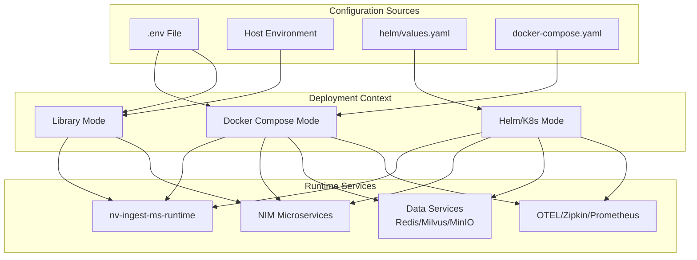
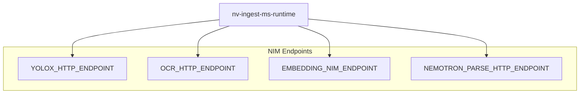
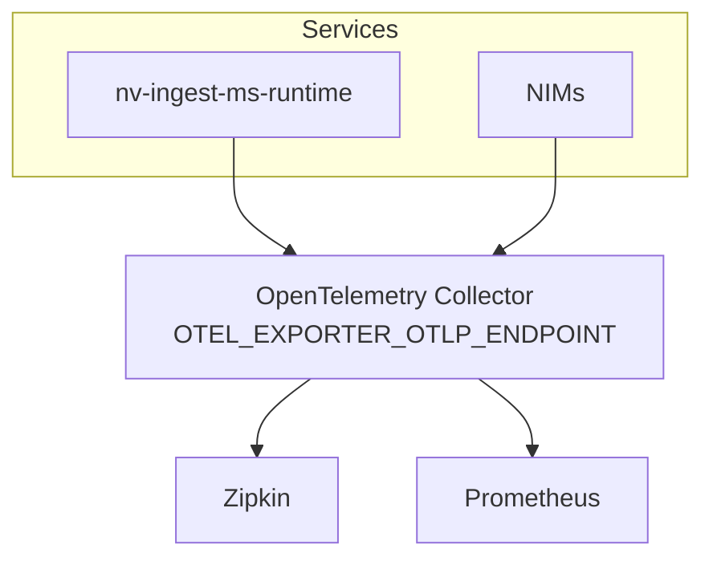

<!-- source: DeepWiki mcp.deepwiki.com · repo NVIDIA/NeMo-Retriever · page 7.4 Environment Variables · fetched 2026-10-26 -->

# Environment Variables

Relevant source files

The following files were used as context for generating this wiki page:

- [docs/docs/extraction/api-keys.md](docs/docs/extraction/api-keys.md)
- [docs/docs/extraction/environment-config.md](docs/docs/extraction/environment-config.md)

## Purpose and Scope

This document provides a comprehensive reference for all environment variables used to configure the NeMo Retriever Library system across deployment modes. Environment variables control service endpoints, authentication, resource allocation, observability, and runtime behavior.

For deployment-specific configuration guides, see [Docker Compose Deployment](#2.1.1), [Helm/Kubernetes Deployment](#2.1.2), and [Library Mode](#2.1.3). For detailed API configuration, see [Configuration Reference](#7.1).

## Overview

NeMo Retriever Library uses environment variables as the primary configuration mechanism across three deployment contexts:

1.  **Docker Compose** - Variables set in `.env` file or directly in `docker-compose.yaml`.
2.  **Helm/Kubernetes** - Variables defined in `helm/values.yaml` and injected via deployment templates.
3.  **Library Mode** - Variables read from the host environment or a local `.env` file.

The system follows a hierarchical configuration pattern where deployment-specific variables override defaults, and service-specific variables override global settings.

## Configuration Architecture

### Environment Variable Flow

**Sources:** [docs/docs/extraction/environment-config.md:1-24](), [docs/docs/extraction/api-keys.md:1-24]()

## Authentication and Access Control

These variables control authentication to NVIDIA services and container registries.

| Variable | Required | Default | Description | Deployment Context |
| :--- | :--- | :--- | :--- | :--- |
| `NVIDIA_API_KEY` | Yes | - | Authorized build.nvidia.com API key for NVIDIA-hosted NIMs. | All (primarily Library) |
| `NGC_API_KEY` | Yes | - | Key used by NIM microservices to access NGC resources. | Docker, Helm |
| `HF_ACCESS_TOKEN` | No | - | Token for Hugging Face Hub downloads (e.g., restricted tokenizers). | All modes |

### NVIDIA API Key (`NVIDIA_API_KEY`)
This key (typically starting with `nvapi-`) is used when running the Library from Python or calling remote NIM URLs at `ai.api.nvidia.com`. It is obtained from [build.nvidia.com](https://build.nvidia.com).

### NGC Personal Key (`NGC_API_KEY`)
Used for Kubernetes/Helm deployments to pull images from `nvcr.io` and provide credentials to in-cluster NIM workloads. It is not the same as the `NVIDIA_API_KEY`.

**Sources:** [docs/docs/extraction/environment-config.md:9-15](), [docs/docs/extraction/api-keys.md:3-30]()

## Service Endpoint Configuration

### NIM Microservice Endpoints

The runtime service connects to NIM microservices via HTTP/gRPC endpoints. While many are configured via YAML, environment variables often override these in containerized environments.

| Variable | Example / Default | Description |
| :--- | :--- | :--- |
| `EMBEDDING_NIM_ENDPOINT` | `http://embedding:8000/v1` | Endpoint for the embedding service. |
| `NEMOTRON_PARSE_HTTP_ENDPOINT` | `http://nemotron-parse:8000/v1` | Endpoint for the Nemotron-Parse NIM. |
| `OCR_HTTP_ENDPOINT` | `http://ocr:8000/v1/infer` | Endpoint for the OCR NIM. |

**Endpoint Resolution Diagram:**

**Sources:** [docs/docs/extraction/environment-config.md:1-24](), [docs/docs/extraction/api-keys.md:1-24]()

## Observability and Telemetry

### OpenTelemetry Configuration

| Variable | Example | Description |
| :--- | :--- | :--- |
| `OTEL_EXPORTER_OTLP_ENDPOINT` | `http://otel-collector:4317` | Endpoint for sending telemetry data to an OTLP collector. |

**Observability Pipeline:**

**Sources:** [docs/docs/extraction/environment-config.md:15-15]()

## Runtime and Performance Configuration

### System-Level Settings

| Variable | Default | Description |
| :--- | :--- | :--- |
| `INGEST_LOG_LEVEL` | `INFO` | Controls logging verbosity (`DEBUG`, `INFO`, `WARNING`, `ERROR`, `CRITICAL`). |
| `RETRIEVER_ENABLE_TORCH_TRT` | `false` | Enables Torch-TensorRT optimization for local model execution. |

### Resource Control

| Variable | Description |
| :--- | :--- |
| `CUDA_VISIBLE_DEVICES` | Controls which GPUs are visible to the runtime and local models. |

**Sources:** [docs/docs/extraction/environment-config.md:12-12]()

## Logging Configuration

| Variable | Default | Description |
| :--- | :--- | :--- |
| `INGEST_LOG_LEVEL` | `INFO` | The log level for the ingest service. |

**Sources:** [docs/docs/extraction/environment-config.md:12-12]()

## Troubleshooting Environment Variables

### Common Issues

1.  **Authentication Failures**: Ensure `NVIDIA_API_KEY` is exported in the shell for Library mode or `NGC_API_KEY` is provided in the Helm values for cluster deployments.
2.  **Telemetry Missing**: Verify `OTEL_EXPORTER_OTLP_ENDPOINT` is reachable from the container network.
3.  **Tokenizer Errors**: If using a restricted Llama tokenizer outside of the provided containers, ensure `HF_ACCESS_TOKEN` is set.

**Sources:** [docs/docs/extraction/environment-config.md:11-15](), [docs/docs/extraction/api-keys.md:10-24]()

---

