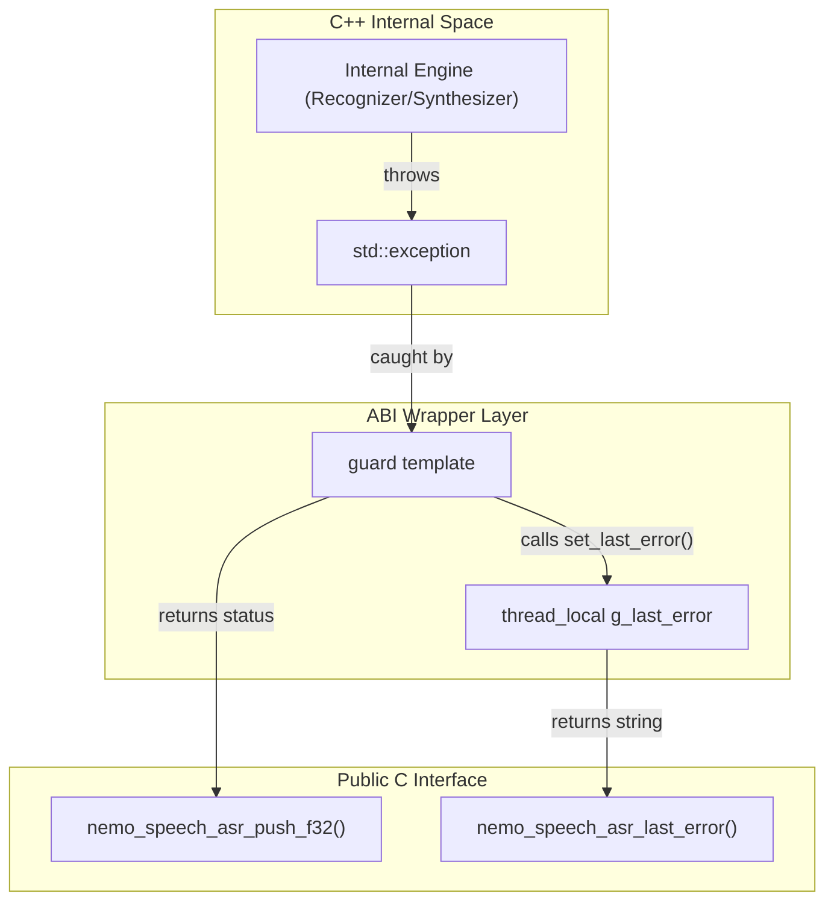
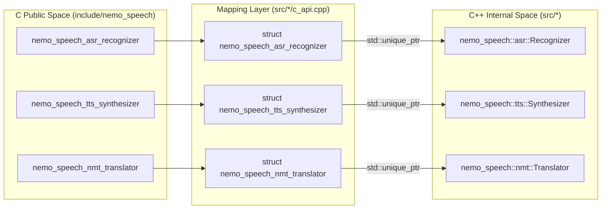

<!-- source: DeepWiki mcp.deepwiki.com · repo NVIDIA/NeMo-Speech.cpp · page 1.3 SDK and C ABI Reference · fetched 2026-10-26 -->

# SDK and C ABI Reference

<details>
<summary>Relevant source files</summary>

The following files were used as context for generating this wiki page:

- [include/nemo_speech/asr.h](include/nemo_speech/asr.h)
- [include/nemo_speech/diar.h](include/nemo_speech/diar.h)
- [include/nemo_speech/nmt.h](include/nemo_speech/nmt.h)
- [include/nemo_speech/tts.h](include/nemo_speech/tts.h)
- [server/http/CMakeLists.txt](server/http/CMakeLists.txt)
- [src/asr/c_api.cpp](src/asr/c_api.cpp)
- [src/asr/c_api.map](src/asr/c_api.map)
- [src/nmt/c_api.cpp](src/nmt/c_api.cpp)
- [src/nmt/c_api.map](src/nmt/c_api.map)
- [src/tts/c_api.cpp](src/tts/c_api.cpp)
- [src/tts/c_api.map](src/tts/c_api.map)
- [tests/c/asr_c_dlopen.c](tests/c/asr_c_dlopen.c)
- [tests/c/tts_c_dlopen.c](tests/c/tts_c_dlopen.c)
- [tests/c/tts_c_smoke.c](tests/c/tts_c_smoke.c)

</details>


NeMo-Speech.cpp provides a stable C ABI (Application Binary Interface) designed for binary compatibility across compiler versions and easy integration with FFIs (Foreign Function Interfaces) for languages like Python, Rust, or Go. The SDK is exposed via headers in `include/nemo_speech/` and implemented as a thin mapping layer over the internal C++ core.

## ABI Philosophy and Design Patterns

The ABI adheres to the following principles to ensure stability and compatibility:

*   **Opaque Handles**: Implementation details are hidden behind pointer handles (e.g., `nemo_speech_asr_recognizer*`). C++ types and exceptions never cross the ABI boundary [include/nemo_speech/asr.h:3-9]().
*   **Size-Prefixed Config Structs**: Configuration structures begin with a `size_t size` field. The library uses the `HAS_FIELD` macro to determine if a field is present based on the size passed by the caller, allowing fields to be appended to structs without breaking older binaries [src/asr/c_api.cpp:51-56]().
*   **Explicit Ownership**: Memory allocated by the library (e.g., result objects) must be explicitly freed using corresponding `*_destroy` functions [include/nemo_speech/asr.h:5-9]().
*   **No STL/No Exceptions**: Only Plain Old Data (POD) types and C-style pointers are used in signatures. Exceptions are caught internally and converted to error codes [src/asr/c_api.cpp:3-4]().

### Configuration Compatibility: HAS_FIELD
The `HAS_FIELD` pattern allows the library to maintain "append-only" ABI compatibility. If a caller compiled against an older header sends a smaller struct, missing tail fields are assigned library defaults [src/asr/c_api.cpp:51-53]().

```cpp
// Example from src/asr/c_api.cpp
#define HAS_FIELD(ptr, type, member) \
    ((ptr) != nullptr && (ptr)->size >= offsetof(type, member) + sizeof(((type*)nullptr)->member))
```

## Error Handling

The C ABI handles errors through a combination of status codes and thread-local error strings.

1.  **Status Enums**: Every major function returns a status code (e.g., `NEMO_SPEECH_ASR_OK`, `NEMO_SPEECH_NMT_ERROR_RUNTIME`) [include/nemo_speech/asr.h:43-49]().
2.  **Thread-Local Error Strings**: If a call fails, a descriptive error message is stored in a `thread_local` variable, accessible via `*_last_error()` [src/asr/c_api.cpp:45-49]().
3.  **The Guard Template**: Implementation files use a `guard` lambda wrapper to catch C++ exceptions and map them to the C status codes [src/nmt/c_api.cpp:77-99]().

### Error Propagation Flow

| Component | Responsibility |
| :--- | :--- |
| `g_last_error` | `thread_local` string storing the last error message [src/asr/c_api.cpp:45](). |
| `set_last_error()` | Helper to update the thread-local string [src/asr/c_api.cpp:46-49](). |
| `guard<F>` | Template that wraps internal C++ calls in a `try-catch` block [src/nmt/c_api.cpp:77-79](). |

**ABI Error Handling Data Flow**

Sources: [src/asr/c_api.cpp:43-49](), [src/nmt/c_api.cpp:77-99](), [include/nemo_speech/asr.h:43-49]().

## Subsystem References

### Automatic Speech Recognition (ASR)
The ASR API mirrors NVIDIA Riva's streaming patterns. It supports transparent dynamic batching where multiple threads can submit work to a single `nemo_speech_asr_recognizer` [include/nemo_speech/asr.h:7-9, 131-134]().

*   **Key Functions**:
    *   `nemo_speech_asr_create()`: Initializes the engine with `nemo_speech_asr_recognizer_config` [include/nemo_speech/asr.h:190-191]().
    *   `nemo_speech_asr_stream_open()`: Starts a recognition session [include/nemo_speech/asr.h:203]().
    *   `nemo_speech_asr_stream_push_f32()`: Submits audio samples [include/nemo_speech/asr.h:208-209]().

### Speaker Diarization
Standalone diarization is available through `nemo_speech/diar.h`. It uses the Sortformer model to provide "who spoke when" without requiring ASR [include/nemo_speech/diar.h:3-9]().

### Text-to-Speech (TTS)
The TTS API manages the MagpieTTS runtime. It provides both text-to-audio and token-to-audio synthesis paths [include/nemo_speech/tts.h:188-204]().

*   **Callback Pattern**: Audio is delivered via `nemo_speech_tts_pcm_callback` as 16-bit mono PCM [include/nemo_speech/tts.h:132-136]().
*   **Statistics**: Detailed performance metrics (RTFX, TTFA) are returned via `nemo_speech_tts_synthesis_stats` [include/nemo_speech/tts.h:138-180]().

### Neural Machine Translation (NMT)
The NMT API provides text-to-text translation using `nmt::Translator` [src/nmt/c_api.cpp:3-6]().

*   **Pool Config**: Allows configuring concurrent decode contexts for parallel translations [include/nemo_speech/nmt.h:65-68]().

## System Architecture: C ABI to Internal Core

The following diagram bridges the C ABI public surface to the internal C++ implementation classes.

**ABI to Core Mapping**

Sources: [src/asr/c_api.cpp:22-24](), [src/tts/c_api.cpp:22-26](), [src/nmt/c_api.cpp:21-23]().

## CMake Integration

The library exports several CMake targets under the `NeMoSpeech::` namespace. Consumers should link against the specific subsystem required to pull in necessary dependencies.

| Component | CMake Target | Dependencies |
| :--- | :--- | :--- |
| **Common** | `NeMoSpeech::Common` | `nemo_speech_common` [server/http/CMakeLists.txt:7]() |
| **ASR** | `NeMoSpeech::ASR` | `nemo_speech_asr`, `nemo_speech_diar` [src/asr/c_api.map:8-10]() |
| **TTS** | `NeMoSpeech::TTS` | `nemo_speech_tts` [src/tts/c_api.map:8]() |
| **NMT** | `NeMoSpeech::NMT` | `nemo_speech_nmt` [src/nmt/c_api.map:8]() |

### Linker Versioning
Shared libraries use linker version scripts (e.g., `src/asr/c_api.map`) to ensure only the `nemo_speech_*` symbols are exported, hiding all internal C++ symbols and protecting the binary contract [src/asr/c_api.map:1-13](), [src/nmt/c_api.map:1-11]().

Sources: [src/asr/c_api.map:1-13](), [src/nmt/c_api.map:1-11](), [src/tts/c_api.map:1-12](), [server/http/CMakeLists.txt:4-11]().

---

