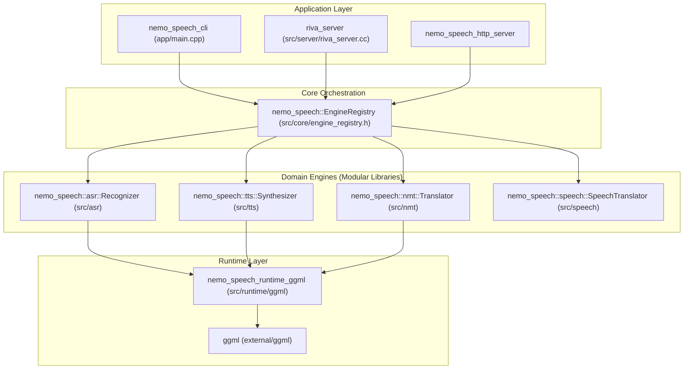
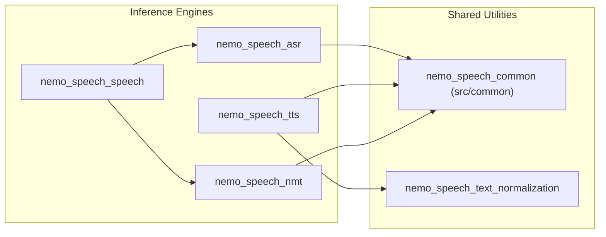

<!-- source: DeepWiki mcp.deepwiki.com · repo NVIDIA/NeMo-Speech.cpp · page 2 Core Architecture · fetched 2026-10-26 -->

# Core Architecture

Relevant source files

The following files were used as context for generating this wiki page:

- [app/CMakeLists.txt](app/CMakeLists.txt)
- [scripts/windows/build.ps1](scripts/windows/build.ps1)
- [src/common/CMakeLists.txt](src/common/CMakeLists.txt)
- [src/core/CMakeLists.txt](src/core/CMakeLists.txt)
- [src/core/engine_registry.cpp](src/core/engine_registry.cpp)
- [src/core/engine_registry.h](src/core/engine_registry.h)
- [src/nmt/CMakeLists.txt](src/nmt/CMakeLists.txt)
- [src/runtime/ggml/CMakeLists.txt](src/runtime/ggml/CMakeLists.txt)
- [src/services/CMakeLists.txt](src/services/CMakeLists.txt)
- [src/speech/CMakeLists.txt](src/speech/CMakeLists.txt)
- [src/tts/magpietts/CMakeLists.txt](src/tts/magpietts/CMakeLists.txt)
- [src/tts/nanocodec/CMakeLists.txt](src/tts/nanocodec/CMakeLists.txt)
- [src/tts/preproc/CMakeLists.txt](src/tts/preproc/CMakeLists.txt)

NeMo-Speech.cpp is designed as a modular, high-performance inference toolkit for speech AI. The architecture is structured into three primary layers: a low-level **GGML Runtime Layer** for hardware-accelerated tensor operations, a **Modular Library Layer** containing domain-specific logic (ASR, TTS, NMT), and a **Core Engine Registry** that manages model lifecycles and service composition.

### System Overview Diagram
The following diagram illustrates how the C++ entities compose the overall system, from the unified CLI down to the hardware backends.

**Sources:** [app/CMakeLists.txt:4-17](), [src/core/engine_registry.h:43-99](), [src/runtime/ggml/CMakeLists.txt:7-13]()

---

### GGML Runtime Layer
The foundation of the project is a specialized runtime built on top of `ggml`. This layer provides high-level C++ abstractions for managing neural network graphs, model loading, and backend dispatching.

*   **Session & Module:** Abstractions for executing computational graphs and managing state.
*   **GGUFLoader:** Handles the parsing of `.gguf` files, which contain both model weights and metadata.
*   **BackendManager:** Dispatches computations to available hardware backends such as CUDA, Metal, Vulkan, or CPU.

For a deep dive into graph construction, LRU caching, and backend dispatch, see [GGML Runtime Layer](#2.1).

**Sources:** [src/runtime/ggml/CMakeLists.txt:7-10](), [src/runtime/ggml/CMakeLists.txt:29-37]()

---

### Engine Registry and Service Composition
The `nemo_speech::EngineRegistry` acts as the central coordinator for the library. It is responsible for the singleton-like management of engine instances and handles the composition of complex pipelines.

| Component | Code Entity | Purpose |
| :--- | :--- | :--- |
| **ASR Engine** | `asr::Recognizer` | Speech-to-text inference. |
| **TTS Engine** | `tts::Synthesizer` | Text-to-speech synthesis. |
| **NMT Engine** | `nmt::Translator` | Neural Machine Translation. |
| **Speech Pipeline** | `speech::SpeechTranslator` | Composite ASR → NMT → TTS pipeline. |

The registry uses compile-time feature flags (e.g., `NEMO_SPEECH_REGISTRY_ASR`) to include or exclude specific engines, allowing for minimal builds. It also manages "Speech Translation" by automatically composing `asr_` and `nmt_` instances when both are loaded.

For details on instantiation logic and feature flags, see [Engine Registry and Service Composition](#2.2).

**Sources:** [src/core/engine_registry.h:38-76](), [src/core/engine_registry.cpp:150-162](), [src/core/CMakeLists.txt:11-28]()

---

### Modular Library Structure
The codebase is partitioned into distinct libraries, ensuring that domain logic (like audio resampling or text normalization) is shared efficiently while keeping the inference engines decoupled.

*   **nemo_speech_common:** Contains domain-agnostic utilities like `ParameterParser`, audio decoders, and resamplers.
*   **nemo_speech_text_normalization:** A separate library for WFST-based grammars (Sparrowhawk/OpenFST) used by both ASR and TTS.
*   **nemo_speech_speech:** A static library that links `nemo_speech_asr` and `nemo_speech_nmt` to provide end-to-end speech translation.

For more information on shared utilities, see [Common Utilities](#2.3).

**Sources:** [src/common/CMakeLists.txt:9-15](), [src/common/CMakeLists.txt:26-30](), [src/speech/CMakeLists.txt:3-17](), [src/nmt/CMakeLists.txt:13-23]()

---

