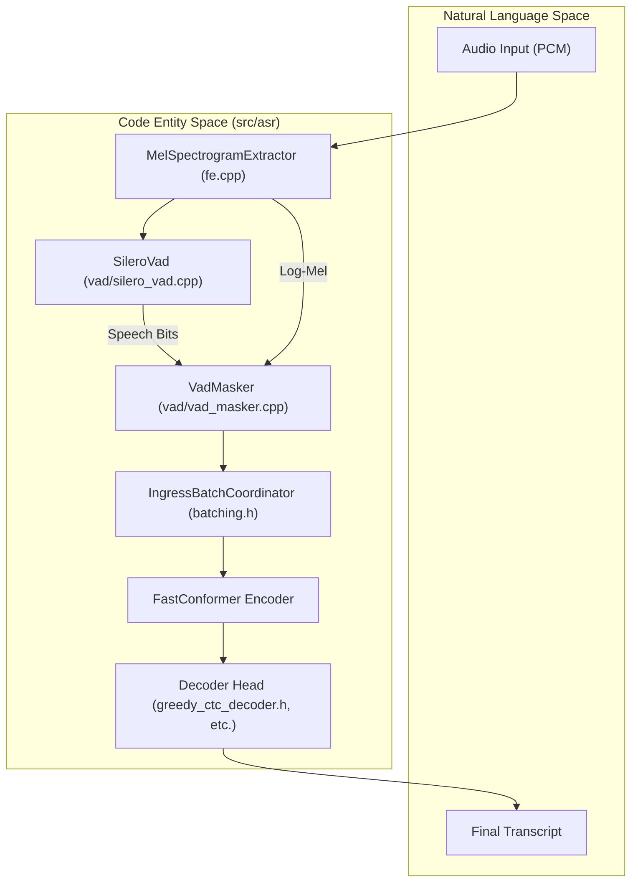
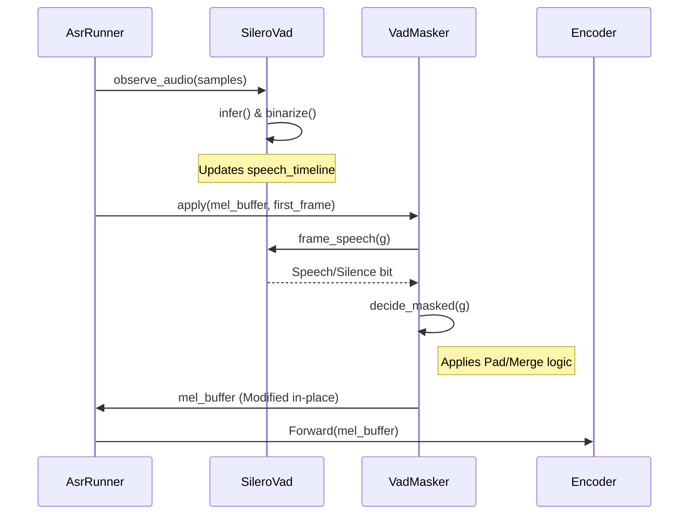

<!-- source: DeepWiki mcp.deepwiki.com · repo NVIDIA/NeMo-Speech.cpp · page 3.1 ASR Models and Configuration · fetched 2026-10-26 -->

# ASR Models and Configuration

Relevant source files

The following files were used as context for generating this wiki page:

- [conversion/vad.py](conversion/vad.py)
- [docs/asr/configuration.md](docs/asr/configuration.md)
- [docs/asr/customization.md](docs/asr/customization.md)
- [docs/asr/models.md](docs/asr/models.md)
- [docs/development/asr-batching.md](docs/development/asr-batching.md)
- [src/asr/batching.h](src/asr/batching.h)
- [src/asr/runner.cpp](src/asr/runner.cpp)
- [src/asr/vad/silero_vad.cpp](src/asr/vad/silero_vad.cpp)
- [src/asr/vad/silero_vad.h](src/asr/vad/silero_vad.h)
- [src/asr/vad/vad_masker.cpp](src/asr/vad/vad_masker.cpp)
- [src/asr/vad/vad_masker.h](src/asr/vad/vad_masker.h)
- [tests/cpp/asr/test_vad.cpp](tests/cpp/asr/test_vad.cpp)

NeMo-Speech.cpp supports a diverse range of Automatic Speech Recognition (ASR) model architectures, including CTC, RNNT, and TDT variants. The system is designed for both high-throughput offline transcription and low-latency streaming, utilizing a unified GGUF format for model distribution and execution.

## Supported Model Families

The ASR subsystem is built around the `FastConformer` encoder, which is shared across most modern NVIDIA NeMo ASR models. The specific behavior is determined by the decoder head and the model's training configuration.

| Model Family | Architecture | Key Characteristics | Source |
|---|---|---|---|
| **Parakeet CTC** | Connectionist Temporal Classification | Efficient, 1.1B parameters. Supports offline and buffered streaming. | [docs/asr/models.md:11-13]() |
| **Parakeet TDT** | Token-and-Duration Transducer | Multilingual (25 languages). Predicts token and duration simultaneously. Offline only. | [docs/asr/models.md:20-31]() |
| **Nemotron-Speech** | RNN-Transducer (RNNT) | 0.6B parameters. Cache-aware for low-latency streaming. | [docs/asr/models.md:36-38]() |
| **Nemotron 3.5** | RNNT + Prompting | Multilingual (40+ languages). Supports language-ID prompt conditioning. | [docs/asr/models.md:45-49]() |

### Model Acquisition and GGUF Format
Models are distributed as **GGUF** files via Hugging Face. These files contain both the neural network weights and critical metadata (e.g., `asr.rnnt.num_prompts`, `asr.rnnt.prompt_dictionary`) required for runtime execution [docs/asr/models.md:3-56]().

Custom NeMo checkpoints can be converted using the `convert_model.py` tool, which auto-detects the head type (CTC, RNNT, or TDT) from the `model_config.yaml` [docs/asr/models.md:78-84]().

### Quantization and Layouts
Weights are typically quantized to `q8_0` (1.062 bytes/elem) for a balance of quality and size [docs/asr/models.md:105-107](). For maximum performance on NVIDIA GPUs, the converter supports a **Planar Q8 layout**, which allows batched "skinny-Q8" tensor-core kernels to operate without a runtime repack [docs/asr/models.md:119-129]().

Sources: [docs/asr/models.md:1-133](), [conversion/vad.py:55-76]()

## ASR Configuration Schema

Configuration is managed via the `asr.*` namespace. These keys can be set via YAML files, environment variables, or CLI flags [docs/asr/configuration.md:3-6]().

### Core Configuration (`asr.*`)
| Key | Default | Description |
|---|---|---|
| `asr.model.path` | - | Path to the model GGUF (Required). |
| `asr.backend.gpu` | `0` | GPU index to use; `-1` for CPU. |
| `asr.streaming.chunk_size` | `0.16` | CTC buffered window size in seconds. |
| `asr.batching.enabled` | `false` | Enables dynamic microbatching of neural work. |
| `asr.decoder.kind` | `greedy` | `greedy` or `flashlight` (requires KenLM). |

### Voice Activity Detection (VAD)
The system integrates **Silero VAD** for feature masking and endpointing. The VAD stack is built inside `src/asr/runner.cpp` using `build_vad_stack` [src/asr/runner.cpp:125-152]().

| Key | Default | Description |
|---|---|---|
| `asr.vad.model_path` | - | Path to Silero VAD GGUF. |
| `asr.vad.masker.mask_enable` | `false` | Mask silence mel frames before the encoder. |
| `asr.vad.masker.onset` | `0.5` | Probability threshold to enter speech state. |
| `asr.vad.masker.offset` | `0.3` | Probability threshold to leave speech state. |

Sources: [docs/asr/configuration.md:16-76](), [src/asr/runner.cpp:125-152](), [src/asr/vad/vad_masker.h:29-62]()

## Implementation and Data Flow

The `Recognizer` and `AsrRunner` classes coordinate the ASR pipeline. The data flow bridges audio ingestion to neural inference through several stages.

### Neural Pipeline Diagram
This diagram illustrates the association between the conceptual ASR stages and the C++ classes/functions responsible for them.

Title: ASR Neural Pipeline Data Flow

Sources: [src/asr/runner.cpp:125-152](), [src/asr/vad/vad_masker.cpp:61-69](), [src/asr/batching.h:132-156]()

### Dynamic Microbatching
NeMo-Speech.cpp uses a work-conserving scheduler to combine compatible neural work into wider GPU graphs.
1. **Ingress Wave:** `IngressBatchCoordinator` aligns streaming audio arrivals within an `ingress_cohort_delay_us` window [src/asr/batching.h:132-156]().
2. **Compatibility Key:** Only requests with identical graph-shaping dimensions (e.g., same chunk size) share a microbatch [docs/development/asr-batching.md:111-113]().
3. **State Arena:** Stateful models (RNNT, VAD) reserve device memory rows in a `state_arena_slots` structure to prevent crosstalk between streams [docs/development/asr-batching.md:119-122]().

### VAD Masking Logic
The `VadMasker` applies a four-step policy to the mel-spectrogram:
1. **Binarize:** Hysteresis using `onset`/`offset` thresholds.
2. **Pad:** Extend speech segments by `pad_onset_ms` and `pad_offset_ms`.
3. **Merge:** Join silence gaps shorter than `min_duration_off_ms`.
4. **Mask:** Set non-speech frames to `mask_value` (default -16.635) before normalization [src/asr/vad/vad_masker.h:6-18]().

Title: VAD and Masking Interaction

Sources: [src/asr/vad/vad_masker.h:73-87](), [src/asr/vad/silero_vad.h:141-159](), [src/asr/vad/vad_masker.cpp:30-58]()

## Post-Processing and Endpointing

The ASR pipeline includes several post-neural stages:
* **Endpointing:** `VadEndpointer` triggers a "End of Utterance" (EOU) fire based on either token-silence or VAD timeline events [src/asr/runner.cpp:125-152]().
* **Post-Processing:** The `fire_eou` helper commits the best hypothesis, captures word timings, and performs a soft reset of the decoder [src/asr/runner.cpp:96-119]().
* **Normalization:** If VAD masking is used, `normalize_per_feature` is applied to the masked log-mel features to ensure consistent input distribution to the encoder [src/asr/runner.cpp:68-89]().

Sources: [src/asr/runner.cpp:68-152](), [docs/asr/configuration.md:69-76]()

---

