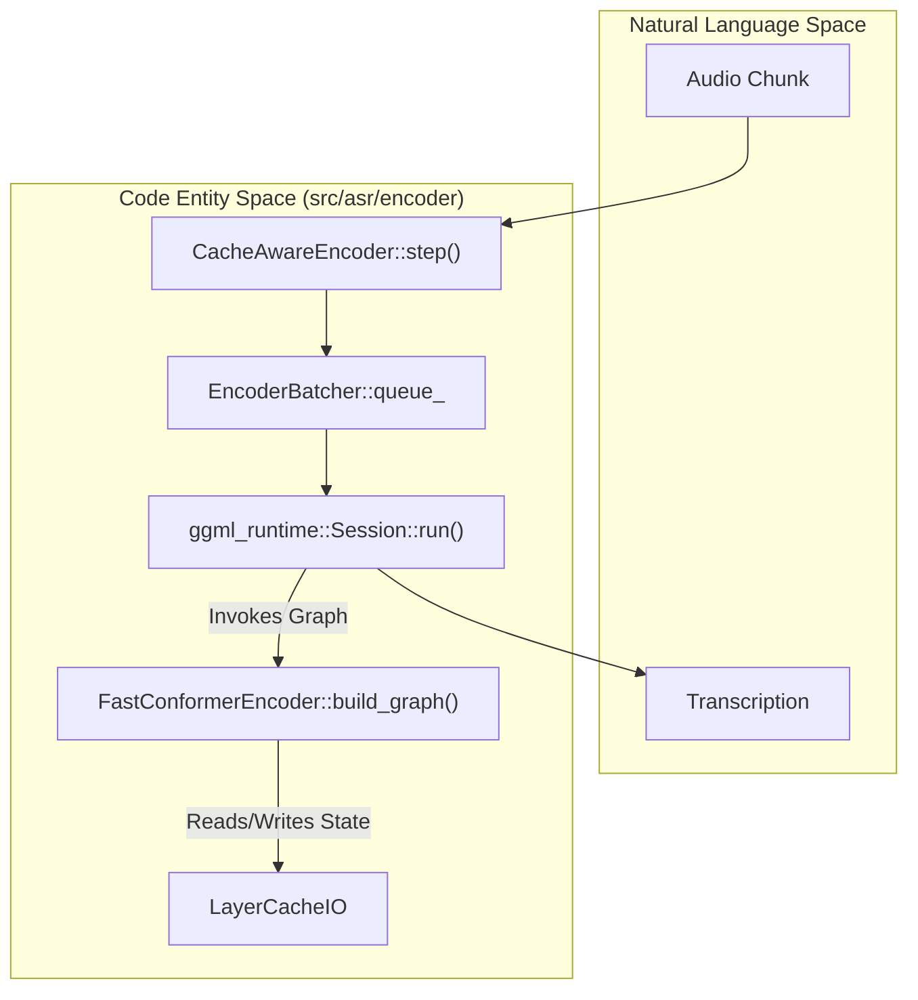
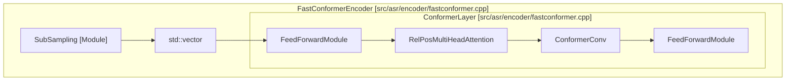

<!-- source: DeepWiki mcp.deepwiki.com · repo NVIDIA/NeMo-Speech.cpp · page 3.2 ASR Encoder: FastConformer · fetched 2026-10-26 -->

# ASR Encoder: FastConformer

Relevant source files

The following files were used as context for generating this wiki page:

- [src/asr/decoders/rnnt_greedy_decoder.cpp](src/asr/decoders/rnnt_greedy_decoder.cpp)
- [src/asr/encoder/cache_aware_encoder.cpp](src/asr/encoder/cache_aware_encoder.cpp)
- [src/asr/encoder/fastconformer.cpp](src/asr/encoder/fastconformer.cpp)
- [src/asr/encoder/fastconformer.h](src/asr/encoder/fastconformer.h)
- [src/asr/encoder/transformer_encoder.cpp](src/asr/encoder/transformer_encoder.cpp)
- [src/asr/encoder/transformer_encoder.h](src/asr/encoder/transformer_encoder.h)

The FastConformer encoder is the primary acoustic feature extractor for ASR models in NeMo-Speech.cpp. It is designed to be highly efficient, supporting both offline batch processing and low-latency streaming inference through a cache-aware architecture. The implementation resides primarily in `src/asr/encoder/` and supports two main variants: the Parakeet-style (standard Conformer) and the Nemotron-style (cache-aware streaming Conformer) `[src/asr/encoder/fastconformer.h:7-13]()`.

## Architecture Overview

The FastConformer architecture consists of a convolutional subsampling stem followed by a stack of Conformer layers. Each Conformer layer integrates four main components: a feed-forward module, a multi-head self-attention module (with relative positional encoding), a convolution module, and a second feed-forward module `[src/asr/encoder/fastconformer.cpp:388-403]()`.

### Subsampling Stem
The `SubSampling` module performs 8x downsampling of input Mel-spectrogram features `[src/asr/encoder/fastconformer.h:47]()`. It utilizes a series of `Conv2D` and `Conv2DDW` (depthwise) layers `[src/asr/encoder/fastconformer.cpp:80-108]()`. For streaming models, the subsampling stem uses **causal padding** to ensure that future frames are not accessed during the convolution operation `[src/asr/encoder/fastconformer.cpp:138-166]()`.

### Conformer Layer
A single `ConformerLayer` executes the following sequence:
1.  **FFN1**: Feed-forward module (half-step).
2.  **MHA**: Multi-head attention with relative positional embeddings.
3.  **Conv**: Depthwise convolution module.
4.  **FFN2**: Feed-forward module (half-step).
5.  **Final Norm**: Layer normalization `[src/asr/encoder/fastconformer.cpp:665-725]()`.

### Relative Position Attention
The attention mechanism in FastConformer uses relative positional encodings, which allow the model to generalize better to varying sequence lengths compared to absolute encodings `[src/asr/encoder/rel_pos_attention.h:7-15]()`. The implementation supports a **fused CUDA kernel** for relative position multi-head attention (RHA) to optimize performance on NVIDIA GPUs `[src/asr/encoder/rel_pos_attention.cpp:113-140]()`.

## Streaming and Caching Strategies

NeMo-Speech.cpp implements a sophisticated caching mechanism to enable "look-ahead" streaming without re-processing the entire audio history.

### Cache-Aware Execution
When `CacheMode::Enabled` is set, the encoder maintains state across successive audio chunks `[src/asr/encoder/fastconformer.h:38-40]()`. The state consists of:
*   **K/V Cache**: Stores past keys and values for the attention mechanism `[src/asr/encoder/fastconformer.h:123-124]()`.
*   **Conv Cache**: Stores the `kernel-1` past frames required for depthwise convolution to bridge chunk boundaries `[src/asr/encoder/fastconformer.h:132]()`.

### CacheStreamRunner vs. BufferedStreamRunner
The system provides two strategies for managing the streaming state:

| Strategy | Class | Description |
| :--- | :--- | :--- |
| **Cache-Aware** | `CacheAwareEncoder` | Uses model-internal K/V and Conv caches. Only the new audio chunk is processed, making it extremely efficient for long streams `[src/asr/encoder/cache_aware_encoder.h:20-30]()`. |
| **Buffered** | `BufferedStreamRunner` | Used for models without internal cache support. It maintains a sliding window buffer of raw audio/features and re-runs the encoder on the full window for each step. |

### Data Flow: Streaming Encoder Step
The following diagram illustrates how the `CacheAwareEncoder` interacts with the `FastConformerEncoder` and the `ggml_runtime::Session` to process a single chunk of audio while maintaining state.

**Streaming State Management Flow**

*Sources: `[src/asr/encoder/cache_aware_encoder.cpp:69-126]()`, `[src/asr/encoder/fastconformer.h:122-153]()`*

## Implementation Details

### Configuration Parameters
The `EncoderConfig` struct defines the geometry of the FastConformer model, including `d_model`, `n_layers`, and `conv_kernel_size` `[src/asr/encoder/fastconformer.h:41-52]()`. Key streaming parameters include:
*   `cache_left_ctx`: The number of past frames visible to the attention mechanism `[src/asr/encoder/fastconformer.h:63]()`.
*   `cache_right_ctx`: The "look-ahead" frames required by the model `[src/asr/encoder/fastconformer.h:64]()`.
*   `cache_chunk_frames`: The number of new frames processed in each streaming step `[src/asr/encoder/fastconformer.h:67]()`.

### Encoder Graph Construction
The `FastConformerEncoder::build_graph` function constructs the GGML computation graph. It handles the wiring of the `LayerCacheIO` for each layer when caching is enabled `[src/asr/encoder/fastconformer.cpp:1152-1200]()`.

**Encoder Internal Module Hierarchy**

*Sources: `[src/asr/encoder/fastconformer.cpp:1100-1140]()`, `[src/asr/encoder/fastconformer.cpp:665-725]()`*

### GPU Optimizations
To achieve high throughput, the encoder utilizes several specialized kernels:
*   **Fused RelPos Attention**: Combined GEMM and attention scoring for relative positions `[src/asr/encoder/rel_pos_attention.cpp:113-140]()`.
*   **Depthwise Convolution Fusions**: The `dw_conv_w_ct` tensor represents a repacked weight layout that enables a direct channels-inner depthwise kernel, avoiding expensive transpositions `[src/asr/encoder/fastconformer.h:140-146]()`.
*   **Batching**: The `EncoderBatcher` class aggregates multiple streaming requests into a single `ggml_runtime::Session::run()` call to maximize GPU utilization `[src/asr/encoder/cache_aware_encoder.cpp:69-126]()`.

Sources:
- `[src/asr/encoder/fastconformer.h:1-110]()`
- `[src/asr/encoder/fastconformer.cpp:1-1200]()`
- `[src/asr/encoder/rel_pos_attention.h:1-50]()`
- `[src/asr/encoder/rel_pos_attention.cpp:1-140]()`
- `[src/asr/encoder/cache_aware_encoder.h:1-60]()`
- `[src/asr/encoder/cache_aware_encoder.cpp:1-160]()`

---

