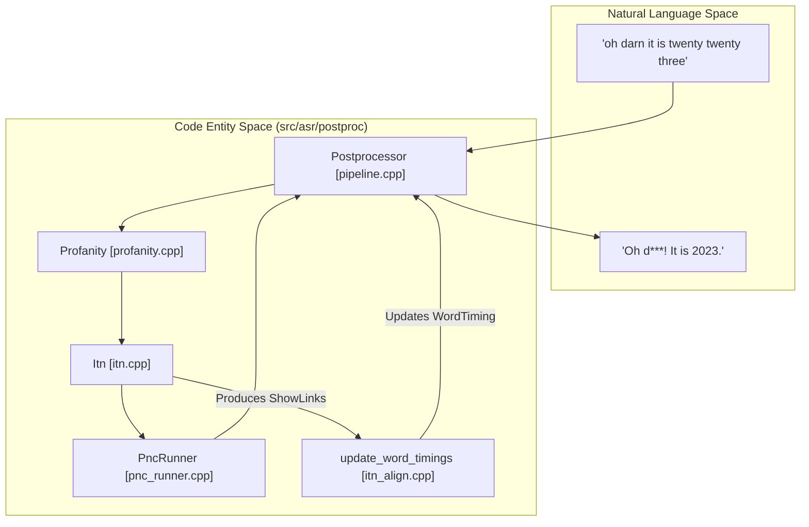

<!-- source: DeepWiki mcp.deepwiki.com · repo NVIDIA/NeMo-Speech.cpp · page 3.4 ASR Post-Processing: ITN, PnC, and Profanity · fetched 2026-10-26 -->

# ASR Post-Processing: ITN, PnC, and Profanity

Relevant source files

The following files were used as context for generating this wiki page:

- [conversion/pnc.py](conversion/pnc.py)
- [src/asr/pnc/pnc_model.cpp](src/asr/pnc/pnc_model.cpp)
- [src/asr/pnc/pnc_model.h](src/asr/pnc/pnc_model.h)
- [src/asr/pnc/pnc_runner.h](src/asr/pnc/pnc_runner.h)
- [src/asr/pnc/wordpiece.cpp](src/asr/pnc/wordpiece.cpp)
- [src/asr/pnc/wordpiece.h](src/asr/pnc/wordpiece.h)
- [src/asr/postproc/itn_align.cpp](src/asr/postproc/itn_align.cpp)
- [src/asr/postproc/itn_align.h](src/asr/postproc/itn_align.h)
- [src/asr/postproc/pipeline.cpp](src/asr/postproc/pipeline.cpp)
- [src/asr/postproc/profanity.cpp](src/asr/postproc/profanity.cpp)
- [src/asr/postproc/profanity.h](src/asr/postproc/profanity.h)
- [src/common/audio_file.cpp](src/common/audio_file.cpp)
- [src/tts/magpietts/audio_pp.cpp](src/tts/magpietts/audio_pp.cpp)
- [tests/cpp/asr/test_oov_boost.cpp](tests/cpp/asr/test_oov_boost.cpp)
- [tests/cpp/asr/test_pnc.cpp](tests/cpp/asr/test_pnc.cpp)
- [tests/cpp/asr/test_postproc.cpp](tests/cpp/asr/test_postproc.cpp)

The ASR post-processing pipeline transforms raw, spoken-form ASR transcripts (typically lowercase and unpunctuated) into formatted, written-form text. This subsystem handles Inverse Text Normalization (ITN), Punctuation and Capitalization (PnC), and profanity filtering. A critical feature of this pipeline is the alignment logic that preserves word-level timing information even when ITN collapses multiple spoken words into a single written token (e.g., "twenty twenty three" $\rightarrow$ "2023").

## Post-Processing Pipeline Orchestration

The `Postprocessor` class in `src/asr/postproc/pipeline.cpp` manages the execution flow. It utilizes a thread-pool `Executor` to handle concurrent requests and manages the lifecycle of ITN grammars and PnC models.

### Data Flow and Code Entity Mapping

The following diagram illustrates how the `Postprocessor` orchestrates various internal entities to transform text.

**ASR Post-Processing Data Flow**

**Sources:** [src/asr/postproc/pipeline.cpp:101-184](), [src/asr/postproc/pipeline.h:26-60]().

---

## Inverse Text Normalization (ITN)

ITN converts spoken-form text into written-form (e.g., dates, currencies, numbers). In NeMo-Speech.cpp, this is implemented using **Sparrowhawk** and **OpenFST** grammars.

### Grammar Management
The `ItnRegistry` discovers and loads language-specific Finite State Transducer (FST) archives (`.far` files). It expects two specific grammars per language:
1. `tokenize_and_classify.far`: Identifies entities in the text.
2. `verbalize.far`: Converts identified entities into their written representation.

### Alignment and Timing Preservation
When ITN is applied, the number of words in the output often differs from the input. The `update_word_timings` function in `src/asr/postproc/itn_align.cpp` uses alignment metadata (in Sparrowhawk's "ShowLinks" format) to map the original ASR timestamps back to the new written tokens.

*   **1:1 Matches:** Unchanged words retain their original `WordTiming`.
*   **Collapses:** If "twenty", "twenty", and "three" collapse into "2023", the new token takes the `start_frame` of the first word and the `end_frame` of the last [src/asr/postproc/itn_align.cpp:153-160]().
*   **Expansions:** If one spoken word expands to multiple written words, the timing is partitioned across the new tokens [src/asr/postproc/itn_align.cpp:202-210]().

**Sources:** [src/asr/postproc/itn_align.cpp:105-210](), [src/asr/postproc/pipeline.cpp:101-136]().

---

## Punctuation and Capitalization (PnC)

The PnC system uses a BERT-based model to predict punctuation marks and capitalization status for each token.

### BERT PnC Architecture
The model (`PncBertModule`) consists of:
1.  **Embeddings:** Token, Position, and Segment (Type) embeddings [src/asr/pnc/pnc_model.cpp:49-57]().
2.  **Encoder Blocks:** Standard Transformer blocks with LayerNorm and GELU activations [src/asr/pnc/pnc_model.cpp:26-39]().
3.  **Heads:** Two separate Linear heads—one for punctuation labels (e.g., `O`, `,`, `.`, `?`) and one for capitalization (e.g., `O`, `U`) [src/asr/pnc/pnc_model.cpp:40-43]().

### Inference Pipeline
The `PncRunner` handles the end-to-end PnC logic:
1.  **Tokenization:** Uses `WordPieceTokenizer` to segment the ASR transcript [src/asr/pnc/wordpiece.cpp:16-42]().
2.  **Sliding Window:** Since BERT has a `max_seq_length` (typically 128), the runner processes text in overlapping segments [src/asr/pnc/pnc_runner.h:3-5]().
3.  **Reconstruction:** Merges the model's argmax predictions back into the string, attaching punctuation to the left and capitalizing tokens marked with the `U` label [src/asr/pnc/pnc_runner.cpp:15-28]().

**Sources:** [src/asr/pnc/pnc_model.cpp:21-44](), [src/asr/pnc/pnc_runner.h:1-29](), [src/asr/pnc/wordpiece.h:1-43]().

---

## Profanity Filtering

Profanity filtering is implemented as a high-performance, whole-word masking utility in `src/asr/postproc/profanity.cpp`.

### Masking Logic
*   **Whole Word Only:** Substrings are not masked (e.g., "darned" is not masked if "darn" is in the list) [tests/cpp/asr/test_postproc.cpp:92]().
*   **Punctuation Preservation:** Leading and trailing punctuation are stripped during the lookup but preserved in the output (e.g., `(darn)` becomes `(d***)`) [src/asr/postproc/profanity.cpp:61-75]().
*   **UTF-8 Safety:** The filter is UTF-8 aware. It keeps the first codepoint and replaces subsequent codepoints with `*`. This prevents splitting multi-byte characters, which would result in invalid UTF-8 strings [src/asr/postproc/profanity.cpp:82-93]().

**Sources:** [src/asr/postproc/profanity.cpp:38-103](), [tests/cpp/asr/test_postproc.cpp:80-94]().

---

## Post-Processing Configuration

The behavior of the pipeline is controlled via `PostprocConfig` and per-request `AsrRequestOptions`.

| Feature | Configuration Key / Flag | Logic Implementation |
| :--- | :--- | :--- |
| **ITN** | `itn_model_dir` | `Itn::normalize` |
| **PnC** | `pnc_model_path` | `PncRunner::postprocess` |
| **Profanity** | `profanity_list_path` | `Profanity::mask` |
| **Verbatim** | `verbatim_transcripts` | `strip_formatting` |

### Verbatim Mode
If `verbatim_transcripts` is set to `true`, the pipeline calls `strip_formatting`. This function lowercases the text and removes all sentence punctuation (`.,?!;:"()[]{}`), effectively reversing any formatting applied by a self-punctuating ASR model [src/asr/postproc/pipeline.cpp:56-78]().

**Sources:** [src/asr/postproc/pipeline.cpp:56-78](), [src/asr/postproc/pipeline.h:18-24]().

---

