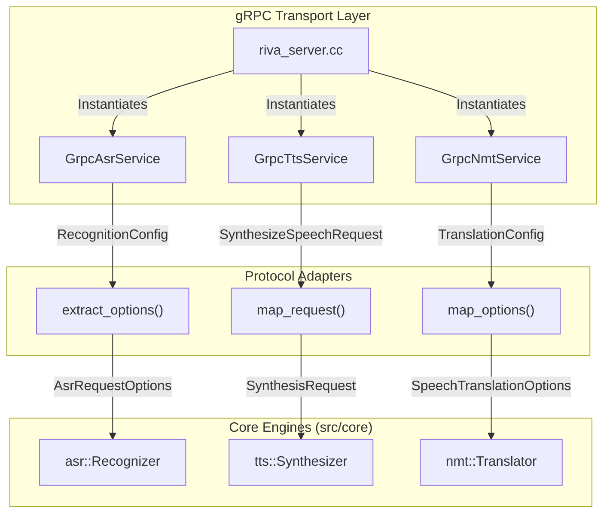
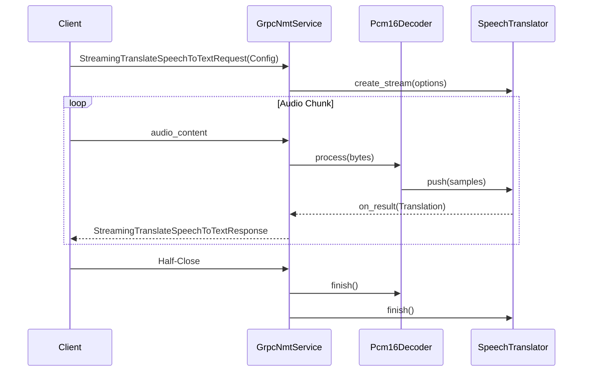

<!-- source: DeepWiki mcp.deepwiki.com · repo NVIDIA/NeMo-Speech.cpp · page 6.2 Riva gRPC Server · fetched 2026-10-26 -->

# Riva gRPC Server

Relevant source files

The following files were used as context for generating this wiki page:

- [app/synthesize.cpp](app/synthesize.cpp)
- [src/common/audio_resampler.cpp](src/common/audio_resampler.cpp)
- [src/server/CMakeLists.txt](src/server/CMakeLists.txt)
- [src/server/riva_server.cc](src/server/riva_server.cc)
- [src/services/grpc_asr.cc](src/services/grpc_asr.cc)
- [src/services/grpc_asr.h](src/services/grpc_asr.h)
- [src/services/grpc_nmt.cc](src/services/grpc_nmt.cc)
- [src/services/grpc_nmt.h](src/services/grpc_nmt.h)
- [src/services/grpc_tts.cc](src/services/grpc_tts.cc)
- [src/services/grpc_tts.h](src/services/grpc_tts.h)
- [tests/cpp/CMakeLists.txt](tests/cpp/CMakeLists.txt)
- [tests/cpp/nmt/CMakeLists.txt](tests/cpp/nmt/CMakeLists.txt)
- [tests/cpp/tts/test_magpietts_asr.cpp](tests/cpp/tts/test_magpietts_asr.cpp)
- [tests/cpp/tts/test_magpietts_file.cpp](tests/cpp/tts/test_magpietts_file.cpp)
- [tools/nanocodec.cpp](tools/nanocodec.cpp)

The `riva_server` ([src/server/riva_server.cc]()) is a high-performance gRPC server that implements the NVIDIA Riva API protocol. It serves as a transport adapter layer, wrapping the core C++ engines (ASR, TTS, and NMT) to provide compatibility with existing Riva clients and SDKs.

## Server Architecture and Service Enablement

The server uses a unified binary approach where multiple services (ASR, TTS, NMT) can be hosted on a single port. Service enablement is governed by a combination of configuration flags and automatic model detection.

### Service Logic
The server evaluates `ServiceEnablement` states ([src/server/riva_server.cc:37-41]()) for each subsystem:
- **Auto**: Service is enabled if its required model paths are provided ([src/server/riva_server.cc:147-148]()).
- **On/Off**: Explicitly overrides the detection logic.

### Environment Variable Management
The server manages specific environment variables to optimize the underlying GGML runtime:
- **CUDA Graph Eviction**: By default, the server sets `GGML_CUDA_GRAPH_EVICT_AFTER_MS=0` ([src/server/riva_server.cc:120-124]()). This ensures that CUDA graphs remain resident in GPU memory across requests, significantly reducing Time-To-First-Audio (TTFA) for TTS.
- **Skinny-Q8**: The server supports the `GGML_CUDA_FORCE_SKINNY_S8` variable (managed via the environment) to toggle optimized quantized kernels.

### Lifecycle and Signal Handling
The server implements a graceful shutdown mechanism using a dedicated watcher thread.
- **Async-Safe Signals**: Signal handlers for `SIGINT` and `SIGTERM` only set an atomic flag `g_shutdown_requested` ([src/server/riva_server.cc:182-187]()).
- **Shutdown Watcher**: A separate thread polls this flag and calls `grpc::Server::Shutdown()` to avoid re-entrancy issues within gRPC internal mutexes ([src/server/riva_server.cc:176-181]()).
- **Fatal Diagnostics**: Custom handlers for `SIGSEGV` and `SIGFPE` log diagnostic information before re-raising the signal for supervisor (systemd/K8s) detection ([src/server/riva_server.cc:196-203]()).

**Sources:** [src/server/riva_server.cc:35-206]()

---

## Service Implementation Mapping

The following diagram bridges the Riva Protobuf definitions to the internal NeMo-Speech C++ entities.

### Code Entity Mapping: gRPC to Core Engines
| Riva gRPC Service | Protobuf Service Definition | Core Engine Class | Adapter File |
| :--- | :--- | :--- | :--- |
| `GrpcAsrService` | `RivaSpeechRecognition` | `asr::Recognizer` | `grpc_asr.cc` |
| `GrpcTtsService` | `RivaSpeechSynthesis` | `tts::Synthesizer` | `grpc_tts.cc` |
| `GrpcNmtService` | `RivaTranslation` | `nmt::Translator` | `grpc_nmt.cc` |

### Service Flow Diagram
This diagram illustrates how a gRPC request is transformed into engine-specific calls.

**Sources:** [src/services/grpc_asr.cc:103-105](), [src/services/grpc_tts.cc:161-162](), [src/services/grpc_nmt.cc:20-24]()

---

## ASR Service (GrpcAsrService)

The `GrpcAsrService` ([src/services/grpc_asr.cc]()) handles both unary (`Recognize`) and bidirectional streaming (`StreamingRecognize`) requests.

### Data Flow: StreamingRecognize
1. **Config Validation**: The first message must contain a `StreamingRecognitionConfig`. The server validates the encoding (supporting `LINEAR_PCM` or `ENCODING_UNSPECIFIED`) and sample rate ([src/services/grpc_asr.cc:58-79]()).
2. **Audio Processing**: Incoming `audio_content` is decoded via `audio::Pcm16StreamDecoder` and resampled if the client rate differs from the model rate ([src/services/grpc_asr.cc:13-14]()).
3. **Engine Interaction**: Samples are pushed to a `RecognizerStream`. The adapter listens for results (interim and final).
4. **Result Mapping**: Internal `asr::Alternative` results are mapped to `nr_asr::SpeechRecognitionAlternative` ([src/services/grpc_asr.cc:159-163]()).
5. **Riva Compatibility**: The adapter injects a leading space for non-first final transcripts to match Riva's cumulative display logic ([src/services/grpc_asr.cc:148-151]()).

### Batch Metrics
If `NEMO_SPEECH_BATCH_METRICS` is set, the service logs detailed execution statistics (queue wait, execution time, batch size) for the frontend, encoder, and decoder stages ([src/services/grpc_asr.cc:22-56]()).

**Sources:** [src/services/grpc_asr.cc:1-163](), [src/services/grpc_asr.h:20-43]()

---

## TTS Service (GrpcTtsService)

The `GrpcTtsService` ([src/services/grpc_tts.cc]()) implements the `Synthesize` and `SynthesizeOnline` (streaming) endpoints.

### Request Mapping
The `map_request` function ([src/services/grpc_tts.cc:161-198]()) translates Riva's `SynthesizeSpeechRequest` into an internal `tts::SynthesisRequest`. It handles:
- **Voice Selection**: Maps `voice_name` to internal speaker indices or model names.
- **Custom Configuration**: Parses `custom_configuration` map keys (e.g., `steps`, `top_k`, `temperature`, `cfg_scale`) into `SynthesisOptions` ([src/services/grpc_tts.cc:176-196]()).

### Performance Instrumentation
The service provides detailed logging of TTS metrics when enabled:
- **TTFA (Time To First Audio)**: Latency from request to first PCM chunk.
- **RTFX (Real-Time Factor)**: Ratio of synthesis time to audio duration.
- **Metadata**: Returns both the original and processed (normalized) text in the response metadata ([src/services/grpc_tts.cc:201-207]()).

**Sources:** [src/services/grpc_tts.cc:161-207](), [src/services/grpc_tts.h:18-35]()

---

## NMT Service (GrpcNmtService)

The `GrpcNmtService` ([src/services/grpc_nmt.cc]()) supports text-to-text, speech-to-text, and speech-to-speech translation.

### Translation Logic
- **Text Translation**: Uses `nmt::Translator::translate` to process batch text requests ([src/services/grpc_nmt.cc:123-144]()).
- **Speech Translation**: Orchestrates the `speech::SpeechTranslator` pipeline. It drives audio through a `Pcm16StreamDecoder` and pushes samples into a `SpeechTranslationStream` ([src/services/grpc_nmt.cc:80-108]()).
- **Language Pairs**: Exposes supported source/target language pairs via `ListSupportedLanguagePairs` ([src/services/grpc_nmt.cc:147-156]()).

### Audio Driving Loop
The `drive_audio` template ([src/services/grpc_nmt.cc:80-108]()) encapsulates the logic for reading gRPC stream messages, decoding PCM, and handling client cancellations or stream finishes.

**Sources:** [src/services/grpc_nmt.cc:80-156](), [src/services/grpc_nmt.h:18-48]()

---

