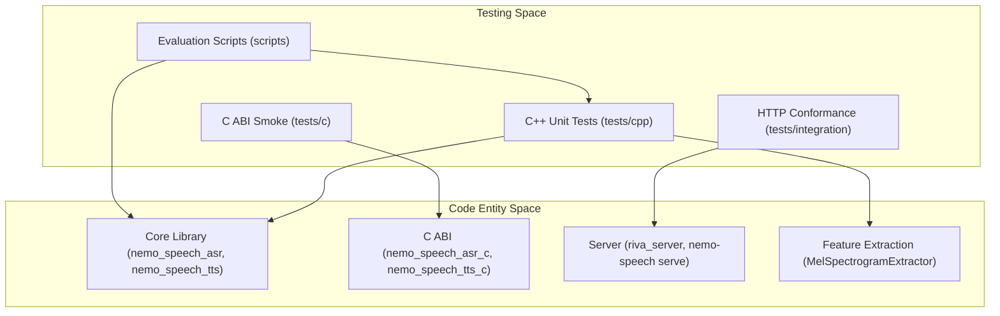
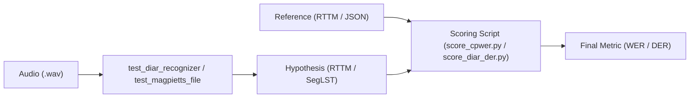

<!-- source: DeepWiki mcp.deepwiki.com · repo NVIDIA/NeMo-Speech.cpp · page 9 Testing and Evaluation · fetched 2026-10-26 -->

# Testing and Evaluation

Relevant source files

The following files were used as context for generating this wiki page:

- [scripts/asr/score_cpwer.py](scripts/asr/score_cpwer.py)
- [scripts/asr/score_diar_der.py](scripts/asr/score_diar_der.py)
- [scripts/tts/generate_mandarin_tokenizer_data.py](scripts/tts/generate_mandarin_tokenizer_data.py)
- [scripts/tts/tokenize-magpietts.py](scripts/tts/tokenize-magpietts.py)
- [src/asr/features/fe.cpp](src/asr/features/fe.cpp)
- [src/asr/features/fe.h](src/asr/features/fe.h)
- [src/server/CMakeLists.txt](src/server/CMakeLists.txt)
- [tests/c/asr_c_smoke.c](tests/c/asr_c_smoke.c)
- [tests/cpp/CMakeLists.txt](tests/cpp/CMakeLists.txt)
- [tests/cpp/asr/CMakeLists.txt](tests/cpp/asr/CMakeLists.txt)
- [tests/cpp/nmt/CMakeLists.txt](tests/cpp/nmt/CMakeLists.txt)
- [tests/cpp/tts/CMakeLists.txt](tests/cpp/tts/CMakeLists.txt)
- [tests/integration/http_conformance_test.py](tests/integration/http_conformance_test.py)

This page provides an overview of the NeMo-Speech.cpp testing infrastructure. The project employs a multi-layered testing strategy ranging from low-level C++ unit tests to high-level HTTP/gRPC conformance and evaluation scripts for measuring accuracy (WER, DER).

## Test Infrastructure Overview

The testing suite is organized into several distinct categories to ensure stability across the library, the C ABI, and the network services:

| Test Category | Description | Key Files/Tools |
|:---|:---|:---|
| **C++ Unit Tests** | Functional tests for core components (encoders, decoders, VAD, tokenizers). | `tests/cpp/` |
| **C ABI Smoke Tests** | Validates the stable C interface and `dlopen` compatibility. | `tests/c/` |
| **CLI Contract Tests** | Ensures the `nemo-speech` CLI adheres to its command-line interface contract. | `tests/cli/` |
| **Integration Tests** | Validates HTTP/WebSocket servers and OpenAI SDK compatibility. | `tests/integration/` |
| **Evaluation Scripts** | Python-based tools for scoring models against standard benchmarks. | `scripts/asr/`, `scripts/tts/` |

Sources: [tests/cpp/CMakeLists.txt:1-91](), [tests/c/asr_c_smoke.c:3-10]()

## Testing Architecture

The following diagram illustrates how the testing infrastructure interacts with the various layers of the NeMo-Speech.cpp codebase.

### Test-to-Code Mapping

Sources: [tests/cpp/asr/CMakeLists.txt:1-71](), [tests/cpp/tts/CMakeLists.txt:1-63](), [tests/integration/http_conformance_test.py:101-130]()

## Core Test Components

### C ABI and SDK Validation
To ensure the stable C ABI remains valid for C consumers, the project includes "smoke tests" compiled strictly as C (not C++). These tests verify that `include/nemo_speech/asr.h` and `include/nemo_speech/tts.h` are compatible with standard C compilers and that the shared libraries can be loaded via `dlopen`.

- `asr_c_smoke`: Proves the `nemo_speech_asr_c` library links and runs offline/streaming recognition [tests/c/asr_c_smoke.c:3-10]().
- `tts_c_smoke`: Validates the unified TTS C ABI [tests/cpp/tts/CMakeLists.txt:19-22]().

### Integration and Conformance
The integration suite focuses on the network layer and external SDK compatibility.
- **HTTP Conformance**: Uses `http_conformance_test.py` to validate REST endpoints, WebSocket streaming protocols, and security headers like Content-Security-Policy [tests/integration/http_conformance_test.py:160-173]().
- **OpenAI Compatibility**: Validates that the server works as a drop-in replacement for OpenAI-compatible clients using the official JavaScript SDK [tests/integration/http_conformance_test.py:52-84]().

For details, see [Integration and Conformance Testing](#9.3).

### ASR and TTS Specific Testing
Each major subsystem has a dedicated suite of functional tests and benchmarking tools:
- **ASR**: Includes tests for CTC/RNNT streaming, VAD, endpointing, and diarization parity [tests/cpp/asr/CMakeLists.txt:3-52](). It also features `bench_asr_batching` for performance tuning.
- **TTS**: Covers MagpieTTS synthesis, tokenizer validation (including Mandarin and Japanese), and ASR loopback tests where synthesized audio is transcribed to verify accuracy [tests/cpp/tts/CMakeLists.txt:5-56]().

For details, see [ASR Testing and Benchmarking](#9.1) and [TTS Testing and Validation](#9.2).

## Accuracy Evaluation

The project provides Python scripts to calculate standard metrics for speech tasks:
- **WER/cpWER**: Concatenated-minimum-permutation Word Error Rate for multi-speaker ASR [scripts/asr/score_cpwer.py:4-17]().
- **DER**: Diarization Error Rate for evaluating the Sortformer diarizer against RTTM references [scripts/asr/score_diar_der.py:4-18]().
- **Mandarin Tokenizer Data**: A specialized generator for HMM and Pinyin tables used in native Mandarin synthesis [scripts/tts/generate_mandarin_tokenizer_data.py:4-32]().

### Evaluation Data Flow

Sources: [scripts/asr/score_cpwer.py:64-106](), [scripts/asr/score_diar_der.py:176-186]()

## Shared Utilities Testing
The `test_shared_utilities` executable targets common infrastructure in `src/common/`, such as the audio resampler, JSON utilities, and the `ParameterParser` [tests/cpp/CMakeLists.txt:10-16](). This ensures that fundamental operations like audio decoding and sample rate conversion (via `test_audio_resampler` and `test_audio_decoder`) remain consistent [tests/cpp/asr/CMakeLists.txt:29-34]().

Sources: [src/asr/features/fe.cpp:28-76](), [src/asr/features/fe.h:62-137]()

---

