# Page: NeMo-Speech.cpp Overview

# NeMo-Speech.cpp Overview

<details>
<summary>Relevant source files</summary>

The following files were used as context for generating this wiki page:

- [CMakeLists.txt](CMakeLists.txt)
- [README.md](README.md)
- [app/CMakeLists.txt](app/CMakeLists.txt)
- [cmake/NeMoSpeechConfig.cmake.in](cmake/NeMoSpeechConfig.cmake.in)
- [docker/Dockerfile](docker/Dockerfile)
- [docs/build.md](docs/build.md)
- [docs/install.md](docs/install.md)
- [docs/sdk.md](docs/sdk.md)
- [ggml-patches/README.md](ggml-patches/README.md)
- [scripts/windows/build.ps1](scripts/windows/build.ps1)
- [src/nmt/CMakeLists.txt](src/nmt/CMakeLists.txt)
- [src/runtime/ggml/CMakeLists.txt](src/runtime/ggml/CMakeLists.txt)
- [src/tts/magpietts/CMakeLists.txt](src/tts/magpietts/CMakeLists.txt)
- [src/tts/nanocodec/CMakeLists.txt](src/tts/nanocodec/CMakeLists.txt)
- [tools/CMakeLists.txt](tools/CMakeLists.txt)

</details>


NeMo-Speech.cpp is a high-performance, lightweight native C++ runtime designed to execute NVIDIA Nemotron Speech models. Built on the `ggml` tensor library, it enables realtime and batch speech processing across multiple platforms (Linux, macOS, Windows) and hardware backends (CUDA, Metal, Vulkan, CPU) [README.md:1-4]().

The project provides a unified stack for Automatic Speech Recognition (ASR), Text-to-Speech (TTS), Neural Machine Translation (NMT), and Speaker Diarization. It is designed for both CLI-based workflows and deep integration into existing applications via a stable C ABI [docs/sdk.md:7-10]().

## Key Capabilities

NeMo-Speech.cpp organizes its features into modular subsystems, which can be enabled or disabled at compile-time via CMake options [CMakeLists.txt:87-94]().

| Capability | Subsystem | Description |
| :--- | :--- | :--- |
| **ASR** | `nemo_speech_asr` | Offline and streaming recognition using FastConformer and Nemotron architectures [docs/sdk.md:38](). |
| **TTS** | `nemo_speech_tts` | High-fidelity synthesis via MagpieTTS and NanoCodec vocoders [docs/sdk.md:41](). |
| **NMT** | `nemo_speech_nmt` | Batched text translation using Riva-Translate models via `llama.cpp` integration [docs/sdk.md:40](). |
| **Diarization** | `nemo_speech_diar` | Standalone or ASR-integrated speaker diarization using Sortformer [docs/sdk.md:39](). |
| **Serving** | `nemo_speech_http` | OpenAI-compatible REST API, WebSockets, and a browser-based Playground [README.md:69-70](). |

## System Architecture

The architecture is layered to separate high-level speech logic from low-level hardware acceleration. The `ggml` runtime serves as the foundation, while the `EngineRegistry` manages the lifecycle of specific speech engines.

### Logic to Code Mapping
The following diagram illustrates how high-level system components map to specific libraries and executable targets within the codebase.

**System Component to Code Entity Mapping**
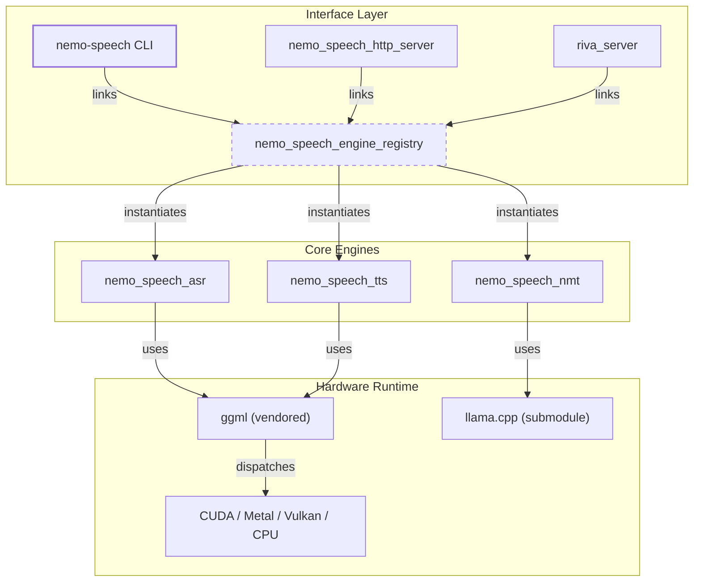
Sources: [app/CMakeLists.txt:4-17](), [src/tts/magpietts/CMakeLists.txt:11-18](), [src/nmt/CMakeLists.txt:13-23](), [CMakeLists.txt:100-104]()

### Library Relationships
The project uses a modular library structure. Most capabilities are exposed through both a C++ implementation library and a stable C ABI wrapper for SDK users.

**Internal Library Dependency Graph**
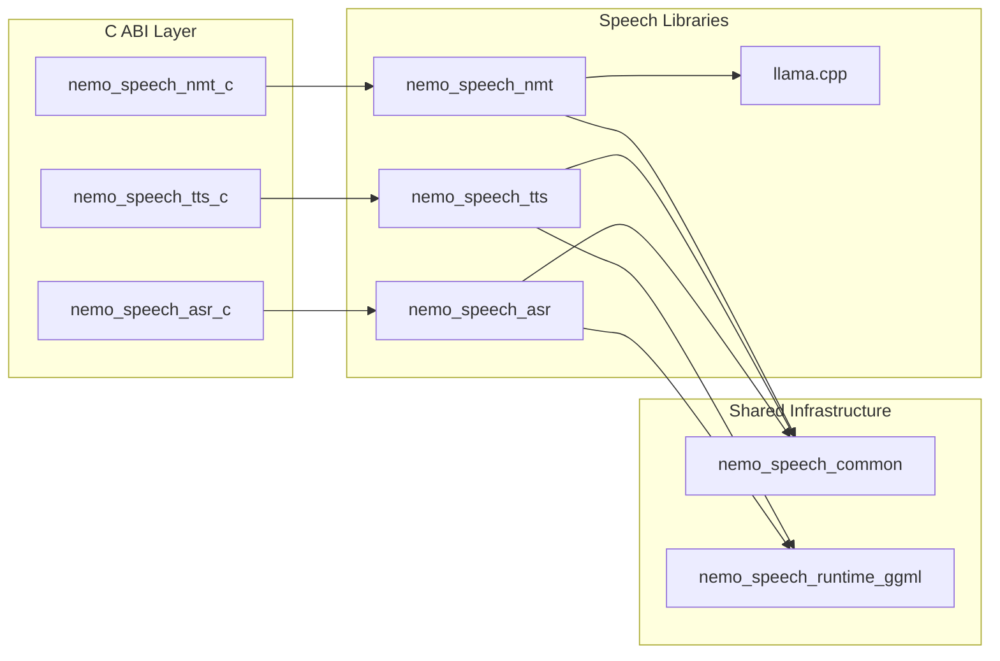
Sources: [src/tts/magpietts/CMakeLists.txt:36-42](), [src/nmt/CMakeLists.txt:39-43](), [app/CMakeLists.txt:23-27]()

## Supported Backends

NeMo-Speech.cpp supports a wide range of hardware through its `ggml` backend manager:
*   **CUDA:** Optimized for NVIDIA GPUs (sm_80+) with custom fused kernels for FastConformer and MagpieTTS [ggml-patches/README.md:57-68]().
*   **Metal:** Native acceleration for Apple Silicon [CMakeLists.txt:101]().
*   **Vulkan:** Cross-vendor GPU acceleration [CMakeLists.txt:100]().
*   **CPU:** Fallback for all platforms, including optimized ARM kernels [scripts/windows/build.ps1:108-111]().

## Next Steps

For detailed information on specific areas of the project, refer to the following child pages:

*   **[Getting Started: Installation and Build](#1.1)**: Step-by-step guide for setting up the environment, initializing submodules, and building for your specific platform.
*   **[CLI Reference](#1.2)**: Comprehensive guide to the `nemo-speech` command-line tool subcommands and flags.
*   **[SDK and C ABI Reference](#1.3)**: Technical details on integrating the runtime into your own applications using the stable C ABI.
*   **[SDK Usage Examples](#1.4)**: Walkthrough of provided example code for common tasks like file transcription and live synthesis.

Sources: [CMakeLists.txt:1-104](), [README.md:1-118](), [docs/sdk.md:1-60](), [docs/build.md:1-114]()

---

# Page: Getting Started: Installation and Build

# Getting Started: Installation and Build

<details>
<summary>Relevant source files</summary>

The following files were used as context for generating this wiki page:

- [.dockerignore](.dockerignore)
- [.pre-commit-config.yaml](.pre-commit-config.yaml)
- [CMakeLists.txt](CMakeLists.txt)
- [CMakePresets.json](CMakePresets.json)
- [README.md](README.md)
- [cmake/NeMoSpeechConfig.cmake.in](cmake/NeMoSpeechConfig.cmake.in)
- [docker/Dockerfile](docker/Dockerfile)
- [docs/build.md](docs/build.md)
- [docs/install.md](docs/install.md)
- [docs/sdk.md](docs/sdk.md)
- [ggml-patches/README.md](ggml-patches/README.md)
- [scripts/install.ps1](scripts/install.ps1)
- [scripts/install.sh](scripts/install.sh)
- [tests/install/install_ps1_test.py](tests/install/install_ps1_test.py)
- [tests/install/install_sh_test.py](tests/install/install_sh_test.py)
- [tools/CMakeLists.txt](tools/CMakeLists.txt)

</details>


This page provides a comprehensive technical guide for installing and building NeMo-Speech.cpp. The project supports multiple platforms (Linux, macOS, Windows) and backends (CUDA, Metal, Vulkan, CPU). It can be deployed via pre-built binaries, a unified installer script, or a manual CMake-based build process.

## Installation Overview

NeMo-Speech.cpp offers three primary paths for installation:
1.  **Unified Installer Scripts**: `scripts/install.sh` (Linux/macOS) and `scripts/install.ps1` (Windows) which automate backend detection and source/binary fetching [scripts/install.sh:1-15]() [scripts/install.ps1:1-13]().
2.  **Manual CMake Build**: For developers requiring specific feature flags (e.g., gRPC, NMT, or custom sanitizers) [CMakeLists.txt:74-100]().
3.  **Docker Deployment**: Containerized builds using multi-stage Dockerfiles for reproducible environments [docker/Dockerfile:3-13]().

### Platform and Backend Compatibility

| Backend | Platform Support | Requirement |
| :--- | :--- | :--- |
| **CUDA** | Linux, Windows | CUDA Toolkit 12/13, NVIDIA Driver [docs/build.md:14-16]() |
| **Metal** | macOS (Apple Silicon) | Xcode Command Line Tools [docs/build.md:36-38]() |
| **Vulkan** | Linux, Windows | Vulkan SDK (glslc, SPIR-V headers) [scripts/install.ps1:64-73]() |
| **CPU** | All | C++17 Compiler (GCC 13+, Clang, MSVC 2022) [docs/build.md:11-12]() |

---

## Automated Installation

The installer scripts prefer pre-built binaries if a release URL is configured via `NEMO_SPEECH_RELEASE_BASE_URL`. If no binary is found, they fall back to a source build [scripts/install.sh:127-152]() [scripts/install.ps1:99-123]().

### Linux and macOS
```bash
# Automated install with backend auto-detection
scripts/install.sh --source
export PATH="$HOME/.local/bin:$PATH"
```
Sources: [docs/install.md:17-23](), [scripts/install.sh:111-119]()

### Windows (PowerShell)
```powershell
# Automated install for Windows
.\scripts\install.ps1 -Source -Backend cuda
```
Sources: [docs/install.md:46-58](), [scripts/install.ps1:92-94]()

---

## Manual Build from Source

Manual builds allow for fine-grained control over components and optimizations via CMake options.

### 1. Submodule Initialization
The project relies on several submodules. You must initialize only those required for your build targets:
*   `ggml`: Required for all builds [docs/build.md:56]().
*   `third_party/cpp-httplib`: Required for the HTTP server (`NEMO_SPEECH_BUILD_HTTP`) [docs/build.md:57]().
*   `llama.cpp`: Required for NMT support (`NEMO_SPEECH_BUILD_NMT`) [docs/build.md:58]().
*   `proto/riva-common`: Required for gRPC adapters (`NEMO_SPEECH_BUILD_GRPC`) [docs/build.md:59]().

### 2. CMake Presets
The project uses `CMakePresets.json` to manage common configurations. Presets are named following the pattern `<backend>-<component>` [docs/build.md:74-76]().

**Common Presets:**
*   `cuda-asr`: CUDA-accelerated ASR and Diarization [CMakePresets.json:82-89]().
*   `metal-server`: Metal-accelerated ASR, TTS, and HTTP Server [CMakePresets.json:231-241]().
*   `cpu-speech`: CPU-only build with ASR, TTS, and NMT [CMakePresets.json:70-80]().

### 3. Build Procedure
```bash
# 1. Apply GGML patches (Required for CUDA performance)
scripts/apply-ggml-patches.sh

# 2. Configure using a preset
scripts/configure.sh cuda-server

# 3. Build
cmake --build --preset cuda-server
```
Sources: [docs/build.md:67-72](), [ggml-patches/README.md:7-10]()

### Installation Build Logic and Data Flow

The following diagram illustrates the relationship between the configuration scripts, the CMake build system, and the resulting artifacts.

**Build System Entity Map**
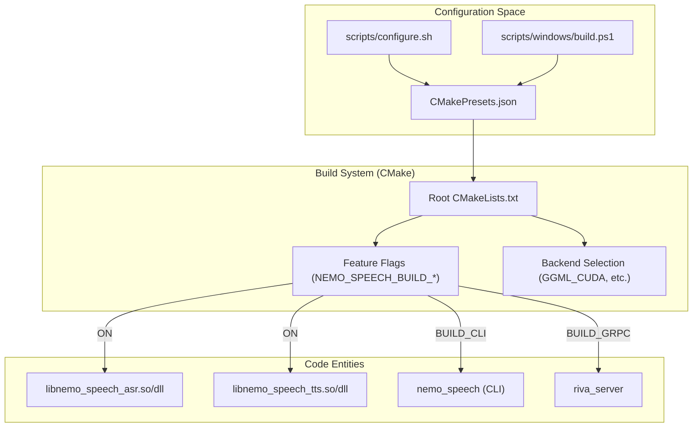
Sources: [CMakeLists.txt:81-99](), [CMakePresets.json:14-20](), [docs/build.md:117-132]()

---

## GGML Patching

For CUDA backends, applying the patches in `ggml-patches/` is critical for performance. These patches introduce fused kernels specifically for the FastConformer architecture used in NeMo models [ggml-patches/README.md:22-26]().

*   **`NEMO_SPEECH_GGML_PATCHED`**: A CMake option (default ON) that enables the use of patched GGML ops [ggml-patches/README.md:22-25]().
*   **Key Patches**:
    *   `0001`: Fused relative-position attention [ggml-patches/README.md:57-77]().
    *   `0005`: Skinny-Q8 GEMM for low-latency streaming [ggml-patches/README.md:100-124]().
    *   `0006`: Dispatch wiring for the custom ops into `ggml-cuda` [ggml-patches/README.md:126-128]().

Sources: [ggml-patches/README.md:1-130]()

---

## Docker Deployment

The `docker/Dockerfile` supports multi-stage builds to produce minimal runtime images [docker/Dockerfile:3-13]().

**Docker Build Targets:**
*   `builder`: Contains the full development toolchain, headers, and source code [docker/Dockerfile:54]().
*   `runtime`: A minimal "from scratch" image containing only the compiled binaries and necessary shared libraries [docker/Dockerfile:12]().

**Build Example:**
```bash
docker build -f docker/Dockerfile --target runtime -t nemo-speech:latest .
```
Sources: [docker/Dockerfile:14-19]()

---

## SDK Installation and Integration

The SDK can be installed into a specific prefix for use in external C++ projects.

### Exporting the SDK
```bash
cmake --install build/cuda-asr --prefix ./nemo_sdk
```
Sources: [docs/build.md:168-172]()

### Consuming the SDK
External projects use `find_package(NeMoSpeech)` to import the libraries. The SDK provides component-based targets [docs/sdk.md:18-26]().

| Component | Target | Header |
| :--- | :--- | :--- |
| **ASR** | `NeMoSpeech::ASR` | `nemo_speech/asr.h` |
| **TTS** | `NeMoSpeech::TTS` | `nemo_speech/tts.h` |
| **NMT** | `NeMoSpeech::NMT` | `nemo_speech/nmt.h` |
| **Diarization** | `NeMoSpeech::Diarization` | `nemo_speech/diar.h` |

Sources: [docs/sdk.md:36-42]()

### SDK Integration Data Flow

The following diagram shows how the C ABI headers and compiled libraries bridge the gap between user code and the internal engine.

**SDK Architecture Bridge**
```mermaid
graph LR
    subgraph "User Application Space"
        APP["main.cpp"]
        INC["#include <nemo_speech/asr.h>"]
    end

    subgraph "SDK Boundary (C ABI)"
        HANDLE["nemo_speech_asr_recognizer*"]
        CONFIG["nemo_speech_asr_recognizer_config"]
        FUNC["nemo_speech_asr_recognize_f32()"]
    end

    subgraph "NeMo-Speech.cpp Internal"
        ENGINE["src/asr/asr_engine.cpp"]
        RUNTIME["src/runtime/ggml/"]
        BACKEND["ggml-cuda.so / Metal / CPU"]
    end

    APP --> INC
    INC --> CONFIG
    CONFIG --> FUNC
    FUNC --> HANDLE
    HANDLE --> ENGINE
    ENGINE --> RUNTIME
    RUNTIME --> BACKEND
```
Sources: [docs/sdk.md:7-11](), [docs/sdk.md:87-126](), [include/nemo_speech/asr.h](), [src/asr/asr_engine.cpp]() (referenced conceptually from [docs/sdk.md:133-137]())

---

# Page: CLI Reference

# CLI Reference

<details>
<summary>Relevant source files</summary>

The following files were used as context for generating this wiki page:

- [app/bench.cpp](app/bench.cpp)
- [app/cli_util.cpp](app/cli_util.cpp)
- [app/cli_util.h](app/cli_util.h)
- [app/diarize.cpp](app/diarize.cpp)
- [app/doctor.cpp](app/doctor.cpp)
- [app/main.cpp](app/main.cpp)
- [app/model.cpp](app/model.cpp)
- [app/model_utils.cpp](app/model_utils.cpp)
- [app/model_utils.h](app/model_utils.h)
- [app/transcribe.cpp](app/transcribe.cpp)
- [app/translate.cpp](app/translate.cpp)
- [docs/cli.md](docs/cli.md)
- [src/common/json.cpp](src/common/json.cpp)
- [src/common/json.h](src/common/json.h)
- [src/runtime/ggml/backend.cpp](src/runtime/ggml/backend.cpp)
- [tests/cli/cli_contract_test.py](tests/cli/cli_contract_test.py)
- [tests/cpp/asr/test_diar_streaming.cpp](tests/cpp/asr/test_diar_streaming.cpp)

</details>


The `nemo-speech` binary is the primary unified interface for local inference, benchmarking, and diagnostics within the NeMo-Speech.cpp ecosystem. It provides a subcommand-based interface similar to `git` or `docker`, allowing users to perform complex speech tasks like transcription, diarization, and synthesis without writing C++ code [app/main.cpp:55-89]().

## Global Flags and Output Control

Global options modify the behavior of all subcommands. They are parsed early in the `main` function before dispatching to specific command handlers [app/main.cpp:106-116]().

| Flag | Purpose | Implementation Detail |
| :--- | :--- | :--- |
| `--json` | Emits results and errors as machine-readable JSON to `stdout` and `stderr`. | Triggers `configure_cli_output(true, ...)` [app/main.cpp:117](). |
| `--quiet` | Suppresses progress bars and non-essential diagnostic messages. | Sets internal `output_state.quiet = true` [app/cli_util.cpp:22](). |
| `--verbose` | Emits detailed runtime diagnostics, including backend initialization and tensor remapping. | Used by engine loaders to enable verbose logging [app/transcribe.cpp:132-133](). |

### Exit Codes
The CLI uses standardized exit codes to facilitate automation:
*   `0`: Success.
*   `1`: General failure (e.g., runtime exception).
*   `2`: `kCliExitInvalidArgument` - Invalid command-line arguments or incompatible flags [app/cli_util.h:20]().
*   `3`: `kCliExitMissingModel` - Required GGUF model file or directory not found [app/cli_util.h:21]().
*   `4`: `kCliExitUnsupportedFeature` - Command requires a component not included in the current build [app/main.cpp:178-181]().

## Subcommand Reference

### transcribe
Performs Automatic Speech Recognition (ASR). It can be configured for offline batching or simulated streaming.
*   **Key Flags**: `--model`, `--vad-model`, `--diar-model`, `--pnc-model`, `--itn-model-dir`.
*   **Data Flow**: Audio is loaded via `nemo_speech::audio::load_wav_file` [app/transcribe.cpp:112](), passed to a `Recognizer` instance [app/transcribe.cpp:22](), and results are formatted into Text, JSON, SRT, or VTT [app/transcribe.cpp:49]().

### synthesize
Performs Text-to-Speech (TTS) synthesis.
*   **Key Flags**: `--magpie-model`, `--codec-model`, `--tokenizer-dir`.
*   **Implementation**: Utilizes `nemo_speech::tts::TtsEngine` to convert text strings into PCM audio, which is then written to a WAV file [docs/cli.md:90-96]().

### translate
Translates text between languages using NMT models.
*   **Key Flags**: `--from`, `--to`, `--input` (file path).
*   **Implementation**: Reads lines from `stdin` or a file, then calls `translator->translate(texts, source, target)` [app/translate.cpp:136]().

### diarize
Identifies speaker segments in audio without necessarily performing ASR.
*   **Key Flags**: `--model` (Sortformer GGUF), `--offline` (full-attention), `--format` (rttm/json/text).
*   **Logic**: Uses `nemo_speech::asr::DiarStream` for streaming geometry or `diarize_offline` for short clips [tests/cpp/asr/test_diar_streaming.cpp:146-168]().

### serve
Starts the HTTP/gRPC server and the browser-based Playground.
*   **Key Flags**: `--config` (YAML), `--port`, `--no-ui`.
*   **Implementation**: Initializes the `server/http/` or `riva_server` components [app/main.cpp:46-50]().

### model
Inspects GGUF metadata to verify architecture compatibility.
*   **Key Functions**: `inspect_gguf_json` [app/model_utils.cpp:47]() parses the GGUF header to determine the model's `role` (asr, tts, etc.) and `runtime_compatible` status based on the current build flags [app/model_utils.cpp:120-158]().

### doctor
Performs a diagnostic check of the environment.
*   **Logic**: Reports the version, detected hardware backends (CUDA, Metal, Vulkan), and available devices [app/main.cpp:76]().

## Device Selection

Device selection is handled by `parse_device` [app/cli_util.cpp:70](), which maps string identifiers to integer GPU indices or `-1` for CPU.

| Device String | Resulting Backend |
| :--- | :--- |
| `auto` | Selects the first available GPU, falling back to CPU [app/cli_util.cpp:71](). |
| `cpu` | Forces `ggml_backend_init_by_type(GGML_BACKEND_DEVICE_TYPE_CPU)` [src/runtime/ggml/backend.cpp:97](). |
| `cuda:N` | Selects the Nth NVIDIA GPU [app/cli_util.cpp:80](). |
| `metal` | Selects the Apple Silicon GPU [app/cli_util.cpp:87](). |
| `vulkan:N` | Selects the Nth Vulkan-compatible device [app/cli_util.cpp:95](). |

## Architectural Diagrams

### Command Dispatch and Logic Flow
This diagram shows how the `main` entry point delegates work to specific command handlers and shared utilities.

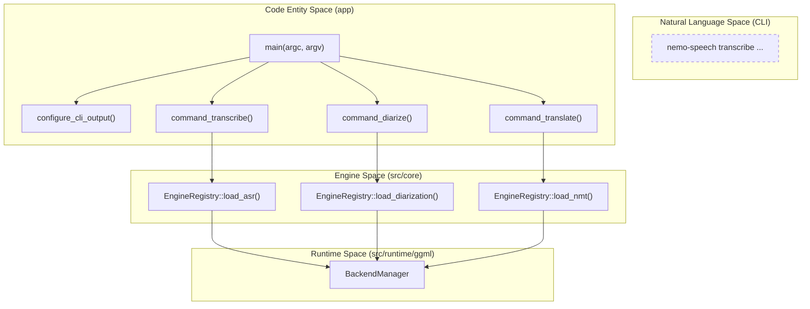
**Sources:** [app/main.cpp:94-210](), [app/cli_util.cpp:18-28](), [app/transcribe.cpp:127-200](), [src/runtime/ggml/backend.cpp:15-18]()

### Model Inspection and Architecture Mapping
This diagram bridges GGUF metadata keys to internal runtime roles.

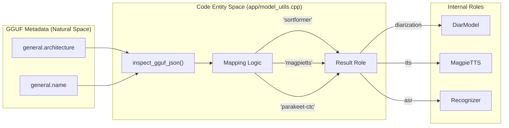
**Sources:** [app/model_utils.cpp:47-96](), [app/model_utils.cpp:120-155]()

## JSON Output Schema

When `--json` is enabled, all errors are emitted to `stderr` in the following format:

```json
{
  "error": {
    "exit_code": 3,
    "type": "missing_model",
    "message": "asr model file does not exist: asr.gguf"
  }
}
```
**Sources:** [app/cli_util.cpp:208-220](), [tests/cli/cli_contract_test.py:25-32]()

Success outputs for subcommands like `transcribe` or `translate` follow a similar structure, wrapping the engine's result in a top-level JSON object [app/transcribe.cpp:49-61](), [app/translate.cpp:138-148]().

`Sources: app/main.cpp:1-210, app/cli_util.cpp:1-205, app/transcribe.cpp:1-200, app/diarize.cpp:1-168, app/translate.cpp:1-168, app/model_utils.cpp:1-158, src/runtime/ggml/backend.cpp:1-122, tests/cli/cli_contract_test.py:1-167`

---

# Page: SDK and C ABI Reference

# SDK and C ABI Reference

<details>
<summary>Relevant source files</summary>

The following files were used as context for generating this wiki page:

- [include/nemo_speech/asr.h](include/nemo_speech/asr.h)
- [include/nemo_speech/diar.h](include/nemo_speech/diar.h)
- [include/nemo_speech/nmt.h](include/nemo_speech/nmt.h)
- [include/nemo_speech/tts.h](include/nemo_speech/tts.h)
- [server/http/CMakeLists.txt](server/http/CMakeLists.txt)
- [src/asr/c_api.cpp](src/asr/c_api.cpp)
- [src/asr/c_api.map](src/asr/c_api.map)
- [src/nmt/c_api.cpp](src/nmt/c_api.cpp)
- [src/nmt/c_api.map](src/nmt/c_api.map)
- [src/tts/c_api.cpp](src/tts/c_api.cpp)
- [src/tts/c_api.map](src/tts/c_api.map)
- [tests/c/asr_c_dlopen.c](tests/c/asr_c_dlopen.c)
- [tests/c/tts_c_dlopen.c](tests/c/tts_c_dlopen.c)
- [tests/c/tts_c_smoke.c](tests/c/tts_c_smoke.c)

</details>


NeMo-Speech.cpp provides a stable C ABI (Application Binary Interface) designed for binary compatibility across compiler versions and easy integration with FFIs (Foreign Function Interfaces) for languages like Python, Rust, or Go. The SDK is exposed via headers in `include/nemo_speech/` and implemented as a thin mapping layer over the internal C++ core.

## ABI Philosophy and Design Patterns

The ABI adheres to the following principles to ensure stability and compatibility:

*   **Opaque Handles**: Implementation details are hidden behind pointer handles (e.g., `nemo_speech_asr_recognizer*`). C++ types and exceptions never cross the ABI boundary [include/nemo_speech/asr.h:3-9]().
*   **Size-Prefixed Config Structs**: Configuration structures begin with a `size_t size` field. The library uses the `HAS_FIELD` macro to determine if a field is present based on the size passed by the caller, allowing fields to be appended to structs without breaking older binaries [src/asr/c_api.cpp:51-56]().
*   **Explicit Ownership**: Memory allocated by the library (e.g., result objects) must be explicitly freed using corresponding `*_destroy` functions [include/nemo_speech/asr.h:5-9]().
*   **No STL/No Exceptions**: Only Plain Old Data (POD) types and C-style pointers are used in signatures. Exceptions are caught internally and converted to error codes [src/asr/c_api.cpp:3-4]().

### Configuration Compatibility: HAS_FIELD
The `HAS_FIELD` pattern allows the library to maintain "append-only" ABI compatibility. If a caller compiled against an older header sends a smaller struct, missing tail fields are assigned library defaults [src/asr/c_api.cpp:51-53]().

```cpp
// Example from src/asr/c_api.cpp
#define HAS_FIELD(ptr, type, member) \
    ((ptr) != nullptr && (ptr)->size >= offsetof(type, member) + sizeof(((type*)nullptr)->member))
```

## Error Handling

The C ABI handles errors through a combination of status codes and thread-local error strings.

1.  **Status Enums**: Every major function returns a status code (e.g., `NEMO_SPEECH_ASR_OK`, `NEMO_SPEECH_NMT_ERROR_RUNTIME`) [include/nemo_speech/asr.h:43-49]().
2.  **Thread-Local Error Strings**: If a call fails, a descriptive error message is stored in a `thread_local` variable, accessible via `*_last_error()` [src/asr/c_api.cpp:45-49]().
3.  **The Guard Template**: Implementation files use a `guard` lambda wrapper to catch C++ exceptions and map them to the C status codes [src/nmt/c_api.cpp:77-99]().

### Error Propagation Flow

| Component | Responsibility |
| :--- | :--- |
| `g_last_error` | `thread_local` string storing the last error message [src/asr/c_api.cpp:45](). |
| `set_last_error()` | Helper to update the thread-local string [src/asr/c_api.cpp:46-49](). |
| `guard<F>` | Template that wraps internal C++ calls in a `try-catch` block [src/nmt/c_api.cpp:77-79](). |

**ABI Error Handling Data Flow**
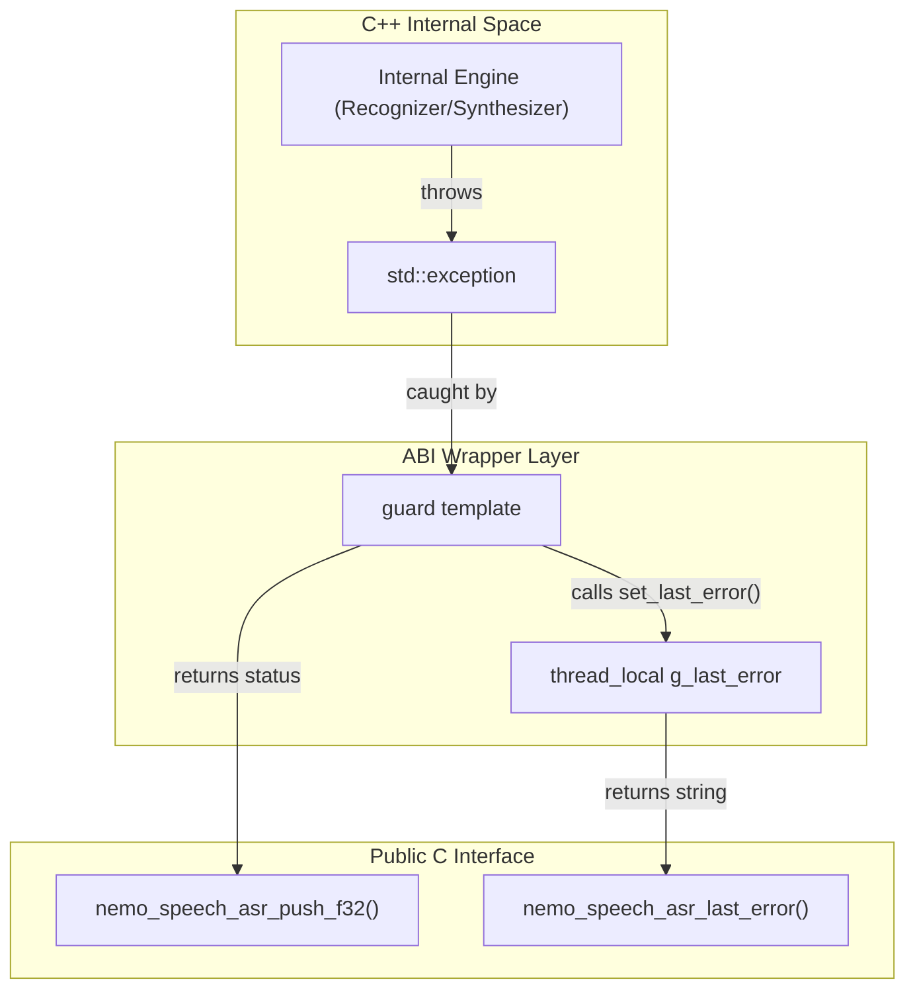
Sources: [src/asr/c_api.cpp:43-49](), [src/nmt/c_api.cpp:77-99](), [include/nemo_speech/asr.h:43-49]().

## Subsystem References

### Automatic Speech Recognition (ASR)
The ASR API mirrors NVIDIA Riva's streaming patterns. It supports transparent dynamic batching where multiple threads can submit work to a single `nemo_speech_asr_recognizer` [include/nemo_speech/asr.h:7-9, 131-134]().

*   **Key Functions**:
    *   `nemo_speech_asr_create()`: Initializes the engine with `nemo_speech_asr_recognizer_config` [include/nemo_speech/asr.h:190-191]().
    *   `nemo_speech_asr_stream_open()`: Starts a recognition session [include/nemo_speech/asr.h:203]().
    *   `nemo_speech_asr_stream_push_f32()`: Submits audio samples [include/nemo_speech/asr.h:208-209]().

### Speaker Diarization
Standalone diarization is available through `nemo_speech/diar.h`. It uses the Sortformer model to provide "who spoke when" without requiring ASR [include/nemo_speech/diar.h:3-9]().

### Text-to-Speech (TTS)
The TTS API manages the MagpieTTS runtime. It provides both text-to-audio and token-to-audio synthesis paths [include/nemo_speech/tts.h:188-204]().

*   **Callback Pattern**: Audio is delivered via `nemo_speech_tts_pcm_callback` as 16-bit mono PCM [include/nemo_speech/tts.h:132-136]().
*   **Statistics**: Detailed performance metrics (RTFX, TTFA) are returned via `nemo_speech_tts_synthesis_stats` [include/nemo_speech/tts.h:138-180]().

### Neural Machine Translation (NMT)
The NMT API provides text-to-text translation using `nmt::Translator` [src/nmt/c_api.cpp:3-6]().

*   **Pool Config**: Allows configuring concurrent decode contexts for parallel translations [include/nemo_speech/nmt.h:65-68]().

## System Architecture: C ABI to Internal Core

The following diagram bridges the C ABI public surface to the internal C++ implementation classes.

**ABI to Core Mapping**
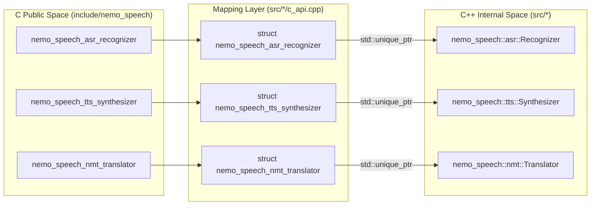
Sources: [src/asr/c_api.cpp:22-24](), [src/tts/c_api.cpp:22-26](), [src/nmt/c_api.cpp:21-23]().

## CMake Integration

The library exports several CMake targets under the `NeMoSpeech::` namespace. Consumers should link against the specific subsystem required to pull in necessary dependencies.

| Component | CMake Target | Dependencies |
| :--- | :--- | :--- |
| **Common** | `NeMoSpeech::Common` | `nemo_speech_common` [server/http/CMakeLists.txt:7]() |
| **ASR** | `NeMoSpeech::ASR` | `nemo_speech_asr`, `nemo_speech_diar` [src/asr/c_api.map:8-10]() |
| **TTS** | `NeMoSpeech::TTS` | `nemo_speech_tts` [src/tts/c_api.map:8]() |
| **NMT** | `NeMoSpeech::NMT` | `nemo_speech_nmt` [src/nmt/c_api.map:8]() |

### Linker Versioning
Shared libraries use linker version scripts (e.g., `src/asr/c_api.map`) to ensure only the `nemo_speech_*` symbols are exported, hiding all internal C++ symbols and protecting the binary contract [src/asr/c_api.map:1-13](), [src/nmt/c_api.map:1-11]().

Sources: [src/asr/c_api.map:1-13](), [src/nmt/c_api.map:1-11](), [src/tts/c_api.map:1-12](), [server/http/CMakeLists.txt:4-11]().

---

# Page: SDK Usage Examples

# SDK Usage Examples

<details>
<summary>Relevant source files</summary>

The following files were used as context for generating this wiki page:

- [docs/clients.md](docs/clients.md)
- [include/nemo_speech/asr.h](include/nemo_speech/asr.h)
- [include/nemo_speech/diar.h](include/nemo_speech/diar.h)
- [include/nemo_speech/nmt.h](include/nemo_speech/nmt.h)
- [include/nemo_speech/tts.h](include/nemo_speech/tts.h)
- [src/asr/c_api.cpp](src/asr/c_api.cpp)
- [src/nmt/c_api.cpp](src/nmt/c_api.cpp)
- [src/tts/c_api.cpp](src/tts/c_api.cpp)
- [tests/c/tts_c_smoke.c](tests/c/tts_c_smoke.c)
- [tests/integration/clients/openai_client.mjs](tests/integration/clients/openai_client.mjs)

</details>


This page provides a technical walkthrough of the C++ examples found in the `examples/` directory. These examples demonstrate how to integrate the NeMo-Speech.cpp runtime into applications using the stable C ABI. The C ABI is designed for binary compatibility across different compiler versions and languages, utilizing opaque handles and size-prefixed POD (Plain Old Data) structs.

## Core Integration Pattern

All SDK examples follow a consistent lifecycle pattern for managing NeMo-Speech.cpp engines. This pattern ensures that C++ exceptions do not cross the binary boundary and that memory ownership is explicitly managed.

### The Handle Pattern
The SDK uses opaque pointers to represent engine instances and request states:
*   `nemo_speech_asr_recognizer*`: Owns the ASR model and compute resources [include/nemo_speech/asr.h:39]().
*   `nemo_speech_tts_synthesizer*`: Owns the MagpieTTS and NanoCodec models [include/nemo_speech/tts.h:36]().
*   `nemo_speech_nmt_translator*`: Owns the NMT translation engine [include/nemo_speech/nmt.h:37]().

### Configuration and ABI Safety
To maintain forward compatibility, configuration structs include a `size` field. The implementation uses a `HAS_FIELD` macro to check if the caller-provided struct is large enough to contain a specific member before accessing it [src/asr/c_api.cpp:54-55]().

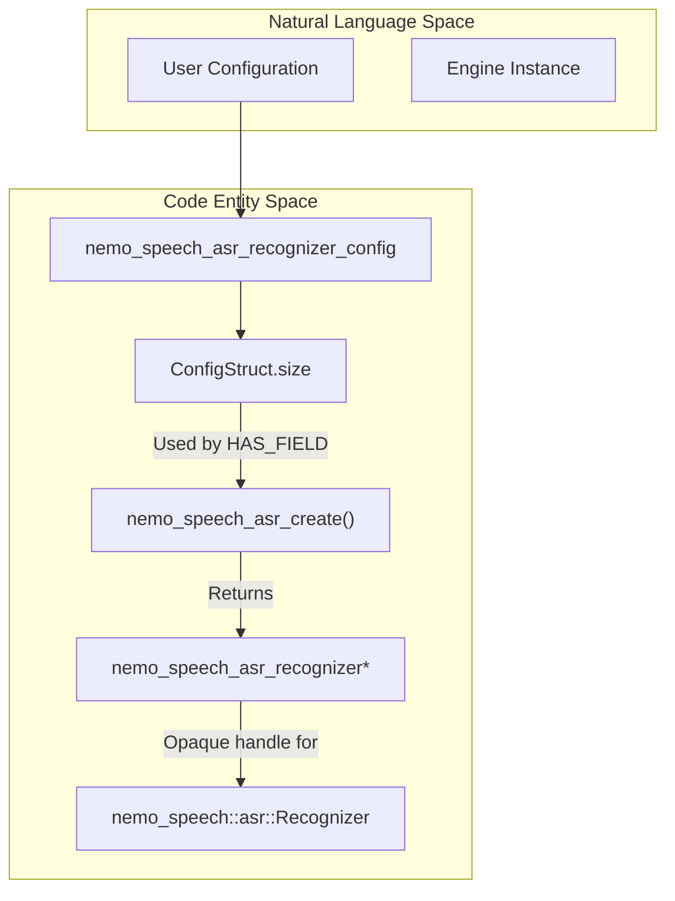
**Sources:** [src/asr/c_api.cpp:54-55](), [include/nemo_speech/asr.h:145-156](), [include/nemo_speech/tts.h:107-113]()

---

## ASR Examples

### File Transcription (`transcribe_file.cpp`)
Demonstrates offline batch transcription of an audio file. It utilizes the `nemo_speech_asr_recognizer` to process a complete audio buffer.

**Data Flow:**
1.  Initialize `nemo_speech_asr_recognizer_config` with model paths.
2.  Call `nemo_speech_asr_create()` to instantiate the engine [src/asr/c_api.cpp:180]().
3.  Load audio into a `float` buffer.
4.  Call `nemo_speech_asr_recognize_f32()` to perform inference.
5.  Iterate through `nemo_speech_asr_result` to extract text and timestamps.

### Live Transcription (`transcribe_live.cpp`)
Demonstrates the streaming API where audio is pushed in small chunks, and partial results are returned as they become available.

**Key Functions:**
*   `nemo_speech_asr_stream_open()`: Creates a stateful stream handle [src/asr/c_api.cpp:218]().
*   `nemo_speech_asr_stream_push_f32()`: Buffers audio and triggers incremental inference [src/asr/c_api.cpp:234]().
*   `nemo_speech_asr_stream_get_next_result()`: Polls for interim or final transcripts [src/asr/c_api.cpp:273]().

**Sources:** [include/nemo_speech/asr.h:203-240](), [src/asr/c_api.cpp:21-29]()

---

## TTS Examples

### Text Synthesis (`synthesize_text.cpp`)
Shows how to convert raw text into PCM audio using the MagpieTTS architecture.

**Implementation Detail:**
The example provides a `nemo_speech_tts_pcm_callback` function. As the engine generates audio chunks (via the NanoCodec vocoder), it invokes this callback with raw 16-bit PCM data [include/nemo_speech/tts.h:136]().

**Sources:** [include/nemo_speech/tts.h:203-207](), [tests/c/tts_c_smoke.c:27-35]()

---

## Diarization Examples

### Standalone Diarization (`diarize_file.cpp`)
Demonstrates the use of the Sortformer model to identify "who spoke when" without performing ASR.

**Data Flow:**
1.  Configure `nemo_speech_diar_model_config` with a Sortformer GGUF [include/nemo_speech/diar.h:30-49]().
2.  Perform offline diarization via `nemo_speech_diar_offline_f32()` [include/nemo_speech/diar.h:109-111]().
3.  Retrieve segments using `nemo_speech_diar_segments()`, which applies onset/offset hysteresis post-processing [include/nemo_speech/diar.h:134-137]().

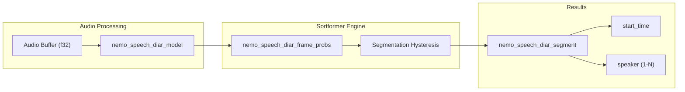
**Sources:** [include/nemo_speech/diar.h:56-70](), [include/nemo_speech/diar.h:127-137]()

---

## Translation Examples

### Text Translation (`translate_text.cpp`)
Demonstrates NMT (Neural Machine Translation) using the `nemo_speech_nmt_translator`. It maps source text to a target language using Riva-Translate models.

**Key Functions:**
*   `nemo_speech_nmt_translate()`: Takes an array of strings and returns a result handle [src/nmt/c_api.cpp:130-146]().
*   `nemo_speech_nmt_result_text()`: Accesses individual translated strings from the result handle [src/nmt/c_api.cpp:154-158]().

### Speech Translation (`speech_translate_file.cpp`)
A composite example that chains ASR and NMT. It transcribes audio in the source language and immediately passes the resulting text to the NMT engine for translation.

**Sources:** [include/nemo_speech/nmt.h:80-92](), [src/nmt/c_api.cpp:21-26]()

---

## Error Handling Pattern

Every example uses a `guard` pattern implemented in the C ABI layer. If a C++ exception occurs within the engine, it is caught, and the error message is stored in a thread-local string [src/asr/c_api.cpp:45-49]().

| Function | Purpose |
| :--- | :--- |
| `nemo_speech_asr_last_error()` | Returns the last ASR error on the current thread [include/nemo_speech/asr.h:323](). |
| `nemo_speech_tts_last_error()` | Returns the last TTS error on the current thread [include/nemo_speech/tts.h:218](). |
| `nemo_speech_nmt_last_error()` | Returns the last NMT error on the current thread [include/nemo_speech/nmt.h:107](). |

**Sources:** [src/asr/c_api.cpp:45-49](), [src/nmt/c_api.cpp:30-34](), [src/tts/c_api.cpp:30-35]()

---

# Page: Core Architecture

# Core Architecture

<details>
<summary>Relevant source files</summary>

The following files were used as context for generating this wiki page:

- [app/CMakeLists.txt](app/CMakeLists.txt)
- [scripts/windows/build.ps1](scripts/windows/build.ps1)
- [src/common/CMakeLists.txt](src/common/CMakeLists.txt)
- [src/core/CMakeLists.txt](src/core/CMakeLists.txt)
- [src/core/engine_registry.cpp](src/core/engine_registry.cpp)
- [src/core/engine_registry.h](src/core/engine_registry.h)
- [src/nmt/CMakeLists.txt](src/nmt/CMakeLists.txt)
- [src/runtime/ggml/CMakeLists.txt](src/runtime/ggml/CMakeLists.txt)
- [src/services/CMakeLists.txt](src/services/CMakeLists.txt)
- [src/speech/CMakeLists.txt](src/speech/CMakeLists.txt)
- [src/tts/magpietts/CMakeLists.txt](src/tts/magpietts/CMakeLists.txt)
- [src/tts/nanocodec/CMakeLists.txt](src/tts/nanocodec/CMakeLists.txt)
- [src/tts/preproc/CMakeLists.txt](src/tts/preproc/CMakeLists.txt)

</details>


NeMo-Speech.cpp is designed as a modular, high-performance inference toolkit for speech AI. The architecture is structured into three primary layers: a low-level **GGML Runtime Layer** for hardware-accelerated tensor operations, a **Modular Library Layer** containing domain-specific logic (ASR, TTS, NMT), and a **Core Engine Registry** that manages model lifecycles and service composition.

### System Overview Diagram
The following diagram illustrates how the C++ entities compose the overall system, from the unified CLI down to the hardware backends.

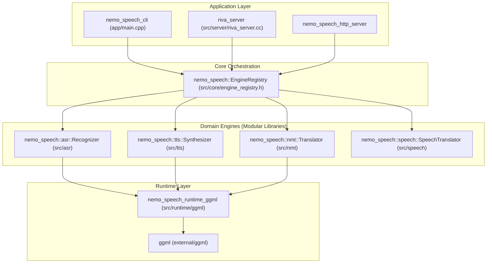
**Sources:** [app/CMakeLists.txt:4-17](), [src/core/engine_registry.h:43-99](), [src/runtime/ggml/CMakeLists.txt:7-13]()

---

### GGML Runtime Layer
The foundation of the project is a specialized runtime built on top of `ggml`. This layer provides high-level C++ abstractions for managing neural network graphs, model loading, and backend dispatching.

*   **Session & Module:** Abstractions for executing computational graphs and managing state.
*   **GGUFLoader:** Handles the parsing of `.gguf` files, which contain both model weights and metadata.
*   **BackendManager:** Dispatches computations to available hardware backends such as CUDA, Metal, Vulkan, or CPU.

For a deep dive into graph construction, LRU caching, and backend dispatch, see [GGML Runtime Layer](#2.1).

**Sources:** [src/runtime/ggml/CMakeLists.txt:7-10](), [src/runtime/ggml/CMakeLists.txt:29-37]()

---

### Engine Registry and Service Composition
The `nemo_speech::EngineRegistry` acts as the central coordinator for the library. It is responsible for the singleton-like management of engine instances and handles the composition of complex pipelines.

| Component | Code Entity | Purpose |
| :--- | :--- | :--- |
| **ASR Engine** | `asr::Recognizer` | Speech-to-text inference. |
| **TTS Engine** | `tts::Synthesizer` | Text-to-speech synthesis. |
| **NMT Engine** | `nmt::Translator` | Neural Machine Translation. |
| **Speech Pipeline** | `speech::SpeechTranslator` | Composite ASR → NMT → TTS pipeline. |

The registry uses compile-time feature flags (e.g., `NEMO_SPEECH_REGISTRY_ASR`) to include or exclude specific engines, allowing for minimal builds. It also manages "Speech Translation" by automatically composing `asr_` and `nmt_` instances when both are loaded.

For details on instantiation logic and feature flags, see [Engine Registry and Service Composition](#2.2).

**Sources:** [src/core/engine_registry.h:38-76](), [src/core/engine_registry.cpp:150-162](), [src/core/CMakeLists.txt:11-28]()

---

### Modular Library Structure
The codebase is partitioned into distinct libraries, ensuring that domain logic (like audio resampling or text normalization) is shared efficiently while keeping the inference engines decoupled.

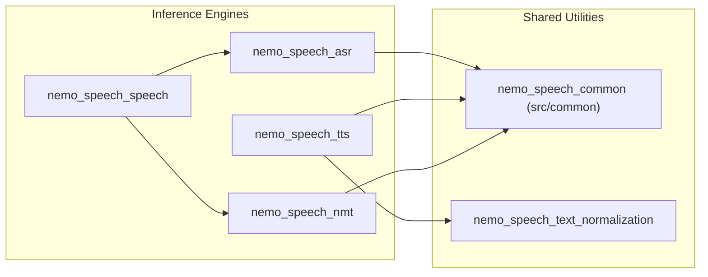

*   **nemo_speech_common:** Contains domain-agnostic utilities like `ParameterParser`, audio decoders, and resamplers.
*   **nemo_speech_text_normalization:** A separate library for WFST-based grammars (Sparrowhawk/OpenFST) used by both ASR and TTS.
*   **nemo_speech_speech:** A static library that links `nemo_speech_asr` and `nemo_speech_nmt` to provide end-to-end speech translation.

For more information on shared utilities, see [Common Utilities](#2.3).

**Sources:** [src/common/CMakeLists.txt:9-15](), [src/common/CMakeLists.txt:26-30](), [src/speech/CMakeLists.txt:3-17](), [src/nmt/CMakeLists.txt:13-23]()

---

# Page: GGML Runtime Layer

# GGML Runtime Layer

<details>
<summary>Relevant source files</summary>

The following files were used as context for generating this wiki page:

- [src/asr/decoders/rnnt_greedy_decoder.cpp](src/asr/decoders/rnnt_greedy_decoder.cpp)
- [src/asr/encoder/fastconformer.h](src/asr/encoder/fastconformer.h)
- [src/asr/encoder/rel_pos_attention.cpp](src/asr/encoder/rel_pos_attention.cpp)
- [src/runtime/ggml/loader.cpp](src/runtime/ggml/loader.cpp)
- [src/runtime/ggml/logging.cpp](src/runtime/ggml/logging.cpp)
- [src/runtime/ggml/nn.cpp](src/runtime/ggml/nn.cpp)
- [src/runtime/ggml/nn.h](src/runtime/ggml/nn.h)
- [src/runtime/ggml/runtime.h](src/runtime/ggml/runtime.h)
- [src/runtime/ggml/session.cpp](src/runtime/ggml/session.cpp)
- [src/runtime/ggml/tensor_container.cpp](src/runtime/ggml/tensor_container.cpp)

</details>


The GGML Runtime Layer (`src/runtime/ggml/`) provides a high-level C++ abstraction over the `ggml` and `ggml-backend` libraries. It manages model loading, graph construction, memory allocation, and hardware dispatch across multiple backends (CUDA, CPU, Metal, Vulkan).

## Core Abstractions

The runtime is built around four primary entities that manage the lifecycle of a model from disk to execution.

### BackendManager
The `BackendManager` owns the physical hardware handles. It initializes the requested backends (e.g., `ggml_backend_cuda_init`) and manages a shared `compute_mutex` to serialize access to hardware for sessions sharing the same manager [src/runtime/ggml/runtime.h:171-203]().

### GGUFLoader
A wrapper around the GGUF file format. It provides type-safe access to metadata (KV pairs) and tensor data. It supports lazy loading, allowing file-backed resources to be released while retaining metadata [src/runtime/ggml/runtime.h:62-95]().

### TensorContainer
Manages `ggml_context` handles and tensor allocation. It separates tensors into two categories:
1.  **Persistent Tensors**: Created via `model_tensor_container`, these hold weights that stay resident in device memory [src/runtime/ggml/session.h:188-190]().
2.  **Transient Tensors**: Created during graph construction for intermediates.

### Session
The `Session` is the primary execution context. it orchestrates the `Module` graph construction and manages the `ggml_backend_sched` (scheduler) which assigns nodes to backends [src/runtime/ggml/runtime.h:206-258]().

| Entity | Role | File |
| :--- | :--- | :--- |
| `BackendManager` | Hardware initialization and synchronization | [src/runtime/ggml/runtime.h:171]() |
| `GGUFLoader` | Metadata and weight loading from `.gguf` | [src/runtime/ggml/runtime.h:62]() |
| `TensorContainer` | Arena-based memory management | [src/runtime/ggml/runtime.h:147]() |
| `Session` | Graph scheduling and execution | [src/runtime/ggml/runtime.h:206]() |

**Sources:** [src/runtime/ggml/runtime.h:62-258](), [src/runtime/ggml/session.h:188-190]()

---

## Data Flow: From Code to Execution

The following diagram illustrates how high-level code entities map to the underlying GGML execution flow.

### System Mapping: Code to GGML Entity
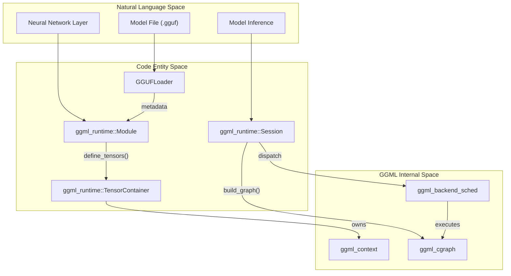
**Sources:** [src/runtime/ggml/runtime.h:149-162](), [src/runtime/ggml/session.cpp:60-74]()

---

## Graph Construction and Caching

The runtime uses a **two-pass construction** strategy to handle the `ggml-alloc` requirement of knowing tensor sizes before allocation.

### Two-Pass Strategy
1.  **Probe Pass**: The `Module::build_graph` function is called to create a `ggml_cgraph`. The runtime measures the number of nodes and the required metadata memory [src/runtime/ggml/session.cpp:109-117]().
2.  **Allocation Pass**: A fitted `ggml_context` is created based on the probe. The graph is expanded into this context, and the scheduler (`ggml_backend_sched`) allocates physical memory buffers for intermediates [src/runtime/ggml/tensor_container.cpp:195-215]().

### LRU Graph Caching
To avoid the overhead of rebuilding graphs (which involves thousands of `ggml_add`, `ggml_mul_mat`, etc. calls), `Session` maintains a cache of `CachedRun` objects.
*   **Cache Key**: A hash of input tensor shapes and types [src/runtime/ggml/session.cpp:133-145]().
*   **Eviction**: An LRU (Least Recently Used) policy manages the cache, clearing the oldest graphs when capacity is reached [src/runtime/ggml/session.cpp:67-70]().

### Execution Sequence
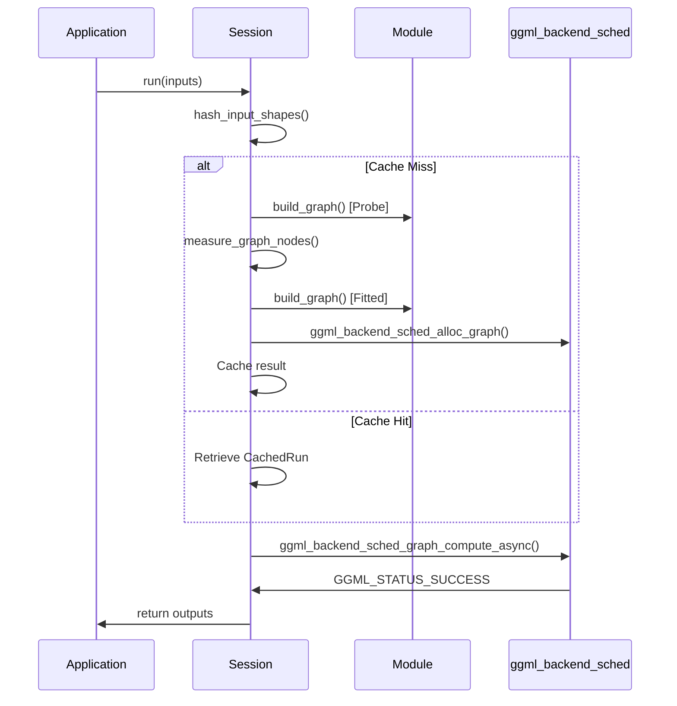
**Sources:** [src/runtime/ggml/session.cpp:109-145](), [src/runtime/ggml/session.cpp:28-43](), [src/runtime/ggml/tensor_container.cpp:195-215]()

---

## Streaming and State Binding

For streaming models (like FastConformer ASR or MagpieTTS), the runtime must maintain state (KV caches, convolution buffers) across multiple `run()` calls.

### LayerCacheIO
The `LayerCacheIO` struct is used by modules to bind persistent state tensors into the active computation graph.
*   **K/V Caches**: `k_cache_cur` and `v_cache_cur` represent past context [src/asr/encoder/fastconformer.h:123-124]().
*   **Conv State**: `conv_cache_cur` stores the `kernel-1` past frames required for causal convolution [src/asr/encoder/fastconformer.h:132]().
*   **Binding**: During `build_graph`, the `Module` retrieves these tensors from a `StreamState` and uses `ggml_view` or `ggml_concat` to link them with new input data [src/asr/encoder/fastconformer.h:111-121]().

**Sources:** [src/asr/encoder/fastconformer.h:111-153](), [src/runtime/ggml/nn.cpp:114-138]()

---

## Backend Dispatch and Optimization

The runtime abstracts hardware-specific optimizations behind standard `Module` implementations.

### Quantized Pointwise Convolutions
In `Conv1D::build_graph`, the runtime detects if a 1D convolution is pointwise (kernel size 1). If so, it uses `ggml_mul_mat` instead of `ggml_conv_1d`. This allows the use of highly optimized quantized kernels (Q8_0, Q4_K, etc.) which are not typically available for standard convolution ops [src/runtime/ggml/nn.cpp:82-95]().

### Skinny-Q8 Optimization
The runtime supports a "Skinny-Q8" mode for CUDA backends. If the `GGML_SKINNY_Q8_CUBLAS_F16` environment variable is set, the runtime casts `F32` inputs to `F16` before performing matrix multiplication against `Q8_0` weights, leveraging specialized CUDA kernels for better performance on narrow (low batch size) GEMMs [src/runtime/ggml/nn.cpp:21-39]().

### Direct Depthwise Convolution
For CUDA backends, `Conv1D` can utilize `ggml_conv_2d_dw_direct` (via Patch 0004), which implements a fused depthwise convolution kernel that avoids the memory overhead of the `im2col` transformation used in the portable CPU/Metal paths [src/runtime/ggml/nn.cpp:97-113]().

**Sources:** [src/runtime/ggml/nn.cpp:21-39](), [src/runtime/ggml/nn.cpp:82-113](), [src/runtime/ggml/nn.h:54-58]()

---

# Page: Engine Registry and Service Composition

# Engine Registry and Service Composition

<details>
<summary>Relevant source files</summary>

The following files were used as context for generating this wiki page:

- [src/common/CMakeLists.txt](src/common/CMakeLists.txt)
- [src/core/CMakeLists.txt](src/core/CMakeLists.txt)
- [src/core/engine_registry.cpp](src/core/engine_registry.cpp)
- [src/core/engine_registry.h](src/core/engine_registry.h)
- [src/services/CMakeLists.txt](src/services/CMakeLists.txt)
- [src/speech/CMakeLists.txt](src/speech/CMakeLists.txt)
- [src/speech/speech_translator.cpp](src/speech/speech_translator.cpp)
- [src/speech/speech_translator.h](src/speech/speech_translator.h)
- [src/tts/preproc/CMakeLists.txt](src/tts/preproc/CMakeLists.txt)

</details>


The `EngineRegistry` serves as the central process-level owner for all loaded speech engines within NeMo-Speech.cpp. It manages the lifecycle of ASR, TTS, NMT, and Diarization engines, handles their instantiation based on compile-time feature flags, and facilitates the composition of these individual services into higher-level pipelines, such as the `SpeechTranslator` [src/core/engine_registry.h:3-5]().

## EngineRegistry Architecture

The `EngineRegistry` class [src/core/engine_registry.h:43-99]() acts as a factory and repository. Frontends (such as the gRPC or HTTP servers) borrow typed engine handles from the registry to fulfill requests. It ensures that complex dependencies—such as a Diarizer sharing a model with an ASR Recognizer—are handled transparently [src/core/engine_registry.cpp:69-76]().

### Feature Flags and Discovery
The registry uses preprocessor definitions to conditionally include and enable engine types. These flags are set during the CMake configuration phase based on which subsystems are built [src/core/CMakeLists.txt:11-28]().

| Feature Flag | Subsystem | Code Entity |
| :--- | :--- | :--- |
| `NEMO_SPEECH_REGISTRY_ASR` | Automatic Speech Recognition | `asr::Recognizer` |
| `NEMO_SPEECH_REGISTRY_TTS` | Text-to-Speech | `tts::Synthesizer` |
| `NEMO_SPEECH_REGISTRY_NMT` | Neural Machine Translation | `nmt::Translator` |
| `NEMO_SPEECH_REGISTRY_DIAR` | Speaker Diarization | `asr::Diarizer` |
| `NEMO_SPEECH_REGISTRY_SPEECH` | Speech-to-Speech/Translation | `speech::SpeechTranslator` |

### Engine Lifecycle and Initialization
Engines are instantiated via `load_*` methods (e.g., `load_asr`, `load_tts`). These methods are thread-safe, protected by a `mutable std::mutex mutex_` [src/core/engine_registry.h:81]().

A key responsibility of the registry is managing global environment state required by the underlying `ggml` backends. For example, when NMT is loaded alongside ASR, the registry sets `GGML_SKINNY_Q8_INPLACE` to `0` to ensure compatibility between different quantization layouts [src/core/engine_registry.cpp:113-123](). Similarly, it manages `GGML_CUDA_GRAPH_EVICT_AFTER_MS` for TTS workloads [src/core/engine_registry.cpp:93]().

**Sources:** [src/core/engine_registry.h:43-99](), [src/core/engine_registry.cpp:30-138](), [src/core/CMakeLists.txt:1-29]()

## Composite Service: SpeechTranslator

The `nemo_speech_speech` library provides the `SpeechTranslator` class, which composes ASR, NMT, and TTS into a unified streaming pipeline [src/speech/speech_translator.h:65-85](). This enables "Speech-to-Text Translation" and "Speech-to-Speech Translation" (S2S) workflows.

### Data Flow and Callbacks
The `SpeechTranslationStream` handles the coordination of data between engines. When audio samples are pushed, the following sequence occurs:
1. **ASR**: `asr::RecognitionStream` processes audio and produces final transcripts [src/speech/speech_translator.cpp:150-157]().
2. **NMT**: The `translate_text` internal function is called using the ASR transcript and requested language pairs [src/speech/speech_translator.cpp:83-86]().
3. **TTS (Optional)**: If `synthesize_speech` is enabled in `SpeechTranslationOptions`, the translated text is passed to the `tts::Synthesizer` [src/speech/speech_translator.cpp:91-109]().

### Implementation Mapping: Pipeline Composition
This diagram illustrates how the `EngineRegistry` associates specific code entities to form the composite `SpeechTranslator`.

**Registry Composition Logic**
```mermaid
graph TD
    subgraph "EngineRegistry Space"
        ER["EngineRegistry"]
        ASR_H["std::shared_ptr<asr::Recognizer> asr_"]
        NMT_H["std::shared_ptr<nmt::Translator> nmt_"]
        TTS_H["std::shared_ptr<tts::Synthesizer> tts_"]
        COMP["rebuild_compositions_locked()"]
    end

    subgraph "Speech Pipeline Space"
        ST["speech::SpeechTranslator"]
        STS["speech::SpeechTranslationStream"]
    end

    ER --> COMP
    COMP -->|Instantiates| ST
    ASR_H -.->|Injected| ST
    NMT_H -.->|Injected| ST
    TTS_H -.->|Injected| ST
    ST -->|streaming_translate()| STS
```
**Sources:** [src/speech/speech_translator.h:18-85](), [src/speech/speech_translator.cpp:67-142](), [src/core/engine_registry.cpp:150-162]()

## Diarization Integration

Diarization can exist as a standalone engine or be derived from an ASR engine if the ASR model supports diarization outputs. The `EngineRegistry` manages this relationship via the `diar_from_asr_` boolean [src/core/engine_registry.h:85]().

When `load_asr` is called, the registry checks if the model contains a diarization component. If it does, it automatically instantiates a `asr::Diarizer` using the ASR engine's internal `DiarModel` [src/core/engine_registry.cpp:69-76]().

### Code Entity Association: Diarization Flow
This diagram bridges the conceptual "Speaker Diarization" feature to the specific classes and methods that implement it.

**Diarization Discovery and Instantiation**
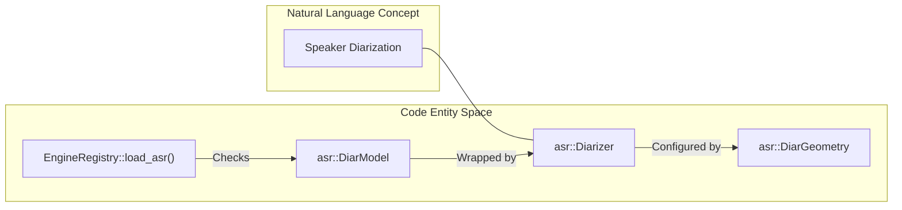
**Sources:** [src/core/engine_registry.cpp:39-57](), [src/core/engine_registry.cpp:69-76](), [src/core/engine_registry.h:50-57]()

## Service Warmup

The registry provides a unified `warmup` function to trigger model-specific initialization (such as CUDA graph capturing or KV cache pre-allocation) before the first request arrives [src/core/engine_registry.cpp:165-187]().

- **ASR Warmup**: Triggers `recognizer->warmup()`, which typically runs a dummy inference pass to initialize buffers [src/core/engine_registry.cpp:176]().
- **TTS Warmup**: Triggers `synthesizer->warmup()` using provided `tts_text` and `tts_steps` to stabilize RTFX (Real-Time Factor) [src/core/engine_registry.cpp:185]().

**Sources:** [src/core/engine_registry.h:31-36](), [src/core/engine_registry.cpp:165-187]()

---

# Page: Common Utilities

# Common Utilities

<details>
<summary>Relevant source files</summary>

The following files were used as context for generating this wiki page:

- [app/cli_util.cpp](app/cli_util.cpp)
- [app/cli_util.h](app/cli_util.h)
- [app/main.cpp](app/main.cpp)
- [src/asr/postproc/itn.cpp](src/asr/postproc/itn.cpp)
- [src/asr/postproc/itn.h](src/asr/postproc/itn.h)
- [src/common/audio_decoder.cpp](src/common/audio_decoder.cpp)
- [src/common/audio_decoder.h](src/common/audio_decoder.h)
- [src/common/audio_file.h](src/common/audio_file.h)
- [src/common/audio_resampler.h](src/common/audio_resampler.h)
- [src/common/json.cpp](src/common/json.cpp)
- [src/common/json.h](src/common/json.h)
- [src/common/text_normalization/compat/sparrowhawk_compat.h](src/common/text_normalization/compat/sparrowhawk_compat.h)
- [src/common/text_normalization/compat/thrax/grm-manager.h](src/common/text_normalization/compat/thrax/grm-manager.h)
- [src/common/text_normalization/compat/thrax/thrax.h](src/common/text_normalization/compat/thrax/thrax.h)
- [src/common/text_normalization/fst_normalizer.cpp](src/common/text_normalization/fst_normalizer.cpp)
- [src/common/text_normalization/fst_normalizer.h](src/common/text_normalization/fst_normalizer.h)
- [src/tts/preproc/text_normalizer.h](src/tts/preproc/text_normalizer.h)
- [tests/cli/cli_contract_test.py](tests/cli/cli_contract_test.py)
- [tests/cpp/asr/test_audio_resampler.cpp](tests/cpp/asr/test_audio_resampler.cpp)
- [tests/cpp/common/test_shared_utilities.cpp](tests/cpp/common/test_shared_utilities.cpp)

</details>


The `src/common/` directory provides the shared infrastructure used across the ASR, TTS, and NMT subsystems. This includes robust configuration parsing, audio processing (decoding and resampling), JSON serialization, and a Weighted Finite State Transducer (WFST) text normalization engine based on Sparrowhawk.

## Configuration and CLI Utilities

The codebase employs a unified approach to configuration through `ParameterParser` (via `cli_util.h`) and JSON-based messaging.

### CLI Argument Parsing
The CLI utilities handle standard global flags such as `--json`, `--quiet`, and `--verbose`, ensuring consistent output across all subcommands [app/main.cpp:100-117](). It includes specialized parsers for:
*   **Integers and Doubles**: Validates ranges and finiteness [app/cli_util.cpp:37-57]().
*   **Device Selection**: Resolves strings like `cuda:0`, `metal`, `vulkan`, or `cpu` into internal device indices [app/cli_util.cpp:69-110]().
*   **File I/O**: Helpers for reading and writing text files with atomic rename semantics to prevent partial writes [app/cli_util.cpp:150-192]().

### JSON Utilities
A custom, lightweight JSON parser and emitter is implemented in `src/common/json.cpp` to avoid heavy external dependencies while maintaining strict standards compliance.
*   **Parser**: A recursive descent parser that handles standard JSON types, Unicode escape sequences (`\uXXXX`), and surrogate pairs [src/common/json.cpp:41-196](). It enforces a maximum nesting depth of 128 to prevent stack exhaustion [src/common/json.cpp:15-105]().
*   **Value Object**: Uses a `std::variant` based approach (via `Value` class) to represent `null`, `bool`, `number` (double), `string`, `array`, and `object` [src/common/json.h]().

## Audio Infrastructure

NeMo-Speech.cpp includes a high-performance audio pipeline designed for both batch and streaming workloads.

### Audio Decoding
The `Pcm16StreamDecoder` provides a streaming interface for processing audio bytes.
*   **Format Detection**: It automatically detects between raw signed 16-bit PCM and RIFF/WAV containers by inspecting the first 12 bytes of the stream [src/common/audio_decoder.cpp:55-87]().
*   **WAV Parsing**: Parses `fmt` chunks to ensure compatibility (must be mono, 16-bit PCM) and `data` chunks to extract raw samples [src/common/audio_decoder.cpp:95-156]().
*   **Streaming Stability**: Handles "carry" bytes when a 16-bit sample is split across two input buffers [src/common/audio_decoder.cpp:171-187]().

### Polyphase Sinc Resampler
The `AudioResampler` implements a high-quality polyphase sinc filter for sample rate conversion.
*   **Implementation**: It supports arbitrary fractional ratios (e.g., 44.1 kHz to 16 kHz) without temporal drift [tests/cpp/asr/test_audio_resampler.cpp:86-91]().
*   **Streaming**: The resampler maintains internal state (delay lines) to ensure that output is identical regardless of how the input is chunked [tests/cpp/asr/test_audio_resampler.cpp:112-125]().
*   **Anti-Aliasing**: Automatically suppresses frequencies above the destination Nyquist frequency [tests/cpp/asr/test_audio_resampler.cpp:107-110]().

### Audio Data Flow
The following diagram illustrates how raw bytes from a file or network stream are transformed into floating-point tensors for model consumption.

**Audio Processing Pipeline**
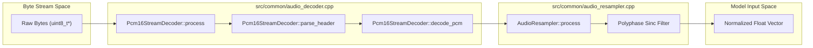
**Sources:** [src/common/audio_decoder.cpp:44-87](), [src/common/audio_resampler.h](), [tests/cpp/asr/test_audio_resampler.cpp:112-125]()

---

## Text Normalization (Sparrowhawk / OpenFST)

Text normalization is used for both **Inverse Text Normalization (ITN)** in ASR (spoken-to-written) and **Text Normalization** in TTS (written-to-spoken).

### Sparrowhawk Integration
The system integrates Google's Sparrowhawk via a compatibility layer that bridges it to OpenFST 1.8 [src/common/text_normalization/fst_normalizer.cpp:10-14]().
*   **Grammar Loading**: It loads precompiled Finite State Archive (`.far`) files: `tokenize_and_classify.far` and `verbalize.far` [src/common/text_normalization/fst_normalizer.cpp:54-59]().
*   **Thrax Compatibility**: A minimal `GrmManager` implementation allows loading and composing rules from STTable archives without requiring the full Thrax library [src/common/text_normalization/compat/thrax/grm-manager.h:5-10]().

### Normalization Logic
1.  **Input Preparation**: Escapes quotes and handles trailing whitespace to match Riva-style grammar expectations [src/common/text_normalization/fst_normalizer.cpp:24-34]().
2.  **WFST Rewrite**: Executes the `Normalize` method of the Sparrowhawk engine [src/common/text_normalization/fst_normalizer.cpp:83-87]().
3.  **Alignment Tracking**: Uses Sparrowhawk's `ShowLinks` feature to generate metadata linking source tokens to normalized words, which is essential for projecting word-level timestamps in ASR [src/common/text_normalization/fst_normalizer.cpp:88-91]().

### Text Normalization Architecture
This diagram bridges the natural language processing concepts to the specific C++ classes and FST archives used.

**WFST Normalization Data Flow**
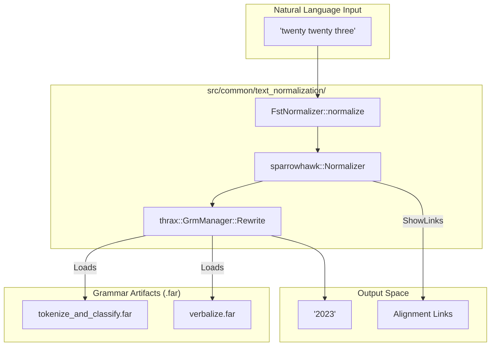
**Sources:** [src/common/text_normalization/fst_normalizer.cpp:45-67](), [src/common/text_normalization/compat/thrax/grm-manager.h:69-93](), [src/asr/postproc/itn.cpp:41-52]()

---

## Technical Reference Table

| Component | Key Class / File | Purpose |
| :--- | :--- | :--- |
| **JSON** | `nemo_speech::json::Parser` | Strict, dependency-free JSON parsing [src/common/json.cpp:41](). |
| **Audio Decoder** | `Pcm16StreamDecoder` | Streaming WAV/PCM to float conversion [src/common/audio_decoder.cpp:36](). |
| **Resampler** | `AudioResampler` | Sinc-based rate conversion with delay state [src/common/audio_resampler.h](). |
| **ITN / TN** | `FstNormalizer` | WFST-based text transformation via Sparrowhawk [src/common/text_normalization/fst_normalizer.h:12](). |
| **CLI Output** | `configure_cli_output` | Global singleton for JSON vs Plaintext CLI output [app/cli_util.cpp:117](). |
| **Thrax Bridge** | `thrax::GrmManager` | Minimal FAR archive loader and rewriter [src/common/text_normalization/compat/thrax/grm-manager.h:32](). |

**Sources:** [src/common/json.cpp:41](), [src/common/audio_decoder.cpp:36](), [src/common/text_normalization/fst_normalizer.h:12](), [app/cli_util.cpp:117](), [src/common/text_normalization/compat/thrax/grm-manager.h:32]()

---

# Page: Automatic Speech Recognition (ASR)

# Automatic Speech Recognition (ASR)

<details>
<summary>Relevant source files</summary>

The following files were used as context for generating this wiki page:

- [conversion/vad.py](conversion/vad.py)
- [docs/asr/configuration.md](docs/asr/configuration.md)
- [docs/asr/customization.md](docs/asr/customization.md)
- [docs/asr/models.md](docs/asr/models.md)
- [src/asr/CMakeLists.txt](src/asr/CMakeLists.txt)
- [src/asr/decoders/greedy_ctc_decoder.cpp](src/asr/decoders/greedy_ctc_decoder.cpp)
- [src/asr/decoders/greedy_ctc_decoder.h](src/asr/decoders/greedy_ctc_decoder.h)
- [src/asr/model.cpp](src/asr/model.cpp)
- [src/asr/model.h](src/asr/model.h)
- [src/asr/runner.cpp](src/asr/runner.cpp)
- [src/asr/vad/silero_vad.cpp](src/asr/vad/silero_vad.cpp)

</details>


The ASR subsystem in `NeMo-Speech.cpp` provides a high-performance C++ implementation of NVIDIA NeMo ASR models. It supports multiple model families, including **FastConformer** encoders paired with **CTC**, **RNNT**, or **TDT** decoders. The pipeline is designed for both low-latency streaming and high-throughput offline transcription, featuring integrated Voice Activity Detection (VAD), speaker diarization, and text post-processing.

### ASR Pipeline Architecture

The ASR pipeline transforms raw audio into formatted text through a series of modular stages. The `AsrModel` class [src/asr/model.h:48-126]() serves as the base for concrete model implementations like `CtcModel` [src/asr/model.h:129-174]() and `RnntModel` [src/asr/model.h:177-228]().

#### Natural Language Space to Code Entity Space: ASR Pipeline
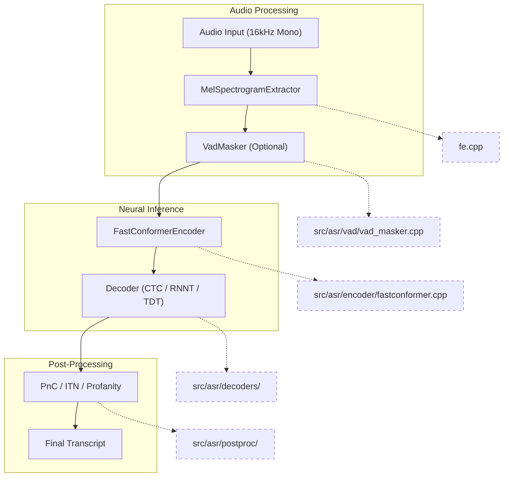
**Sources:** [src/asr/model.h:48-228](), [src/asr/runner.cpp:126-152](), [docs/asr/configuration.md:22-76]()

---

### Key Components

#### 1. ASR Models and Configuration
The system supports several model families optimized for different use cases:
*   **Parakeet CTC**: Optimized for buffered streaming and offline use.
*   **Nemotron-Speech RNNT**: Cache-aware streaming models for ultra-low latency.
*   **Nemotron 3.5**: Multilingual models with prompt-conditioning for Language ID.
*   **Parakeet TDT**: Token-and-Duration Transducer for high-accuracy offline transcription.

For details on model selection, GGUF conversion, and the `asr.*` configuration schema, see **[ASR Models and Configuration](#3.1)**.

**Sources:** [docs/asr/models.md:1-76](), [docs/asr/configuration.md:22-40]()

#### 2. Encoder: FastConformer
The core of the ASR system is the **FastConformer** encoder [src/asr/model.h:19-20](). It utilizes a depthwise-separable convolutional architecture and self-attention. In streaming mode, the encoder uses a **Cache-Aware** mechanism to maintain state across audio chunks, ensuring that look-ahead and history context are handled efficiently without re-computing full sequences.

For details on encoder architecture and streaming strategies, see **[ASR Encoder: FastConformer](#3.2)**.

**Sources:** [src/asr/model.h:17-19](), [src/asr/model.cpp:59-85]()

#### 3. Decoders
Decoders translate encoder hidden states into tokens. `NeMo-Speech.cpp` supports:
*   **Greedy CTC**: Efficient argmax decoding [src/asr/decoders/greedy_ctc_decoder.h:55-120]().
*   **Flashlight (Beam Search)**: Integrated with **KenLM** for n-gram language model fusion [src/asr/runner.cpp:154-171]().
*   **RNNT/TDT**: Transducer-based decoding with internal state management.
*   **Context Biasing**: Support for word boosting via Aho-Corasick shallow fusion to improve recognition of specific terms.

For details on decoding algorithms and word boosting, see **[ASR Decoders](#3.3)**.

**Sources:** [src/asr/decoders/greedy_ctc_decoder.cpp:125-182](), [docs/asr/configuration.md:96-113]()

#### 4. Post-Processing
Raw transcripts are refined through a post-processing pipeline:
*   **Inverse Text Normalization (ITN)**: Converts spoken forms (e.g., "three hundred dollars") to written forms ("$300") using Sparrowhawk WFST grammars [src/asr/CMakeLists.txt:55-58]().
*   **PnC**: Adds punctuation and capitalization using a BERT-based model.
*   **Profanity Filtering**: Masks sensitive terms based on configurable word lists.

For details on the post-processing pipeline, see **[ASR Post-Processing: ITN, PnC, and Profanity](#3.4)**.

**Sources:** [docs/asr/configuration.md:72-76](), [src/asr/runner.cpp:97-120]()

#### 5. Speaker Diarization
The system integrates a **Sortformer**-based diarization engine [src/asr/diar/]. This allows the system to identify "who spoke when" by assigning speaker tags to ASR word outputs. It supports both streaming and offline modes through a shared AOSC (Active Overlapping Speaker Correlation) state.

For details on diarization geometry and ASR alignment, see **[Speaker Diarization](#3.5)**.

**Sources:** [docs/asr/models.md:158-178](), [docs/asr/configuration.md:61-68]()

---

### Execution Flow
The `AsrModel` uses a `ggml_runtime::Session` to build and execute computational graphs [src/asr/model.cpp:64-80](). 

#### Natural Language Space to Code Entity Space: Inference Control
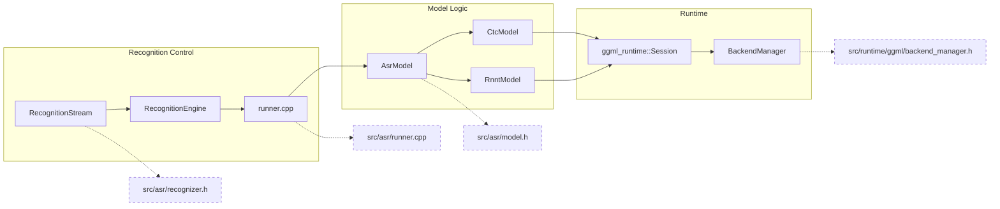
**Sources:** [src/asr/model.h:48-60](), [src/asr/runner.cpp:91-120](), [src/asr/recognizer.h]()

### VAD and Endpointing
The system includes **Silero VAD** [src/asr/vad/silero_vad.cpp:24-63]() for detecting speech activity. This is used for:
1.  **Feature Masking**: Zeroing out non-speech Mel frames to reduce encoder noise [docs/asr/configuration.md:51-60]().
2.  **Endpointing**: Triggering "End of Utterance" (EOU) events based on silence duration to finalize transcripts mid-stream [src/asr/runner.cpp:126-152]().

**Sources:** [src/asr/runner.cpp:126-152](), [docs/asr/configuration.md:69-71]()

---

# Page: ASR Models and Configuration

# ASR Models and Configuration

<details>
<summary>Relevant source files</summary>

The following files were used as context for generating this wiki page:

- [conversion/vad.py](conversion/vad.py)
- [docs/asr/configuration.md](docs/asr/configuration.md)
- [docs/asr/customization.md](docs/asr/customization.md)
- [docs/asr/models.md](docs/asr/models.md)
- [docs/development/asr-batching.md](docs/development/asr-batching.md)
- [src/asr/batching.h](src/asr/batching.h)
- [src/asr/runner.cpp](src/asr/runner.cpp)
- [src/asr/vad/silero_vad.cpp](src/asr/vad/silero_vad.cpp)
- [src/asr/vad/silero_vad.h](src/asr/vad/silero_vad.h)
- [src/asr/vad/vad_masker.cpp](src/asr/vad/vad_masker.cpp)
- [src/asr/vad/vad_masker.h](src/asr/vad/vad_masker.h)
- [tests/cpp/asr/test_vad.cpp](tests/cpp/asr/test_vad.cpp)

</details>


NeMo-Speech.cpp supports a diverse range of Automatic Speech Recognition (ASR) model architectures, including CTC, RNNT, and TDT variants. The system is designed for both high-throughput offline transcription and low-latency streaming, utilizing a unified GGUF format for model distribution and execution.

## Supported Model Families

The ASR subsystem is built around the `FastConformer` encoder, which is shared across most modern NVIDIA NeMo ASR models. The specific behavior is determined by the decoder head and the model's training configuration.

| Model Family | Architecture | Key Characteristics | Source |
|---|---|---|---|
| **Parakeet CTC** | Connectionist Temporal Classification | Efficient, 1.1B parameters. Supports offline and buffered streaming. | [docs/asr/models.md:11-13]() |
| **Parakeet TDT** | Token-and-Duration Transducer | Multilingual (25 languages). Predicts token and duration simultaneously. Offline only. | [docs/asr/models.md:20-31]() |
| **Nemotron-Speech** | RNN-Transducer (RNNT) | 0.6B parameters. Cache-aware for low-latency streaming. | [docs/asr/models.md:36-38]() |
| **Nemotron 3.5** | RNNT + Prompting | Multilingual (40+ languages). Supports language-ID prompt conditioning. | [docs/asr/models.md:45-49]() |

### Model Acquisition and GGUF Format
Models are distributed as **GGUF** files via Hugging Face. These files contain both the neural network weights and critical metadata (e.g., `asr.rnnt.num_prompts`, `asr.rnnt.prompt_dictionary`) required for runtime execution [docs/asr/models.md:3-56]().

Custom NeMo checkpoints can be converted using the `convert_model.py` tool, which auto-detects the head type (CTC, RNNT, or TDT) from the `model_config.yaml` [docs/asr/models.md:78-84]().

### Quantization and Layouts
Weights are typically quantized to `q8_0` (1.062 bytes/elem) for a balance of quality and size [docs/asr/models.md:105-107](). For maximum performance on NVIDIA GPUs, the converter supports a **Planar Q8 layout**, which allows batched "skinny-Q8" tensor-core kernels to operate without a runtime repack [docs/asr/models.md:119-129]().

Sources: [docs/asr/models.md:1-133](), [conversion/vad.py:55-76]()

## ASR Configuration Schema

Configuration is managed via the `asr.*` namespace. These keys can be set via YAML files, environment variables, or CLI flags [docs/asr/configuration.md:3-6]().

### Core Configuration (`asr.*`)
| Key | Default | Description |
|---|---|---|
| `asr.model.path` | - | Path to the model GGUF (Required). |
| `asr.backend.gpu` | `0` | GPU index to use; `-1` for CPU. |
| `asr.streaming.chunk_size` | `0.16` | CTC buffered window size in seconds. |
| `asr.batching.enabled` | `false` | Enables dynamic microbatching of neural work. |
| `asr.decoder.kind` | `greedy` | `greedy` or `flashlight` (requires KenLM). |

### Voice Activity Detection (VAD)
The system integrates **Silero VAD** for feature masking and endpointing. The VAD stack is built inside `src/asr/runner.cpp` using `build_vad_stack` [src/asr/runner.cpp:125-152]().

| Key | Default | Description |
|---|---|---|
| `asr.vad.model_path` | - | Path to Silero VAD GGUF. |
| `asr.vad.masker.mask_enable` | `false` | Mask silence mel frames before the encoder. |
| `asr.vad.masker.onset` | `0.5` | Probability threshold to enter speech state. |
| `asr.vad.masker.offset` | `0.3` | Probability threshold to leave speech state. |

Sources: [docs/asr/configuration.md:16-76](), [src/asr/runner.cpp:125-152](), [src/asr/vad/vad_masker.h:29-62]()

## Implementation and Data Flow

The `Recognizer` and `AsrRunner` classes coordinate the ASR pipeline. The data flow bridges audio ingestion to neural inference through several stages.

### Neural Pipeline Diagram
This diagram illustrates the association between the conceptual ASR stages and the C++ classes/functions responsible for them.

Title: ASR Neural Pipeline Data Flow
```mermaid
graph TD
    subgraph "Natural Language Space"
        Audio["Audio Input (PCM)"]
        Transcript["Final Transcript"]
    end

    subgraph "Code Entity Space (src/asr)"
        FE["MelSpectrogramExtractor (fe.cpp)"]
        VAD["SileroVad (vad/silero_vad.cpp)"]
        Masker["VadMasker (vad/vad_masker.cpp)"]
        Encoder["FastConformer Encoder"]
        Batcher["IngressBatchCoordinator (batching.h)"]
        Decoder["Decoder Head (greedy_ctc_decoder.h, etc.)"]
    end

    Audio --> FE
    FE --> VAD
    VAD -- "Speech Bits" --> Masker
    FE -- "Log-Mel" --> Masker
    Masker --> Batcher
    Batcher --> Encoder
    Encoder --> Decoder
    Decoder --> Transcript
```
Sources: [src/asr/runner.cpp:125-152](), [src/asr/vad/vad_masker.cpp:61-69](), [src/asr/batching.h:132-156]()

### Dynamic Microbatching
NeMo-Speech.cpp uses a work-conserving scheduler to combine compatible neural work into wider GPU graphs.
1. **Ingress Wave:** `IngressBatchCoordinator` aligns streaming audio arrivals within an `ingress_cohort_delay_us` window [src/asr/batching.h:132-156]().
2. **Compatibility Key:** Only requests with identical graph-shaping dimensions (e.g., same chunk size) share a microbatch [docs/development/asr-batching.md:111-113]().
3. **State Arena:** Stateful models (RNNT, VAD) reserve device memory rows in a `state_arena_slots` structure to prevent crosstalk between streams [docs/development/asr-batching.md:119-122]().

### VAD Masking Logic
The `VadMasker` applies a four-step policy to the mel-spectrogram:
1. **Binarize:** Hysteresis using `onset`/`offset` thresholds.
2. **Pad:** Extend speech segments by `pad_onset_ms` and `pad_offset_ms`.
3. **Merge:** Join silence gaps shorter than `min_duration_off_ms`.
4. **Mask:** Set non-speech frames to `mask_value` (default -16.635) before normalization [src/asr/vad/vad_masker.h:6-18]().

Title: VAD and Masking Interaction
```mermaid
sequenceDiagram
    participant R as AsrRunner
    participant V as SileroVad
    participant M as VadMasker
    participant E as Encoder

    R->>V: observe_audio(samples)
    V->>V: infer() & binarize()
    Note over V: Updates speech_timeline
    R->>M: apply(mel_buffer, first_frame)
    M->>V: frame_speech(g)
    V-->>M: Speech/Silence bit
    M->>M: decide_masked(g)
    Note right of M: Applies Pad/Merge logic
    M->>R: mel_buffer (Modified in-place)
    R->>E: Forward(mel_buffer)
```
Sources: [src/asr/vad/vad_masker.h:73-87](), [src/asr/vad/silero_vad.h:141-159](), [src/asr/vad/vad_masker.cpp:30-58]()

## Post-Processing and Endpointing

The ASR pipeline includes several post-neural stages:
* **Endpointing:** `VadEndpointer` triggers a "End of Utterance" (EOU) fire based on either token-silence or VAD timeline events [src/asr/runner.cpp:125-152]().
* **Post-Processing:** The `fire_eou` helper commits the best hypothesis, captures word timings, and performs a soft reset of the decoder [src/asr/runner.cpp:96-119]().
* **Normalization:** If VAD masking is used, `normalize_per_feature` is applied to the masked log-mel features to ensure consistent input distribution to the encoder [src/asr/runner.cpp:68-89]().

Sources: [src/asr/runner.cpp:68-152](), [docs/asr/configuration.md:69-76]()

---

# Page: ASR Encoder: FastConformer

# ASR Encoder: FastConformer

<details>
<summary>Relevant source files</summary>

The following files were used as context for generating this wiki page:

- [src/asr/decoders/rnnt_greedy_decoder.cpp](src/asr/decoders/rnnt_greedy_decoder.cpp)
- [src/asr/encoder/cache_aware_encoder.cpp](src/asr/encoder/cache_aware_encoder.cpp)
- [src/asr/encoder/fastconformer.cpp](src/asr/encoder/fastconformer.cpp)
- [src/asr/encoder/fastconformer.h](src/asr/encoder/fastconformer.h)
- [src/asr/encoder/transformer_encoder.cpp](src/asr/encoder/transformer_encoder.cpp)
- [src/asr/encoder/transformer_encoder.h](src/asr/encoder/transformer_encoder.h)

</details>


The FastConformer encoder is the primary acoustic feature extractor for ASR models in NeMo-Speech.cpp. It is designed to be highly efficient, supporting both offline batch processing and low-latency streaming inference through a cache-aware architecture. The implementation resides primarily in `src/asr/encoder/` and supports two main variants: the Parakeet-style (standard Conformer) and the Nemotron-style (cache-aware streaming Conformer) `[src/asr/encoder/fastconformer.h:7-13]()`.

## Architecture Overview

The FastConformer architecture consists of a convolutional subsampling stem followed by a stack of Conformer layers. Each Conformer layer integrates four main components: a feed-forward module, a multi-head self-attention module (with relative positional encoding), a convolution module, and a second feed-forward module `[src/asr/encoder/fastconformer.cpp:388-403]()`.

### Subsampling Stem
The `SubSampling` module performs 8x downsampling of input Mel-spectrogram features `[src/asr/encoder/fastconformer.h:47]()`. It utilizes a series of `Conv2D` and `Conv2DDW` (depthwise) layers `[src/asr/encoder/fastconformer.cpp:80-108]()`. For streaming models, the subsampling stem uses **causal padding** to ensure that future frames are not accessed during the convolution operation `[src/asr/encoder/fastconformer.cpp:138-166]()`.

### Conformer Layer
A single `ConformerLayer` executes the following sequence:
1.  **FFN1**: Feed-forward module (half-step).
2.  **MHA**: Multi-head attention with relative positional embeddings.
3.  **Conv**: Depthwise convolution module.
4.  **FFN2**: Feed-forward module (half-step).
5.  **Final Norm**: Layer normalization `[src/asr/encoder/fastconformer.cpp:665-725]()`.

### Relative Position Attention
The attention mechanism in FastConformer uses relative positional encodings, which allow the model to generalize better to varying sequence lengths compared to absolute encodings `[src/asr/encoder/rel_pos_attention.h:7-15]()`. The implementation supports a **fused CUDA kernel** for relative position multi-head attention (RHA) to optimize performance on NVIDIA GPUs `[src/asr/encoder/rel_pos_attention.cpp:113-140]()`.

## Streaming and Caching Strategies

NeMo-Speech.cpp implements a sophisticated caching mechanism to enable "look-ahead" streaming without re-processing the entire audio history.

### Cache-Aware Execution
When `CacheMode::Enabled` is set, the encoder maintains state across successive audio chunks `[src/asr/encoder/fastconformer.h:38-40]()`. The state consists of:
*   **K/V Cache**: Stores past keys and values for the attention mechanism `[src/asr/encoder/fastconformer.h:123-124]()`.
*   **Conv Cache**: Stores the `kernel-1` past frames required for depthwise convolution to bridge chunk boundaries `[src/asr/encoder/fastconformer.h:132]()`.

### CacheStreamRunner vs. BufferedStreamRunner
The system provides two strategies for managing the streaming state:

| Strategy | Class | Description |
| :--- | :--- | :--- |
| **Cache-Aware** | `CacheAwareEncoder` | Uses model-internal K/V and Conv caches. Only the new audio chunk is processed, making it extremely efficient for long streams `[src/asr/encoder/cache_aware_encoder.h:20-30]()`. |
| **Buffered** | `BufferedStreamRunner` | Used for models without internal cache support. It maintains a sliding window buffer of raw audio/features and re-runs the encoder on the full window for each step. |

### Data Flow: Streaming Encoder Step
The following diagram illustrates how the `CacheAwareEncoder` interacts with the `FastConformerEncoder` and the `ggml_runtime::Session` to process a single chunk of audio while maintaining state.

**Streaming State Management Flow**
```mermaid
graph TD
    subgraph "Natural Language Space"
        A["Audio Chunk"]
        B["Transcription"]
    end

    subgraph "Code Entity Space (src/asr/encoder)"
        direction TB
        C["CacheAwareEncoder::step()"]
        D["EncoderBatcher::queue_"]
        E["ggml_runtime::Session::run()"]
        F["FastConformerEncoder::build_graph()"]
        G["LayerCacheIO"]
        
        A --> C
        C --> D
        D --> E
        E -- "Invokes Graph" --> F
        F -- "Reads/Writes State" --> G
        E --> B
    end
```
*Sources: `[src/asr/encoder/cache_aware_encoder.cpp:69-126]()`, `[src/asr/encoder/fastconformer.h:122-153]()`*

## Implementation Details

### Configuration Parameters
The `EncoderConfig` struct defines the geometry of the FastConformer model, including `d_model`, `n_layers`, and `conv_kernel_size` `[src/asr/encoder/fastconformer.h:41-52]()`. Key streaming parameters include:
*   `cache_left_ctx`: The number of past frames visible to the attention mechanism `[src/asr/encoder/fastconformer.h:63]()`.
*   `cache_right_ctx`: The "look-ahead" frames required by the model `[src/asr/encoder/fastconformer.h:64]()`.
*   `cache_chunk_frames`: The number of new frames processed in each streaming step `[src/asr/encoder/fastconformer.h:67]()`.

### Encoder Graph Construction
The `FastConformerEncoder::build_graph` function constructs the GGML computation graph. It handles the wiring of the `LayerCacheIO` for each layer when caching is enabled `[src/asr/encoder/fastconformer.cpp:1152-1200]()`.

**Encoder Internal Module Hierarchy**
```mermaid
graph TD
    subgraph "FastConformerEncoder [src/asr/encoder/fastconformer.cpp]"
        STEM["SubSampling [Module]"]
        LAYERS["std::vector<ConformerLayer*>"]
        
        subgraph "ConformerLayer [src/asr/encoder/fastconformer.cpp]"
            FFN1["FeedForwardModule"]
            MHA["RelPosMultiHeadAttention"]
            CONV["ConformerConv"]
            FFN2["FeedForwardModule"]
        end
        
        STEM --> LAYERS
        LAYERS --> FFN1
        FFN1 --> MHA
        MHA --> CONV
        CONV --> FFN2
    end
```
*Sources: `[src/asr/encoder/fastconformer.cpp:1100-1140]()`, `[src/asr/encoder/fastconformer.cpp:665-725]()`*

### GPU Optimizations
To achieve high throughput, the encoder utilizes several specialized kernels:
*   **Fused RelPos Attention**: Combined GEMM and attention scoring for relative positions `[src/asr/encoder/rel_pos_attention.cpp:113-140]()`.
*   **Depthwise Convolution Fusions**: The `dw_conv_w_ct` tensor represents a repacked weight layout that enables a direct channels-inner depthwise kernel, avoiding expensive transpositions `[src/asr/encoder/fastconformer.h:140-146]()`.
*   **Batching**: The `EncoderBatcher` class aggregates multiple streaming requests into a single `ggml_runtime::Session::run()` call to maximize GPU utilization `[src/asr/encoder/cache_aware_encoder.cpp:69-126]()`.

Sources:
- `[src/asr/encoder/fastconformer.h:1-110]()`
- `[src/asr/encoder/fastconformer.cpp:1-1200]()`
- `[src/asr/encoder/rel_pos_attention.h:1-50]()`
- `[src/asr/encoder/rel_pos_attention.cpp:1-140]()`
- `[src/asr/encoder/cache_aware_encoder.h:1-60]()`
- `[src/asr/encoder/cache_aware_encoder.cpp:1-160]()`

---

# Page: ASR Decoders

# ASR Decoders

<details>
<summary>Relevant source files</summary>

The following files were used as context for generating this wiki page:

- [src/asr/decoders/context_biasing.cpp](src/asr/decoders/context_biasing.cpp)
- [src/asr/decoders/decoder.h](src/asr/decoders/decoder.h)
- [src/asr/decoders/flashlight_decoder.cpp](src/asr/decoders/flashlight_decoder.cpp)
- [src/asr/decoders/flashlight_decoder.h](src/asr/decoders/flashlight_decoder.h)
- [src/asr/decoders/greedy_ctc_decoder.cpp](src/asr/decoders/greedy_ctc_decoder.cpp)
- [src/asr/decoders/greedy_ctc_decoder.h](src/asr/decoders/greedy_ctc_decoder.h)
- [src/asr/decoders/rnnt_greedy_decoder.h](src/asr/decoders/rnnt_greedy_decoder.h)
- [src/asr/decoders/rnnt_modules.cpp](src/asr/decoders/rnnt_modules.cpp)
- [src/asr/decoders/rnnt_modules.h](src/asr/decoders/rnnt_modules.h)
- [src/asr/diar/sortformer_model.cpp](src/asr/diar/sortformer_model.cpp)
- [src/asr/diar/sortformer_model.h](src/asr/diar/sortformer_model.h)
- [src/asr/model.cpp](src/asr/model.cpp)
- [src/asr/model.h](src/asr/model.h)
- [src/asr/recognizer.h](src/asr/recognizer.h)
- [tests/cpp/asr/test_ctc_offline.cpp](tests/cpp/asr/test_ctc_offline.cpp)
- [tests/cpp/asr/test_decoders.cpp](tests/cpp/asr/test_decoders.cpp)

</details>


The ASR Decoder layer is responsible for transforming the high-level acoustic features produced by the encoder into discrete token sequences and, ultimately, human-readable text. NeMo-Speech.cpp supports several decoding strategies tailored for different model architectures (CTC, RNNT, TDT) and use cases (greedy vs. beam-search with language models).

## Decoder Architecture Overview

All decoders implement the `Decoder` interface [src/asr/decoders/decoder.h:16-48](), which provides a unified API for stepping through audio chunks, handling utterance resets, and retrieving transcripts and word timings.

### Supported Decoder Types

| Decoder | Architecture | Key Features |
| :--- | :--- | :--- |
| **GreedyCTC** | CTC | Frame-level argmax with collapse rule and seam deduplication. |
| **RNNT Greedy** | RNNT | Two-layer LSTM predictor with joint network; supports word boosting. |
| **TDT Decoder** | TDT | Token-and-Duration Transducer; predicts tokens and skip-durations. |
| **Flashlight** | CTC | Beam-search with KenLM fusion and lexicon-based decoding. |

---

## CTC Decoders

### Greedy CTC Decoder
The `GreedyCtcDecoder` [src/asr/decoders/greedy_ctc_decoder.h:55-120]() implements the standard CTC collapse rule: repeating tokens are collapsed into one, and the `blank_id` acts as a separator.

#### Seam Deduplication
In streaming scenarios, overlapping audio windows can cause a single acoustic event to appear at the end of one chunk and the start of the next. The `GreedyCtcDecoder` implements a "seam merge" logic [src/asr/decoders/greedy_ctc_decoder.h:97-104]() that suppresses a window-leading repeat of the last committed token if it occurs within a small frame gap (`kSeamMergeMaxGap = 2`).

**Data Flow: CTC Greedy Decoding**
```mermaid
graph TD
    A["Encoder Output (T, D)"] --> B["CtcHeadModule (GGML)"]
    B --> C["Log-Softmax / Argmax"]
    C --> D["GreedyCtcDecoder::step_compact"]
    D --> E{"Seam Repeat?"}
    E -- "Yes" --> F["Suppress Token"]
    E -- "No" --> G{"Is Blank?"}
    G -- "Yes" --> H["Update prev_id"]
    G -- "No" --> I["Emit Token & Update Timings"]
    I --> J["WordTiming Accumulator"]
```
*Sources: [src/asr/decoders/greedy_ctc_decoder.cpp:145-185](), [src/asr/decoders/greedy_ctc_decoder.h:97-104]()*

### Flashlight Beam-Search Decoder
When `NEMO_SPEECH_WITH_FLASHLIGHT` is enabled, the system supports beam-search decoding with N-gram language models (KenLM). The `FlashlightDecoder` [src/asr/decoders/flashlight_decoder.h:107-160]() integrates the Flashlight `LexiconDecoder`.

*   **KenLM Fusion:** Uses a `.bin` KenLM file for shallow fusion during the beam search.
*   **Lexicon:** Maps words to their SentencePiece token sequences.
*   **Resources:** `FlashlightResources` [src/asr/decoders/flashlight_decoder.h:72-105]() manages the shared, immutable KenLM and Trie structures to minimize memory overhead across multiple streams.

---

## Transducer Decoders (RNNT and TDT)

### RNNT Greedy Decoder
The `RnntGreedyDecoder` [src/asr/decoders/rnnt_greedy_decoder.h:138-160]() manages the interaction between the encoder projections and the recurrent predictor.

1.  **Predictor Stage:** A 2-layer LSTM [src/asr/decoders/rnnt_modules.cpp:79-94]() that processes the previously emitted token.
2.  **Joint Stage:** A joint network [src/asr/decoders/rnnt_modules.cpp:170-176]() that combines encoder and predictor outputs to produce logits.
3.  **Emit Loop:** For each encoder frame, the decoder emits symbols until a `blank_id` is predicted or `max_symbols_per_step` (default 10) is reached [src/asr/decoders/rnnt_greedy_decoder.h:41]().

### Token-and-Duration Transducer (TDT)
TDT models extend RNNT by predicting both a token and a duration (number of encoder frames to skip). The `RnntEngine` interface provides `joint_tdt_argmax` [src/asr/decoders/rnnt_greedy_decoder.h:118-121]() to handle these dual outputs. This significantly accelerates inference by allowing the decoder to skip redundant acoustic frames.

**Code Entity Space: RNNT Decoder Components**
```mermaid
classDiagram
    class RnntGreedyDecoder {
        +step(enc_out)
        -bias_node_
        -words_
    }
    class RnntEngine {
        <<interface>>
        +predict_rnnt()
        +joint_argmax()
        +joint_tdt_argmax()
    }
    class RnntPredictorModule {
        +build_graph()
        -layers_ (LSTM)
    }
    class RnntJointModule {
        +build_graph()
        -enc_proj_
        -pred_proj_
    }
    RnntGreedyDecoder --> RnntEngine
    RnntEngine <|-- RnntModel
    RnntModel --> RnntPredictorModule
    RnntModel --> RnntJointModule
```
*Sources: [src/asr/decoders/rnnt_greedy_decoder.h:68-135](), [src/asr/decoders/rnnt_modules.h:15-60]()*

---

## Context Biasing (Word Boosting)

NeMo-Speech.cpp implements context biasing via **Aho-Corasick shallow fusion**. This allows the user to "boost" specific phrases (e.g., proper nouns) by increasing their likelihood during decoding.

### Implementation: ContextBiasingTree
The `ContextBiasingTree` [src/asr/decoders/context_biasing.h:20-70]() builds an Aho-Corasick automaton from a list of phrases.

*   **Scoring:** Phrases are assigned scores. As the decoder matches subword tokens against the trie, it applies a `token_score` to the logits [src/asr/decoders/context_biasing.cpp:14-50]().
*   **Backoff:** If a token does not match the next node in the trie, the state machine follows a "fail" link to the longest possible suffix that is still a prefix of another boosted phrase [src/asr/decoders/context_biasing.cpp:67-97]().
*   **Integration:** In `RnntGreedyDecoder`, the `step` function calls `tree.step_boost(state)` to retrieve a logit bias vector applied to the joint network output [src/asr/decoders/rnnt_greedy_decoder.cpp:154-165]().

**Sequence: RNNT Context Biasing**
```mermaid
sequenceDiagram
    participant D as RnntGreedyDecoder
    participant T as ContextBiasingTree
    participant E as RnntEngine (Joint)

    D->>T: step_boost(current_state)
    T-->>D: logit_bias (specials + base_backoff)
    D->>E: joint_argmax(..., logit_bias)
    E-->>D: best_token
    D->>T: advance(current_state, best_token)
    T-->>D: next_state
```
*Sources: [src/asr/decoders/context_biasing.cpp:99-130](), [src/asr/decoders/rnnt_greedy_decoder.h:147-155]()*

---

## Implementation Details

### Key Classes and Functions

| Symbol | Location | Description |
| :--- | :--- | :--- |
| `CtcHeadModule` | [src/asr/decoders/greedy_ctc_decoder.h:31]() | GGML Module wrapping the $1 \times 1$ convolution and log-softmax for CTC. |
| `build_lstm_cell_graph` | [src/asr/decoders/rnnt_modules.cpp:29-75]() | Constructs the GGML compute graph for a single LSTM step (i, f, g, o gates). |
| `detokenize_sentencepiece` | [src/asr/decoders/decoder.h:54]() | Utility to convert token IDs back to UTF-8 strings, handling SentencePiece `▁` markers. |
| `extract_timings` | [src/asr/decoders/flashlight_decoder.cpp:320]() | Maps Flashlight `DecodeResult` frame indices to `WordTiming` structs. |

### Word Timings
Word timestamps are calculated differently depending on the decoder:
*   **CTC:** A word starts when a token piece beginning with the SentencePiece boundary marker (`▁`) is emitted [src/asr/decoders/greedy_ctc_decoder.cpp:178-185]().
*   **RNNT:** The `WordTiming` is recorded when the first non-blank token of a word is emitted by the joint network.
*   **Flashlight:** Timings are extracted directly from the beam's `DecodeResult` which tracks token-to-frame alignment [src/asr/decoders/flashlight_decoder.h:142-147]().

Sources:
- [src/asr/decoders/decoder.h:16-54]()
- [src/asr/decoders/greedy_ctc_decoder.h:22-121]()
- [src/asr/decoders/greedy_ctc_decoder.cpp:14-185]()
- [src/asr/decoders/rnnt_greedy_decoder.h:33-160]()
- [src/asr/decoders/rnnt_modules.h:15-85]()
- [src/asr/decoders/rnnt_modules.cpp:29-176]()
- [src/asr/decoders/context_biasing.h:20-70]()
- [src/asr/decoders/context_biasing.cpp:14-130]()
- [src/asr/decoders/flashlight_decoder.h:35-160]()

---

# Page: ASR Post-Processing: ITN, PnC, and Profanity

# ASR Post-Processing: ITN, PnC, and Profanity

<details>
<summary>Relevant source files</summary>

The following files were used as context for generating this wiki page:

- [conversion/pnc.py](conversion/pnc.py)
- [src/asr/pnc/pnc_model.cpp](src/asr/pnc/pnc_model.cpp)
- [src/asr/pnc/pnc_model.h](src/asr/pnc/pnc_model.h)
- [src/asr/pnc/pnc_runner.h](src/asr/pnc/pnc_runner.h)
- [src/asr/pnc/wordpiece.cpp](src/asr/pnc/wordpiece.cpp)
- [src/asr/pnc/wordpiece.h](src/asr/pnc/wordpiece.h)
- [src/asr/postproc/itn_align.cpp](src/asr/postproc/itn_align.cpp)
- [src/asr/postproc/itn_align.h](src/asr/postproc/itn_align.h)
- [src/asr/postproc/pipeline.cpp](src/asr/postproc/pipeline.cpp)
- [src/asr/postproc/profanity.cpp](src/asr/postproc/profanity.cpp)
- [src/asr/postproc/profanity.h](src/asr/postproc/profanity.h)
- [src/common/audio_file.cpp](src/common/audio_file.cpp)
- [src/tts/magpietts/audio_pp.cpp](src/tts/magpietts/audio_pp.cpp)
- [tests/cpp/asr/test_oov_boost.cpp](tests/cpp/asr/test_oov_boost.cpp)
- [tests/cpp/asr/test_pnc.cpp](tests/cpp/asr/test_pnc.cpp)
- [tests/cpp/asr/test_postproc.cpp](tests/cpp/asr/test_postproc.cpp)

</details>


The ASR post-processing pipeline transforms raw, spoken-form ASR transcripts (typically lowercase and unpunctuated) into formatted, written-form text. This subsystem handles Inverse Text Normalization (ITN), Punctuation and Capitalization (PnC), and profanity filtering. A critical feature of this pipeline is the alignment logic that preserves word-level timing information even when ITN collapses multiple spoken words into a single written token (e.g., "twenty twenty three" $\rightarrow$ "2023").

## Post-Processing Pipeline Orchestration

The `Postprocessor` class in `src/asr/postproc/pipeline.cpp` manages the execution flow. It utilizes a thread-pool `Executor` to handle concurrent requests and manages the lifecycle of ITN grammars and PnC models.

### Data Flow and Code Entity Mapping

The following diagram illustrates how the `Postprocessor` orchestrates various internal entities to transform text.

**ASR Post-Processing Data Flow**

```mermaid
graph TD
    subgraph "Natural Language Space"
        Input["'oh darn it is twenty twenty three'"]
        Output["'Oh d***! It is 2023.'"]
    end

    subgraph "Code Entity Space (src/asr/postproc)"
        PP["Postprocessor [pipeline.cpp]"]
        Prof["Profanity [profanity.cpp]"]
        ITN["Itn [itn.cpp]"]
        PnC["PncRunner [pnc_runner.cpp]"]
        Align["update_word_timings [itn_align.cpp]"]
    end

    Input --> PP
    PP --> Prof
    Prof --> ITN
    ITN --> PnC
    PnC --> PP
    
    ITN -- "Produces ShowLinks" --> Align
    Align -- "Updates WordTiming" --> PP
    PP --> Output
```

**Sources:** [src/asr/postproc/pipeline.cpp:101-184](), [src/asr/postproc/pipeline.h:26-60]().

---

## Inverse Text Normalization (ITN)

ITN converts spoken-form text into written-form (e.g., dates, currencies, numbers). In NeMo-Speech.cpp, this is implemented using **Sparrowhawk** and **OpenFST** grammars.

### Grammar Management
The `ItnRegistry` discovers and loads language-specific Finite State Transducer (FST) archives (`.far` files). It expects two specific grammars per language:
1. `tokenize_and_classify.far`: Identifies entities in the text.
2. `verbalize.far`: Converts identified entities into their written representation.

### Alignment and Timing Preservation
When ITN is applied, the number of words in the output often differs from the input. The `update_word_timings` function in `src/asr/postproc/itn_align.cpp` uses alignment metadata (in Sparrowhawk's "ShowLinks" format) to map the original ASR timestamps back to the new written tokens.

*   **1:1 Matches:** Unchanged words retain their original `WordTiming`.
*   **Collapses:** If "twenty", "twenty", and "three" collapse into "2023", the new token takes the `start_frame` of the first word and the `end_frame` of the last [src/asr/postproc/itn_align.cpp:153-160]().
*   **Expansions:** If one spoken word expands to multiple written words, the timing is partitioned across the new tokens [src/asr/postproc/itn_align.cpp:202-210]().

**Sources:** [src/asr/postproc/itn_align.cpp:105-210](), [src/asr/postproc/pipeline.cpp:101-136]().

---

## Punctuation and Capitalization (PnC)

The PnC system uses a BERT-based model to predict punctuation marks and capitalization status for each token.

### BERT PnC Architecture
The model (`PncBertModule`) consists of:
1.  **Embeddings:** Token, Position, and Segment (Type) embeddings [src/asr/pnc/pnc_model.cpp:49-57]().
2.  **Encoder Blocks:** Standard Transformer blocks with LayerNorm and GELU activations [src/asr/pnc/pnc_model.cpp:26-39]().
3.  **Heads:** Two separate Linear heads—one for punctuation labels (e.g., `O`, `,`, `.`, `?`) and one for capitalization (e.g., `O`, `U`) [src/asr/pnc/pnc_model.cpp:40-43]().

### Inference Pipeline
The `PncRunner` handles the end-to-end PnC logic:
1.  **Tokenization:** Uses `WordPieceTokenizer` to segment the ASR transcript [src/asr/pnc/wordpiece.cpp:16-42]().
2.  **Sliding Window:** Since BERT has a `max_seq_length` (typically 128), the runner processes text in overlapping segments [src/asr/pnc/pnc_runner.h:3-5]().
3.  **Reconstruction:** Merges the model's argmax predictions back into the string, attaching punctuation to the left and capitalizing tokens marked with the `U` label [src/asr/pnc/pnc_runner.cpp:15-28]().

**Sources:** [src/asr/pnc/pnc_model.cpp:21-44](), [src/asr/pnc/pnc_runner.h:1-29](), [src/asr/pnc/wordpiece.h:1-43]().

---

## Profanity Filtering

Profanity filtering is implemented as a high-performance, whole-word masking utility in `src/asr/postproc/profanity.cpp`.

### Masking Logic
*   **Whole Word Only:** Substrings are not masked (e.g., "darned" is not masked if "darn" is in the list) [tests/cpp/asr/test_postproc.cpp:92]().
*   **Punctuation Preservation:** Leading and trailing punctuation are stripped during the lookup but preserved in the output (e.g., `(darn)` becomes `(d***)`) [src/asr/postproc/profanity.cpp:61-75]().
*   **UTF-8 Safety:** The filter is UTF-8 aware. It keeps the first codepoint and replaces subsequent codepoints with `*`. This prevents splitting multi-byte characters, which would result in invalid UTF-8 strings [src/asr/postproc/profanity.cpp:82-93]().

**Sources:** [src/asr/postproc/profanity.cpp:38-103](), [tests/cpp/asr/test_postproc.cpp:80-94]().

---

## Post-Processing Configuration

The behavior of the pipeline is controlled via `PostprocConfig` and per-request `AsrRequestOptions`.

| Feature | Configuration Key / Flag | Logic Implementation |
| :--- | :--- | :--- |
| **ITN** | `itn_model_dir` | `Itn::normalize` |
| **PnC** | `pnc_model_path` | `PncRunner::postprocess` |
| **Profanity** | `profanity_list_path` | `Profanity::mask` |
| **Verbatim** | `verbatim_transcripts` | `strip_formatting` |

### Verbatim Mode
If `verbatim_transcripts` is set to `true`, the pipeline calls `strip_formatting`. This function lowercases the text and removes all sentence punctuation (`.,?!;:"()[]{}`), effectively reversing any formatting applied by a self-punctuating ASR model [src/asr/postproc/pipeline.cpp:56-78]().

**Sources:** [src/asr/postproc/pipeline.cpp:56-78](), [src/asr/postproc/pipeline.h:18-24]().

---

# Page: Speaker Diarization

# Speaker Diarization

<details>
<summary>Relevant source files</summary>

The following files were used as context for generating this wiki page:

- [config/diar.example.yaml](config/diar.example.yaml)
- [include/nemo_speech/diar.h](include/nemo_speech/diar.h)
- [src/asr/c_api.cpp](src/asr/c_api.cpp)
- [src/asr/decoders/rnnt_greedy_decoder.h](src/asr/decoders/rnnt_greedy_decoder.h)
- [src/asr/diar/aosc_state.cpp](src/asr/diar/aosc_state.cpp)
- [src/asr/diar/aosc_state.h](src/asr/diar/aosc_state.h)
- [src/asr/diar/diar_pipeline.h](src/asr/diar/diar_pipeline.h)
- [src/asr/diar/diarizer.cpp](src/asr/diar/diarizer.cpp)
- [src/asr/diar/diarizer.h](src/asr/diar/diarizer.h)
- [src/asr/diar/sortformer_model.cpp](src/asr/diar/sortformer_model.cpp)
- [src/asr/diar/sortformer_model.h](src/asr/diar/sortformer_model.h)
- [src/tts/c_api.cpp](src/tts/c_api.cpp)
- [tests/c/tts_c_smoke.c](tests/c/tts_c_smoke.c)
- [tests/cpp/asr/test_sortformer_parity.cpp](tests/cpp/asr/test_sortformer_parity.cpp)

</details>


The speaker diarization subsystem in `NeMo-Speech.cpp` provides high-performance speaker labeling ("who spoke when") using the **Sortformer v2** architecture. It supports both offline (full-attention) and streaming modes, featuring a stateful **AOSC (Active-Only Speaker Cache)** to maintain speaker identity over long-duration audio streams.

## Subsystem Architecture

The diarization engine is implemented in `src/asr/diar/` and is designed to run either as a standalone component or as a sidecar to the ASR pipeline for word-level speaker attribution.

### Core Components

| Class | Responsibility |
| :--- | :--- |
| `Diarizer` | High-level interface for loading models and managing execution modes. |
| `DiarStream` | Manages the streaming state machine, including audio buffering and timeline compaction. |
| `AoscState` | Implements the Active-Only Speaker Cache logic, handling speaker embedding compression and silence profiling. |
| `SortformerModel` | Encapsulates the GGML runtime, graph construction, and session management. |
| `DiarGeometry` | Defines the windowing parameters (chunk, left/right context, FIFO, and cache lengths). |

**Sources:** `[src/asr/diar/diarizer.h:50-71]()`, `[src/asr/diar/diar_pipeline.h:118-164]()`, `[src/asr/diar/sortformer_model.h:95-136]()`.

### Data Flow and Code Entity Mapping

The following diagram bridges the natural language concepts of the diarization pipeline to their specific code implementations.

**Diarization Execution Flow**
```mermaid
graph TD
    subgraph "Input Processing"
        A["Audio Samples"] --> B["DiarizationStream::push"]
        B --> C["AudioResampler (16kHz)"]
        C --> D["DiarStream::feed_audio"]
    end

    subgraph "Model Runtime (SortformerModel)"
        D --> E["MelSpectrogramExtractor"]
        E --> F["SortformerGraph::build_graph"]
        F --> G["FastConformerEncoder (NEST)"]
        G --> H["TransformerEncoderModule"]
        H --> I["Sigmoid Head"]
    end

    subgraph "State Management (AoscState)"
        I --> J["AoscState::update"]
        J --> K["Speaker Cache (L1)"]
        J --> L["FIFO (L2)"]
        K -- "Compress" --> M["AoscState::compress"]
        L -- "Shift" --> K
    end

    subgraph "Output Generation"
        J --> N["DiarizationResult"]
        N --> O["diar_segments_from_probs"]
    end
```
**Sources:** `[src/asr/diar/diarizer.cpp:41-66]()`, `[src/asr/diar/sortformer_model.cpp:107-149]()`, `[src/asr/diar/aosc_state.cpp:110-172]()`.

---

## Sortformer Model Implementation

The `SortformerGraph` builds a GGML compute graph that mirrors the NeMo `SortformerEncLabelModel` export logic.

1.  **Pre-encode**: The Mel window `(n_mels, T_mel)` is processed by an 8x downstriding convolution stem (NEST) to produce chunk embeddings `(512, T3)` `[src/asr/diar/sortformer_model.cpp:111-117]()`.
2.  **Concatenation**: The graph concatenates the `spkcache` (L1), `fifo` (L2), and current `chunk` embeddings along the time dimension `[src/asr/diar/sortformer_model.cpp:125-130]()`.
3.  **Conformer/Transformer Stack**: A 17-layer FastConformer stack (with relative position embeddings) followed by an 18-layer post-LN transformer processes the sequence `[src/asr/diar/sortformer_model.cpp:132-140]()`.
4.  **Head**: A two-layer MLP with ReLU activations and a Sigmoid tail outputs speaker probabilities for the entire sequence `[src/asr/diar/sortformer_model.cpp:141-149]()`.

**Sources:** `[src/asr/diar/sortformer_model.h:6-23]()`, `[src/asr/diar/sortformer_model.cpp:69-89]()`.

---

## Streaming and Windowing Geometry

The `DiarGeometry` struct controls how audio is sliced into overlapping windows for the model. The engine supports two primary presets:

*   **Streaming**: Optimized for low latency (1.6s chunks).
*   **Offline**: Optimized for throughput and long-range context (8s chunks).

| Parameter | Code Symbol | Description |
| :--- | :--- | :--- |
| Chunk Length | `chunk_len` | The number of 80ms frames processed in one forward pass. |
| Left Context | `chunk_left_context` | Historical context frames provided to the encoder. |
| Right Context | `chunk_right_context` | Look-ahead frames required before a chunk can be emitted. |
| FIFO Length | `fifo_len` | Size of the intermediate buffer between the chunk and the cache. |
| Cache Length | `spkcache_len` | Total size of the compressed speaker history. |

**Sources:** `[src/asr/diar/diar_pipeline.h:35-61]()`, `[src/asr/diar/aosc_state.cpp:41-75]()`.

---

## Active-Only Speaker Cache (AOSC)

To handle long streams without exceeding the model's positional embedding limit (`pos_emb_max_len`), the `AoscState` implements a compression mechanism:

1.  **Silence Profiling**: `AoscState::accumulate_silence` maintains a running mean of "silence embeddings" for frames where total speaker activity is below a threshold `[src/asr/diar/aosc_state.cpp:86-107]()`.
2.  **Compression**: When the speaker cache exceeds `spkcache_len`, `AoscState::compress` reduces the history. It selects the `k` most representative frames per speaker (defined by `sil_frames_per_spk`) based on model scores, effectively discarding redundant information while preserving speaker identity `[src/asr/diar/aosc_state.cpp:175-220]()`.

**Sources:** `[src/asr/diar/aosc_state.h:20-55]()`, `[src/asr/diar/sortformer_model.h:38-46]()`.

---

## Segmentation and Post-Processing

Raw frame probabilities are converted into discrete `DiarSegment` objects using a hysteresis-based approach in `diar_segments_from_probs`.

**Segmentation Logic Mapping**
```mermaid
graph LR
    subgraph "Hysteresis"
        A["Frame Probs"] --> B["Onset Threshold"]
        B --> C["Offset Threshold"]
    end
    subgraph "Temporal Refinement"
        C --> D["Pad Edges"]
        D --> E["Fill Gaps (min_duration_off)"]
        E --> F["Drop Short (min_duration_on)"]
    end
    F --> G["DiarSegment List"]
```

The configuration is managed by `DiarSegmentationCfg`, which includes parameters for `onset`, `offset`, `pad_onset`, `pad_offset`, `min_duration_on`, and `min_duration_off`.

**Sources:** `[src/asr/diar/diar_pipeline.h:98-115]()`, `[include/nemo_speech/diar.h:56-64]()`.

---

## Long-Stream Compaction

For streams lasting hours, the raw probability timeline `probs_` is compacted to prevent unbounded memory growth.

*   **Trigger**: Compaction occurs once the retained timeline exceeds a `trigger_frames` threshold `[src/asr/diar/diar_pipeline.h:147-152]()`.
*   **Gap Detection**: The system searches for a silent gap across all speakers that is longer than the post-processing reach.
*   **Finalization**: Probabilities older than the gap are converted into permanent segments, and the raw floats are dropped from memory. `probs_base_` is incremented to track the global frame offset `[src/asr/diar/diar_pipeline.h:139-144]()`.

**Sources:** `[src/asr/diar/diar_pipeline.h:147-160]()`.

---

## C ABI Integration

The diarization functionality is exposed via the stable C ABI in `include/nemo_speech/diar.h`.

*   **`nemo_speech_diar_create`**: Instantiates the model and runtime `[src/asr/c_api.cpp:1134-1145]()`.
*   **`nemo_speech_diar_stream_push_f32`**: Feeds audio into a stateful stream `[src/asr/c_api.cpp:1210-1223]()`.
*   **`nemo_speech_diar_segments`**: Retrieves the processed speaker segments `[src/asr/c_api.cpp:1290-1320]()`.

For ASR-aligned diarization, the `nemo_speech_asr_recognizer` uses the `Diarizer` internally to tag `WordInfo` structures with `speaker_tag` values.

**Sources:** `[include/nemo_speech/diar.h:74-135]()`, `[src/asr/c_api.cpp:147-160]()`.

---

# Page: Text-to-Speech (TTS)

# Text-to-Speech (TTS)

<details>
<summary>Relevant source files</summary>

The following files were used as context for generating this wiki page:

- [docs/tts/configuration.md](docs/tts/configuration.md)
- [docs/tts/models.md](docs/tts/models.md)
- [src/tts/magpietts/README.md](src/tts/magpietts/README.md)
- [src/tts/magpietts/magpietts.cpp](src/tts/magpietts/magpietts.cpp)
- [src/tts/magpietts/model.cpp](src/tts/magpietts/model.cpp)
- [src/tts/magpietts/runtime.cpp](src/tts/magpietts/runtime.cpp)
- [src/tts/magpietts/runtime.h](src/tts/magpietts/runtime.h)
- [src/tts/synthesizer.cpp](src/tts/synthesizer.cpp)
- [src/tts/synthesizer.h](src/tts/synthesizer.h)
- [src/tts/tokenizer/tokenizer.cpp](src/tts/tokenizer/tokenizer.cpp)

</details>


The Text-to-Speech (TTS) subsystem in NeMo-Speech.cpp provides a high-performance, streaming-first pipeline for generating high-fidelity speech from text. It utilizes a two-stage architecture: **MagpieTTS** for autoregressive token generation and **NeMo NanoCodec** for neural vocoding [src/tts/magpietts/README.md:9-12]().

The subsystem is designed for low-latency applications, supporting features like CUDA Graph optimization, Classifier-Free Guidance (CFG), and a multi-threaded producer-consumer streaming architecture [src/tts/magpietts/magpietts.cpp:149-163]().

### System Architecture

The TTS pipeline orchestrates text normalization, tokenization, autoregressive inference, and audio decoding. The `Synthesizer` class serves as the primary entry point, managing the lifecycle of requests from raw text to PCM audio [src/tts/synthesizer.h:62-74]().

#### TTS Data Flow

```mermaid
graph TD
    Text["Raw Text Input"] --> TN["TextNormalizer (Sparrowhawk)"]
    TN --> Tok["MagpieNativeTokenizer"]
    Tok --> Magpie["MagpieTtsRuntime (Autoregressive)"]
    Magpie --> Codec["NanoCodec (Vocoder)"]
    Codec --> Post["Audio Post-Processing (Resampling)"]
    Post --> Output["PCM Audio (s16le)"]

    subgraph "Natural Language Space"
    Text
    TN
    Tok
    end

    subgraph "Code Entity Space"
    Magpie["magpietts_model"]
    Codec["NanoCodecModel"]
    end
```
**Sources:** [src/tts/synthesizer.cpp:122-166](), [src/tts/magpietts/magpietts.cpp:140-147](), [src/tts/magpietts/README.md:9-13]()

### Core Components

#### MagpieTTS Token Generator
MagpieTTS is the autoregressive backbone of the system. It consumes phoneme or character tokens and generates discrete audio tokens. It supports multiple languages and speakers through a shared embedding space [src/tts/magpietts/runtime.cpp:115-120]().
*   **Key Features:** Local Transformer (LT) for long-context stability, KV cache management, and Classifier-Free Guidance (CFG) [src/tts/magpietts/runtime.h:49-52]().
*   **For details, see [MagpieTTS Model and Runtime](#4.1).**

#### NanoCodec Neural Vocoder
The NanoCodec decoder converts the discrete tokens produced by MagpieTTS into high-quality 22kHz audio [src/tts/magpietts/README.md:9-12](). It is optimized for streaming, using a stateful decoding approach that minimizes redundant computation across audio chunks [src/tts/magpietts/runtime.h:53]().
*   **Key Features:** Overlap-add windowing, streaming chunking, and CUDA/CPU backend support [src/tts/magpietts/runtime.h:40-44]().
*   **For details, see [NanoCodec Neural Vocoder](#4.2).**

#### Tokenization and Normalization
Before synthesis, text must be converted into a format the model understands. This involves:
1.  **Text Normalization:** Converting written forms (e.g., "$10") to spoken forms ("ten dollars") using Sparrowhawk [docs/tts/configuration.md:33-40]().
2.  **Tokenization:** Mapping spoken text to phoneme or character IDs using language-specific logic (IPA for European languages, MeCab for Japanese, etc.) [src/tts/tokenizer/tokenizer.cpp:193-202]().
*   **For details, see [TTS Tokenizer and Text Normalization](#4.3).**

### Class Relationship Diagram

The following diagram bridges the high-level synthesis concepts to the specific C++ entities implementing them.

```mermaid
classDiagram
    class Synthesizer {
        +prepare(SynthesisRequest) PreparedSynthesis
        +synthesize(PreparedSynthesis) SynthesisResult
    }
    class MagpieTtsRuntime {
        +synthesize(tokens) MagpieSynthesisStats
    }
    class MagpieNativeTokenizer {
        +tokenize(text, lang) MagpieTokenizationResult
    }
    class TextNormalizer {
        +normalize(text, lang) string
    }
    class MagpieStreamingRuntime {
        +load(magpie_gguf, codec_gguf) bool
    }

    Synthesizer *-- MagpieTtsRuntime : "orchestrates"
    Synthesizer *-- MagpieNativeTokenizer : "uses"
    Synthesizer *-- TextNormalizer : "uses"
    MagpieTtsRuntime *-- MagpieStreamingRuntime : "manages state"
```
**Sources:** [src/tts/synthesizer.h:62-96](), [src/tts/magpietts/runtime.cpp:102-120](), [src/tts/tokenizer/tokenizer.h:139-140]()

### Configuration and Models

The TTS system requires two specific GGUF models and an extracted directory of tokenizer assets from a `.nemo` checkpoint [docs/tts/models.md:3-5]().

| Component | Required File / Directory | Description |
|---|---|---|
| **Magpie Model** | `*.magpie.f16.gguf` | Autoregressive token generator [docs/tts/configuration.md:20]() |
| **Codec Model** | `*.codec.f16.gguf` | Neural vocoder (NanoCodec) [docs/tts/configuration.md:21]() |
| **Tokenizer** | `extracted/` | Extracted `.nemo` directory containing phoneme maps [docs/tts/configuration.md:22]() |

*   **For details on configuration keys and model downloads, see [TTS Models and Configuration](#4.4).**

### Performance Metrics
The system tracks several key performance indicators (KPIs) during synthesis:
*   **TTFT (Time to First Token):** Latency until the first codec token is generated.
*   **TTFA (Time to First Audio):** Latency until the first PCM audio chunk is emitted [src/tts/magpietts/runtime.h:103]().
*   **RTFX (Real-Time Factor):** The ratio of generated audio duration to processing time [src/tts/magpietts/runtime.h:86]().

**Sources:** [src/tts/magpietts/runtime.h:75-116](), [docs/tts/configuration.md:138-160]()

---

# Page: MagpieTTS Model and Runtime

# MagpieTTS Model and Runtime

<details>
<summary>Relevant source files</summary>

The following files were used as context for generating this wiki page:

- [src/tts/magpietts/config.cpp](src/tts/magpietts/config.cpp)
- [src/tts/magpietts/config.h](src/tts/magpietts/config.h)
- [src/tts/magpietts/decoder.cpp](src/tts/magpietts/decoder.cpp)
- [src/tts/magpietts/decoder.h](src/tts/magpietts/decoder.h)
- [src/tts/magpietts/encoder.h](src/tts/magpietts/encoder.h)
- [src/tts/magpietts/graph.h](src/tts/magpietts/graph.h)
- [src/tts/magpietts/lt.cpp](src/tts/magpietts/lt.cpp)
- [src/tts/magpietts/lt.h](src/tts/magpietts/lt.h)
- [src/tts/magpietts/magpietts.cpp](src/tts/magpietts/magpietts.cpp)
- [src/tts/magpietts/magpietts_cuda_sampling.cu](src/tts/magpietts/magpietts_cuda_sampling.cu)
- [src/tts/magpietts/magpietts_cuda_sampling.h](src/tts/magpietts/magpietts_cuda_sampling.h)
- [src/tts/magpietts/model.cpp](src/tts/magpietts/model.cpp)
- [src/tts/magpietts/runtime.cpp](src/tts/magpietts/runtime.cpp)
- [src/tts/magpietts/runtime.h](src/tts/magpietts/runtime.h)
- [src/tts/tokenizer/tokenizer.cpp](src/tts/tokenizer/tokenizer.cpp)
- [src/tts/tokenizer/tokenizer.h](src/tts/tokenizer/tokenizer.h)
- [tests/cpp/tts/test_grpc_tts_config.cpp](tests/cpp/tts/test_grpc_tts_config.cpp)

</details>


MagpieTTS is a multi-speaker, multi-lingual neural text-to-speech system integrated into NeMo-Speech.cpp. It utilizes a Transformer-based architecture to generate discrete audio tokens which are subsequently decoded into waveforms by the NanoCodec vocoder. The runtime is designed for high-performance streaming synthesis, featuring KV cache management, CUDA graph optimizations, and a tiered sampling approach.

## 1. Architecture Overview

The MagpieTTS architecture consists of three primary components: a text encoder, a token decoder, and a Local Transformer (LT) for fine-grained audio codebook modeling.

### 1.1 Model Components
*   **Encoder**: Processes input text tokens (phonemes/IPA) into a continuous latent representation.
*   **Decoder**: An autoregressive Transformer that generates the first level of audio codebooks conditioned on the encoder output and previous audio tokens.
*   **Local Transformer (LT)**: A specialized module that predicts higher-level codebooks (residual quantizers) based on the first codebook level. This can be executed in FP32 for higher precision [src/tts/magpietts/magpietts.cpp:184-199]().
*   **NanoCodec**: The neural vocoder that transforms discrete audio codes into 22kHz/44kHz PCM audio [src/tts/magpietts/magpietts.cpp:145-147]().

### 1.2 Data Flow Diagram
This diagram maps the logical flow of synthesis to the internal C++ classes and functions.

**MagpieTTS Synthesis Pipeline**
```mermaid
graph TD
    Text["Input Text"] --> Tokenizer["MagpieNativeTokenizer::tokenize()"]
    Tokenizer --> Chunks["MagpieTokenChunk"]
    
    subgraph "MagpieStreamingRuntime::synthesize()"
        Chunks --> Enc["MagpieEncoder::eval()"]
        Enc --> Dec["MagpieDecoder::evalCachedPair()"]
        
        subgraph "Autoregressive Loop"
            Dec --> CFG["Classifier-Free Guidance (CFG)"]
            CFG --> Sampler["MagpieCodebookSampler::runCuda()"]
            Sampler --> KV["DecoderKvCache"]
            KV --> Dec
        end
        
        Sampler --> LT["LocalCodebookSampler (LT)"]
    end
    
    LT --> Codec["NanoCodecModel::decode()"]
    Codec --> PCM["PCM Audio Callback"]

    style Enc stroke-dasharray: 5 5
    style Dec stroke-dasharray: 5 5
```
**Sources:** [src/tts/magpietts/runtime.cpp:131-155](), [src/tts/magpietts/magpietts.cpp:140-148](), [src/tts/tokenizer/tokenizer.h:72-79]()

---

## 2. Execution Runtime and Optimizations

The runtime is built on top of `ggml` and provides several optimization strategies to achieve low Time-to-First-Audio (TTFA) and high Real-Time Factor (RTFX).

### 2.1 KV Cache Management
To avoid recomputing the full prefix for every generated audio frame, MagpieTTS employs two types of KV caches:
*   **DecoderKvCache**: Stores Key and Value tensors for the self-attention layers in the decoder [src/tts/magpietts/decoder.h:9-35]().
*   **DecoderCrossKvCache**: Stores Key and Value tensors for the cross-attention layers (attending to the encoder's text representations). Since text is static during a single synthesis request, this cache is initialized once per chunk [src/tts/magpietts/decoder.h:37-61]().

### 2.2 Classifier-Free Guidance (CFG)
MagpieTTS uses CFG to improve prosody and voice quality. The runtime performs a "pair" evaluation where it computes both a conditional and an unconditional (null-text) pass simultaneously [src/tts/magpietts/decoder.cpp:23-29]().
*   **Implementation**: `MagpieDecoder::evalCachedPair` handles the dual-stream execution and manages separate `cond_kv` and `uncond_kv` caches [src/tts/magpietts/decoder.h:114-123]().
*   **Scale**: The guidance scale is configurable via `MagpieRuntimeConfig::cfg_scale` [src/tts/magpietts/runtime.h:46-49]().

### 2.3 CUDA Sampling and UMA
For systems with NVIDIA GPUs, MagpieTTS implements a fused CUDA sampling kernel to minimize host-device synchronization overhead.
*   **Fused Kernel**: `magpietts_sample_codebooks_kernel` performs top-k sampling, temperature scaling, and CFG logic directly on the GPU [src/tts/magpietts/magpietts_cuda_sampling.cu:106-112]().
*   **UMA Mode**: On integrated GPUs (like NVIDIA Jetson or Grace-Hopper), the runtime can detect and utilize Unified Memory Architecture (UMA) to eliminate redundant copies [src/tts/magpietts/magpietts_cuda_sampling.cu:23-46]().

---

## 3. Longform Synthesis and Attention Prior

For long sequences, MagpieTTS supports a "longform" mode that prevents attention degradation over time.

### 3.1 Attention Prior State
The `MagpieLongformAttentionPriorState` manages an attention bias that encourages the model to focus on text tokens near the current synthesis position [src/tts/magpietts/magpietts.cpp:65-72](). This is critical for maintaining stability in synthesis sessions lasting several minutes.

### 3.2 Context Splicing
When processing long text in chunks, the runtime uses `splice_longform_history_context` to maintain a sliding window of text embeddings, ensuring the transition between chunks is seamless [src/tts/magpietts/magpietts.cpp:84-108]().

---

## 4. Streaming Pipeline

The `MagpieTtsRuntime` implements a producer-consumer model where the Magpie decoder produces audio codes that are immediately queued for the NanoCodec vocoder.

| Component | Responsibility | Class/Entity |
| :--- | :--- | :--- |
| **Producer** | Autoregressive token generation | `MagpieStreamingRuntime` |
| **Consumer** | Neural Vocoding (Codes to PCM) | `nc::NanoCodecModel` |
| **Workspace** | Thread-local buffers and samplers | `MagpieStreamingWorkspace` |
| **Stats** | Latency and RTF tracking | `MagpieSynthesisStats` |

**Sources:** [src/tts/magpietts/magpietts.cpp:140-148](), [src/tts/magpietts/runtime.h:75-116]()

### 4.1 Implementation Detail: `MagpieStreamingWorkspace`
The workspace encapsulates all stateful objects required for a single synthesis request, including the encoder, decoder, and local transformer samplers [src/tts/magpietts/magpietts.cpp:140-148](). It manages the initialization of persistent tensors on the backend (CPU or CUDA) via `BackendTensor::alloc2d` [src/tts/model.cpp:132-162]().

**Sources:**
* `src/tts/magpietts/magpietts.cpp:140-205` (Workspace and sampler management)
* `src/tts/magpietts/decoder.cpp:46-147` (KV Cache implementation)
* `src/tts/magpietts/magpietts_cuda_sampling.cu:106-210` (CUDA Sampling kernel)
* `src/tts/magpietts/runtime.h:31-62` (Runtime configuration schema)

---

## 5. Configuration Reference

MagpieTTS behavior is controlled via the `tts.*` configuration keys, parsed by the `common::ParameterParser` [src/tts/magpietts/config.cpp:131-185]().

| Key | Type | Default | Description |
| :--- | :--- | :--- | :--- |
| `tts.magpie-model` | String | Required | Path to MagpieTTS GGUF |
| `tts.use-kv-cache` | Bool | `true` | Enables incremental decoding |
| `tts.use-cfg` | Bool | `true` | Enables Classifier-Free Guidance |
| `tts.lt-fp32` | Bool | `false` | Run Local Transformer in FP32 |
| `tts.longform-mode` | String | `auto` | `off`, `on`, or `auto` longform support |
| `tts.sampling-backend`| String | `auto` | `cpu` or `cuda` for token sampling |

**Sources:** [src/tts/magpietts/config.cpp:131-185](), [src/tts/magpietts/runtime.h:31-62]()

---

# Page: NanoCodec Neural Vocoder

# NanoCodec Neural Vocoder

<details>
<summary>Relevant source files</summary>

The following files were used as context for generating this wiki page:

- [app/synthesize.cpp](app/synthesize.cpp)
- [src/asr/postproc/itn_align.cpp](src/asr/postproc/itn_align.cpp)
- [src/common/audio_file.cpp](src/common/audio_file.cpp)
- [src/server/riva_server.cc](src/server/riva_server.cc)
- [src/tts/magpietts/audio_pp.cpp](src/tts/magpietts/audio_pp.cpp)
- [src/tts/nanocodec/model.cpp](src/tts/nanocodec/model.cpp)
- [src/tts/nanocodec/model.h](src/tts/nanocodec/model.h)
- [tests/cpp/tts/test_magpietts_asr.cpp](tests/cpp/tts/test_magpietts_asr.cpp)
- [tests/cpp/tts/test_magpietts_file.cpp](tests/cpp/tts/test_magpietts_file.cpp)
- [tools/nanocodec.cpp](tools/nanocodec.cpp)

</details>


The NanoCodec neural vocoder is a high-performance audio decoder used in the Text-to-Speech (TTS) pipeline to convert discrete latent codes into high-fidelity waveforms. It is specifically optimized for low-latency streaming and efficient execution on both CPU and GPU backends using `ggml`.

## Architecture and Implementation

NanoCodec implements a convolutional decoder architecture with multiple upsampling stages and residual blocks. The model parameters and structure are defined by `NanoCodecHParams` [src/tts/nanocodec/model.h:13-28]().

### Model Components
*   **Quantizer Decoder**: Maps input indices from multiple codebooks (default 8) back to the latent space [src/tts/nanocodec/model.cpp:216-223]().
*   **Upsampling Layers**: A series of transposed convolutions or upsampling stages defined by `up_rates` (default: 8, 8, 4, 2, 2) [src/tts/nanocodec/model.h:25]().
*   **Residual Blocks**: Multi-scale residual layers with varying kernel sizes and dilations to capture diverse temporal features [src/tts/nanocodec/model.h:26-27]().
*   **Activations**: Custom activation functions (Alpha-based) loaded from GGUF tensors [src/tts/nanocodec/model.cpp:57-60]().

### Code Entity Map: Architecture
The following diagram illustrates the relationship between the GGUF model structure and the C++ classes.

"NanoCodec Architecture"
```mermaid
graph TD
    subgraph "GGUF Model File"
        G["nano_codec.decoder.*"]
        H["nano_codec.quantizer.*"]
    end

    subgraph "Code Space: src/tts/nanocodec/"
        M["NanoCodecModel"]
        D["NanoCodecDecoder"]
        HP["NanoCodecHParams"]
        SG["NanoCodecStreamGraph"]
        SS["NanoCodecStreamState"]
    end

    M -- "loads via" --> G
    M -- "configures" --> HP
    D -- "references" --> M
    D -- "executes" --> SG
    SG -- "binds" --> SS
```
Sources: [src/tts/nanocodec/model.h:35-123](), [src/tts/nanocodec/model.cpp:199-230]()

## Offline vs. Stateful Streaming Decode

NanoCodec supports two primary execution modes: offline (batch) decoding and stateful streaming decoding.

### 1. Offline Decode
The `decode` function [src/tts/nanocodec/model.h:111]() processes an entire sequence of `NanoCodecFrames` in a single pass. This is suitable for non-realtime applications or short utterances where latency is not the primary concern.

### 2. Stateful Streaming Decode
For realtime TTS, the `NanoCodecDecoder` utilizes `NanoCodecStreamGraph` and `NanoCodecStreamState` [src/tts/nanocodec/model.h:65-105]().
*   **NanoCodecStreamGraph**: Encapsulates the `ggml` computation graph for a fixed `chunk_frames` size. This allows for graph reuse and optimization (e.g., CUDA graphs) [src/tts/nanocodec/model.h:85-105]().
*   **NanoCodecStreamState**: Manages the internal recurrent/convolutional state (buffers) across consecutive chunks, ensuring audio continuity [src/tts/nanocodec/model.h:65-83]().
*   **chunk_frames**: The number of codec frames processed per execution step. A smaller `chunk_frames` (e.g., 3) reduces Time-to-First-Audio (TTFA) but increases overhead [tests/cpp/tts/test_magpietts_asr.cpp:49]().

Sources: [src/tts/nanocodec/model.h:107-123](), [src/tts/nanocodec/model.cpp:1030-1080]()

## Audio Post-Processing

The `AudioPostProcessor` class handles the transition between synthesized audio chunks to prevent audible clicks and artifacts.

### Windowing and Overlap-Add
To ensure smooth transitions, NanoCodec output often employs a Hanning window for overlap-add [src/tts/magpietts/audio_pp.cpp:19-26]().
*   **Leading/Trailing Overlap**: The processor maintains a `pending_audio_` buffer [src/tts/magpietts/audio_pp.cpp:104-107]().
*   **Blending**: When a new chunk arrives, the `writeDecodedAudio` function blends the end of the previous chunk with the beginning of the current one using the `hanningOverlapWeight` [src/tts/magpietts/audio_pp.cpp:80-88]().

### Data Flow: Streaming Synthesis
"Streaming Audio Flow"
```mermaid
sequenceDiagram
    participant M as MagpieTTS
    participant D as NanoCodecDecoder
    participant PP as AudioPostProcessor
    participant CB as WriteCallback

    M->>D: NanoCodecFrames (chunk_frames)
    D->>D: decodeStream(state, graph)
    D->>PP: writeDecodedAudio(vector<float>)
    PP->>PP: Apply Hanning Overlap-Add
    PP->>CB: Processed PCM Data
```
Sources: [src/tts/magpietts/audio_pp.cpp:29-109](), [src/tts/nanocodec/model.h:114-116]()

## Standalone Tool: `nanocodec`

A standalone utility is provided in `tools/nanocodec.cpp` for testing and validating the vocoder independently of the full TTS pipeline.

### Key Capabilities
*   **Offline Decoding**: Decodes a text file of codec tokens into a WAV file [tools/nanocodec.cpp:152-157]().
*   **Streaming Simulation**: Uses the `--stream` flag to simulate the stateful chunk-based decoding used in the Riva-compatible server [tools/nanocodec.cpp:159-160]().
*   **Backend Selection**: Supports forcing execution on CPU via `--cpu` [tools/nanocodec.cpp:161]().

### Usage Example
```bash
./nanocodec -m nanocodec.gguf --codes tokens.txt -o output.wav --threads 4 --stream --chunk-frames 3
```
Sources: [tools/nanocodec.cpp:149-164](), [tools/nanocodec.cpp:209-230]()

## Integration in Riva Server

The `riva_server` integrates NanoCodec through the `MagpieTtsServerConfig` [src/server/riva_server.cc:69-80]().
*   **CUDA Graph Optimization**: The server defaults `GGML_CUDA_GRAPH_EVICT_AFTER_MS=0` to keep NanoCodec graphs resident in GPU memory, significantly improving performance for subsequent streaming chunks [src/server/riva_server.cc:114-124]().
*   **Thread Management**: Separate thread counts can be configured for the Magpie token generator and the NanoCodec decoder [tests/cpp/tts/test_magpietts_asr.cpp:100]().

Sources: [src/server/riva_server.cc:132-135](), [tests/cpp/tts/test_magpietts_asr.cpp:48-49]()

---

# Page: TTS Tokenizer and Text Normalization

# TTS Tokenizer and Text Normalization

<details>
<summary>Relevant source files</summary>

The following files were used as context for generating this wiki page:

- [.gitattributes](.gitattributes)
- [scripts/asr/score_cpwer.py](scripts/asr/score_cpwer.py)
- [scripts/asr/score_diar_der.py](scripts/asr/score_diar_der.py)
- [scripts/tts/generate_mandarin_tokenizer_data.py](scripts/tts/generate_mandarin_tokenizer_data.py)
- [scripts/tts/tokenize-magpietts.py](scripts/tts/tokenize-magpietts.py)
- [src/tts/preproc/text_normalizer.cpp](src/tts/preproc/text_normalizer.cpp)
- [src/tts/tokenizer/CMakeLists.txt](src/tts/tokenizer/CMakeLists.txt)
- [src/tts/tokenizer/mandarin_data/README.md](src/tts/tokenizer/mandarin_data/README.md)
- [src/tts/tokenizer/mandarin_data/hmm_model.utf8](src/tts/tokenizer/mandarin_data/hmm_model.utf8)
- [src/tts/tokenizer/mandarin_data/jieba.dict.utf8](src/tts/tokenizer/mandarin_data/jieba.dict.utf8)
- [src/tts/tokenizer/mandarin_data/manifest.json](src/tts/tokenizer/mandarin_data/manifest.json)
- [src/tts/tokenizer/mandarin_data/pinyin_chars.tsv](src/tts/tokenizer/mandarin_data/pinyin_chars.tsv)
- [src/tts/tokenizer/mandarin_data/pinyin_phrases.tsv](src/tts/tokenizer/mandarin_data/pinyin_phrases.tsv)
- [src/tts/tokenizer/mandarin_tokenizer.cpp](src/tts/tokenizer/mandarin_tokenizer.cpp)
- [src/tts/tokenizer/mandarin_tokenizer.h](src/tts/tokenizer/mandarin_tokenizer.h)
- [src/tts/tokenizer/tokenizer_impl.cpp](src/tts/tokenizer/tokenizer_impl.cpp)
- [tests/cpp/tts/test_text_normalizer.cpp](tests/cpp/tts/test_text_normalizer.cpp)
- [tests/cpp/tts/test_tokenizer_single_chars.cpp](tests/cpp/tts/test_tokenizer_single_chars.cpp)
- [tests/integration/http_conformance_test.py](tests/integration/http_conformance_test.py)

</details>


The TTS Tokenizer and Text Normalization subsystem is responsible for transforming raw written-form text into a sequence of phonemes or token IDs that the **MagpieTTS** model can process. This pipeline handles the transition from natural language (graphemes) to phonetic representations (IPA, Pinyin, or Katakana) and includes a normalization layer for verbalizing non-alphabetic entities like numerals and currencies.

## Architecture Overview

The pipeline is primarily managed by the `MagpieNativeTokenizer` class, which dispatches tokenization requests based on the provided language code. It supports three major branches:
1.  **IPA Tokenizer**: For European languages (English, German, Spanish, French, Italian).
2.  **Mandarin Tokenizer**: Uses `cppjieba` for segmentation and HMM-based Pinyin conversion.
3.  **Japanese Tokenizer**: Uses `MeCab` and `Open JTalk` logic for Katakana/Accent phrase conversion.

### Tokenization Data Flow

The following diagram illustrates the flow from raw text input to the final token IDs used by the inference engine.

**Diagram: TTS Text Processing Pipeline**
```mermaid
graph TD
    Input["Raw Text (std::string)"] --> TN["TextNormalizer (Sparrowhawk/WFST)"]
    TN --> Dispatcher{"Language Dispatcher"}
    
    subgraph "Language Tokenizers"
        Dispatcher -- "en, de, es, fr, it" --> IPA["IPA Tokenizer (tokenizer_impl.cpp)"]
        Dispatcher -- "zh" --> ZH["MandarinTokenizer (mandarin_tokenizer.cpp)"]
        Dispatcher -- "ja" --> JA["Japanese Tokenizer (MeCab/OpenJTalk)"]
    end
    
    IPA --> Output["Token IDs (std::vector<int32_t>)"]
    ZH --> Output
    JA --> Output
    
    Output --> Magpie["MagpieTTS Inference Engine"]
```
**Sources:** [src/tts/tokenizer/tokenizer_impl.cpp:52-70](), [src/tts/tokenizer/tokenizer.h:9-20]()

---

## Text Normalization (TN)

The `TextNormalizer` class (in `src/tts/preproc/`) provides a wrapper around **Sparrowhawk**, a C++ rewrite of the Kestrel text-to-speech text normalization system. It uses Weighted Finite State Transducers (WFST) compiled into `.far` files to rewrite "written" text into "spoken" text.

### Key Capabilities
*   **Verbalization**: Converts "$5" to "five dollars" or "2" to "two" [tests/cpp/tts/test_text_normalizer.cpp:78-83]().
*   **Language Routing**: Automatically selects the correct grammar based on the language code (e.g., `fr-FR` routes to French grammars) [src/tts/preproc/text_normalizer.cpp:158-172]().
*   **Numeral Detection**: Includes native support for detecting Devanagari, Han, and Full-width numerals to trigger normalization [src/tts/preproc/text_normalizer.cpp:75-127]().

### Implementation Detail
The `TextNormalizer` initializes by searching for two primary FAR files: `tokenize_and_classify.far` and `verbalize.far` [src/tts/preproc/text_normalizer.cpp:209-215](). If `NEMO_SPEECH_WITH_NORM` is disabled, the class acts as a pass-through [tests/cpp/tts/test_text_normalizer.cpp:137-139]().

**Sources:** [src/tts/preproc/text_normalizer.cpp:25-245](), [tests/cpp/tts/test_text_normalizer.cpp:71-142]()

---

## Mandarin Tokenizer

The Mandarin tokenizer (`mandarin_tokenizer.cpp`) implements a G2P (Grapheme-to-Phoneme) pipeline specifically for Chinese characters (Hanzi).

### Components
1.  **Segmentation**: Uses `cppjieba::MixSegment` to perform word segmentation [src/tts/tokenizer/mandarin_tokenizer.cpp:169-170]().
2.  **Pinyin Conversion**: Converts Hanzi to Pinyin using HMM models and lookup tables (`pinyin_chars.tsv`, `pinyin_phrases.tsv`) [src/tts/tokenizer/mandarin_tokenizer.cpp:171-172]().
3.  **Phoneme Mapping**: Maps Pinyin syllables to IPA-like symbols using a phoneme dictionary [src/tts/tokenizer/mandarin_tokenizer.cpp:187-202]().

### Data Generation
The data tables for the Mandarin tokenizer are generated via a Python script that extracts probabilities from `jieba` and `pypinyin` HMM tables.

**Sources:** [src/tts/tokenizer/mandarin_tokenizer.cpp:156-210](), [scripts/tts/generate_mandarin_tokenizer_data.py:61-91]()

---

## Japanese Tokenizer

The Japanese tokenizer integrates `MeCab` and `Open JTalk` components to handle the complex relationship between Kanji/Kana and pitch accents.

### Pipeline Steps
1.  **text2mecab**: Pre-processes text for the MeCab analyzer.
2.  **MeCab**: Performs morphological analysis using the NAIST-JDIC dictionary.
3.  **mecab2njd**: Converts MeCab output to NJD (Naist Japanese Dictionary) nodes.
4.  **NJD Processing**: A series of passes to set digits, accents, and unvoiced vowels (e.g., `njd_set_accent_phrase`, `njd_set_pronunciation`) [src/tts/tokenizer/tokenizer_impl.cpp:30-40]().

### Build System Integration
The `nemo_speech_openjtalk_frontend` is built as a static library. It includes a custom command to compile the dictionary using `nemo_speech_mecab_dict_index` during the build process [src/tts/tokenizer/CMakeLists.txt:68-160]().

**Sources:** [src/tts/tokenizer/tokenizer_impl.cpp:28-41](), [src/tts/tokenizer/CMakeLists.txt:5-102]()

---

## Code Entity Map

The following diagram maps the logical tokenizer components to their specific C++ classes and implementation files.

**Diagram: Tokenizer Code Entities**
```mermaid
classDiagram
    class MagpieNativeTokenizer {
        +tokenize(text, lang)
        -impl_
    }
    class TextNormalizer {
        +normalize(text, lang)
        -fst_normalizer_
    }
    class MandarinTokenizer {
        +encode(text)
        -segmenter_
    }
    class OpenJTalkFrontend {
        <<static library>>
        mecab_sparse_toke()
        njd_set_accent_phrase()
    }

    MagpieNativeTokenizer ..> TextNormalizer : calls
    MagpieNativeTokenizer ..> MandarinTokenizer : uses for "zh"
    MagpieNativeTokenizer ..> OpenJTalkFrontend : uses for "ja"

    MagpieNativeTokenizer -- "src/tts/tokenizer/tokenizer_impl.cpp"
    TextNormalizer -- "src/tts/preproc/text_normalizer.cpp"
    MandarinTokenizer -- "src/tts/tokenizer/mandarin_tokenizer.cpp"
```
**Sources:** [src/tts/tokenizer/tokenizer_impl.cpp:1-100](), [src/tts/preproc/text_normalizer.h:1-20](), [src/tts/tokenizer/mandarin_tokenizer.h:1-20]()

## Tokenizer Configuration

Tokenization behavior can be tuned via the `MagpieTokenizerConfig` struct.

| Parameter | Description |
| :--- | :--- |
| `sentence_limit` | Maximum number of words per chunk before forcing a split [tests/cpp/tts/test_tokenizer_single_chars.cpp:150-157](). |
| `sentence_chunking` | If true, splits input into chunks at sentence boundaries for streaming synthesis [src/tts/tokenizer/tokenizer_impl.cpp:56](). |
| `tokenizer_model_dir` | Path to the directory containing IPA dicts, Mandarin data, and TN FARs [tests/cpp/tts/test_tokenizer_single_chars.cpp:126-132](). |

**Sources:** [tests/cpp/tts/test_tokenizer_single_chars.cpp:150-174](), [src/tts/tokenizer/tokenizer_impl.cpp:52-70]()

---

# Page: TTS Models and Configuration

# TTS Models and Configuration

<details>
<summary>Relevant source files</summary>

The following files were used as context for generating this wiki page:

- [app/synthesize.cpp](app/synthesize.cpp)
- [docs/tts/configuration.md](docs/tts/configuration.md)
- [docs/tts/models.md](docs/tts/models.md)
- [src/server/riva_server.cc](src/server/riva_server.cc)
- [src/tts/magpietts/README.md](src/tts/magpietts/README.md)
- [tests/cpp/tts/test_magpietts_asr.cpp](tests/cpp/tts/test_magpietts_asr.cpp)
- [tests/cpp/tts/test_magpietts_attention_prior.cpp](tests/cpp/tts/test_magpietts_attention_prior.cpp)
- [tests/cpp/tts/test_magpietts_file.cpp](tests/cpp/tts/test_magpietts_file.cpp)
- [tools/nanocodec.cpp](tools/nanocodec.cpp)

</details>


The Text-to-Speech (TTS) subsystem in NeMo-Speech.cpp provides high-quality, low-latency neural speech synthesis. It utilizes an autoregressive token generator (**MagpieTTS**) and a neural vocoder (**NanoCodec**) to transform text into 22050 Hz mono PCM audio. This page details the model requirements, GGUF conversion, and the extensive configuration schema available via CLI, environment variables, and YAML.

## Model Overview

The TTS pipeline requires three distinct components to function:
1.  **MagpieTTS GGUF**: An autoregressive model (e.g., 357M parameters) that predicts discrete codec tokens from input text/phonemes [docs/tts/models.md:11-13]().
2.  **NanoCodec GGUF**: A neural vocoder that decodes MagpieTTS tokens into raw audio waveforms [docs/tts/models.md:54-56]().
3.  **Tokenizer Assets**: Extracted from the original `.nemo` archive, these files handle the mapping of text to IPA phonemes and subsequently to model-specific IDs [docs/tts/models.md:28-32]().

### Model Acquisition and Extraction

Ready-to-run F16 GGUFs are available on Hugging Face. The tokenizer must be manually extracted from the `.nemo` archive because it contains non-tensor assets (like lookup tables) not stored in GGUF [docs/tts/models.md:28-29]().

```bash
# Download MagpieTTS and NanoCodec
hf download nvidia/magpie_tts_multilingual_357m \
    --include magpie_tts_multilingual_357m.v2602.f16.gguf \
    --include magpie_tts_multilingual_357m.nemo \
    --local-dir models/magpie-tts

hf download nvidia/nemo-nano-codec-22khz-1.89kbps-21.5fps \
    nemo_nano_codec_22khz_1.89kbps_21.5fps.decoder.f16.gguf \
    --local-dir models/nano-codec

# Extract tokenizer
mkdir -p models/magpie-tts/extracted
tar -xf models/magpie-tts/magpie_tts_multilingual_357m.nemo -C models/magpie-tts/extracted
```
*Sources: [docs/tts/models.md:15-26](), [docs/tts/models.md:59-63]()*

## Configuration Schema

TTS configuration is nested under the `tts.*` key. The system follows a precedence order: Defaults < YAML Config < Environment Variables < CLI Flags [docs/tts/configuration.md:5-7]().

### Identity and Tokenization
| Key | CLI Alias | Default | Description |
|---|---|---|---|
| `tts.magpie-model` | `--magpie-model` | - | Path to MagpieTTS GGUF [docs/tts/configuration.md:127](). |
| `tts.codec-model` | `--codec-model` | - | Path to NanoCodec GGUF [docs/tts/configuration.md:128](). |
| `tts.tokenizer-model-dir` | `--tokenizer-dir` | - | Path to extracted `.nemo` assets [docs/tts/configuration.md:129](). |
| `tts.tn-model-dir` | `--tn-model-dir` | - | Sparrowhawk TN grammar directory [docs/tts/configuration.md:131](). |
| `tts.language-code` | `--language` | `en-US` | Default language for synthesis [docs/tts/configuration.md:132](). |
| `tts.voice-name` | `--voice` | - | Voice name (e.g., `John`, `Sofia`) [docs/tts/configuration.md:133](). |

### Synthesis Controls
| Key | Default | Description |
|---|---|---|
| `tts.steps` | `-1` | Max decoder frames; `-1` uses model default [docs/tts/configuration.md:141](). |
| `tts.temperature` | Model Default | Sampling temperature for token generation [docs/tts/configuration.md:143](). |
| `tts.cfg-scale` | Model Default | Classifier-Free Guidance (CFG) scale [docs/tts/configuration.md:144](). |
| `tts.use-kv-cache` | `true` | Enables KV caching for autoregressive speedup [docs/tts/configuration.md:147](). |
| `tts.uma-mode` | `false` | Unified Memory Architecture optimization [src/tts/magpietts/README.md:145](). |

*Sources: [docs/tts/configuration.md:120-160](), [src/server/riva_server.cc:69-80]()*

## System Data Flow and Entities

The following diagram bridges the high-level synthesis request to the internal C++ classes and runtime structures.

**TTS Synthesis Execution Flow**
```mermaid
graph TD
    subgraph "Natural Language Space"
        Text["Input Text"]
        Voice["Voice Selection"]
    end

    subgraph "Code Entity Space (nemo_speech::tts)"
        TtsServer["MagpieTtsServerConfig"]
        Synthesizer["Synthesizer Class"]
        Tokenizer["Tokenizer (IPA/Mandarin/Japanese)"]
        MagpieModel["MagpieTTS Model (GGML)"]
        CodecModel["NanoCodec Model (GGML)"]
        PriorState["MagpieAttentionPriorState"]
    end

    Text --> TtsServer
    TtsServer --> Tokenizer
    Tokenizer --> Synthesizer
    Synthesizer --> MagpieModel
    MagpieModel -- "Discrete Tokens" --> CodecModel
    MagpieModel -. "KV Cache / Prior" .-> PriorState
    CodecModel --> Audio["PCM Audio Out"]
```
*Sources: [src/tts/magpietts/magpietts.h:20-25](), [src/server/riva_server.cc:99-111](), [tests/cpp/tts/test_magpietts_attention_prior.cpp:56-60]()*

## Performance and Metrics

The TTS engine tracks several key performance metrics, visible when `--benchmark` is enabled [docs/tts/configuration.md:138]():

*   **TTFT (Time to First Token)**: Latency from request to the first generated codec token.
*   **TTFA (Time to First Audio)**: Latency until the first PCM audio chunk is produced by NanoCodec.
*   **RTFX (Real-Time Factor X)**: The ratio of synthesized audio duration to the processing time. An RTFX of 10.0 means 10 seconds of audio are generated in 1 second.

### Warmup and CUDA Graphs
To minimize cold-start latency, the system performs a startup warmup by default. This initializes the tokenizer, runtime state, and captures CUDA graphs for the Local Transformer [src/tts/magpietts/README.md:126-127]().

In production environments, `GGML_CUDA_GRAPH_EVICT_AFTER_MS` is defaulted to `0` to keep CUDA graphs resident across idle gaps between requests [src/server/riva_server.cc:114-124]().

**Runtime Graph Management**
```mermaid
graph LR
    [riva_server] --> |"init"| Warmup["Warmup Request"]
    Warmup --> |"capture"| CudaGraph["CUDA Graphs"]
    CudaGraph --> |"resident"| Idle["Idle State"]
    Idle --> |"reuse"| NextReq["Next Synthesis Request"]
    
    subgraph "Memory Management"
        Evict["GGML_CUDA_GRAPH_EVICT_AFTER_MS"]
    end
    
    Evict -.-> |"Default: 0"| Idle
```
*Sources: [src/server/riva_server.cc:114-124](), [src/tts/magpietts/README.md:126-135]()*

## Advanced Features

### Longform Synthesis and Attention Prior
For long sequences, MagpieTTS uses an **Attention Prior** to prevent the model from "looping" or losing focus. The `MagpieAttentionPriorState` monitors attention scores and restricts the lookahead window to ensure monotonic progress [tests/cpp/tts/test_magpietts_attention_prior.cpp:56-70]().
*   `attention_prior_lookahead_window`: Controls how many future tokens the model can attend to [tests/cpp/tts/test_magpietts_attention_prior.cpp:42]().
*   `attention_prior_advance_threshold`: Number of frames to wait before forcing the attention window to advance [tests/cpp/tts/test_magpietts_attention_prior.cpp:82]().

### NanoCodec Streaming
NanoCodec supports stateful streaming via `NanoCodecStreamGraph`. It processes audio in chunks defined by `tts.chunk-frames` (default 3) and utilizes overlap-add windowing to prevent clicks between chunks [docs/tts/configuration.md:151-160](), [tools/nanocodec.cpp:25]().

*Sources: [tests/cpp/tts/test_magpietts_attention_prior.cpp:39-47](), [docs/tts/configuration.md:153-157](), [tools/nanocodec.cpp:159-160]()*

---

# Page: Neural Machine Translation (NMT)

# Neural Machine Translation (NMT)

<details>
<summary>Relevant source files</summary>

The following files were used as context for generating this wiki page:

- [config/nmt.example.yaml](config/nmt.example.yaml)
- [docs/nmt/configuration.md](docs/nmt/configuration.md)
- [docs/nmt/models.md](docs/nmt/models.md)
- [src/asr/pnc/pnc_runner.cpp](src/asr/pnc/pnc_runner.cpp)
- [src/nmt/langpairs.cc](src/nmt/langpairs.cc)
- [src/nmt/langpairs.h](src/nmt/langpairs.h)
- [src/nmt/translator.cpp](src/nmt/translator.cpp)
- [src/nmt/translator.h](src/nmt/translator.h)
- [src/speech/speech_translator.cpp](src/speech/speech_translator.cpp)
- [src/speech/speech_translator.h](src/speech/speech_translator.h)
- [src/tts/magpietts/encoder.cpp](src/tts/magpietts/encoder.cpp)
- [tests/cpp/nmt/test_langpairs.cpp](tests/cpp/nmt/test_langpairs.cpp)
- [tests/cpp/nmt/test_nmt.cpp](tests/cpp/nmt/test_nmt.cpp)
- [tests/cpp/tts/test_tts_terminal_punctuation.cpp](tests/cpp/tts/test_tts_terminal_punctuation.cpp)

</details>


The Neural Machine Translation (NMT) subsystem in NeMo-Speech.cpp provides high-performance text translation using the **Riva-Translate** model family. It leverages a pinned version of `llama.cpp` as the execution engine, allowing it to share the underlying `ggml` runtime with the ASR and TTS subsystems. The NMT component is designed for both standalone text translation and integrated speech-to-speech translation pipelines.

## Riva-Translate and llama.cpp Integration

The NMT subsystem is built around the `nemo_speech::nmt::Translator` class, which acts as a wrapper for `llama.cpp` `[src/nmt/translator.h:74-91]()`. It supports the **Riva-Translate-4B-Instruct-v2** model, a Mistral/Llama-architecture transformer optimized for translation across dozens of language pairs `[docs/nmt/models.md:3-8]()`.

### Key Integration Features
*   **Shared Runtime:** NMT reuses the root `ggml` target, ensuring that ASR, TTS, and NMT share a single backend (CUDA, Metal, etc.) at runtime `[docs/nmt/models.md:29-30]()`.
*   **Prompt Engineering:** The system automatically wraps input text in a chat-style translation prompt (System/User turns) based on the requested language pair `[src/nmt/langpairs.cc:183-185]()`.
*   **Thread Safety:** The `Translator` manages a pool of decode contexts, allowing `translate()` to be called concurrently from multiple threads `[src/nmt/translator.h:79-84]()`.

### NMT System Architecture
The following diagram illustrates how the NMT library interacts with `llama.cpp` and the language pair resolution logic.

**NMT Logic Flow**
```mermaid
graph TD
    subgraph "Natural Language Space"
        Input["Source Text"]
        LangPair["Source/Target Codes (e.g., 'en', 'es')"]
    end

    subgraph "Code Entity Space: nemo_speech::nmt"
        direction TB
        [Translator] -- "uses" --> [Impl]
        [Impl] -- "calls" --> [langpairs::resolve_tag]
        [langpairs::resolve_tag] -- "returns" --> Tag["Pair Tag (en-es)"]
        Tag -- "passed to" --> [langpairs::build_prompt]
        [langpairs::build_prompt] -- "generates" --> Prompt["<s>System...<s>User..."]
        
        subgraph "Execution Layer"
            Prompt -- "tokenized by" --> [llama_tokenize]
            [llama_tokenize] -- "fed to" --> [llama_decode]
            [llama_decode] -- "samples" --> [llama_sampler_sample]
        end
    end

    Input --> [Translator]
    LangPair --> [Translator]
    [llama_sampler_sample] --> Output["Translated Text"]
```
Sources: `[src/nmt/translator.cpp:145-186]()`, `[src/nmt/langpairs.cc:145-186]()`

## Language Pair Support

The system supports a wide array of language pairs, typically involving English as either the source or target. The `nemo_speech::nmt::langpairs` namespace handles the normalization of BCP-47 codes and the resolution of supported tags `[src/nmt/langpairs.h:13-40]()`.

| Feature | Description |
|---|---|
| **Normalization** | Converts codes like `EN-US` to `en` or `es-ES` to `es-es` to match model tags `[src/nmt/langpairs.cc:102-125]()`. |
| **Tag Resolution** | Resolves ambiguous inputs (e.g., source="en", target="de") into a unified tag `en-de` `[src/nmt/langpairs.cc:145-173]()`. |
| **Prompt Template** | Matches the `Riva-Translate` v1.1 chat template for high-quality instruction following `[src/nmt/langpairs.cc:183-185]()`. |

For a complete list of supported pairs and configuration details, see **[NMT Configuration and Models](#5.1)**.

## Speech Translation Pipeline

The `nemo_speech::speech::SpeechTranslator` class provides a composite interface that links ASR, NMT, and TTS into a single streaming pipeline `[src/speech/speech_translator.h:65-85]()`.

1.  **ASR:** Captures audio and produces a transcript via `asr::RecognitionStream` `[src/speech/speech_translator.cpp:155]()`.
2.  **NMT:** Once a "final" ASR result is received, it is sent to `nmt::Translator` for translation `[src/speech/speech_translator.cpp:83-86]()`.
3.  **TTS:** The translated text is optionally passed to `tts::Synthesizer` to generate spoken audio in the target language `[src/speech/speech_translator.cpp:100-109]()`.

**Speech Translation Pipeline Entities**
```mermaid
graph LR
    subgraph "nemo_speech::speech"
        [SpeechTranslator] -- "creates" --> [SpeechTranslationStream]
        [SpeechTranslationStream] -- "manages" --> [SpeechTranslationStream::Impl]
    end

    subgraph "Subsystem Integration"
        [SpeechTranslationStream::Impl] -- "pushes audio to" --> [asr::RecognitionStream]
        [asr::RecognitionStream] -- "emits final to" --> [nmt::Translator]
        [nmt::Translator] -- "sends text to" --> [tts::Synthesizer]
    end

    [tts::Synthesizer] -- "yields" --> Audio["Target Audio"]
```
Sources: `[src/speech/speech_translator.cpp:67-142]()`, `[src/speech/speech_translator.h:18-44]()`

For details on the end-to-end flow and callbacks, see **[Speech Translation Pipeline](#5.2)**.

## Serving and RPCs

NMT capabilities are exposed through two primary server interfaces:
*   **HTTP/REST:** The `nemo-speech serve` command provides a `/v1/translations` endpoint for text-to-text translation `[docs/nmt/configuration.md:13-23]()`.
*   **Riva gRPC:** The `riva_server` binary implements `RivaTranslation.TranslateText`, `StreamingTranslateSpeechToText`, and `StreamingTranslateSpeechToSpeech` `[docs/nmt/configuration.md:61-80]()`.

For service enablement and gRPC details, see the **[Riva gRPC Server](#6.2)** documentation.

## Related Pages
*   **[NMT Configuration and Models](#5.1)** — Detailed model conversion steps, `nmt.*` config keys, and concurrency pooling.
*   **[Speech Translation Pipeline](#5.2)** — Deep dive into `src/speech/speech_translator.cpp` and the ASR → NMT → TTS coordination logic.

---

# Page: NMT Configuration and Models

# NMT Configuration and Models

<details>
<summary>Relevant source files</summary>

The following files were used as context for generating this wiki page:

- [config/nmt.example.yaml](config/nmt.example.yaml)
- [docs/nmt/configuration.md](docs/nmt/configuration.md)
- [docs/nmt/models.md](docs/nmt/models.md)
- [src/asr/pnc/pnc_runner.cpp](src/asr/pnc/pnc_runner.cpp)
- [src/nmt/langpairs.cc](src/nmt/langpairs.cc)
- [src/nmt/langpairs.h](src/nmt/langpairs.h)
- [src/nmt/translator.cpp](src/nmt/translator.cpp)
- [src/nmt/translator.h](src/nmt/translator.h)
- [src/tts/magpietts/encoder.cpp](src/tts/magpietts/encoder.cpp)
- [tests/cpp/nmt/test_langpairs.cpp](tests/cpp/nmt/test_langpairs.cpp)
- [tests/cpp/nmt/test_nmt.cpp](tests/cpp/nmt/test_nmt.cpp)
- [tests/cpp/tts/test_tts_terminal_punctuation.cpp](tests/cpp/tts/test_tts_terminal_punctuation.cpp)

</details>


The Neural Machine Translation (NMT) subsystem in NeMo-Speech.cpp provides high-performance text translation using the **Riva-Translate** model family. It leverages a pinned `llama.cpp` integration to execute Mistral/Llama-style architectures within the unified `ggml` runtime used by the ASR and TTS engines.

## Riva-Translate Models

The primary supported model is **Riva-Translate-4B-Instruct-v2**, a transformer-based decoder optimized for multilingual translation tasks [docs/nmt/models.md:8-8]().

### Conversion to GGUF
Unlike ASR or TTS models which use custom NeMo-to-GGUF scripts, NMT models are standard Hugging Face checkpoints. The conversion process delegates to the `llama.cpp` converter [docs/nmt/models.md:3-6]().

To convert the model, ensure the `llama.cpp` submodule is initialized and its Python dependencies are installed:
```bash
git submodule update --init llama.cpp
pip install -r llama.cpp/requirements/requirements-convert_hf_to_gguf.txt
python3 convert_model.py nvidia/Riva-Translate-4B-Instruct-v2 \
    --outfile riva-translate-4b-instruct-v2.q8_0.gguf --outtype q8_0
```
*Sources: [docs/nmt/models.md:13-18]()*

### Precision and Performance
Supported precisions include `f32`, `f16`, `bf16`, and `q8_0` [docs/nmt/models.md:32-35](). The `q8_0` quantization is recommended for a balance of speed and memory efficiency on both CPU and GPU backends [docs/nmt/models.md:35-35]().

## NMT Configuration Schema

The NMT engine is configured via the `nmt.*` key space in YAML files, environment variables, or CLI flags. The configuration is managed by the `TranslatorConfig` struct [src/nmt/translator.h:59-72]().

| Key | Default | Description |
|---|---|---|
| `nmt.enabled` | `auto` | Explicitly enable/disable NMT. Auto-enables if `path` is set [docs/nmt/configuration.md:33-33](). |
| `nmt.backend.gpu` | `0` | GPU device index; `-1` for CPU [src/nmt/translator.h:20-23](). |
| `nmt.model.path` | (none) | Path to the `.gguf` model file [src/nmt/translator.h:35-35](). |
| `nmt.model.n_ctx` | `1024` | KV cache context length in tokens (Model max: 8192) [src/nmt/translator.h:36-36](). |
| `nmt.generation.max_new_tokens` | `256` | Maximum tokens generated per input text [src/nmt/translator.h:41-44](). |
| `nmt.pool.contexts` | `1` | Number of parallel decode slots in the pool [src/nmt/translator.h:53-57](). |
| `nmt.verbose` | `false` | Enable verbose `llama.cpp` runtime logging [src/nmt/translator.h:70-70](). |

*Sources: [src/nmt/translator.h:19-72](), [docs/nmt/configuration.md:37-45]()*

## Implementation and Data Flow

The core of the NMT subsystem is the `Translator` class [src/nmt/translator.h:74-91](). It manages a pool of `llama_context` handles to allow concurrent translation requests without reallocating memory.

### Concurrency Model: nmt.pool.contexts
The `nmt.pool.contexts` setting defines a fixed-size pool of `Slot` objects, each containing a `llama_context` and a `llama_sampler` [src/nmt/translator.cpp:104-107]().
1.  **Acquisition:** When `translate()` is called, the thread calls `impl_->acquire()`, which blocks on a condition variable until a slot is available [src/nmt/translator.cpp:119-125]().
2.  **Execution:** The translation runs using the acquired `llama_context` [src/nmt/translator.cpp:145-186]().
3.  **Release:** Upon completion, the slot is returned to the pool via `impl_->release()` [src/nmt/translator.cpp:127-133]().

### Prompt Construction
The Riva-Translate model uses a specific chat-style template to define the translation task. The `nemo_speech::nmt::langpairs::build_prompt` function constructs this system and user turn sequence [src/nmt/langpairs.cc:176-186]().

**Example Prompt Structure:**
```text
<s>System
You are an expert at translating text from English to German.</s>
<s>User
What is the German translation of the sentence: Hello world.</s>
<s>Assistant
```
*Sources: [src/nmt/langpairs.cc:183-185](), [tests/cpp/nmt/test_langpairs.cpp:37-41]()*

### Language Pair Resolution
The `langpairs` utility resolves BCP-47 language codes or region tags (e.g., `en-US`, `zh-CN`) to the model's internal supported tags [src/nmt/langpairs.h:18-26](). It supports 1-to-N and N-to-1 mappings relative to English [src/nmt/langpairs.cc:131-137]().

### Data Flow Diagram
The following diagram illustrates the flow from a translation request to the `llama.cpp` execution.

**NMT Execution Pipeline**
```mermaid
graph TD
    subgraph "Public API"
        REQ["translate(texts, src, tgt)"]
    end

    subgraph "nemo_speech::nmt::Translator"
        TAG["langpairs::resolve_tag"]
        POOL["impl_->acquire() Slot"]
        PRMPT["langpairs::build_prompt"]
        DECODE["llama_decode (Prefill + Generate)"]
        DETOK["impl_->detok"]
        REL["impl_->release() Slot"]
    end

    subgraph "llama.cpp / GGML"
        L_CTX["llama_context (KV Cache)"]
        L_SMPL["llama_sampler"]
    end

    REQ --> TAG
    TAG --> POOL
    POOL --> PRMPT
    PRMPT --> DECODE
    DECODE <--> L_CTX
    DECODE <--> L_SMPL
    DECODE --> DETOK
    DETOK --> REL
    REL --> REQ
```
*Sources: [src/nmt/translator.cpp:119-186](), [src/nmt/langpairs.cc:145-186]()*

## Code Entity Mapping

This section maps logical NMT concepts to specific C++ entities in the codebase.

| System Concept | Code Entity | File |
|---|---|---|
| Model Entry Point | `nemo_speech::nmt::Translator` | [src/nmt/translator.h:74-91]() |
| Context Pooling | `nemo_speech::nmt::Translator::Impl::Slot` | [src/nmt/translator.cpp:104-107]() |
| Prompt Template | `nemo_speech::nmt::langpairs::build_prompt` | [src/nmt/langpairs.cc:176-186]() |
| Code Normalization | `nemo_speech::nmt::langpairs::normalize_language_code` | [src/nmt/langpairs.cc:102-125]() |
| Llama Logging | `llama_log_callback` | [src/nmt/translator.cpp:24-35]() |

**NMT Entity Relationship**
```mermaid
classDiagram
    class Translator {
        +translate(texts, src, tgt)
        -unique_ptr~Impl~ impl_
    }
    class Impl {
        +vector~Slot~ slots
        +acquire() int
        +release(int)
        +run_one(Slot, tag, text)
    }
    class Slot {
        +context_ptr ctx
        +sampler_ptr smpl
    }
    class langpairs {
        +resolve_tag(src, tgt)
        +build_prompt(tag, text)
    }

    Translator *-- Impl
    Impl *-- Slot
    Impl ..> langpairs : uses
```
*Sources: [src/nmt/translator.h:74-91](), [src/nmt/translator.cpp:103-113](), [src/nmt/langpairs.h:13-40]()*

## Memory and Optimization Notes

*   **KV Cache Size:** Each decode context holds a KV cache sized by `n_ctx`. At the default `1024` tokens, this consumes approximately `136 MiB` per context [docs/nmt/configuration.md:48-49]().
*   **Skinny-Q8 Safety:** The NMT engine explicitly disables `GGML_SKINNY_Q8` optimizations (via `force_skinny_q8_safe_for_nmt`) because the in-place repacking used for ASR is unsafe for decoder architectures and slower for single-token generation [src/nmt/translator.cpp:59-66]().
*   **Input Limits:** Inputs exceeding `nmt.model.n_ctx` are rejected with a `std::runtime_error` to prevent cryptic decode failures [src/nmt/translator.cpp:159-162]().

*Sources: [src/nmt/translator.cpp:59-66](), [docs/nmt/configuration.md:48-59]()*

---

# Page: Speech Translation Pipeline

# Speech Translation Pipeline

<details>
<summary>Relevant source files</summary>

The following files were used as context for generating this wiki page:

- [src/common/CMakeLists.txt](src/common/CMakeLists.txt)
- [src/common/audio_resampler.cpp](src/common/audio_resampler.cpp)
- [src/core/CMakeLists.txt](src/core/CMakeLists.txt)
- [src/services/CMakeLists.txt](src/services/CMakeLists.txt)
- [src/services/grpc_nmt.cc](src/services/grpc_nmt.cc)
- [src/services/grpc_tts.cc](src/services/grpc_tts.cc)
- [src/speech/CMakeLists.txt](src/speech/CMakeLists.txt)
- [src/speech/speech_translator.cpp](src/speech/speech_translator.cpp)
- [src/speech/speech_translator.h](src/speech/speech_translator.h)
- [src/tts/preproc/CMakeLists.txt](src/tts/preproc/CMakeLists.txt)

</details>


The Speech Translation pipeline in NeMo-Speech.cpp provides a transport-neutral, end-to-end streaming solution that orchestrates Automatic Speech Recognition (ASR), Neural Machine Translation (NMT), and optional Text-to-Speech (TTS). It is implemented primarily in `src/speech/speech_translator.cpp` and exposed via the `nemo_speech_speech` library.

## Pipeline Architecture

The pipeline follows a sequential data flow where audio is first transcribed, the resulting text is translated, and the translation is optionally synthesized into audio. The `SpeechTranslator` class acts as the orchestrator for these three subsystems [src/speech/speech_translator.h:65-85]().

### Component Interaction Diagram

The following diagram illustrates how the `SpeechTranslator` bridges the natural language processing steps with specific code entities.

**Speech Translation Data Flow**
```mermaid
graph TD
    subgraph "Natural Language Space"
        A["Audio Input"] --> B["Source Transcript"]
        B --> C["Target Translation"]
        C --> D["Synthesized Speech"]
    end

    subgraph "Code Entity Space"
        E["SpeechTranslationStream::push"] -- "float*" --> F["asr::RecognitionStream"]
        F -- "asr::Result" --> G["SpeechTranslationStream::Impl::emit_final"]
        G -- "std::string" --> H["nmt::Translator::translate"]
        H -- "SpeechTranslationResult" --> I["tts::Synthesizer::synthesize"]
        I -- "PCM s16le" --> J["SpeechTranslationCallbacks::audio"]
    end

    A -.-> E
    B -.-> G
    C -.-> H
    D -.-> J
```
**Sources:** [src/speech/speech_translator.cpp:77-123](), [src/speech/speech_translator.h:18-44]()

## Key Classes and Data Structures

### SpeechTranslator
The `SpeechTranslator` class is the primary entry point. It requires a `Recognizer` and a `Translator` at construction, with an optional `Synthesizer` for Speech-to-Speech (S2S) workflows [src/speech/speech_translator.cpp:184-188]().

### SpeechTranslationOptions
Configures the behavior of the pipeline per request [src/speech/speech_translator.h:18-24]():
* `recognition`: An `asr::AsrRequestOptions` struct for configuring VAD, diarization, and boosting.
* `source_language` / `target_language`: ISO language codes for translation.
* `synthesize_speech`: Boolean flag to enable the TTS stage.
* `synthesis`: A `tts::SynthesisRequest` struct for voice and prosody control.

### SpeechTranslationCallbacks
Because the pipeline is streaming, it uses asynchronous callbacks to return results to the caller [src/speech/speech_translator.h:32-44]():
* `translation`: Invoked when a new ASR final is translated.
* `audio`: Invoked for every chunk of synthesized PCM audio.
* `utterance_end`: Invoked at semantic boundaries (e.g., end of a sentence synthesis).

## Implementation Details

### Execution Flow
1. **Audio Ingestion**: Audio samples are pushed via `SpeechTranslationStream::push` [src/speech/speech_translator.cpp:150-157]().
2. **ASR Processing**: The samples are forwarded to an internal `asr::RecognitionStream`.
3. **Draining Finals**: The pipeline calls `drain_finals()`, which polls the ASR stream for "final" results [src/speech/speech_translator.cpp:125-132]().
4. **Translation**: For each final transcript, `translate_text` is called. It resolves the source language (handling "auto" detection) and invokes the NMT engine [src/speech/speech_translator.cpp:43-63]().
5. **TTS Synthesis**: If `synthesize_speech` is enabled, the translated text is passed to `synthesizer->synthesize`. This uses a lambda to bridge the TTS engine's output to the `SpeechTranslationCallbacks::audio` callback [src/speech/speech_translator.cpp:94-114]().

**Pipeline Logic Sequence**
```mermaid
sequenceDiagram
    participant App as "Application"
    participant STS as "SpeechTranslationStream"
    participant ASR as "asr::Recognizer"
    participant NMT as "nmt::Translator"
    participant TTS as "tts::Synthesizer"

    App->>STS: push(samples)
    STS->>ASR: RecognitionStream::push(samples)
    ASR-->>STS: asr::Result (is_final=true)
    STS->>NMT: translate(transcript, src, tgt)
    NMT-->>STS: SpeechTranslationResult
    Note over STS: Invoke callbacks.translation()
    STS->>TTS: synthesize(translated_text)
    loop Audio Chunks
        TTS-->>STS: PCM Data
        STS-->>App: callbacks.audio(pcm)
    end
    Note over STS: Invoke callbacks.utterance_end()
```
**Sources:** [src/speech/speech_translator.cpp:77-132](), [src/speech/speech_translator.h:46-63]()

## Subsystem Integration

The `nemo_speech_speech` library serves as the composite layer, linking the specialized subsystems together.

| Subsystem | Library Target | Role in Pipeline |
| :--- | :--- | :--- |
| **ASR** | `nemo_speech_asr` | Converts input audio to source text and detects language [src/speech/CMakeLists.txt:11](). |
| **NMT** | `nemo_speech_nmt` | Translates source text to target language [src/speech/CMakeLists.txt:12](). |
| **TTS** | `nemo_speech_tts` | (Optional) Synthesizes translated text into audio [src/speech/CMakeLists.txt:16](). |

### gRPC Integration
The `GrpcNmtService` in `src/services/grpc_nmt.cc` provides a Riva-compatible interface for this pipeline. It uses `map_options` to convert Protobuf `RecognitionConfig` and `TranslationConfig` into the internal `SpeechTranslationOptions` [src/services/grpc_nmt.cc:20-48](). It also handles audio decoding via `audio::Pcm16StreamDecoder` before pushing to the translator [src/services/grpc_nmt.cc:80-108]().

**Sources:** [src/speech/CMakeLists.txt:1-17](), [src/services/grpc_nmt.cc:112-118](), [src/services/CMakeLists.txt:19-27]()

---

# Page: HTTP and gRPC Server

# HTTP and gRPC Server

<details>
<summary>Relevant source files</summary>

The following files were used as context for generating this wiki page:

- [app/serve.cpp](app/serve.cpp)
- [config/README.md](config/README.md)
- [config/asr.example.yaml](config/asr.example.yaml)
- [config/server.example.yaml](config/server.example.yaml)
- [config/tts.example.yaml](config/tts.example.yaml)
- [docs/api.md](docs/api.md)
- [docs/server.md](docs/server.md)
- [server/http/http_server.cpp](server/http/http_server.cpp)

</details>


NeMo-Speech.cpp provides a network serving layer that allows speech models to be accessed over standard protocols. It supports two primary serving interfaces: a modern **HTTP/WebSocket API** (including an OpenAI-compatible subset and a browser-based Playground) and a **Riva-compatible gRPC server**.

The network layer acts as a bridge between client requests and the underlying `EngineRegistry`, which manages the lifecycle and execution of ASR, TTS, NMT, and Diarization engines [docs/server.md:3-6]().

## Serving Architecture

The codebase separates the network listeners from the core inference logic. The `nemo-speech serve` command initializes the `http::Server` [app/serve.cpp:115-117](), while the `riva_server` binary implements the gRPC services [docs/server.md:7](). Both servers utilize the same unified configuration system to parameterize the underlying engines.

### Serving Components Mapping

The following diagram maps the networking concepts to their specific C++ implementations and configuration keys.

**Serving Layer to Code Entity Mapping**
```mermaid
graph TD
    subgraph "Network Space"
        ["HTTP/WS (Port 8080)"] --> ["nemo-speech serve"]
        ["gRPC (Port 50051)"] --> ["riva_server"]
    end

    subgraph "Code Entity Space"
        ["nemo-speech serve"] --> [app_serve["app/serve.cpp"]]
        ["riva_server"] --> [src_riva["src/server/riva_server.cc"]]
        
        [app_serve] --> [HttpServer["nemo_speech::http::Server"]]
        [src_riva] --> [GrpcAsr["nemo_speech::riva::GrpcAsrService"]]
        [src_riva] --> [GrpcTts["nemo_speech::riva::GrpcTtsService"]]
        
        [HttpServer] --> [EngineReg["nemo_speech::core::EngineRegistry"]]
        [GrpcAsr] --> [EngineReg]
    end

    subgraph "Configuration"
        [EngineReg] -.-> ["http.port"]
        [EngineReg] -.-> ["asr.model.path"]
        [EngineReg] -.-> ["tts.magpie-model"]
    end
```
**Sources:** [app/serve.cpp:115-145](), [docs/server.md:5-7](), [config/server.example.yaml:8-55]()

## Unified Configuration System

Both servers share a common configuration hierarchy. Settings are applied with the following precedence (lowest to highest): built-in defaults, YAML configuration files, environment variables, and finally CLI flags [docs/server.md:34-38]().

| Feature | YAML Key | Env Variable | CLI Flag |
| :--- | :--- | :--- | :--- |
| **HTTP Port** | `http.port` | `NEMO_SPEECH_HTTP_PORT` | `--port` |
| **ASR Model** | `asr.model.path` | `NEMO_SPEECH_ASR_MODEL_PATH` | `--asr-model` |
| **TTS Model** | `tts.magpie-model` | `NEMO_SPEECH_TTS_MAGPIE_MODEL` | `--tts-model` |
| **API Key** | `http.api-key` | `NEMO_SPEECH_HTTP_API_KEY` | `--api-key` |

**Sources:** [docs/server.md:32-88](), [config/server.example.yaml:8-107]()

## HTTP and REST/WebSocket API

The HTTP server, implemented in `server/http/`, provides a comprehensive suite of endpoints for speech tasks. It includes:
*   **REST Endpoints**: OpenAI-compatible routes for transcriptions (`/v1/audio/transcriptions`) and speech synthesis (`/v1/audio/speech`) [docs/api.md:25-96]().
*   **Realtime WebSocket**: A high-performance binary protocol for live ASR using PCM16 frames [docs/api.md:53-60]().
*   **Browser Playground**: An embedded UI that allows testing all capabilities directly from a web browser [server/http/http_server.cpp:30-46]().

For details, see **[HTTP Server and REST/WebSocket API](#6.1)**.

**Sources:** [server/http/http_server.cpp:30-46](), [docs/api.md:1-152]()

## Riva gRPC Server

The `riva_server` binary provides a gRPC interface that is wire-compatible with NVIDIA Riva. This allows NeMo-Speech.cpp to act as a drop-in replacement for Riva clients in environments where a lightweight, local-first deployment is preferred [docs/server.md:7]().

Key features include:
*   **Service Compatibility**: Implements `GrpcAsrService`, `GrpcTtsService`, and `GrpcNmtService` [docs/server.md:7]().
*   **Resource Management**: Supports CUDA graph eviction and memory optimization settings like "Skinny-Q8" for low-latency GEMM operations.
*   **Deployment**: Optimized for containerized environments where gRPC is the standard for microservice communication.

For details, see **[Riva gRPC Server](#6.2)**.

**Sources:** [docs/server.md:7-28](), [config/README.md:3-5]()

## Request Lifecycle

The following diagram illustrates how a network request flows through the serving layer to the inference engines.

**Request Processing Flow**
```mermaid
sequenceDiagram
    participant C as Client (HTTP/gRPC)
    participant S as Server (serve/riva_server)
    participant R as EngineRegistry
    participant E as Engine (ASR/TTS/NMT)

    C->>S: Request (e.g., POST /v1/audio/transcriptions)
    S->>S: Authenticate (http.api-key)
    S->>R: GetEngine(capability)
    R-->>S: Engine Handle
    S->>E: Process(audio_data, options)
    E->>E: GGML Inference
    E-->>S: Results (text/audio)
    S-->>C: Response (JSON/WAV)
```
**Sources:** [docs/api.md:6-11](), [app/serve.cpp:147-200](), [docs/server.md:5-9]()

---

# Page: HTTP Server and REST/WebSocket API

# HTTP Server and REST/WebSocket API

<details>
<summary>Relevant source files</summary>

The following files were used as context for generating this wiki page:

- [app/serve.cpp](app/serve.cpp)
- [config/README.md](config/README.md)
- [config/asr.example.yaml](config/asr.example.yaml)
- [config/server.example.yaml](config/server.example.yaml)
- [config/tts.example.yaml](config/tts.example.yaml)
- [docs/api.md](docs/api.md)
- [docs/clients.md](docs/clients.md)
- [docs/server.md](docs/server.md)
- [scripts/asr/score_cpwer.py](scripts/asr/score_cpwer.py)
- [scripts/asr/score_diar_der.py](scripts/asr/score_diar_der.py)
- [scripts/tts/generate_mandarin_tokenizer_data.py](scripts/tts/generate_mandarin_tokenizer_data.py)
- [scripts/tts/tokenize-magpietts.py](scripts/tts/tokenize-magpietts.py)
- [server/http/CMakeLists.txt](server/http/CMakeLists.txt)
- [server/http/http_server.cpp](server/http/http_server.cpp)
- [src/asr/c_api.map](src/asr/c_api.map)
- [src/nmt/c_api.map](src/nmt/c_api.map)
- [src/tts/c_api.map](src/tts/c_api.map)
- [tests/integration/clients/openai_client.mjs](tests/integration/clients/openai_client.mjs)
- [tests/integration/http_conformance_test.py](tests/integration/http_conformance_test.py)

</details>


The NeMo-Speech.cpp HTTP server provides a high-performance, local inference gateway for ASR, TTS, NMT, and Diarization. It is designed for low-latency interactions and broad compatibility with existing ecosystems, such as the OpenAI API and browser-based applications.

## Server Entry Point and Lifecycle

The HTTP server is invoked via the `nemo-speech serve` command, implemented in `app/serve.cpp` [app/serve.cpp:115-115](). The server utilizes a bounded worker pool for handling concurrent requests and supports graceful shutdown via `SIGINT` and `SIGTERM` signals [app/serve.cpp:32-50]().

### Data Flow: Startup to Request Handling

The following diagram illustrates the initialization flow and how the `serve` command bridges configuration to the runtime `nemo_speech::http::Server`.

**Server Initialization and Execution Flow**
```mermaid
graph TD
    subgraph "Natural Language Space"
        CLI["nemo-speech serve"]
        YAML["server.example.yaml"]
        ENV["NEMO_SPEECH_HTTP_PORT"]
    end

    subgraph "Code Entity Space"
        Parser["nemo_speech::common::ParameterParser"]
        Registry["nemo_speech::EngineRegistry"]
        HTTPServer["nemo_speech::http::Server"]
        Mongoose["httplib::Server (Mongoose)"]
        
        CLI --> Parser
        YAML --> Parser
        ENV --> Parser
        
        Parser --> Registry
        Registry -->|"Instantiate Engines"| HTTPServer
        HTTPServer -->|"Listen & Serve"| Mongoose
    end

    Registry -.->|"Load GGUF"| ASR["ASR Engine"]
    Registry -.->|"Load GGUF"| TTS["TTS Engine"]
```
**Sources:** [app/serve.cpp:115-200](), [server/http/http_server.cpp:4-25](), [docs/server.md:30-38]()

## Configuration

Configuration follows a strict precedence: built-in defaults < YAML file < environment variables < CLI options [docs/server.md:37-38]().

### Listener Settings
These settings control the HTTP layer itself:
| Key | CLI Flag | Default | Description |
|---|---|---|---|
| `http.host` | `--host` | `127.0.0.1` | Bind address [app/serve.cpp:154-154]() |
| `http.port` | `--port` | `8080` | Bind port [app/serve.cpp:157-160]() |
| `http.api-key` | `--api-key` | None | Bearer token for auth [app/serve.cpp:198-198]() |
| `http.threads` | `--threads` | `4` | HTTP worker pool size [app/serve.cpp:162-166]() |
| `http.max-upload-mb`| `--max-upload-mb`| `512` | Max request body size [app/serve.cpp:168-173]() |

**Sources:** [app/serve.cpp:147-200](), [docs/server.md:74-89]()

## REST API Endpoints

The server exposes several OpenAI-compatible and extension endpoints. All non-2xx responses return a JSON error object [docs/api.md:8-9]().

### ASR: `/v1/audio/transcriptions`
Accepts `multipart/form-data` with a WAV file. It supports:
- **Punctuation/Capitalization**: Controlled by `automatic_punctuation` [docs/api.md:35-35]().
- **Diarization**: Tagging words with speakers via `diarization=true` (requires a diarizer model) [docs/api.md:38-38]().
- **Word Boosting**: Via `speech_contexts` array or `prompt` string [docs/api.md:40-41]().

### TTS: `/v1/audio/speech`
Accepts a JSON body for text synthesis.
- **Input**: The text to be spoken [docs/api.md:89-89]().
- **Format**: Returns `wav` or raw `pcm` bytes [docs/api.md:94-94]().

### NMT and Speech Translation
- **Text Translation**: `POST /v1/translations` [docs/api.md:98-98]().
- **Speech Translation**: `POST /v1/audio/translations` (ASR $\rightarrow$ NMT) [docs/api.md:110-110]().
- **Speech-to-Speech**: `POST /v1/audio/speech/translations` (ASR $\rightarrow$ NMT $\rightarrow$ TTS) [docs/api.md:126-126]().

**Sources:** [docs/api.md:25-141](), [server/http/http_server.cpp:26-45]()

## WebSocket Realtime ASR Protocol

The `/v1/realtime` endpoint provides a bidirectional WebSocket for live PCM16 audio streaming [docs/api.md:53-53]().

### Protocol Sequence
1.  **Connection**: Server sends `session.created`.
2.  **Configuration**: Client optionally sends `session.update` to set `sample_rate`, `language`, or `speech_contexts` [docs/api.md:62-76]().
3.  **Audio Streaming**: Client sends binary little-endian PCM16 frames.
4.  **Events**: Server emits `conversation.item.input_audio_transcription.delta` for partial results and `.completed` for final transcripts [docs/api.md:78-81]().

**Sources:** [docs/api.md:53-81](), [tests/integration/http_conformance_test.py:90-91]()

## Browser Playground

The server includes an embedded, zero-dependency Playground UI accessible at `GET /` [server/http/http_server.cpp:30-46](). It is implemented as a single-file HTML/JS asset within the binary to ensure it works in air-gapped environments without CDNs or Node.js [docs/server.md:154-158]().

**Playground Capabilities:**
- Drag-and-drop WAV transcription [server/http/http_server.cpp:41-41]().
- Live microphone input via WebSocket [server/http/http_server.cpp:41-41]().
- TTS voice and language selection [server/http/http_server.cpp:43-43]().
- Real-time speaker timeline visualization [server/http/http_server.cpp:42-42]().

**Sources:** [server/http/http_server.cpp:30-47](), [docs/server.md:154-160]()

## Implementation Details

The server is built on `cpp-httplib`. The `nemo_speech::http::Server` class manages the lifecycle of the `EngineRegistry`, ensuring that models are loaded once and shared across requests [docs/server.md:5-6]().

### Request Handling Diagram
This diagram maps the HTTP request lifecycle to the internal C++ classes.

**Request Routing and Engine Dispatch**
```mermaid
sequenceDiagram
    participant C as Client
    participant H as nemo_speech::http::Server
    participant R as nemo_speech::EngineRegistry
    participant E as ASR/TTS/NMT Engine

    C->>H: POST /v1/audio/transcriptions
    H->>R: Get ASR Engine Handle
    R-->>H: Engine Instance
    H->>E: Transcribe(AudioData)
    E-->>H: Result (Text + Timestamps)
    H->>H: Format to JSON (OpenAI Schema)
    H-->>C: 200 OK { "text": "..." }
```
**Sources:** [server/http/http_server.cpp:26-47](), [app/serve.cpp:21-25]()

## Health and Readiness

The server provides endpoints for monitoring:
- `GET /health`: Returns engine status and version [docs/server.md:126-126]().
- `GET /ready`: Returns 200 only when all configured models are loaded and the engine is ready for inference; returns 503 Service Unavailable during warmup [docs/server.md:127-129]().

**Sources:** [docs/server.md:125-135](), [tests/integration/http_conformance_test.py:152-153]()

---

# Page: Riva gRPC Server

# Riva gRPC Server

<details>
<summary>Relevant source files</summary>

The following files were used as context for generating this wiki page:

- [app/synthesize.cpp](app/synthesize.cpp)
- [src/common/audio_resampler.cpp](src/common/audio_resampler.cpp)
- [src/server/CMakeLists.txt](src/server/CMakeLists.txt)
- [src/server/riva_server.cc](src/server/riva_server.cc)
- [src/services/grpc_asr.cc](src/services/grpc_asr.cc)
- [src/services/grpc_asr.h](src/services/grpc_asr.h)
- [src/services/grpc_nmt.cc](src/services/grpc_nmt.cc)
- [src/services/grpc_nmt.h](src/services/grpc_nmt.h)
- [src/services/grpc_tts.cc](src/services/grpc_tts.cc)
- [src/services/grpc_tts.h](src/services/grpc_tts.h)
- [tests/cpp/CMakeLists.txt](tests/cpp/CMakeLists.txt)
- [tests/cpp/nmt/CMakeLists.txt](tests/cpp/nmt/CMakeLists.txt)
- [tests/cpp/tts/test_magpietts_asr.cpp](tests/cpp/tts/test_magpietts_asr.cpp)
- [tests/cpp/tts/test_magpietts_file.cpp](tests/cpp/tts/test_magpietts_file.cpp)
- [tools/nanocodec.cpp](tools/nanocodec.cpp)

</details>


The `riva_server` ([src/server/riva_server.cc]()) is a high-performance gRPC server that implements the NVIDIA Riva API protocol. It serves as a transport adapter layer, wrapping the core C++ engines (ASR, TTS, and NMT) to provide compatibility with existing Riva clients and SDKs.

## Server Architecture and Service Enablement

The server uses a unified binary approach where multiple services (ASR, TTS, NMT) can be hosted on a single port. Service enablement is governed by a combination of configuration flags and automatic model detection.

### Service Logic
The server evaluates `ServiceEnablement` states ([src/server/riva_server.cc:37-41]()) for each subsystem:
- **Auto**: Service is enabled if its required model paths are provided ([src/server/riva_server.cc:147-148]()).
- **On/Off**: Explicitly overrides the detection logic.

### Environment Variable Management
The server manages specific environment variables to optimize the underlying GGML runtime:
- **CUDA Graph Eviction**: By default, the server sets `GGML_CUDA_GRAPH_EVICT_AFTER_MS=0` ([src/server/riva_server.cc:120-124]()). This ensures that CUDA graphs remain resident in GPU memory across requests, significantly reducing Time-To-First-Audio (TTFA) for TTS.
- **Skinny-Q8**: The server supports the `GGML_CUDA_FORCE_SKINNY_S8` variable (managed via the environment) to toggle optimized quantized kernels.

### Lifecycle and Signal Handling
The server implements a graceful shutdown mechanism using a dedicated watcher thread.
- **Async-Safe Signals**: Signal handlers for `SIGINT` and `SIGTERM` only set an atomic flag `g_shutdown_requested` ([src/server/riva_server.cc:182-187]()).
- **Shutdown Watcher**: A separate thread polls this flag and calls `grpc::Server::Shutdown()` to avoid re-entrancy issues within gRPC internal mutexes ([src/server/riva_server.cc:176-181]()).
- **Fatal Diagnostics**: Custom handlers for `SIGSEGV` and `SIGFPE` log diagnostic information before re-raising the signal for supervisor (systemd/K8s) detection ([src/server/riva_server.cc:196-203]()).

**Sources:** [src/server/riva_server.cc:35-206]()

---

## Service Implementation Mapping

The following diagram bridges the Riva Protobuf definitions to the internal NeMo-Speech C++ entities.

### Code Entity Mapping: gRPC to Core Engines
| Riva gRPC Service | Protobuf Service Definition | Core Engine Class | Adapter File |
| :--- | :--- | :--- | :--- |
| `GrpcAsrService` | `RivaSpeechRecognition` | `asr::Recognizer` | `grpc_asr.cc` |
| `GrpcTtsService` | `RivaSpeechSynthesis` | `tts::Synthesizer` | `grpc_tts.cc` |
| `GrpcNmtService` | `RivaTranslation` | `nmt::Translator` | `grpc_nmt.cc` |

### Service Flow Diagram
This diagram illustrates how a gRPC request is transformed into engine-specific calls.

```mermaid
graph TD
    subgraph "gRPC Transport Layer"
        RS["riva_server.cc"]
        ASR_S["GrpcAsrService"]
        TTS_S["GrpcTtsService"]
        NMT_S["GrpcNmtService"]
    end

    subgraph "Protocol Adapters"
        MAP_ASR["extract_options()"]
        MAP_TTS["map_request()"]
        MAP_NMT["map_options()"]
    end

    subgraph "Core Engines (src/core)"
        RECOGNIZER["asr::Recognizer"]
        SYNTHESIZER["tts::Synthesizer"]
        TRANSLATOR["nmt::Translator"]
    end

    RS -->|Instantiates| ASR_S
    RS -->|Instantiates| TTS_S
    RS -->|Instantiates| NMT_S

    ASR_S -->|RecognitionConfig| MAP_ASR
    MAP_ASR -->|AsrRequestOptions| RECOGNIZER

    TTS_S -->|SynthesizeSpeechRequest| MAP_TTS
    MAP_TTS -->|SynthesisRequest| SYNTHESIZER

    NMT_S -->|TranslationConfig| MAP_NMT
    MAP_NMT -->|SpeechTranslationOptions| TRANSLATOR
```
**Sources:** [src/services/grpc_asr.cc:103-105](), [src/services/grpc_tts.cc:161-162](), [src/services/grpc_nmt.cc:20-24]()

---

## ASR Service (GrpcAsrService)

The `GrpcAsrService` ([src/services/grpc_asr.cc]()) handles both unary (`Recognize`) and bidirectional streaming (`StreamingRecognize`) requests.

### Data Flow: StreamingRecognize
1. **Config Validation**: The first message must contain a `StreamingRecognitionConfig`. The server validates the encoding (supporting `LINEAR_PCM` or `ENCODING_UNSPECIFIED`) and sample rate ([src/services/grpc_asr.cc:58-79]()).
2. **Audio Processing**: Incoming `audio_content` is decoded via `audio::Pcm16StreamDecoder` and resampled if the client rate differs from the model rate ([src/services/grpc_asr.cc:13-14]()).
3. **Engine Interaction**: Samples are pushed to a `RecognizerStream`. The adapter listens for results (interim and final).
4. **Result Mapping**: Internal `asr::Alternative` results are mapped to `nr_asr::SpeechRecognitionAlternative` ([src/services/grpc_asr.cc:159-163]()).
5. **Riva Compatibility**: The adapter injects a leading space for non-first final transcripts to match Riva's cumulative display logic ([src/services/grpc_asr.cc:148-151]()).

### Batch Metrics
If `NEMO_SPEECH_BATCH_METRICS` is set, the service logs detailed execution statistics (queue wait, execution time, batch size) for the frontend, encoder, and decoder stages ([src/services/grpc_asr.cc:22-56]()).

**Sources:** [src/services/grpc_asr.cc:1-163](), [src/services/grpc_asr.h:20-43]()

---

## TTS Service (GrpcTtsService)

The `GrpcTtsService` ([src/services/grpc_tts.cc]()) implements the `Synthesize` and `SynthesizeOnline` (streaming) endpoints.

### Request Mapping
The `map_request` function ([src/services/grpc_tts.cc:161-198]()) translates Riva's `SynthesizeSpeechRequest` into an internal `tts::SynthesisRequest`. It handles:
- **Voice Selection**: Maps `voice_name` to internal speaker indices or model names.
- **Custom Configuration**: Parses `custom_configuration` map keys (e.g., `steps`, `top_k`, `temperature`, `cfg_scale`) into `SynthesisOptions` ([src/services/grpc_tts.cc:176-196]()).

### Performance Instrumentation
The service provides detailed logging of TTS metrics when enabled:
- **TTFA (Time To First Audio)**: Latency from request to first PCM chunk.
- **RTFX (Real-Time Factor)**: Ratio of synthesis time to audio duration.
- **Metadata**: Returns both the original and processed (normalized) text in the response metadata ([src/services/grpc_tts.cc:201-207]()).

**Sources:** [src/services/grpc_tts.cc:161-207](), [src/services/grpc_tts.h:18-35]()

---

## NMT Service (GrpcNmtService)

The `GrpcNmtService` ([src/services/grpc_nmt.cc]()) supports text-to-text, speech-to-text, and speech-to-speech translation.

### Translation Logic
- **Text Translation**: Uses `nmt::Translator::translate` to process batch text requests ([src/services/grpc_nmt.cc:123-144]()).
- **Speech Translation**: Orchestrates the `speech::SpeechTranslator` pipeline. It drives audio through a `Pcm16StreamDecoder` and pushes samples into a `SpeechTranslationStream` ([src/services/grpc_nmt.cc:80-108]()).
- **Language Pairs**: Exposes supported source/target language pairs via `ListSupportedLanguagePairs` ([src/services/grpc_nmt.cc:147-156]()).

### Audio Driving Loop
The `drive_audio` template ([src/services/grpc_nmt.cc:80-108]()) encapsulates the logic for reading gRPC stream messages, decoding PCM, and handling client cancellations or stream finishes.

```mermaid
sequenceDiagram
    participant Client
    participant GrpcNmtService
    participant Pcm16Decoder
    participant SpeechTranslator

    Client->>GrpcNmtService: StreamingTranslateSpeechToTextRequest(Config)
    GrpcNmtService->>SpeechTranslator: create_stream(options)
    
    loop Audio Chunk
        Client->>GrpcNmtService: audio_content
        GrpcNmtService->>Pcm16Decoder: process(bytes)
        Pcm16Decoder->>SpeechTranslator: push(samples)
        SpeechTranslator-->>GrpcNmtService: on_result(Translation)
        GrpcNmtService-->>Client: StreamingTranslateSpeechToTextResponse
    end
    
    Client->>GrpcNmtService: Half-Close
    GrpcNmtService->>Pcm16Decoder: finish()
    GrpcNmtService->>SpeechTranslator: finish()
```

**Sources:** [src/services/grpc_nmt.cc:80-156](), [src/services/grpc_nmt.h:18-48]()

---

# Page: Model Conversion

# Model Conversion

<details>
<summary>Relevant source files</summary>

The following files were used as context for generating this wiki page:

- [conversion/__init__.py](conversion/__init__.py)
- [conversion/asr.py](conversion/asr.py)
- [conversion/codec.py](conversion/codec.py)
- [conversion/diarization.py](conversion/diarization.py)
- [conversion/registry.py](conversion/registry.py)
- [conversion/tts.py](conversion/tts.py)
- [docs/model-conversion.md](docs/model-conversion.md)
- [scripts/asr/dump_sortformer_reference.py](scripts/asr/dump_sortformer_reference.py)
- [src/tts/nanocodec/README.md](src/tts/nanocodec/README.md)
- [tests/conversion/converter_contract_test.py](tests/conversion/converter_contract_test.py)

</details>


The `convert_model.py` pipeline is the unified entry point for transforming NVIDIA NeMo checkpoints (`.nemo`) and Hugging Face models into GGUF files compatible with the NeMo-Speech.cpp runtime. It performs architecture detection, weight remapping, and quantization without requiring the full `nemo_toolkit` [docs/model-conversion.md:59-60]().

## Conversion Overview

The converter supports a variety of model families including ASR, TTS, Diarization, VAD, and NMT. While published models are available as GGUF on Hugging Face, the converter allows for custom checkpoints and alternate quantization types [docs/model-conversion.md:3-6]().

### Basic Usage
```bash
python3 convert_model.py SOURCE --outfile MODEL.gguf
```
The `SOURCE` can be a local `.nemo` archive, an extracted checkpoint directory, or a Hugging Face repository ID [docs/model-conversion.md:15-16]().

### Supported Architectures and Defaults
| Architecture | Default Type | Example Source |
| :--- | :--- | :--- |
| **ASR** | `q8_0` | `nvidia/nemotron-speech-streaming-en-0.6b` |
| **TTS** | `f16` | `nvidia/magpie_tts_multilingual_357m` |
| **Diarization** | `f32` | `nvidia/diar_streaming_sortformer_4spk-v2` |
| **Codec** | `f16` | `nvidia/nemo-nano-codec-22khz-1.89kbps` |
| **VAD** | `f32` | `silero` |
| **NMT** | `f16` | `nvidia/Riva-Translate-4B-Instruct-v2` |

*Table Source: [docs/model-conversion.md:21-29]()*

## Conversion Pipeline

The conversion process is orchestrated by `conversion/registry.py`, which manages the lifecycle of a `ConversionRequest` [conversion/registry.py:18-31]().

### Pipeline Logic Flow
The following diagram illustrates how the `convert_model.py` entry point interacts with the internal registry and specialized architecture converters.

**Model Conversion Architecture**
```mermaid
graph TD
    Entry["convert_model.py"] --> Registry["conversion/registry.py"]
    Registry --> Detect["detect_architecture()"]
    Detect --> Config["_architecture_from_config()"]
    
    subgraph "Specialized Converters"
        ASR["conversion/asr.py"]
        TTS["conversion/tts.py"]
        Diar["conversion/diarization.py"]
        Codec["conversion/codec.py"]
        NMT["llama.cpp/convert_hf_to_gguf.py"]
    end

    Registry -- "ASR Request" --> ASR
    Registry -- "TTS Request" --> TTS
    Registry -- "Diarization Request" --> Diar
    Registry -- "Codec Request" --> Codec
    Registry -- "NMT Request" --> NMT
```
Sources: [conversion/registry.py:152-205](), [conversion/__init__.py:1-8]()

For details on the orchestrator, automatic architecture detection, and security checks, see **[Conversion Pipeline and Architecture Detection](#7.1)**.

## Architecture-Specific Details

Each model family requires specific tensor remapping and metadata injection to work with the GGML-based C++ engines.

### Weight Remapping and Quantization
Converters often rename tensors to match the expected C++ class structure. For example, RNNT LSTM tensors are renamed from PyTorch's `weight_ih_l0` to `ih_l0.weight` so they can be owned by the runtime's `Linear` module [conversion/asr.py:17-19]().

**Entity Mapping: PyTorch to GGUF Space**
```mermaid
graph LR
    subgraph "Natural Language / PyTorch Space"
        PT_CKPT["model_weights.ckpt"]
        PT_CFG["model_config.yaml"]
        PT_LSTM["weight_ih_l0"]
        PT_CONV["pointwise_conv.weight"]
    end

    subgraph "Code Entity Space (conversion)"
        ConvReq["ConversionRequest"]
        Remap["remap() / _pick_dtype()"]
        Writer["gguf.GGUFWriter"]
    end

    PT_CKPT --> ConvReq
    PT_CFG --> ConvReq
    ConvReq --> Remap
    PT_LSTM -- "Rename" --> Remap
    PT_CONV -- "Squeeze 3D to 2D" --> Remap
    Remap --> Writer
    Writer --> GGUF["Final .gguf File"]
```
Sources: [conversion/asr.py:10-22](), [conversion/asr.py:64-77](), [conversion/diarization.py:139-154]()

### Key Conversion Logic per Domain:
*   **ASR**: Supports FastConformer-CTC and RNNT. It analytically pre-computes positional encodings and supports a specialized "Planar Q8" layout for CUDA optimization [conversion/asr.py:7-22](), [conversion/asr.py:95-104]().
*   **TTS**: Targets MagpieTTS. It extracts autoregressive weights and metadata like `speaker_names` and `baked_context_length` [conversion/tts.py:82-122]().
*   **Diarization**: Converts Sortformer models. It remaps the NEST encoder and Sortformer-specific scoring constants (e.g., `spkcache_sil_frames_per_spk`) [conversion/diarization.py:4-18](), [conversion/diarization.py:115-123]().
*   **NMT**: Delegates to the `llama.cpp` conversion script to handle large transformer models [conversion/registry.py:127-150]().

For detailed remapping tables and architecture-specific flags, see **[Per-Architecture Conversion Details](#7.2)**.

## Related Components
*   **[Automatic Speech Recognition (ASR)](#3)**: Runtime details for converted ASR models.
*   **[Text-to-Speech (TTS)](#4)**: Runtime details for MagpieTTS and NanoCodec.
*   **[GGML Patches and GPU Optimization](#8)**: Details on the specialized kernels (like Skinny-Q8) that the converters target.

Sources: [docs/model-conversion.md:62-67](), [conversion/registry.py:14-16]()

---

# Page: Conversion Pipeline and Architecture Detection

# Conversion Pipeline and Architecture Detection

<details>
<summary>Relevant source files</summary>

The following files were used as context for generating this wiki page:

- [conversion/__init__.py](conversion/__init__.py)
- [conversion/asr.py](conversion/asr.py)
- [conversion/codec.py](conversion/codec.py)
- [conversion/diarization.py](conversion/diarization.py)
- [conversion/registry.py](conversion/registry.py)
- [conversion/tts.py](conversion/tts.py)
- [docs/model-conversion.md](docs/model-conversion.md)
- [scripts/asr/dump_sortformer_reference.py](scripts/asr/dump_sortformer_reference.py)
- [src/tts/nanocodec/README.md](src/tts/nanocodec/README.md)
- [tests/conversion/converter_contract_test.py](tests/conversion/converter_contract_test.py)

</details>


The model conversion pipeline is a unified Python-based system designed to transform NVIDIA NeMo checkpoints (`.nemo` files) and Hugging Face models into GGUF format for use with the `ggml` runtime. The orchestrator for this process is `conversion/registry.py`, which handles source resolution, automatic architecture detection, and dispatching to specific conversion logic.

## Conversion Orchestration

The conversion process is driven by the `ConversionRequest` dataclass, which encapsulates all parameters required for the pipeline, including source paths, output file locations, and quantization preferences [conversion/registry.py:17-31]().

### Conversion Data Flow and Code Entities

The following diagram illustrates how the `convert_model` entry point interacts with the registry and specific conversion modules.

**Conversion Orchestration Flow**
```mermaid
graph TD
    subgraph "Natural Language Space"
        UserCmd["CLI Command: python3 convert_model.py"]
    end

    subgraph "Code Entity Space"
        Entry["convert_model.py"]
        Request["class ConversionRequest"]
        Registry["conversion/registry.py"]
        Detect["fn detect_architecture"]
        Normalize["fn _normalized_outtype"]
        Dispatch["fn convert_model"]
        
        ASR["conversion/asr.py"]
        TTS["conversion/tts.py"]
        Diar["conversion/diarization.py"]
        NMT["llama.cpp/convert_hf_to_gguf.py"]
    end

    UserCmd --> Entry
    Entry --> Request
    Request --> Registry
    Registry --> Detect
    Detect --> Normalize
    Normalize --> Dispatch
    
    Dispatch -- "asr" --> ASR
    Dispatch -- "tts" --> TTS
    Dispatch -- "diarization" --> Diar
    Dispatch -- "nmt" --> NMT
```
Sources: [conversion/registry.py:152-205](), [docs/model-conversion.md:8-13]()

## Architecture Detection

The pipeline automatically identifies the model family by inspecting the `model_config.yaml` found within a NeMo archive or directory. The function `_architecture_from_config` parses the `target` or `_target_` keys to determine the model type [conversion/registry.py:34-48]().

| Detection Keyword | Detected Architecture |
| :--- | :--- |
| `sortformer` | `diarization` |
| `punctuationcapitalization` | `pnc` |
| `magpietts` | `tts` |
| `audiocodecmodel` | `codec` |
| `EncDecCTCModel` / `EncDecRNNTModel` | `asr` |

If the source is a directory containing a `config.json` or `.safetensors` files but no NeMo configuration, the system defaults to the `nmt` (Neural Machine Translation) architecture, which utilizes the `llama.cpp` conversion delegate [conversion/registry.py:65-67](), [conversion/registry.py:84-85]().

Sources: [conversion/registry.py:34-48](), [conversion/registry.py:81-86](), [tests/conversion/converter_contract_test.py:40-75]()

## Source Resolution and Security

The pipeline supports multiple source types through `_resolve_nemo_for_detection` [conversion/registry.py:51-68]():
1.  **Local Files**: `.nemo` archives or extracted directories.
2.  **Hugging Face**: Repository IDs (e.g., `nvidia/parakeet-ctc-1.1b`). The system uses `list_hugging_face_files` to locate `.nemo` files and downloads them via the standard HF cache [conversion/registry.py:62-64]().
3.  **Special Keywords**: Keywords like `silero` or `vad` trigger specific logic for Silero VAD conversion [conversion/registry.py:60-61]().

### Security Checks
To prevent ZipSlip and path traversal attacks during checkpoint extraction, the `extract_archive` utility implements strict validation. It rejects any archive member that contains parent directory references (`..`) or is a symbolic link [tests/conversion/converter_contract_test.py:83-102]().

Sources: [conversion/registry.py:51-68](), [conversion/source.py:38-38](), [tests/conversion/converter_contract_test.py:83-102]()

## Quantization and Output Types

The pipeline normalizes output types based on the architecture. Each architecture has a default quantization type and a set of supported formats defined in `_normalized_outtype` [conversion/registry.py:89-124]().

| Architecture | Default `outtype` | Supported Types |
| :--- | :--- | :--- |
| `asr` | `q8_0` | `f16`, `bf16`, `q8_0`, `q4_k`, `q5_k`, `q6_k`, `nvfp4`, `mxfp4` |
| `tts` | `f16` | `f16`, `f32` |
| `diarization`| `f32` | `f32`, `f16`, `bf16`, `q8_0`, `q4_k`, `q5_k`, `q6_k` |
| `vad` | `f32` | `f32` |
| `nmt` | `f16` | `f32`, `f16`, `bf16`, `q8_0` |

### Specialized Layouts
For ASR models, the converter supports a `planar` Q8 layout. This layout serializes all `int8` quantizers first, followed by all `FP16` block scales, which is the exact format consumed by optimized CUDA kernels [conversion/asr.py:95-104](), [conversion/asr.py:120-132]().

Sources: [conversion/registry.py:89-124](), [conversion/asr.py:95-104](), [docs/model-conversion.md:21-30]()

## Implementation Mapping

The following diagram maps the logical conversion steps to the specific Python functions and modules responsible for the data transformation.

**Code Entity Mapping: Resolution to Emission**
```mermaid
graph LR
    subgraph "Resolution Phase"
        S1["resolve_nemo_source"]
        S2["read_nemo_config"]
    end

    subgraph "Extraction Phase"
        E1["extract_archive"]
        E2["load_state_dict"]
    end

    subgraph "Emission Phase"
        W1["GGUFWriter"]
        W2["quantize"]
        W3["remap (architecture-specific)"]
    end

    S1 --> S2
    S2 --> E1
    E1 --> E2
    E2 --> W3
    W3 --> W2
    W2 --> W1
```
Sources: [conversion/registry.py:12-12](), [conversion/asr.py:39-47](), [conversion/tts.py:26-26](), [conversion/diarization.py:39-42]()

---

# Page: Per-Architecture Conversion Details

# Per-Architecture Conversion Details

<details>
<summary>Relevant source files</summary>

The following files were used as context for generating this wiki page:

- [conversion/__init__.py](conversion/__init__.py)
- [conversion/asr.py](conversion/asr.py)
- [conversion/codec.py](conversion/codec.py)
- [conversion/diarization.py](conversion/diarization.py)
- [conversion/pnc.py](conversion/pnc.py)
- [conversion/registry.py](conversion/registry.py)
- [conversion/tts.py](conversion/tts.py)
- [conversion/vad.py](conversion/vad.py)
- [docs/asr/models.md](docs/asr/models.md)
- [docs/model-conversion.md](docs/model-conversion.md)
- [scripts/asr/dump_sortformer_reference.py](scripts/asr/dump_sortformer_reference.py)
- [src/asr/pnc/pnc_model.cpp](src/asr/pnc/pnc_model.cpp)
- [src/asr/pnc/pnc_model.h](src/asr/pnc/pnc_model.h)
- [src/asr/vad/silero_vad.cpp](src/asr/vad/silero_vad.cpp)
- [src/tts/nanocodec/README.md](src/tts/nanocodec/README.md)
- [tests/conversion/converter_contract_test.py](tests/conversion/converter_contract_test.py)
- [tests/cpp/asr/test_oov_boost.cpp](tests/cpp/asr/test_oov_boost.cpp)
- [tests/cpp/asr/test_pnc.cpp](tests/cpp/asr/test_pnc.cpp)

</details>


This page provides a deep dive into the architecture-specific logic within the `convert_model.py` pipeline. The converter transforms NVIDIA NeMo checkpoints and third-party models into GGUF files compatible with the `nemo-speech.cpp` runtime.

The conversion process is orchestrated by `conversion/registry.py`, which performs automatic architecture detection based on the `model_config.yaml` found within `.nemo` archives or Hugging Face repositories [conversion/registry.py:34-49]().

## ASR Conversion (FastConformer)

The ASR converter handles both CTC and RNNT architectures, specifically targeting the FastConformer encoder family [conversion/asr.py:4-9]().

### Tensor Remapping and Normalization
To ensure compatibility with the C++ `Linear` and `Conv1D` modules, several transformations are applied:
*   **LSTM Normalization**: PyTorch's `weight_ih_l0` style names are remapped to `ih_l0.weight` so they can be loaded directly by the runtime's `Linear` abstraction [conversion/asr.py:17-19]().
*   **Analytical PE**: Positional encodings are pre-computed analytically during conversion rather than being copied from the checkpoint buffer [conversion/asr.py:20-21]().
*   **Pointwise Convolutions**: Pointwise (1x1) convolution weights are squeezed from 3D to 2D shapes. This allows the runtime to dispatch them through `ggml_mul_mat` for higher performance [conversion/asr.py:72-76]().

### Planar Q8 Layout
For CUDA backends, the converter supports a `--q8-layout planar` option [docs/asr/models.md:121-129](). 
*   **Standard Q8**: Block-interleaved (32 values followed by one FP16 scale).
*   **Planar Q8**: Serializes all `int8` quantizers first, followed by all `FP16` scales in a separate plane [conversion/asr.py:95-98](). This layout is required for the "skinny-Q8" CUDA kernels to avoid runtime repacking during batched inference.

### ASR Conversion Flow
The following diagram illustrates the transformation of a NeMo ASR checkpoint into a GGUF artifact.

**ASR Conversion Logic**
```mermaid
graph TD
    subgraph "Natural Language Space"
        A["NeMo Checkpoint (.nemo)"]
    end

    subgraph "Code Entity Space: conversion/asr.py"
        B["extract_archive()"]
        C["_is_linear_weight()"]
        D["_q8_0_to_tensor_planar()"]
        E["build_pe()"]
        F["GGUFWriter"]
    end

    A --> B
    B --> C
    C -- "If --q8-layout planar" --> D
    B --> E
    D --> F
    E --> F
    F --> G["ASR GGUF"]
```
**Sources:** [conversion/asr.py:32-131](), [conversion/registry.py:157-167]().

---

## Diarization (Sortformer)

The Diarization converter targets the `SortformerEncLabelModel` [conversion/diarization.py:6](). It preserves the FastConformer encoder weights while remapping the transformer and scoring heads.

*   **Encoder Mapping**: `encoder.*` tensors are kept identical to ASR encoder names to allow the C++ `FastConformerEncoder` to load them unchanged [conversion/diarization.py:7-9]().
*   **Head Mapping**: `sortformer_modules.*` are remapped to `head.*`, and `transformer_encoder.*` becomes `transformer.*` [conversion/diarization.py:144-150]().
*   **AOSC Constants**: The converter embeds scoring constants (e.g., `spkcache_sil_frames_per_spk`, `pred_score_threshold`) into the GGUF metadata. These values are critical for the AOSC (Attentive Overlap-aware Speaker Clustering) algorithm parity [conversion/diarization.py:93-101]().

**Sources:** [conversion/diarization.py:6-26](), [conversion/diarization.py:139-154]().

---

## TTS and Codec (MagpieTTS & NanoCodec)

TTS conversion involves two distinct models: the MagpieTTS autoregressive generator and the NanoCodec neural vocoder.

### MagpieTTS
The converter extracts the autoregressive weights but excludes the vocoder, which is treated as a separate sidecar GGUF [conversion/tts.py:9-12](). Key metadata such as `audio_codebooks`, `frame_stacking_factor`, and `baked_context_length` are written to the `magpietts.*` namespace [conversion/tts.py:103-122]().

### NanoCodec
The NanoCodec converter targets the token-to-audio path. It extracts the **Group FSQ (Finite Scalar Quantization)** metadata and the HiFi-GAN decoder weights [conversion/codec.py:9-12]().
*   **FSQ Codebooks**: The converter analytically generates the FSQ codebooks based on `num_levels` and `num_groups` found in the config [conversion/codec.py:74-97]().
*   **HiFi-GAN**: Weights are mapped to a layout compatible with `ggml.conv1d` and `conv_transpose1d` [conversion/codec.py:134-140]().

**Sources:** [conversion/tts.py:82-122](), [conversion/codec.py:100-135]().

---

## Punctuation and Capitalization (PnC)

The PnC converter transforms BERT-based models into a GGUF format with an `arch="pnc"` [conversion/pnc.py:8]().

*   **Tensor Mapping**: Maps standard Hugging Face BERT names (e.g., `embeddings.word_embeddings`) to the internal `pnc.token_embd` naming convention [conversion/pnc.py:32-41]().
*   **Classification Heads**: Remaps `punct_classifier` and `capit_classifier` to `pnc.punct_head` and `pnc.capit_head` [conversion/pnc.py:68-71]().
*   **Vocab Integration**: The WordPiece `vocab.txt` and label sets (`punct_label_ids.csv`) are embedded directly into the GGUF as arrays [conversion/pnc.py:158-160]().

**Sources:** [conversion/pnc.py:32-72](), [conversion/pnc.py:146-165]().

---

## VAD (Silero) and NMT

### Silero VAD
The VAD converter produces a sidecar GGUF for the Silero-VAD model. It supports loading from the `silero-vad` pip package or existing `whisper.cpp` GGML binaries [conversion/vad.py:36-44]().
*   **Metadata**: Stores `stft_n_basis`, `lstm_hidden`, and `window_size` in the `vad.*` namespace [conversion/vad.py:57-77]().
*   **Parity**: Weights are emitted as `F32` to maintain strict probability parity with the original PyTorch implementation [conversion/vad.py:28-30]().

### NMT (llama.cpp Delegate)
For Neural Machine Translation models like `Riva-Translate-4B`, `nemo-speech.cpp` delegates conversion to the `llama.cpp` converter via a submodule call [conversion/registry.py:127-149]().

**Sources:** [conversion/vad.py:161-168](), [conversion/registry.py:127-150]().

---

## System Entity Mapping

The following diagram maps the logical conversion domains to the specific implementation files and classes within the `conversion/` directory.

**Conversion Implementation Map**
```mermaid
graph LR
    subgraph "Conversion Domains"
        ASR["ASR (FastConformer)"]
        DIAR["Diarization (Sortformer)"]
        TTS["TTS (MagpieTTS)"]
        CODEC["Vocoder (NanoCodec)"]
        VAD["VAD (Silero)"]
        PNC["PnC (BERT)"]
    end

    subgraph "Code Entities"
        C_ASR["conversion/asr.py"]
        C_DIAR["conversion/diarization.py"]
        C_TTS["conversion/tts.py"]
        C_CODEC["conversion/codec.py"]
        C_VAD["conversion/vad.py"]
        C_PNC["conversion/pnc.py"]
        REG["conversion/registry.py"]
    end

    REG -- "detect_architecture()" --> ASR
    ASR --> C_ASR
    DIAR --> C_DIAR
    TTS --> C_TTS
    CODEC --> C_CODEC
    VAD --> C_VAD
    PNC --> C_PNC
```
**Sources:** [conversion/registry.py:14-30](), [conversion/registry.py:152-205]().

---

# Page: GGML Patches and GPU Optimization

# GGML Patches and GPU Optimization

<details>
<summary>Relevant source files</summary>

The following files were used as context for generating this wiki page:

- [CMakeLists.txt](CMakeLists.txt)
- [ggml-patches/0003-norm-mul-add-fusion.patch](ggml-patches/0003-norm-mul-add-fusion.patch)
- [ggml-patches/0009-fastconformer-cuda-fusions.patch](ggml-patches/0009-fastconformer-cuda-fusions.patch)
- [ggml-patches/0015-cuda-ctc-batch-fusions.patch](ggml-patches/0015-cuda-ctc-batch-fusions.patch)
- [ggml-patches/README.md](ggml-patches/README.md)
- [scripts/apply-ggml-patches.sh](scripts/apply-ggml-patches.sh)
- [scripts/windows/apply-ggml-patches.ps1](scripts/windows/apply-ggml-patches.ps1)

</details>


NeMo-Speech.cpp utilizes a series of targeted patches for the `ggml` submodule to achieve production-grade performance on NVIDIA GPUs. These patches introduce fused kernels, specialized quantizers, and graph-level optimizations specifically tuned for speech models like FastConformer and MagpieTTS.

### The Patch Series Architecture

The `ggml-patches/` directory contains a sequential series of `.patch` files that are applied to the vendored `ggml` submodule during the build process. These patches are primarily focused on the CUDA backend and are required for the optimized execution paths used by the ASR and TTS engines.

The build flag `NEMO_SPEECH_GGML_PATCHED` [ggml-patches/README.md:22-25]() controls whether the codebase expects these optimizations. It defaults to `ON` because critical components, such as the FastConformer encoder, rely on the fused relative-position attention operator introduced in the first patch.

#### Key Optimization Categories

| Category | Patches | Description |
| :--- | :--- | :--- |
| **Fused Operators** | 0001, 0003, 0009, 0015 | Fuses multiple ops (e.g., Attention, LayerNorm+Affine, BatchNorm+SiLU) into single CUDA kernels to reduce memory round-trips. |
| **Quantization** | 0002, 0005 | Specialized kernels for NVFP4 (Blackwell) and "Skinny-Q8" GEMM for streaming ASR shapes. |
| **Precision** | 0004, 0008, 0009 | Adds support for F16 depthwise convolution and BF16 projection fusions. |
| **Dispatch** | 0006 | Connects new operators to the `ggml-cuda` backend and enables `supports_op` logic. |

Sources: [ggml-patches/README.md:55-128](), [scripts/apply-ggml-patches.sh:4-11]()

### Patch Management and Build Integration

Patches are applied using `scripts/apply-ggml-patches.sh` (or `apply-ggml-patches.ps1` on Windows). The scripts perform a "reverse-apply" check to ensure patches are not applied twice and verify that the current state of the `ggml` submodule matches the expected pinned commit before proceeding.

#### Application Logic
```mermaid
graph TD
    subgraph "Natural Language Space"
        Init["Initialize Submodule"]
        Check["Check Patch Status"]
        Apply["Apply Series"]
    end

    subgraph "Code Entity Space"
        GitSub["git submodule update --init"]
        Script["scripts/apply-ggml-patches.sh"]
        PatchFiles["ggml-patches/*.patch"]
        Flag["NEMO_SPEECH_GGML_PATCHED"]
    end

    Init --> GitSub
    GitSub --> Script
    Script --> PatchFiles
    PatchFiles -- "Validates Series" --> Check
    Check -- "Apply if missing" --> Apply
    Apply -- "Enables optimized paths" --> Flag
```
Sources: [scripts/apply-ggml-patches.sh:18-81](), [scripts/windows/apply-ggml-patches.ps1:62-136]()

### CUDA Kernel Details

The core of the optimization effort lies in the custom CUDA kernels. For example, `0001-fused-relpos-attn.patch` adds `GGML_OP_FUSED_RELPOS_ATTN`, which implements a warp-cooperative score loop for `d_k=128` [ggml-patches/README.md:57-68](). Similarly, `0003-norm-mul-add-fusion.patch` implements `norm_mul_add_f32` to handle LayerNorm affine patterns in a single launch [ggml-patches/0003-norm-mul-add-fusion.patch:9-51]().

For a deep dive into each patch's implementation and the specific kernels they introduce, see **[CUDA Kernel Patches](#8.1)**.

### cuBLAS Shim and Custom Kernels

To support minimal deployment environments (such as Docker images without the full CUDA toolkit), NeMo-Speech.cpp includes a `cublas_shim.cu`. This provides a drop-in replacement for `libcublas.so` that uses custom WMMA tensor-core kernels for GEMM and GEMV operations.

This is controlled by the `NEMO_SPEECH_CUBLAS_SHIM` CMake option [CMakeLists.txt:139-140]().

#### Optimization Dispatch
```mermaid
graph LR
    subgraph "Natural Language Space"
        Dispatch["Operator Dispatch"]
        Custom["Custom Kernel"]
        Shim["cuBLAS Replacement"]
    end

    subgraph "Code Entity Space"
        GgmlCuda["src/ggml-cuda/ggml-cuda.cu"]
        FusedOp["ggml_cuda_op_norm_fused"]
        CublasShim["kernels/cublas_shim.cu"]
        SkinnyQ8["ggml-cuda/skinny-q8.cu"]
    end

    Dispatch --> GgmlCuda
    GgmlCuda -- "Fused Pattern Match" --> FusedOp
    GgmlCuda -- "Streaming ASR Shape" --> SkinnyQ8
    GgmlCuda -- "Low-dependency Build" --> CublasShim
```
Sources: [ggml-patches/0009-fastconformer-cuda-fusions.patch:39-66](), [ggml-patches/0003-norm-mul-add-fusion.patch:97-144](), [ggml-patches/README.md:100-112]()

For details on the shim and how it interacts with the backend coverage diagnostics, see **[cuBLAS Shim and Custom Kernels](#8.2)**.

***

**Child Pages:**
* **[CUDA Kernel Patches](#8.1)**: Technical breakdown of each patch from 0001 to 0016.
* **[cuBLAS Shim and Custom Kernels](#8.2)**: Deployment optimizations and minimal CUDA runtime support.

---

# Page: CUDA Kernel Patches

# CUDA Kernel Patches

<details>
<summary>Relevant source files</summary>

The following files were used as context for generating this wiki page:

- [ggml-patches/0001-fused-relpos-attn.patch](ggml-patches/0001-fused-relpos-attn.patch)
- [ggml-patches/0002-nvfp4-warp-quantizer.patch](ggml-patches/0002-nvfp4-warp-quantizer.patch)
- [ggml-patches/0003-norm-mul-add-fusion.patch](ggml-patches/0003-norm-mul-add-fusion.patch)
- [ggml-patches/0005-skinny-q8-gemm.patch](ggml-patches/0005-skinny-q8-gemm.patch)
- [ggml-patches/0006-cuda-dispatch-wiring.patch](ggml-patches/0006-cuda-dispatch-wiring.patch)
- [ggml-patches/0007-magpietts-nanocodec.patch](ggml-patches/0007-magpietts-nanocodec.patch)
- [ggml-patches/0008-cublas-bf16-projections.patch](ggml-patches/0008-cublas-bf16-projections.patch)
- [ggml-patches/0009-fastconformer-cuda-fusions.patch](ggml-patches/0009-fastconformer-cuda-fusions.patch)
- [ggml-patches/0011-cuda-graph-shape-key.patch](ggml-patches/0011-cuda-graph-shape-key.patch)
- [ggml-patches/0012-cuda-streaming-cache-copies.patch](ggml-patches/0012-cuda-streaming-cache-copies.patch)
- [ggml-patches/0014-cuda-relpos-extensions.patch](ggml-patches/0014-cuda-relpos-extensions.patch)
- [ggml-patches/0015-cuda-ctc-batch-fusions.patch](ggml-patches/0015-cuda-ctc-batch-fusions.patch)

</details>


NeMo-Speech.cpp utilizes a series of targeted patches to the underlying `ggml` runtime to enable high-performance speech processing. These patches implement fused operators, specialized quantization kernels, and optimized data movement strategies specifically tailored for FastConformer, MagpieTTS, and NanoCodec architectures.

## Overview of Patches

The patches are located in the `ggml-patches/` directory and are applied during the build process when `NEMO_SPEECH_GGML_PATCHED` is enabled. They primarily target the CUDA backend to maximize throughput for streaming ASR and TTS.

| Patch ID | Name | Primary Purpose |
| :--- | :--- | :--- |
| **0001/0014** | Fused RelPos Attention | Replaces multiple ops with a single kernel for FastConformer attention. |
| **0002** | NVFP4 Warp Quantizer | High-speed FP4 activation quantization for Blackwell (SM120) GPUs. |
| **0003/0009** | Norm-Mul-Add Fusion | Fuses LayerNorm with affine transformations (gamma/beta). |
| **0004** | F16 Depthwise Conv | Optimized kernel for FastConformer's depthwise convolution layers. |
| **0005** | Skinny-Q8 GEMM | Specialized int8 GEMM for narrow streaming ASR activations. |
| **0007** | MagpieTTS/NanoCodec Ops | Adds support for Jetson Thor (SM110) and CUDA graph eviction control. |
| **0008** | BF16 Projections | Fuses BF16 to F32 conversion with bias addition and SiLU. |
| **0015** | CTC Batch Fusions | Fuses BatchNorm, SiLU, and Transpose for ASR decoders. |

---

## Fused Relative-Position Attention (0001, 0014)

The FastConformer encoder relies on relative-position multi-head attention. In standard `ggml`, this requires a sequence of operations: content scores ($K \cdot Q_u$), position scores ($P \cdot Q_v$ with relative shift), softmax, and context accumulation ($Attn \cdot V$).

### Implementation
Patch `0001` introduces `GGML_OP_FUSED_RELPOS_ATTN`, which performs all these steps in a single CUDA kernel [ggml-patches/0001-fused-relpos-attn.patch:9-53](). This avoids materializing the large relative-shift matrix and score matrix in global memory.

Patch `0014` extends this for **streaming** by adding `ggml_fused_relpos_attn_cached` [ggml-patches/0014-cuda-relpos-extensions.patch:26-40](). This variant reads cached K/V pairs directly from a persistent circular buffer arena using slot IDs and ring heads [ggml-patches/0014-cuda-relpos-extensions.patch:128-135]().

### Data Flow: Fused Attention
```mermaid
graph TD
    Q["Q [dk, q_len, n_head, batch]"] --> Kernel["fused_relpos_attn_kernel"]
    K["K [dk, kv_len, n_head, batch]"] --> Kernel
    V["V [dk, kv_len, n_head, batch]"] --> Kernel
    P["P [dk, pos_len, n_head]"] --> Kernel
    Bias["bu / bv [dk, n_head]"] --> Kernel
    Mask["Mask [kv_len, batch]"] --> Kernel
    
    subgraph "Inside CUDA Kernel"
        S1["Content Score: dot(Q+bu, K)"]
        S2["Pos Score: dot(Q+bv, P) + RelShift"]
        Soft["Softmax(S1 + S2 + Mask)"]
        Ctx["Context: dot(Soft, V)"]
    end
    
    Kernel --> Out["Output [dk, q_len, n_head, batch]"]
```
**Sources:** [ggml-patches/0001-fused-relpos-attn.patch:18-53](), [ggml-patches/0014-cuda-relpos-extensions.patch:56-68]()

---

## Skinny-Q8 GEMM (0005, 0006)

Streaming ASR encoders often process very small chunks (e.g., 9 to 64 columns). Standard LLM-optimized GEMM kernels (like `mul_mat_q`) underperform at these "skinny" shapes due to tiling overhead.

### Skinny-Q8 Specialization
Patch `0005` implements a specialized `int8` tensor core GEMM for $9 \le N \le 64$ [ggml-patches/0005-skinny-q8-gemm.patch:9-12](). It uses a `cp.async` pipeline to stage weights and activations into shared memory, targeting `mma.sync.m16n8k32.s8` instructions [ggml-patches/0005-skinny-q8-gemm.patch:14-28]().

### Dispatch Logic
The dispatch wiring in `ggml-cuda.cu` ensures that if the input matrix is skinny and uses `Q8_0` weights, the specialized `ggml_cuda_mul_mat_skinny_q8` is preferred over standard cuBLAS or MMVQ paths [ggml-patches/0006-cuda-dispatch-wiring.patch:108-112]().

**Sources:** [ggml-patches/0005-skinny-q8-gemm.patch:6-34](), [ggml-patches/0006-cuda-dispatch-wiring.patch:59-81]()

---

## NVFP4 Warp Quantizer (0002)

For NVIDIA Blackwell GPUs, `ggml` supports `NVFP4` (4-bit floating point) activations. Patch `0002` introduces a warp-cooperative quantizer to accelerate this process.

### Implementation Details
*   **Warp-Cooperative:** A single warp processes 64 elements, performing `amax` reductions over 16-lane sub-blocks [ggml-patches/0002-nvfp4-warp-quantizer.patch:47-58]().
*   **Performance:** It is approximately 8x faster than the original scalar sub-block kernel by using `__shfl_xor_sync` for reductions [ggml-patches/0002-nvfp4-warp-quantizer.patch:78-85]().
*   **Search Width:** Adds a `search_width` parameter to `quantize_mmq_nvfp4` to allow trading off quantization error for speed [ggml-patches/0002-nvfp4-warp-quantizer.patch:29-32]().

**Sources:** [ggml-patches/0002-nvfp4-warp-quantizer.patch:15-108]()

---

## Norm-Mul-Add and BF16 Fusions (0003, 0008, 0009)

These patches reduce global memory round-trips by fusing activation normalization with subsequent operations.

### LayerNorm Fusions
Patch `0003` and `0009` implement `ggml_cuda_op_norm_fused`. This kernel combines `GGML_OP_NORM` (LayerNorm) with a row-vector scale ($\gamma$) and optional shift ($\beta$) [ggml-patches/0003-norm-mul-add-fusion.patch:9-17](). Patch `0009` further extends this to allow the result to be written directly in `BF16` precision if a cast follows the normalization [ggml-patches/0009-fastconformer-cuda-fusions.patch:75-102]().

### BF16 Projection Fusion
Patch `0008` optimizes the common pattern of a `BF16` projection followed by a bias and `SiLU` activation. It introduces `launch_bf16_add_row_bias_silu_to_bf16`, which performs the addition and activation during the F32-to-BF16 downcast [ggml-patches/0008-cublas-bf16-projections.patch:35-60]().

### System Entity Mapping
The following diagram maps high-level Fusion concepts to their implementation functions in the CUDA backend.

```mermaid
graph LR
    subgraph "Natural Language Concepts"
        LN["LayerNorm Affine Fusion"]
        BP["BF16 Bias+SiLU Fusion"]
        BN["BatchNorm Fusion"]
    end

    subgraph "Code Entity Space (ggml-cuda)"
        LN_Fn["ggml_cuda_op_norm_fused"]
        BP_Fn["launch_bf16_add_row_bias_silu_to_bf16"]
        BN_Fn["ggml_cuda_op_batch_norm_silu_transpose_fused"]
    end

    LN --> LN_Fn
    BP --> BP_Fn
    BN --> BN_Fn

    LN_Fn --- F1["norm.cu"]
    BP_Fn --- F2["ggml-cuda.cu"]
    BN_Fn --- F3["ggml-cuda.cu"]
```
**Sources:** [ggml-patches/0003-norm-mul-add-fusion.patch:97-144](), [ggml-patches/0008-cublas-bf16-projections.patch:35-60](), [ggml-patches/0015-cuda-ctc-batch-fusions.patch:101-104]()

---

## MagpieTTS and Runtime Enhancements (0007, 0011, 0012)

### CUDA Graph Management
Patch `0007` adds environment variables to control CUDA graph lifecycle:
*   `GGML_CUDA_GRAPH_SWEEP_MS`: Interval for checking unused graphs (default 5s) [ggml-patches/0007-magpietts-nanocodec.patch:118-119]().
*   `GGML_CUDA_GRAPH_EVICT_AFTER_MS`: Idle time before a graph is evicted (default 10s) [ggml-patches/0007-magpietts-nanocodec.patch:120-121]().

Patch `0011` improves graph lookup safety by introducing a `ggml_cuda_graph_key` that includes a structural signature of the graph (nodes, types, shapes) rather than just the first node pointer [ggml-patches/0011-cuda-graph-shape-key.patch:9-38]().

### Streaming Cache Copies
Patch `0012` optimizes K/V cache updates for ASR. It uses `cudaMemcpy2DAsync` for pitched copies when moving time-rows in a `[C, T, B]` tensor [ggml-patches/0012-cuda-streaming-cache-copies.patch:15-26](). It also adds a `k_get_rows_contiguous_f32x4` kernel that uses `float4` vector loads to move large cache rows more efficiently than the standard scalar `get_rows` kernel [ggml-patches/0012-cuda-streaming-cache-copies.patch:43-59]().

**Sources:** [ggml-patches/0007-magpietts-nanocodec.patch:99-131](), [ggml-patches/0011-cuda-graph-shape-key.patch:114-132](), [ggml-patches/0012-cuda-streaming-cache-copies.patch:68-84]()

---

# Page: cuBLAS Shim and Custom Kernels

# cuBLAS Shim and Custom Kernels

<details>
<summary>Relevant source files</summary>

The following files were used as context for generating this wiki page:

- [docs/development/diagnostics.md](docs/development/diagnostics.md)
- [kernels/cublas_shim.cu](kernels/cublas_shim.cu)
- [src/asr/runner.h](src/asr/runner.h)
- [tests/cpp/asr/test_rnnt_concurrency.cpp](tests/cpp/asr/test_rnnt_concurrency.cpp)
- [tests/cpp/asr/test_rnnt_streaming.cpp](tests/cpp/asr/test_rnnt_streaming.cpp)
- [tests/cpp/asr/test_transducer_offline.cpp](tests/cpp/asr/test_transducer_offline.cpp)
- [tests/cpp/test_cublas_shim_numerics.cu](tests/cpp/test_cublas_shim_numerics.cu)
- [tools/check_backend_coverage.cpp](tools/check_backend_coverage.cpp)

</details>


The cuBLAS shim is an in-tree, drop-in replacement for the standard NVIDIA cuBLAS library (`libcublas.so.13`). It is designed to provide the minimal set of GEMM (General Matrix Multiplication) and GEMV (General Matrix-Vector Multiplication) entry points required by the `ggml-cuda` backend for unquantized operations in NeMo-Speech.cpp models.

## Purpose and Scope

In a standard CUDA environment, `ggml-cuda` utilizes cuBLAS for operations that are not quantized, such as FastConformer attention scores, context projections, subsampling convolutions, and the CTC head [kernels/cublas_shim.cu:5-7](). However, the full cuBLAS library typically requires `libcublasLt`, which exceeds 500 MB in size [kernels/cublas_shim.cu:7-10]().

The shim enables:
*   **Minimal Docker Images:** By replacing the full cuBLAS toolkit with a specialized ~1MB shim, deployment images can be significantly reduced in size.
*   **Zero-Dependency Runtime:** The shim implements exactly the symbols `ggml` imports, specialized for the specific tensor shapes used in speech models [kernels/cublas_shim.cu:8-10]().
*   **Tensor Core Optimization:** It includes custom WMMA (Warp Matrix Multiply-Accumulate) kernels to maintain high performance on modern NVIDIA GPUs without requiring the full cuBLASLt heuristic engine [kernels/cublas_shim.cu:9-10]().

### Build Configuration
The shim is enabled via the `NEMO_SPEECH_CUBLAS_SHIM` CMake option. When built, it produces a library named `libcublas.so.13` with versioned symbols, allowing the dynamic linker to load it instead of the system cuBLAS without modifying the `ggml` source code [kernels/cublas_shim.cu:12-13]().

**Sources:** [kernels/cublas_shim.cu:1-20]()

---

## Implementation Details

The shim provides a C-compatible ABI that matches `cublas_v2.h` semantics, specifically supporting Column-Major layout and standard `op(A)*op(B)` operations [kernels/cublas_shim.cu:15-20]().

### Memory Management and Workspaces
Certain high-performance kernels (like Split-K) require temporary workspace memory. The shim manages this via a `ShimHandle` that tracks per-stream workspaces [kernels/cublas_shim.cu:52-64]().

| Constant | Value | Description |
| :--- | :--- | :--- |
| `kMaxSplitKWorkspaces` | 8 | Maximum cached workspaces per handle [kernels/cublas_shim.cu:82]() |
| `kShimWorkspaceBytes` | ~12 MiB | Size of the per-stream FP32 workspace [kernels/cublas_shim.cu:83-91]() |

The shim uses `cudaMallocAsync` where available to minimize synchronization overhead when allocating these workspaces [kernels/cublas_shim.cu:125-135]().

### Kernel Architectures
The shim implements several specialized kernel paths based on the problem size:

1.  **WMMA Tensor Core Path:** Used for standard matrix sizes, utilizing 16x16x16 tiles [kernels/cublas_shim.cu:66-68]().
2.  **Small-M Split-K Path:** Specialized for cases where $M$ is very small (e.g., $M \le 32$), typical in streaming inference where batch sizes or sequence lengths are minimal [kernels/cublas_shim.cu:75-80]().
3.  **GEMV Warps:** Optimized vector-matrix paths for single-row operations [kernels/cublas_shim.cu:69]().

### Data Flow: Shim Dispatch
The following diagram illustrates how a call from the GGML runtime is dispatched through the shim to a custom CUDA kernel.

**cuBLAS Shim Dispatch Flow**
```mermaid
graph TD
    subgraph "GGML Runtime Space"
        GGML["ggml-cuda.cu"] -- "Calls cublasSgemm" --> SHIM_ENTRY["cublas_shim.cu: cublasSgemm"]
    end

    subgraph "Shim Logic Space"
        SHIM_ENTRY --> HANDLE_LOOKUP["Get ShimHandle/Stream"]
        HANDLE_LOOKUP --> SHAPE_ANALYSIS{"Analyze M, N, K"}
        
        SHAPE_ANALYSIS -- "M <= 32" --> SPLIT_K["k_small_m_split_k"]
        SHAPE_ANALYSIS -- "Standard" --> WMMA["k_wmma_gemm"]
        SHAPE_ANALYSIS -- "Vector" --> GEMV["k_gemv"]
    end

    subgraph "Hardware Space"
        WMMA --> TC["Tensor Cores"]
        SPLIT_K --> CUDA_CORES["CUDA Cores (FP32 Acc)"]
    end

    Sources["Sources: kernels/cublas_shim.cu:52-141, kernels/cublas_shim.cu:167-180"]
```

**Sources:** [kernels/cublas_shim.cu:51-141](), [kernels/cublas_shim.cu:149-180]()

---

## Backend Coverage Diagnostic

The `check_backend_coverage` tool is a critical diagnostic utility used to ensure that the custom kernels and shim are correctly utilized by the runtime [tools/check_backend_coverage.cpp:3-7]().

### Silent CPU Fallback Detection
In `ggml`, if a backend (like CUDA) cannot support a specific operation, the scheduler may silently fall back to the CPU. This is catastrophic for speech streaming latency because it introduces a GPU-CPU roundtrip for every audio chunk [tools/check_backend_coverage.cpp:5-7]().

The tool performs the following steps:
1.  Loads a GGUF model and initializes the `BackendManager` [tools/check_backend_coverage.cpp:95-100]().
2.  Forces a "warm-up" inference step for every `Session` in the pipeline (Encoder, RNNT Predictor, Joint) [tools/check_backend_coverage.cpp:116-166]().
3.  Captures the `ggml_backend_sched` assignment for every node [tools/check_backend_coverage.cpp:66-69]().
4.  Dumps the schedule and flags any node assigned to the CPU backend when a GPU was requested [tools/check_backend_coverage.cpp:42-49]().

### Usage and Exit Codes
```bash
# Example usage
check_backend_coverage model.gguf --gpu 0
```

| Exit Code | Meaning |
| :--- | :--- |
| 0 | Success: No CPU-fallback detected [tools/check_backend_coverage.cpp:15]() |
| 2 | Failure: At least one op was scheduled on CPU instead of GPU [tools/check_backend_coverage.cpp:17-18]() |

**Sources:** [tools/check_backend_coverage.cpp:1-30](), [tools/check_backend_coverage.cpp:63-113](), [docs/development/diagnostics.md:1-15]()

---

## Testing and Verification

The shim is verified through specialized numerical tests to ensure parity with the official cuBLAS library.

### Numeric Parity Testing
The test suite `test_cublas_shim_numerics.cu` validates:
*   **Cancellation Cases:** Ensures FP16/BF16 accumulation handles positive/negative cancellation correctly [tests/cpp/test_cublas_shim_numerics.cu:32-41]().
*   **Batched GEMM:** Validates `cublasGemmStridedBatchedEx` logic for multi-sequence processing [tests/cpp/test_cublas_shim_numerics.cu:98-105]().
*   **Stream Churn:** Stress tests the creation and destruction of CUDA streams to ensure the `ShimHandle` workspace cache does not leak memory [tests/cpp/test_cublas_shim_numerics.cu:171-185]().

### Integration in ASR Pipeline
The shim is implicitly tested during ASR concurrency and streaming tests. For example, `test_rnnt_concurrency.cpp` ensures that the custom encoder kernels do not cause crosstalk between parallel inference streams [tests/cpp/asr/test_rnnt_concurrency.cpp:3-9]().

**System Entity Mapping**
```mermaid
graph LR
    subgraph "Diagnostic Tools"
        CBC["check_backend_coverage.cpp"]
        TCN["test_cublas_shim_numerics.cu"]
    end

    subgraph "Runtime Core"
        ASR_RUNNER["AsrRunner"]
        CSR["CacheStreamRunner"]
    end

    subgraph "Shim Layer"
        SHIM["cublas_shim.cu"]
    end

    CBC -- "Validates" --> SHIM
    TCN -- "Validates" --> SHIM
    CSR -- "Invokes GEMM via" --> SHIM
    ASR_RUNNER -- "Manages" --> CSR

    Sources["Sources: tools/check_backend_coverage.cpp:32-38, src/asr/runner.h:71-112, tests/cpp/test_cublas_shim_numerics.cu:11-30"]
```

**Sources:** [tests/cpp/test_cublas_shim_numerics.cu:31-95](), [tests/cpp/asr/test_rnnt_concurrency.cpp:1-14](), [src/asr/runner.h:71-112]()

---

# Page: Testing and Evaluation

# Testing and Evaluation

<details>
<summary>Relevant source files</summary>

The following files were used as context for generating this wiki page:

- [scripts/asr/score_cpwer.py](scripts/asr/score_cpwer.py)
- [scripts/asr/score_diar_der.py](scripts/asr/score_diar_der.py)
- [scripts/tts/generate_mandarin_tokenizer_data.py](scripts/tts/generate_mandarin_tokenizer_data.py)
- [scripts/tts/tokenize-magpietts.py](scripts/tts/tokenize-magpietts.py)
- [src/asr/features/fe.cpp](src/asr/features/fe.cpp)
- [src/asr/features/fe.h](src/asr/features/fe.h)
- [src/server/CMakeLists.txt](src/server/CMakeLists.txt)
- [tests/c/asr_c_smoke.c](tests/c/asr_c_smoke.c)
- [tests/cpp/CMakeLists.txt](tests/cpp/CMakeLists.txt)
- [tests/cpp/asr/CMakeLists.txt](tests/cpp/asr/CMakeLists.txt)
- [tests/cpp/nmt/CMakeLists.txt](tests/cpp/nmt/CMakeLists.txt)
- [tests/cpp/tts/CMakeLists.txt](tests/cpp/tts/CMakeLists.txt)
- [tests/integration/http_conformance_test.py](tests/integration/http_conformance_test.py)

</details>


This page provides an overview of the NeMo-Speech.cpp testing infrastructure. The project employs a multi-layered testing strategy ranging from low-level C++ unit tests to high-level HTTP/gRPC conformance and evaluation scripts for measuring accuracy (WER, DER).

## Test Infrastructure Overview

The testing suite is organized into several distinct categories to ensure stability across the library, the C ABI, and the network services:

| Test Category | Description | Key Files/Tools |
|:---|:---|:---|
| **C++ Unit Tests** | Functional tests for core components (encoders, decoders, VAD, tokenizers). | `tests/cpp/` |
| **C ABI Smoke Tests** | Validates the stable C interface and `dlopen` compatibility. | `tests/c/` |
| **CLI Contract Tests** | Ensures the `nemo-speech` CLI adheres to its command-line interface contract. | `tests/cli/` |
| **Integration Tests** | Validates HTTP/WebSocket servers and OpenAI SDK compatibility. | `tests/integration/` |
| **Evaluation Scripts** | Python-based tools for scoring models against standard benchmarks. | `scripts/asr/`, `scripts/tts/` |

Sources: [tests/cpp/CMakeLists.txt:1-91](), [tests/c/asr_c_smoke.c:3-10]()

## Testing Architecture

The following diagram illustrates how the testing infrastructure interacts with the various layers of the NeMo-Speech.cpp codebase.

### Test-to-Code Mapping
```mermaid
graph TD
    subgraph "Testing Space"
        UNIT["C++ Unit Tests (tests/cpp)"]
        CSMOKE["C ABI Smoke (tests/c)"]
        HTTP["HTTP Conformance (tests/integration)"]
        EVAL["Evaluation Scripts (scripts)"]
    end

    subgraph "Code Entity Space"
        CORE["Core Library (nemo_speech_asr, nemo_speech_tts)"]
        CABI["C ABI (nemo_speech_asr_c, nemo_speech_tts_c)"]
        SERVE["Server (riva_server, nemo-speech serve)"]
        FE["Feature Extraction (MelSpectrogramExtractor)"]
    end

    UNIT --> CORE
    UNIT --> FE
    CSMOKE --> CABI
    HTTP --> SERVE
    EVAL --> UNIT
    EVAL --> CORE
```
Sources: [tests/cpp/asr/CMakeLists.txt:1-71](), [tests/cpp/tts/CMakeLists.txt:1-63](), [tests/integration/http_conformance_test.py:101-130]()

## Core Test Components

### C ABI and SDK Validation
To ensure the stable C ABI remains valid for C consumers, the project includes "smoke tests" compiled strictly as C (not C++). These tests verify that `include/nemo_speech/asr.h` and `include/nemo_speech/tts.h` are compatible with standard C compilers and that the shared libraries can be loaded via `dlopen`.

- `asr_c_smoke`: Proves the `nemo_speech_asr_c` library links and runs offline/streaming recognition [tests/c/asr_c_smoke.c:3-10]().
- `tts_c_smoke`: Validates the unified TTS C ABI [tests/cpp/tts/CMakeLists.txt:19-22]().

### Integration and Conformance
The integration suite focuses on the network layer and external SDK compatibility.
- **HTTP Conformance**: Uses `http_conformance_test.py` to validate REST endpoints, WebSocket streaming protocols, and security headers like Content-Security-Policy [tests/integration/http_conformance_test.py:160-173]().
- **OpenAI Compatibility**: Validates that the server works as a drop-in replacement for OpenAI-compatible clients using the official JavaScript SDK [tests/integration/http_conformance_test.py:52-84]().

For details, see [Integration and Conformance Testing](#9.3).

### ASR and TTS Specific Testing
Each major subsystem has a dedicated suite of functional tests and benchmarking tools:
- **ASR**: Includes tests for CTC/RNNT streaming, VAD, endpointing, and diarization parity [tests/cpp/asr/CMakeLists.txt:3-52](). It also features `bench_asr_batching` for performance tuning.
- **TTS**: Covers MagpieTTS synthesis, tokenizer validation (including Mandarin and Japanese), and ASR loopback tests where synthesized audio is transcribed to verify accuracy [tests/cpp/tts/CMakeLists.txt:5-56]().

For details, see [ASR Testing and Benchmarking](#9.1) and [TTS Testing and Validation](#9.2).

## Accuracy Evaluation

The project provides Python scripts to calculate standard metrics for speech tasks:
- **WER/cpWER**: Concatenated-minimum-permutation Word Error Rate for multi-speaker ASR [scripts/asr/score_cpwer.py:4-17]().
- **DER**: Diarization Error Rate for evaluating the Sortformer diarizer against RTTM references [scripts/asr/score_diar_der.py:4-18]().
- **Mandarin Tokenizer Data**: A specialized generator for HMM and Pinyin tables used in native Mandarin synthesis [scripts/tts/generate_mandarin_tokenizer_data.py:4-32]().

### Evaluation Data Flow
```mermaid
graph LR
    AUDIO["Audio (.wav)"] --> CLI["test_diar_recognizer / test_magpietts_file"]
    CLI --> HYP["Hypothesis (RTTM / SegLST)"]
    REF["Reference (RTTM / JSON)"] --> SCORE["Scoring Script (score_cpwer.py / score_diar_der.py)"]
    HYP --> SCORE
    SCORE --> METRIC["Final Metric (WER / DER)"]
```
Sources: [scripts/asr/score_cpwer.py:64-106](), [scripts/asr/score_diar_der.py:176-186]()

## Shared Utilities Testing
The `test_shared_utilities` executable targets common infrastructure in `src/common/`, such as the audio resampler, JSON utilities, and the `ParameterParser` [tests/cpp/CMakeLists.txt:10-16](). This ensures that fundamental operations like audio decoding and sample rate conversion (via `test_audio_resampler` and `test_audio_decoder`) remain consistent [tests/cpp/asr/CMakeLists.txt:29-34]().

Sources: [src/asr/features/fe.cpp:28-76](), [src/asr/features/fe.h:62-137]()

---

# Page: ASR Testing and Benchmarking

# ASR Testing and Benchmarking

<details>
<summary>Relevant source files</summary>

The following files were used as context for generating this wiki page:

- [docs/development/diagnostics.md](docs/development/diagnostics.md)
- [scripts/asr/score_cpwer.py](scripts/asr/score_cpwer.py)
- [scripts/asr/score_diar_der.py](scripts/asr/score_diar_der.py)
- [scripts/tts/generate_mandarin_tokenizer_data.py](scripts/tts/generate_mandarin_tokenizer_data.py)
- [scripts/tts/tokenize-magpietts.py](scripts/tts/tokenize-magpietts.py)
- [src/asr/diar/aosc_state.cpp](src/asr/diar/aosc_state.cpp)
- [src/asr/diar/aosc_state.h](src/asr/diar/aosc_state.h)
- [src/asr/features/fe.cpp](src/asr/features/fe.cpp)
- [src/asr/features/fe.h](src/asr/features/fe.h)
- [src/asr/postproc/itn_align.h](src/asr/postproc/itn_align.h)
- [src/asr/postproc/profanity.cpp](src/asr/postproc/profanity.cpp)
- [src/asr/postproc/profanity.h](src/asr/postproc/profanity.h)
- [src/asr/runner.h](src/asr/runner.h)
- [tests/c/asr_c_smoke.c](tests/c/asr_c_smoke.c)
- [tests/cpp/asr/CMakeLists.txt](tests/cpp/asr/CMakeLists.txt)
- [tests/cpp/asr/test_ctc_streaming.cpp](tests/cpp/asr/test_ctc_streaming.cpp)
- [tests/cpp/asr/test_endpointer.cpp](tests/cpp/asr/test_endpointer.cpp)
- [tests/cpp/asr/test_postproc.cpp](tests/cpp/asr/test_postproc.cpp)
- [tests/cpp/asr/test_rnnt_concurrency.cpp](tests/cpp/asr/test_rnnt_concurrency.cpp)
- [tests/cpp/asr/test_rnnt_streaming.cpp](tests/cpp/asr/test_rnnt_streaming.cpp)
- [tests/cpp/asr/test_sortformer_parity.cpp](tests/cpp/asr/test_sortformer_parity.cpp)
- [tests/cpp/asr/test_transducer_offline.cpp](tests/cpp/asr/test_transducer_offline.cpp)
- [tests/cpp/tts/CMakeLists.txt](tests/cpp/tts/CMakeLists.txt)
- [tests/integration/http_conformance_test.py](tests/integration/http_conformance_test.py)
- [tools/bench_asr_batching.cpp](tools/bench_asr_batching.cpp)
- [tools/check_backend_coverage.cpp](tools/check_backend_coverage.cpp)

</details>


NeMo-Speech.cpp includes a comprehensive test suite for Automatic Speech Recognition (ASR), ranging from low-level feature extraction unit tests to high-level diarization parity and accuracy evaluation scripts. The infrastructure supports both functional correctness (unit/integration tests) and performance characterization (benchmarking).

## Test Suite Architecture

The ASR test suite is primarily located in `tests/cpp/asr/` and is integrated into the CMake build system.

### ASR Component Testing
| Test Target | File | Description |
| :--- | :--- | :--- |
| `test_ctc_streaming` | [tests/cpp/asr/test_ctc_streaming.cpp:6-7]() | Validates streaming CTC models (e.g., Parakeet) with paced audio input. |
| `test_rnnt_streaming` | [tests/cpp/asr/test_rnnt_streaming.cpp:9-10]() | Validates streaming RNNT/TDT models using the cache-aware encoder. |
| `test_rnnt_concurrency` | [tests/cpp/asr/test_rnnt_concurrency.cpp:17-18]() | Stress tests the shared encoder `Session` with multiple `SessionState` instances to detect crosstalk. |
| `test_vad` | [tests/cpp/asr/test_vad.cpp:20-21]() | Unit tests for the Silero VAD implementation and frame-level masking. |
| `test_decoders` | [tests/cpp/asr/test_decoders.cpp:35-36]() | Tests Greedy CTC, RNNT, and TDT decoder implementations. |
| `test_postproc` | [tests/cpp/asr/test_postproc.cpp:3-5]() | Tests profanity filtering, punctuation spacing, and ITN alignment remapping. |

### Audio and Feature Extraction
The feature extraction (FE) pipeline is validated for parity against NeMo's Python implementation. The `FeModule` [src/asr/features/fe.cpp:79-109]() uses a GPU-accelerated DFT matrix approach to match `torch.stft` behavior.

| Test Target | File | Description |
| :--- | :--- | :--- |
| `test_audio_resampler` | [tests/cpp/asr/test_audio_resampler.cpp:29-30]() | Validates the polyphase sinc filter for 16kHz conversion. |
| `test_audio_decoder` | [tests/cpp/asr/test_audio_decoder.cpp:32-33]() | Tests WAV/FLAC/MP3 decoding via `dr_wav` and `minimp3`. |

### Code Mapping: Test Infrastructure
This diagram maps the testing entities to the core ASR classes they exercise.

```mermaid
graph TD
    subgraph "Test Space"
        T_STREAM["test_rnnt_streaming"]
        T_CONC["test_rnnt_concurrency"]
        T_DIAR["test_sortformer_parity"]
        T_POST["test_postproc"]
    end

    subgraph "Code Entity Space"
        RUNNER["Runner (src/asr/runner.h)"]
        SESSION["Session (src/runtime/ggml/session.h)"]
        S_MODEL["SortformerModel (src/asr/diar/sortformer_model.h)"]
        PROF["Profanity (src/asr/postproc/profanity.h)"]
        ITN["Itn (src/asr/postproc/itn.h)"]
    end

    T_STREAM -- "drives" --> RUNNER
    T_CONC -- "stresses" --> SESSION
    T_DIAR -- "teacher-forces" --> S_MODEL
    T_POST -- "unit tests" --> PROF
    T_POST -- "unit tests" --> ITN
```
**Sources:** [tests/cpp/asr/CMakeLists.txt:1-71](), [tests/cpp/asr/test_postproc.cpp:1-160]()

## Endpointer and VAD Testing

The `test_endpointer` executable validates the `VadEndpointer` logic, which manages End-of-Utterance (EOU) detection based on either token-level silence or VAD model output.

*   **Policy Unit Test**: Exercises `VadEndpointer::poll` [tests/cpp/asr/test_endpointer.cpp:57-108]() with synthetic timelines to ensure EOU fires exactly at the `stop_history_eou_ms` threshold and re-arms correctly.
*   **Integration Test**: Streams a multi-utterance clip through the `Runner` [tests/cpp/asr/test_endpointer.cpp:114-161]() to verify that the pipeline correctly splits results into multiple final transcripts.

**Sources:** [tests/cpp/asr/test_endpointer.cpp:1-161](), [src/asr/diar/aosc_state.h:1-50]()

## Diarization Parity Testing

Diarization is tested using `test_sortformer_parity`, which performs a "teacher-forced" comparison against NeMo reference dumps.

1.  **Reference Generation**: NeMo states are exported using `scripts/asr/dump_sortformer_reference.py` [tests/cpp/asr/test_sortformer_parity.cpp:10-12]().
2.  **Teacher Forcing**: The C++ test loads reference `spkcache` and `fifo` buffers for every chunk [tests/cpp/asr/test_sortformer_parity.cpp:143-154](), ensuring that divergence is limited to the GGML graph implementation rather than accumulated state drift.
3.  **Validation**: It compares `pre_encode` embeddings and final speaker `preds` [tests/cpp/asr/test_sortformer_parity.cpp:163-178](), typically requiring a maximum absolute difference $< 1e-2$.

**Sources:** [tests/cpp/asr/test_sortformer_parity.cpp:1-187]()

## Benchmarking with `bench_asr_batching`

The `bench_asr_batching` tool is a diagnostic utility for measuring throughput and latency across various ASR workloads.

### Execution Modes
*   **Stream**: Simulates real-time PCM arrivals. Latency is calculated as `completion_time - scheduled_arrival_time`, making processing backlogs visible [tools/bench_asr_batching.cpp:5-9]().
*   **Offline**: Processes in-memory utterances as fast as possible to measure maximum RTFX (Real-Time Factor) [tools/bench_asr_batching.cpp:10]().

### Key Metrics
The tool reports metrics per concurrency level:
*   **RTFX**: Throughput relative to real-time.
*   **P50/P95 Latency**: Milliseconds from chunk arrival to result.
*   **Batch Statistics**: Mean batch size and singleton percentage to evaluate the efficiency of the dynamic batcher [tools/bench_asr_batching.cpp:84-109]().

**Sources:** [tools/bench_asr_batching.cpp:1-220]()

## Evaluation Scripts

Accuracy evaluation is performed using Python scripts that wrap the C++ CLI binaries.

### cpWER (Concatenated minimum-Permutation Word Error Rate)
`scripts/asr/score_cpwer.py` evaluates the joint ASR+Diarization pipeline:
1.  Runs `test_diar_recognizer --seglst` [scripts/asr/score_cpwer.py:66-69]().
2.  Normalizes text (lowercase, strip punctuation) [scripts/asr/score_cpwer.py:32-38]().
3.  Uses the `meeteval` library to calculate cpWER against a reference `seglst.json` [scripts/asr/score_cpwer.py:95-106]().

### DER (Diarization Error Rate)
`scripts/asr/score_diar_der.py` evaluates diarization accuracy:
1.  Drives `test_diar_streaming --rttm` [scripts/asr/score_diar_der.py:177-182]().
2.  Applies onset/offset hysteresis and padding logic mirroring `DiarStream::segments()` [scripts/asr/score_diar_der.py:93-125]().
3.  Calculates DER using `pyannote.metrics`, optionally comparing against a NeMo baseline [scripts/asr/score_diar_der.py:128-186]().

### ASR/Diarization Evaluation Data Flow
```mermaid
sequenceDiagram
    participant W as WAV Files
    participant B as test_diar_recognizer (C++)
    participant S as score_cpwer.py (Python)
    participant M as meeteval / pyannote

    S->>B: Execute with --seglst
    B->>W: Read Audio
    B->>B: ASR + Sortformer Inference
    B-->>S: Output Tab-Separated Segments
    S->>S: normalize_text()
    S->>M: Compare Hyp vs Ref
    M-->>S: Return cpWER / DER
```
**Sources:** [scripts/asr/score_cpwer.py:1-112](), [scripts/asr/score_diar_der.py:1-186]()

---

# Page: TTS Testing and Validation

# TTS Testing and Validation

<details>
<summary>Relevant source files</summary>

The following files were used as context for generating this wiki page:

- [app/synthesize.cpp](app/synthesize.cpp)
- [src/server/riva_server.cc](src/server/riva_server.cc)
- [src/tts/preproc/text_normalizer.cpp](src/tts/preproc/text_normalizer.cpp)
- [tests/cpp/tts/test_magpietts_asr.cpp](tests/cpp/tts/test_magpietts_asr.cpp)
- [tests/cpp/tts/test_magpietts_attention_prior.cpp](tests/cpp/tts/test_magpietts_attention_prior.cpp)
- [tests/cpp/tts/test_magpietts_file.cpp](tests/cpp/tts/test_magpietts_file.cpp)
- [tests/cpp/tts/test_text_normalizer.cpp](tests/cpp/tts/test_text_normalizer.cpp)
- [tests/cpp/tts/test_tokenizer_single_chars.cpp](tests/cpp/tts/test_tokenizer_single_chars.cpp)
- [tools/nanocodec.cpp](tools/nanocodec.cpp)

</details>


NeMo-Speech.cpp includes a comprehensive test suite for Text-to-Speech (TTS) components, ranging from low-level tokenizer unit tests to end-to-end ASR loopback validation. The suite ensures the stability of the MagpieTTS architecture, NanoCodec neural vocoder, and the text normalization pipeline.

## TTS Testing Architecture

The TTS validation infrastructure is divided into three primary layers:
1.  **Unit Tests**: Focused on `MagpieNativeTokenizer`, `TextNormalizer`, and `MagpieAttentionPriorState`.
2.  **Synthesis Tests**: Validating audio generation from token IDs or text strings into WAV files.
3.  **Loopback Validation**: Using an ASR model to transcribe synthesized audio and calculating Word Error Rate (WER) to verify intelligibility.

### Entity Relationship Diagram

This diagram bridges the natural language testing concepts to the specific C++ classes and files used in the validation suite.

```mermaid
graph TD
    subgraph "Validation Space"
        TN["Text Normalization"]
        TOK["Tokenization"]
        PRIOR["Attention Prior"]
        LB["ASR Loopback"]
    end

    subgraph "Code Entity Space"
        TNC["nemo_speech::tts::preproc::TextNormalizer"]
        TOKC["nemo_speech::tts::MagpieNativeTokenizer"]
        APC["nemo_speech::tts::MagpieAttentionPriorState"]
        LBC["test_magpietts_asr.cpp"]
    end

    TN --> TNC
    TOK --> TOKC
    PRIOR --> APC
    LB --> LBC

    TNC -->|uses| FST["FstNormalizer (Sparrowhawk)"]
    TOKC -->|calls| TN_CALL["TextNormalizer::normalize"]
    LBC -->|composes| SYN["Synthesizer"]
    LBC -->|composes| REC["Recognizer"]
```
**Sources:** [src/tts/preproc/text_normalizer.cpp:25-26](), [tests/cpp/tts/test_magpietts_asr.cpp:21-27](), [tests/cpp/tts/test_magpietts_attention_prior.cpp:7-9](), [tests/cpp/tts/test_tokenizer_single_chars.cpp:9-11]()

---

## ASR Loopback Validation

The most rigorous test for TTS quality is the ASR loopback test implemented in `test_magpietts_asr.cpp`. It verifies the entire pipeline by synthesizing audio from text and immediately transcribing it back to text using a Nemotron RNNT ASR model.

### Implementation Details
- **Data Flow**: Text → Tokenizer → MagpieTTS → NanoCodec → Nemotron ASR → WER/CER calculation.
- **Configurability**: Supports overriding sampling parameters like `temperature`, `top-k`, and `cfg-scale` [tests/cpp/tts/test_magpietts_asr.cpp:35-69]().
- **Validation**: Reports lowercase Word Error Rate (WER) and Character Error Rate (CER) [tests/cpp/tts/test_magpietts_asr.cpp:6-7]().

### Loopback Data Flow
```mermaid
sequenceDiagram
    participant T as Input Text
    participant M as MagpieTTS Model
    participant C as NanoCodec
    participant A as Nemotron ASR
    participant V as WER/CER Validator

    T->>M: Tokenized IDs
    M->>C: Latent Codec Frames
    C->>A: PCM16 Audio
    A->>V: Hypothesized Transcript
    T->>V: Reference Text
    V->>V: Calculate Error Metrics
```
**Sources:** [tests/cpp/tts/test_magpietts_asr.cpp:5-7](), [tests/cpp/tts/test_magpietts_asr.cpp:71-115]()

---

## Attention Prior Tests

Longform synthesis in MagpieTTS relies on an "attention prior" to maintain stability across many frames. The `test_magpietts_attention_prior.cpp` suite validates the `MagpieAttentionPriorState` and `MagpieLongformAttentionPriorState` classes.

### Key Test Cases
- **Clamping**: Ensures the lookahead argmax is clamped correctly to prevent skipping text [tests/cpp/tts/test_magpietts_attention_prior.cpp:63-70]().
- **Thresholds**: Validates that attention advances only after the `attention_prior_advance_threshold` (measured in audio frames) is met [tests/cpp/tts/test_magpietts_attention_prior.cpp:82-91]().
- **Decay**: Tests that focus on the final token remains active for a set period before decaying [tests/cpp/tts/test_magpietts_attention_prior.cpp:112-123]().
- **Longform Chunks**: Validates `MagpieLongformAttentionPriorState::beginChunk`, ensuring the absolute attended position is tracked across chunk boundaries [tests/cpp/tts/test_magpietts_attention_prior.cpp:145-163]().

**Sources:** [tests/cpp/tts/test_magpietts_attention_prior.cpp:55-77](), [tests/cpp/tts/test_magpietts_attention_prior.cpp:145-182]()

---

## Tokenizer and Text Normalizer Validation

### Tokenizer Testing
`test_tokenizer_single_chars.cpp` verifies the `MagpieNativeTokenizer` across multiple languages and chunking configurations.
- **Single Character Mapping**: Validates that specific characters (e.g., 'A', 'T', 'S') map to the correct IPA/phoneme token IDs [tests/cpp/tts/test_tokenizer_single_chars.cpp:135-139]().
- **Sentence Chunking**: Verifies the `sentence_limit` logic, ensuring long text is split into manageable chunks for the model [tests/cpp/tts/test_tokenizer_single_chars.cpp:150-160]().
- **Transformation Callbacks**: Tests the ability to modify text chunks via lambda functions during tokenization [tests/cpp/tts/test_tokenizer_single_chars.cpp:175-185]().

### Text Normalizer Testing
The `TextNormalizer` validation (`test_text_normalizer.cpp`) ensures written-form text (e.g., "$10") is correctly verbalized (e.g., "ten dollars") before reaching the tokenizer.
- **Numeral Detection**: Detects native numerals in Hindi (Devanagari), Mandarin, and Japanese [src/tts/preproc/text_normalizer.cpp:75-127]().
- **Language Routing**: Ensures that a request for French (`fr-FR`) uses the French TN grammar rather than defaulting to English [tests/cpp/tts/test_text_normalizer.cpp:100-110]().
- **Currency and Punctuation**: Specifically tests German TN verbalization of sentence-final currency symbols [tests/cpp/tts/test_text_normalizer.cpp:112-126]().

**Sources:** [tests/cpp/tts/test_tokenizer_single_chars.cpp:132-160](), [src/tts/preproc/text_normalizer.cpp:180-215](), [tests/cpp/tts/test_text_normalizer.cpp:78-95]()

---

## NanoCodec Standalone Tool

The `nanocodec` tool (`tools/nanocodec.cpp`) serves as a standalone utility for testing the neural vocoder in isolation. It takes a file containing MagpieTTS codec tokens (8 integers per frame) and generates a WAV file.

### Key Features
- **Codebook Validation**: Currently expects 8 codebooks per frame [tools/nanocodec.cpp:76-79]().
- **Execution Modes**: Supports both standard offline decoding and stateful streaming decoding via the `--stream` flag [tools/nanocodec.cpp:159-160]().
- **WAV Generation**: Implements a manual RIFF WAV header writer to ensure the output is standard PCM16 [tools/nanocodec.cpp:110-146]().

### Parameters
| Flag | Description | Code Reference |
| :--- | :--- | :--- |
| `--codes` | Path to text file with 8 integers per frame | [tools/nanocodec.cpp:179]() |
| `--chunk-frames` | Size of internal streaming chunks | [tools/nanocodec.cpp:187]() |
| `--cpu` | Force NanoCodec onto CPU backend | [tools/nanocodec.cpp:189]() |

**Sources:** [tools/nanocodec.cpp:19-30](), [tools/nanocodec.cpp:75-94](), [tools/nanocodec.cpp:149-163]()

---

## gRPC TTS Configuration Testing

The `riva_server` includes logic to validate TTS service readiness. The `tts_configured` function in `src/server/riva_server.cc` checks for the presence of three critical paths:
1.  MagpieTTS GGUF model path.
2.  NanoCodec GGUF model path.
3.  Tokenizer model directory.

If any are missing, the TTS service is automatically disabled unless explicitly forced on via `--tts.enabled true`.

**Sources:** [src/server/riva_server.cc:131-135](), [src/server/riva_server.cc:144-155]()

---

# Page: Integration and Conformance Testing

# Integration and Conformance Testing

<details>
<summary>Relevant source files</summary>

The following files were used as context for generating this wiki page:

- [app/cli_util.cpp](app/cli_util.cpp)
- [app/cli_util.h](app/cli_util.h)
- [app/main.cpp](app/main.cpp)
- [docs/clients.md](docs/clients.md)
- [scripts/asr/score_cpwer.py](scripts/asr/score_cpwer.py)
- [scripts/asr/score_diar_der.py](scripts/asr/score_diar_der.py)
- [scripts/tts/generate_mandarin_tokenizer_data.py](scripts/tts/generate_mandarin_tokenizer_data.py)
- [scripts/tts/tokenize-magpietts.py](scripts/tts/tokenize-magpietts.py)
- [src/common/json.cpp](src/common/json.cpp)
- [src/common/json.h](src/common/json.h)
- [tests/cli/cli_contract_test.py](tests/cli/cli_contract_test.py)
- [tests/integration/clients/openai_client.mjs](tests/integration/clients/openai_client.mjs)
- [tests/integration/http_conformance_test.py](tests/integration/http_conformance_test.py)

</details>


NeMo-Speech.cpp utilizes a comprehensive integration testing strategy to ensure the stability of its unified CLI, HTTP/WebSocket server, and compatibility with third-party SDKs. This layer of testing sits above unit tests to validate end-to-end data flow, network protocol adherence, and CLI contract stability.

## HTTP Conformance Test Suite

The primary tool for validating the serving layer is the HTTP conformance test suite located at `tests/integration/http_conformance_test.py` [tests/integration/http_conformance_test.py:1-4](). This suite automates the lifecycle of the `nemo-speech serve` command and executes a battery of tests against its REST and WebSocket endpoints.

### Server Lifecycle and Endpoint Validation
The test suite dynamically allocates a free port [tests/integration/http_conformance_test.py:21-25]() and spawns the `nemo-speech serve` process with a temporary API key [tests/integration/http_conformance_test.py:98-139](). It polls the `/ready` endpoint until the server reports successful model loading and backend initialization [tests/integration/http_conformance_test.py:142-158]().

Key validation areas include:
*   **Security Headers**: Ensures the browser playground and API responses include mandatory security headers such as `Content-Security-Policy` (CSP) and `X-Content-Type-Options: nosniff` [tests/integration/http_conformance_test.py:166-173]().
*   **Playground Integrity**: Validates that the built-in playground does not load remote assets (preventing data leakage) and contains necessary UI elements like speaker-tagged ASR controls and voice selectors [tests/integration/http_conformance_test.py:175-194]().
*   **Request Tracing**: Verifies that every response includes a unique `X-Request-Id` for observability [tests/integration/http_conformance_test.py:174]().

### OpenAI SDK Compatibility
NeMo-Speech.cpp implements a subset of the OpenAI Audio API [docs/clients.md:9-10](). The conformance suite validates this by driving the official `openai` Python and JavaScript SDKs against the local server [tests/integration/http_conformance_test.py:52-84]().

**Data Flow: OpenAI SDK Integration**

The following diagram illustrates how the conformance test bridges the Python/JS SDK space to the internal C++ server entities.

| Natural Language Concept | Code Entity / Symbol |
| :--- | :--- |
| **Transcription Request** | `client.audio.transcriptions.create` [docs/clients.md:21]() |
| **API Base URL** | `OPENAI_BASE_URL` [tests/integration/http_conformance_test.py:72]() |
| **Internal JSON Parser** | `nemo_speech::json::Parser` [src/common/json.cpp:41]() |
| **Serving Command** | `command_serve` [app/main.cpp:211]() |

```mermaid
graph TD
    subgraph "Python/JS SDK Space"
        SDK["OpenAI SDK Client"]
        SDK -- "POST /v1/audio/transcriptions" --> HTTP
    end

    subgraph "NeMo-Speech.cpp Server"
        HTTP["nemo-speech serve"]
        HTTP --> JSON["nemo_speech::json::Parser"]
        JSON --> Engine["EngineRegistry"]
    end

    subgraph "Conformance Test"
        Runner["http_conformance_test.py"]
        Runner -- "spawns" --> HTTP
        Runner -- "executes" --> SDK
    end
```
Sources: [tests/integration/http_conformance_test.py:52-84](), [docs/clients.md:14-40](), [src/common/json.cpp:41](), [app/main.cpp:211]()

## CLI Contract Testing

The CLI contract test suite (`tests/cli/cli_contract_test.py`) ensures that the `nemo-speech` binary adheres to its interface definitions, exit code standards, and JSON output schema [tests/cli/cli_contract_test.py:1-13]().

### Error Handling and Exit Codes
The suite validates that the CLI emits structured JSON errors to `stderr` when the `--json` flag is provided, and that these errors contain the correct `exit_code` and `type` [tests/cli/cli_contract_test.py:25-32]().

| Exit Code | Constant | Meaning |
| :--- | :--- | :--- |
| 0 | `kCliExitSuccess` | Successful execution [app/cli_util.h:9]() |
| 1 | `kCliExitRuntime` | General runtime failure [app/cli_util.h:10]() |
| 2 | `kCliExitInvalidArgument` | Parameter validation failure [app/cli_util.h:11]() |
| 3 | `kCliExitMissingModel` | GGUF file not found or inaccessible [app/cli_util.h:12]() |
| 4 | `kCliExitUnsupportedFeature` | Command requires a feature not compiled in [app/cli_util.h:13]() |

### Command Availability
The `main.cpp` entry point uses preprocessor definitions (e.g., `NEMO_SPEECH_CLI_ASR`) to conditionally enable subcommands [app/main.cpp:29-52](). The contract test verifies that attempting to use a disabled feature returns a `kCliExitUnsupportedFeature` error with a helpful rebuild message [app/main.cpp:178-181](), [tests/cli/cli_contract_test.py:72]().

**CLI Entity Relationship Diagram**

```mermaid
graph TD
    subgraph "app/main.cpp"
        Entry["main()"]
        Entry -- "parse global flags" --> Config["configure_cli_output()"]
        Entry -- "dispatch" --> Cmd["command_transcribe / command_serve / ..."]
    end

    subgraph "app/cli_util.cpp"
        Config --> State["CliOutputState"]
        Cmd -- "on error" --> PrintErr["print_cli_error()"]
        PrintErr -- "escapes" --> JSONEsc["json_escape()"]
    end

    subgraph "Contract Validation"
        Test["cli_contract_test.py"]
        Test -- "assert exit_code" --> Entry
    end
```
Sources: [app/main.cpp:94-215](), [app/cli_util.cpp:20-26](), [app/cli_util.cpp:113-148](), [app/cli_util.h:9-13](), [tests/cli/cli_contract_test.py:25-32]()

## Evaluation and Scoring Scripts

Beyond protocol conformance, the repository includes scripts for scoring model accuracy and performance against reference datasets.

### ASR and Diarization Scoring
*   **DER (Diarization Error Rate)**: `scripts/asr/score_diar_der.py` calculates DER by comparing the RTTM output of `test_diar_streaming` against reference RTTMs using `pyannote.metrics` [scripts/asr/score_diar_der.py:22-28](). It supports different geometry presets (e.g., "streaming" vs "offline") to match the C++ engine's internal `DiarGeometry` [scripts/asr/score_diar_der.py:32-40]().
*   **cpWER (Concatenated minimum-Permutation WER)**: `scripts/asr/score_cpwer.py` evaluates multi-speaker ASR sessions. It drives `test_diar_recognizer` to produce SegLST (Segment List) files and scores them using the `meeteval` library [scripts/asr/score_cpwer.py:28-30](), [scripts/asr/score_cpwer.py:95-106]().

### TTS Tokenizer Validation
`scripts/tts/generate_mandarin_tokenizer_data.py` generates the HMM and Pinyin tables required for the native Mandarin tokenizer [scripts/tts/generate_mandarin_tokenizer_data.py:61-91](). It includes a "golden" output generator that uses `jieba` and `pypinyin` to create reference token sequences used to verify the C++ tokenizer's parity with the original Python implementation [scripts/tts/generate_mandarin_tokenizer_data.py:151-165]().

Sources: [scripts/asr/score_diar_der.py:4-18](), [scripts/asr/score_cpwer.py:4-17](), [scripts/tts/generate_mandarin_tokenizer_data.py:1-41]()

---

# Page: Glossary

# Glossary

<details>
<summary>Relevant source files</summary>

The following files were used as context for generating this wiki page:

- [README.md](README.md)
- [app/serve.cpp](app/serve.cpp)
- [cmake/NeMoSpeechConfig.cmake.in](cmake/NeMoSpeechConfig.cmake.in)
- [config/README.md](config/README.md)
- [config/asr.example.yaml](config/asr.example.yaml)
- [config/diar.example.yaml](config/diar.example.yaml)
- [config/server.example.yaml](config/server.example.yaml)
- [config/tts.example.yaml](config/tts.example.yaml)
- [conversion/__init__.py](conversion/__init__.py)
- [conversion/asr.py](conversion/asr.py)
- [conversion/registry.py](conversion/registry.py)
- [docker/Dockerfile](docker/Dockerfile)
- [docs/api.md](docs/api.md)
- [docs/asr/configuration.md](docs/asr/configuration.md)
- [docs/asr/customization.md](docs/asr/customization.md)
- [docs/build.md](docs/build.md)
- [docs/install.md](docs/install.md)
- [docs/model-conversion.md](docs/model-conversion.md)
- [docs/sdk.md](docs/sdk.md)
- [docs/server.md](docs/server.md)
- [docs/tts/configuration.md](docs/tts/configuration.md)
- [docs/tts/models.md](docs/tts/models.md)
- [include/nemo_speech/asr.h](include/nemo_speech/asr.h)
- [include/nemo_speech/diar.h](include/nemo_speech/diar.h)
- [include/nemo_speech/nmt.h](include/nemo_speech/nmt.h)
- [include/nemo_speech/tts.h](include/nemo_speech/tts.h)
- [src/asr/c_api.cpp](src/asr/c_api.cpp)
- [src/asr/diar/diar_pipeline.h](src/asr/diar/diar_pipeline.h)
- [src/asr/diar/diarizer.cpp](src/asr/diar/diarizer.cpp)
- [src/asr/diar/diarizer.h](src/asr/diar/diarizer.h)
- [src/asr/runner.cpp](src/asr/runner.cpp)
- [src/nmt/c_api.cpp](src/nmt/c_api.cpp)
- [src/runtime/ggml/loader.cpp](src/runtime/ggml/loader.cpp)
- [src/runtime/ggml/logging.cpp](src/runtime/ggml/logging.cpp)
- [src/runtime/ggml/runtime.h](src/runtime/ggml/runtime.h)
- [src/runtime/ggml/session.cpp](src/runtime/ggml/session.cpp)
- [src/tts/c_api.cpp](src/tts/c_api.cpp)
- [src/tts/magpietts/README.md](src/tts/magpietts/README.md)
- [src/tts/magpietts/magpietts.cpp](src/tts/magpietts/magpietts.cpp)
- [src/tts/magpietts/model.cpp](src/tts/magpietts/model.cpp)
- [src/tts/magpietts/runtime.cpp](src/tts/magpietts/runtime.cpp)
- [src/tts/magpietts/runtime.h](src/tts/magpietts/runtime.h)
- [src/tts/tokenizer/tokenizer.cpp](src/tts/tokenizer/tokenizer.cpp)
- [tests/c/tts_c_smoke.c](tests/c/tts_c_smoke.c)
- [tests/conversion/converter_contract_test.py](tests/conversion/converter_contract_test.py)
- [tools/CMakeLists.txt](tools/CMakeLists.txt)

</details>


This glossary provides technical definitions for domain-specific terms, model architectures, and implementation concepts used throughout the NeMo-Speech.cpp codebase.

## Core Runtime Concepts

### GGML Runtime Layer
The foundational tensor library and runtime used for model execution. NeMo-Speech.cpp extends GGML with a high-level C++ abstraction layer located in `src/runtime/ggml/`.

*   **Session**: A thread-local execution context that manages the lifecycle of a model's forward pass. It handles memory allocation for temporary tensors and graph construction [src/runtime/ggml/runtime.h:146-146]().
*   **Module**: The abstract interface for neural network components (e.g., Encoder, Decoder). Modules define their persistent tensors and implement the `build_graph` method [src/runtime/ggml/runtime.h:149-162]().
*   **BackendManager**: Orchestrates hardware acceleration (CUDA, Metal, Vulkan, CPU). It manages the `ggml_backend_t` handles and provides shared access to GPU resources [src/runtime/ggml/runtime.h:171-200]().
*   **GGUFLoader**: Handles the parsing of `.gguf` files, including metadata retrieval and lazy loading of tensor data into backend-specific buffers [src/runtime/ggml/runtime.h:62-95]().

### Natural Language to Code Entity Space: Runtime

```mermaid
graph TD
    subgraph "Natural Language Space"
        A["Model Execution"]
        B["Hardware Acceleration"]
        C["Memory Management"]
    end

    subgraph "Code Entity Space"
        A --> D["ggml_runtime::Module"]
        A --> E["ggml_runtime::Session"]
        B --> F["ggml_runtime::BackendManager"]
        B --> G["ggml_backend_t"]
        C --> H["ggml_runtime::TensorBag"]
        C --> I["ggml_backend_buffer_t"]
    end
    
    D -- "defines" --> H
    E -- "executes" --> D
    F -- "manages" --> G
```
**Sources:** [src/runtime/ggml/runtime.h:60-200]()

---

## Automatic Speech Recognition (ASR)

### Model Families
*   **FastConformer**: The primary encoder architecture used for ASR. It utilizes depthwise convolutions and relative-position attention. Implementation details are found in `src/asr/encoder/`.
*   **Parakeet CTC**: A Connectionist Temporal Classification model that predicts character or subword probabilities directly from encoder frames.
*   **Nemotron-Speech RNNT**: A Recurrent Neural Network Transducer model consisting of an encoder, prediction network, and joint network.

### ASR Components
*   **VAD (Voice Activity Detection)**: A subsystem that identifies segments of speech versus silence to trigger end-pointing or masking. Configured via `nemo_speech_asr_vad_config` [include/nemo_speech/asr.h:95-101]().
*   **ITN (Inverse Text Normalization)**: Converts spoken-form text (e.g., "three hundred dollars") into written-form (e.g., "$300"). Implemented using Sparrowhawk WFST grammars [include/nemo_speech/asr.h:110-116]().
*   **Flashlight Decoder**: A beam-search decoder that supports integration with KenLM language models for improved accuracy [include/nemo_speech/asr.h:78-93]().
*   **Diarization (Sortformer)**: The process of partitioning an audio stream into segments according to speaker identity. Managed by the `Diarizer` and `DiarStream` classes [src/asr/diar/diarizer.h:4-196]().

**Sources:** [include/nemo_speech/asr.h:51-156](), [src/asr/diar/diarizer.cpp:4-196]()

---

## Text-to-Speech (TTS)

### MagpieTTS
A multi-lingual, multi-speaker transformer-based TTS architecture. It generates acoustic tokens (codes) from input text.

*   **Local Transformer (LT)**: A component within MagpieTTS that processes local context. It can be executed on either CPU or GPU (CUDA) depending on `lt_backend` settings [include/nemo_speech/tts.h:100-100]().
*   **Classifier-Free Guidance (CFG)**: A technique used during sampling to improve the alignment and quality of generated speech by contrasting conditional and unconditional outputs [src/tts/magpietts/magpietts.cpp:160-162]().
*   **Longform Mode**: A synthesis strategy for long texts that utilizes an attention prior and KV cache management to maintain consistency across chunks [src/tts/magpietts/magpietts.cpp:125-132]().

### NanoCodec
A neural vocoder that converts the discrete tokens produced by MagpieTTS into high-fidelity audio waveforms.

*   **Stateful Decoding**: An optimization where the internal states of the NanoCodec layers are preserved between chunks, enabling low-latency streaming [include/nemo_speech/tts.h:96-96]().
*   **Overlap-Add**: A technique used during streaming to smooth transitions between synthesized audio chunks, controlled by `window_ms` [include/nemo_speech/tts.h:88-88]().

### Natural Language to Code Entity Space: TTS Pipeline

```mermaid
graph LR
    subgraph "Natural Language Space"
        Text["Input Text"]
        Audio["Waveform Output"]
    end

    subgraph "Code Entity Space"
        Text --> TN["Sparrowhawk TN"]
        TN --> Tok["MagpieNativeTokenizer"]
        Tok --> Magpie["MagpieTTS Module"]
        Magpie --> Codec["NanoCodecModel"]
        Codec --> Audio
    end

    Magpie -- "KV Cache" --> Magpie
    Codec -- "Streaming State" --> Codec
```
**Sources:** [src/tts/magpietts/magpietts.cpp:140-205](), [src/tts/tokenizer/tokenizer.cpp:139-190](), [include/nemo_speech/tts.h:66-136]()

---

## Common Infrastructure

### C ABI (Application Binary Interface)
The stable interface exposed to external callers (C, C++, Python, Rust). It uses opaque handles and size-prefixed POD structs to ensure binary compatibility.

*   **HAS_FIELD**: A macro used in the C ABI implementation to check if a struct field is present based on the `size` member provided by the caller [src/asr/c_api.cpp:54-55]().
*   **nemo_speech_asr_recognizer**: Opaque handle for the ASR engine [include/nemo_speech/asr.h:39-39]().
*   **nemo_speech_tts_synthesizer**: Opaque handle for the TTS engine [include/nemo_speech/tts.h:36-36]().

### Parameter Management
*   **ParameterParser**: A utility in `src/common/` that handles configuration ingestion from YAML files, environment variables, and CLI flags [app/serve.cpp:146-200]().
*   **UMA (Unified Memory Architecture)**: A mode for handling memory on systems where CPU and GPU share physical RAM (e.g., NVIDIA Grace Hopper, Apple Silicon). Controlled via `nemo_speech_tts_uma_mode` [include/nemo_speech/tts.h:52-56]().

**Sources:** [src/asr/c_api.cpp:22-156](), [src/tts/c_api.cpp:22-132](), [app/serve.cpp:115-200]()

---

## Technical Abbreviations

| Abbreviation | Full Term | Context |
| :--- | :--- | :--- |
| **ASR** | Automatic Speech Recognition | Speech-to-Text conversion. |
| **TTS** | Text-to-Speech | Speech synthesis. |
| **NMT** | Neural Machine Translation | Text-to-Text or Speech-to-Text translation. |
| **GGUF** | GGML Universal Format | The binary file format for model weights and metadata. |
| **RTF** | Real Time Factor | `Elapsed Time / Audio Duration`. Lower is better. |
| **RTFX** | Real Time Factor X | `Audio Duration / Elapsed Time`. Higher is better. |
| **TTFA** | Time to First Audio | Latency from request to the first byte of audio (TTS). |
| **TTFT** | Time to First Token | Latency to the first generated token (ASR/LLM). |
| **ITL** | Inter-Token Latency | The time between subsequent tokens/chunks. |
| **WFST** | Weighted Finite State Transducer | Technology used for ITN and Text Normalization. |

**Sources:** [include/nemo_speech/asr.h:3-19](), [include/nemo_speech/tts.h:138-180](), [docs/tts/configuration.md:124-161]()