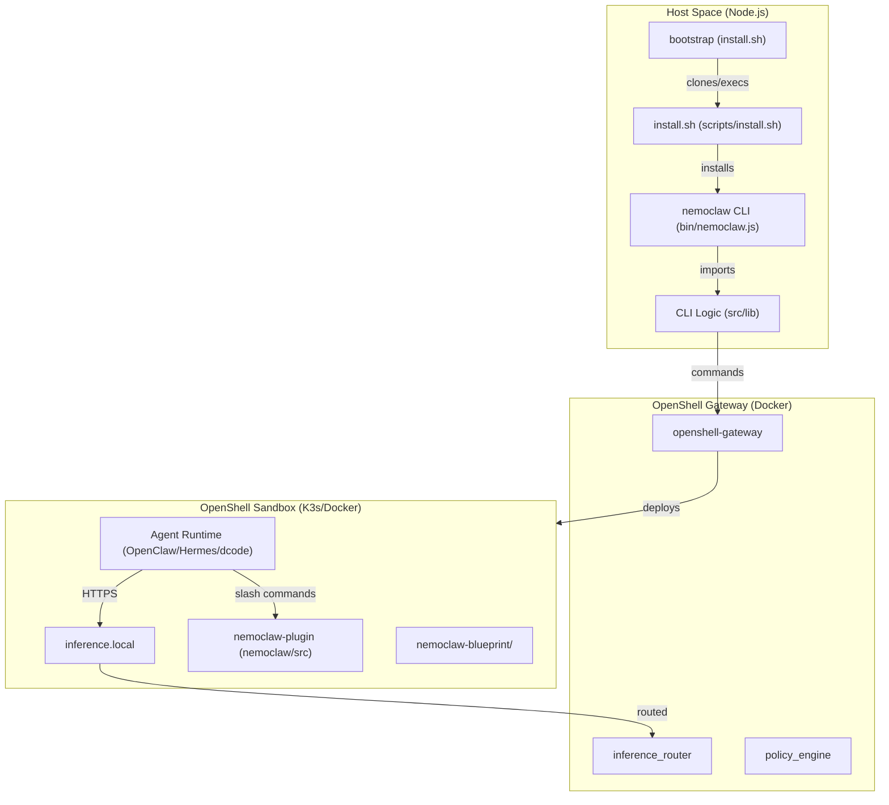
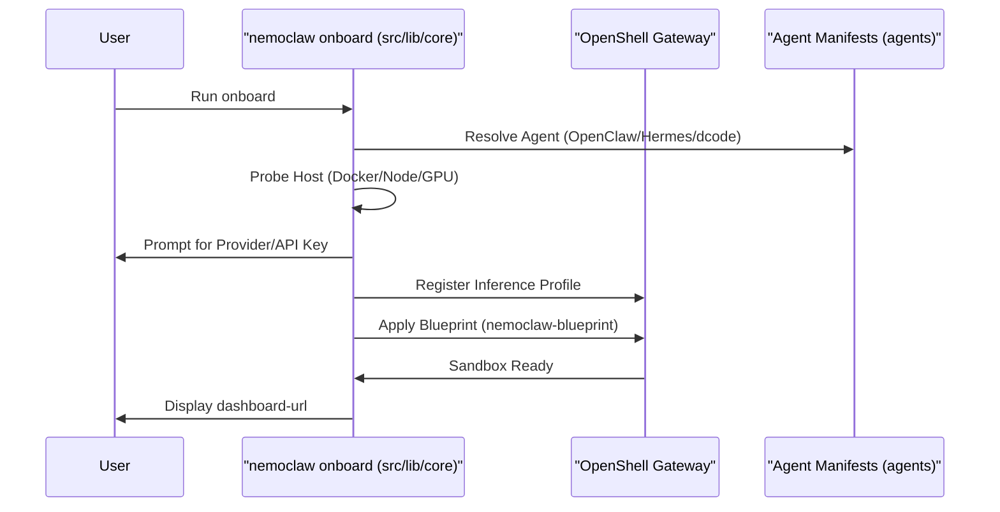

<!-- source: DeepWiki mcp.deepwiki.com · repo NVIDIA/NemoClaw · page 1 Overview · fetched 2026-10-26 -->

# Overview

Relevant source files

The following files were used as context for generating this wiki page:

- [.agents/skills/_shared/controlled-words.md](.agents/skills/_shared/controlled-words.md)
- [.agents/skills/_shared/documentation-writing-review.md](.agents/skills/_shared/documentation-writing-review.md)
- [.agents/skills/_shared/pr-follow-up.md](.agents/skills/_shared/pr-follow-up.md)
- [.agents/skills/nemoclaw-contributor-create-pr/SKILL.md](.agents/skills/nemoclaw-contributor-create-pr/SKILL.md)
- [.agents/skills/nemoclaw-contributor-onboard-messaging-channel/SKILL.md](.agents/skills/nemoclaw-contributor-onboard-messaging-channel/SKILL.md)
- [.agents/skills/nemoclaw-contributor-update-docs/SKILL.md](.agents/skills/nemoclaw-contributor-update-docs/SKILL.md)
- [.agents/skills/nemoclaw-maintainer-day/PR-REVIEW-PRIORITIES.md](.agents/skills/nemoclaw-maintainer-day/PR-REVIEW-PRIORITIES.md)
- [.agents/skills/nemoclaw-maintainer-day/SALVAGE-PR.md](.agents/skills/nemoclaw-maintainer-day/SALVAGE-PR.md)
- [.agents/skills/nemoclaw-maintainer-day/TEST-GAPS.md](.agents/skills/nemoclaw-maintainer-day/TEST-GAPS.md)
- [.agents/skills/nemoclaw-maintainer-policies/SKILL.md](.agents/skills/nemoclaw-maintainer-policies/SKILL.md)
- [.agents/skills/nemoclaw-maintainer-refactor-docs/SKILL.md](.agents/skills/nemoclaw-maintainer-refactor-docs/SKILL.md)
- [.agents/skills/nemoclaw-maintainer-release-notes/SKILL.md](.agents/skills/nemoclaw-maintainer-release-notes/SKILL.md)
- [.github/PULL_REQUEST_TEMPLATE.md](.github/PULL_REQUEST_TEMPLATE.md)
- [.gitignore](.gitignore)
- [.pre-commit-config.yaml](.pre-commit-config.yaml)
- [AGENTS.md](AGENTS.md)
- [CONTRIBUTING.md](CONTRIBUTING.md)
- [README.md](README.md)
- [WRITING.md](WRITING.md)
- [bin/nemoclaw.js](bin/nemoclaw.js)
- [ci/platform-matrix.json](ci/platform-matrix.json)
- [docs/AGENTS.md](docs/AGENTS.md)
- [docs/CONTRIBUTING.md](docs/CONTRIBUTING.md)
- [docs/DORI_SETUP.md](docs/DORI_SETUP.md)
- [docs/about/ecosystem-deepagents.mdx](docs/about/ecosystem-deepagents.mdx)
- [docs/about/ecosystem-hermes.mdx](docs/about/ecosystem-hermes.mdx)
- [docs/about/ecosystem.mdx](docs/about/ecosystem.mdx)
- [docs/about/overview.mdx](docs/about/overview.mdx)
- [docs/changelog/2026-07-30.mdx](docs/changelog/2026-07-30.mdx)
- [docs/configure-agents/configure-memory-search.mdx](docs/configure-agents/configure-memory-search.mdx)
- [docs/get-started/dgx-station-preparation.mdx](docs/get-started/dgx-station-preparation.mdx)
- [docs/get-started/prerequisites.mdx](docs/get-started/prerequisites.mdx)
- [docs/get-started/quickstart-hermes.mdx](docs/get-started/quickstart-hermes.mdx)
- [docs/get-started/quickstart.mdx](docs/get-started/quickstart.mdx)
- [docs/index.mdx](docs/index.mdx)
- [docs/index.yml](docs/index.yml)
- [docs/inference/set-up-vllm-on-two-dgx-stations.mdx](docs/inference/set-up-vllm-on-two-dgx-stations.mdx)
- [docs/manage-sandboxes/run-deep-agents-code.mdx](docs/manage-sandboxes/run-deep-agents-code.mdx)
- [docs/reference/commands.mdx](docs/reference/commands.mdx)
- [docs/reference/configure-runtime-identity.mdx](docs/reference/configure-runtime-identity.mdx)
- [docs/reference/platform-support.mdx](docs/reference/platform-support.mdx)
- [docs/reference/troubleshooting.mdx](docs/reference/troubleshooting.mdx)
- [docs/resources/engineer-agentic-documentation.mdx](docs/resources/engineer-agentic-documentation.mdx)
- [fern/AGENTS.md](fern/AGENTS.md)
- [install.sh](install.sh)
- [package-lock.json](package-lock.json)
- [package.json](package.json)
- [scripts/check-docs-published-routes.mts](scripts/check-docs-published-routes.mts)
- [scripts/install.sh](scripts/install.sh)
- [scripts/start-services.sh](scripts/start-services.sh)
- [src/lib/sandbox/config-format.test.ts](src/lib/sandbox/config-format.test.ts)
- [src/lib/sandbox/config-format.ts](src/lib/sandbox/config-format.ts)
- [src/lib/sandbox/config-get.test.ts](src/lib/sandbox/config-get.test.ts)
- [test/check-docs-published-routes.test.ts](test/check-docs-published-routes.test.ts)
- [test/install-onboard-yes.test.ts](test/install-onboard-yes.test.ts)
- [test/install-preflight.test.ts](test/install-preflight.test.ts)
- [test/station-doc-ownership.test.ts](test/station-doc-ownership.test.ts)
- [uninstall.sh](uninstall.sh)

NVIDIA NemoClaw is an open-source reference stack for running always-on AI agents more safely inside [NVIDIA OpenShell](https://github.com/NVIDIA/OpenShell) sandboxes. [README.md:6-12]() It provides guided onboarding, a hardened blueprint, routed inference, network policy, and lifecycle management through a single CLI. [README.md:13-14]()

NemoClaw addresses the security, cost, and compliance risks of autonomous AI agents by providing policy-based privacy and security guardrails. [README.md:12-14]() This enables agents like [OpenClaw](https://openclaw.ai), [Hermes](https://get-hermes.ai), or [LangChain Deep Agents Code](https://docs.langchain.com/oss/python/deepagents/code/overview) to run securely across various environments, including RTX PCs, DGX Spark, and cloud instances. [README.md:15-20](), [docs/reference/commands.mdx:12-36]()

## Core Capabilities

| Capability | Description |
| :--- | :--- |
| **Sandboxed Execution** | Agents run in isolated environments with container security measures, capability drops, and process limits. [README.md:60-60]() |
| **Inference Routing** | Traffic is routed through the OpenShell gateway. Agents use `inference.local` while sensitive API keys stay on the host. [README.md:56-56](), [docs/reference/commands.mdx:45-53]() |
| **Guided Onboarding** | An interactive wizard (`nemoclaw onboard`) handles gateway setup, provider registration, and image building. [docs/reference/commands.mdx:43-44](), [scripts/install.sh:7-8]() |
| **Local Inference** | Native support for local model servers like Ollama, vLLM, and NVIDIA NIM with automatic detection and installation. [scripts/install.sh:7-8](), [README.md:56-56]() |
| **Policy Enforcement** | Egress rules and filesystem access are defined via schemas and enforced by the runtime. [README.md:57-58]() |

**Sources**: [README.md:12-21](), [docs/reference/commands.mdx:12-60](), [scripts/install.sh:7-8]()

## System Architecture

NemoClaw consists of a host-side CLI (available as `nemoclaw`, `nemohermes`, or `nemo-deepagents`) that orchestrates the OpenShell runtime and manages agent-specific runtimes. [bin/nemoclaw.js:6-10](), [package.json:7-11](), [docs/reference/commands.mdx:38-73]()

### High-Level Component Interaction

The following diagram illustrates the relationship between the host CLI, the OpenShell gateway, and the sandboxed agent runtimes.

**Diagram 1: NemoClaw Component Integration**

**Sources**: [AGENTS.md:28-43](), [bin/nemoclaw.js:1-12](), [scripts/install.sh:7-8](), [install.sh:5-10](), [docs/reference/commands.mdx:75-115]()

### Component Roles

| Component | Code Reference | Role |
| :--- | :--- | :--- |
| **Host CLI** | `bin/nemoclaw.js` | Primary interface for `onboard`, `status`, `logs`, and `connect`. [package.json:7-11](), [docs/reference/commands.mdx:117-145]() |
| **Installer** | `scripts/install.sh` | Bootstraps Node.js, Ollama, and NemoClaw CLI. [scripts/install.sh:7-8]() |
| **Plugin** | `nemoclaw/src/` | TypeScript plugin for in-sandbox slash commands and TUI interactions. [AGENTS.md:32-35]() |
| **Blueprint** | `nemoclaw-blueprint/` | YAML definitions for sandbox orchestration and network policies. [AGENTS.md:36-37]() |
| **Core Logic** | `src/lib/` | Core TypeScript logic for onboarding, credentials, and policies. [AGENTS.md:31-31]() |

**Sources**: [AGENTS.md:28-43](), [package.json:7-11](), [scripts/install.sh:7-8](), [docs/reference/commands.mdx:12-36]()

## How It Works

### The Onboarding Lifecycle
NemoClaw uses an interactive wizard to transition from a clean host to a fully secured agent environment. The `nemoclaw onboard` command handles provider selection and credential management. [docs/reference/commands.mdx:43-45](), [docs/get-started/quickstart.mdx:48-54]()

**Diagram 2: Onboarding Data Flow**

**Sources**: [docs/reference/commands.mdx:38-73](), [docs/get-started/quickstart.mdx:37-78](), [AGENTS.md:28-43]()

### Multi-Agent Support
NemoClaw supports multiple agent runtimes through a unified CLI. Users can switch agents via environment variables or specific binary aliases. [bin/nemoclaw.js:6-10](), [docs/reference/commands.mdx:38-73]()

*   **OpenClaw**: The default agent, providing a chat interface with `/nemoclaw` slash commands. [docs/reference/commands.mdx:42-45]()
*   **Hermes**: Selected via `NEMOCLAW_AGENT=hermes` or the `nemohermes` alias. Includes a built-in dashboard. [docs/reference/commands.mdx:48-59]()
*   **LangChain Deep Agents Code**: Selected via the `nemo-deepagents` alias; uses the `dcode` terminal runtime. [docs/reference/commands.mdx:61-73]()

**Sources**: [bin/nemoclaw.js:6-10](), [docs/reference/commands.mdx:12-73](), [package.json:7-11]()

### Security and Isolation
NemoClaw enforces multiple layers of protection:
*   **Network Policy**: Egress control based on baseline and session policies. [README.md:57-58]()
*   **Credential Isolation**: API keys are managed by the host CLI and OpenShell gateway, keeping them out of the sandbox filesystem. [README.md:13-14](), [docs/reference/commands.mdx:45-45]()
*   **Hardened Runtimes**: Leverages OpenShell's container security measures, including capability drops and process limits. [README.md:60-60]()

**Sources**: [README.md:57-60](), [docs/reference/commands.mdx:45-53](), [AGENTS.md:8-9]()

## Next Steps

*   [Getting Started](Getting-Started) — Install the CLI and launch your first agent.
*   [Core Concepts](Core-Concepts) — Deep dive into the architecture and security model.
*   [Command-Line Interface](Command-Line-Interface) — Complete reference for `nemoclaw`, `nemohermes`, and `nemo-deepagents` commands.

**Sources**: [README.md:45-62](), [docs/reference/commands.mdx:4-11]()

---

