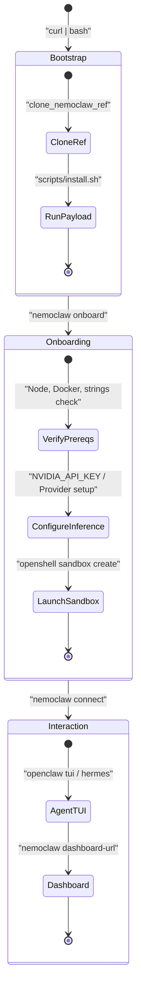

<!-- source: DeepWiki mcp.deepwiki.com · repo NVIDIA/NemoClaw · page 2 Getting Started · fetched 2026-10-26 -->

# Getting Started

<details>
<summary>Relevant source files</summary>

The following files were used as context for generating this wiki page:

- [README.md](README.md)
- [bin/nemoclaw.js](bin/nemoclaw.js)
- [ci/platform-matrix.json](ci/platform-matrix.json)
- [docs/about/ecosystem-deepagents.mdx](docs/about/ecosystem-deepagents.mdx)
- [docs/about/ecosystem-hermes.mdx](docs/about/ecosystem-hermes.mdx)
- [docs/about/ecosystem.mdx](docs/about/ecosystem.mdx)
- [docs/about/overview.mdx](docs/about/overview.mdx)
- [docs/get-started/dgx-station-preparation.mdx](docs/get-started/dgx-station-preparation.mdx)
- [docs/get-started/prerequisites.mdx](docs/get-started/prerequisites.mdx)
- [docs/get-started/quickstart-hermes.mdx](docs/get-started/quickstart-hermes.mdx)
- [docs/get-started/quickstart.mdx](docs/get-started/quickstart.mdx)
- [docs/index.mdx](docs/index.mdx)
- [docs/reference/platform-support.mdx](docs/reference/platform-support.mdx)
- [install.sh](install.sh)
- [scripts/install.sh](scripts/install.sh)
- [scripts/start-services.sh](scripts/start-services.sh)
- [test/install-onboard-yes.test.ts](test/install-onboard-yes.test.ts)
- [test/install-preflight.test.ts](test/install-preflight.test.ts)
- [test/station-doc-ownership.test.ts](test/station-doc-ownership.test.ts)
- [uninstall.sh](uninstall.sh)

</details>


This section guides you through initial installation and setup to get NemoClaw running on your system. You will install prerequisites, set up the OpenShell runtime, configure inference providers, and launch your first sandboxed AI agent.

NemoClaw simplifies the execution of AI assistants like [OpenClaw](https://openclaw.ai), [Hermes](https://get-hermes.ai), and [LangChain Deep Agents Code](https://docs.langchain.com/oss/python/deepagents/code/overview) by providing guided onboarding, a hardened blueprint, and routed inference on top of the [NVIDIA OpenShell](https://github.com/NVIDIA/OpenShell) runtime [README.md:6-21]().

For detailed installation procedures covering different installation methods, see [Installation](#2.1). For a hands-on walkthrough of launching and interacting with your first sandbox, see [Quick Start Guide](#2.2). For information about the onboarding wizard and credential configuration, see [Configuration and Onboarding](#2.3).

---

## Installation Paths

NemoClaw supports several installation paths depending on your environment. The primary method is a unified bootstrap script (`install.sh`) that handles Node.js detection, OpenShell installation, and the onboarding wizard [install.sh:5-20](). The installer is designed to run as a normal user, although it may request elevated privileges for system package management or Docker configuration [docs/get-started/prerequisites.mdx:38-42]().

### Installation Flow and System Association
```mermaid
graph TB
    subgraph "Host_Environment"
        ["👤 User Entrypoint"] --> ["install.sh [bootstrap]"]
        ["install.sh [bootstrap]"] -- "exec_installer_from_ref" --> ["scripts/install.sh [payload]"]
        ["scripts/install.sh [payload]"] -- "npm install" --> ["nemoclaw CLI [bin/nemoclaw.js]"]
    end

    subgraph "NemoClaw_Logic_Space"
        ["nemoclaw CLI [bin/nemoclaw.js]"] -- "onboard command" --> ["src/lib/onboard/"]
        ["src/lib/onboard/"] -- "executes" --> ["openshell binary"]
    end

    subgraph "OpenShell_Runtime_Space"
        ["openshell binary"] -- "manages" --> ["Gateway_Process"]
        ["openshell binary"] -- "creates" --> ["Sandbox_Container"]
    end

    subgraph "Sandbox_Internal_Space"
        ["Sandbox_Container"] -- "runs" --> ["Agent_Runtime (OpenClaw/Hermes/dcode)"]
        ["Sandbox_Container"] -- "mounts" --> ["nemoclaw-plugin"]
    end
```

**Installation Path Comparison**

| Path | Script / Entry Point | Target User | Automation Level |
|------|--------|-------------|------------------|
| Quick Install | `install.sh` | End users wanting minimal setup | Fully automated bootstrap [install.sh:123-140]() |
| Manual / Dev | `./scripts/dev-setup.sh` | Developers and contributors | Manual dependency management [README.md:82-95]() |
| Uninstaller | `uninstall.sh` | Users removing all resources | Automated cleanup via CLI [uninstall.sh:11-26]() |

**Sources:** [README.md:23-44](), [install.sh:5-27](), [scripts/install.sh:7-15](), [uninstall.sh:11-26](), [docs/get-started/quickstart.mdx:37-46]()

---

## Prerequisites

Before installing NemoClaw, verify your system meets the hardware and software requirements. The installer performs preflight checks for Node.js versions and required binaries like `docker` and `strings` [docs/get-started/prerequisites.mdx:28-53]().

### System Requirements

| Component | Requirement | Notes |
|-----------|-------------|-------|
| Node.js | `>= 22.19` | Required for host CLI [docs/get-started/prerequisites.mdx:32]() |
| Docker | Running | Required for sandbox execution [docs/get-started/prerequisites.mdx:35]() |
| Python | Python 3 | Trusted system location for snapshot sanitization [docs/get-started/prerequisites.mdx:34, 44-48]() |
| OS | Linux / macOS / WSL2 | Primary tested platforms [ci/platform-matrix.json:27-79]() |
| Memory | 8 GB RAM | Minimum to avoid OOM during image operations [docs/get-started/prerequisites.mdx:16-26]() |

**Sources:** [docs/get-started/prerequisites.mdx:14-37](), [ci/platform-matrix.json:27-79](), [scripts/install.sh:151-160](), [test/install-preflight.test.ts:130-185]()

---

## Getting Started Workflow

The setup process moves from host-level environment preparation to sandbox-level agent execution. The bootstrap `install.sh` orchestrates the transition from raw scripts to the compiled `nemoclaw` CLI.

### Logic Flow: Host to Sandbox


**Sources:** [install.sh:78-106](), [scripts/install.sh:173-182](), [docs/get-started/quickstart.mdx:36-78](), [docs/get-started/quickstart-hermes.mdx:37-77]()

---

## Command Hierarchy

NemoClaw uses a layered command approach. The `nemoclaw` host utility orchestrates the `openshell` CLI, while the agents (OpenClaw, Hermes, or dcode) run inside the sandbox.

| Command | Context | Role |
|---------|---------|------|
| `nemoclaw onboard` | Host | Interactive wizard to set up environment and providers [install.sh:123-140]() |
| `nemoclaw connect` | Host | Connect to an active sandbox via SSH [docs/get-started/quickstart.mdx:73-76]() |
| `nemoclaw status` | Host | Check health of sandboxes and gateway [docs/get-started/quickstart.mdx:59-62]() |
| `nemohermes` | Host | NemoClaw CLI with Hermes pre-selected [docs/get-started/quickstart-hermes.mdx:16]() |
| `nemo-deepagents` | Host | NemoClaw CLI with LangChain Deep Agents pre-selected [bin/nemoclaw.js:7-10]() |

**Sources:** [bin/nemoclaw.js:6-12](), [docs/get-started/quickstart.mdx:56-77](), [docs/get-started/quickstart-hermes.mdx:55-76](), [install.sh:119-160]()

---

## Next Steps

After completing the initial setup, proceed to the child pages for detailed guidance:

1. **[Installation](#2.1)** — Detailed instructions for automated and manual setups, platform-specific notes, and dependency management.
2. **[Quick Start Guide](#2.2)** — Hands-on walkthrough to launch your first sandbox and interact with the agent.
3. **[Configuration and Onboarding](#2.3)** — Deep dive into the onboarding wizard, inference provider selection, and credential storage.

For information about the underlying architecture, see [System Architecture](#3.1). For troubleshooting installation issues, see [Troubleshooting](#8.5).

**Sources:** [README.md:45-62](), [docs/index.mdx:1-20]()

---

