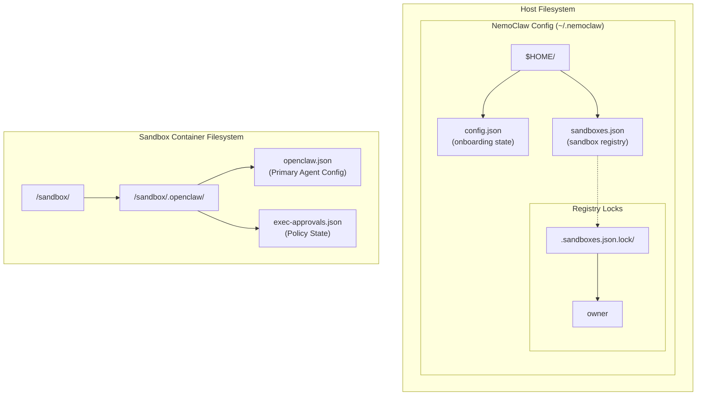
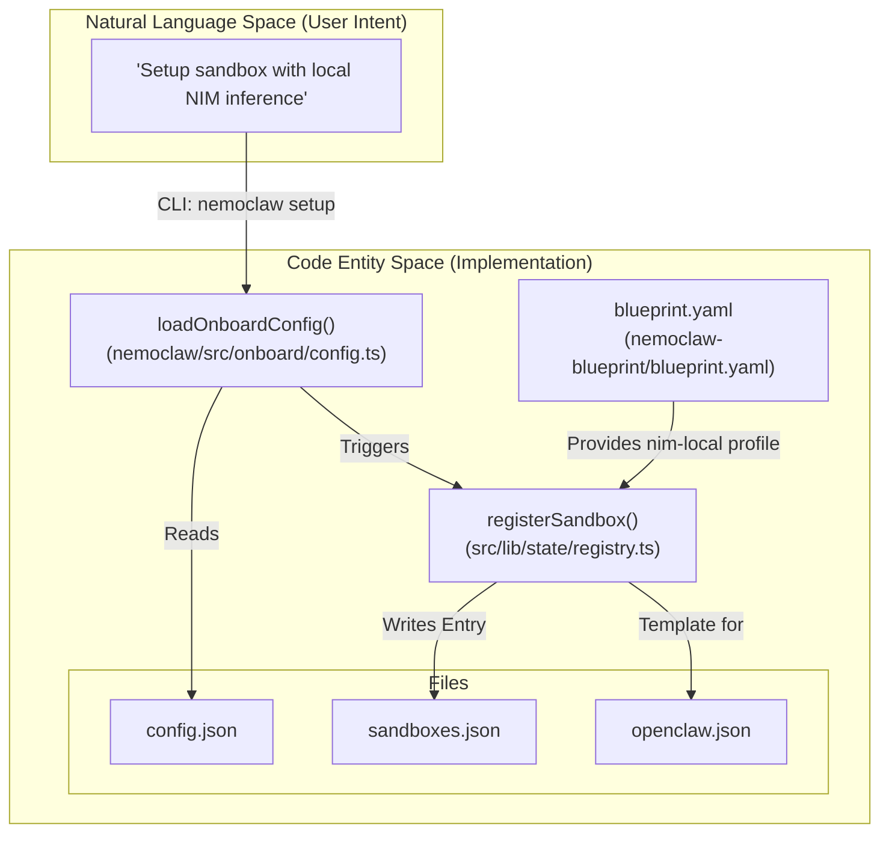

<!-- source: DeepWiki mcp.deepwiki.com · repo NVIDIA/NemoClaw · page 8.3 Configuration Files · fetched 2026-10-26 -->

# Configuration Files

<details>
<summary>Relevant source files</summary>

The following files were used as context for generating this wiki page:

- [.agents/skills/_shared/controlled-words.md](.agents/skills/_shared/controlled-words.md)
- [.agents/skills/_shared/documentation-writing-review.md](.agents/skills/_shared/documentation-writing-review.md)
- [.agents/skills/_shared/pr-follow-up.md](.agents/skills/_shared/pr-follow-up.md)
- [.agents/skills/nemoclaw-contributor-create-pr/SKILL.md](.agents/skills/nemoclaw-contributor-create-pr/SKILL.md)
- [.agents/skills/nemoclaw-contributor-onboard-messaging-channel/SKILL.md](.agents/skills/nemoclaw-contributor-onboard-messaging-channel/SKILL.md)
- [.agents/skills/nemoclaw-contributor-update-docs/SKILL.md](.agents/skills/nemoclaw-contributor-update-docs/SKILL.md)
- [.agents/skills/nemoclaw-maintainer-day/PR-REVIEW-PRIORITIES.md](.agents/skills/nemoclaw-maintainer-day/PR-REVIEW-PRIORITIES.md)
- [.agents/skills/nemoclaw-maintainer-day/SALVAGE-PR.md](.agents/skills/nemoclaw-maintainer-day/SALVAGE-PR.md)
- [.agents/skills/nemoclaw-maintainer-day/TEST-GAPS.md](.agents/skills/nemoclaw-maintainer-day/TEST-GAPS.md)
- [.agents/skills/nemoclaw-maintainer-policies/SKILL.md](.agents/skills/nemoclaw-maintainer-policies/SKILL.md)
- [.agents/skills/nemoclaw-maintainer-refactor-docs/SKILL.md](.agents/skills/nemoclaw-maintainer-refactor-docs/SKILL.md)
- [.agents/skills/nemoclaw-maintainer-release-notes/SKILL.md](.agents/skills/nemoclaw-maintainer-release-notes/SKILL.md)
- [.github/PULL_REQUEST_TEMPLATE.md](.github/PULL_REQUEST_TEMPLATE.md)
- [.github/dco-bypass.txt](.github/dco-bypass.txt)
- [.github/workflows/dco-check.yaml](.github/workflows/dco-check.yaml)
- [.github/workflows/installer-hash-check.yaml](.github/workflows/installer-hash-check.yaml)
- [.pre-commit-config.yaml](.pre-commit-config.yaml)
- [AGENTS.md](AGENTS.md)
- [CONTRIBUTING.md](CONTRIBUTING.md)
- [WRITING.md](WRITING.md)
- [docs/AGENTS.md](docs/AGENTS.md)
- [docs/CONTRIBUTING.md](docs/CONTRIBUTING.md)
- [fern/AGENTS.md](fern/AGENTS.md)
- [nemoclaw-blueprint/blueprint.yaml](nemoclaw-blueprint/blueprint.yaml)
- [nemoclaw-blueprint/private-networks.yaml](nemoclaw-blueprint/private-networks.yaml)
- [nemoclaw/src/blueprint/private-networks.test.ts](nemoclaw/src/blueprint/private-networks.test.ts)
- [nemoclaw/src/blueprint/private-networks.ts](nemoclaw/src/blueprint/private-networks.ts)
- [package-lock.json](package-lock.json)
- [package.json](package.json)
- [scripts/brev-launchable-ci-cpu.sh](scripts/brev-launchable-ci-cpu.sh)
- [scripts/check-installer-hash.sh](scripts/check-installer-hash.sh)
- [scripts/checks/extract-installer-pins.mts](scripts/checks/extract-installer-pins.mts)
- [scripts/install-openshell.sh](scripts/install-openshell.sh)
- [src/lib/agent/onboard-web-auth.test.ts](src/lib/agent/onboard-web-auth.test.ts)
- [src/lib/onboard/inference-providers/hermes.test.ts](src/lib/onboard/inference-providers/hermes.test.ts)
- [src/lib/onboard/inference-providers/hermes.ts](src/lib/onboard/inference-providers/hermes.ts)
- [src/lib/private-networks.ts](src/lib/private-networks.ts)
- [src/lib/runner.ts](src/lib/runner.ts)
- [src/lib/sandbox/config-format.test.ts](src/lib/sandbox/config-format.test.ts)
- [src/lib/sandbox/config-format.ts](src/lib/sandbox/config-format.ts)
- [src/lib/sandbox/config-get.test.ts](src/lib/sandbox/config-get.test.ts)
- [src/lib/sandbox/config.ts](src/lib/sandbox/config.ts)
- [test/brev-launchable-ci-cpu-checksum.test.ts](test/brev-launchable-ci-cpu-checksum.test.ts)
- [test/config-set-nested-ssrf.test.ts](test/config-set-nested-ssrf.test.ts)
- [test/config-set-prompt-error.test.ts](test/config-set-prompt-error.test.ts)
- [test/config-set.test.ts](test/config-set.test.ts)
- [test/dependency-pins-check.test.ts](test/dependency-pins-check.test.ts)
- [test/helpers/vitest-state-isolation.ts](test/helpers/vitest-state-isolation.ts)
- [test/install-openshell-version-check.test.ts](test/install-openshell-version-check.test.ts)
- [test/installer-hash-check.test.ts](test/installer-hash-check.test.ts)
- [test/package-contract/cli/config-set-prompt-eof.test.ts](test/package-contract/cli/config-set-prompt-eof.test.ts)
- [test/runner.test.ts](test/runner.test.ts)
- [test/vitest-state-isolation.test.ts](test/vitest-state-isolation.test.ts)

</details>


This page documents all configuration files used by NemoClaw, including their locations, formats, purposes, and how they interact with the system components. It covers the registry for managing sandboxes, the state tracking for blueprint executions, the onboarding configuration for inference routing, and the security-hardened configuration generation for the sandbox environment.

---

## Overview of Configuration Files

NemoClaw uses multiple configuration files across different directories to manage OpenClaw settings, authentication, policies, and sandbox registry state:

| File | Location | Format | Purpose | Managed By |
|------|----------|--------|---------|------------|
| `openclaw.json` | `/sandbox/.openclaw/` | JSON | OpenClaw agent configuration, model settings, gateway config | `scripts/generate-openclaw-config.py` |
| `auth-profiles.json` | `/sandbox/.openclaw/agents/main/agent/` | JSON | Authentication credentials for inference providers | `scripts/nemoclaw-start.sh`, OpenClaw |
| `blueprint.yaml` | `nemoclaw-blueprint/` | YAML | Blueprint manifest with version, compatibility, digest, and profiles | Blueprint artifact |
| `openclaw-sandbox.yaml` | `nemoclaw-blueprint/policies/` | YAML | Baseline security policies (network, filesystem, process) | Developer, copied into blueprint |
| `sandboxes.json` | `~/.nemoclaw/` | JSON | Registry of sandboxes with metadata (model, provider, GPU, policies) | `src/lib/state/registry.ts` |
| `config.json` | `~/.nemoclaw/` | JSON | Onboarding state and active inference route config | `nemoclaw/src/onboard/config.ts` |
| `manifest.yaml` | `agents/openclaw/` | YAML | Agent-specific integration contract and state directory mapping | Agent Maintainer |

**Sources:** [src/lib/state/registry.ts:92-92](), [nemoclaw/src/onboard/config.ts:154-156](), [nemoclaw-blueprint/blueprint.yaml:1-35](), [agents/openclaw/manifest.yaml:35-57]()

---

## Configuration File Locations



**Sources:** [src/lib/state/registry.ts:92-95](), [nemoclaw/src/onboard/config.ts:15-156](), [agents/openclaw/manifest.yaml:36-39]()

---

## Sandbox Registry (`sandboxes.json`)

The `sandboxes.json` file serves as the central registry for all sandboxes managed by NemoClaw on the host. It is accessed via the `SandboxRegistry` and `SandboxEntry` interfaces in the registry module.

### Data Structure
The `SandboxEntry` interface defines the metadata persisted for each sandbox instance [src/lib/state/registry.ts:37-80]().

```typescript
export interface SandboxEntry {
  name: string;
  model?: string | null;
  provider?: string | null;
  gpuEnabled?: boolean;
  policies?: string[];
  policyPresetsFinalized?: boolean;
  gatewayName?: string | null;
  gatewayPort?: number | null;
  agentVersion?: string | null;
}
```

### Implementation Details
- **Atomic Operations**: NemoClaw uses an advisory lock mechanism (`acquireLock`, `releaseLock`) using a `.lock` directory and a PID-based `owner` file to prevent concurrent writes to the registry [src/lib/state/registry.ts:99-209]().
- **Default Sandbox**: The registry tracks a `defaultSandbox` pointer which is used by the CLI when no specific sandbox name is provided [src/lib/state/registry.ts:87-90]().

**Sources:** [src/lib/state/registry.ts:1-230](), [package.json:61-61]()

---

## Onboarding Configuration (`config.json`)

The `config.json` file (managed by `NemoClawOnboardConfig`) stores the global result of the `nemoclaw onboard` process. It tracks the preferred inference provider and model used during new sandbox creation.

### Data Structure
[nemoclaw/src/onboard/config.ts:28-38]()

```typescript
export interface NemoClawOnboardConfig {
  endpointType: EndpointType; // "ncp", "nim-local", "vllm", "ollama", etc.
  endpointUrl: string;
  model: string;
  profile: string;
  credentialEnv: string;
  onboardedAt: string;
}
```

### Managed Inference Routing
If `endpointUrl` is set to `https://inference.local/v1`, the system identifies this as a "Managed Inference Route", which abstracts the underlying provider from the OpenClaw agent [nemoclaw/src/onboard/config.ts:89-92]().

**Sources:** [nemoclaw/src/onboard/config.ts:17-109]()

---

## Blueprint Manifest (`blueprint.yaml`)

The `blueprint.yaml` file defines the orchestration requirements for a specific NemoClaw release, including container images pinned by digest and available inference profiles.

### Key Fields
- **Image Pinning**: The `sandbox` component image is pinned to a specific SHA256 digest to prevent silent updates [nemoclaw-blueprint/blueprint.yaml:35-35]().
- **Integrity Digest**: A top-level `digest` field mirrors the sandbox image digest to allow release tooling to verify the manifest without deep parsing [nemoclaw-blueprint/blueprint.yaml:15-15]().
- **Inference Profiles**: Defines named configurations (e.g., `default`, `ncp`, `nim-local`, `vllm`, `routed`) that specify the provider type, endpoint, and model [nemoclaw-blueprint/blueprint.yaml:54-94]().
- **Policy Extensions**: Blueprints can define `policy.additions` to allow access to specific infrastructure services like local NIM containers [nemoclaw-blueprint/blueprint.yaml:103-110]().

**Sources:** [nemoclaw-blueprint/blueprint.yaml:1-110]()

---

## Agent Manifest (`manifest.yaml`)

The agent manifest (e.g., `agents/openclaw/manifest.yaml`) defines the integration contract between NemoClaw and the sandboxed agent. It specifies where configuration and state reside within the container.

### Integration Contract
- **Binary Path**: Location of the agent binary (e.g., `/usr/local/bin/openclaw`) [agents/openclaw/manifest.yaml:20-20]().
- **Health Probes**: URL and port used to verify the agent is running (e.g., `http://localhost:18789/`) [agents/openclaw/manifest.yaml:26-30]().
- **State Directories**: List of directories (relative to the agent home) that must be persisted across sandbox restarts, such as `workspace`, `skills`, and `memory` [agents/openclaw/manifest.yaml:42-57]().

**Sources:** [agents/openclaw/manifest.yaml:1-96]()

---

## Configuration Data Flow

The following diagram bridges the user's natural language intent to the code entities and configuration files that realize that intent.



**Sources:** [src/lib/state/registry.ts:216-225](), [nemoclaw/src/onboard/config.ts:158-172](), [nemoclaw-blueprint/blueprint.yaml:69-75]()

---

## Schema Validation

NemoClaw includes JSON schemas in the `schemas/` directory to validate configuration files. These schemas are used by the `validate-configs` script and during runtime to ensure data integrity.

- **`blueprint.schema.json`**: Validates the structure of `blueprint.yaml`, including resource profiles and inference providers.
- **`onboard-config.schema.json`**: Validates the `config.json` file generated during onboarding.
- **`sandbox-policy.schema.json`**: Validates network and filesystem policies.
- **`openclaw-plugin.schema.json`**: Validates the `openclaw.plugin.json` used for NemoClaw's plugin registration inside the sandbox.

**Sources:** [package.json:61-61](), [.pre-commit-config.yaml:162-168](), [AGENTS.md:36-37]()

---

