<!-- source: DeepWiki mcp.deepwiki.com · repo NVIDIA/OSMO · page 1.1 Architecture · fetched 2026-10-26 -->

# Architecture

<details>
<summary>Relevant source files</summary>

The following files were used as context for generating this wiki page:

- [.github/PULL_REQUEST_TEMPLATE.md](.github/PULL_REQUEST_TEMPLATE.md)
- [CONTRIBUTING.md](CONTRIBUTING.md)
- [README.md](README.md)
- [deployments/brev/README.md](deployments/brev/README.md)
- [deployments/brev/setup.sh](deployments/brev/setup.sh)
- [docs/deployment_guide/appendix/deploy_local.rst](docs/deployment_guide/appendix/deploy_local.rst)
- [docs/deployment_guide/appendix/deploy_minimal.rst](docs/deployment_guide/appendix/deploy_minimal.rst)
- [docs/deployment_guide/getting_started/create_storage/s3/index.rst](docs/deployment_guide/getting_started/create_storage/s3/index.rst)
- [docs/deployment_guide/index.rst](docs/deployment_guide/index.rst)
- [docs/spelling_wordlist.txt](docs/spelling_wordlist.txt)
- [docs/user_guide/index.rst](docs/user_guide/index.rst)
- [docs/user_guide/overview.svg](docs/user_guide/overview.svg)
- [src/lib/utils/common.py](src/lib/utils/common.py)
- [src/lib/utils/port_forward.py](src/lib/utils/port_forward.py)
- [src/lib/utils/tests/test_common.py](src/lib/utils/tests/test_common.py)
- [src/service/core/config/helpers.py](src/service/core/config/helpers.py)
- [src/service/core/data/data_service.py](src/service/core/data/data_service.py)
- [src/service/logger/ctrl_websocket.py](src/service/logger/ctrl_websocket.py)
- [src/service/router/router.py](src/service/router/router.py)
- [src/utils/connectors/postgres.py](src/utils/connectors/postgres.py)
- [src/utils/job/kb_objects.py](src/utils/job/kb_objects.py)
- [src/utils/job/task.py](src/utils/job/task.py)

</details>


## Purpose and Scope

This page describes the high-level architecture of OSMO, focusing on the separation between the Control Plane and Compute Plane, how services are organized, and the key architectural patterns that enable multi-backend workflow orchestration. For workflow-specific concepts like tasks and groups, see [Key Concepts](#1.2). For deployment specifics, see [Kubernetes Deployment](#7).

## System Overview

OSMO uses a **Control Plane / Compute Plane** architecture that enables workflow orchestration across heterogeneous infrastructure without requiring direct network access to compute clusters.

### Control Plane / Compute Plane Separation

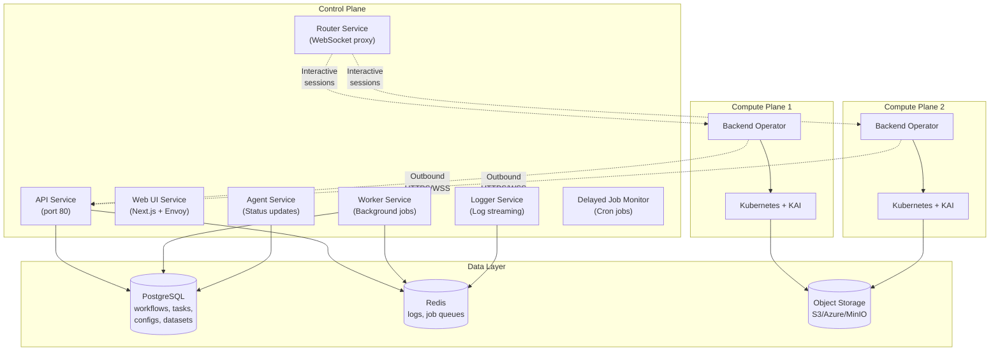

**Key architectural principle**: Backend operators initiate **outbound connections** to the control plane. This allows compute clusters to operate behind firewalls, in restricted networks, or across geographic boundaries without requiring inbound network access.

**Sources**: README.md:89-107, docs/deployment_guide/index.rst:83-98

## Control Plane Services

The control plane consists of seven core services, each with specific responsibilities:

| Service | Primary Class/Module | Port | Purpose |
|---------|---------------------|------|---------|
| API | Various `/api/*` routes | 80 | Workflow submission, configuration management, dataset operations |
| Web UI | Next.js application | 8080 | Browser-based interface for workflow management |
| Router | `src/service/router/router.py` | 8000 | Proxies exec, port-forward, and webserver connections to backends |
| Worker | Background job processor | N/A | Processes workflow state transitions and background tasks |
| Logger | `src/service/logger/ctrl_websocket.py` | N/A | Streams logs from task containers via WebSocket |
| Agent | Status update processor | N/A | Receives heartbeats and status updates from backends |
| Delayed Job Monitor | Cron job processor | N/A | Handles scheduled background operations |

### Service Communication Patterns

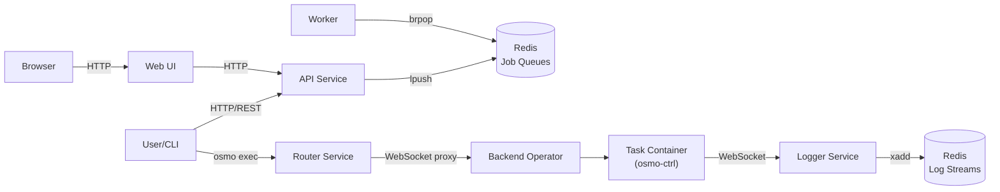

**Sources**: src/service/router/router.py:93-124, src/service/logger/ctrl_websocket.py:118-247

### API Service Routes

The API service exposes RESTful endpoints organized by resource type:

- `/api/workflow/*` - Workflow submission, cancellation, status ([src/service/core/workflow/](src/service/core/workflow))
- `/api/bucket/*` - Dataset upload, download, versioning ([src/service/core/data/data_service.py:36-39]())
- `/api/config/*` - Service, workflow, and dataset configuration ([src/service/core/config/](src/service/core/config))
- `/api/backend/*` - Backend registration, pool management
- `/api/credential/*` - User credential management

**Sources**: src/service/core/data/data_service.py:36-39

### Router Service Architecture

The Router service (`RouterServiceConfig`) provides interactive access to running tasks through WebSocket proxying:

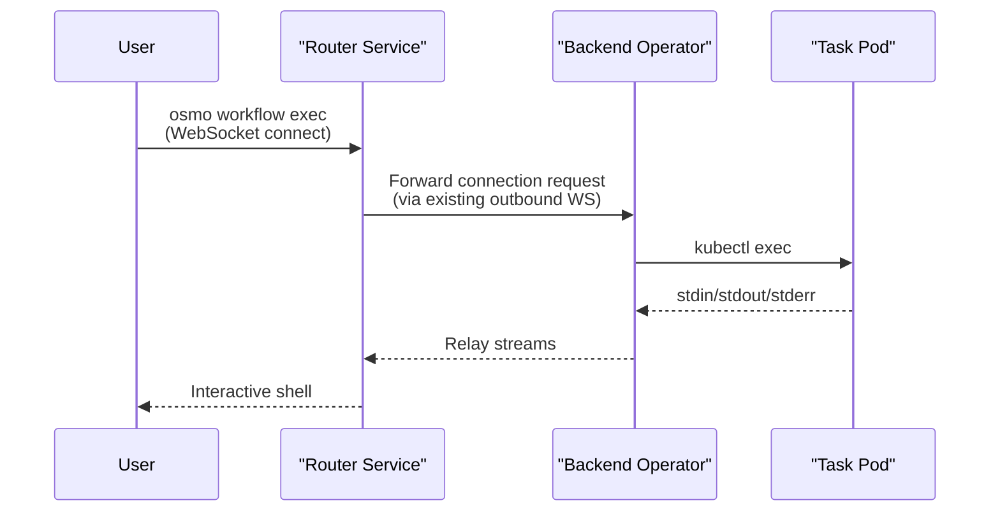

Key implementation details:
- **Sticky cookies**: `AWSALB`, `AWSALBCORS` maintained for load balancer affinity ([src/service/router/router.py:60-63]())
- **Connection storage**: `connections: Dict[str, RouterConnection]` maintains active exec/port-forward sessions ([src/service/router/router.py:95-96]())
- **Webserver sessions**: `webservers: Dict[str, WebserverConnection]` tracks long-running HTTP connections ([src/service/router/router.py:96]())

**Sources**: src/service/router/router.py:37-124

## Compute Plane Components

Each compute cluster runs a **Backend Operator** consisting of three components:

### Backend Operator Architecture

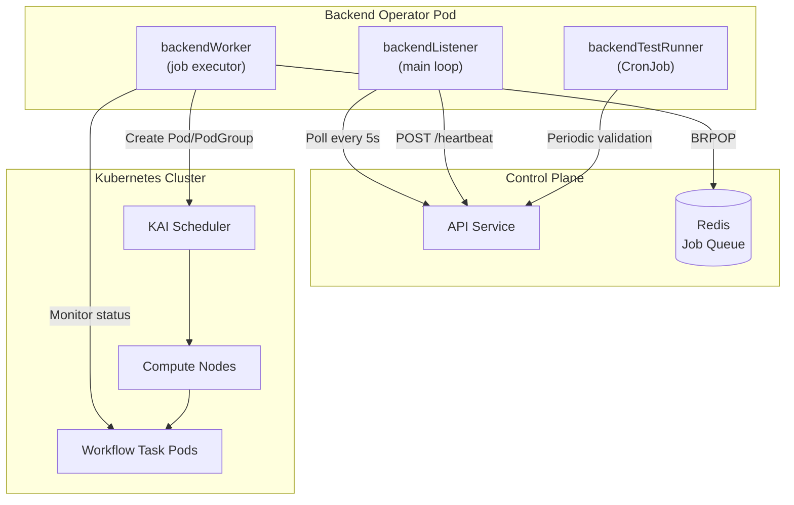

**Sources**: README.md:91-107, docs/deployment_guide/index.rst:91-93

### Backend Listener Responsibilities

The backend listener (deployed as `backend-listener` in the Helm chart) performs:

1. **Heartbeat transmission**: POST to `/api/backend/{name}/heartbeat` every 5 seconds
2. **Node resource reporting**: Aggregates `allocatable_fields`, `usage_fields`, and conditions from Kubernetes nodes
3. **Task polling**: Retrieves pending tasks for assigned pools
4. **Cluster metadata**: Reports `k8s_uid`, `k8s_namespace`, `version`

**Sources**: docs/deployment_guide/index.rst:91-93

### Backend Worker Job Processing

The backend worker subscribes to Redis queue `backend-connections:{backend_name}` and processes jobs:

- `BackendCreateWorkflowJobs`: Creates Kubernetes resources (Pods, PodGroups, Secrets, ConfigMaps)
- `BackendCleanupWorkflowJobs`: Deletes completed workflow resources
- `BackendSynchronizeQueues`: Updates KAI scheduler queues for pools
- `BackendGetErrorLogs`: Retrieves error logs from failed tasks

**Job creation pattern**:
```python
# From src/utils/job/kb_objects.py
def backend_action_queue_name(backend_name: str) -> str:
    return f'backend-connections:{backend_name}'
```

**Sources**: src/utils/connectors/postgres.py:51-52, src/utils/job/kb_objects.py:45-103

### Kubernetes Resource Factory

The `K8sObjectFactory` pattern abstracts scheduler-specific resource creation:

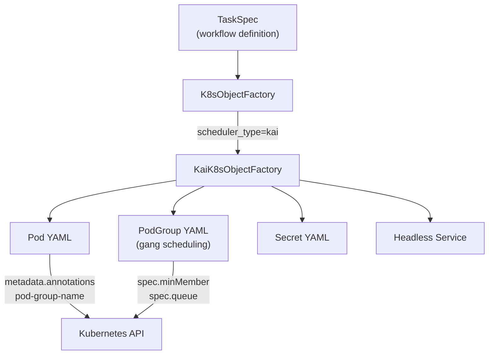

Key methods:
- `create_group_k8s_resources()`: Generates gang-scheduled Pod and PodGroup resources ([src/utils/job/kb_objects.py:74-103]())
- `create_init_container()`: Builds the `osmo-init` init container ([src/utils/job/kb_objects.py:111-152]())
- `create_control_container()`: Builds the `osmo-ctrl` sidecar ([src/utils/job/kb_objects.py:154-240]())

**Sources**: src/utils/job/kb_objects.py:43-323

## Data Layer

### PostgreSQL Schema Organization

The PostgreSQL database (`osmo_db`) stores all persistent state:

| Table | Purpose | Key Columns |
|-------|---------|-------------|
| `workflows` | Workflow metadata | `workflow_uuid`, `workflow_id`, `status`, `submitted_by` |
| `groups` | Task group specifications | `group_uuid`, `workflow_id`, `spec`, `status` |
| `tasks` | Individual task state | `task_uuid`, `workflow_id`, `retry_id`, `status`, `node_name` |
| `dataset` | Dataset registry | `id`, `name`, `bucket`, `hash_location` |
| `dataset_version` | Dataset versions | `dataset_id`, `version_id`, `location`, `status` |
| `dataset_tag` | Version tags | `dataset_id`, `tag`, `version_id` |
| `backends` | Backend registration | `name`, `k8s_namespace`, `last_heartbeat` |
| `pools` | Resource pool configuration | `name`, `backend`, `platforms`, `resources` |
| `credential` | Encrypted user credentials | `user_name`, `cred_name`, `payload` (HSTORE) |
| `configs` | Dynamic configuration | `key`, `value`, `type` |

**Indices for performance**:
- `workflow_list_index`: Optimizes workflow list queries by `(submitted_by, pool, status, submit_time)` ([src/utils/connectors/postgres.py:669-677]())
- `tasks_status_id_name`: Unique index on `(status, workflow_id, retry_id, name)` ([src/utils/connectors/postgres.py:758-762]())

**Sources**: src/utils/connectors/postgres.py:531-965

### Redis Data Structures

Redis serves as the ephemeral data layer with distinct usage patterns:

| Key Pattern | Type | Purpose |
|-------------|------|---------|
| `{workflow_id}-logs` | Stream | Aggregated workflow logs from all tasks |
| `{workflow_id}:{task_name}:{retry_id}:logs` | Stream | Individual task logs |
| `backend-connections:{backend_name}` | List | Job queue for backend worker |
| `workflow-{workflow_id}:{task_name}:{retry_id}:action` | List | Action queue for exec/port-forward |
| `osmo-group-barrier:{workflow_id}:{group_name}:{barrier_name}` | Set | Barrier synchronization for distributed tasks |

**Log streaming implementation**:
```python
# From src/service/logger/ctrl_websocket.py:199-206
await redis_client.xadd(
    f'{workflow_obj.workflow_id}-logs',
    json.loads(logs.json()),
    maxlen=workflow_config.max_log_lines
)
```

**Sources**: src/service/logger/ctrl_websocket.py:118-247

### Object Storage: Content-Addressable System

OSMO implements a content-addressable storage system with deduplication:

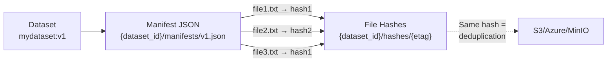

**Deduplication mechanism**:
1. Files stored by content hash (ETag) in `{dataset_id}/hashes/{etag}`
2. Manifest maps logical paths to hashes
3. Multiple datasets sharing files reference same hash
4. Achieves 10-100x storage savings for common patterns

**Bucket configuration** stored in PostgreSQL `configs` table with `type=DATASET`:
- `buckets`: Dict mapping bucket names to `BucketConfig` (mode, credentials, check_key)
- `default_bucket`: Fallback bucket name

**Sources**: README.md:76, docs/deployment_guide/index.rst:63-68

## Multi-Namespace Architecture

OSMO uses Kubernetes namespace isolation for security and multi-tenancy:

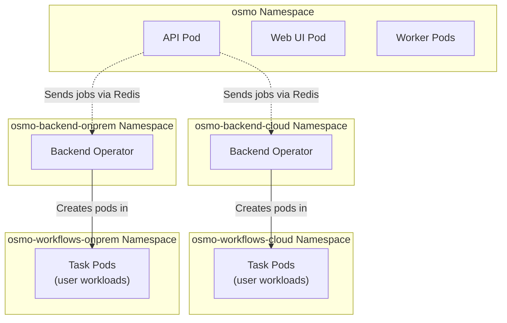

**Namespace purposes**:
- **Control plane namespace** (e.g., `osmo`): API, UI, Worker, Logger services
- **Backend operator namespace** (e.g., `osmo-backend-{name}`): Backend listener and worker pods
- **Workflow namespace** (e.g., `osmo-workflows-{name}`): User task pods with resource isolation

**Sources**: docs/deployment_guide/index.rst:250-267

## Workflow Execution Architecture

### Task Lifecycle State Machine

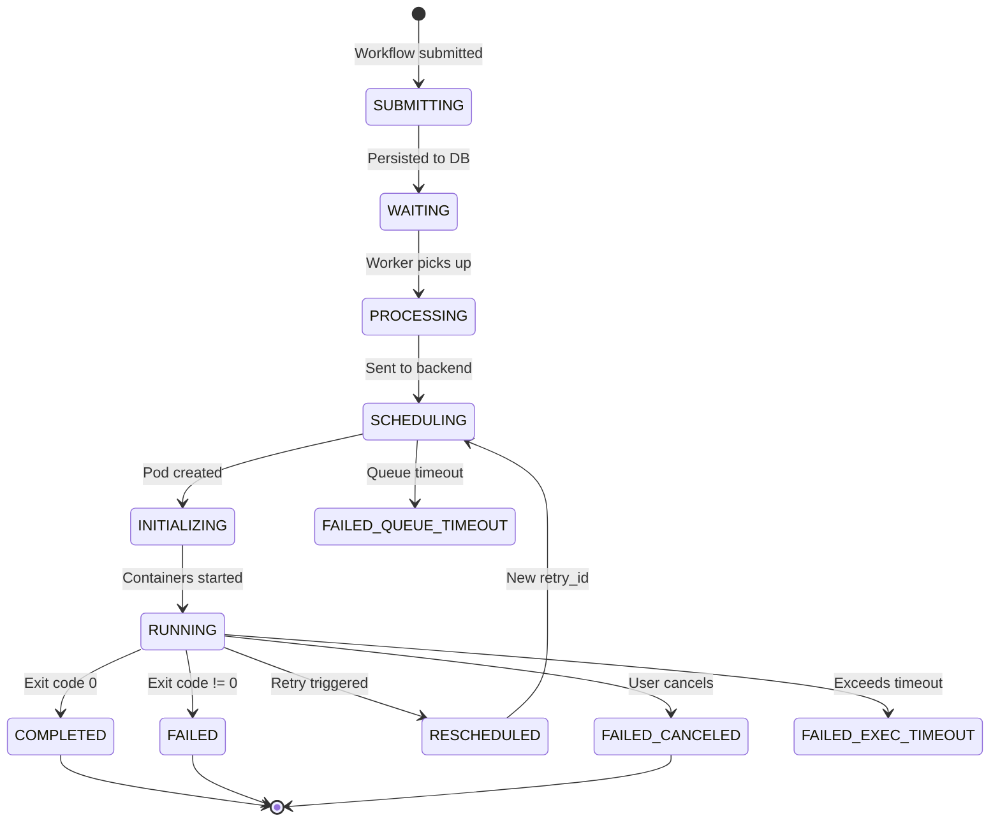

**Status enum** defined in `TaskGroupStatus` ([src/utils/job/task.py:151-257]()):
- **Alive statuses**: `SUBMITTING`, `WAITING`, `PROCESSING`, `SCHEDULING`, `INITIALIZING`, `RUNNING`, `RESCHEDULED`
- **Failed statuses**: `FAILED`, `FAILED_CANCELED`, `FAILED_SERVER_ERROR`, `FAILED_BACKEND_ERROR`, `FAILED_EXEC_TIMEOUT`, `FAILED_QUEUE_TIMEOUT`, `FAILED_IMAGE_PULL`, `FAILED_UPSTREAM`, `FAILED_EVICTED`, `FAILED_START_ERROR`, `FAILED_START_TIMEOUT`, `FAILED_PREEMPTED`

**Sources**: src/utils/job/task.py:151-257

### Task Pod Structure

Each workflow task runs in a Kubernetes Pod with the following container structure:

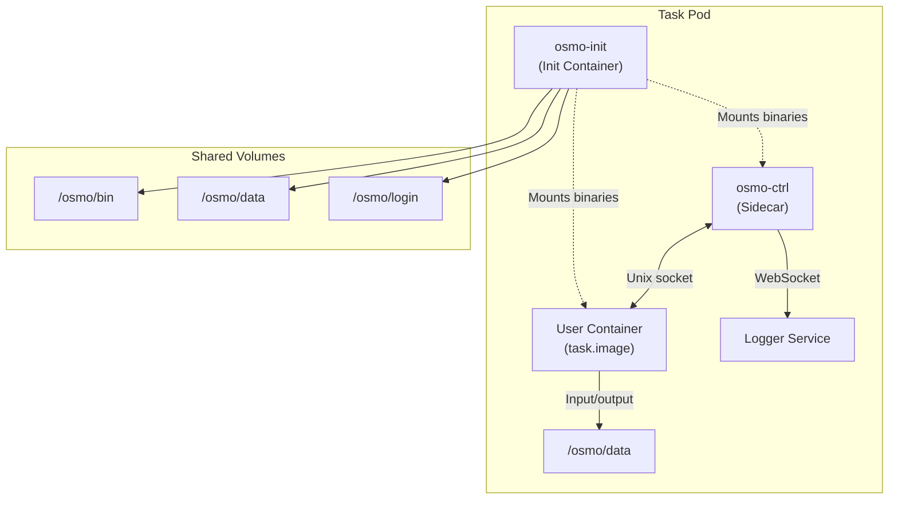

**Container responsibilities**:
1. **osmo-init**: Copies binaries (`osmo_exec`, `osmo_ctrl`) and configuration files to shared volumes ([src/utils/job/kb_objects.py:111-152]())
2. **osmo-ctrl**: Handles data upload/download, log streaming, checkpoint syncing ([src/utils/job/kb_objects.py:154-240]())
3. **User container**: Executes task command with entry point wrapped by `osmo_exec`

**Volume mounts**:
- `/osmo/bin`: Shared binaries
- `/osmo/data`: Input/output data, benchmarks, socket
- `/osmo/login`: OSMO CLI configuration for authentication

**Sources**: src/utils/job/kb_objects.py:111-240

### Gang Scheduling with KAI

For distributed workloads requiring simultaneous launch (e.g., multi-GPU training), OSMO uses KAI scheduler's PodGroup resource:

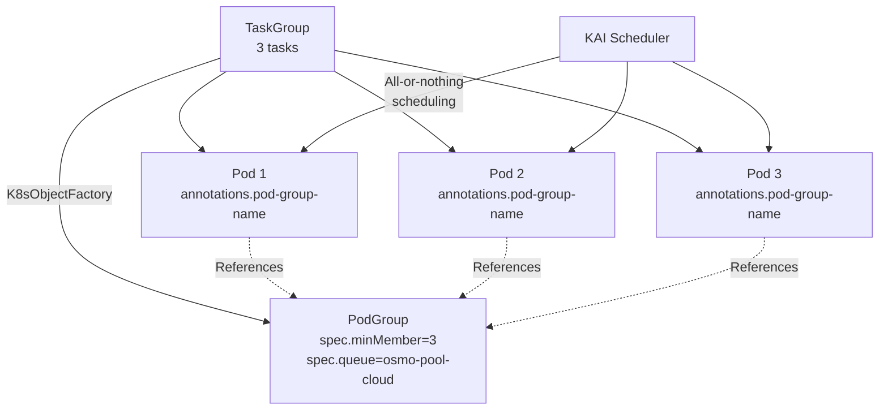

**PodGroup specification** created by `KaiK8sObjectFactory.create_group_k8s_resources()` ([src/utils/job/kb_objects.py:331-377]()):
```yaml
apiVersion: scheduling.run.ai/v2alpha2
kind: PodGroup
metadata:
  name: osmo-{group_uuid}
  labels:
    kai.scheduler/queue: osmo-pool-{namespace}-{pool}
spec:
  minMember: 3  # Number of pods in group
  queue: osmo-pool-{namespace}-{pool}
  priorityClassName: osmo-normal
```

**Sources**: src/utils/job/kb_objects.py:324-407

## Authentication and Security Architecture

### Multi-Tier Authentication

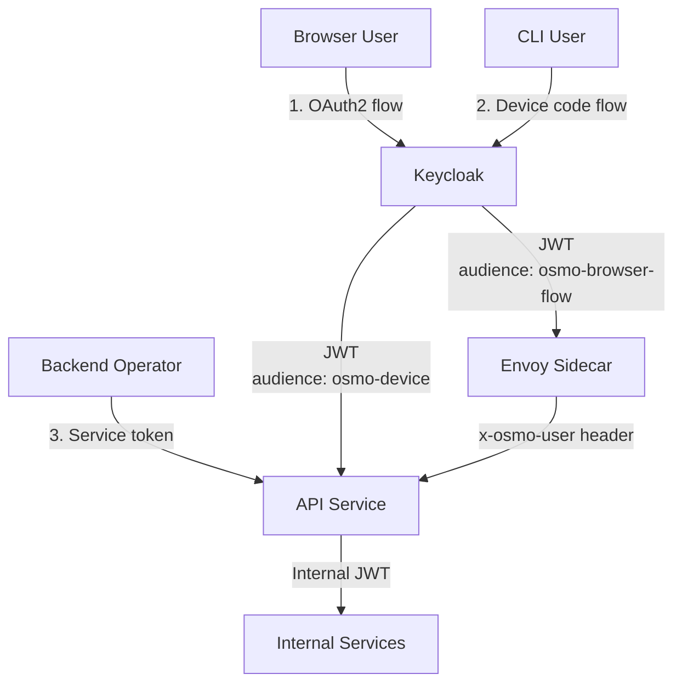

**Authentication tiers**:
1. **Browser flow**: OAuth2 authorization code with Envoy JWT validation
2. **Device flow**: CLI device authorization with polling
3. **Service tokens**: Backend operators authenticate with role-based tokens

**Credential encryption**: User credentials stored in PostgreSQL `credential` table use Master Encryption Key (MEK):
- MEK stored in JWK format (JSON Web Key)
- Credentials encrypted per-user with User Encryption Key (UEK)
- `SecretManager` handles encryption/decryption ([src/utils/connectors/postgres.py:252-261]())

**Sources**: src/utils/connectors/postgres.py:252-261

### Envoy Sidecar Integration

The Web UI uses Envoy as an authentication proxy:

```yaml
# Envoy OAuth2 filter configuration
oauth2:
  config:
    token_endpoint: {keycloak}/token
    authorization_endpoint: {keycloak}/auth
    credentials:
      client_id: osmo-client
      hmac_secret: {session_key}
```

**Flow**:
1. Unauthenticated request → Envoy redirects to Keycloak
2. User authenticates → Authorization code returned
3. Envoy exchanges code for JWT access token
4. Envoy validates JWT (issuer, audience, signature via JWKS)
5. Envoy extracts user claim → `x-osmo-user` header
6. Request forwarded to backend service

**Sources**: docs/deployment_guide/index.rst:83-98

## Configuration Management System

OSMO uses a versioned configuration system stored in PostgreSQL:

### Configuration Types

| ConfigType | Scope | Key Classes |
|------------|-------|-------------|
| `SERVICE` | Global service settings | `ServiceConfig` |
| `WORKFLOW` | Workflow defaults | `WorkflowConfig` |
| `DATASET` | Storage bucket settings | `DatasetConfig` |

**Configuration storage**:
```sql
CREATE TABLE configs (
    key TEXT,
    value TEXT,
    type TEXT,  -- SERVICE, WORKFLOW, DATASET
    PRIMARY KEY (key, type)
);
```

**Configuration history tracking**:
```sql
CREATE TABLE config_history (
    id SERIAL PRIMARY KEY,
    config_type TEXT,
    name TEXT,
    username TEXT,
    data JSONB,
    description TEXT,
    tags TEXT[],
    created_date TIMESTAMP
);
```

**API operations**:
- `PUT /api/config/{type}`: Replace entire configuration
- `PATCH /api/config/{type}`: Strategic merge patch
- `GET /api/config/{type}/history`: List configuration history
- `POST /api/config/{type}/rollback/{id}`: Rollback to previous version

**Sources**: src/service/core/config/helpers.py:72-114, src/utils/connectors/postgres.py:69-87

## Summary: Key Architectural Patterns

1. **Outbound-only connectivity**: Backend operators initiate connections, enabling deployment behind firewalls
2. **Event-driven job processing**: Redis queues decouple control plane from compute plane
3. **Gang scheduling**: KAI PodGroups ensure simultaneous launch for distributed workloads
4. **Content-addressable storage**: Hash-based deduplication reduces storage costs 10-100x
5. **Multi-namespace isolation**: Separate namespaces for control, operators, and workloads
6. **Sidecar pattern**: `osmo-ctrl` and `osmo-init` containers provide consistent runtime environment
7. **Stateless control plane**: All state in PostgreSQL/Redis enables horizontal scaling
8. **WebSocket proxying**: Router service enables interactive access without direct cluster access

**Sources**: README.md:89-107, docs/deployment_guide/index.rst:83-98, src/service/router/router.py:93-124

---

