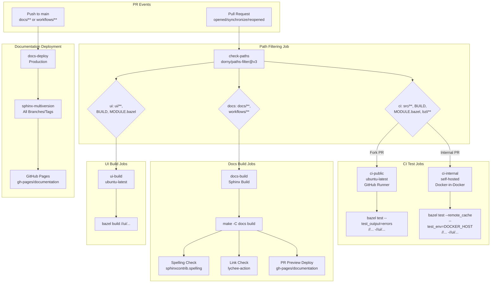
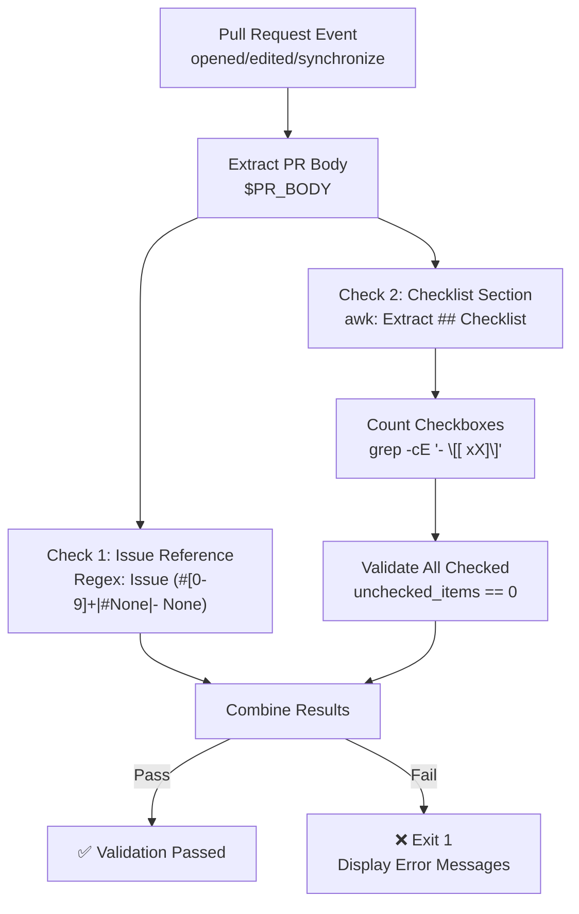
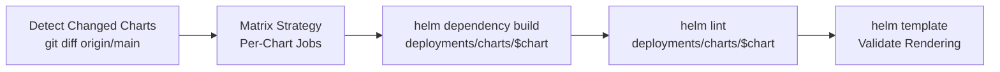
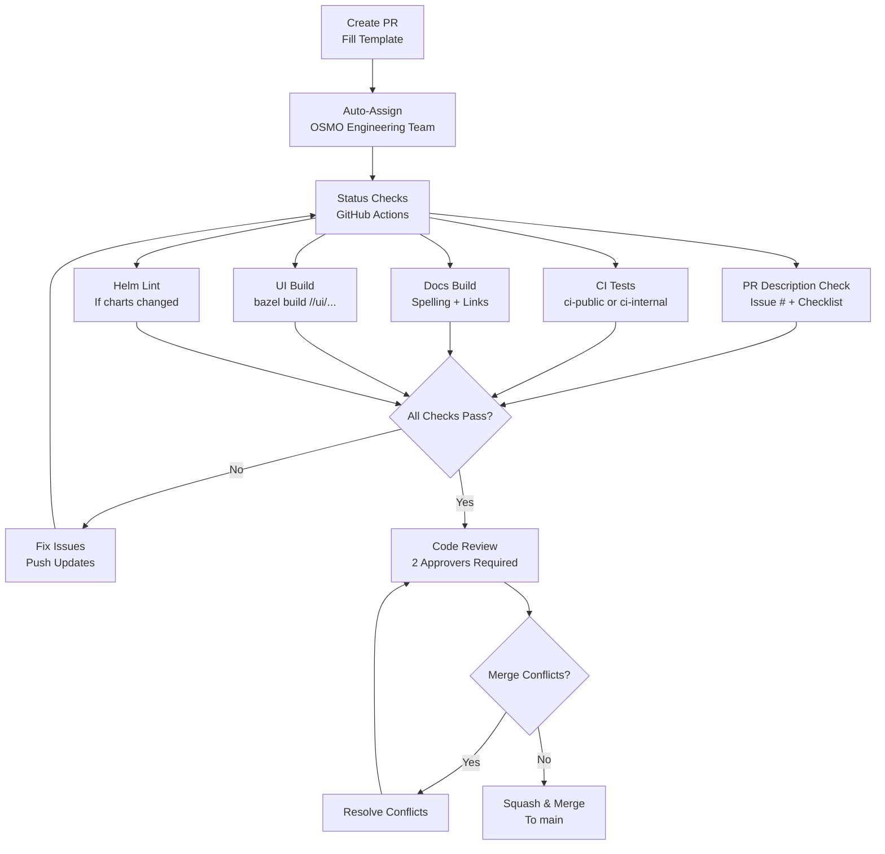
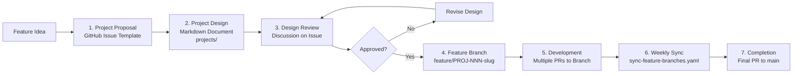

<!-- source: DeepWiki mcp.deepwiki.com · repo NVIDIA/OSMO · page 9 Development and Contributing · fetched 2026-10-26 -->

# Development and Contributing

<details>
<summary>Relevant source files</summary>

The following files were used as context for generating this wiki page:

- [.github/PULL_REQUEST_TEMPLATE.md](.github/PULL_REQUEST_TEMPLATE.md)
- [.github/workflows/docs-deploy.yaml](.github/workflows/docs-deploy.yaml)
- [.github/workflows/helm-chart-lint.yaml](.github/workflows/helm-chart-lint.yaml)
- [.github/workflows/pr-checks.yaml](.github/workflows/pr-checks.yaml)
- [.github/workflows/pr-description-check.yaml](.github/workflows/pr-description-check.yaml)
- [.github/workflows/sync-feature-branches.yaml](.github/workflows/sync-feature-branches.yaml)
- [CONTRIBUTING.md](CONTRIBUTING.md)
- [README.md](README.md)
- [deployments/brev/README.md](deployments/brev/README.md)
- [deployments/brev/setup.sh](deployments/brev/setup.sh)
- [docs/conf.py](docs/conf.py)
- [docs/deployment_guide/getting_started/create_storage/s3/index.rst](docs/deployment_guide/getting_started/create_storage/s3/index.rst)

</details>


This page provides an overview of the development workflow and contribution process for OSMO. It covers system requirements, repository structure, CI/CD pipelines, and pull request procedures for developers who want to contribute bug fixes, documentation improvements, or new features.

For detailed information on specific aspects of development:
- **[Development Setup](#9.1)** - Environment setup, building from source, and running tests
- **[CI/CD Pipeline](#9.2)** - Detailed GitHub Actions workflows and testing infrastructure  
- **[Projects Process](#9.3)** - Formal process for proposing and implementing significant changes
- **[Pull Request Guidelines](#9.4)** - PR requirements, descriptions, and review process

**Sources:** [CONTRIBUTING.md:1-139]()

---

## System Requirements

OSMO development requires the following environment:

| Component | Minimum Version | Purpose |
|-----------|----------------|---------|
| **Operating System** | Ubuntu 22.04+ or MacOS (arm64) | Development platform |
| **Git LFS** | ≥3.7.1 | Source control for large files |
| **Bazel** | ≥8.1.1 | Build system |
| **Docker** | ≥28.3.2 | Container runtime for testing |
| **Helm** | ≥3.17.1 | Kubernetes package management |
| **KIND** | ≥0.29.0 | Local Kubernetes clusters |
| **kubectl** | ≥1.32.2 | Kubernetes CLI |
| **aws-cli** | ≥2.24.7 | AWS operations (optional) |
| **npm** | ≥11.6.2 | Node.js package management for UI |

**Sources:** [CONTRIBUTING.md:26-43]()

---

## Repository Structure

```mermaid
graph TB
    subgraph "Repository Root"
        Root["/"]
        
        Root --> SRC["src/<br/>Python Services"]
        Root --> UI["ui/<br/>Web UI (Next.js)"]
        Root --> Charts["deployments/charts/<br/>Helm Charts"]
        Root --> Docs["docs/<br/>Sphinx Documentation"]
        Root --> Workflows["workflows/<br/>Example Workflows"]
        Root --> GH[".github/<br/>CI/CD Workflows"]
        Root --> BZL["bzl/<br/>Bazel Rules"]
        Root --> Projects["projects/<br/>Project Proposals"]
    end
    
    subgraph "src/ Structure"
        SRC --> API["osmo/api/<br/>API Service"]
        SRC --> Worker["osmo/worker/<br/>Background Jobs"]
        SRC --> Router["osmo/router/<br/>Router Service"]
        SRC --> Agent["osmo/agent/<br/>Agent Service"]
        SRC --> Logger["osmo/logger/<br/>Logger Service"]
        SRC --> Backend["osmo/backend/<br/>Backend Operator"]
        SRC --> Common["osmo/common/<br/>Shared Libraries"]
        SRC --> Tests["tests/<br/>Unit & Integration Tests"]
    end
    
    subgraph "CI/CD Workflows"
        GH --> PRChecks["workflows/pr-checks.yaml<br/>Main PR Validation"]
        GH --> DocsDeloy["workflows/docs-deploy.yaml<br/>Documentation Deployment"]
        GH --> PRDesc["workflows/pr-description-check.yaml<br/>PR Format Validation"]
        GH --> HelmLint["workflows/helm-chart-lint.yaml<br/>Chart Validation"]
        GH --> SyncBranches["workflows/sync-feature-branches.yaml<br/>Feature Branch Sync"]
    end
    
    subgraph "Helm Charts"
        Charts --> QS["quick-start/<br/>Umbrella Chart"]
        Charts --> Service["service/<br/>Control Plane Services"]
        Charts --> WebUI["web-ui/<br/>UI Deployment"]
        Charts --> BackendOp["backend-operator/<br/>Compute Plane"]
        Charts --> RouterChart["router/<br/>Router Service"]
    end
```



**Key Directories:**

| Directory | Purpose | Build System |
|-----------|---------|--------------|
| `src/` | Python services (API, Worker, Router, Agent, Logger, Backend) | Bazel |
| `ui/` | Next.js web interface | Bazel (pnpm) |
| `deployments/charts/` | Helm charts for Kubernetes deployment | Helm |
| `docs/` | Sphinx documentation | Makefile + Sphinx |
| `workflows/` | Example workflow YAML files | N/A |
| `.github/workflows/` | GitHub Actions CI/CD definitions | GitHub Actions |
| `bzl/` | Custom Bazel rules (linting, mypy, Python) | Bazel |
| `projects/` | Project proposals and design documents | N/A |

**Sources:** [CONTRIBUTING.md:45-66](), [.github/workflows/pr-checks.yaml:1-312]()

---

## Development Workflow

### Overview

```mermaid
graph LR
    Fork["1. Fork Repository<br/>github.com/NVIDIA/OSMO"] --> Clone["2. Clone Fork<br/>git clone"]
    Clone --> Branch["3. Create Branch<br/>from main"]
    Branch --> Develop["4. Develop Changes<br/>Follow Dev Guide"]
    Develop --> Test["5. Run Tests<br/>bazel test //..."]
    Test --> Build["6. Build Containers<br/>Validate Changes"]
    Build --> Commit["7. Commit<br/>Issue #N - Title"]
    Commit --> Push["8. Push to Fork<br/>git push origin"]
    Push --> PR["9. Create Pull Request<br/>Fill Template"]
    PR --> Review["10. Code Review<br/>2 Approvers Required"]
    Review --> StatusChecks["11. Status Checks<br/>CI Tests Must Pass"]
    StatusChecks --> Merge["12. Merge<br/>Squash & Merge"]
```



**Sources:** [CONTRIBUTING.md:45-111]()

### Fork and Clone

```bash
# 1. Fork the repository on GitHub
# https://github.com/NVIDIA/OSMO

# 2. Clone your fork
git clone https://github.com/YOUR_USERNAME/YOUR_FORK.git osmo
cd osmo

# 3. Add upstream remote
git remote add upstream https://github.com/NVIDIA/OSMO.git
```

**Sources:** [CONTRIBUTING.md:45-53]()

### Development Process

The development workflow follows three main phases:

1. **Iterate on Changes** - Modify code following the [Dev Guide](BUILD_AND_TEST.md) and [coding guidelines](#coding-guidelines)
2. **Build and Test** - Create containers with changes and validate functionality
3. **Test Coverage** - Add or update unit and functional tests

**Sources:** [CONTRIBUTING.md:55-63]()

### Coding Guidelines

| Guideline | Description |
|-----------|-------------|
| **Follow Conventions** | Match existing code style in the relevant file/module |
| **Avoid Complexity** | Preserve maintainability and readability |
| **No Commented Code** | Remove commented-out code before committing |
| **Commit Format** | Use imperative mood with issue reference |
| **License Compliance** | Ensure no license/patent conflicts |

**Commit Message Format:**

```
#<Issue Number> - <Commit Title>

<Commit Body>
```

Example:
```
#42 - Add retry logic to dataset upload

Implement exponential backoff for S3 upload failures to handle
transient network errors. This reduces failed uploads by 95% in
high-latency environments.
```

**Sources:** [CONTRIBUTING.md:67-85]()

---

## CI/CD Pipeline Architecture

### Pipeline Overview



**Sources:** [.github/workflows/pr-checks.yaml:1-312](), [.github/workflows/docs-deploy.yaml:1-95]()

### Workflow Files

#### pr-checks.yaml

The main PR validation workflow uses **path-based execution optimization** to run only relevant tests based on changed files.

**Path Filters:**

```yaml
# .github/workflows/pr-checks.yaml:51-68
filters:
  ci:
    - '.github/workflows/pr-checks.yaml'
    - 'BUILD'
    - 'MODULE.bazel'
    - 'bzl/**'
    - 'src/**'
    - 'run/**'
  docs:
    - 'docs/**'
    - 'workflows/**'
  ui:
    - 'ui/**'
    - 'BUILD'
    - 'MODULE.bazel'
    - 'bzl/**'
```

**Fork vs Internal PRs:**

| Aspect | Fork PRs (`ci-public`) | Internal PRs (`ci-internal`) |
|--------|----------------------|----------------------------|
| **Runner** | `ubuntu-latest` (GitHub-hosted) | `self-hosted` (internal infrastructure) |
| **Environment** | Standard GitHub Actions | Docker-in-Docker container |
| **Bazel Cache** | Local disk cache | Remote cache (`--remote_cache`) |
| **Test Environment** | Limited Docker access | Full Docker daemon access via TCP |
| **Trigger** | `github.event.pull_request.head.repo.fork == true` | `github.event.pull_request.head.repo.fork == false` |

**CI Test Commands:**

```bash
# Fork PRs (ci-public)
bazel test --test_output=errors -- //... -//ui/...

# Internal PRs (ci-internal)
bazel test --remote_cache=$BAZEL_REMOTE_CACHE_URL \
  --test_env=DOCKER_HOST=tcp://docker:2375 \
  --test_env=TESTCONTAINERS_HOST_OVERRIDE=docker \
  --test_output=errors \
  -- //... -//ui/...
```

**Sources:** [.github/workflows/pr-checks.yaml:33-183]()

#### docs-build Job

```mermaid
graph LR
    Checkout["Checkout<br/>with LFS"] --> SetupPython["Setup Python 3.10.18"]
    SetupPython --> InstallDeps["Install Dependencies<br/>locked_requirements.txt"]
    InstallDeps --> SphinxBuild["Sphinx Build<br/>make -C docs build"]
    SphinxBuild --> CheckErrors["Check Build Errors<br/>Exit if *.log files exist"]
    CheckErrors --> Deploy["Deploy Preview<br/>pr-preview-action"]
    Deploy --> Spelling["Spelling Check<br/>continue-on-error"]
    Spelling --> LinkCheck["Link Check<br/>lychee-action"]
    LinkCheck --> Validate["Validate Checks<br/>Fail if either failed"]
```



**Documentation Build Process:**

1. **Sphinx Build** - Builds HTML documentation from `.rst` files
2. **Spelling Check** - Uses `sphinxcontrib.spelling` with custom wordlist
3. **Link Check** - Validates all hyperlinks using `lychee` with caching
4. **Preview Deployment** - Deploys to `gh-pages/documentation/pr-preview/pr-<number>`

**Sources:** [.github/workflows/pr-checks.yaml:186-282]()

#### ui-build Job

```bash
# UI Build Command
bazel build //ui/...
```

The UI build job compiles the Next.js web application using Bazel with `pnpm` as the package manager. It uses the same setup-bazel action with external cache for `npm: ui/pnpm-lock.yaml`.

**Sources:** [.github/workflows/pr-checks.yaml:286-312]()

### Additional Workflows

#### pr-description-check.yaml

Validates PR descriptions meet requirements:



**Required PR Description Elements:**

1. **Issue Reference** - Must include `Issue #<number>` or `Issue - None` (case-insensitive)
2. **Complete Checklist** - All boxes in `## Checklist` section must be checked:
   - `[x] I am familiar with the Contributing Guidelines`
   - `[x] New or existing tests cover these changes`
   - `[x] The documentation is up to date with these changes`

**Sources:** [.github/workflows/pr-description-check.yaml:1-135](), [.github/PULL_REQUEST_TEMPLATE.md:1-12]()

#### helm-chart-lint.yaml

Validates Helm chart changes:



Only runs when files in `deployments/charts/**` change. Uses matrix strategy to lint each changed chart independently.

**Sources:** [.github/workflows/helm-chart-lint.yaml:1-126]()

#### sync-feature-branches.yaml

Automatically syncs `feature/*` branches with `main`:

- **Schedule:** Weekly on Mondays at 9am PT (17:00 UTC)
- **Process:** Creates sync PRs from temporary branches (`sync/feature/*/YYYYMMDD-HHMM`)
- **Purpose:** Keeps long-lived feature branches up-to-date during development

**Sources:** [.github/workflows/sync-feature-branches.yaml:1-151]()

---

## Pull Request Process

### PR Lifecycle



**Sources:** [CONTRIBUTING.md:87-111]()

### PR Template Requirements

The PR template enforces structured descriptions:

| Section | Required Content |
|---------|-----------------|
| **Title** | `#<issue number> - <commit title>` format |
| **Description** | Standalone description following commit message rules |
| **Issue Reference** | `Issue #<number>` or `Issue - None` |
| **Checklist** | All three items must be checked before merge |

**PR Template:**

```markdown
<!-- Title: "#<issue number> - <commit title>" -->

## Description
<!-- Standalone description of changes -->

Issue #<issue number | "None">

## Checklist
- [ ] I am familiar with the Contributing Guidelines
- [ ] New or existing tests cover these changes
- [ ] The documentation is up to date with these changes
```

**Sources:** [.github/PULL_REQUEST_TEMPLATE.md:1-12]()

### Review Requirements

**Merge Criteria:**

1. ✅ **Two Approvals** - Two OSMO engineers must approve the PR
2. ✅ **Status Checks Pass** - All GitHub Actions workflows succeed
3. ✅ **No Merge Conflicts** - Branch must be up-to-date with `main`
4. ✅ **Checklist Complete** - All PR template checklist items checked
5. ✅ **Issue Reference** - Valid issue number or "None"

**Status Check Triggering:**

- Fork PRs: Status checks run automatically via `ci-public`
- Internal PRs: Status checks may require manual triggering by OSMO engineers via `ci-internal`

**Sources:** [CONTRIBUTING.md:102-108]()

---

## Projects Process

For **significant changes** (new projects, major features, cross-cutting changes, or architectural decisions), OSMO uses a formal Projects Process:



### When to Use the Projects Process

| Change Type | Use Projects Process? | Rationale |
|-------------|----------------------|-----------|
| Small bug fix | ❌ No | Direct PR to `main` with issue reference |
| Documentation update | ❌ No | Direct PR to `main` |
| Localized feature | ❌ No | File issue, implement in single PR |
| New service/component | ✅ Yes | Requires architecture review |
| API breaking changes | ✅ Yes | Needs coordination across services |
| Multi-week development | ✅ Yes | Feature branch prevents merge conflicts |
| Cross-cutting refactoring | ✅ Yes | Impacts multiple subsystems |

**Sources:** [CONTRIBUTING.md:14-22]()

### Project Proposal Template

Open a [project proposal](https://github.com/NVIDIA/OSMO/issues/new?template=4-project-proposal.yml) issue to initiate the process. The proposal should include:

- **Problem Statement** - What challenge are you solving?
- **Proposed Solution** - High-level approach
- **Alternatives Considered** - Other options evaluated
- **Impact Analysis** - Which components are affected
- **Implementation Plan** - Timeline and milestones

After proposal approval, create a design document in `projects/` directory:

```
projects/
├── README.md
├── PROJ-001-example-project/
│   ├── design.md
│   └── assets/
└── template/
    └── design_template.md
```

**Sources:** [CONTRIBUTING.md:20-22]()

### Feature Branch Workflow

Feature branches use the naming convention: `feature/PROJ-NNN-short-slug`

Example: `feature/PROJ-042-distributed-caching`

The `sync-feature-branches.yaml` workflow automatically creates weekly PRs to keep feature branches synchronized with `main`, reducing merge conflicts.

**Sources:** [.github/workflows/sync-feature-branches.yaml:42-146]()

---

## Developer Certificate of Origin

All contributions are made under the Developer Certificate of Origin (DCO) 1.1:

```
By making a contribution to this project, I certify that:

(a) The contribution was created in whole or in part by me and I have
    the right to submit it under the open source license indicated in
    the file; or

(b) The contribution is based upon previous work that, to the best of
    my knowledge, is covered under an appropriate open source license
    and I have the right under that license to submit that work with
    modifications, whether created in whole or in part by me, under
    the same open source license (unless I am permitted to submit
    under a different license), as indicated in the file; or

(c) The contribution was provided directly to me by some other person
    who certified (a), (b) or (c) and I have not modified it.

(d) I understand and agree that this project and the contribution are
    public and that a record of the contribution (including all
    personal information I submit with it, including my sign-off) is
    maintained indefinitely and may be redistributed consistent with
    this project or the open source license(s) involved.
```

Commits should include a `Signed-off-by` line matching the commit author.

**Sources:** [CONTRIBUTING.md:112-138]()

---

## Next Steps

- **[Development Setup](#9.1)** - Set up your development environment, build from source, and run tests
- **[CI/CD Pipeline](#9.2)** - Deep dive into GitHub Actions workflows and testing strategies
- **[Projects Process](#9.3)** - Learn the formal process for proposing significant changes
- **[Pull Request Guidelines](#9.4)** - Detailed PR requirements and review procedures

For questions or support:
- 🐛 [Report Issues](https://github.com/NVIDIA/OSMO/issues)
- 📖 [User Guide](https://nvidia.github.io/OSMO/main/user_guide)
- 📚 [Deployment Guide](https://nvidia.github.io/OSMO/main/deployment_guide)

**Sources:** [README.md:157-165](), [CONTRIBUTING.md:1-139]()

---

