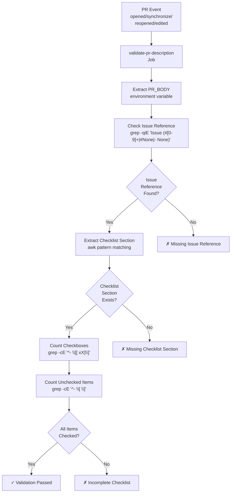
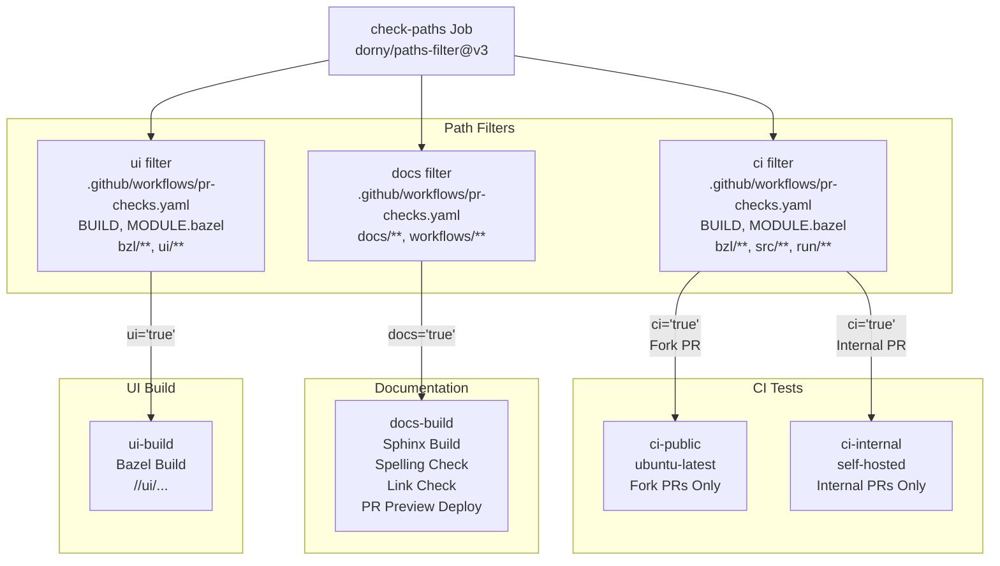
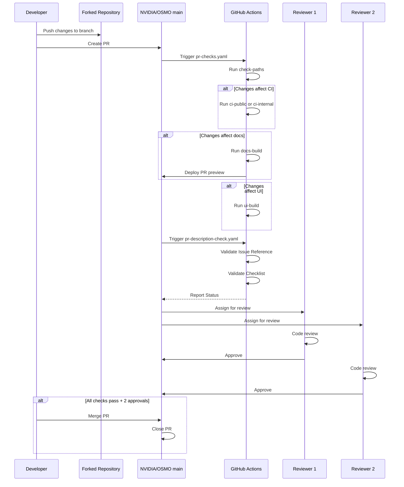
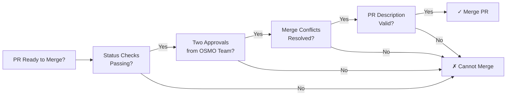

<!-- source: DeepWiki mcp.deepwiki.com · repo NVIDIA/OSMO · page 9.4 Pull Request Guidelines · fetched 2026-10-26 -->

# Pull Request Guidelines

<details>
<summary>Relevant source files</summary>

The following files were used as context for generating this wiki page:

- [.github/PULL_REQUEST_TEMPLATE.md](.github/PULL_REQUEST_TEMPLATE.md)
- [.github/workflows/docs-deploy.yaml](.github/workflows/docs-deploy.yaml)
- [.github/workflows/helm-chart-lint.yaml](.github/workflows/helm-chart-lint.yaml)
- [.github/workflows/pr-checks.yaml](.github/workflows/pr-checks.yaml)
- [.github/workflows/pr-description-check.yaml](.github/workflows/pr-description-check.yaml)
- [.github/workflows/sync-feature-branches.yaml](.github/workflows/sync-feature-branches.yaml)
- [CONTRIBUTING.md](CONTRIBUTING.md)
- [README.md](README.md)
- [deployments/brev/README.md](deployments/brev/README.md)
- [deployments/brev/setup.sh](deployments/brev/setup.sh)
- [docs/conf.py](docs/conf.py)
- [docs/deployment_guide/getting_started/create_storage/s3/index.rst](docs/deployment_guide/getting_started/create_storage/s3/index.rst)

</details>


This page documents the requirements, validation workflows, and review process for submitting Pull Requests (PRs) to the OSMO repository. It covers PR description format, automated status checks, code review requirements, and merge policies.

For information about the broader development workflow, see [Development Setup](#9.1). For details about the Projects Process for significant changes, see [Projects Process](#9.3).

## Overview

All code contributions to OSMO follow a structured PR process enforced by automated checks and manual code review. The system uses path-based filtering to run only relevant tests, validates PR descriptions against a template, and requires approval from two OSMO engineers before merging.

**Sources:** [CONTRIBUTING.md:87-111](), [.github/workflows/pr-checks.yaml:1-312]()

---

## PR Description Requirements

Every PR must follow the template defined in [.github/PULL_REQUEST_TEMPLATE.md:1-12]() and pass automated validation checks before it can be merged.

### Required Elements

| Element | Format | Validation |
|---------|--------|------------|
| **Issue Reference** | `Issue #<number>` or `Issue - None` | Case-insensitive, enforced by [.github/workflows/pr-description-check.yaml:44-60]() |
| **Checklist** | All items must be checked (`[x]`) | Enforced by [.github/workflows/pr-description-check.yaml:85-111]() |
| **Description** | Standalone description following commit message conventions | Not automatically validated |

### Checklist Items

```markdown
## Checklist
- [x] I am familiar with the Contributing Guidelines
- [x] New or existing tests cover these changes
- [x] The documentation is up to date with these changes
```

The validation workflow extracts the `## Checklist` section and verifies all checkboxes are marked. Unchecked items cause the PR to fail validation with a detailed error message.

**Sources:** [.github/PULL_REQUEST_TEMPLATE.md:1-12](), [.github/workflows/pr-description-check.yaml:29-135]()

---

## PR Validation Workflow

The following diagram shows how PR description validation works:



**Sources:** [.github/workflows/pr-description-check.yaml:29-135]()

---

## Status Checks

OSMO uses path-based filtering to run only relevant tests for changed files. The `check-paths` job determines which test suites to execute based on file changes.

### Path Filtering Matrix



**Sources:** [.github/workflows/pr-checks.yaml:33-69]()

### CI Test Execution

The system runs different CI pipelines depending on whether the PR originates from a fork or the main repository:

**Fork PRs (`ci-public`):**
- Runs on `ubuntu-latest` GitHub-hosted runners
- Uses disk-based Bazel caching
- Includes disk space cleanup to prevent storage issues
- Command: `bazel test --test_output=errors -- //... -//ui/...`

**Internal PRs (`ci-internal`):**
- Runs on `self-hosted` runners with GPU support
- Uses Docker-in-Docker (`docker:dind` service)
- Leverages remote Bazel cache for faster builds
- Sets environment variables for Testcontainers integration
- Command: `bazel test --remote_cache=$BAZEL_REMOTE_CACHE_URL --test_env=DOCKER_HOST=tcp://docker:2375 --test_output=errors -- //... -//ui/...`

**Sources:** [.github/workflows/pr-checks.yaml:73-183]()

### Documentation Build and Validation

When documentation files change, the `docs-build` job:

1. **Builds Sphinx documentation** using `make -C docs build`
2. **Runs spelling check** using `sphinxcontrib.spelling`
3. **Validates links** using `lychee-action` with caching
4. **Deploys PR preview** to `gh-pages/documentation` branch using `pr-preview-action`

The preview is accessible at: `https://nvidia.github.io/OSMO/pr-preview/pr-<number>/`

**Sources:** [.github/workflows/pr-checks.yaml:187-282]()

### Helm Chart Linting

When Helm chart files in `deployments/charts/**` are modified, the `helm-lint` workflow:

1. **Detects changed charts** by comparing with base branch
2. **Builds dependencies** using `helm dependency build`
3. **Lints charts** using `helm lint`
4. **Validates rendering** using `helm template`

The workflow uses a matrix strategy to lint multiple charts in parallel.

**Sources:** [.github/workflows/helm-chart-lint.yaml:36-125]()

---

## Review Process

### Approval Requirements

| Requirement | Description |
|------------|-------------|
| **Two Approvers** | Two OSMO engineers must approve the PR before merging |
| **OSMO Team Assignment** | The OSMO engineering team is automatically assigned for review |
| **Status Checks** | All automated checks must pass |
| **Merge Conflicts** | Must be resolved before merging |

### Review Workflow



**Sources:** [CONTRIBUTING.md:102-108]()

---

## Merge Requirements

Before a PR can be merged, all of the following conditions must be met:

### Pre-Merge Checklist



**Sources:** [CONTRIBUTING.md:102-108]()

---

## Automated Workflows

### Concurrency Control

All PR workflows use concurrency groups to prevent redundant runs:

```yaml
concurrency:
  group: ${{ github.workflow }}-${{ github.event.pull_request.number }}
  cancel-in-progress: true
```

This ensures that when new commits are pushed to a PR, in-progress workflow runs are cancelled to save resources.

**Sources:** [.github/workflows/pr-checks.yaml:25-27]()

### Trigger Events

PR checks are triggered on the following GitHub events:

- `opened` - When a PR is first created
- `synchronize` - When new commits are pushed to the PR branch
- `reopened` - When a closed PR is reopened
- `edited` - When the PR description is modified (description check only)
- `closed` - Triggers cleanup for documentation preview

**Sources:** [.github/workflows/pr-checks.yaml:19-23](), [.github/workflows/pr-description-check.yaml:19-22]()

### Feature Branch Syncing

For long-lived feature branches following the Projects Process, the `sync-feature-branches` workflow automatically creates PRs to merge `main` into feature branches:

**Schedule:** Weekly on Mondays at 9am PT (5pm UTC)

**Process:**
1. Detects all `feature/**` branches
2. Checks if branch is behind `main`
3. Creates temporary branch `sync/<branch>/<timestamp>`
4. Attempts to merge `main`
5. Creates PR with sync changes
6. Extracts issue number from branch name for PR description

**Sources:** [.github/workflows/sync-feature-branches.yaml:1-151]()

---

## Bazel Caching Strategy

The CI system uses different caching strategies for public and internal PRs:

### Public Fork PRs

```yaml
- name: Setup Bazel
  uses: bazel-contrib/setup-bazel@4fd964a13a440a8aeb0be47350db2fc640f19ca8
  with:
    bazelisk-cache: true
    disk-cache: ${{ github.workflow }}
    repository-cache: true
    external-cache: |
      manifest:
        osmo_python_deps: src/locked_requirements.txt
        osmo_tests_python_deps: src/tests/locked_requirements.txt
        osmo_mypy_deps: bzl/mypy/locked_requirements.txt
        pylint_python_deps: bzl/linting/locked_requirements.txt
        io_bazel_rules_go: src/runtime/go.mod
        bazel_gazelle: src/runtime/go.sum
```

Uses manifest-based external cache keyed on lock files for Python and Go dependencies.

### Internal PRs

```yaml
- name: Run Tests
  run: |
    bazel test --remote_cache=${{ secrets.BAZEL_REMOTE_CACHE_URL }} \
      --test_env=DOCKER_HOST=tcp://docker:2375 \
      --test_env=TESTCONTAINERS_HOST_OVERRIDE=docker \
      --test_output=errors \
      -- \
      //... \
      -//ui/...
```

Uses remote cache URL from secrets for shared cache across all internal builds.

**Sources:** [.github/workflows/pr-checks.yaml:107-125](), [.github/workflows/pr-checks.yaml:174-182]()

---

## Commit Message Conventions

Commits must follow specific formatting rules:

```
#<Issue Number> - <Commit Title>

<Commit Body>
```

**Rules:**
- Use imperative mood for commit titles
- Follow [conventional commit guidelines](https://chris.beams.io/posts/git-commit)
- Reference the issue number corresponding to the PR
- Avoid committing commented-out code
- Keep commits focused on a single concern

**Sources:** [CONTRIBUTING.md:74-82]()

---

## PR Best Practices

### Scope and Size

- Keep PRs concise and focused on a single concern
- Consider multiple PRs if addressing multiple unrelated issues
- For significant changes, use the [Projects Process](#9.3) with project proposals

### Branch Selection

Exercise caution when selecting source and target branches:
- Standard PRs target `main`
- Feature branch PRs target `feature/**` branches
- Verify branch selection before creating PR

### Test Coverage

All PRs must include appropriate test coverage:
- Add unit tests for new functionality
- Update existing tests when modifying behavior
- Ensure functional tests cover integration points

**Sources:** [CONTRIBUTING.md:88-109]()

---

## Troubleshooting

### Common Issues

| Issue | Solution |
|-------|----------|
| **PR description validation fails** | Ensure `Issue #XX` or `Issue - None` is present and all checklist items are checked |
| **Status checks don't run** | Maintainer must manually trigger checks for first-time contributors |
| **Merge conflicts** | Rebase or merge `main` into your branch and resolve conflicts |
| **CI fails on fork** | Check disk space; `ci-public` includes cleanup steps but may need manual intervention |
| **Documentation preview not deploying** | Check that `docs/**` or `workflows/**` files changed and build succeeded |

### Disk Space Issues on Public CI

The `ci-public` job includes extensive cleanup to prevent disk space issues on GitHub-hosted runners:

```bash
sudo rm -rf /usr/share/dotnet
sudo rm -rf /usr/local/lib/android
sudo rm -rf /opt/ghc
sudo rm -rf /usr/local/.ghcup
sudo rm -rf /opt/hostedtoolcache/CodeQL
sudo docker image prune --all --force
```

**Sources:** [.github/workflows/pr-checks.yaml:81-100]()

---

## Summary

The OSMO PR process enforces quality through:

1. **Automated validation** of PR descriptions and checklists
2. **Path-based test execution** to optimize CI resource usage
3. **Separate pipelines** for fork and internal PRs with appropriate security controls
4. **Two-approver policy** requiring review from OSMO engineers
5. **Comprehensive status checks** including tests, documentation builds, and linting

All workflows use concurrency control to prevent redundant runs and leverage caching strategies appropriate to their execution environment.

**Sources:** [CONTRIBUTING.md:1-139](), [.github/workflows/pr-checks.yaml:1-312](), [.github/workflows/pr-description-check.yaml:1-135]()