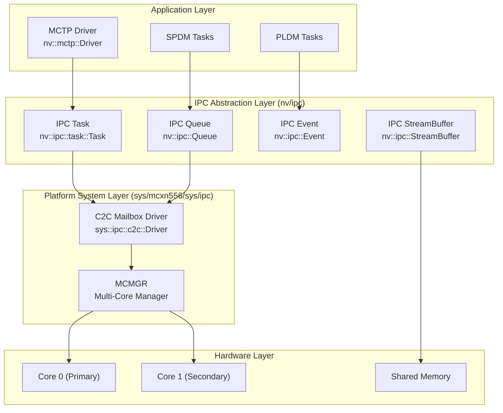
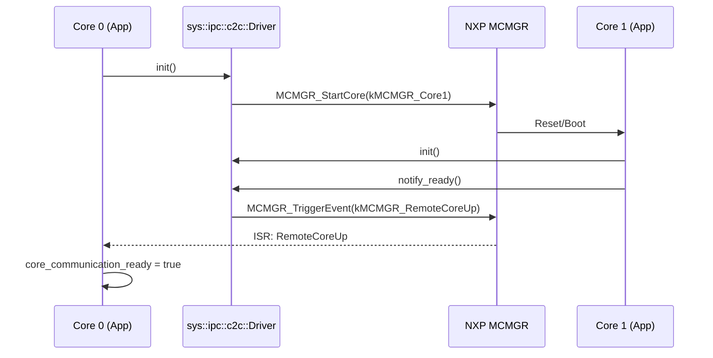
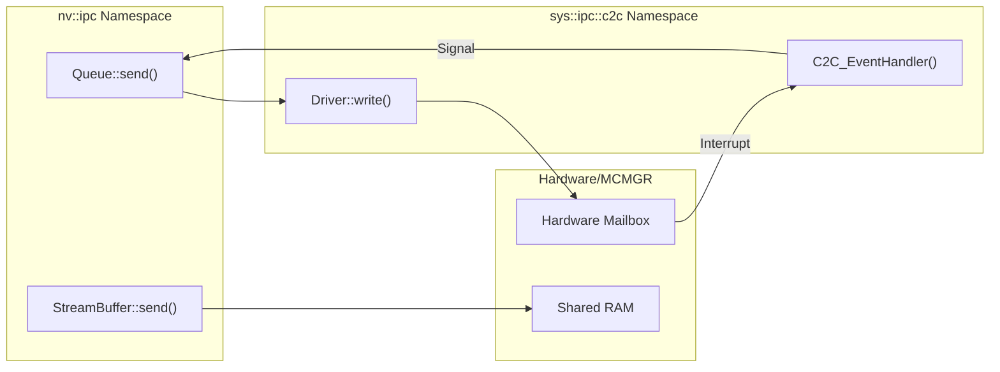

<!-- source: DeepWiki mcp.deepwiki.com · repo NVIDIA/OpenSMA · page 5.3 Inter-Process Communication · fetched 2026-10-26 -->

# Inter-Process Communication

Relevant source files

The following files were used as context for generating this wiki page:

- [corepdk/modules/mctp-cpp/src/main.adb](corepdk/modules/mctp-cpp/src/main.adb)
- [corepdk/modules/mctp-cpp/src/main.cpp](corepdk/modules/mctp-cpp/src/main.cpp)

The Inter-Process Communication (IPC) system provides the multi-core communication infrastructure for tasks running across different CPU cores (Core0 and Core1) in OpenSMA. It enables message passing, event synchronization, and bulk data transfer between cores using shared memory and hardware-specific multi-core management features.

The implementation is split between high-level task abstractions in `src/nv/ipc/` and low-level platform drivers in `src/sys/mcxn556/sys/ipc/`.

## System Architecture

The IPC system operates as a layered architecture supporting communication between Core0 and Core1. It utilizes FreeRTOS primitives (Queues, Events, Mutexes, Stream Buffers) wrapped in a unified interface to abstract hardware-specific mailbox and shared memory mechanisms.

### IPC Architecture Overview

Sources: [src/nv/ipc/ipc_task.h:20-55](), [src/nv/ipc/queue.h:20-45](), [src/sys/mcxn556/sys/ipc/c2c_driver.h:20-60]()

## Core Components

### IPC Task and Supervisor
The `nv::ipc::task::Task` manages the lifecycle of inter-core communication, including the startup of the secondary core. The `nv::ipc::supervisor::Task` monitors the health of these communication channels.

| Class | Purpose | File |
|-------|---------|------|
| `nv::ipc::task::Task` | Main IPC processing loop and core startup | [src/nv/ipc/ipc_task.h:24-24]() |
| `nv::ipc::supervisor::Task` | Monitors IPC status and handles watchdog integration | [src/nv/ipc/supervisor_task.h:24-24]() |
| `nv::ipc::task::Config` | Configuration for stack size, priority, and core images | [src/nv/ipc/ipc_task.h:31-51]() |

Sources: [src/nv/ipc/ipc_task.h:24-51](), [src/nv/ipc/supervisor_task.h:24-40]()

### IPC Communication Primitives
OpenSMA wraps FreeRTOS primitives to provide a consistent interface for both intra-core and inter-core communication.

*   **Queues (`nv::ipc::Queue`)**: Used for passing structured messages between tasks. Supports `send()`, `receive()`, and `peek()` operations. [src/nv/ipc/queue.h:20-80]()
*   **Events (`nv::ipc::Event`)**: Used for synchronization and signaling state changes. Supports `set()`, `clear()`, and `wait()`. [src/nv/ipc/event.h:20-75]()
*   **Stream Buffers (`nv::ipc::StreamBuffer`)**: Optimized for bulk data transfer (e.g., MCTP packets) between cores. [src/nv/ipc/streambuffer.h:20-80]()
*   **Mutexes (`nv::ipc::Mutex`)**: Ensures thread-safe access to shared resources within a core. [src/nv/ipc/mutex.h:20-65]()

Sources: [src/nv/ipc/queue.h:20-80](), [src/nv/ipc/event.h:20-75](), [src/nv/ipc/streambuffer.h:20-80](), [src/nv/ipc/mutex.h:20-65]()

## Platform Implementation: MCXN556 C2C

The `sys::ipc::c2c::Driver` implements the low-level transport using the MCXN556 Multi-Core Manager (MCMGR) and hardware mailboxes.

### Core Startup Sequence
On dual-core platforms, Core 0 is responsible for booting Core 1 and establishing the initial communication handshake.

Sources: [src/sys/mcxn556/sys/ipc/c2c_driver.cpp:50-120](), [src/nv/ipc/ipc_task.cpp:45-80]()

### C2C Data Flow (Code Entity Space)

The following diagram maps high-level IPC calls to the underlying driver implementation in `src/sys/mcxn556/sys/ipc/`.

Sources: [src/nv/ipc/queue.cpp:30-55](), [src/sys/mcxn556/sys/ipc/c2c_driver.cpp:150-200](), [src/nv/ipc/streambuffer.cpp:40-60]()

## Message Handling and Routing

### IPC Message Structure
Messages passed through IPC queues often use a standard header to facilitate routing between different system components (I2C, I3C, USB, MCTP).

| Field | Type | Description |
|-------|------|-------------|
| `src_id` | `TaskId` | Originating task identifier |
| `dst_id` | `TaskId` | Destination task identifier |
| `msg_type` | `uint8_t` | Protocol or message category |
| `payload` | `uint8_t[]` | Variable length data |

Sources: [src/nv/ipc/common.h:30-50](), [src/nv/ipchandler/ipchandler.cpp:42-51]()

### Inter-Core Notification Events
The system defines specific events for core synchronization:

| Event | Value | Description |
|-------|-------|-------------|
| `Core0Ready` | `0x01` | Core 0 has finished initialization |
| `Core1Ready` | `0x02` | Core 1 has finished initialization |
| `DataAvailable` | `0x04` | New data is waiting in the StreamBuffer |

Sources: [src/nv/ipc/common.h:60-75](), [src/sys/mcxn556/sys/ipc/c2c_driver.h:45-55]()

## Status and Error Codes
The IPC system uses `nv::ipc::task::Status` to report the health of inter-core links.

| Status | Meaning |
|--------|---------|
| `Ok` | Operation successful |
| `CommunicationNotReady` | Attempted to send data before Core1 handshake |
| `Timeout` | Blocking operation exceeded specified time |
| `QueueFull` | Destination queue is unable to accept more messages |
| `McmgrError` | Underlying hardware driver reported a failure |

Sources: [src/nv/ipc/common.h:80-100]()

## Integration with MCTP
MCTP (Management Component Transport Protocol) is a primary consumer of the IPC system. It uses `nv::ipc::StreamBuffer` to pass large MCTP packets between the physical layer drivers (running on Core 0) and the protocol stack (often running on Core 1).

1.  **Reception**: Physical driver (I2C/USB) receives a packet and writes it to an `IPC StreamBuffer`.
2.  **Notification**: Driver triggers an `IPC Event` to notify the MCTP Task.
3.  **Processing**: MCTP Task reads from the `StreamBuffer` and processes the message.

Sources: [src/nv/mctp/driver.cpp:100-150](), [src/nv/ipc/streambuffer.h:20-40]()

---

