# Page: OpenSMA Overview

# OpenSMA Overview

<details>
<summary>Relevant source files</summary>

The following files were used as context for generating this wiki page:

- [CONTRIBUTING.md](CONTRIBUTING.md)
- [LICENSE](LICENSE)
- [NOTICE](NOTICE)
- [README.md](README.md)

</details>


OpenSMA is a secure device management system designed for embedded platforms, specifically targeting NXP MCXN-series microcontrollers. It implements DMTF standards for secure firmware updates and device communication. The system provides a multi-language architecture combining Ada for security-critical protocols, C++ for transport services, and C for hardware drivers, unified by a comprehensive build and test infrastructure.

This document provides a high-level overview of OpenSMA's architecture, key components, and design principles. For detailed information about specific subsystems, see the subsequent sections on Build Infrastructure, Security Protocols, Transport Layers, and Hardware Drivers.

## System Architecture

OpenSMA implements a layered architecture that separates security protocols, transport mechanisms, and platform-specific drivers to ensure portability and security isolation.

### High-Level Architecture

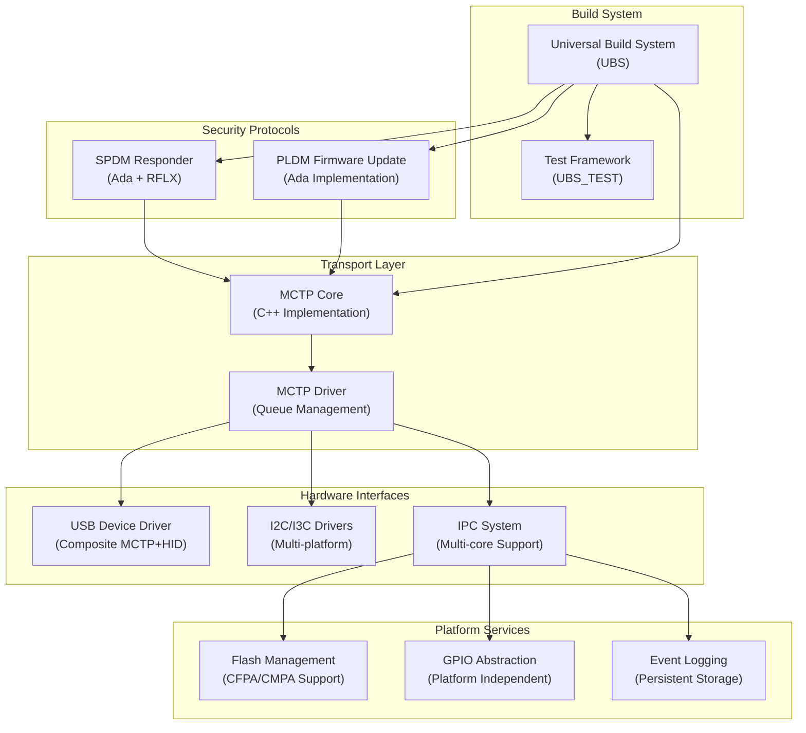

Sources: [README.md:54-61](), [CONTRIBUTING.md:55-59]()

## Core Components

### Security Protocols

OpenSMA implements two key DMTF security standards:

| Protocol | Implementation Language | Primary Function |
|----------|------------------------|------------------|
| SPDM | Ada with RFLX | Device authentication, measurement, and session establishment |
| PLDM | Ada | Secure firmware updates and device monitoring |

The SPDM implementation leverages the RFLX framework for type-safe message parsing, while PLDM handles the firmware update state machine.

### Transport Layer

The MCTP (Management Component Transport Protocol) provides the transport foundation for security protocols across various physical media including USB, I2C, and I3C.

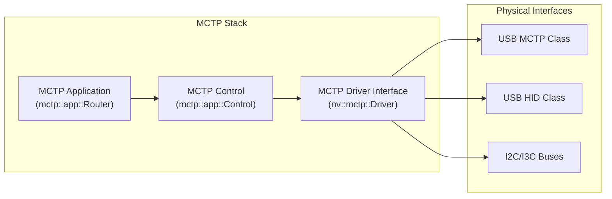

Sources: [README.md:39-41]()

### Multi-Language Integration

OpenSMA's architecture demonstrates sophisticated multi-language integration to balance safety and performance:

- **Ada**: Used for security protocols (`SPDM`, `PLDM`) to leverage high-assurance properties.
- **C++**: Used for the transport layer (`MCTP`) and hardware abstraction layers.
- **C**: Used for low-level platform interfaces, SDK integration, and legacy drivers.

The Universal Build System (UBS) orchestrates compilation across these languages, ensuring consistent toolchain application.

## Licensing and Contributions

### Licensing

OpenSMA is primarily licensed under the **Apache License, Version 2.0**. Portions of the repository may include code under BSD-3 licenses from partners like NXP or AdaCore.

- **Main License**: Apache-2.0 [LICENSE:6-7]()
- **Copyright**: Copyright (c) 2025 NVIDIA CORPORATION & AFFILIATES [NOTICE:3-3]()

### Contribution Guidelines

OpenSMA currently maintains a restricted contribution model:
- **External Contributions**: The project is not currently accepting external code contributions or Pull Requests [CONTRIBUTING.md:3-3]().
- **Issue Reporting**: Bug reports and feature requests are welcome via GitHub Issues [CONTRIBUTING.md:8-8]().
- **DCO**: All internal commits must follow the Developer Certificate of Origin (DCO) and be signed off with `git commit -s` [CONTRIBUTING.md:21-27]().
- **Security**: Vulnerabilities should be reported via GitHub's "Report a vulnerability" feature rather than public issues [CONTRIBUTING.md:68-69]().

## Build and Environment

The system requires a Linux environment (Ubuntu 24.04 recommended) and a specific toolchain setup:

| Component | Version/Link |
|-----------|--------------|
| GCC Arm Toolchain | 14.2.rel1 [README.md:30-31]() |
| GCC Arm Toolchain (Legacy) | 10.3-2021.10 [README.md:32-33]() |
| GNAT Ada Toolchain | 14.2.1 (via Alire) [README.md:34-36]() |
| NXP SDK | MCXN556S v25.09.00 [README.md:39-41]() |

The project uses a Makefile-based build system triggered via the `mcu_build.sh` script, which supports both local builds and Docker-based containerized builds [README.md:58-71]().

Sources: [README.md:5-27](), [README.md:29-41](), [CONTRIBUTING.md:1-66]()

---

# Page: Build and Test Infrastructure

# Build and Test Infrastructure

<details>
<summary>Relevant source files</summary>

The following files were used as context for generating this wiki page:

- [.gitlab-ci.yml](.gitlab-ci.yml)
- [README.md](README.md)

</details>


This document covers the Universal Build System (UBS) and comprehensive testing framework that enables multi-language development across C, C++, and Ada in the OpenSMA project. UBS provides a makefile-based build orchestration system with platform abstraction, plugin architecture, and integrated testing capabilities.

For information about the specific testing implementations within individual modules, see [Self-Tests and Validation](#2.3). For details about the UBS build system mechanics, see [UBS Build System](#2.1). For the testing framework and assertion mechanisms, see [Testing Framework](#2.2).

## UBS Architecture Overview

The Universal Build System is structured as a modular makefile-based system that orchestrates compilation, linking, testing, and static analysis across multiple programming languages and target platforms.

### Core UBS Components

```mermaid
graph TB
    subgraph "UBS Entry Points"
        UBSMAIN["ubs-main.mk<br/>Main orchestration"]
        UBSMK["ubs.mk<br/>User interface"]
    end
    
    subgraph "Configuration Layer"
        UBSCONFIG["ubs-config.mk<br/>Base configuration"]
        UBSPROJECT["ubs-project.mk<br/>Project settings"] 
        UBSPLATFORM["ubs-platform.mk<br/>Platform support"]
        UBSPOSTCONFIG["ubs-post-config.mk<br/>Final processing"]
    end
    
    subgraph "Build Engine"
        UBSRULES["ubs-rules.mk<br/>Compilation rules"]
        UBSUTILS["ubs-utils.mk<br/>Helper functions"]
        UBSPRINTER["ubs-printer.mk<br/>Console output"]
    end
    
    subgraph "Extension Systems"
        UBSPLUGIN["ubs-plugin.mk<br/>Plugin loader"]
        UBSREQ["ubs-requirements.mk<br/>Tool validation"]
        UBSCLEAN["ubs-clean.mk<br/>Cleanup rules"]
    end
    
    subgraph "Testing & Analysis"
        UBSUNITTEST["ubs-unittest.mk<br/>Test execution"]
        UBSCOVERAGE["ubs-coverage.mk<br/>Coverage analysis"]
        UBSSTATICANALYSIS["ubs-static-analysis.mk<br/>Code analysis"]
    end
    
    UBSMAIN --> UBSCONFIG
    UBSMAIN --> UBSUTILS
    UBSMAIN --> UBSPRINTER
    UBSMAIN --> UBSPLUGIN
    UBSMAIN --> UBSREQ
    UBSMAIN --> UBSCLEAN
    UBSMAIN --> UBSPLATFORM
    UBSMAIN --> UBSPROJECT
    UBSMAIN --> UBSUNITTEST
    UBSMAIN --> UBSCOVERAGE
    UBSMAIN --> UBSSTATICANALYSIS
    UBSMAIN --> UBSPOSTCONFIG
    UBSMAIN --> UBSRULES
    
    UBSMK --> UBSMAIN
```

**Sources:** [corepdk/ubs/src/ubs/ubs-main.mk:18-35](), [corepdk/ubs/src/ubs/ubs.mk:19]()

### Build Process Flow

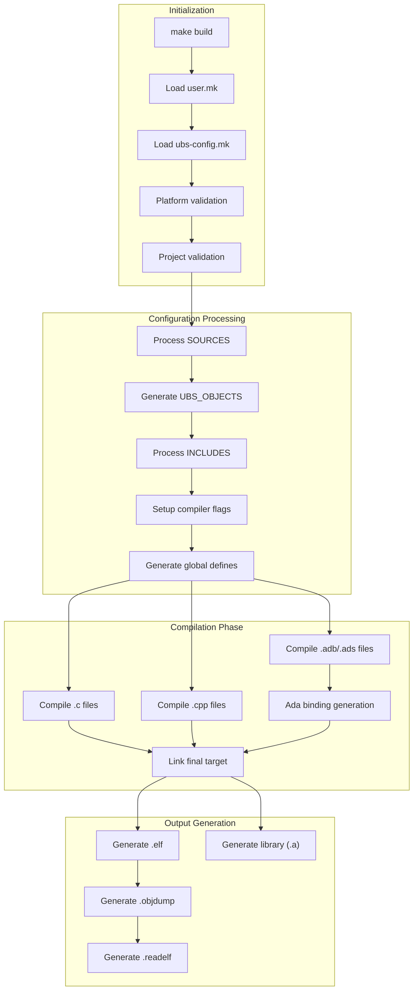

**Sources:** [corepdk/ubs/src/ubs/ubs-rules.mk:18](), [corepdk/ubs/src/ubs/ubs-post-config.mk:21-98]()

## Multi-Language Compilation Support

UBS provides unified compilation rules for C, C++, and Ada with automatic dependency management and cross-language integration.

### Language-Specific Build Rules

| Language | Source Extension | Object Pattern | Compiler Variable | Flags Variable |
|----------|------------------|----------------|-------------------|----------------|
| C | `.c` | `%.c.o` | `UBS_CC` | `UBS_CC_FLAGS` |
| C++ | `.cpp` | `%.cpp.o` | `UBS_CXX` | `UBS_CXX_FLAGS` |
| Ada Body | `.adb` | `%.o` + `%.ali` | `UBS_ADA` | `UBS_ADA_FLAGS` |
| Ada Spec | `.ads` | `%.o` + `%.ali` | `UBS_ADA` | `UBS_ADA_FLAGS` |
| Assembly | `.S` | `%.S.o` | `UBS_CC` | `UBS_CC_FLAGS` |

**Sources:** [corepdk/ubs/src/ubs/ubs-rules.mk:69-89]()

### Compilation Rule Implementation

The build system uses template-based compilation rules with automatic dependency generation:

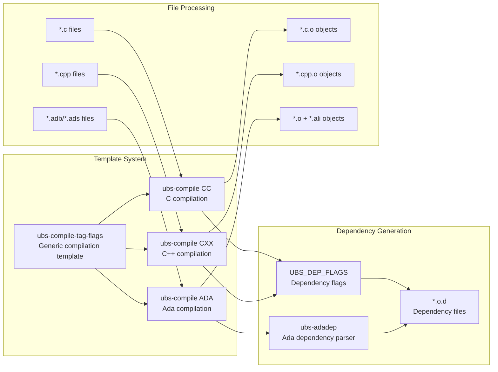

**Sources:** [corepdk/ubs/src/ubs/ubs-rules.mk:37-57](), [corepdk/ubs/src/ubs/ubs-rules.mk:77-89]()

## Global Defines and Code Generation

UBS implements a sophisticated code generation system that creates language-specific constant definitions from makefile variables.

### Global Defines System Architecture

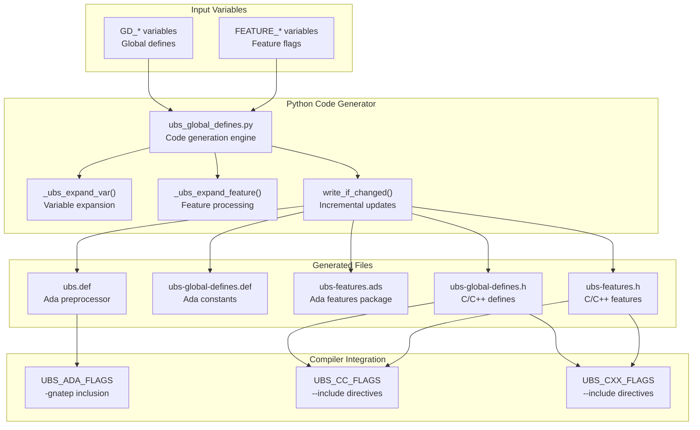

**Sources:** [corepdk/ubs/src/ubs/ubs_global_defines.py:79-170](), [corepdk/ubs/src/ubs/ubs-post-config.mk:94-98]()

### Feature Flag Generation Example

The system automatically generates language-appropriate feature flag definitions:

| Input Makefile Variable | Ada Output | C Output | C++ Output |
|-------------------------|------------|-----------|-------------|
| `FEATURE_USB := 1` | `Ubs.Features.USB : constant boolean := True;` | `#define UBS_FEATURES_USB 1` | `constexpr auto USB = 1;` |
| `FEATURE_LOGGING := 0` | `Ubs.Features.LOGGING : constant boolean := False;` | `#define UBS_FEATURES_LOGGING 0` | `constexpr auto LOGGING = 0;` |

**Sources:** [corepdk/ubs/src/ubs/ubs_global_defines.py:114-160]()

## Testing Framework Integration

UBS provides integrated unit testing capabilities with multi-language support and assertion frameworks.

### Test Discovery and Execution

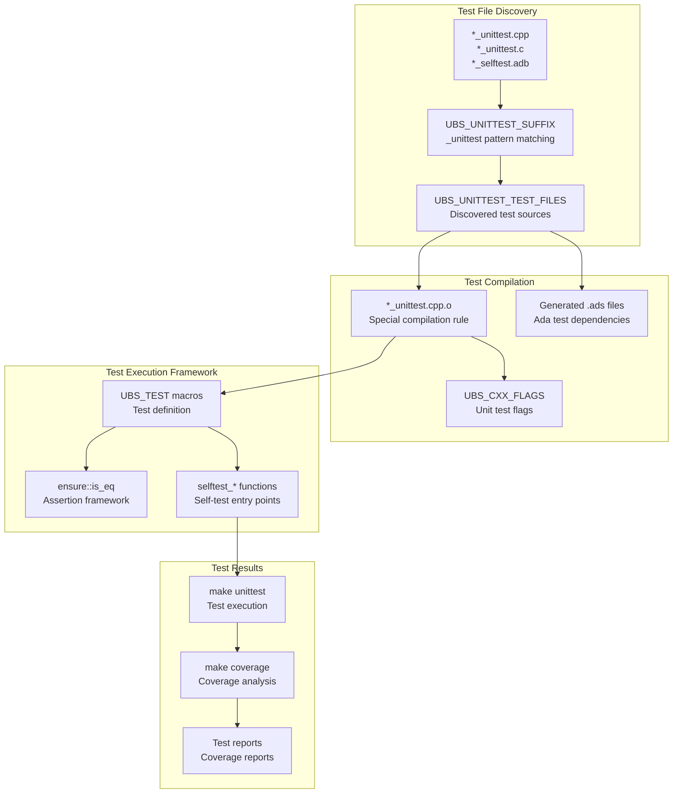

**Sources:** [corepdk/ubs/src/ubs/ubs-rules.mk:62-67](), [corepdk/ubs/src/ubs/ubs-unittest.mk]()

## Platform Abstraction Layer

UBS supports multiple target platforms through a plugin-based platform abstraction system.

### Platform Configuration Structure

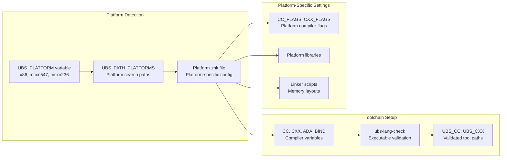

**Sources:** [corepdk/ubs/src/ubs/ubs-platform.mk:18-32](), [corepdk/ubs/src/ubs/ubs-config.mk:35-38]()

### Supported Language Toolchains

The platform layer validates and configures toolchains for all supported languages:

| Language | Variable | Validation Function | Purpose |
|----------|----------|-------------------|---------|
| C | `CC` | `ubs-lang-check` | C compiler (gcc, clang) |
| C++ | `CXX` | `ubs-lang-check` | C++ compiler (g++, clang++) |
| Ada | `ADA` | `ubs-lang-check` | Ada compiler (gnat) |
| Binding | `BIND` | `ubs-lang-check` | Ada binder (gnatbind) |
| Preprocessor | `CPP` | `ubs-lang-check` | C preprocessor |
| Linker | `LD` | `ubs-lang-check` | Linker (ld, gold) |
| Final Link | `LINK` | `ubs-lang-check` | Final linking tool |

**Sources:** [corepdk/ubs/src/ubs/ubs-platform.mk:20-31]()

## Plugin System Architecture

UBS implements an extensible plugin system that allows projects to add custom build commands and functionality.

### Plugin Loading Mechanism

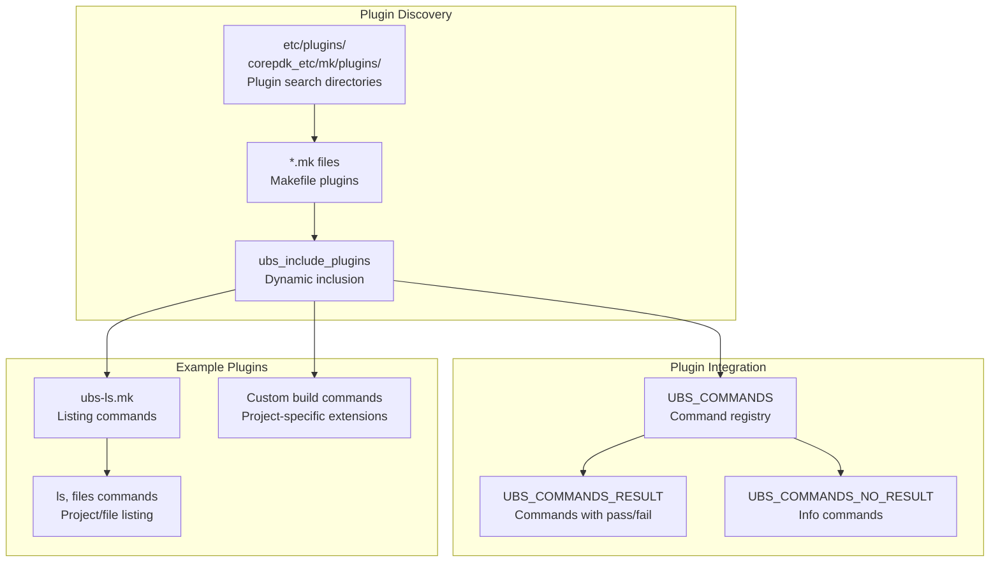

**Sources:** [corepdk/ubs/src/ubs/ubs-plugin.mk:18-38](), [corepdk/ubs/src/selftests/projects/x86-ada/etc/plugins/ubs-ls.mk:18-34]()

## Build Artifacts and Output Structure

UBS organizes build outputs in a structured directory hierarchy with support for multiple configurations.

### Output Directory Structure

| Path Pattern | Purpose | Contents |
|--------------|---------|----------|
| `build/{PROJECT}-{PLATFORM}-{MODE}/` | Root build directory | All build artifacts |
| `build/{PROJECT}-{PLATFORM}-{MODE}/obj/` | Object files | `.o`, `.ali`, `.d` files |
| `build/{PROJECT}-{PLATFORM}-{MODE}/gen/` | Generated code | Auto-generated sources |
| `build/{PROJECT}-{PLATFORM}-{MODE}/reports/` | Analysis reports | Coverage, static analysis |
| `build/{PROJECT}-{PLATFORM}-{MODE}/libs/` | Library outputs | `.a` library files |

**Sources:** [corepdk/ubs/src/ubs/ubs-config.mk:44-49]()

### Target Generation Process

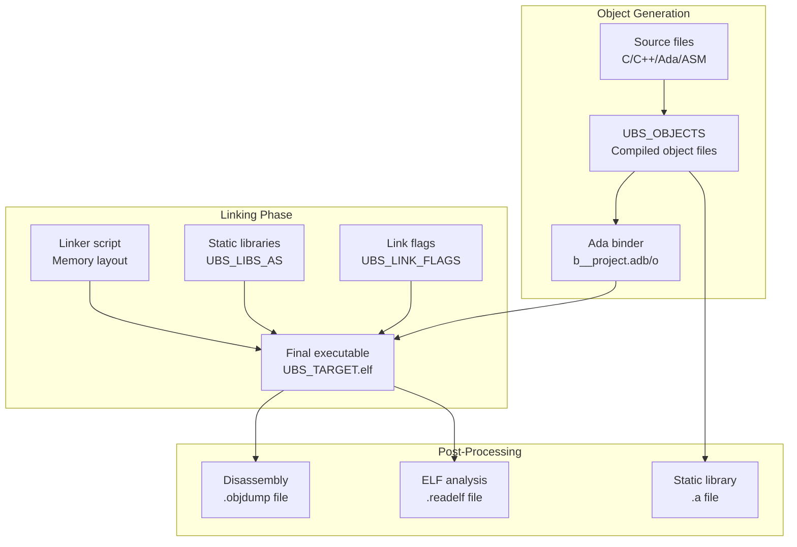

**Sources:** [corepdk/ubs/src/ubs/ubs-rules.mk:24-35](), [corepdk/ubs/src/ubs/ubs-rules.mk:104-111]()

## CI/CD Pipeline

The project utilizes GitLab CI for automated build and test verification. The pipeline is defined to trigger on merge requests, main branch updates, and tags.

### Pipeline Configuration

The `.gitlab-ci.yml` file defines a build matrix for key projects and platforms:

| Project | Platform | Board | Mode |
|---------|----------|-------|------|
| `mcxn547helloworld` | `mcxn556-both` | `mcxn547helloworld` | `rel` |
| `p3957_cxx` | `mcxn556-core0` | `p3957_cxx` | `rel` |

**Sources:** [.gitlab-ci.yml:18-27]()

### Environment and Tooling

The CI environment is provisioned via a Docker image `${CI_REGISTRY_IMAGE}/env:latest`. It includes:
- **Toolchains**: Arm GNU Toolchain (14.2.rel1), GNAT for ARM (14.2.1), and legacy GCC ARM (10.3).
- **SDKs**: NXP MCXN556S SDK (25.09.00), patched during the `before_script` phase.
- **Python Dependencies**: `spsdk` (3.4.0) for firmware signing and manipulation.

**Sources:** [.gitlab-ci.yml:32-51](), [README.md:30-45]()

### Build Orchestration

The `mcu_build.sh` script serves as the primary entry point for both CI and local builds, wrapping the UBS `make` calls with appropriate project and board parameters.

```bash
./mcu_build.sh PROJECT=${PROJECT} BOARD=${BOARD} PLATFORM=${PLATFORM} MODE=${MODE} RUN_LOCAL=1 BUILD_ONLY=1
```

**Sources:** [.gitlab-ci.yml:56](), [README.md:59]()

---

# Page: UBS Build System

# UBS Build System

<details>
<summary>Relevant source files</summary>

The following files were used as context for generating this wiki page:

- [.gitlab-ci.yml](.gitlab-ci.yml)
- [README.md](README.md)

</details>


The Universal Build System (UBS) is a comprehensive Makefile-based build infrastructure that provides multi-language compilation support, platform abstraction, and an extensible plugin architecture. UBS orchestrates the build process for C, C++, and Ada source files across multiple target platforms while providing integrated testing, static analysis, and code generation capabilities.

For information about the testing framework that integrates with UBS, see [Testing Framework](2.2). For details on self-tests and validation procedures, see [Self-Tests and Validation](2.3).

## Architecture Overview

UBS follows a modular architecture where the main orchestrator includes specialized components for different aspects of the build process.

### Core Component Structure

```mermaid
graph TB
    subgraph "Entry Points"
        UBS_MK["ubs.mk"]
        UBS_MAIN["ubs-main.mk"]
        USER_MK["user.mk"]
    end
    
    subgraph "Configuration Layer"
        UBS_CONFIG["ubs-config.mk"]
        UBS_PROJECT["ubs-project.mk"] 
        UBS_PLATFORM["ubs-platform.mk"]
        UBS_POST_CONFIG["ubs-post-config.mk"]
    end
    
    subgraph "Utility Layer"
        UBS_UTILS["ubs-utils.mk"]
        UBS_PRINTER["ubs-printer.mk"]
        UBS_PLUGIN["ubs-plugin.mk"]
        UBS_REQUIREMENTS["ubs-requirements.mk"]
    end
    
    subgraph "Build Layer"
        UBS_RULES["ubs-rules.mk"]
        UBS_CLEAN["ubs-clean.mk"]
        UBS_HELP["ubs-help.mk"]
    end
    
    subgraph "Testing Layer"
        UBS_UNITTEST["ubs-unittest.mk"]
        UBS_UNITPROVE["ubs-unitprove.mk"]
        UBS_COVERAGE["ubs-coverage.mk"]
        UBS_STATIC_ANALYSIS["ubs-static-analysis.mk"]
    end
    
    subgraph "Code Generation"
        UBS_GLOBAL_DEFINES_PY["ubs_global_defines.py"]
        UBS_GPR_PROJECT["ubs_gprproject"]
        UBS_LINKER_AUTOGEN["ubs_linker_autogen"]
    end
    
    UBS_MK --> UBS_MAIN
    UBS_MAIN --> USER_MK
    UBS_MAIN --> UBS_CONFIG
    UBS_MAIN --> UBS_UTILS
    UBS_MAIN --> UBS_PRINTER
    UBS_MAIN --> UBS_PLUGIN
    UBS_MAIN --> UBS_REQUIREMENTS
    UBS_MAIN --> UBS_CLEAN
    UBS_MAIN --> UBS_HELP
    UBS_MAIN --> UBS_PLATFORM
    UBS_MAIN --> UBS_PROJECT
    UBS_MAIN --> UBS_UNITTEST
    UBS_MAIN --> UBS_UNITPROVE
    UBS_MAIN --> UBS_COVERAGE
    UBS_MAIN --> UBS_STATIC_ANALYSIS
    UBS_MAIN --> UBS_POST_CONFIG
    UBS_MAIN --> UBS_RULES
    UBS_MAIN --> UBS_GLOBAL_DEFINES_PY
    UBS_MAIN --> UBS_GPR_PROJECT
```

Sources: [corepdk/ubs/src/ubs/ubs-main.mk:18-36](), [corepdk/ubs/src/ubs/ubs.mk:19]()

### Configuration System

UBS uses a layered configuration approach where base settings are established first, then specialized for projects and platforms.

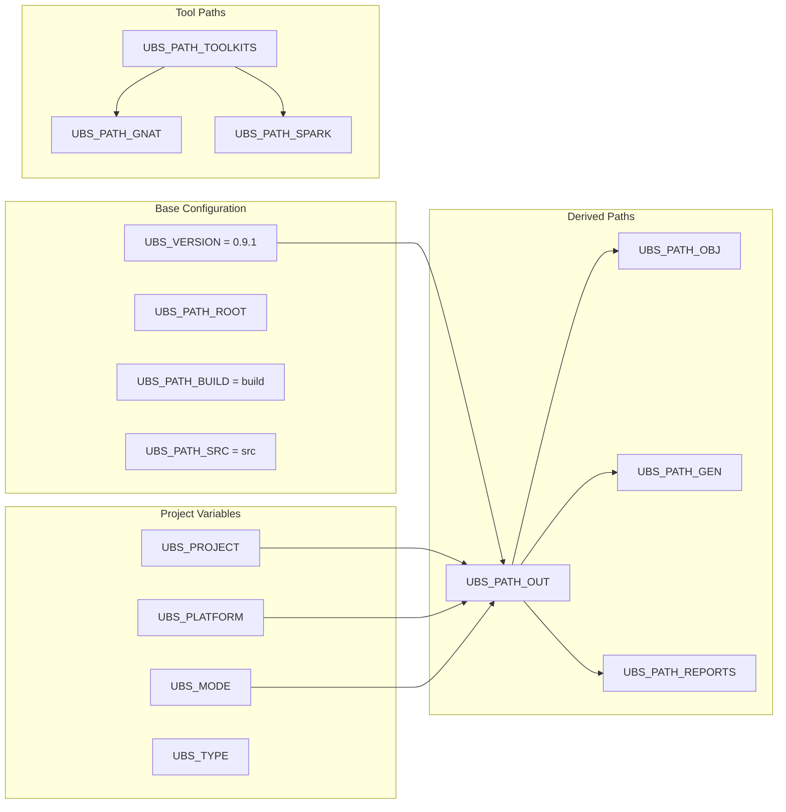

Sources: [corepdk/ubs/src/ubs/ubs-config.mk:21-51](), [corepdk/ubs/src/ubs/ubs-config.mk:56-60]()

## Environment and Toolchain

The build system requires a specific environment (Ubuntu 24.04) and set of toolchains to function correctly. These are typically managed via `libexec/toolchain/` and `libexec/sdk/` directories.

### Toolchain Configuration
The build environment is prepared by linking toolchains and SDKs into the `libexec/` directory. Key toolchains include:
* **ARM GNU Toolchain**: `arm-gnu-toolchain-14.2.rel1-x86_64-arm-none-eabi` [.gitlab-ci.yml:38-38]()
* **GNAT for ARM**: `gnat_arm_elf_14.2.1_524d4d41` [.gitlab-ci.yml:39-39]()
* **NXP SDK**: `SDK_25_09_00_MCXN556S` [.gitlab-ci.yml:43-43]()

### CI/CD Integration
UBS is integrated into GitLab CI, using a build matrix to compile multiple project configurations in parallel.

| Project | Platform | Board | Mode |
| :--- | :--- | :--- | :--- |
| `mcxn547helloworld` | `mcxn556-both` | `mcxn547helloworld` | `rel` |
| `p3957_cxx` | `mcxn556-core0` | `p3957_cxx` | `rel` |

Sources: [.gitlab-ci.yml:18-27](), [.gitlab-ci.yml:63-64]()

## Build Process Flow

The UBS build process follows a structured sequence from configuration validation through final target generation.

### Build Orchestration

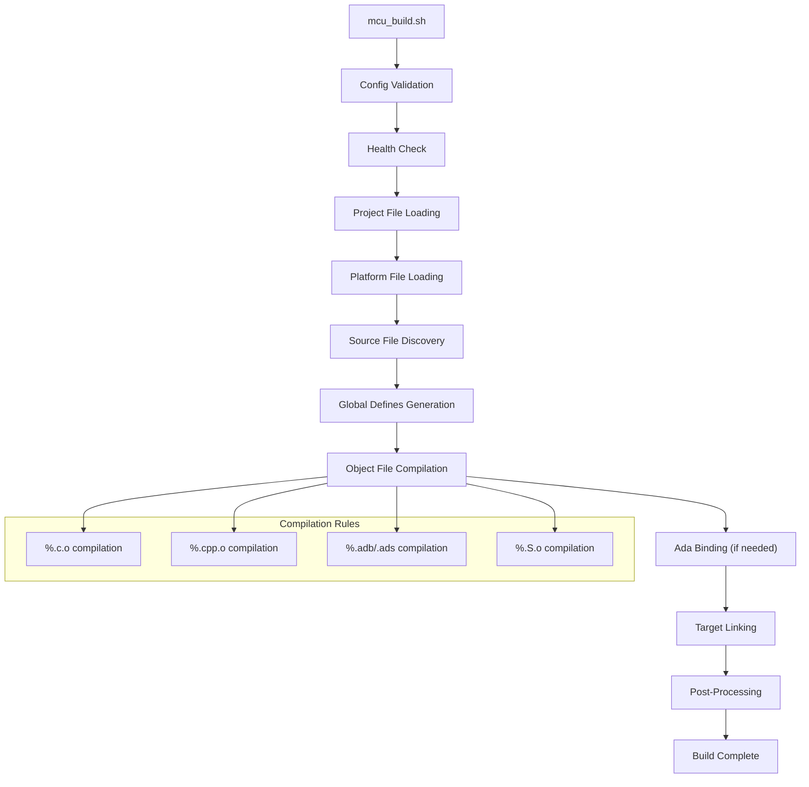

Sources: [corepdk/ubs/src/ubs/ubs-rules.mk:18](), [corepdk/ubs/src/ubs/ubs-rules.mk:24-35](), [mcu_build.sh:56-56]()

### Multi-Language Compilation Pipeline

UBS supports three primary languages with specialized handling for each:

| Language | File Extensions | Compiler Variable | Flags Variable | Special Processing |
|----------|----------------|------------------|----------------|--------------------|
| C | `.c` | `UBS_CC` | `UBS_CC_FLAGS` | Standard compilation |
| C++ | `.cpp` | `UBS_CXX` | `UBS_CXX_FLAGS` | C++23 standard, clang-tidy |
| Ada | `.adb`, `.ads` | `UBS_ADA` | `UBS_ADA_FLAGS` | Binding, ALI dependency tracking |
| Assembly | `.S` | `UBS_CC` | `UBS_CC_FLAGS` | Preprocessor support |

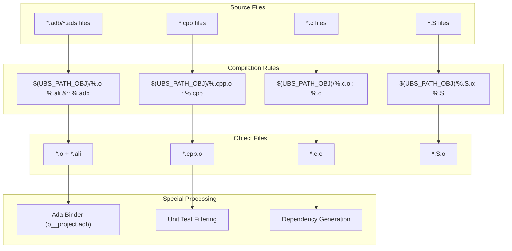

Sources: [corepdk/ubs/src/ubs/ubs-rules.mk:70-89](), [corepdk/ubs/src/ubs/ubs-rules.mk:91-101]()

## Global Defines and Feature System

UBS provides a sophisticated global defines system that generates code for all supported languages from makefile variables.

### Global Defines Processing

The Python-based global defines system (`ubs_global_defines.py`) processes makefile variables and generates appropriate header files and Ada packages:

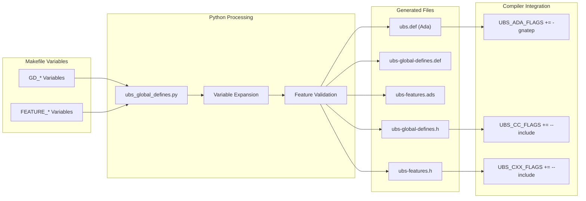

Sources: [corepdk/ubs/src/ubs/ubs_global_defines.py:79-170](), [corepdk/ubs/src/ubs/ubs-post-config.mk:94-97]()

## Platform and Project System

UBS uses configuration files to define platform-specific toolchains and project-specific source lists and build settings.

### Platform Configuration

Platform files define toolchain executables and platform-specific flags. The `mcu_build.sh` script passes these parameters to the makefile.

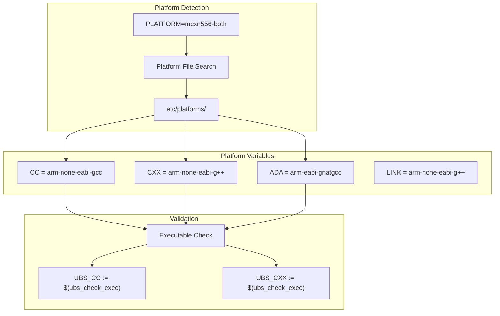

Sources: [corepdk/ubs/src/ubs/ubs-platform.mk:18-31](), [.gitlab-ci.yml:56-56](), [README.md:59-59]()

## Static Analysis Integration

UBS integrates multiple static analysis tools with unified command interfaces, including `clang-tidy-18` for C++ code.

### Analysis Tool Chain

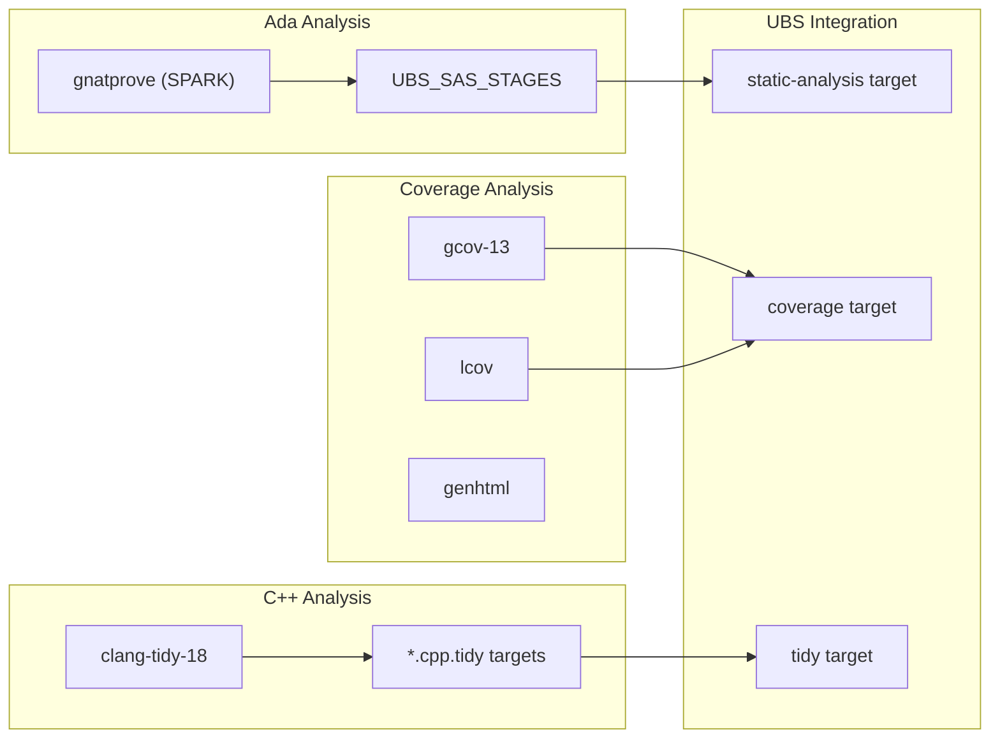

Sources: [corepdk/ubs/src/ubs/ubs-rules.mk:126-139](), [corepdk/ubs/src/ubs/ubs-requirements.mk:39-50](), [README.md:12-13]()

---

# Page: Testing Framework

# Testing Framework

<details>
<summary>Relevant source files</summary>

The following files were used as context for generating this wiki page:

- [corepdk/modules/mctp-cpp/src/app/pdk-mctp-app-composer-test.cpp](corepdk/modules/mctp-cpp/src/app/pdk-mctp-app-composer-test.cpp)
- [corepdk/modules/mctp-cpp/src/app/pdk-mctp-app-control-test.cpp](corepdk/modules/mctp-cpp/src/app/pdk-mctp-app-control-test.cpp)
- [corepdk/modules/mctp-cpp/src/file1-test.cpp](corepdk/modules/mctp-cpp/src/file1-test.cpp)
- [corepdk/modules/pldm-fd/src/file1-test.cpp](corepdk/modules/pldm-fd/src/file1-test.cpp)

</details>


## Purpose and Scope

The Testing Framework provides a comprehensive unit testing infrastructure for OpenSMA that supports multi-language development across C, C++, and Ada components. The framework is built on top of the Universal Build System (UBS) and provides standardized test macros, assertion mechanisms, and self-test validation capabilities.

This document covers the core testing infrastructure, the `UBS_TEST` macro system, the assertion framework, and the implementation of module-specific tests.

## Test Framework Architecture

The testing framework is organized around several key components that work together to provide comprehensive test coverage. Tests are typically located alongside the source code in `*-test.cpp` files.

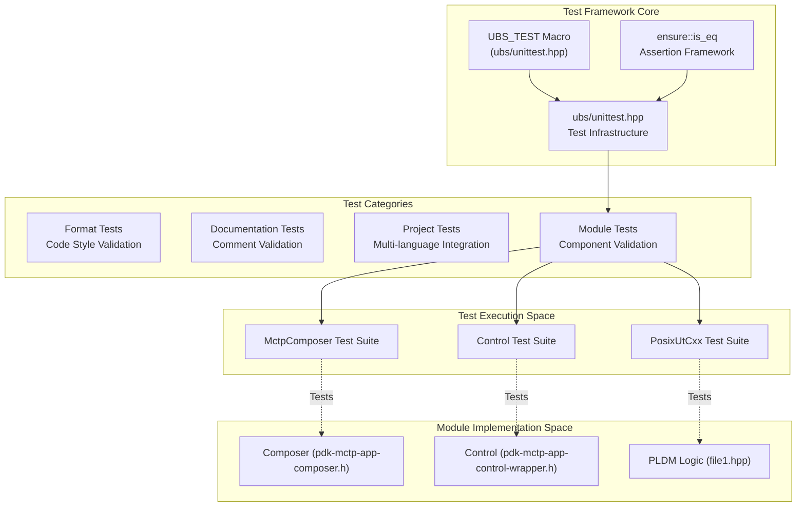

Sources: [corepdk/modules/mctp-cpp/src/app/pdk-mctp-app-composer-test.cpp:23-26](), [corepdk/modules/mctp-cpp/src/app/pdk-mctp-app-control-test.cpp:25-27](), [corepdk/modules/pldm-fd/src/file1-test.cpp:18-21]()

## Test Macro System

### UBS_TEST Macro

The `UBS_TEST` macro is the entry point for defining a unit test. It registers the test case within a specific suite.

| Component | Description | Example |
|-----------|-------------|---------|
| **Test Suite** | Logical grouping of related tests | `MctpComposer`, `Control`, `PosixUtCxx` |
| **Test Name** | Specific identifier for the test case | `ConstructMctpHeader`, `UpdateEidTest`, `FuncTest` |

### Implementation Pattern

The standard pattern involves including `ubs/unittest.hpp` and using the `ubs::unittest` namespace.

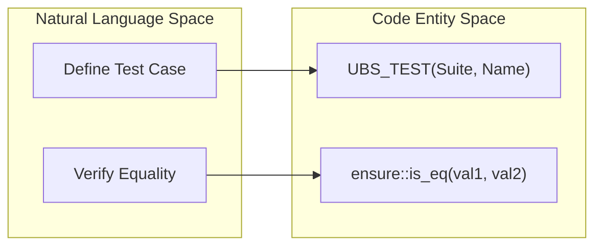

Sources: [corepdk/modules/mctp-cpp/src/app/pdk-mctp-app-composer-test.cpp:176](), [corepdk/modules/mctp-cpp/src/app/pdk-mctp-app-control-test.cpp:29](), [corepdk/modules/mctp-cpp/src/file1-test.cpp:23]()

## Assertion Framework

### ensure::is_eq Function

The `ensure::is_eq` function is the primary assertion tool. It is used to validate that the actual output of a function matches the expected value. If the assertion fails, the test runner marks the test as failed.

### Complex Validation Example: MCTP Composer

In complex modules like MCTP, the assertion framework is used within helper functions to validate packet structures:

| Function | File | Logic |
|----------|------|-------|
| `compare_two_packet_hdr` | [corepdk/modules/mctp-cpp/src/app/pdk-mctp-app-composer-test.cpp:31-42]() | Uses `ensure::is_eq` to check `hdr_ver`, `dst_eid`, `src_eid`, and `msg_tag`. |
| `test_gen_multi_packet` | [corepdk/modules/mctp-cpp/src/app/pdk-mctp-app-composer-test.cpp:45-100]() | Validates sequence numbers (`pkt_seq`), start-of-message (`som`), and end-of-message (`eom`) flags. |

Sources: [corepdk/modules/mctp-cpp/src/app/pdk-mctp-app-composer-test.cpp:33-41](), [corepdk/modules/mctp-cpp/src/app/pdk-mctp-app-composer-test.cpp:78-82]()

## Module-Specific Testing

### MCTP Control Tests
The `Control` test suite validates the MCTP control message handling, including header filling and error packet generation.

*   **Header Filling**: `UBS_TEST(Control, FillPacketHeaderTest)` verifies that the `src_eid` and `dst_eid` are correctly swapped and assigned during response generation [corepdk/modules/mctp-cpp/src/app/pdk-mctp-app-control-test.cpp:38-84]().
*   **Error Handling**: `UBS_TEST(Control, FillErrorPacketTest)` ensures that completion codes like `Ccode::ErrorGeneral` are correctly placed in the response [corepdk/modules/mctp-cpp/src/app/pdk-mctp-app-control-test.cpp:105-123]().

### PLDM and Generic Module Tests
Modules like `pldm-fd` use the framework to validate core logic through the `PosixUtCxx` suite.

*   **Basic Validation**: Tests like `UBS_TEST(PosixUtCxx, FuncTest)` verify simple function returns using the `selftest_cxx_only` namespace [corepdk/modules/pldm-fd/src/file1-test.cpp:23-26]().

## Test Runner Project

The `testrunner` project (located in `src/projects/testrunner`) serves as the execution environment for these tests. It aggregates the various `*-test.cpp` files across the repository into a single executable that can be run on x86 or simulated environments to validate the codebase before deployment to hardware.

### Data Flow in Test Execution

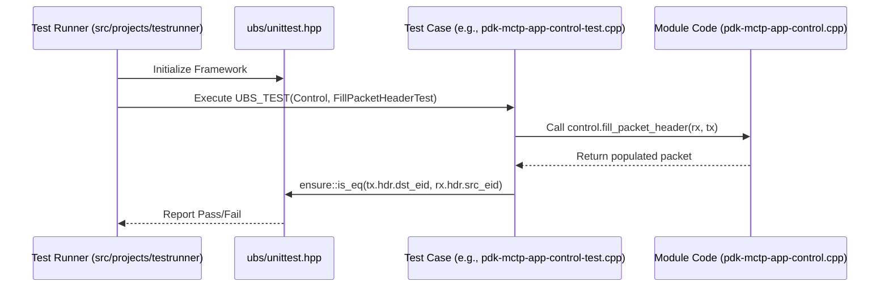

Sources: [corepdk/modules/mctp-cpp/src/app/pdk-mctp-app-control-test.cpp:38-84](), [corepdk/modules/mctp-cpp/src/app/pdk-mctp-app-composer-test.cpp:23-25]()

---

# Page: Self-Tests and Validation

# Self-Tests and Validation

<details>
<summary>Relevant source files</summary>

The following files were used as context for generating this wiki page:

- [.gitlab-ci.yml](.gitlab-ci.yml)
- [corepdk/modules/mctp-cpp/src/app/pdk-mctp-app-validator-test.cpp](corepdk/modules/mctp-cpp/src/app/pdk-mctp-app-validator-test.cpp)
- [corepdk/modules/mctp-cpp/src/app/pdk-mctp-app-validator.cpp](corepdk/modules/mctp-cpp/src/app/pdk-mctp-app-validator.cpp)
- [corepdk/modules/mctp-cpp/src/app/pdk-mctp-app-validator.h](corepdk/modules/mctp-cpp/src/app/pdk-mctp-app-validator.h)

</details>


## Purpose and Scope

The self-tests and validation system provides comprehensive testing capabilities across OpenSMA's multi-language codebase, ensuring code quality, proper formatting, documentation compliance, and cross-language integration. This system validates C, C++, and Ada components working together through the Universal Build System (UBS).

For information about the underlying UBS build infrastructure, see [UBS Build System](#2.1). For details about the testing framework macros and assertion mechanisms, see [Testing Framework](#2.2).

## Test Categories Overview

The self-test system is organized into three primary categories that validate different aspects of the codebase:

```mermaid
graph TB
    subgraph "Self-Test Categories"
        FORMAT["Format Tests<br/>Code Style Validation"]
        CDOC["Documentation Tests<br/>Comment Requirements"] 
        PROJECTS["Multi-Language Projects<br/>Integration Testing"]
        UNIT["Unit Tests<br/>Module Logic Validation"]
    end
    
    subgraph "Format Test Types"
        FORMATTED["Properly Formatted Files<br/>Reference Standard"]
        UNFORMATTED["Unformatted Files<br/>Style Violations"]
        NOFORMAT["No-Format Files<br/>Formatting Exclusions"]
    end
    
    subgraph "Documentation Validation"
        CCOMMENTS["C Documentation<br/>Function Comments"]
        CPPCOMMENTS["C++ Documentation<br/>Namespace Comments"]
        MISSING["Missing Documentation<br/>Validation Failures"]
    end
    
    subgraph "Language Integration"
        CONLY["C-Only Projects<br/>x86-ut-c"]
        CPPONLY["C++-Only Projects<br/>x86-ut-cpp"]
        MIXED["Mixed Language<br/>x86-ut-c-cpp-ada"]
    end

    subgraph "Unit Test Suites"
        MCTP_VAL["MCTP Validator Tests<br/>pdk-mctp-app-validator-test.cpp"]
    end
    
    FORMAT --> FORMATTED
    FORMAT --> UNFORMATTED
    FORMAT --> NOFORMAT
    
    CDOC --> CCOMMENTS
    CDOC --> CPPCOMMENTS
    CDOC --> MISSING
    
    PROJECTS --> CONLY
    PROJECTS --> CPPONLY
    PROJECTS --> MIXED

    UNIT --> MCTP_VAL
```

Sources: [corepdk/ubs/src/selftests/format/](), [corepdk/ubs/src/selftests/cdoc/](), [corepdk/ubs/src/selftests/projects/](), [corepdk/modules/mctp-cpp/src/app/pdk-mctp-app-validator-test.cpp:24-29]()

## Multi-Language Integration Tests

The project-based tests validate different combinations of programming languages working together through the UBS build system:

| Project Name | Languages | Purpose |
|--------------|-----------|---------|
| `x86-ut-c` | C | Pure C compilation and linking |
| `x86-ut-cpp` | C++ | Pure C++ compilation and linking |
| `x86-ut-c-cpp` | C + C++ | C/C++ interoperability |
| `x86-ut-c-ada` | C + Ada | C/Ada interoperability |
| `x86-ut-cpp-ada` | C++ + Ada | C++/Ada interoperability |
| `x86-ut-c-cpp-ada` | C + C++ + Ada | Full multi-language integration |

```mermaid
graph TD
    subgraph "Multi-Language Test Architecture"
        MAIN[main.cpp<br/>Entry Point]
        FILE1["file1.cpp<br/>selftest_cxx_only::func_that_returns_8()"]
        FILE2C["file2.c<br/>func_that_returns_8()"]
        FILE2H["file2.h<br/>C/C++ Compatible Header"]
    end
    
    subgraph "Language Interop Patterns"
        EXTERNC["extern \"C\" {}<br/>C++ to C Interface"]
        NAMESPACE["selftest_cxx_only<br/>C++ Namespace Isolation"]
        PRAGMAONCE["#pragma once<br/>Header Guard Pattern"]
    end
    
    subgraph "Test Function Patterns"
        FUNC8["func_that_returns_8()<br/>Standard Test Function"]
        FUNC7["func_that_returns_7()<br/>Variant Test Function"]
        FUNC9["func_that_returns_9()<br/>Alternative Test Function"]
    end
    
    MAIN --> FILE1
    MAIN --> FILE2C
    FILE2C --> FILE2H
    FILE1 --> NAMESPACE
    FILE2H --> EXTERNC
    FILE2H --> PRAGMAONCE
    
    FILE1 --> FUNC8
    FILE2C --> FUNC8
    FUNC8 --> FUNC7
    FUNC8 --> FUNC9
```

Sources: [corepdk/ubs/src/selftests/projects/x86-ut-c-cpp-ada/src/main.cpp:18-24](), [corepdk/ubs/src/selftests/projects/x86-ut-c-cpp/src/file1.cpp:19-26](), [corepdk/ubs/src/selftests/projects/x86-ut-c-cpp/src/file2.h:18-29]()

## Code Quality Validation Tests

### Format Validation

The format test system ensures consistent code styling across the codebase using deliberately malformed reference files:

```mermaid
graph LR
    subgraph "Format Test Files"
        GOODFILE["file1.cpp<br/>Correctly Formatted"]
        UNFORMATFILE["file1-unformat.cpp<br/>Bad Formatting"]
        NOFORMATFILE["file2-noformat.c<br/>Format Excluded"]
    end
    
    subgraph "Format Validation Process"
        FORMATTER["Code Formatter Tool"]
        VALIDATOR["Format Validator"]
        EXCLUSION["Format Exclusion List"]
    end
    
    subgraph "Test Results"
        PASS["Format Test Pass"]
        FAIL["Format Test Fail"]
        SKIP["Format Test Skip"]
    end
    
    GOODFILE --> FORMATTER
    UNFORMATFILE --> FORMATTER
    NOFORMATFILE --> EXCLUSION
    
    FORMATTER --> VALIDATOR
    EXCLUSION --> VALIDATOR
    
    VALIDATOR --> PASS
    VALIDATOR --> FAIL
    VALIDATOR --> SKIP
```

The format tests include intentionally malformed files to validate format checking:
- [corepdk/ubs/src/selftests/format/src/file1-unformat.cpp:26]() contains a namespace comment mismatch: `}  // namespace self_test_cxx_only` instead of the correct `selftest_cxx_only`
- [corepdk/ubs/src/selftests/format/src/file2-unformat.c:24-25]() has extra trailing whitespace

Sources: [corepdk/ubs/src/selftests/format/src/file1-unformat.cpp:19-26](), [corepdk/ubs/src/selftests/format/src/file2-noformat.h:18-29](), [corepdk/ubs/src/selftests/format/src/file2-unformat.c:18-25]()

### Documentation Validation

The `cdoc` tests validate documentation comment requirements:

```mermaid
graph TB
    subgraph "Documentation Test Structure"
        CFILE["file2.c<br/>C Implementation"]
        HFILE["file2.h<br/>Header Declaration"]
        CPPFILE["file1.cpp<br/>C++ Implementation"]
        MAIN["main.cpp<br/>Test Driver"]
    end
    
    subgraph "Documentation Patterns"
        CDOC["/** Function return 8 in c */<br/>C-Style Documentation"]
        CPPDOC["/** Function return 8 in cpp */<br/>C++-Style Documentation"]
        MISSING["Missing Documentation<br/>Validation Failure"]
    end
    
    subgraph "Validation Results"
        DOCPASS["Documentation Valid"]
        DOCFAIL["Documentation Missing"]
    end
    
    CFILE --> CDOC
    CPPFILE --> CPPDOC
    HFILE --> MISSING
    
    CDOC --> DOCPASS
    CPPDOC --> DOCPASS
    MISSING --> DOCFAIL
```

Key documentation patterns:
- [corepdk/ubs/src/selftests/cdoc/src/file2.c:20-23]() shows proper C function documentation: `/** Function return 8 in c */`
- [corepdk/ubs/src/selftests/cdoc/src/file1.cpp:21-23]() shows proper C++ function documentation: `/** Function return 8 in cpp */`

Sources: [corepdk/ubs/src/selftests/cdoc/src/file2.c:18-26](), [corepdk/ubs/src/selftests/cdoc/src/file1.cpp:21-27](), [corepdk/ubs/src/selftests/cdoc/src/main.cpp:18-24]()

## Module Logic Validation

The system employs logic-specific self-tests to validate protocol implementations. A primary example is the MCTP `Validator` class, which ensures that incoming packets adhere to the Management Component Transport Protocol specification.

### MCTP Validator Logic

The `pdk::mctp::app::Validator` class [corepdk/modules/mctp-cpp/src/app/pdk-mctp-app-validator.h:26-38]() maintains state for multi-packet messages and performs header validation.

```mermaid
graph TD
    subgraph "pdk::mctp::app::Validator"
        VAL_FUNC["validate(Packet, Interface)"]
        RESET_FUNC["reset()"]
        STATE_SEQ["_pkt_seq"]
        STATE_TAG["_msg_tag"]
    end

    subgraph "Validation Checks"
        HDR_VER["Header Version == 0x01"]
        EID_CHECK["Destination EID Validation"]
        TYPE_CHECK["MsgType (Control, PLDM, SPDM, Vendor)"]
        SEQ_CHECK["Packet Sequence (Multi-packet)"]
    end

    VAL_FUNC --> HDR_VER
    VAL_FUNC --> EID_CHECK
    VAL_FUNC --> TYPE_CHECK
    VAL_FUNC --> SEQ_CHECK
    RESET_FUNC --> STATE_SEQ
```

| Check Type | Code Entity | Logic Description |
|------------|-------------|-------------------|
| Header Version | `ctl.hdr_ver` | Must be `0x01` [corepdk/modules/mctp-cpp/src/app/pdk-mctp-app-validator.cpp:33-36]() |
| EID Validation | `eid_ok` | Checks if `dst_eid` is NULL, Broadcast, or matches local EIDs [corepdk/modules/mctp-cpp/src/app/pdk-mctp-app-validator.cpp:42-50]() |
| Control Packets | `MsgType::Control` | Validates single-packet Request/Response types [corepdk/modules/mctp-cpp/src/app/pdk-mctp-app-validator.cpp:53-65]() |
| Multi-packet | `_pkt_seq` | Tracks and increments 2-bit sequence numbers [corepdk/modules/mctp-cpp/src/app/pdk-mctp-app-validator.cpp:156-174]() |

### Unit Test Implementation

Module unit tests use the `UBS_TEST` macro [corepdk/modules/mctp-cpp/src/app/pdk-mctp-app-validator-test.cpp:29]() to define test cases. The `Validator` tests simulate both valid and invalid scenarios:

*   **Invalid Header Version**: Tests packets where `hdr_ver != 0x01` [corepdk/modules/mctp-cpp/src/app/pdk-mctp-app-validator-test.cpp:35-48]().
*   **Invalid EID**: Tests packets with destination EIDs not present in the routing table [corepdk/modules/mctp-cpp/src/app/pdk-mctp-app-validator-test.cpp:50-63]().
*   **Protocol Start**: Validates `SOM` (Start of Message) handling for PLDM and SPDM [corepdk/modules/mctp-cpp/src/app/pdk-mctp-app-validator-test.cpp:148-174]().

Sources: [corepdk/modules/mctp-cpp/src/app/pdk-mctp-app-validator.cpp:30-186](), [corepdk/modules/mctp-cpp/src/app/pdk-mctp-app-validator-test.cpp:29-174]()

## CI Pipeline Validation

The GitLab CI pipeline automates the validation process, ensuring that every merge request or commit to `main` passes the build and test suites.

```mermaid
sequenceDiagram
    participant MR as GitLab Merge Request
    participant CI as CI Runner
    participant BLD as mcu_build.sh
    participant ART as Artifacts

    MR->>CI: Trigger Pipeline
    CI->>CI: Setup Toolchains (ARM GNU, GNAT)
    CI->>CI: Patch SDK (mcu.patch.xz)
    CI->>BLD: Execute Build Matrix
    Note over BLD: Projects: mcxn547helloworld, p3957_cxx
    BLD-->>CI: Build Success
    CI->>ART: Store Build Binaries
```

The pipeline configuration [ .gitlab-ci.yml:1-65]() defines:
1.  **Toolchain Provisioning**: Symlinks are created for ARM GNU and GNAT toolchains [ .gitlab-ci.yml:37-40]().
2.  **SDK Patching**: The NXP SDK is patched using `xz` and `patch` commands before building [ .gitlab-ci.yml:43-46]().
3.  **Build Matrix**: Parallel jobs build multiple configurations, such as `mcxn547helloworld` on the `mcxn556-both` platform [ .gitlab-ci.yml:18-27]().

Sources: [ .gitlab-ci.yml:1-65]()

## Module-Specific Self-Tests

Core modules integrate their own self-test functions following consistent patterns:

All module self-tests follow identical patterns:
- [corepdk/modules/mctp-cpp/src/file1.cpp:19-26]() defines `selftest_cxx_only::func_that_returns_8()`
- [corepdk/modules/spdm/src/file1.cpp:19-26]() uses the same function signature
- [corepdk/modules/pldm-fd/src/file1.cpp:19-26]() maintains consistency across modules

Sources: [corepdk/modules/mctp-cpp/src/file1.cpp:18-26](), [corepdk/modules/spdm/src/file1.cpp:18-26](), [corepdk/modules/pldm-fd/src/file1.cpp:18-26]()

## Test Organization and Structure

### File Naming Conventions

The self-test system uses consistent naming patterns across all test categories:

| Pattern | Purpose | Example |
|---------|---------|---------|
| `main.cpp` | Test entry points | All project directories |
| `*-test.cpp` | Logic unit tests | `pdk-mctp-app-validator-test.cpp` |
| `file1.cpp` | Primary C++ test files | C++ functionality tests |
| `file2.c` | Primary C test files | C functionality tests |
| `*-unformat.*` | Intentionally malformed code | Format validation failures |

### Test Function Standardization

The self-test system standardizes on specific function return values for validation:

- Functions returning `8`: [corepdk/modules/spdm/src/file1.cpp:21-24](), [corepdk/ubs/src/selftests/projects/x86-ut-c/src/file1.c:20-23]()
- Functions returning `7`: [corepdk/ubs/src/selftests/format/src/file2-unformat.c:20-23](), [corepdk/ubs/src/selftests/projects/x86-ut-cpp/src/file1.cpp:21-24]()
- Functions returning `9`: [corepdk/ubs/src/selftests/format/src/file2-noformat.c:20-23]()

Sources: [corepdk/ubs/src/selftests/projects/x86-ut-c/src/file1.h:18-29](), [corepdk/ubs/src/selftests/format/src/file2-unformat.h:18-29](), [corepdk/ubs/src/selftests/format/src/file2-noformat.h:18-29]()

---

# Page: Security Protocols

# Security Protocols

<details>
<summary>Relevant source files</summary>

The following files were used as context for generating this wiki page:

- [corepdk/modules/pldm-fd/src/pdk-pldm.ads](corepdk/modules/pldm-fd/src/pdk-pldm.ads)
- [corepdk/modules/spdm/src/app/crypto/aead/pdk-spdm-app-res-crypto-aead.h](corepdk/modules/spdm/src/app/crypto/aead/pdk-spdm-app-res-crypto-aead.h)

</details>


## Purpose and Scope

This document covers the implementation of DMTF security protocols in OpenSMA, specifically the Security Protocol and Data Model (SPDM) and Platform Level Data Model (PLDM) firmware update protocols. These protocols provide cryptographic authentication, measurement, and secure firmware update capabilities for device management.

For information about the underlying transport layer, see [Transport Layer](#4). For details on hardware drivers and platform integration, see [Hardware Drivers](#5).

## Protocol Overview

OpenSMA implements two primary DMTF security protocols using Ada with SPARK formal verification:

| Protocol | Purpose | Key Features |
|----------|---------|--------------|
| **SPDM** | Device authentication and attestation | Certificate management, measurements, challenge-response authentication |
| **PLDM-FD** | Firmware update | Secure component updates, version management, activation control |

Both protocols operate over MCTP (Management Component Transport Protocol) and support both in-band and out-of-band communication channels.

## SPDM Protocol Implementation

The SPDM implementation provides the foundation for secure device identity and attestation. It is divided between a high-level application layer and a robust cryptographic subsystem.

### SPDM Architecture and Message Processing

The SPDM stack utilizes Record Flux (RFLX) for formal verification of message parsing and generation, ensuring memory safety during protocol exchanges.

```mermaid
graph TB
    subgraph "SPDM Protocol Layer (Ada/RFLX)"
        SpdmResp["RFLX.SPDM.Response<br/>Message Parser/Generator"]
        CertResp["RFLX.SPDM.Certificate_Response<br/>Certificate Chain Handling"]
        MeasResp["RFLX.SPDM.Measurements_Response<br/>Device Measurements"]
        VerEntry["RFLX.SPDM.Version_Number_Entry<br/>Version Negotiation"]
    end
    
    subgraph "SPDM Message Types"
        GetMeasReq["RFLX.SPDM.Get_Measurements_Request<br/>Attestation Requests"]
        MeasBlock["RFLX.SPDM.Measurement_Block<br/>Individual Measurements"]
        DmtfField["RFLX.SPDM.DMTF_Measurement_Field<br/>DMTF Measurement Format"]
    end
    
    subgraph "Task Integration (C++)"
        SpdmTask["nv::ipc::TaskId::Spdm<br/>SPDM Processing Task"]
        SpdmRxQueue["QueueId::SpdmRx<br/>Incoming Messages"]
        SpdmCryptoQueue["QueueId::SpdmCryptoHelper<br/>Cryptographic Operations"]
    end
    
    SpdmResp --> CertResp
    SpdmResp --> MeasResp
    SpdmResp --> VerEntry
    
    GetMeasReq --> MeasBlock
    MeasBlock --> DmtfField
    
    SpdmTask --> SpdmRxQueue
    SpdmTask --> SpdmCryptoQueue
```

**Sources:** `corepdk/modules/spdm/src/app/spdm_responder_ada_library/rflx-spdm-response.ads`, `src/projects/p3957/config.h:164-167`

### Cryptographic Subsystem

The SPDM implementation relies on a comprehensive crypto library supporting:
*   **AEAD**: Authenticated Encryption with Associated Data (AES-GCM and ChaCha20Poly1305) [`corepdk/modules/spdm/src/app/crypto/aead/pdk-spdm-app-res-crypto-aead.h:41-128`]().
*   **Asymmetric Cryptography**: Diffie-Hellman (DH) and Elliptic Curve (EC) for key exchange and signatures.
*   **Hashing and MAC**: Support for SHA-2 and SHA-3 hashing alongside HMAC and KMAC.

For detailed information on message structures, certificate management, and measurement signing, see **[SPDM Protocol Implementation](#3.1)**.

## PLDM Firmware Update

The Platform Level Data Model (PLDM) implementation focuses on the Firmware Device (FD) role, managing the lifecycle of secure firmware updates.

### PLDM Command and State Architecture

The PLDM implementation is structured around a central state machine that governs the update process from discovery to activation.

```mermaid
graph TB
    subgraph "PLDM Base Commands"
        PldmBaseCmd["Pdk.Pldm.Base.Cmd<br/>Base Command Processing"]
        SetTid["On_Set_Tid<br/>Terminal ID Management"]
        GetTid["On_Get_Tid<br/>Terminal ID Query"]
        GetPldmVer["Get_Pldm_Version<br/>Version Negotiation"]
        GetPldmTypes["Get_Pldm_Types<br/>Supported Type Query"]
    end
    
    subgraph "PLDM Firmware Update Commands"
        FwUpdateCmd["Pdk.Pldm.Fwupdate.Cmd<br/>FW Update Command Handler"]
        QueryDevId["Pldmfw_Cmd_Query_Device_Id<br/>Device Identification"]
        GetFwParams["Pldmfw_Cmd_Get_Fw_Parameters<br/>Component Information"]
        RequestUpdate["Pldmfw_Cmd_Request_Update<br/>Update Initiation"]
        PassCompTable["Pldmfw_Cmd_Pass_Component_Table<br/>Component Verification"]
        UpdateComponent["Pldmfw_Cmd_Update_Component<br/>Component Update"]
    end
    
    subgraph "PLDM State Machine"
        PldmState["Pldmfw_State<br/>Update State Management"]
        IdleState["PLDMFW_STATE_IDLE"]
        ReadyState["PLDMFW_STATE_RDY_XFER"]
        DownloadState["PLDMFW_STATE_DL"]
        VerifyState["PLDMFW_STATE_VERIFY"]
        ApplyState["PLDMFW_STATE_APPLY"]
        ActivateState["PLDMFW_STATE_ACTIVATE"]
    end
    
    PldmBaseCmd --> FwUpdateCmd
    FwUpdateCmd --> PldmState
    
    QueryDevId --> IdleState
    RequestUpdate --> ReadyState
    UpdateComponent --> DownloadState
    PassCompTable --> VerifyState
```

**Sources:** `corepdk/modules/pldm-fd/src/base/pdk-pldm-base-cmd.ads:226-266`, `corepdk/modules/pldm-fd/src/fwupdate/pdk-pldm-fwupdate-cmd.ads:77-515`, `corepdk/modules/pldm-fd/src/fwupdate/pdk-pldm-fwupdate.ads:76-84`

### Security Validation and Rate Limiting

The PLDM implementation includes security checks to prevent unauthorized updates:
*   **Rate Limiting**: Logic to prevent Denial of Service (DoS) attacks via rapid update requests [`corepdk/modules/pldm-fd/src/fwupdate/pdk-pldm-fwupdate-cmd.adb:157-222`]().
*   **Version Validation**: Checks against component stamps and classification types [`corepdk/modules/pldm-fd/src/fwupdate/pdk-pldm-fwupdate-cmd.adb:852-880`]().
*   **Interface Authorization**: Ensures updates are only accepted on authorized physical or logical interfaces [`corepdk/modules/pldm-fd/src/fwupdate/pdk-pldm-fwupdate-cmd.adb:690-701`]().

For detailed state transition diagrams and firmware package parsing details, see **[PLDM Firmware Update](#3.2)**.

## Transport Integration

### IPC Task Configuration

The security protocols integrate with the IPC system through dedicated tasks and queues, defined in the project configuration:

| Task/Queue | Purpose | Configuration |
|------------|---------|---------------|
| `TaskId::Spdm` | SPDM message processing | Task ID 76 [`src/projects/p3957/config.h:74-77`]() |
| `TaskId::Pldm` | PLDM command handling | Task ID 74 [`src/projects/p3957/config.h:74-77`]() |
| `QueueId::SpdmRx` | SPDM incoming messages | 72-byte messages [`src/projects/p3957/config.h:199-200`]() |
| `QueueId::PldmRx4k` | Large PLDM transfers | 4128-byte messages [`src/projects/p3957/config.h:215-216`]() |

### MCTP Protocol Integration

Both SPDM and PLDM operate over MCTP transport. The MCTP Router handles the delivery of messages based on the MCTP Message Type:
*   **Type 1**: PLDM Control and Discovery [`corepdk/modules/pldm-fd/src/pdk-pldm.ads:20-21`]()
*   **Type 5**: PLDM Firmware Update [`corepdk/modules/pldm-fd/src/pdk-pldm.ads:20-21`]()
*   **Type 1.2.x**: SPDM messages

```mermaid
graph TB
    subgraph "MCTP Transport Layer"
        MctpRouter["MCTP Router<br/>nv::mctp::router"]
        MctpSpdmQueue["QueueId::MctpSpdmRequest<br/>SPDM Request Routing"]
        MctpPldmQueue["QueueId::MctpPldmRequest<br/>PLDM Request Routing"]
    end
    
    subgraph "Security Protocol Tasks"
        SpdmTask["SPDM Task<br/>Security Authentication"]
        PldmTask["PLDM Task<br/>Firmware Update"]
    end
    
    MctpRouter --> MctpSpdmQueue
    MctpRouter --> MctpPldmQueue
    
    MctpSpdmQueue --> SpdmTask
    MctpPldmQueue --> PldmTask
```

**Sources:** `src/projects/p3957/config.h:102-103`, `src/projects/p3957/config.h:185-186`, `corepdk/modules/pldm-fd/src/pdk-pldm.ads:20-21`

---

# Page: SPDM Protocol Implementation

# SPDM Protocol Implementation

<details>
<summary>Relevant source files</summary>

The following files were used as context for generating this wiki page:

- [corepdk/modules/spdm/src/app/crypto/aead/pdk-spdm-app-res-crypto-aead.cpp](corepdk/modules/spdm/src/app/crypto/aead/pdk-spdm-app-res-crypto-aead.cpp)
- [corepdk/modules/spdm/src/app/crypto/aead/pdk-spdm-app-res-crypto-aead.h](corepdk/modules/spdm/src/app/crypto/aead/pdk-spdm-app-res-crypto-aead.h)
- [corepdk/modules/spdm/src/app/crypto/cert/pdk-spdm-app-res-crypto-cert.cpp](corepdk/modules/spdm/src/app/crypto/cert/pdk-spdm-app-res-crypto-cert.cpp)
- [corepdk/modules/spdm/src/app/crypto/dh/pdk-spdm-app-res-crypto-dh.cpp](corepdk/modules/spdm/src/app/crypto/dh/pdk-spdm-app-res-crypto-dh.cpp)
- [corepdk/modules/spdm/src/app/crypto/ec/pdk-spdm-app-res-crypto-ec.cpp](corepdk/modules/spdm/src/app/crypto/ec/pdk-spdm-app-res-crypto-ec.cpp)
- [corepdk/modules/spdm/src/app/crypto/hash/pdk-spdm-app-res-crypto-hash.cpp](corepdk/modules/spdm/src/app/crypto/hash/pdk-spdm-app-res-crypto-hash.cpp)
- [corepdk/modules/spdm/src/app/crypto/hkdf/pdk-spdm-app-res-crypto-hkdf.cpp](corepdk/modules/spdm/src/app/crypto/hkdf/pdk-spdm-app-res-crypto-hkdf.cpp)
- [corepdk/modules/spdm/src/app/crypto/mac/pdk-spdm-app-res-crypto-mac.cpp](corepdk/modules/spdm/src/app/crypto/mac/pdk-spdm-app-res-crypto-mac.cpp)

</details>


## Purpose and Scope

This document covers the SPDM (Security Protocol and Data Model) implementation in OpenSMA, which provides secure device authentication, measurement, and certificate management capabilities. The implementation utilizes a hybrid approach:
1.  **Ada/SPARK Responder**: Uses the RecordFlux (RFLX) framework for formal message specification, parsing, and response generation.
2.  **C++ Cryptographic Subsystem**: Provides the underlying cryptographic primitives (AEAD, Hash, HKDF, ECDSA, etc.) required by the SPDM protocol.

The implementation handles SPDM requests and generates responses according to the DMTF SPDM specification, leveraging hardware acceleration where available on the NXP MCXN platforms.

## Architecture Overview

The SPDM implementation is split between the formal Ada responder library and the C++ cryptographic application layer.

### SPDM System Architecture

```mermaid
graph TB
    subgraph "SPDM Application Layer (C++)"
        CryptoHelper["src/nv/spdm/pdk-spdm-app-res-crypto-helper.cpp<br/>Crypto Helper Utilities"]
        CertMgr["src/nv/spdm/pdk-spdm-app-res-cert.cpp<br/>Certificate Management"]
        MeasMgr["src/nv/spdm/pdk-spdm-app-res-measurement.cpp<br/>Measurement Management"]
    end

    subgraph "Crypto Subsystem (C++)"
        AEAD["corepdk/modules/spdm/src/app/crypto/aead/<br/>AES-GCM / ChaChaPoly"]
        Hash["corepdk/modules/spdm/src/app/crypto/hash/<br/>SHA-256 / SHA-384 / SHA-512"]
        HKDF["corepdk/modules/spdm/src/app/crypto/hkdf/<br/>Key Derivation"]
        EC["corepdk/modules/spdm/src/app/crypto/ec/<br/>ECDSA / ECDHE"]
        MAC["corepdk/modules/spdm/src/app/crypto/mac/<br/>HMAC / CMAC"]
    end

    subgraph "SPDM Responder Library (Ada/RFLX)"
        ResponseCore["RFLX.SPDM.Response<br/>Main Parser"]
        MeasResp["RFLX.SPDM.Measurements_Response"]
        CertResp["RFLX.SPDM.Certificate_Response"]
    end

    ResponseCore --> CryptoHelper
    CryptoHelper --> Hash
    CryptoHelper --> HKDF
    CryptoHelper --> EC
    CertMgr --> EC
    MeasMgr --> Hash
```

Sources: [corepdk/modules/spdm/src/app/crypto/aead/pdk-spdm-app-res-crypto-aead.cpp:3-50](), [corepdk/modules/spdm/src/app/crypto/hash/pdk-spdm-app-res-crypto-hash.cpp:52-88](), [corepdk/modules/spdm/src/app/crypto/hkdf/pdk-spdm-app-res-crypto-hkdf.cpp:26-65]()

## Cryptographic Subsystem

The cryptographic layer in `corepdk/modules/spdm/src/app/crypto/` provides a standardized interface (prefixed with `libspdm_`) that wraps platform-specific security drivers.

### Key Primitives and Implementations

| Category | File Path | Supported Algorithms |
| :--- | :--- | :--- |
| **AEAD** | [corepdk/modules/spdm/src/app/crypto/aead/pdk-spdm-app-res-crypto-aead.cpp:1-150]() | AES-GCM (128/256), ChaCha20Poly1305 |
| **Hash** | [corepdk/modules/spdm/src/app/crypto/hash/pdk-spdm-app-res-crypto-hash.cpp:1-100]() | SHA-256, SHA-384, SHA-512, SHA3-256/384/512, SM3 |
| **EC** | [corepdk/modules/spdm/src/app/crypto/ec/pdk-spdm-app-res-crypto-ec.cpp:1-200]() | ECDSA, ECDHE (P-256, P-384, P-521), SM2 |
| **HKDF** | [corepdk/modules/spdm/src/app/crypto/hkdf/pdk-spdm-app-res-crypto-hkdf.cpp:1-170]() | HMAC-based Extract/Expand for SHA-2/SHA-3 |
| **MAC** | [corepdk/modules/spdm/src/app/crypto/mac/pdk-spdm-app-res-crypto-mac.cpp:1-180]() | HMAC (SHA-2/SHA-3), AES-CMAC |

### Cryptographic Data Flow

The following diagram illustrates how the application layer utilizes the crypto primitives for SPDM operations.

```mermaid
graph LR
    subgraph "Application Logic"
        VerifySig["libspdm_ec_verify_signature"]
        DeriveKey["libspdm_hkdf_sha256_expand"]
        ComputeHash["hash_all_from_base_hash_algo"]
    end

    subgraph "Platform Implementation"
        EC_Plat["pdk::spdm::platforms::res::crypto::ec::ec_verify"]
        HKDF_Plat["pdk::spdm::platforms::res::crypto::hkdf::hkdf_sha256_expand"]
        Hash_Plat["libspdm_sha256_hash_all"]
    end

    VerifySig --> EC_Plat
    DeriveKey --> HKDF_Plat
    ComputeHash --> Hash_Plat
```

Sources: [corepdk/modules/spdm/src/app/crypto/ec/pdk-spdm-app-res-crypto-ec.cpp:203-220](), [corepdk/modules/spdm/src/app/crypto/hkdf/pdk-spdm-app-res-crypto-hkdf.cpp:53-65](), [corepdk/modules/spdm/src/app/crypto/hash/pdk-spdm-app-res-crypto-hash.cpp:52-66]()

## Message Processing and Parsing

The SPDM responder processes incoming requests through a structured message parsing pipeline defined in Ada/RFLX.

### Supported SPDM Message Types

| Message Type | Purpose | RFLX Component |
| :--- | :--- | :--- |
| **Version** | Protocol version negotiation | `RFLX.SPDM.Version_Response` |
| **Capabilities** | Device capability advertisement | `RFLX.SPDM.Capabilities_Response` |
| **Algorithms** | Cryptographic algorithm negotiation | `RFLX.SPDM.Algorithms_Response` |
| **Digests** | Certificate digest exchange | `RFLX.SPDM.Digests_Response` |
| **Certificate** | Certificate chain delivery | `RFLX.SPDM.Certificate_Response` |
| **Measurements** | Device measurement reporting | `RFLX.SPDM.Measurements_Response` |

### Measurement Hash Selection
The function `find_hash_size_from_base_hash_algo` is used to determine the digest size based on the negotiated SPDM algorithm.

```cpp
size_t find_hash_size_from_base_hash_algo(const pdk::spdm::app::res::algorithms::BaseHashSel base_hash_algo)
{
    switch (base_hash_algo) {
        case BaseHashSel::TpmAlgSha256  : return HashAlgoDigestSize::TpmAlgSha256Size; // 32 bytes
        case BaseHashSel::TpmAlgSha384  : return HashAlgoDigestSize::TpmAlgSha384Size; // 48 bytes
        case BaseHashSel::TpmAlgSha512  : return HashAlgoDigestSize::TpmAlgSha512Size; // 64 bytes
        // ...
    }
}
```

Sources: [corepdk/modules/spdm/src/app/crypto/hash/pdk-spdm-app-res-crypto-hash.cpp:35-50]()

## Context and Memory Management

Each SPDM cryptographic operation involves context management to ensure state is maintained correctly during multi-step operations (e.g., Init-Update-Final for hashing).

### Hashing Context Operations
1.  **Allocation**: `libspdm_sha256_new()` initializes a platform-specific hash context. [corepdk/modules/spdm/src/app/crypto/hash/pdk-spdm-app-res-crypto-hash.cpp:100-106]()
2.  **Duplication**: `libspdm_sha256_duplicate()` allows cloning a context for branching hash calculations (common in SPDM transcript hashing). [corepdk/modules/spdm/src/app/crypto/hash/pdk-spdm-app-res-crypto-hash.cpp:153-160]()
3.  **Finalization**: `libspdm_sha256_final()` computes the final digest and invalidates the context. [corepdk/modules/spdm/src/app/crypto/hash/pdk-spdm-app-res-crypto-hash.cpp:197-205]()

### Diffie-Hellman (DH) Key Exchange
The system supports FFDHE (Finite Field Diffie-Hellman Ephemeral) via:
-   `libspdm_dh_new_by_nid`: Creates context based on Negotiated Identifier (NID). [corepdk/modules/spdm/src/app/crypto/dh/pdk-spdm-app-res-crypto-dh.cpp:23-29]()
-   `libspdm_dh_generate_key`: Generates ephemeral public/private pairs. [corepdk/modules/spdm/src/app/crypto/dh/pdk-spdm-app-res-crypto-dh.cpp:71-78]()
-   `libspdm_dh_compute_key`: Computes the shared secret from the peer's public key. [corepdk/modules/spdm/src/app/crypto/dh/pdk-spdm-app-res-crypto-dh.cpp:110-121]()

## SPARK Formal Verification

The Ada portion of the SPDM responder uses SPARK_Mode for formal verification. This ensures:
-   **Memory Safety**: Absence of buffer overflows in message parsing.
-   **Control Flow Correctness**: Guaranteed termination and valid state transitions.
-   **Data Integrity**: Verification that message fields match the DMTF specification.

Sources: [corepdk/modules/spdm/src/app/spdm_responder_ada_library/rflx-spdm-response.ads:20-24](), [corepdk/modules/spdm/src/app/spdm_responder_ada_library/rflx-spdm-response.adb:12-14]()

---

# Page: PLDM Firmware Update

# PLDM Firmware Update

<details>
<summary>Relevant source files</summary>

The following files were used as context for generating this wiki page:

- [corepdk/modules/pldm-fd/src/app/pdk-pldm-hook.ads](corepdk/modules/pldm-fd/src/app/pdk-pldm-hook.ads)
- [corepdk/modules/pldm-fd/src/app/pdk-pldm-interfaces.ads](corepdk/modules/pldm-fd/src/app/pdk-pldm-interfaces.ads)
- [corepdk/modules/pldm-fd/src/base/pdk-pldm-base-cmd.adb](corepdk/modules/pldm-fd/src/base/pdk-pldm-base-cmd.adb)
- [corepdk/modules/pldm-fd/src/base/pdk-pldm-base.ads](corepdk/modules/pldm-fd/src/base/pdk-pldm-base.ads)
- [corepdk/modules/pldm-fd/src/device/pdk-pldm-device-cmd.adb](corepdk/modules/pldm-fd/src/device/pdk-pldm-device-cmd.adb)
- [corepdk/modules/pldm-fd/src/fwupdate/pdk-pldm-fwupdate-cmd.adb](corepdk/modules/pldm-fd/src/fwupdate/pdk-pldm-fwupdate-cmd.adb)
- [corepdk/modules/pldm-fd/src/fwupdate/pdk-pldm-fwupdate-state.adb](corepdk/modules/pldm-fd/src/fwupdate/pdk-pldm-fwupdate-state.adb)
- [corepdk/modules/pldm-fd/src/pdk-pldm.ads](corepdk/modules/pldm-fd/src/pdk-pldm.ads)
- [corepdk/modules/pldm-fd/src/types/nv_types.ads](corepdk/modules/pldm-fd/src/types/nv_types.ads)

</details>


## Purpose and Scope

This document covers the PLDM (Platform Level Data Model) firmware update implementation in OpenSMA. PLDM firmware update is a DMTF standard protocol (Type 5) that provides secure, standardized firmware update capabilities for embedded devices. The implementation handles the complete firmware update lifecycle including discovery, transfer, verification, and activation phases.

The implementation consists of the `pldm-fd` module in Ada, which provides the core protocol logic, state machine management, and message parsing, and the application layer in `src/nv/pldm/` for task integration.

**Sources:** [corepdk/modules/pldm-fd/src/pdk-pldm.ads:18-32](), [corepdk/modules/pldm-fd/src/fwupdate/pdk-pldm-fwupdate.ads:19-32]()

## Architecture Overview

The PLDM firmware update system is built around a state machine that manages the firmware update process through distinct phases. The core implementation uses Ada for safety-critical operations with platform-specific integration.

### State Machine

The firmware update process is governed by the `Pldmfw_State` enumeration, which transitions through various phases from `IDLE` to `ACTIVATE`.

```mermaid
stateDiagram-v2
    [*] --> IDLE
    IDLE --> LC : "Request Update (0x10)"
    LC --> RDY_XFER : "Pass Component Table (0x13)"
    RDY_XFER --> DL : "Update Component (0x14)"
    DL --> VERIFY : "Transfer Complete (0x16)"
    VERIFY --> APPLY : "Verify Complete (0x17)"
    APPLY --> ACTIVATE : "Apply Complete (0x18)"
    ACTIVATE --> IDLE : "Activate FW (0x1A)"
    
    DL --> IDLE : "Cancel/Error"
    VERIFY --> IDLE : "Cancel/Error"
    APPLY --> IDLE : "Cancel/Error"
    ACTIVATE --> IDLE : "Cancel/Error"
    
    note right of IDLE : "PLDMFW_STATE_IDLE"
    note right of LC : "PLDMFW_STATE_LC"
    note right of RDY_XFER : "PLDMFW_STATE_RDY_XFER"
    note right of DL : "PLDMFW_STATE_DL"
    note right of VERIFY : "PLDMFW_STATE_VERIFY"
    note right of APPLY : "PLDMFW_STATE_APPLY"
    note right of ACTIVATE : "PLDMFW_STATE_ACTIVATE"
```

**Sources:** [corepdk/modules/pldm-fd/src/fwupdate/pdk-pldm-fwupdate.ads:76-83](), [corepdk/modules/pldm-fd/src/fwupdate/pdk-pldm-fwupdate-state.adb:29-60]()

### Core Context Structure

The `Pldm_Context` record maintains the complete state of a firmware update session, including transfer offsets, component IDs, and timing information for reporting.

```mermaid
classDiagram
    class Pldm_Context {
        +Pldmfw_State Pldm_State
        +Pldmfw_State Pldm_Previous_State
        +NvU8 Idle_Reason_Code
        +NvU32 Max_Transfer_Size
        +NvU16 Comp_Id
        +NvU32 Fw_Size
        +NvU32 Fw_Current_Offset
        +NvU32 Fw_Update_Size
        +NvU32 Dl_M0_Time
        +NvU32 Dl_M1_Time
        +Pldmfw_Slot_State Slot_State
        +Non_Idempotent_Iid_Cmd_Resp Iid_Cmd
    }
    
    class Non_Idempotent_Iid_Cmd_Resp {
        +NvU8 Iid
        +NvU8 Cmd
        +Non_Idempotent_Resp Resp
    }
    
    Pldm_Context --> Non_Idempotent_Iid_Cmd_Resp
```

**Sources:** [corepdk/modules/pldm-fd/src/fwupdate/pdk-pldm-fwupdate.ads:314-357]()

## Command Processing

### Command Handler Architecture

Messages are routed based on the PLDM Type and Command Code. Type 0 commands (Base) are handled in `Pdk.Pldm.Base.Cmd`, while Type 5 commands (Firmware Update) are handled in `Pdk.Pldm.Fwupdate.Cmd`.

```mermaid
flowchart TD
    A["MCTP Packet"] --> B{"PLDM Type?"}
    B -->|"Type 0"| C["Process_Base_Commands"]
    B -->|"Type 5"| D["Pldmfw_State_Handler"]
    
    C --> C1["BASE_COMMAND_SET_TID"]
    C --> C2["BASE_COMMAND_GET_TID"]
    C --> C3["BASE_COMMAND_GET_PLDM_VER"]
    
    D --> D1{"Current State?"}
    D1 -->|"IDLE"| E["Pldmfw_State_Idle_Handler"]
    D1 -->|"DL"| F["Pldmfw_State_Dl_Handler"]
    
    E --> E1["PLDMFW_COMMAND_QUERY_DEVICE_ID"]
    E --> E2["PLDMFW_COMMAND_REQUEST_UPDATE"]
    F --> F1["PLDMFW_COMMAND_TRANSFER_COMPLETE"]
```

**Sources:** [corepdk/modules/pldm-fd/src/base/pdk-pldm-base-cmd.adb:38-164](), [corepdk/modules/pldm-fd/src/fwupdate/pdk-pldm-fwupdate-state.adb:62-117](), [corepdk/modules/pldm-fd/src/fwupdate/pdk-pldm-fwupdate-state.adb:251-306]()

### Key Command Implementations

#### Request Update Command
The `Pldmfw_Cmd_Request_Update` procedure initializes the update session. It performs critical checks, including rate limiting and validation of the update agent's parameters.

- **Rate Limiting:** Checks if the update frequency exceeds allowed limits using `Pldmfw_Is_Rate_Limit_Reached`.
- **State Transition:** On success, transitions the state machine to `PLDMFW_STATE_LC` (Learn Components).

**Sources:** [corepdk/modules/pldm-fd/src/fwupdate/pdk-pldm-fwupdate-cmd.adb:654-779]()

#### Component Table Processing
`Pldmfw_Cmd_Pass_Component_Table` allows the Update Agent to communicate component information. The Firmware Device (FD) validates these against its internal component list using `Pldm_Hook_Get_Component_Info_List`.

**Sources:** [corepdk/modules/pldm-fd/src/fwupdate/pdk-pldm-fwupdate-cmd.adb:781-916]()

## Non-Idempotent Command Handling

PLDM firmware update requires specific handling for non-idempotent commands to ensure that retried requests (due to transport timeouts) receive the same response without re-triggering the operation.

The `Iid_Cmd` field in `Pldm_Context` caches the last Instance ID (IID), Command Code, and Response payload. The `Pldmfw_Response_Non_Idempotent_Cmd` procedure checks if an incoming request matches the cached IID and command; if so, it retransmits the cached response.

**Sources:** [corepdk/modules/pldm-fd/src/fwupdate/pdk-pldm-fwupdate-cmd.adb:431-483](), [corepdk/modules/pldm-fd/src/fwupdate/pdk-pldm-fwupdate.ads:345-349]()

## Rate Limiting and Flow Control

To prevent flash wear or DoS scenarios, the implementation includes a rate limiting mechanism.

```ada
procedure Pldmfw_Is_Rate_Limit_Reached
  (Context                 : in out Pldm_Context;
   Is_Limited_Rate_Reached :    out Boolean)
is
   -- Implementation logic in body
```

The algorithm tracks the number of update requests within a time window (`Info.Time`). If the `Limited_Rate` is reached, subsequent requests are rejected with `PLDMFW_CC_UNABLE_TO_INIT_UPDATE`. The limit is dynamically adjusted: if a limit was reached in the previous window, the next limit is halved to throttle the agent.

**Sources:** [corepdk/modules/pldm-fd/src/fwupdate/pdk-pldm-fwupdate-cmd.adb:157-222]()

## Platform Integration

### Platform Hooks (Ada to Platform)

The core module defines a set of hooks in `Pdk.Pldm.Hook.Plat` that must be implemented by the platform layer (e.g., MCXN556 or x86 simulation). These hooks provide access to:
- Flash storage for firmware components.
- Version information (Active/Pending).
- Timer services (`Pldm_Hook_Set_Timer`).
- Reporting and logging (`Pldm_Hook_Log_Fw_Update_Report`).

**Sources:** [corepdk/modules/pldm-fd/src/app/pdk-pldm-hook.ads:19-21](), [corepdk/modules/pldm-fd/src/fwupdate/pdk-pldm-fwupdate-cmd.adb:150-154]()

### Base Protocol Operations

While firmware update is the primary focus, the module supports mandatory PLDM Base (Type 0) commands:
- `SET_TID` / `GET_TID`: Manages the Terminal ID.
- `GET_PLDM_TYPES`: Reports supported types (0 and 5).
- `GET_PLDM_CMDS`: Reports supported commands for a given type.

**Sources:** [corepdk/modules/pldm-fd/src/base/pdk-pldm-base-cmd.adb:56-148]()

## Data Flow and Types

The system uses `Nv_Types` for fixed-width modular integers with SPARK overflow annotations to ensure mathematical correctness in buffer offset calculations.

| Type | Definition | Usage |
| :--- | :--- | :--- |
| `NvU8` | `mod 2**8` | Command codes, Completion codes |
| `NvU32` | `mod 2**32` | Flash offsets, Timestamps, Sizes |
| `Pldm_Header` | Record | Standard 3-byte PLDM header (RQ, Instance ID, Type, Cmd) |

**Sources:** [corepdk/modules/pldm-fd/src/types/nv_types.ads:58-60](), [corepdk/modules/pldm-fd/src/types/nv_types.ads:154-156](), [corepdk/modules/pldm-fd/src/fwupdate/pdk-pldm-fwupdate.ads:133-141]()

---

# Page: Transport Layer

# Transport Layer

<details>
<summary>Relevant source files</summary>

The following files were used as context for generating this wiki page:

- [corepdk/modules/mctp-cpp/src/app/pdk-mctp-app-common.h](corepdk/modules/mctp-cpp/src/app/pdk-mctp-app-common.h)
- [corepdk/modules/mctp-cpp/src/app/pdk-mctp-app-composer.h](corepdk/modules/mctp-cpp/src/app/pdk-mctp-app-composer.h)

</details>


## Purpose and Scope

The Transport Layer provides the MCTP (Management Component Transport Protocol) implementation that enables reliable message routing and transport services between security protocols and physical interfaces. This layer handles endpoint management, routing table maintenance, and platform-specific transport adaptations across I2C, USB, and I3C layers.

For security protocol implementations that use this transport layer, see [Security Protocols](#3). For hardware driver implementations that interface with this layer, see [Hardware Drivers](#5).

## MCTP Architecture Overview

The Transport Layer implements DMTF's MCTP specification (DSP0236) through a modular C++ architecture that supports multiple platforms and physical transports.

### Core Transport Components

```mermaid
graph TB
    subgraph "Application Layer Interface [corepdk/modules/mctp-cpp/src/app/]"
        AppControl["pdk::mctp::app::Control<br/>Control Message Processing"]
        AppPacket["pdk::mctp::app::Packet<br/>Message Packet Structure"]
        AppRouter["pdk::mctp::app::Router<br/>Message Routing Logic"]
        AppComposer["pdk::mctp::app::Composer<br/>Multi-packet Assembly"]
        AppValidator["pdk::mctp::app::Validator<br/>Packet Validation"]
    end
    
    subgraph "Platform Implementations [corepdk/modules/mctp-cpp/src/platforms/]"
        PlatformControl236["pdk::mctp::platforms::Control<br/>MCX N236 Implementation"]
        PlatformControlX86["pdk::mctp::platforms::Control<br/>x86 Implementation"]
        PlatformConfig["pdk::mctp::platforms::Config<br/>Platform Configuration"]
    end
    
    subgraph "Physical Interfaces [src/nv/mctp/]"
        USBInterface["USB MCTP Transport<br/>Bulk Transfer Protocol"]
        I2CInterface["I2C/SMBus Transport<br/>Packet-based Protocol"]
        I3CInterface["I3C High-Speed Transport<br/>Advanced Serial Protocol"]
    end
    
    AppControl --> AppPacket
    AppControl --> AppRouter
    AppControl --> AppValidator
    AppComposer --> AppPacket
    
    PlatformControl236 --> AppControl
    PlatformControlX86 --> AppControl
    PlatformConfig --> PlatformControl236
    
    PlatformControl236 --> USBInterface
    PlatformControl236 --> I2CInterface
    PlatformControl236 --> I3CInterface
```

Sources: [corepdk/modules/mctp-cpp/src/app/pdk-mctp-app-composer.h:23-62](), [corepdk/modules/mctp-cpp/src/app/pdk-mctp-app-common.h:25-36](), [corepdk/modules/mctp-cpp/src/app/pdk-mctp-app-composer.h:49-55]()

## MCTP Core Services

The core services handle the logic of the MCTP protocol independent of the physical medium. This includes packet composition, routing logic, and control message handling.

### Packet Composition and Routing
The `Composer` class manages the assembly and disassembly of MCTP packets, specifically handling multi-packet messages where a single message is split across multiple transport units. It tracks Start of Message (`som`) and End of Message (`eom`) flags to ensure complete message delivery.

```mermaid
graph LR
    subgraph "Composer Logic [pdk::mctp::app::Composer]"
        recv_packet["recv_packet()<br/>Assemble incoming fragments"]
        gen_packet["gen_packet()<br/>Fragment outgoing messages"]
        construct_mctp_header["construct_mctp_header()<br/>Build TransportHeader"]
    end

    subgraph "Data Structures [pdk-mctp-app-common.h]"
        TransportHeader["TransportHeader<br/>hdr_ver, dst_eid, src_eid,<br/>msg_tag, pkt_seq, som, eom"]
    end

    recv_packet --> TransportHeader
    gen_packet --> TransportHeader
    construct_mctp_header --> TransportHeader
```

- **Packet Assembly**: `recv_packet` handles multi-packet assembly and returns the full packet size when the final fragment is received [corepdk/modules/mctp-cpp/src/app/pdk-mctp-app-composer.h:37-39]().
- **Packet Generation**: `gen_packet` segments a large buffer into individual MCTP packets for transmission [corepdk/modules/mctp-cpp/src/app/pdk-mctp-app-composer.h:47-48]().
- **Header Management**: The `TransportHeader` struct defines the standard 4-byte MCTP transport header [corepdk/modules/mctp-cpp/src/app/pdk-mctp-app-common.h:25-36]().

For details, see [MCTP Core Services](#4.1).

## MCTP Platform Integration

Platform integration maps the high-level MCTP logic to specific hardware targets and operating system primitives, such as FreeRTOS queues on the MCXN series.

### Target Implementations
- **MCXN Series**: Integrates with FreeRTOS tasks and hardware drivers (I2C, USB, I3C). It uses specialized drivers in `src/nv/mctp/` to bridge the `pdk::mctp` application logic with the physical hardware.
- **x86 Simulation**: Provides a simulated environment for testing MCTP logic without physical hardware, typically used for validating routing and control message handling in CI environments.

### Transport Adaptation
The platform layer defines how packets are physically moved. For example, on MCXN556, MCTP messages are routed through FreeRTOS queues to the appropriate driver task based on the `dst_eid` (Destination Endpoint ID) and the internal routing table.

For details, see [MCTP Platform Integration](#4.2).

## Detailed Sub-Pages

- **[MCTP Core Services](#4.1)**: Detailed documentation on `Composer`, `Router`, `Control`, and `Validator` classes. Covers EID management, routing table updates, and MCTP control command implementations (e.g., `Get Endpoint ID`, `Set Endpoint ID`).
- **[MCTP Platform Integration](#4.2)**: Details on platform-specific drivers, task priorities, FreeRTOS queue integration, and target-specific configuration for x86 and MCXN microcontrollers.

Sources: [corepdk/modules/mctp-cpp/src/app/pdk-mctp-app-composer.h:1-63](), [corepdk/modules/mctp-cpp/src/app/pdk-mctp-app-common.h:1-43]()

---

# Page: MCTP Core Services

# MCTP Core Services

<details>
<summary>Relevant source files</summary>

The following files were used as context for generating this wiki page:

- [corepdk/modules/mctp-cpp/src/app/pdk-mctp-app-common.h](corepdk/modules/mctp-cpp/src/app/pdk-mctp-app-common.h)
- [corepdk/modules/mctp-cpp/src/app/pdk-mctp-app-composer.cpp](corepdk/modules/mctp-cpp/src/app/pdk-mctp-app-composer.cpp)
- [corepdk/modules/mctp-cpp/src/app/pdk-mctp-app-composer.h](corepdk/modules/mctp-cpp/src/app/pdk-mctp-app-composer.h)
- [corepdk/modules/mctp-cpp/src/app/pdk-mctp-app-control.cpp](corepdk/modules/mctp-cpp/src/app/pdk-mctp-app-control.cpp)
- [corepdk/modules/mctp-cpp/src/app/pdk-mctp-app-control.h](corepdk/modules/mctp-cpp/src/app/pdk-mctp-app-control.h)
- [corepdk/modules/mctp-cpp/src/app/pdk-mctp-app-enums.h](corepdk/modules/mctp-cpp/src/app/pdk-mctp-app-enums.h)
- [corepdk/modules/mctp-cpp/src/app/pdk-mctp-app-packet.cpp](corepdk/modules/mctp-cpp/src/app/pdk-mctp-app-packet.cpp)
- [corepdk/modules/mctp-cpp/src/app/pdk-mctp-app-router.cpp](corepdk/modules/mctp-cpp/src/app/pdk-mctp-app-router.cpp)
- [corepdk/modules/mctp-cpp/src/app/pdk-mctp-app-router.h](corepdk/modules/mctp-cpp/src/app/pdk-mctp-app-router.h)
- [corepdk/modules/mctp-cpp/src/app/pdk-mctp-app-validator.cpp](corepdk/modules/mctp-cpp/src/app/pdk-mctp-app-validator.cpp)
- [corepdk/modules/mctp-cpp/src/app/pdk-mctp-app-vendor.cpp](corepdk/modules/mctp-cpp/src/app/pdk-mctp-app-vendor.cpp)

</details>


## Purpose and Scope

The MCTP Core Services provide control message processing, endpoint management, routing table operations, and packet composition for the Management Component Transport Protocol (MCTP) implementation. This system handles MCTP control commands as defined by the DMTF DSP0236 specification, manages endpoint identifiers (EIDs), maintains routing tables, and coordinates message reassembly (decomposition/composition) across different physical interfaces.

The core logic resides in `corepdk/modules/mctp-cpp/src/app/`, while platform-specific application logic for NVIDIA-specific message types (NSM) is found in `src/nv/mctp/`.

## Control Message Architecture

The MCTP control services are built around a layered architecture with platform-agnostic base classes and platform-specific implementations.

### Core Control Classes

```mermaid
classDiagram
    class Control["pdk::mctp::app::Control"] {
        +PktReq : TransportHeader
        +PktRes : TransportHeader  
        +RoutingMap : array~ShardRoutingTable~
        +fill_packet_header(rx, tx)
        +fill_control_msg_header(rx, tx)
        +get_packet_type(buf) PacketType
        +on_get_endpoint_id(rx, tx)
        +on_get_endpoint_uuid(rx, tx)
        +on_get_mctp_version_support(rx, tx)
        +on_get_msg_type_support(rx, tx)
        +on_get_vendor_msg_support(rx, tx)
        +on_allocate_endpoint_id(rx, tx)
        +on_routing_info_update(rx, tx)
        -_router : RoutingTable
        -_routing_map : RoutingMap
    }
    
    class Composer["pdk::mctp::app::Composer"] {
        +recv_packet(pkt_size, pkt, buf) bool
        +gen_packet(pkt, bytes, index, is_complete, buf) bool
        +construct_mctp_header(pkt, bytes, is_res, dst, client, tag, ver)
        -_completed : bool
        -_som_recv : bool
        -_full_packet_size : uint32_t
    }
    
    class Validator["pdk::mctp::app::Validator"] {
        +validate(pkt, interface) bool
        +reset()
        -_pkt_seq : uint8_t
        -_msg_tag : uint8_t
        -_eid : uint8_t
    }

    class Vendor["pdk::mctp::app::Vendor"] {
        +get_vendor_packet_type(buf) PacketType
        +fill_vendor_msg_header(rx, tx)
        +fill_error_packet(code, rx, tx)
    }
    
    Control --> Validator : uses
    Control --> Composer : uses for reassembly
    Control --> Vendor : handles VDM
```

Sources: [corepdk/modules/mctp-cpp/src/app/pdk-mctp-app-control.h:34-156](), [corepdk/modules/mctp-cpp/src/app/pdk-mctp-app-composer.h:23-62](), [corepdk/modules/mctp-cpp/src/app/pdk-mctp-app-validator.cpp:30-178](), [corepdk/modules/mctp-cpp/src/app/pdk-mctp-app-vendor.h:25-50]()

### Command Processing Logic

The `Control` class implements standard MCTP control commands. Key handlers include:
*   **Get Endpoint ID**: Returns the current EID and endpoint type (Simple or Bus Owner Bridge) [corepdk/modules/mctp-cpp/src/app/pdk-mctp-app-control.cpp:45-63]().
*   **Get MCTP Version Support**: Reports supported versions for Base, Control, PLDM, and Vendor types [corepdk/modules/mctp-cpp/src/app/pdk-mctp-app-control.cpp:77-99]().
*   **Allocate Endpoint ID**: Manages dynamic EID allocation and handles `ForceAllocate` requests to clear existing routing info [corepdk/modules/mctp-cpp/src/app/pdk-mctp-app-control.cpp:147-172]().
*   **Vendor Message Support**: Reports NVIDIA-specific IANI (0x1647) and PCI (0x10DE) vendor IDs [corepdk/modules/mctp-cpp/src/app/pdk-mctp-app-control.cpp:113-145]().

## Packet Composition and Reassembly

The `Composer` class manages the assembly of multi-packet MCTP messages into a contiguous buffer and the decomposition of large payloads into individual packets.

### Reassembly (recv_packet)
`recv_packet` handles four distinct cases [corepdk/modules/mctp-cpp/src/app/pdk-mctp-app-composer.cpp:40-132]():
1.  **Single Packet**: If both SOM (Start of Message) and EOM (End of Message) are set, the packet is copied directly to the buffer.
2.  **Start Packet**: If only SOM is set, it initializes a new assembly process.
3.  **Continued Packets**: Middle and End packets are appended to the buffer. It performs overflow checks against the buffer size [corepdk/modules/mctp-cpp/src/app/pdk-mctp-app-composer.cpp:102-112]().
4.  **Unknown/Out-of-Order**: Packets received without a preceding SOM are dropped.

### Decomposition (gen_packet)
`gen_packet` segments a large message buffer into individual MCTP packets for transmission [corepdk/modules/mctp-cpp/src/app/pdk-mctp-app-composer.cpp:133-177]():
*   Calculates the payload size for the current packet index.
*   Sets `som` for index 0 and `eom` for the final segment.
*   Handles packet sequence numbering (`pkt_seq`) using a 2-bit mask [corepdk/modules/mctp-cpp/src/app/pdk-mctp-app-composer.cpp:159]().

Sources: [corepdk/modules/mctp-cpp/src/app/pdk-mctp-app-composer.cpp:40-177]()

## Message Validation

The `Validator` class ensures that incoming packets adhere to the MCTP protocol state.

```mermaid
flowchart TD
    Start["validate(pkt)"] --> HdrVer["Check Header Version (0x01)"]
    HdrVer --> Interface["Check Interface Bounds"]
    Interface --> EID["Check Destination EID (NULL/Broadcast/Local)"]
    EID --> MsgTypeSwitch{"Message Type"}
    
    MsgTypeSwitch -- Control --> SinglePkt{"SOM=1 & EOM=1?"}
    SinglePkt -- Yes --> Success["Return True"]
    SinglePkt -- No --> Fail["Return False"]
    
    MsgTypeSwitch -- PLDM/SPDM --> SOM{"SOM=1?"}
    SOM -- Yes --> UpdateState["Update _msg_tag, _pkt_seq, _eid"]
    SOM -- No --> SeqCheck{"pkt_seq == _pkt_seq + 1?"}
    SeqCheck -- Yes --> Success
    SeqCheck -- No --> Fail
    
    MsgTypeSwitch -- Vendor --> VendorCheck["Validate IANI/PCI Vendor ID"]
    VendorCheck --> Success
```

The validator tracks the expected `_pkt_seq` and `_msg_tag` for multi-packet sequences, rejecting out-of-order or interleaved packets from the same endpoint [corepdk/modules/mctp-cpp/src/app/pdk-mctp-app-validator.cpp:156-174]().

Sources: [corepdk/modules/mctp-cpp/src/app/pdk-mctp-app-validator.cpp:30-178]()

## Data Structures and Enums

### Transport Header
The core MCTP header structure used for all packet processing:
[corepdk/modules/mctp-cpp/src/app/pdk-mctp-app-common.h:25-36]()
*   `hdr_ver`: Header Version (4 bits)
*   `dst_eid` / `src_eid`: Endpoint IDs
*   `msg_tag`: 3-bit tag for message tracking
*   `tag_owner`: 1 bit (1 for Request, 0 for Response)
*   `pkt_seq`: 2-bit sequence number
*   `som` / `eom`: Start/End of Message flags

### Message Types and Commands
The protocol supports multiple message types via the `MsgType` enum [corepdk/modules/mctp-cpp/src/app/pdk-mctp-app-enums.h:105-115]():
*   `Control` (0x00)
*   `Pldm` (0x01)
*   `Spdm` (0x05)
*   `VendorPci` (0x7E)
*   `VendorIani` (0x7F)

Standard commands defined in `Cmd` enum include `SetEpId`, `GetEpId`, `GetEpUuid`, and `RoutingInfoUpdate` [corepdk/modules/mctp-cpp/src/app/pdk-mctp-app-enums.h:81-103]().

## Vendor Message Handling

The `Vendor` class provides specialized utilities for NVIDIA-specific messages (VDM). It handles the construction of response headers for Vendor IANI messages, ensuring the IANA ID (0x1647) and NVIDIA-specific command codes are correctly populated [corepdk/modules/mctp-cpp/src/app/pdk-mctp-app-vendor.cpp:52-65]().

It also provides `unsupported_command` logic which returns a completion code of `ErrorUnsupportedCmd` for unknown vendor requests [corepdk/modules/mctp-cpp/src/app/pdk-mctp-app-vendor.cpp:41-50]().

Sources: [corepdk/modules/mctp-cpp/src/app/pdk-mctp-app-vendor.cpp:25-98]()

---

# Page: MCTP Platform Integration

# MCTP Platform Integration

<details>
<summary>Relevant source files</summary>

The following files were used as context for generating this wiki page:

- [corepdk/modules/mctp-cpp/src/app/pdk-mctp-app-control-plat.h](corepdk/modules/mctp-cpp/src/app/pdk-mctp-app-control-plat.h)
- [corepdk/modules/mctp-cpp/src/app/pdk-mctp-app-router-plat.h](corepdk/modules/mctp-cpp/src/app/pdk-mctp-app-router-plat.h)
- [corepdk/modules/mctp-cpp/src/platforms/x86/pdk-mctp-platforms-config.h](corepdk/modules/mctp-cpp/src/platforms/x86/pdk-mctp-platforms-config.h)
- [corepdk/modules/mctp-cpp/src/platforms/x86/pdk-mctp-platforms-control.cpp](corepdk/modules/mctp-cpp/src/platforms/x86/pdk-mctp-platforms-control.cpp)
- [corepdk/modules/mctp-cpp/src/platforms/x86/pdk-mctp-platforms-control.h](corepdk/modules/mctp-cpp/src/platforms/x86/pdk-mctp-platforms-control.h)
- [corepdk/modules/mctp-cpp/src/platforms/x86/pdk-mctp-platforms-nsm.h](corepdk/modules/mctp-cpp/src/platforms/x86/pdk-mctp-platforms-nsm.h)
- [corepdk/modules/mctp-cpp/src/platforms/x86/pdk-mctp-platforms-packet.h](corepdk/modules/mctp-cpp/src/platforms/x86/pdk-mctp-platforms-packet.h)
- [corepdk/modules/mctp-cpp/src/platforms/x86/pdk-mctp-platforms-router.h](corepdk/modules/mctp-cpp/src/platforms/x86/pdk-mctp-platforms-router.h)

</details>


## Purpose and Scope

This section covers the platform-specific implementations and hardware integration aspects of the MCTP (Management Component Transport Protocol) transport layer. It documents the platform abstraction mechanisms, hardware driver interfaces, and utility functions that enable MCTP to operate across different hardware platforms supported by OpenSMA, specifically focusing on the x86 simulation and MCU targets.

The platform integration layer bridges the generic `pdk::mctp::app` logic with physical transport drivers like USB, I3C, and IPC. It defines how packets are framed, how routing tables are stored, and how control commands (like EID assignment) are handled per-platform.

## Platform Abstraction Architecture

The MCTP platform integration follows a layered abstraction model. The core protocol logic in `mctp-cpp` defines platform hooks (headers ending in `-plat.h`) that must be implemented by the specific target platform.

### MCTP Platform Integration Overview

```mermaid
graph TB
    subgraph "MCTP Core (app)"
        ROUTER_CORE["pdk::mctp::app::Router"]
        CONTROL_CORE["pdk::mctp::app::Control"]
    end
    
    subgraph "Platform Implementation (platforms/x86)"
        CONTROL_X86["pdk::mctp::platforms::Control"]
        ROUTER_PLAT["pdk-mctp-platforms-router.h"]
        CONFIG_X86["pdk-mctp-platforms-config.h"]
    end
    
    subgraph "Platform Hooks"
        PKT_HOOKS["pdk-mctp-app-packet-plat.h"]
        CTRL_HOOKS["pdk-mctp-app-control-plat.h"]
        ROUT_HOOKS["pdk-mctp-app-router-plat.h"]
    end
    
    subgraph "Hardware Interface"
        USB_DRV["USB Device Driver"]
        FREE_RTOS["FreeRTOS Queues / Task"]
    end
    
    ROUTER_CORE --> ROUT_HOOKS
    CONTROL_CORE --> CTRL_HOOKS
    
    ROUT_HOOKS --> ROUTER_PLAT
    CTRL_HOOKS --> CONTROL_X86
    PKT_HOOKS --> CONFIG_X86
    
    CONTROL_X86 --> CONFIG_X86
    ROUTER_PLAT --> CONFIG_X86
    
    CONTROL_X86 --> USB_DRV
    ROUTER_PLAT --> FREE_RTOS
```

Sources: [corepdk/modules/mctp-cpp/src/app/pdk-mctp-app-control-plat.h:25-28](), [corepdk/modules/mctp-cpp/src/app/pdk-mctp-app-router-plat.h:21-25](), [corepdk/modules/mctp-cpp/src/platforms/x86/pdk-mctp-platforms-control.h:27-38](), [corepdk/modules/mctp-cpp/src/platforms/x86/pdk-mctp-platforms-config.h:25-48]()

## Platform-Specific Configurations (x86)

The x86 platform serves as the primary simulation and testing target. It defines constants for routing table sizes, supported message types, and interface behaviors.

### Configuration Constants
The `pdk::mctp::platforms` namespace in the x86 implementation defines the following parameters:

| Constant | Value | Description |
|----------|-------|-------------|
| `TransmitUnit` | 64 | Maximum payload size for MCTP packets [corepdk/modules/mctp-cpp/src/platforms/x86/pdk-mctp-platforms-packet.h:25-25]() |
| `DownStreamNum` | 0 | Number of downstream endpoints [corepdk/modules/mctp-cpp/src/platforms/x86/pdk-mctp-platforms-config.h:27-27]() |
| `UpStreamNum` | 1 | Number of upstream endpoints [corepdk/modules/mctp-cpp/src/platforms/x86/pdk-mctp-platforms-config.h:28-28]() |
| `DefaultInterface` | `Interface::UsUsb` | Default physical interface [corepdk/modules/mctp-cpp/src/platforms/x86/pdk-mctp-platforms-config.h:35-35]() |

### Supported Message Types
The platform explicitly defines which MCTP message types it supports in `SupportedType`:
- `Pldm` (Platform Level Data Model)
- `Spdm` (Security Protocol and Data Model)
- `VendorPci` (NVIDIA OEM Binding)
- `VendorIani`

Sources: [corepdk/modules/mctp-cpp/src/platforms/x86/pdk-mctp-platforms-config.h:40-46]()

## Packet Framing and Private Headers

Each platform can define a `PrivateHeader` used for internal communication between the MCTP stack and hardware drivers. This header is prepended to the MCTP `TransportHeader`.

### x86 Private Header Structure
The `PrivateHeader` includes metadata about the packet length and the physical interface it arrived on:
- `packet_length`: 16-bit length of the packet [corepdk/modules/mctp-cpp/src/platforms/x86/pdk-mctp-platforms-packet.h:36-36]()
- `packet_interface`: 8-bit identifier for the source/destination interface [corepdk/modules/mctp-cpp/src/platforms/x86/pdk-mctp-platforms-packet.h:37-37]()

Sources: [corepdk/modules/mctp-cpp/src/platforms/x86/pdk-mctp-platforms-packet.h:34-39]()

## Platform Control Logic

The `pdk::mctp::platforms::Control` class extends the base MCTP control message handler to provide platform-specific responses to discovery and EID management.

### Command Handling Flow
The `process` function dispatches MCTP Control commands to specific handlers:

```mermaid
graph TD
    RX_PKT["process(rx, tx)"] --> CMD_SWITCH{"Command Code"}
    CMD_SWITCH -->|SetEpId| SET_EID["on_set_endpoint_id"]
    CMD_SWITCH -->|GetRoutTableEntry| GET_RT["on_get_routing_table_entry"]
    CMD_SWITCH -->|Default| ERR["fill_error_packet"]
    
    SET_EID --> SET_PLAT["platforms::set_cur_eid"]
    GET_RT --> FILL_RT["Populate ctx.data with RoutingTableEntry"]
```

### Key Implementation Details:
- **EID Assignment**: `on_set_endpoint_id` updates the routing table via `platforms::set_cur_eid` and returns the accepted EID and the size of the EID pool [corepdk/modules/mctp-cpp/src/platforms/x86/pdk-mctp-platforms-control.cpp:57-70]().
- **Routing Table Exposure**: `on_get_routing_table_entry` reports local routing information, including physical IDs (e.g., `MctpOverUsb`) and medium IDs (e.g., `Usb20`) [corepdk/modules/mctp-cpp/src/platforms/x86/pdk-mctp-platforms-control.cpp:157-161]().

Sources: [corepdk/modules/mctp-cpp/src/platforms/x86/pdk-mctp-platforms-control.cpp:28-48](), [corepdk/modules/mctp-cpp/src/platforms/x86/pdk-mctp-platforms-control.cpp:50-94]()

## NVIDIA Message Support (NSM)

OpenSMA implements NVIDIA-specific OEM bindings via the NSM (NVIDIA System Management) message type. The platform integration defines the packet structure for these messages.

### NSM Packet Format (`NsmPktReq`)
The NSM request structure overlays the standard MCTP transport header with NVIDIA-specific fields:
- `pci_vendor_id`: Set to `0xDE10` for NVIDIA [corepdk/modules/mctp-cpp/src/platforms/x86/pdk-mctp-platforms-nsm.h:84-84]().
- `nv_msg_type`: Sub-type for NSM messages [corepdk/modules/mctp-cpp/src/platforms/x86/pdk-mctp-platforms-nsm.h:41-41]().
- `cmd_code`: A union of various NSM command codes including `NsmFWCmdCode` and `NsmDevCfgCmdCode` [corepdk/modules/mctp-cpp/src/platforms/x86/pdk-mctp-platforms-nsm.h:43-50]().

Sources: [corepdk/modules/mctp-cpp/src/platforms/x86/pdk-mctp-platforms-nsm.h:25-83]()

## Routing Table and Endpoint Management

The platform maintains a `RoutingTable` structure that tracks EIDs across different "clients" (interfaces).

### Routing Table Structures
- `RoutingTableEntry`: Contains physical information like `PhyId`, `PhyMediumId`, and the `port_address` [corepdk/modules/mctp-cpp/src/platforms/x86/pdk-mctp-platforms-router.h:39-45]().
- `RoutingTable`: A packed structure containing bitfields for EID state (type, state, endpoint type) and the actual `cur_eid` map [corepdk/modules/mctp-cpp/src/platforms/x86/pdk-mctp-platforms-router.h:47-65]().

### Interface Mapping
The `PrivateEidMap` maps `Interface` enums to specific EIDs, allowing the router to determine which physical port an EID belongs to [corepdk/modules/mctp-cpp/src/platforms/x86/pdk-mctp-platforms-router.h:29-29]().

Sources: [corepdk/modules/mctp-cpp/src/platforms/x86/pdk-mctp-platforms-router.h:27-67]()

## Summary

MCTP Platform Integration provides the necessary glue between the protocol stack and hardware.
- **x86 Platform**: Provides a robust simulation environment with configurable routing and support for PLDM, SPDM, and NSM.
- **Control Handlers**: Implement the mandatory MCTP control protocol (EID assignment, discovery) using platform-specific storage.
- **OEM Support**: Extends the standard MCTP header to support NVIDIA-specific management commands (NSM).

---

# Page: Hardware Drivers

# Hardware Drivers

<details>
<summary>Relevant source files</summary>

The following files were used as context for generating this wiki page:

- [corepdk/modules/mctp-cpp/src/platforms/x86/pdk-mctp-platforms-enums.h](corepdk/modules/mctp-cpp/src/platforms/x86/pdk-mctp-platforms-enums.h)

</details>


This document covers the hardware driver subsystem that provides platform abstraction layers for GPIO, USB, IPC, flash memory, and communication peripherals in the OpenSMA secure device management system. These drivers support multi-platform deployment across NXP MCXN547, MCXN556, MCXN236, and x86 architectures, enabling secure communication and hardware management capabilities.

For information about the transport protocols that use these drivers, see [Transport Layer](#4). For system services that depend on these drivers, see [System Services](#6).

## Architecture Overview

The hardware driver system follows a layered architecture pattern with platform-agnostic interfaces in the `nv::` namespace and platform-specific implementations in the `sys::` namespace. This design enables code reuse across different hardware platforms while maintaining hardware-specific optimizations.

```mermaid
graph TB
    subgraph "Application Layer"
        APP["Application Code"]
    end
    
    subgraph "Platform-Agnostic Interface Layer"
        NVGPIO["nv::gpio::Driver"]
        NVIPC["nv::ipc::task::Driver"]
        NVUSB["nv::usb::Task"]
        NVFLASH["nv::flash::Flash"]
    end
    
    subgraph "Platform-Specific Implementation Layer"
        SYSGPIO["sys::gpio::Driver"]
        SYSIPC["sys::ipc::task::Driver"]
        SYSUSB["sys::usb::Driver"]
        SYSCFPA["sys::flash::CfpaDriver"]
    end
    
    subgraph "Hardware Abstraction"
        MCX547["MCX N547 HAL"]
        MCX556["MCX N556 HAL"]
        MCX236["MCX N236 HAL"]
        X86["x86 Stubs"]
    end
    
    APP --> NVGPIO
    APP --> NVIPC
    APP --> NVUSB
    APP --> NVFLASH
    
    NVGPIO --> SYSGPIO
    NVIPC --> SYSIPC
    NVUSB --> SYSUSB
    NVFLASH --> SYSCFPA
    
    SYSGPIO --> MCX547
    SYSGPIO --> MCX556
    SYSGPIO --> MCX236
    SYSGPIO --> X86
    
    SYSIPC --> MCX547
    SYSIPC --> MCX556
    SYSIPC --> MCX236
    SYSIPC --> X86
    
    SYSUSB --> MCX547
    SYSUSB --> MCX556
    SYSUSB --> MCX236
    
    SYSCFPA --> MCX547
    SYSCFPA --> MCX556
    SYSCFPA --> MCX236
```

Sources: [src/nv/gpio/driver.h:24-48](), [src/nv/ipc/driver.h:25-51](), [src/sys/mcxn547/sys/gpio/driver.cpp:45-57](), [src/sys/mcxn236/sys/ipc/driver.cpp:18-100]()

## Driver Subsystems

The hardware abstraction layer is divided into several specialized subsystems. For detailed technical specifications, implementation details, and API references, refer to the respective child pages.

### USB Device Driver
Provides a composite USB device implementation supporting MCTP (Management Component Transport Protocol) and HID (Human Interface Device) classes. It handles endpoint management, buffering, and LSTP (Low-Speed Transport Protocol) tunneling for virtual UART access.
For details, see [USB Device Driver](#5.1).

### GPIO Driver System
Manages digital I/O across multiple ports and pins with support for configurable interrupts (rising/falling edge, logic levels). It utilizes platform-specific pin masks to ensure hardware compatibility across the MCXN series.
For details, see [GPIO Driver System](#5.2).

### Inter-Process Communication (IPC)
Facilitates communication between Core0 and Core1 on dual-core MCXN platforms. It uses NXP's Multi-Core Manager (MCMGR), FreeRTOS stream buffers, and C2C (Core-to-Core) mailboxes to synchronize tasks and transfer data securely between cores.
For details, see [Inter-Process Communication](#5.3).

### Flash and Crypto Management
Handles non-volatile storage and security hardware. This includes CFPA (Customer Field Programmable Area) management for secure versioning and anti-rollback, as well as integration with NBOOT for ECDSA-based firmware authentication and hardware-accelerated cryptographic helpers.
For details, see [Flash and Crypto Management](#5.4).

### I2C, I3C, and SPI Drivers
Provides the physical transport layer for sensors, EEPROMs, and GPU communication. This subsystem includes support for SMBus/I2C, high-speed I3C communication via SMBPBI for NVIDIA GPUs, and SPI flash/SPB (Serial Peripheral Bus) drivers.
For details, see [I2C, I3C, and SPI Drivers](#5.5).

## Platform Enumerations and Codes

To ensure consistency across transport layers and drivers, the system defines standard interfaces and command codes. These are used by drivers to report status and by the MCTP router to identify physical interfaces.

| Interface Type | Enum Value | Description |
|----------------|------------|-------------|
| `UsI2c` | `27` | Upstream I2C Interface |
| `UsUsb` | `1` | Upstream USB Interface |
| `DsI3c0` | `6` | Downstream I3C Interface 0 |
| `Pldm` | `8` | PLDM Virtual Interface |
| `Spdm` | `9` | SPDM Virtual Interface |

Sources: [corepdk/modules/mctp-cpp/src/platforms/x86/pdk-mctp-platforms-enums.h:24-47]()

### Common Driver Completion Codes
Drivers return standard `Ccode` (Completion Code) and `Rcode` (Reason Code) values to indicate the result of hardware operations, particularly for NVIDIA-specific vendor messages (VDM).

```mermaid
graph LR
    subgraph "Code Entity Space: pdk::mctp::platforms"
        CCODE["enum class Ccode"]
        VCMD["enum class VdmCmd"]
        NSM["enum class NsmMsgType"]
    end

    subgraph "Natural Language Concepts"
        SUCCESS["Success (0x00)"]
        GEN_ERR["General Error (0x01)"]
        BOOT_DONE["BootComplete (0x02)"]
        DIAG["Diagnostics (4)"]
    end

    CCODE -- "Value 0x00" --> SUCCESS
    CCODE -- "Value 0x01" --> GEN_ERR
    VCMD -- "Command 0x02" --> BOOT_DONE
    NSM -- "Type 4" --> DIAG
```

Sources: [corepdk/modules/mctp-cpp/src/platforms/x86/pdk-mctp-platforms-enums.h:49-70](), [corepdk/modules/mctp-cpp/src/platforms/x86/pdk-mctp-platforms-enums.h:100-122](), [corepdk/modules/mctp-cpp/src/platforms/x86/pdk-mctp-platforms-enums.h:125-135]()

## Platform Support Matrix

| Driver Component | MCX N547 | MCX N556 | MCX N236 | x86 |
|------------------|----------|----------|----------|-----|
| GPIO Driver | Full | Full | Full | Stub |
| USB Device | Composite | Composite | Composite | N/A |
| IPC Driver | Multi-core | Multi-core | Single-core | Stub |
| Flash/CFPA | Full | Full | Full | N/A |
| I3C Driver | Support | Support | N/A | Stub |

Sources: [src/sys/mcxn547/sys/gpio/driver.cpp:45-274](), [src/sys/mcxn236/sys/gpio/driver.cpp:45-274](), [src/sys/x86/sys/gpio/driver.cpp:24-56](), [src/sys/x86/sys/ipc/driver.cpp:21-100]()

---

# Page: USB Device Driver

# USB Device Driver

<details>
<summary>Relevant source files</summary>

The following files were used as context for generating this wiki page:

- [corepdk/modules/mctp-cpp/src/platforms/x86/pdk-mctp-platforms-packet-plat.cpp](corepdk/modules/mctp-cpp/src/platforms/x86/pdk-mctp-platforms-packet-plat.cpp)
- [corepdk/modules/mctp-cpp/src/platforms/x86/pdk-mctp-platforms-router-plat.cpp](corepdk/modules/mctp-cpp/src/platforms/x86/pdk-mctp-platforms-router-plat.cpp)

</details>


## Purpose and Scope

The USB Device Driver provides a composite USB device implementation that supports both MCTP (Management Component Transport Protocol) and HID (Human Interface Device) classes. This driver serves as the physical transport layer for the MCTP protocol stack, enabling secure device management communications over USB. The driver is designed for embedded platforms including MCX N556 and MCX N236, and provides x86 stubs for development and testing.

In addition to standard USB classes, the driver supports **LSTP (Low-Speed Transport Protocol)** tunneling, which facilitates UART-over-USB communication via the `vruart` (Virtual Remote UART) subsystem.

For information about the MCTP protocol implementation that uses this driver, see [MCTP Core Services](#4.1). For details about the USB task that coordinates driver operations, see [Inter-Process Communication](#5.3).

Sources: [src/nv/usb/task.h:31-134](), [src/nv/lstp/lstp.h:1-50](), [src/nv/vruart/vruart.h:1-40]()

## System Architecture

The USB Device Driver implements a layered architecture with platform-specific implementations and a common interface layer.

### USB Driver Architecture

```mermaid
graph TB
    subgraph "Application Layer"
        UsbTask["nv::usb::Task<br/>USB Task Manager"]
        MctpRouter["nv::usb::MctpRouter<br/>Transport Integration"]
        LstpTunnel["nv::lstp::Tunnel<br/>LSTP via USB"]
    end
    
    subgraph "USB Driver Layer"
        UsbDriver["sys::usb::Driver<br/>Main USB Driver"]
        CompositeConfig["g_UsbDeviceCompositeConfig<br/>Device Configuration"]
    end
    
    subgraph "USB Class Implementations"
        MctpClass["MCTP Class<br/>USB_DeviceMctpSend/Recv"]
        HidClass["HID Class<br/>USB_DeviceHidSend/Recv"]
        MctpCallbacks["usb_devicemctpcallback<br/>MCTP Event Handler"]
        HidCallbacks["usb_devicehidcallback<br/>HID Event Handler"]
    end
    
    subgraph "Backends"
        I2cBackend["nv::usb::I2cBackend<br/>HID to I2C/SMBus"]
        VrUart["nv::vruart::VrUart<br/>Virtual UART Logic"]
    end
    
    subgraph "Platform Hardware"
        MCX556["MCX N556 Platform<br/>USB Controller EHCI"]
        MCX236["MCX N236 Platform<br/>USB Controller EHCI"]
        X86["x86 Platform<br/>Development Stubs"]
    end
    
    UsbTask --> UsbDriver
    UsbTask --> MctpRouter
    UsbDriver --> CompositeConfig
    CompositeConfig --> MctpClass
    CompositeConfig --> HidClass
    MctpClass --> MctpCallbacks
    HidClass --> HidCallbacks
    
    HidCallbacks --> I2cBackend
    LstpTunnel --> VrUart
    
    UsbDriver --> MCX556
    UsbDriver --> MCX236
    UsbDriver --> X86
```

Sources: [src/sys/mcxn556/sys/usb/usb.cpp:1-541](), [src/nv/usb/task.h:31-134](), [src/nv/usb/hid_smb.h:20-50]()

## MCTP Platform Integration

The MCTP implementation over USB utilizes platform-specific packet and routing logic defined in the `pdk::mctp::platforms` namespace. This allows the USB driver to interact with the MCTP stack using standardized EIDs (Endpoint IDs) and UUIDs.

### MCTP Packet and Routing Entities

```mermaid
graph LR
    subgraph "MCTP Platform Logic"
        PktPlat["pdk::mctp::platforms::Packet"]
        RouterPlat["pdk::mctp::platforms::RoutingTable"]
    end

    subgraph "Functions"
        GetEid["get_cur_eid()"]
        SetEid["set_cur_eid()"]
        GetUuid["get_uuid()"]
        SetPktIntf["set_packet_interface()"]
    end

    RouterPlat --> GetEid
    RouterPlat --> SetEid
    RouterPlat --> GetUuid
    PktPlat --> SetPktIntf
```

| Function | File | Description |
|----------|------|-------------|
| `get_cur_eid` | [corepdk/modules/mctp-cpp/src/platforms/x86/pdk-mctp-platforms-router-plat.cpp:24-32]() | Retrieves the current EID for a specific USB/MCTP interface. |
| `set_cur_eid` | [corepdk/modules/mctp-cpp/src/platforms/x86/pdk-mctp-platforms-router-plat.cpp:34-37]() | Updates the routing table with a new EID for the interface. |
| `get_uuid` | [corepdk/modules/mctp-cpp/src/platforms/x86/pdk-mctp-platforms-router-plat.cpp:39-42]() | Returns the device UUID associated with the MCTP stack. |
| `set_packet_interface` | [corepdk/modules/mctp-cpp/src/platforms/x86/pdk-mctp-platforms-packet-plat.cpp:41-44]() | Sets the interface type (e.g., USB) in the MCTP packet private header. |

Sources: [corepdk/modules/mctp-cpp/src/platforms/x86/pdk-mctp-platforms-router-plat.cpp:22-43](), [corepdk/modules/mctp-cpp/src/platforms/x86/pdk-mctp-platforms-packet-plat.cpp:20-59]()

## Composite Device Configuration

The USB device presents as a composite device supporting both MCTP and HID interfaces simultaneously. The composite configuration is controlled by the `USB_CONFIG_COMPOSITE` preprocessor definition.

### Device Configuration Structure

```mermaid
graph LR
    subgraph "USB Device"
        Device["USB Composite Device<br/>VID: UsbDeviceVid<br/>PID: UsbDevicePid"]
    end
    
    subgraph "Interface 0: MCTP"
        MctpInterface["MCTP Interface<br/>Class: 0x14<br/>Subclass: 0x00<br/>Protocol: 0x01"]
        MctpEndpointIn["Endpoint 1 IN<br/>Bulk Transfer<br/>512 bytes"]
        MctpEndpointOut["Endpoint 2 OUT<br/>Bulk Transfer<br/>512 bytes"]
    end
    
    subgraph "Interface 1: HID"
        HidInterface["HID Interface<br/>Class: 0x03<br/>Subclass: 0x00<br/>Protocol: 0x00"]
        HidEndpointIn["Endpoint 3 IN<br/>Interrupt Transfer<br/>64 bytes"]
        HidEndpointOut["Endpoint 3 OUT<br/>Interrupt Transfer<br/>64 bytes"]
    end
    
    Device --> MctpInterface
    Device --> HidInterface
    MctpInterface --> MctpEndpointIn
    MctpInterface --> MctpEndpointOut
    HidInterface --> HidEndpointIn
    HidInterface --> HidEndpointOut
```

Sources: [src/sys/mcxn556/sys/usb/usb_device_descriptor.h:30-106](), [src/sys/mcxn556/sys/usb/usb_device_descriptor.cpp:402-554]()

| Configuration | Value | Description |
|---------------|--------|-------------|
| Device Class | 0xEF (Miscellaneous) | Composite device class |
| Device Subclass | 0x02 (Common Class) | Common composite subclass |
| Device Protocol | 0x01 (IAD) | Interface Association Descriptor protocol |
| Max Power | 0x32 (100mA) | Power consumption |
| Configuration Count | 1 | Single configuration |

Sources: [src/sys/mcxn556/sys/usb/usb_device_descriptor.h:69-73]()

## HID Class and I2C Backend

The HID class provides interrupt transfer endpoints primarily for SMBus/I2C operations. The `nv::usb::I2cBackend` bridges HID reports to physical I2C transactions.

### HID Event Handling

The HID class processes various events through the `Driver::usb_devicehidcallback` function:

| Event | Handler Function | Purpose |
|-------|------------------|---------|
| `kUSB_DeviceHidEventGetReport` | Report ID processing | Handle host requests for specific reports |
| `kUSB_DeviceHidEventSetReport` | `nv::usb::HidSmb` | Process SMBus configuration commands via I2C backend |
| `kUSB_DeviceHidEventSendResponse` | Send completion | Handle transmission completion |
| `kUSB_DeviceHidEventRecvResponse` | Receive processing | Process received data from host |

Sources: [src/sys/mcxn556/sys/usb/usb.cpp:76-198](), [src/nv/usb/hid_smb.h:20-40]()

## LSTP and Virtual UART (vruart)

The driver supports **LSTP (Low-Speed Transport Protocol)**, which allows for UART-like communication over the USB transport. This is implemented via the `vruart` (Virtual Remote UART) subsystem.

- **LSTP Tunnel**: Wraps data in LSTP frames for reliable delivery over USB.
- **vruart**: Provides a stream-based interface that mimics a hardware UART, allowing standard logging and console tools to operate over the USB connection.

Sources: [src/nv/lstp/lstp.h:1-50](), [src/nv/vruart/vruart.h:1-40]()

## Platform-Specific Implementations

The USB driver provides platform-specific implementations for different target platforms while maintaining a common interface.

### Hardware Controller Integration

| Platform | USB Controller | Features |
|----------|----------------|----------|
| MCX N556 | EHCI (USB 2.0) | Full-speed and high-speed support |
| MCX N236 | EHCI (USB 2.0) | Full-speed and high-speed support |
| x86 | Simulated | Development and testing only |

The driver includes interrupt handlers and VBUS detection for the EHCI controllers:

- `USB1_HS_IRQHandler()` - USB interrupt service routine
- `Driver::check_vbus()` - VBUS status detection

Sources: [src/sys/mcxn556/sys/usb/usb.cpp:317-333]()

## Task and Event Management

The USB driver integrates with the system's task-based architecture through the `nv::usb::Task` class, which coordinates USB operations with the rest of the system.

### USB Task Event Flow

```mermaid
stateDiagram-v2
    [*] --> Initialization
    
    Initialization --> WaitingForAttach : Driver::init()
    
    WaitingForAttach --> DeviceAttached : kUSB_DeviceEventSetConfiguration
    
    DeviceAttached --> ProcessingEvents : set_device_attach_event()
    
    ProcessingEvents --> MctpReceive : set_mctp_rx0_event()
    ProcessingEvents --> MctpTransmit : MctpTxBit
    ProcessingEvents --> HidReceive : set_hid_rx_event()
    ProcessingEvents --> TxComplete : set_mctp_tx_done_event()
    
    MctpReceive --> ProcessingEvents : mctp_receive()
    MctpTransmit --> ProcessingEvents : transmit()
    HidReceive --> ProcessingEvents : hid_receive()
    TxComplete --> ProcessingEvents : check_tx_done_status()
    
    ProcessingEvents --> WaitingForAttach : kUSB_DeviceEventBusReset
    
    ProcessingEvents --> [*] : System shutdown
```

Sources: [src/nv/usb/task.h:46-79](), [src/sys/mcxn556/sys/usb/usb.cpp:335-534]()

### Event Bit Definitions

The USB task uses specific event bits for coordination:

| Event Bit | Purpose | Set By |
|-----------|---------|--------|
| `MctpTxBit` | MCTP transmit request | Application layer |
| `MctpRxBit` | MCTP receive completed | USB interrupt |
| `MctpTxDoneBit` | MCTP transmit completed | USB interrupt |
| `AttachBit` | Device enumeration complete | USB interrupt |
| `ResetBit` | USB bus reset occurred | USB interrupt |
| `HidRxBit` | HID receive completed | USB interrupt |

Sources: [src/nv/usb/task.h:46-56]()

## Buffer Management

The driver implements a dual-buffer system for both MCTP and HID data transfers to enable continuous operation without blocking.

### Buffer Architecture

```mermaid
graph TB
    subgraph "MCTP Buffers"
        MctpBuffer0["mctp_buffer[0]<br/>512 bytes<br/>Primary Buffer"]
        MctpBuffer1["mctp_buffer[1]<br/>512 bytes<br/>Secondary Buffer"]
        MctpRxBuffer["mctp_rx_buffer<br/>Task Buffer"]
        MctpTxBuffer["mctp_tx_buffer<br/>Task Buffer"]
    end
    
    subgraph "HID Buffers"
        HidBuffer0["hid_buffer[0]<br/>64 bytes<br/>Primary Buffer"]
        HidBuffer1["hid_buffer[1]<br/>64 bytes<br/>Secondary Buffer"]
        HidRxBuffer["hid_rx_buffer<br/>Task Buffer"]
        HidTxBuffer["hid_tx_buffer<br/>Task Buffer"]
    end
    
    subgraph "Buffer Management"
        BufferIndex["buffer_index<br/>Active Buffer Selector"]
        UsbDevice["g_UsbDevice<br/>Global Device State"]
    end
    
    UsbDevice --> BufferIndex
    BufferIndex --> MctpBuffer0
    BufferIndex --> MctpBuffer1
    BufferIndex --> HidBuffer0
    BufferIndex --> HidBuffer1
    
    MctpBuffer0 --> MctpRxBuffer
    MctpBuffer1 --> MctpRxBuffer
    MctpTxBuffer --> MctpBuffer0
    MctpTxBuffer --> MctpBuffer1
```

Sources: [src/sys/mcxn556/sys/usb/usb.cpp:223-241](), [src/nv/usb/task.h:107-117]()

### Buffer Size Configuration

| Buffer Type | Size | Purpose |
|-------------|------|---------|
| MCTP buffers | 512 bytes | `USB_MCTP_OUT_BUFFER_LENGTH` |
| HID buffers | 64 bytes | `USB_HID_GENERIC_OUT_BUFFER_LENGTH` |
| Task buffers | Variable | Application-level processing |

Sources: [src/sys/mcxn556/sys/usb/usb_device_descriptor.h:42-83]()

---

# Page: GPIO Driver System

# GPIO Driver System

<details>
<summary>Relevant source files</summary>

The following files were used as context for generating this wiki page:

- [corepdk/modules/mctp-cpp/src/platforms/x86/pdk-mctp-platforms-control-plat.cpp](corepdk/modules/mctp-cpp/src/platforms/x86/pdk-mctp-platforms-control-plat.cpp)

</details>


## Purpose and Scope

The GPIO Driver System provides a platform-agnostic interface for General Purpose Input/Output (GPIO) pin control across multiple hardware platforms. This system supports MCX N556 and MCX N236 production hardware platforms, with x86 stub implementations for development and testing purposes. The driver handles basic GPIO operations including pin initialization, interrupt configuration, and read/write operations while maintaining security through Memory Protection Unit (MPU) integration and privileged access control.

For information about other hardware drivers, see [Hardware Drivers](#5). For inter-process communication mechanisms, see [Inter-Process Communication](#5.3).

## Architecture Overview

The GPIO driver implements a two-layer architecture with platform abstraction:

```mermaid
classDiagram
    class nv_gpio_Driver["nv::gpio::Driver"] {
        +init()
        +init_pin(port, pin, dir, state)
        +init_interrupt(port, pin, detection, select)
        +read(port, pin, data)
        +write(port, pin, data)
        +init_interrupt_svc()
        +init_interrupt_impl()
    }
    
    class sys_gpio_Driver["sys::gpio::Driver"] {
        #init()
        #is_pin_valid(port, pin)
        #get_gpio_instance(port)
        #get_port_instance(port)
        #ValidPinMasks[]
    }
    
    class mcxn556_Driver["MCX N556 Implementation"] {
        -GPIO0..GPIO5 instances
        -PORT0..PORT5 instances
        -ValidPinMasks specific
    }
    
    class mcxn236_Driver["MCX N236 Implementation"] {
        -GPIO0..GPIO5 instances
        -PORT0..PORT5 instances
        -ValidPinMasks specific
    }
    
    class x86_Driver["x86 Stub Implementation"] {
        -stub_operations()
    }
    
    nv_gpio_Driver --|> sys_gpio_Driver : "inherits"
    sys_gpio_Driver <|-- mcxn556_Driver : "platform specific"
    sys_gpio_Driver <|-- mcxn236_Driver : "platform specific"
    sys_gpio_Driver <|-- x86_Driver : "test platform"
```

**Sources:** [src/nv/gpio/driver.h:24-48](), [src/sys/mcxn556/sys/gpio/driver.h:30-48](), [src/sys/mcxn236/sys/gpio/driver.h:30-48](), [src/sys/x86/sys/gpio/driver.h:20-28]()

## Platform Implementation Structure

The system provides concrete implementations for each supported platform with hardware-specific configurations:

```mermaid
graph TB
    subgraph "Common Interface Layer"
        nv_Driver["nv::gpio::Driver"]
        common_types["nv::gpio::common.h<br/>GpioPort, GpioPin<br/>Direction, Status<br/>InterruptDetection"]
    end
    
    subgraph "Platform Abstraction Layer"
        sys_Driver["sys::gpio::Driver<br/>Base Implementation"]
    end
    
    subgraph "MCX N556 Platform"
        mcxn556_impl["mcxn556/sys/gpio/driver.cpp<br/>GPIO0-GPIO5 instances<br/>PORT0-PORT5 instances"]
        mcxn556_const["mcxn556/sys/gpio/constant.h<br/>NumInstance=6<br/>ValidPinMasks"]
    end
    
    subgraph "MCX N236 Platform"
        mcxn236_impl["mcxn236/sys/gpio/driver.cpp<br/>GPIO0-GPIO5 instances<br/>PORT0-PORT5 instances"]
        mcxn236_const["mcxn236/sys/gpio/constant.h<br/>NumInstance=6<br/>ValidPinMasks"]
    end
    
    subgraph "x86 Development Platform"
        x86_impl["x86/sys/gpio/driver.cpp<br/>Stub implementations<br/>Status::Ok returns"]
    end
    
    nv_Driver --> sys_Driver
    common_types --> nv_Driver
    
    sys_Driver --> mcxn556_impl
    sys_Driver --> mcxn236_impl
    sys_Driver --> x86_impl
    
    mcxn556_impl --> mcxn556_const
    mcxn236_impl --> mcxn236_const
```

**Sources:** [src/nv/gpio/driver.h:19-50](), [src/nv/gpio/common.h:20-62](), [src/sys/mcxn556/sys/gpio/constant.h:22-41](), [src/sys/mcxn236/sys/gpio/constant.h:22-41]()

## Core GPIO Operations

The GPIO driver provides five primary operations accessible through the `nv::gpio::Driver` class:

| Operation | Function | Purpose | Platform Support |
|-----------|----------|---------|-------------------|
| Initialization | `init()` | Initialize GPIO subsystem and enable non-privileged access | All platforms |
| Pin Setup | `init_pin(port, pin, dir, state)` | Configure pin direction and initial state | All platforms |
| Interrupt Setup | `init_interrupt(port, pin, detection, select)` | Configure GPIO interrupts with MPU protection | MCX platforms only |
| Read Operation | `read(port, pin, data)` | Read current pin state (input/output) | All platforms |
| Write Operation | `write(port, pin, data) ` | Set output pin state | All platforms |

### GPIO Pin Initialization

The `init_pin` function configures GPIO pins with direction and initial state:

```mermaid
flowchart TD
    init_pin["init_pin(port, pin, dir, state)"]
    validate["is_pin_valid(port, pin)"]
    get_inst["get_gpio_instance(port)"]
    config["gpio_pin_config_t<br/>pinDirection, outputLogic"]
    hardware["GPIO_PinInit(inst, pin, config)"]
    
    init_pin --> validate
    validate -->|valid| get_inst
    validate -->|invalid| error["return Status::InvalidParam"]
    get_inst --> config
    config --> hardware
    hardware --> success["return Status::Ok"]
```

**Sources:** [src/sys/mcxn556/sys/gpio/driver.cpp:125-143](), [src/sys/mcxn236/sys/gpio/driver.cpp:125-143]()

## Security and MPU Integration

The GPIO driver implements security through Memory Protection Unit (MPU) integration, particularly for interrupt configuration:

### System Call Mechanism

The `init_interrupt` function uses a system call mechanism to ensure privileged access:

```mermaid
sequenceDiagram
    participant App as "Application Code"
    participant Driver as "nv::gpio::Driver"
    participant SVC as "System Call Handler"
    participant Priv as "Privileged Function"
    participant HW as "GPIO Hardware"
    
    App->>Driver: init_interrupt(port, pin, det, select)
    Driver->>Driver: init_interrupt_svc()
    
    alt MPU Enabled
        Driver->>Driver: Check privilege level
        alt Unprivileged
            Driver->>SVC: svc NV_SYSTEM_CALL_Gpio_Init_Interrupt
            SVC->>Priv: Gpio_Init_Interrupt_Priv()
        else Privileged
            Driver->>Priv: Direct call
        end
    else MPU Disabled
        Driver->>Priv: init_interrupt_impl()
    end
    
    Priv->>HW: GPIO_SetPinInterruptConfig()
    Priv->>HW: GPIO_SetPinInterruptChannel()
    Priv->>HW: EnableIRQ()
```

**Sources:** [src/sys/mcxn556/sys/gpio/driver.cpp:153-184](), [src/sys/mcxn556/sys/gpio/driver.cpp:34-43]()

## Platform-Specific Pin Validation

Each platform defines valid GPIO pins through bitmasks in the `ValidPinMasks` array:

### MCX N556 Pin Configuration

| GPIO Port | Valid Pin Mask | Description |
|-----------|----------------|-------------|
| GPIO0 | `0xFFFFFFF8` | Pins 3-31 available |
| GPIO1 | `0xC0FFFFFF` | Pins 0-25, 30-31 available |
| GPIO2 | `0x00000FFF` | Pins 0-11 available |
| GPIO3 | `0x00FFFFFF` | Pins 0-23 available |
| GPIO4 | `0x00FFF0FF` | Pins 0-7, 12-23 available |
| GPIO5 | `0x000003FF` | Pins 0-9 available |

### MCX N236 Pin Configuration

| GPIO Port | Valid Pin Mask | Description |
|-----------|----------------|-------------|
| GPIO0 | `0x3FFFF0FF` | Pins 0-7, 12-29 available |
| GPIO1 | `0xFF0FFFFF` | Pins 0-19, 24-31 available |
| GPIO2 | `0xFFFFFFFF` | All pins 0-31 available |
| GPIO3 | `0xFFF7FFC7` | Pins 0-2, 6-14, 16-30 available |
| GPIO4 | `0xFFFFFFFF` | All pins 0-31 available |
| GPIO5 | `0xFFFFFCFF` | Pins 0-7, 10-31 available |

**Sources:** [src/sys/mcxn556/sys/gpio/constant.h:27-32](), [src/sys/mcxn236/sys/gpio/constant.h:27-32]()

## Hardware Instance Mapping

The driver maps logical GPIO ports to hardware instances through platform-specific functions:

### GPIO and PORT Instance Resolution

```mermaid
graph LR
    subgraph "Logical Interface"
        GpioPort["GpioPort (0-5)"]
    end
    
    subgraph "Hardware Mapping Functions"
        get_gpio["get_gpio_instance()"]
        get_port["get_port_instance()"]
    end
    
    subgraph "MCX Hardware Instances"
        GPIO0["GPIO0"]
        GPIO1["GPIO1"]
        GPIO2["GPIO2"]
        GPIO3["GPIO3"]
        GPIO4["GPIO4"]
        GPIO5["GPIO5"]
        PORT0["PORT0"]
        PORT1["PORT1"]
        PORT2["PORT2"]
        PORT3["PORT3"]
        PORT4["PORT4"]
        PORT5["PORT5"]
    end
    
    GpioPort --> get_gpio
    GpioPort --> get_port
    
    get_gpio --> GPIO0
    get_gpio --> GPIO1
    get_gpio --> GPIO2
    get_gpio --> GPIO3
    get_gpio --> GPIO4
    get_gpio --> GPIO5
    
    get_port --> PORT0
    get_port --> PORT1
    get_port --> PORT2
    get_port --> PORT3
    get_port --> PORT4
    get_port --> PORT5
```

**Sources:** [src/sys/mcxn556/sys/gpio/driver.cpp:69-123](), [src/sys/mcxn236/sys/gpio/driver.cpp:69-123]()

## Interrupt Configuration

The GPIO driver supports comprehensive interrupt configuration with multiple detection modes and interrupt channel selection:

### Interrupt Detection Types

The `InterruptDetection` enum supports five detection modes:

| Detection Mode | Hardware Mapping | Use Case |
|----------------|------------------|----------|
| `InterruptRising` | `kGPIO_InterruptRisingEdge` | Edge-triggered on rising signal |
| `InterruptFalling` | `kGPIO_InterruptFallingEdge` | Edge-triggered on falling signal |
| `InterruptBothEdge` | `kGPIO_InterruptEitherEdge` | Edge-triggered on both transitions |
| `InterruptHigh` | `kGPIO_InterruptLogicOne` | Level-triggered on high state |
| `InterruptLow` | `kGPIO_InterruptLogicZero` | Level-triggered on low state |

### Interrupt Channel Assignment

Each GPIO port supports two interrupt channels (`InterruptSelect0` and `InterruptSelect1`), mapped to hardware IRQ numbers using the formula:
`IRQn_Type = GPIO00_IRQn + (port * InterruptPerPort) + select`

**Sources:** [src/sys/mcxn556/sys/gpio/driver.cpp:202-231](), [src/nv/gpio/common.h:40-53](), [src/sys/mcxn556/sys/gpio/constant.h:26]()

## x86 Platform Stub Implementation

The x86 platform provides stub implementations for development and testing purposes. All GPIO operations return `Status::Ok` without performing actual hardware operations:

```mermaid
flowchart TD
    x86_init["Driver::init()"] --> stub_init["sys::gpio::Driver::init()"]
    x86_init_pin["Driver::init_pin()"] --> ok1["return Status::Ok"]
    x86_interrupt["Driver::init_interrupt()"] --> ok2["return Status::Ok"]
    x86_read["Driver::read()"] --> set_zero["data = 0"] --> ok3["return Status::Ok"]
    x86_write["Driver::write()"] --> ok4["return Status::Ok"]
    
    stub_init --> empty["{ /* empty */ }"]
```

This allows the same GPIO driver interface to be used across development (x86) and production (MCX) environments without code changes.

**Sources:** [src/sys/x86/sys/gpio/driver.cpp:24-55]()

---

# Page: Inter-Process Communication

# Inter-Process Communication

<details>
<summary>Relevant source files</summary>

The following files were used as context for generating this wiki page:

- [corepdk/modules/mctp-cpp/src/main.adb](corepdk/modules/mctp-cpp/src/main.adb)
- [corepdk/modules/mctp-cpp/src/main.cpp](corepdk/modules/mctp-cpp/src/main.cpp)

</details>


The Inter-Process Communication (IPC) system provides the multi-core communication infrastructure for tasks running across different CPU cores (Core0 and Core1) in OpenSMA. It enables message passing, event synchronization, and bulk data transfer between cores using shared memory and hardware-specific multi-core management features.

The implementation is split between high-level task abstractions in `src/nv/ipc/` and low-level platform drivers in `src/sys/mcxn556/sys/ipc/`.

## System Architecture

The IPC system operates as a layered architecture supporting communication between Core0 and Core1. It utilizes FreeRTOS primitives (Queues, Events, Mutexes, Stream Buffers) wrapped in a unified interface to abstract hardware-specific mailbox and shared memory mechanisms.

### IPC Architecture Overview

```mermaid
graph TB
    subgraph "Application Layer"
        MCTP["MCTP Driver<br/>nv::mctp::Driver"]
        SPDM["SPDM Tasks"]
        PLDM["PLDM Tasks"]
    end
    
    subgraph "IPC Abstraction Layer (nv/ipc)"
        IPCTASK["IPC Task<br/>nv::ipc::task::Task"]
        IPCQUEUE["IPC Queue<br/>nv::ipc::Queue"]
        IPCEVENT["IPC Event<br/>nv::ipc::Event"]
        IPCSTREAM["IPC StreamBuffer<br/>nv::ipc::StreamBuffer"]
    end
    
    subgraph "Platform System Layer (sys/mcxn556/sys/ipc)"
        C2C["C2C Mailbox Driver<br/>sys::ipc::c2c::Driver"]
        MCMGR["MCMGR<br/>Multi-Core Manager"]
    end
    
    subgraph "Hardware Layer"
        CORE0["Core 0 (Primary)"]
        CORE1["Core 1 (Secondary)"]
        SHAREDMEM["Shared Memory"]
    end
    
    MCTP --> IPCTASK
    SPDM --> IPCQUEUE
    PLDM --> IPCEVENT
    
    IPCTASK --> C2C
    IPCQUEUE --> C2C
    
    C2C --> MCMGR
    MCMGR --> CORE0
    MCMGR --> CORE1
    IPCSTREAM --> SHAREDMEM
```

Sources: [src/nv/ipc/ipc_task.h:20-55](), [src/nv/ipc/queue.h:20-45](), [src/sys/mcxn556/sys/ipc/c2c_driver.h:20-60]()

## Core Components

### IPC Task and Supervisor
The `nv::ipc::task::Task` manages the lifecycle of inter-core communication, including the startup of the secondary core. The `nv::ipc::supervisor::Task` monitors the health of these communication channels.

| Class | Purpose | File |
|-------|---------|------|
| `nv::ipc::task::Task` | Main IPC processing loop and core startup | [src/nv/ipc/ipc_task.h:24-24]() |
| `nv::ipc::supervisor::Task` | Monitors IPC status and handles watchdog integration | [src/nv/ipc/supervisor_task.h:24-24]() |
| `nv::ipc::task::Config` | Configuration for stack size, priority, and core images | [src/nv/ipc/ipc_task.h:31-51]() |

Sources: [src/nv/ipc/ipc_task.h:24-51](), [src/nv/ipc/supervisor_task.h:24-40]()

### IPC Communication Primitives
OpenSMA wraps FreeRTOS primitives to provide a consistent interface for both intra-core and inter-core communication.

*   **Queues (`nv::ipc::Queue`)**: Used for passing structured messages between tasks. Supports `send()`, `receive()`, and `peek()` operations. [src/nv/ipc/queue.h:20-80]()
*   **Events (`nv::ipc::Event`)**: Used for synchronization and signaling state changes. Supports `set()`, `clear()`, and `wait()`. [src/nv/ipc/event.h:20-75]()
*   **Stream Buffers (`nv::ipc::StreamBuffer`)**: Optimized for bulk data transfer (e.g., MCTP packets) between cores. [src/nv/ipc/streambuffer.h:20-80]()
*   **Mutexes (`nv::ipc::Mutex`)**: Ensures thread-safe access to shared resources within a core. [src/nv/ipc/mutex.h:20-65]()

Sources: [src/nv/ipc/queue.h:20-80](), [src/nv/ipc/event.h:20-75](), [src/nv/ipc/streambuffer.h:20-80](), [src/nv/ipc/mutex.h:20-65]()

## Platform Implementation: MCXN556 C2C

The `sys::ipc::c2c::Driver` implements the low-level transport using the MCXN556 Multi-Core Manager (MCMGR) and hardware mailboxes.

### Core Startup Sequence
On dual-core platforms, Core 0 is responsible for booting Core 1 and establishing the initial communication handshake.

```mermaid
sequenceDiagram
    participant C0 as Core 0 (App)
    participant DRV as sys::ipc::c2c::Driver
    participant MCMGR as NXP MCMGR
    participant C1 as Core 1 (App)

    C0->>DRV: init()
    DRV->>MCMGR: MCMGR_StartCore(kMCMGR_Core1)
    MCMGR->>C1: Reset/Boot
    C1->>DRV: init()
    C1->>DRV: notify_ready()
    DRV->>MCMGR: MCMGR_TriggerEvent(kMCMGR_RemoteCoreUp)
    MCMGR-->>C0: ISR: RemoteCoreUp
    C0->>C0: core_communication_ready = true
```

Sources: [src/sys/mcxn556/sys/ipc/c2c_driver.cpp:50-120](), [src/nv/ipc/ipc_task.cpp:45-80]()

### C2C Data Flow (Code Entity Space)

The following diagram maps high-level IPC calls to the underlying driver implementation in `src/sys/mcxn556/sys/ipc/`.

```mermaid
graph LR
    subgraph "nv::ipc Namespace"
        Q_SEND["Queue::send()"]
        SB_SEND["StreamBuffer::send()"]
    end

    subgraph "sys::ipc::c2c Namespace"
        C2C_DRV["Driver::write()"]
        C2C_ISR["C2C_EventHandler()"]
    end

    subgraph "Hardware/MCMGR"
        MBOX["Hardware Mailbox"]
        SHM["Shared RAM"]
    end

    Q_SEND --> C2C_DRV
    SB_SEND --> SHM
    C2C_DRV --> MBOX
    MBOX -- Interrupt --> C2C_ISR
    C2C_ISR -- Signal --> Q_SEND
```

Sources: [src/nv/ipc/queue.cpp:30-55](), [src/sys/mcxn556/sys/ipc/c2c_driver.cpp:150-200](), [src/nv/ipc/streambuffer.cpp:40-60]()

## Message Handling and Routing

### IPC Message Structure
Messages passed through IPC queues often use a standard header to facilitate routing between different system components (I2C, I3C, USB, MCTP).

| Field | Type | Description |
|-------|------|-------------|
| `src_id` | `TaskId` | Originating task identifier |
| `dst_id` | `TaskId` | Destination task identifier |
| `msg_type` | `uint8_t` | Protocol or message category |
| `payload` | `uint8_t[]` | Variable length data |

Sources: [src/nv/ipc/common.h:30-50](), [src/nv/ipchandler/ipchandler.cpp:42-51]()

### Inter-Core Notification Events
The system defines specific events for core synchronization:

| Event | Value | Description |
|-------|-------|-------------|
| `Core0Ready` | `0x01` | Core 0 has finished initialization |
| `Core1Ready` | `0x02` | Core 1 has finished initialization |
| `DataAvailable` | `0x04` | New data is waiting in the StreamBuffer |

Sources: [src/nv/ipc/common.h:60-75](), [src/sys/mcxn556/sys/ipc/c2c_driver.h:45-55]()

## Status and Error Codes
The IPC system uses `nv::ipc::task::Status` to report the health of inter-core links.

| Status | Meaning |
|--------|---------|
| `Ok` | Operation successful |
| `CommunicationNotReady` | Attempted to send data before Core1 handshake |
| `Timeout` | Blocking operation exceeded specified time |
| `QueueFull` | Destination queue is unable to accept more messages |
| `McmgrError` | Underlying hardware driver reported a failure |

Sources: [src/nv/ipc/common.h:80-100]()

## Integration with MCTP
MCTP (Management Component Transport Protocol) is a primary consumer of the IPC system. It uses `nv::ipc::StreamBuffer` to pass large MCTP packets between the physical layer drivers (running on Core 0) and the protocol stack (often running on Core 1).

1.  **Reception**: Physical driver (I2C/USB) receives a packet and writes it to an `IPC StreamBuffer`.
2.  **Notification**: Driver triggers an `IPC Event` to notify the MCTP Task.
3.  **Processing**: MCTP Task reads from the `StreamBuffer` and processes the message.

Sources: [src/nv/mctp/driver.cpp:100-150](), [src/nv/ipc/streambuffer.h:20-40]()

---

# Page: Flash and Crypto Management

# Flash and Crypto Management

<details>
<summary>Relevant source files</summary>

The following files were used as context for generating this wiki page:

- [corepdk/modules/spdm/src/app/crypto/cert/pdk-spdm-app-res-crypto-cert-plat.h](corepdk/modules/spdm/src/app/crypto/cert/pdk-spdm-app-res-crypto-cert-plat.h)
- [corepdk/modules/spdm/src/app/crypto/hash/pdk-spdm-app-res-crypto-hash-plat.h](corepdk/modules/spdm/src/app/crypto/hash/pdk-spdm-app-res-crypto-hash-plat.h)

</details>


This page covers the flash memory management and cryptographic operations that provide secure storage and authentication services in OpenSMA. The system manages Customer Field Programmable Areas (CFPA) and Customer Manufacturing Programmable Areas (CMPA) for secure configuration storage, implements cryptographic operations for the SPDM protocol, and provides firmware authentication services through NBOOT integration.

For information about the logging system that uses flash storage, see [Logging System](#6.2). For details about the bootloader that manages secure firmware updates, see [Bootloader and Watchdog](#6.1).

## System Architecture

The flash and crypto management system consists of several interconnected components that provide secure storage and authentication services:

```mermaid
graph TB
    subgraph "Application Layer"
        SPDM_CRYPTO["SPDM Crypto Helper<br/>nv::spdm::crypto"]
        FW_AUTH["Firmware Authentication<br/>authenticate_firmware()"]
    end
    
    subgraph "Platform Crypto Layer"
        SYS_CRYPTO["System Crypto<br/>sys::crypto"]
        NBOOT_INT["NBOOT Integration<br/>perform_image_auth_ecdsa()"]
        HASH_PLAT["Hash Platform<br/>pdk::spdm::platforms::res::crypto::hash"]
    end
    
    subgraph "Flash Management Layer"
        CFPA_DRV["CFPA Driver<br/>sys::flash::CfpaDriver"]
        FCCOB_DRV["FCCOB Driver<br/>sys::flash::FccobDriver"]
    end
    
    subgraph "Hardware Abstraction"
        FFR_API["FFR SDK API<br/>FFR_GetCustomerInfieldData()"]
        FLASH_HW["Flash Hardware<br/>MCXN236/MCXN556"]
    end
    
    SPDM_CRYPTO --> FW_AUTH
    FW_AUTH --> SYS_CRYPTO
    SYS_CRYPTO --> NBOOT_INT
    SYS_CRYPTO --> CFPA_DRV
    SYS_CRYPTO --> HASH_PLAT
    
    CFPA_DRV --> FFR_API
    CFPA_DRV --> FCCOB_DRV
    FCCOB_DRV --> FLASH_HW
    FFR_API --> FLASH_HW
```

**Sources:** [src/nv/spdm/spdm_crypto_helper.h:1-121](), [src/sys/mcxn236/sys/crypto/crypto.cpp:1-232](), [src/sys/mcxn236/sys/flash/cfpa_driver.h:1-126](), [src/sys/mcxn236/sys/flash/fccob.h:1-102](), [corepdk/modules/spdm/src/app/crypto/hash/pdk-spdm-app-res-crypto-hash-plat.h:1-64]()

## CFPA Driver System

The Customer Field Programmable Area (CFPA) driver manages secure configuration storage across dual-page flash memory areas. The system provides anti-rollback protection through version management and supports secure firmware updates.

### CFPA Driver Class Structure

```mermaid
classDiagram
    class CfpaDriver {
        -flash_config_t flash_config
        -uint8_t inactive_page
        -CfpaCustomerProgramSession cfpa_custoer_session
        -bool cfpa_customer_updated
        +init_cfpa_flash_config(config)
        +read_cfpa(buffer, offset)
        +read_cfpa_customer(buffer, page_index, offset)
        +increase_cfpa_secure_version(sec_version)
        +write_cfpa_customer(buffer, page_index, offset)
        +increase_cfpa_image_key_revoke(key_revoke)
        +read_cmpa(buffer, offset)
        -get_image_version()
        -get_firmware_version()
        -get_key_index()
        -recover_configuration_area()
    }
    
    class CfpaCustomerProgramSession {
        +cfpa_cfg_info_t cfpa_content
        +uint32_t offset
    }
    
    class RotRecordFlags {
        +uint32_t type_of_rot : 4
        +uint32_t used_rot_num : 4
        +uint32_t rvsd : 19
        +uint32_t no_ca_flag : 1
    }
    
    CfpaDriver --> CfpaCustomerProgramSession
    CfpaDriver --> RotRecordFlags
```

### CFPA Memory Layout

| Component | Size | Offset | Description |
|-----------|------|--------|-------------|
| CFPA Configuration | 0x200 | 0x0 | Secure firmware version, key revocation |
| CFPA Customer Area | 0x1000 | 0x200 | Application-specific configuration data |
| CMPA Area | 0x200 | N/A | Root of Trust key hash, manufacturing data |

**Key Constants:**
- `CfpaStart`: 0x1000000 - Base address of CFPA area
- `CfpaPageOffset`: 0x2000 - Offset between dual pages
- `CfpaVersionAuto`: 0xFFFFFF - Automatic version increment

**Sources:** [src/sys/mcxn236/sys/flash/cfpa_driver.h:78-89](), [src/sys/mcxn547/sys/flash/cfpa_driver.h:78-89](), [src/sys/mcxn236/sys/flash/cfpa_driver.cpp:25-480]()

## Cryptographic Services

The cryptographic services provide ECDSA signing and verification, hash functions, and firmware authentication capabilities for the SPDM protocol.

### SPDM Hash Platform Interface

The system defines a platform-agnostic hash interface in the `pdk::spdm::platforms::res::crypto::hash` namespace to support various SHA algorithms required by SPDM.

```mermaid
graph LR
    subgraph "Hash API (pdk-spdm-app-res-crypto-hash-plat.h)"
        SHA2["SHA-2 Family<br/>SHA256, SHA384, SHA512"]
        SHA3["SHA-3 Family<br/>SHA3-256, SHA3-384, SHA3-512"]
        SM3["SM3 Family<br/>SM3-256"]
    end
    
    subgraph "Standard Operations"
        NEW["shaXXX_new()"]
        INIT["shaXXX_init()"]
        UPDATE["shaXXX_update()"]
        FINAL["shaXXX_final()"]
        HASH_ALL["shaXXX_hash_all()"]
    end
    
    SHA2 --> NEW
    SHA3 --> NEW
    SM3 --> NEW
```

### SPDM Crypto Helper Operations

| Operation | Implementation Detail |
|-----------|-----------------------|
| `spdm_hash_data()` | SHA-384 using mbedtls or platform hash |
| `spdm_ecdsa_sign()` | SECP384R1 signing |
| `spdm_ecdsa_verify()` | Signature verification |
| `spdm_random_data()` | mbedtls_ctr_drbg |

**Sources:** [corepdk/modules/spdm/src/app/crypto/hash/pdk-spdm-app-res-crypto-hash-plat.h:6-64](), [src/nv/spdm/spdm_crypto_helper.h:57-81](), [src/nv/spdm/spdm_crypto_helper.cpp:84-247]()

## System Crypto and NBOOT Integration

The system crypto layer provides platform-specific cryptographic operations with secure boot integration through NXP's NBOOT library.

### Firmware Authentication Flow

```mermaid
sequenceDiagram
    participant APP as "Application"
    participant CRYPTO as "sys::crypto::authenticate_firmware()"
    participant CFPA as "CFPA Driver"
    participant CMPA as "CMPA Access"
    participant NBOOT as "NBOOT_ImgAuthenticateEcdsa()"
    
    APP->>CRYPTO: authenticate_firmware(ParsingFwType)
    CRYPTO->>CMPA: Read ROTKH, ROKTH usage
    CRYPTO->>CFPA: Read secure_fw_version, image_key_revoke
    CRYPTO->>CRYPTO: Validate security version
    CRYPTO->>CRYPTO: Validate key revocation
    CRYPTO->>NBOOT: Setup nboot_img_auth_ecdsa_parms_t
    CRYPTO->>NBOOT: perform_image_auth_ecdsa()
    NBOOT-->>CRYPTO: Authentication result
    CRYPTO-->>APP: CryptoStatus
```

### MPU System Call Integration

The system provides privileged cryptographic operations through MPU system calls:

```mermaid
graph LR
    USER_SPACE["User Space<br/>perform_image_auth_ecdsa()"]
    SVC_CALL["System Call<br/>perform_image_auth_ecdsa_svc()"]
    PRIV_IMPL["Privileged Implementation<br/>Crypto_Image_Auth_Ecdsa_Priv()"]
    
    USER_SPACE -->|"SVC NV_SYSTEM_CALL_Crypto_Image_Auth_Ecdsa"| SVC_CALL
    SVC_CALL --> PRIV_IMPL
```

**Sources:** [src/sys/mcxn236/sys/crypto/crypto.cpp:48-231]()

## Flash Operations (FCCOB Driver)

The Flash Command Complete Operations Buffer (FCCOB) driver provides low-level flash memory operations including read, write, and erase functionality.

### FCCOB Command Structure

```mermaid
graph TD
    subgraph "FCCOB Commands"
        READ_ALL["ReadAllOnePhrase<br/>0x4"]
        PROGRAM["PhraseProgram<br/>0x24"]
        ERASE["SectorErase<br/>0x42"]
    end
    
    subgraph "Operation Flow"
        PREP["prepare_fccob_cmd()"]
        START["start_fccob_cmd()"]
        WAIT_EN["wait_write_enable()"]
        WAIT_RDY["wait_write_ready()"]
        WAIT_COMPLETE["wait_command_complete()"]
    end
    
    PREP --> START
    START --> WAIT_EN
    WAIT_EN --> WAIT_RDY
    WAIT_RDY --> WAIT_COMPLETE
```

### FSTAT Register Structure

The Flash Status Register (`FstatReg`) provides status and control information:

| Field | Bits | Description |
|-------|------|-------------|
| `fail` | 0 | Command failure indicator |
| `cmdabt` | 2 | Command abort indicator |
| `pviol` | 4 | Protection violation |
| `accerr` | 5 | Access error |
| `ccif` | 7 | Command complete interrupt flag |
| `perdy` | 31 | Program/erase ready |

**Sources:** [src/sys/mcxn236/sys/flash/fccob.h:33-101]()

## Security Features

### Anti-Rollback Protection

The system implements comprehensive anti-rollback protection through multiple version checks:

```mermaid
graph TD
    FW_IMAGE["Firmware Image<br/>Security Version"]
    CFPA_SEC["CFPA Secure Version<br/>secure_fw_version"]
    KEY_VER["Image Key Version<br/>Certificate key index"]
    CFPA_KEY["CFPA Key Revocation<br/>image_key_revoke"]
    
    FW_IMAGE -->|"Must be >= "| CFPA_SEC
    KEY_VER -->|"Must be >= "| CFPA_KEY
    
    CFPA_SEC -->|"Monotonic increase only"| CFPA_WRITE["CFPA Write Operation"]
    CFPA_KEY -->|"Monotonic increase only"| CFPA_WRITE
```

### Root of Trust Configuration

The system manages Root of Trust keys through CMPA and certificate parsing:

| Component | Location | Purpose |
|-----------|----------|---------|
| Root Key Hash | CMPA offset 0x060 | SHA-384 hash of root public keys |
| Root Key Usage | CFPA offset 0x054 | Key usage flags (4 keys x 3 bits each) |
| Key Revocation | CFPA offset 0x018 | Revoked key mask |
| Certificate Block | Firmware manifest | Public key certificates and signatures |

**Sources:** [src/sys/mcxn236/sys/crypto/crypto.cpp:142-229](), [src/sys/mcxn236/sys/flash/cfpa_driver.cpp:421-463]()

## Platform Support

The flash and crypto management system supports multiple MCX platforms with identical interfaces but platform-specific implementations:

| Platform | CFPA Driver | Crypto Implementation |
|----------|-------------|----------------------|
| MCXN236 | [src/sys/mcxn236/sys/flash/cfpa_driver.h]() | [src/sys/mcxn236/sys/crypto/crypto.cpp]() |
| MCXN547 | [src/sys/mcxn547/sys/flash/cfpa_driver.h]() | Similar to MCXN236 |
| MCXN556 | [src/sys/mcxn556/sys/flash/cfpa_driver.h]() | Platform hash and cert helpers |

**Sources:** [src/sys/mcxn236/sys/flash/cfpa_driver.h:1-126](), [src/sys/mcxn547/sys/flash/cfpa_driver.h:1-126](), [corepdk/modules/spdm/src/app/crypto/hash/pdk-spdm-app-res-crypto-hash-plat.h:1-64]()

---

# Page: I2C, I3C, and SPI Drivers

# I2C, I3C, and SPI Drivers

<details>
<summary>Relevant source files</summary>

The following files were used as context for generating this wiki page:

- [corepdk/modules/mctp-cpp/src/platforms/x86/pdk-mctp-platforms-nsm-packet.h](corepdk/modules/mctp-cpp/src/platforms/x86/pdk-mctp-platforms-nsm-packet.h)

</details>


The I2C, I3C, and SPI driver subsystem provides the physical and data-link layer abstractions necessary for communication with sensors, EEPROMs, GPUs (via SMBPBI), and external flash memory. These drivers are partitioned into hardware-agnostic logic (residing in `src/nv/`) and platform-specific implementations for the NXP MCXN556 (residing in `src/sys/mcxn556/sys/`).

## I2C and SMBus Drivers

The I2C subsystem handles standard sensor communication and SMBus protocols. It supports both master and slave operations, primarily used for environmental monitoring and persistent storage access.

### Implementation and Data Flow

The I2C driver architecture separates the high-level request handling from the low-level peripheral register access. 

1.  **Request Layer**: High-level components (like `NvI2cSensor`) initiate transactions by providing a bus ID, slave address, and data buffer.
2.  **Hardware Abstraction Layer (HAL)**: The platform-specific code in `src/sys/mcxn556/sys/i2c/` manages the MCXN556 LPI2C (Low Power I2C) peripheral.
3.  **Interrupt Handling**: Transactions are typically non-blocking, utilizing interrupts to signal completion or error states to the calling task.

### Key Components

| Class/Entity | Location | Description |
| :--- | :--- | :--- |
| `I2cDriver` | `src/sys/mcxn556/sys/i2c/` | Manages hardware initialization, clock gating, and pin muxing for I2C instances. |
| `NvI2cEeprom` | `src/nv/i2c/` | Implements the logic for reading/writing to standard I2C EEPROMs with page-boundary handling. |
| `NvI2cSensor` | `src/nv/i2c/` | Base class for various sensors (temperature, voltage) connected via I2C. |

**Sources:** `src/nv/i2c/`, `src/sys/mcxn556/sys/i2c/`

## I3C and SMBPBI Communication

The I3C driver is specifically optimized for high-speed communication with NVIDIA GPUs using the **SMBPBI (SMBus Post-Box Interface)** protocol. This allows the MCXN556 to act as a management controller for the GPU.

### SMBPBI Protocol over I3C

The I3C implementation supports Improved Direct Data Command (IDDC) and handles the transition between I2C-compatible mode and high-speed I3C mode.

1.  **MCTP Integration**: The I3C driver serves as a transport for MCTP packets, allowing PLDM and SPDM messages to flow to the GPU.
2.  **Private Header Handling**: As seen in `NsmPacket` [corepdk/modules/mctp-cpp/src/platforms/x86/pdk-mctp-platforms-nsm-packet.h:26-33](), packets are wrapped with a `PrivateHeader` before being dispatched over the physical link.

### I3C Driver Architecture

The following diagram illustrates the relationship between the MCTP stack and the I3C physical layer:

**I3C MCTP Transport Mapping**
```mermaid
graph TD
    subgraph "Code Entity Space"
        MCTP_Router["pdk::mctp::app::Router"]
        NsmPacket["pdk::mctp::platforms::NsmPacket"]
        I3C_HAL["src/sys/mcxn556/sys/i3c/I3cDriver"]
        SMBPBI_Task["src/nv/i3c/NvI3cSmbpbiTask"]
    end

    MCTP_Router -->|Dispatches| NsmPacket
    NsmPacket -->|Contains| PrivHeader["PrivateHeader [pdk-mctp-platforms-nsm-packet.h:28]"]
    NsmPacket -->|Contains| MCTP_Hdr["TransportHeader [pdk-mctp-platforms-nsm-packet.h:29]"]
    
    SMBPBI_Task -->|Interfaces| I3C_HAL
    I3C_HAL -->|Physical I/O| GPU_Bus["I3C Bus / SMBPBI"]
```

**Sources:** `corepdk/modules/mctp-cpp/src/platforms/x86/pdk-mctp-platforms-nsm-packet.h`, `src/nv/i3c/`, `src/sys/mcxn556/sys/i3c/`

## SPI and SPB Drivers

The SPI driver subsystem manages communication with external Flash memory and the Serial Peripheral Bus (SPB). This is critical for firmware storage, logging, and high-speed peripheral interfacing.

### SPI Flash Management

The SPI Flash driver provides an abstraction for standard NOR flash commands (Read, Page Program, Sector Erase).

*   **Concurrency**: Access to the SPI bus is protected by mutexes to prevent collisions between different tasks (e.g., the Logger task and the Firmware Update task).
*   **DMA Integration**: For large data transfers, such as firmware image writes, the SPI driver utilizes the MCXN556 DMA controller to minimize CPU overhead.

### SPB (Serial Peripheral Bus)

The SPB driver in `src/nv/spi/` provides a higher-level protocol layer over the raw SPI driver, often used for internal chip-to-chip communication or specialized sensor arrays.

| Component | File Path | Role |
| :--- | :--- | :--- |
| `SpiDriver` | `src/sys/mcxn556/sys/spi/` | Low-level LPSPI peripheral control and configuration. |
| `NvSpiFlash` | `src/nv/spi/` | Logic for JEDEC ID detection and flash-specific command sets. |
| `SpiTransaction` | `src/nv/spi/` | Encapsulates a single SPI transfer (MOSI/MISO buffers and length). |

**Sources:** `src/nv/spi/`, `src/sys/mcxn556/sys/spi/`

## Driver Hardware Abstraction Layer (HAL)

The platform-specific implementations for the MCXN556 follow a consistent pattern to ensure portability across different NXP SoC variants.

### Peripheral Initialization Sequence

The following diagram demonstrates the typical lifecycle of a peripheral driver (I2C/I3C/SPI) within the system:

**Peripheral Driver Lifecycle**
```mermaid
sequenceDiagram
    participant App as "src/nv/* Task"
    participant HAL as "src/sys/mcxn556/sys/* Driver"
    participant HW as "MCXN556 Peripheral"

    App->>HAL: Init(Config)
    HAL->>HW: Enable Clock / Set Muxing
    HAL->>HW: Configure Baudrate/Timings
    
    App->>HAL: Transfer(Request)
    HAL->>HW: Load FIFO / Trigger Start
    HW-->>HAL: Interrupt (TX Empty/RX Full)
    HAL-->>App: Signal Completion (Event/Queue)
```

### Packet Structure for Management Protocols

When these drivers are used for management protocols (like NSM over I3C), they utilize specific packet structures defined in the MCTP platform layer. For instance, the `NsmPacket` structure defines a fixed data length of 256 bytes [corepdk/modules/mctp-cpp/src/platforms/x86/pdk-mctp-platforms-nsm-packet.h:25]().

**NsmPacket Structure [corepdk/modules/mctp-cpp/src/platforms/x86/pdk-mctp-platforms-nsm-packet.h:26-45]():**
*   `PrivateHeader priv`: Platform-specific routing/metadata.
*   `TransportHeader hdr`: Standard MCTP transport header.
*   `msg`: The actual message body (PLDM, SPDM, or Vendor-defined).
*   `to_span()`: Helper function to convert the packet to a `std::span<uint8_t>` for driver transmission [corepdk/modules/mctp-cpp/src/platforms/x86/pdk-mctp-platforms-nsm-packet.h:34-37]().

**Sources:** `corepdk/modules/mctp-cpp/src/platforms/x86/pdk-mctp-platforms-nsm-packet.h`, `src/sys/mcxn556/sys/`

---

# Page: System Services

# System Services

<details>
<summary>Relevant source files</summary>

The following files were used as context for generating this wiki page:

- [corepdk/modules/pldm-fd/src/platforms/x86/pdk-pldm-plat.adb](corepdk/modules/pldm-fd/src/platforms/x86/pdk-pldm-plat.adb)

</details>


This document covers the core system services that provide fundamental runtime support for the OpenSMA system. These services include bootloader functionality, watchdog management, event logging, telemetry, power management, and inter-process communication.

For information about specific hardware drivers, see [Hardware Drivers](#5). For details about security protocols that run on these system services, see [Security Protocols](#3).

## System Services Architecture

System services form the foundation layer that supports all higher-level protocols and applications. They provide essential capabilities like secure boot, fault recovery, persistent storage, and inter-task communication.

### System Services Overview

```mermaid
graph TB
    subgraph "Application Layer"
        SPDM["SPDM Task"]
        PLDM["PLDM Task"]
        MCTP["MCTP Task"]
        USB["USB Task"]
    end
    
    subgraph "System Services Layer"
        BOOTLOADER["nv::bootloader::Driver<br/>Dual-Image Boot Management"]
        WATCHDOG["nv::watchdog::Boot<br/>nv::watchdog::Runtime<br/>Fault Detection & Recovery"]
        LOGGER["nv::logger::Logger<br/>nv::logger::Task<br/>Event Logging"]
        FLASH["nv::flash::Flash<br/>nv::flash::Task<br/>Storage Operations"]
        TELEMETRY["nv::telemetry::Task<br/>Data Collection"]
        IPC["nv::ipc::task::Task<br/>Inter-Core Communication"]
    end
    
    subgraph "Hardware Layer"
        FLASHHW["Flash Memory<br/>CFPA/CMPA Areas"]
        WATCHDOGHW["Code Watchdog<br/>CDOG0/CDOG1"]
        UART["UART Console"]
        MULTICORE["Multi-Core Hardware<br/>MCMGR"]
        SENSORS["Voltage/Temp Sensors"]
    end
    
    SPDM --> BOOTLOADER
    PLDM --> FLASH
    MCTP --> IPC
    USB --> LOGGER
    TELEMETRY --> SENSORS
    
    BOOTLOADER --> WATCHDOG
    BOOTLOADER --> FLASH
    LOGGER --> FLASH
    WATCHDOG --> FLASHHW
    FLASH --> FLASHHW
    LOGGER --> UART
    IPC --> MULTICORE
    
    BOOTLOADER --> WATCHDOGHW
    WATCHDOG --> WATCHDOGHW
```

**Sources:** [src/nv/bootloader.h:28-93](), [src/nv/logger/task.cpp:31-58](), [src/nv/flash/task.cpp:31-47](), [src/nv/ipc/ipc_task.cpp:28-64]()

### Service Initialization Flow

The system services follow a carefully orchestrated initialization sequence to ensure proper dependency management and fault tolerance.

```mermaid
sequenceDiagram
    participant Boot as "Bootloader"
    participant WDT as "Watchdog"
    participant Flash as "Flash Task"
    participant Logger as "Logger Task"
    participant IPC as "IPC Task"
    
    Boot->>Boot: "boot_init()"
    Boot->>WDT: "start_watchdog()"
    Boot->>Flash: "Task::make()"
    Boot->>Logger: "Task::make()"
    Boot->>IPC: "Task::make()"
    
    Flash->>Flash: "init()"
    Flash->>Boot: "set_task_booted(Flash)"
    
    Logger->>Logger: "init()"
    Logger->>Boot: "set_task_booted(Logger)"
    
    IPC->>IPC: "set_up_core_communication()"
    IPC->>Boot: "set_task_booted(IPC)"
    
    Boot->>Boot: "on_timer() - check all booted"
    Boot->>WDT: "disable()"
    Boot->>Boot: "Runtime services active"
```

**Sources:** [src/sys/mcxn556/sys/bootloader/bootloader.cpp:157-343](), [src/nv/flash/task.cpp:186-194](), [src/nv/logger/task.cpp:316-363]()

## Bootloader and Watchdog

The `nv::bootloader::Driver` class provides secure dual-image boot functionality with fault recovery capabilities. It manages image authentication via a firmware parser and handles automatic failover if a boot fails. The watchdog system provides two-tier fault detection: boot-time watchdog (`nv::watchdog::Boot`) monitors initial system startup, while runtime watchdog monitors ongoing task health.

For details, see [Bootloader and Watchdog](#6.1).

### Key Bootloader Components

| Component | Function | Implementation |
|-----------|----------|----------------|
| `current_boot_index()` | Determine active boot slot | [src/sys/mcxn556/sys/bootloader/bootloader.cpp:50-60]() |
| `boot_init()` | Initialize boot process | [src/sys/mcxn556/sys/bootloader/bootloader.cpp:157-343]() |
| `run_on_index()` | Switch to specific image | [src/sys/mcxn556/sys/bootloader/bootloader.cpp:37-48]() |
| `check_boot_reason()` | Analyze reset causes | [src/sys/mcxn556/sys/bootloader/bootloader.cpp:70-142]() |

**Sources:** [src/nv/bootloader.h:52-91](), [src/sys/mcxn556/sys/bootloader/bootloader.cpp:1-683]()

## Logging System

The logging system (`nv::logger::Logger` and `nv::logger::Task`) provides comprehensive event logging with flash persistence and UART console output capabilities. It includes specialized handling for diagnostic faults and ISR-safe logging.

For details, see [Logging System](#6.2).

### Log Storage Organization

The logging system uses a circular buffer in flash memory with metadata for tracking head/tail pointers.

```mermaid
graph LR
    subgraph "Flash Memory Layout"
        META["LogMetadata<br/>0x0000-0x1000<br/>LogPtr Entries"]
        ENTRIES["LogEntries<br/>0x1000-0xD000<br/>Circular Buffer"]
        FAULT["FaultEntries<br/>0xE000-0xF000<br/>Fatal Error Logs"]
    end
    
    subgraph "LogPtr Structure"
        HEAD["head: uint16_t<br/>Current Read Position"]
        TAIL["tail: uint16_t<br/>Next Write Position"]
        HEADCHK["head_checksum: uint16_t<br/>~head"]
        TAILCHK["tail_checksum: uint16_t<br/>~tail"]
    end
    
    META --> HEAD
    META --> TAIL
    META --> HEADCHK  
    META --> TAILCHK
    ENTRIES --> META
    FAULT --> ENTRIES
```

**Sources:** [src/nv/logger/common.h:300-320](), [src/nv/logger/log.cpp:263-302](), [src/nv/logger/common.h:30-33]()

## Telemetry and Power Management

The telemetry and power management subsystems handle the collection of sensor data and the control of system power states. This includes voltage and temperature monitoring (`nv::volt_mon`), SoC power smoothing, and GPU power controller management. The `nv::telemetry` module provides a centralized cache for this data to be queried by management protocols like PLDM.

For details, see [Telemetry and Power Management](#6.3).

### Telemetry Entity Mapping

```mermaid
graph LR
    subgraph "Code Entity Space"
        TM_TASK["nv::telemetry::Task"]
        VM_DRV["nv::volt_mon::Driver"]
        SOC_PS["nv::soc_pwr_smoothing::Manager"]
        GPU_PC["nv::gpu_pwr_controller::Controller"]
    end

    subgraph "Natural Language Space"
        SENSORS["Voltage/Temperature Sensors"]
        PWR_SMOOTH["Power Smoothing Logic"]
        GPU_PWR["GPU Power Control"]
    end

    TM_TASK -- "Collects from" --> VM_DRV
    VM_DRV -- "Monitors" --> SENSORS
    SOC_PS -- "Implements" --> PWR_SMOOTH
    GPU_PC -- "Manages" --> GPU_PWR
```

**Sources:** [src/nv/telemetry/task.cpp:45-80](), [src/nv/volt_mon/volt_mon.cpp:20-55](), [src/nv/soc_pwr_smoothing/soc_pwr_smoothing.cpp:15-40]()

## Inter-Process Communication (IPC)

The IPC system enables communication between multiple CPU cores (Core0 and Core1) using shared memory and stream buffers. It is managed by the `nv::ipc::task::Task` and utilizes hardware mailboxes (C2C) for signaling.

### IPC Code Mapping

```mermaid
graph TB
    subgraph "nv::ipc::task::Task"
        Q_PROC["process_queue()"]
        E_PROC["process_events()"]
    end

    subgraph "sys::mcxn556::sys::ipc"
        MBOX["C2C_Mailbox"]
        ISR["IPC_IRQ_Handler"]
    end

    Q_PROC -- "Uses" --> MBOX
    ISR -- "Triggers" --> E_PROC
```

**Sources:** [src/nv/ipc/ipc_task.cpp:66-110](), [src/nv/ipc/ipc_task.cpp:177-210](), [src/sys/mcxn556/sys/ipc/ipc.cpp:50-95]()

## Service Integration Summary

The system services are tightly integrated to provide comprehensive system management:

- **Bootloader-Watchdog Integration**: Boot watchdog monitors system startup and triggers image failover on boot failures.
- **Logging-Flash Integration**: Event logging uses flash services for persistent storage with circular buffer management.
- **Telemetry-Management Integration**: Telemetry data is cached and formatted for delivery via PLDM/MCTP.
- **IPC-Task Integration**: Multi-core communication enables distributed processing across CPU cores.

**Sources:** [src/sys/mcxn556/sys/bootloader/bootloader.cpp:400-535](), [src/nv/logger/task.cpp:316-504](), [src/nv/flash/task.cpp:186-293](), [src/nv/ipc/ipc_task.cpp:112-156]()

---

# Page: Bootloader and Watchdog

# Bootloader and Watchdog

<details>
<summary>Relevant source files</summary>

The following files were used as context for generating this wiki page:

- [corepdk/modules/pldm-fd/src/app/pdk-pldm-hook-plat.ads](corepdk/modules/pldm-fd/src/app/pdk-pldm-hook-plat.ads)
- [corepdk/modules/pldm-fd/src/platforms/x86/pdk-pldm-hook-plat.adb](corepdk/modules/pldm-fd/src/platforms/x86/pdk-pldm-hook-plat.adb)

</details>


This document covers the bootloader and watchdog systems in OpenSMA, which provide secure boot functionality with dual-image support and comprehensive fault recovery mechanisms. The bootloader manages the selection and execution of firmware images, while the watchdog systems monitor boot and runtime health to ensure system reliability.

For information about flash memory management used by the bootloader, see [Flash and Crypto Management](#5.4). For logging of boot events, see [Logging System](#6.2).

## Overview

The bootloader and watchdog system implements a robust dual-image boot architecture with automatic failover capabilities. It supports two firmware image slots (Image0 and Image1) and uses both boot-time and runtime watchdogs to detect failures and automatically switch to a working firmware image when necessary.

## Architecture

### Boot Flow Decision Making

```mermaid
flowchart TD
    START["System Reset"]
    BOOTINIT["Driver::boot_init()"]
    HWCHECK["Hardware Initialization<br/>check_boot_reason()"]
    AUTHCHECK["Authentication Check<br/>is_inactive_auth_pass()"]
    CURRENT["current_boot_index()"]
    
    UPDATECHECK{"Firmware Update<br/>Complete?"}
    FAILCHECK{"Boot Failed<br/>Previously?"}
    WDTCHECK{"Runtime WDT<br/>Triggered?"}
    
    SWITCH["run_on_index(inactive)"]
    CONTINUE["Continue Boot<br/>Process"]
    TASKMON["Task Status<br/>Monitoring"]
    
    START --> BOOTINIT
    BOOTINIT --> HWCHECK
    HWCHECK --> AUTHCHECK
    AUTHCHECK --> CURRENT
    CURRENT --> UPDATECHECK
    
    UPDATECHECK -->|Yes| FAILCHECK
    UPDATECHECK -->|No| WDTCHECK
    
    FAILCHECK -->|Yes| CONTINUE
    FAILCHECK -->|No| SWITCH
    
    WDTCHECK -->|Yes| SWITCH
    WDTCHECK -->|No| CONTINUE
    
    CONTINUE --> TASKMON
    SWITCH --> TASKMON
```

Sources: [src/sys/mcxn556/sys/bootloader/bootloader.cpp:157-343](), [src/sys/mcxn236/sys/bootloader/bootloader.cpp:157-343]()

### Component Relationships

```mermaid
classDiagram
    class Driver {
        +boot_init()
        +run_on_index(ImageIndex)
        +current_boot_index() ImageIndex
        +set_image_bootable(ImageIndex, bool)
        +get_boot_reason() uint32_t
        +is_inactive_auth_pass() bool
    }
    
    class BootWatchdog {
        +start_watchdog(uint32_t)
        +check_boot_failed(ImageIndex) bool
        +mark_switch(ImageIndex)
        +clear_boot_failed(ImageIndex)
        +read_sticky() uint32_t
    }
    
    class RuntimeWatchdog {
        +init(uint32_t, bool)
        +is_reset(ImageIndex) bool
        +start_task_status_query()
    }
    
    class FlashManager {
        +get_data(Key, Data&)
        +set_data(Key, Data)
        +get_data_from_kernel(Key, Data&)
    }
    
    Driver --> BootWatchdog : "manages boot failures"
    Driver --> RuntimeWatchdog : "monitors runtime health"
    Driver --> FlashManager : "persistent state"
    BootWatchdog --> FlashManager : "failure tracking"
```

Sources: [src/nv/bootloader.h:28-91](), [src/nv/watchdog/boot.h:20-55](), [src/nv/watchdog/runtime.h:20-45]()

## Dual-Image Boot Management

The system maintains two firmware image slots with independent bootability tracking.

### Image Management

| Component | Description | Flash Keys |
|-----------|-------------|------------|
| **Image0** | Primary firmware slot | `PdsBootableSlot0` |
| **Image1** | Secondary firmware slot | `PdsBootableSlot1` |
| **Update State** | Firmware update progress | `PdsUpdateState`, `PdsUpdateSlot` |
| **Boot Tracking** | Historical boot information | Watchdog sticky registers |

### Boot Slot Selection Logic

```mermaid
flowchart TD
    GETSLOT["current_boot_index()"]
    READSTATE["Read PDS State<br/>update_state, update_slot<br/>bootable_slot0, bootable_slot1"]
    
    UPDATECOMPLETE{"update_state ==<br/>State::Complete?"}
    UPDATESTAGE{"update_state ==<br/>State::Stage?"}
    
    CHECKFAILED{"check_boot_failed(inactive)?"}
    CHECKAUTH{"inactive_auth_pass?"}
    CHECKRUNTIME{"runtime_flag >=<br/>RetryThreshold?"}
    
    SWITCHFW["Switch to inactive:<br/>mark_switch(inactive)<br/>run_on_index(inactive)"]
    BOOTCURRENT["Boot current slot"]
    
    GETSLOT --> READSTATE
    READSTATE --> UPDATECOMPLETE
    
    UPDATECOMPLETE -->|Yes| CHECKFAILED
    UPDATECOMPLETE -->|No| UPDATESTAGE
    
    UPDATESTAGE -->|Yes| CHECKFAILED
    UPDATESTAGE -->|No| CHECKRUNTIME
    
    CHECKFAILED -->|No| CHECKAUTH
    CHECKFAILED -->|Yes| BOOTCURRENT
    
    CHECKAUTH -->|Yes| SWITCHFW
    CHECKAUTH -->|No| BOOTCURRENT
    
    CHECKRUNTIME -->|Yes| SWITCHFW
    CHECKRUNTIME -->|No| BOOTCURRENT
```

Sources: [src/sys/mcxn556/sys/bootloader/bootloader.cpp:177-299](), [src/sys/mcxn236/sys/bootloader/bootloader.cpp:177-299]()

## Watchdog Systems

### Boot Watchdog (CDOG)

The boot watchdog (CDOG) monitors the initial system startup and switches to an alternate image if boot fails. It uses persistent storage to track boot failures across resets.

```mermaid
sequenceDiagram
    participant HW as "Hardware Reset"
    participant BW as "Boot::start_watchdog()"
    participant BL as "Driver::boot_init()"
    participant TM as "Task Monitoring"
    
    HW->>BW: System Reset
    BW->>BW: init(reset_ms)
    BW->>BW: enable()
    BW->>BW: check boot history
    BW->>BL: Continue if inactive auth passes
    BL->>BL: Hardware initialization
    BL->>BL: Start task monitoring timer
    TM->>BW: All tasks booted
    BW->>BW: disable()
    Note right of BW: Boot successful
```

**BootFailedRecord Structure:**
- `slot0_failed`: Failure status and counters for Image0
- `slot1_failed`: Failure status and counters for Image1  
- `prev_try_boot_slot`: Last attempted boot slot
- `prev_booted_slot`: Last successful boot slot
- Runtime flags for each slot

Sources: [src/sys/mcxn556/sys/watchdog/boot.cpp:92-156](), [src/sys/mcxn556/sys/watchdog/boot.cpp:261-294]()

### Runtime Watchdog (WWDT)

The runtime watchdog (WWDT) monitors ongoing system health by querying the status of registered tasks via the Supervisor.

```mermaid
stateDiagram-v2
    [*] --> Monitoring: init(reset_ms, false)
    Monitoring --> TaskQuery: Timer: SupervisorCheckMs
    TaskQuery --> Monitoring: Tasks Healthy
    TaskQuery --> FlagUpdate: Task Timeout
    FlagUpdate --> Monitoring: runtime_flag++
    FlagUpdate --> ImageSwitch: runtime_flag >= RetryThreshold
    ImageSwitch --> [*]: run_on_index(inactive)
```

Sources: [src/sys/mcxn556/sys/bootloader/bootloader.cpp:515-526](), [src/nv/watchdog/runtime.h:20-45]()

## Boot Authentication and Security

The system verifies firmware authenticity using multiple methods to ensure only trusted code is executed.

### Authentication Flow

1. **FMC Authentication** (when available): Hardware-based verification.
2. **NBOOT Authentication** (fallback): Software-based ECDSA verification using stored keys.

```mermaid
flowchart LR
    BOOTSRC["get_boot_src_from_kernel()"]
    FMCCHECK{"boot_source ==<br/>BootSourceFMC?"}
    FMCAUTH["get_auth_result()<br/>Check FMC bits"]
    NBOOTAUTH["auth_inactive_from_kernel()<br/>ECDSA verification"]
    
    BOOTSRC --> FMCCHECK
    FMCCHECK -->|Yes| FMCAUTH
    FMCCHECK -->|No| NBOOTAUTH
```

**Authentication Components:**
- **CMPA Configuration**: Root key hash and usage permissions.
- **CFPA Configuration**: Firmware version and key revocation.
- **ECDSA P-384**: Signature verification algorithm.
- **Root Key Management**: Up to 4 root keys with individual revocation.

Sources: [src/sys/mcxn556/sys/watchdog/boot.cpp:381-499](), [src/sys/mcxn556/sys/bootloader/bootloader.cpp:229-240]()

## Boot Reason Detection and Fault Recovery

### Reset Cause Analysis

The bootloader identifies and logs various reset sources by reading hardware registers.

| Reset Type | CMC_SRS Bit | Description |
|------------|-------------|-------------|
| Power-on | `CMC_SRS_POR_MASK` | Initial power application |
| Watchdog | `CMC_SRS_CDOG0_MASK` | Boot watchdog timeout |
| Runtime WDT | `CMC_SRS_WWDT1_MASK` | Runtime watchdog timeout |
| Software | `CMC_SRS_SW_MASK` | Programmatic reset |
| Security | `CMC_SRS_SECVIO_MASK` | Security violation |
| Fault | `CMC_SRS_LOCKUP_MASK` | CPU lockup condition |

### Fault Record Management

The system maintains comprehensive fault records to aid in post-mortem analysis.

**Application Fault Record:**
- Magic number validation (`ApplicationFaultMagic = 0xFAFA5A5A`)
- CFSR (Configurable Fault Status Register)
- HFSR (Hard Fault Status Register)  
- Event bits indicating which tasks failed

**FMC Fault Record:**
- Fault magic (`FmcFaultMagic = 0xABABABAB`)
- Memory fault addresses (MMFAR, BFAR)
- Processor fault status

Sources: [src/sys/mcxn556/sys/bootloader/bootloader.cpp:70-142](), [src/sys/mcxn556/sys/bootloader/bootloader.cpp:325-335]()

## Autonomous Health and Status (AHS)

The AHS subsystem (Autonomous Health and Status) provides higher-level health monitoring and reporting. It integrates with the watchdog system to report health metrics and status changes.

In the context of firmware updates, the PLDM layer utilizes platform hooks to update the health and update status of components.

| Hook Function | Purpose |
|---------------|---------|
| `Pldm_Hook_Set_Update_State` | Updates the status of a firmware component (Progress, Complete, Staged) | [corepdk/modules/pldm-fd/src/app/pdk-pldm-hook-plat.ads:103-107]() |
| `Pldm_Hook_Log_Fw_Update_Report` | Logs detailed metrics of the update process including retry counts and timings | [corepdk/modules/pldm-fd/src/app/pdk-pldm-hook-plat.ads:141-146]() |
| `Pldm_Hook_Handle_Activate` | Triggers the activation of a staged firmware image | [corepdk/modules/pldm-fd/src/app/pdk-pldm-hook-plat.ads:130-133]() |

Sources: [corepdk/modules/pldm-fd/src/app/pdk-pldm-hook-plat.ads:99-155]()

## Integration Points

### Task Boot Status Monitoring

The bootloader coordinates with all system tasks through event-based boot status reporting. Each system task reports successful initialization using `nv::ipc::BootedEventBits` enumeration.

```mermaid
sequenceDiagram
    participant BL as "Bootloader Timer"
    participant ES as "Event System"
    participant T1 as "Task 1"
    participant T2 as "Task 2"
    participant TN as "Task N"
    
    BL->>ES: Check TaskBootStatus event
    T1->>ES: Set BootedEventBit
    T2->>ES: Set BootedEventBit
    TN->>ES: Set BootedEventBit
    ES->>BL: All bits set (BootStatusMask)
    BL->>BL: disable() boot watchdog
    BL->>BL: Mark slot as bootable
```

### Flash Storage Integration

The bootloader uses both persistent data storage (PDS) and non-persistent data storage (NPDS):

**PDS Keys (Persistent):**
- Boot slot states (`PdsBootableSlot0`, `PdsBootableSlot1`)
- Update tracking (`PdsUpdateState`, `PdsUpdateSlot`)

**NPDS Keys (Runtime):**
- Boot reasons and fault records
- FMC status and authentication results
- Application fault information

Sources: [src/sys/mcxn556/sys/bootloader/bootloader.cpp:400-534](), [src/sys/mcxn556/sys/bootloader/bootloader.cpp:188-209]()

---

# Page: Logging System

# Logging System

<details>
<summary>Relevant source files</summary>

The following files were used as context for generating this wiki page:

- [corepdk/modules/pldm-fd/src/platforms/x86/pdk-pldm-plattypes.ads](corepdk/modules/pldm-fd/src/platforms/x86/pdk-pldm-plattypes.ads)

</details>


## Purpose and Scope

The Logging System provides comprehensive event logging capabilities with persistent flash storage, real-time console output, and remote download functionality. This system supports multi-level logging across all OpenSMA components with both synchronous and asynchronous operation modes, including interrupt-safe logging for critical system events.

For information about the Flash Management system that underlies persistent storage, see [Flash and Crypto Management](#5.4). For details about the IPC system used for task communication, see [Inter-Process Communication](#5.3).

## System Architecture

The logging system operates through a multi-component architecture centered around the `Logger` class and `Task` class, with flash-based persistence and UART console output.

### Code-to-System Mapping: Logging Architecture

```mermaid
graph TB
    subgraph "Application Space"
        API["nv::logger::Logger API<br/>add(), add_from_isr(), download()"]
        EVENTS["nv::logger::Event Definitions<br/>Event::LoggerStart, Event::UsbError"]
    end
    
    subgraph "Task Space (src/nv/logger/task.cpp)"
        LOGTASK["nv::logger::Task<br/>Task::start()"]
        QUEUES["nv::ipc::Queue<br/>LogRequest, LogResponse, LogISR"]
        IPCEVENTS["nv::ipc::Event<br/>AddLogEvent, DownloadLogEvent"]
    end
    
    subgraph "Core Logic (src/nv/logger/log.cpp)"
        LOGGER["nv::logger::Logger<br/>store(), process_download()"]
        BUFFER["nv::logger::LogBuffer<br/>EntryBuffer with metadata"]
    end
    
    subgraph "Hardware Abstraction"
        FLASH["Flash Storage<br/>LogEntry, Metadata, FaultEntry"]
        UART["UART Console<br/>nv::logger::uart_string()"]
    end
    
    API --> QUEUES
    EVENTS --> API
    QUEUES --> LOGTASK
    LOGTASK --> IPCEVENTS
    LOGTASK --> LOGGER
    LOGGER --> BUFFER
    LOGGER --> FLASH
    LOGGER --> UART
    
    style LOGGER fill:#e8f5e8
    style LOGTASK fill:#e1f5fe
    style FLASH fill:#fff3e0
```

Sources: [src/nv/logger/log.cpp:111-424](), [src/nv/logger/task.cpp:36-514](), [src/nv/logger/common.h:25-437]()

## Core Components

### Logger Class

The `Logger` class (defined in `src/nv/logger/log.h`) provides the core logging functionality with persistent flash storage and metadata management.

| Component | Purpose | Key Methods |
|-----------|---------|-------------|
| `Logger` | Main logging engine | `init()`, `store()`, `process_download()` |
| `LogBuffer` | In-memory buffer management | Contains `LogPtr`, `EntryBuffer`, metadata |
| `DownloadSession` | Log retrieval state machine | Manages multi-state download process |

The logger supports multiple output directions defined in the `OutputDirection` enum:
- `Console`: UART output only [src/nv/logger/common.h:253-253]()
- `Flash`: Persistent storage only [src/nv/logger/common.h:254-254]()
- `Both`: Both console and flash output [src/nv/logger/common.h:255-255]()

Sources: [src/nv/logger/log.h:34-98](), [src/nv/logger/common.h:252-258]()

### Event System

The logging system uses a comprehensive event classification system with predefined events across system components. Events are identified by a `uint16_t` `EventId` [src/nv/logger/common.h:59-59]().

| Event Structure Member | Type | Description |
|------------------------|------|-------------|
| `unique_id` | `uint16_t` | Unique identifier for the event type |
| `level` | `Level` | Severity: Debug, Info, Warning, Error, Critical |
| `data` | `EventData` | 8-byte payload array for context |

Sources: [src/nv/logger/common.h:43-51](), [src/nv/logger/common.h:59-226]()

## Flash Storage System

The logging system implements a flash-based storage system with metadata management and circular buffering to ensure persistence across reboots.

### Storage Layout and Code Entities

```mermaid
graph TB
    subgraph "Flash Memory Layout (sys::flash::config)"
        META["Metadata Sector<br/>LogMetadataStart<br/>4KB sector"]
        ENTRIES["Log Entries<br/>LogEntryStart<br/>48KB circular buffer"]
        FAULTS["Fault Entries<br/>FaultEntryStart<br/>Separate fault logging"]
    end
    
    subgraph "Metadata Entity (nv::logger::LogPtr)"
        LOGPTR["LogPtr Structure"]
        HEAD["head: uint32_t"]
        TAIL["tail: uint32_t"]
        HEADCHECK["head_checksum: ~head"]
        TAILCHECK["tail_checksum: ~tail"]
    end
    
    subgraph "Entry Management"
        CIRCULAR["Circular Buffer<br/>EntryNumInFlash: 3072"]
        PHRASE["PhraseSize: 16 bytes<br/>Flash programming unit"]
    end
    
    META --> LOGPTR
    LOGPTR --> HEAD
    LOGPTR --> TAIL
    LOGPTR --> HEADCHECK
    LOGPTR --> TAILCHECK
    
    ENTRIES --> CIRCULAR
    CIRCULAR --> PHRASE
```

Sources: [src/nv/logger/common.h:283-320](), [src/nv/logger/log.cpp:263-332](), [src/nv/logger/log.h:116-121]()

### Storage Constants

| Constant | Value | Purpose |
|----------|-------|---------|
| `EntrySize` | 16 bytes | Size of single log entry [src/nv/logger/common.h:283-283]() |
| `EntryNumInFlash` | 3072 entries | Total flash capacity [src/nv/logger/common.h:285-285]() |
| `PhraseSize` | 16 bytes | Flash programming unit [src/nv/logger/common.h:298-298]() |

### Flash Operations

The logger implements flash operations through the `MemorySource` enum, supporting `LogEntry`, `Metadata`, and `FaultEntry` [src/nv/logger/common.h:260-265]().

Sources: [src/nv/logger/log.cpp:334-394]()

## Task Architecture and IPC

The logging system operates as a dedicated IPC task (`nv::logger::Task`) with event-driven processing.

### Task Communication Flow

```mermaid
graph TB
    subgraph "Client Applications"
        APP1["Application Threads<br/>Logger::add()"]
        ISR["Interrupt Handlers<br/>Logger::add_from_isr()"]
    end
    
    subgraph "IPC Infrastructure (src/nv/ipc)"
        REQQUEUE["QueueId::LogRequest"]
        ISRQUEUE["QueueId::LogISR"]
        EVENTS["nv::ipc::Event<br/>AddLogEvent"]
    end
    
    subgraph "Logger Task Loop"
        TASKLOOP["Task::start()<br/>while(1)"]
        EVENTPROC["Event::wait()"]
        STORAGE["Logger::store()"]
    end
    
    APP1 --> REQQUEUE
    ISR --> ISRQUEUE
    
    REQQUEUE --> EVENTS
    ISRQUEUE --> EVENTS
    
    EVENTS --> EVENTPROC
    EVENTPROC --> STORAGE
```

### Event Processing

The logger task processes multiple event types through a unified event loop in `Task::start()` [src/nv/logger/task.cpp:316-514]():

| Event Bit | Purpose |
|-----------|---------|
| `AddLogEvent` | Regular logging requests via `LogRequest` queue |
| `AddLogISREvent` | Interrupt-safe logging via `LogISR` queue |
| `DownloadLogEvent` | Log download requests via `LogDownload` queue |
| `CleanLogEvent` | Clear all logs from flash |
| `DropLogEvent` | Notification that logs were dropped due to queue overflow |

Sources: [src/nv/logger/task.cpp:316-514](), [src/nv/logger/common.h:240-250]()

## Download System

The logging system provides log download capabilities through a multi-state state machine. This allows remote entities to retrieve the entire log buffer, fault data, and performance metrics.

### Download State Machine

The `DownloadSession` structure maintains state across the multi-phase download process [src/nv/logger/common.h:382-404]().

| Field | Purpose |
|-------|---------|
| `session` | Session identifier (0-254) |
| `state` | Current download state (Event, Fatal, Perf) |
| `ptr` | Current position in circular flash buffer |
| `event_tail` | End position for the current download session |

Sources: [src/nv/logger/log.cpp:401-737](), [src/nv/logger/common.h:382-404]()

## API and Usage

### Core Logging API

The logging system provides both synchronous and asynchronous logging interfaces in `src/nv/logger/log.h`:

```cpp
// Basic logging with predefined events
Status Logger::add(EventId event, Level level, EventData data, 
                   OutputDirection output, bool wait = false); [src/nv/logger/log.h:134-135]()

// ISR-safe logging
Status Logger::add_from_isr(EventId event, Level level, EventData data, 
                            OutputDirection output); [src/nv/logger/log.h:137-138]()
```

### Usage Examples

```cpp
// Log with two 32-bit values using helper
EventData data = data_from_two_u32(val1, val2); [src/nv/logger/common.h:431-437]()
Logger::add(Event::SomeEvent.unique_id, Level::Info, data, OutputDirection::Both);
```

Sources: [src/nv/logger/log.h:39-188](), [src/nv/logger/task.cpp:68-196]()

## Configuration and Constants

### Memory Configuration

| Setting | Value | Description |
|---------|-------|-------------|
| `LogMetadataStart` | `sys::flash::config::LoggerStartAddress` | Metadata sector start [src/nv/logger/common.h:288-288]() |
| `LogEntryStart` | `LogMetadataStart + 0x1000` | Log entries start (4KB offset) [src/nv/logger/common.h:289-289]() |
| `FlashSize` | 48KB | Total log flash allocation [src/nv/logger/common.h:284-284]() |

### Task Configuration

| Parameter | Value | Purpose |
|-----------|-------|---------|
| Stack Size | `configMINIMAL_STACK_SIZE + 512` | Logger task stack depth [src/nv/logger/task.cpp:52-52]() |
| Priority | `Priority::Logger` | Task scheduling priority [src/nv/logger/task.cpp:58-58]() |

Sources: [src/nv/logger/common.h:283-298](), [src/nv/logger/task.cpp:52-58]()

---

# Page: Telemetry and Power Management

# Telemetry and Power Management

<details>
<summary>Relevant source files</summary>

The following files were used as context for generating this wiki page:

- [corepdk/modules/mctp-cpp/src/app/pdk-mctp-app-vendor.cpp](corepdk/modules/mctp-cpp/src/app/pdk-mctp-app-vendor.cpp)
- [corepdk/modules/mctp-cpp/src/app/pdk-mctp-app-vendor.h](corepdk/modules/mctp-cpp/src/app/pdk-mctp-app-vendor.h)

</details>


The Telemetry and Power Management subsystems in OpenSMA provide a comprehensive framework for monitoring environmental conditions, managing power delivery to SoCs and GPUs, and exposing this data via standardized management protocols. These services ensure the operational health of the hardware by regulating voltages, smoothing power spikes, and maintaining a high-resolution telemetry cache for external monitoring tools.

## System Architecture

The telemetry and power infrastructure is organized into several specialized subsystems that interact with hardware sensors and the MCTP transport layer.

### Code Entity Space Mapping

The following diagram maps high-level system responsibilities to the specific C++ classes and files that implement them.

**Diagram: Telemetry and Power Subsystem Mapping**
```mermaid
graph TD
    subgraph "Natural Language Space"
        A["Telemetry Collection"]
        B["Voltage Monitoring"]
        C["Power Regulation"]
        D["External Reporting"]
    end

    subgraph "Code Entity Space"
        A --- E["src/nv/telemetry/"]
        B --- F["src/nv/volt_mon/"]
        C --- G["src/nv/gpu_pwr_controller/"]
        C --- H["src/nv/soc_pwr_smoothing/"]
        D --- I["pdk::mctp::app::Vendor"]
    end

    E -.-> |"Caches Data"| F
    G -.-> |"Regulates"| H
    I -.-> |"Exposes via NSM"| E
```
Sources: [corepdk/modules/mctp-cpp/src/app/pdk-mctp-app-vendor.h:86-101](), [corepdk/modules/mctp-cpp/src/app/pdk-mctp-app-vendor.cpp:25-39]()

## Telemetry Data Collection

The telemetry subsystem (`src/nv/telemetry/`) acts as a centralized cache for all sensor data, including temperatures, voltages, and power consumption metrics. It decouples the high-frequency sampling required for power management from the asynchronous requests coming from external management controllers.

### Data Flow and Reporting

Data is exposed to external entities (such as a Baseboard Management Controller) through the NVIDIA Sensor Model (NSM) over MCTP. The `pdk::mctp::app::Vendor` class provides the foundation for handling these vendor-specific IANA messages (NVIDIA IANA `0x1647`).

**Diagram: Telemetry Data Flow**
```mermaid
sequenceDiagram
    participant HW as Hardware Sensors
    participant VM as VoltMon/TempMon
    participant TC as Telemetry Cache
    participant VC as Vendor Class (MCTP)
    participant BMC as External BMC

    HW->>VM: Raw Analog/Digital Signals
    VM->>TC: Update Metric Value
    BMC->>VC: MCTP Request (Vendor IANA 0x1647)
    VC->>TC: Query Metric ID
    TC-->>VC: Return Cached Value
    VC-->>BMC: MCTP Response (VendorPktRes)
```
Sources: [corepdk/modules/mctp-cpp/src/app/pdk-mctp-app-vendor.h:28-30](), [corepdk/modules/mctp-cpp/src/app/pdk-mctp-app-vendor.cpp:52-65]()

## Power Management Subsystems

OpenSMA implements sophisticated power control logic to protect hardware and optimize performance.

### GPU Power Controller
Located in `src/nv/gpu_pwr_controller/`, this subsystem manages the power sequencing and thermal throttling of the GPU. It monitors real-time power draw and interfaces with the VRMs (Voltage Regulator Modules) to adjust power limits dynamically.

### SoC Power Smoothing
The SoC Power Smoothing subsystem (`src/nv/soc_pwr_smoothing/`) is designed to mitigate transient power spikes. By monitoring high-frequency current telemetry, it can trigger rapid throttling mechanisms to ensure the SoC stays within its designated power envelope, preventing voltage droops that could lead to system instability.

### VPP and NHP
*   **VPP (Voltage Per Phase) Management**: Manages individual power phases for high-current rails, allowing for phase shedding to improve efficiency at low loads (`src/nv/vpp/`).
*   **NHP (Next-Gen High Power)**: Handles the high-power interface protocols and safety checks for high-wattage hardware components (`src/nv/nhp/`).

## Protocol Implementation (Vendor-Specific)

The `Vendor` class in `corepdk/modules/mctp-cpp/` manages the structure of telemetry requests and responses.

### Key Structures and Functions

| Entity | Description | File |
|:---|:---|:---|
| `VendorPktReq` | Structure for incoming NVIDIA-specific MCTP requests. | [corepdk/modules/mctp-cpp/src/app/pdk-mctp-app-vendor.h:31-56]() |
| `VendorPktRes` | Structure for outgoing telemetry responses including completion codes. | [corepdk/modules/mctp-cpp/src/app/pdk-mctp-app-vendor.h:58-84]() |
| `get_vendor_packet_type` | Identifies if a packet is a Request, Response, or Datagram. | [corepdk/modules/mctp-cpp/src/app/pdk-mctp-app-vendor.cpp:25-39]() |
| `fill_vendor_msg_header` | Populates the IANA and Command Code fields for responses. | [corepdk/modules/mctp-cpp/src/app/pdk-mctp-app-vendor.cpp:52-65]() |

### Response Header Construction
When responding to a telemetry query, the system must correctly map the incoming `instance_id` and `command_code` to the response packet to ensure the requester can correlate the data.

```cpp
void Vendor::fill_vendor_msg_header(const Packet& rx, Packet& tx) const
{
    auto& vrx           = VendorPktReq::from(rx);
    auto& vtx           = VendorPktRes::from(tx);
    vtx.msg_type        = MsgType::VendorIani;
    vtx.iana            = vrx.iana;  // nvidia = 0x1647
    vtx.instance_id     = vrx.instance_id;
    vtx.command_code    = vrx.command_code;
    // ...
}
```
Sources: [corepdk/modules/mctp-cpp/src/app/pdk-mctp-app-vendor.cpp:52-65]()

## Voltage Monitoring (VoltMon)

The `src/nv/volt_mon/` subsystem is responsible for:
1.  **ADC Sampling**: Periodically reading analog-to-digital converters connected to voltage rails.
2.  **Scaling**: Converting raw ADC counts into millivolts using calibration coefficients.
3.  **Threshold Checking**: Comparing current readings against Warning and Critical thresholds defined in the hardware specification.
4.  **Fault Propagation**: If a voltage exceeds a critical threshold, `VoltMon` triggers an immediate system-level fault via the `Logger` and may initiate an emergency power-down via the `GPU Power Controller`.

Sources: [corepdk/modules/mctp-cpp/src/app/pdk-mctp-app-vendor.cpp:41-50](), [corepdk/modules/mctp-cpp/src/app/pdk-mctp-app-vendor.h:86-101]()

---

# Page: Project Configuration and Boards

# Project Configuration and Boards

<details>
<summary>Relevant source files</summary>

The following files were used as context for generating this wiki page:

- [.gitlab-ci.yml](.gitlab-ci.yml)
- [corepdk/modules/mctp-cpp/src/platforms/x86/pdk-mctp-platforms-enums.h](corepdk/modules/mctp-cpp/src/platforms/x86/pdk-mctp-platforms-enums.h)
- [corepdk/modules/pldm-fd/src/app/pdk-pldm-interfaces-plattypes.ads](corepdk/modules/pldm-fd/src/app/pdk-pldm-interfaces-plattypes.ads)

</details>


This section provides a high-level overview of how OpenSMA projects are structured, configured, and mapped to specific hardware boards. The project configuration system manages the complexity of a dual-core environment (NXP MCXN547/MCXN556), defining how tasks, queues, and hardware resources are distributed across Core0 and Core1.

The configuration is divided into three primary areas:
1.  **Project Definitions**: High-level task enums, buffer sizes, and protocol parameters located in `src/projects/`.
2.  **Board Support**: Low-level pin multiplexing, peripheral clocking, and hardware-specific initialization in `src/boards/`.
3.  **Build Rules**: Makefile logic in `etc/projects/` that links specific source sets and compiler flags to a target.

### Dual-Core Architecture and Task Mapping

OpenSMA utilizes a multi-core architecture where different system responsibilities are partitioned between Core0 and Core1. This partitioning is defined in the project-level `config.h` files. These files use enumerations to assign unique identifiers to tasks, FreeRTOS queues, and system events, ensuring that the Inter-Process Communication (IPC) system can route messages correctly between cores.

The following diagram illustrates how the project configuration bridges high-level application logic to the underlying hardware and multi-core IPC.

#### Project Configuration Mapping
```mermaid
graph TD
    subgraph "Project Configuration Space (src/projects)"
        [config.h] --> ["TaskId Enum"]
        [config.h] --> ["QueueId Enum"]
        [config.h] --> ["EventId Enum"]
    end

    subgraph "Hardware Abstraction Space (src/boards)"
        [board.h] --> ["Pin Muxing"]
        [pin_mux.c] --> ["GPIO Assignments"]
        [peripherals.c] --> ["LPI2C/LPUART Config"]
    end

    subgraph "Build System (etc/projects)"
        [project.mk] --> ["Compiler Flags"]
        [project.mk] --> ["Source Inclusion"]
    end

    ["TaskId Enum"] -- "Routes to" --> ["IPC Task (src/nv/ipc)"]
    ["Pin Muxing"] -- "Configures" --> ["GPIO Driver (src/nv/gpio)"]
    ["Source Inclusion"] -- "Builds" --> ["Binary Artifact"]
```
Sources: [src/projects/mcxn547helloworld/config.h:1-100](), [src/boards/mcxn547helloworld/board.h:1-50]()

### Core Configuration Entities

The system relies on several key enums and constants to manage resource allocation. These are defined per project to allow different firmware images (e.g., a production image vs. a test runner) to utilize hardware differently.

| Entity | Purpose | Example File |
| :--- | :--- | :--- |
| `TaskId` | Identifies every active thread (MCTP, SPDM, Logger, etc.) across both cores. | `src/projects/mcxn547helloworld/config.h` |
| `QueueId` | Defines mailbox and message queue IDs for the `nv::ipc` system. | `src/projects/mcxn547helloworld/config.h` |
| `Interface` | Maps MCTP transport layers (USB, I2C, I3C) to physical hardware instances. | `corepdk/modules/mctp-cpp/src/platforms/x86/pdk-mctp-platforms-enums.h` |
| `NsmMsgType` | Defines NVIDIA-specific message types for telemetry and diagnostics. | `corepdk/modules/mctp-cpp/src/platforms/x86/pdk-mctp-platforms-enums.h` |

Sources: [corepdk/modules/mctp-cpp/src/platforms/x86/pdk-mctp-platforms-enums.h:24-47](), [corepdk/modules/mctp-cpp/src/platforms/x86/pdk-mctp-platforms-enums.h:125-135]()

### Build Matrix and CI Integration

The project configuration is tied directly to the GitLab CI pipeline via a build matrix. This matrix defines the valid combinations of `PROJECT`, `BOARD`, and `PLATFORM`. For example, the `mcxn547helloworld` project is mapped to the `mcxn556-both` platform (indicating dual-core deployment), while `p3957_cxx` is restricted to `mcxn556-core0`.

#### CI Build Matrix Flow
```mermaid
graph LR
    subgraph "GitLab CI (.gitlab-ci.yml)"
        A["build_matrix"] --> B["PROJECT: mcxn547helloworld"]
        A["build_matrix"] --> C["PROJECT: p3957_cxx"]
    end

    B --> D["mcu_build.sh"]
    C --> D["mcu_build.sh"]

    subgraph "Build Process"
        D --> E["etc/projects/mcxn547helloworld.mk"]
        D --> F["etc/projects/p3957_cxx.mk"]
    end

    E --> G["Core0 + Core1 Binaries"]
    F --> H["Core0 Only Binary"]
```
Sources: [.gitlab-ci.yml:18-27](), [.gitlab-ci.yml:53-57]()

---

### Sub-Pages

#### [mcxn547helloworld Project](#7.1)
The reference project for the NXP MCXN547 dual-core platform. It provides the standard configuration for LSTP (Low-Speed Transport Protocol) over USB, MCTP routing, and SPDM security parameters. This project serves as the template for dual-core task and queue mapping. For details, see [mcxn547helloworld Project](#7.1).

#### [p3957_cxx and testrunner Projects](#7.2)
Focuses on C++ and Ada integration. The `p3957_cxx` project is the primary C++ target for MCXN556 Core0, while the `testrunner` project is a specialized configuration used to execute unit tests within the target environment, including the generation of sign-parameters for secure boot validation. For details, see [p3957_cxx and testrunner Projects](#7.2).

---

# Page: mcxn547helloworld Project

# mcxn547helloworld Project

<details>
<summary>Relevant source files</summary>

The following files were used as context for generating this wiki page:

- [.gitlab-ci.yml](.gitlab-ci.yml)
- [README.md](README.md)

</details>


The `mcxn547helloworld` project serves as the reference implementation and foundational template for the OpenSMA system on the NXP MCXN547 dual-core platform. It demonstrates the integration of the dual-core architecture (Core0 and Core1), the Management Component Transport Protocol (MCTP), Security Protocol and Data Model (SPDM), and the Low-Speed Transport Protocol (LSTP) over USB.

This project defines the system-wide configuration including task priorities, inter-process communication (IPC) identifiers, and hardware abstraction layers for the MCXN547 SoC.

## Project Configuration

The core of the project configuration is defined in `config.h`, which centralizes the orchestration of the dual-core environment. It utilizes FreeRTOS-based abstractions for task management and IPC.

### Task and Resource Identification
The project uses enumerated types to uniquely identify tasks, queues, and events across both cores. This ensures that IPC mechanisms like `Ipc::Queue` and `Ipc::Event` can route messages correctly between Core0 and Core1.

*   **Task IDs**: Defines all active tasks such as `TASK_ID_MCTP`, `TASK_ID_SPDM`, and `TASK_ID_USB` [src/projects/mcxn547helloworld/config.h:35-65]().
*   **Queue IDs**: Maps communication channels, for example, `QUEUE_ID_MCTP_RX` and `QUEUE_ID_USB_TX` [src/projects/mcxn547helloworld/config.h:73-95]().
*   **Event IDs**: Specifies synchronization primitives like `EVENT_ID_USB_CONNECTED` [src/projects/mcxn547helloworld/config.h:103-115]().

### Protocol Parameters
The project configures several high-level protocols:
1.  **MCTP**: Configures Endpoint IDs (EID) and transmission unit sizes.
2.  **SPDM**: Defines security capabilities and measurement thresholds for the MCXN547.
3.  **LSTP/USB**: Sets up the tunneling of serial data over USB HID/MCTP endpoints.

**Entity Mapping: Configuration to Execution**
The following diagram illustrates how `config.h` definitions bridge the logical "Task Space" to the physical "Dual-Core Execution Space".

**Project Task Orchestration**
```mermaid
graph TD
    subgraph "Core0 (Application & Security)"
        T_MCTP["TASK_ID_MCTP"]
        T_SPDM["TASK_ID_SPDM"]
        T_PLDM["TASK_ID_PLDM"]
    end

    subgraph "Core1 (I/O & Connectivity)"
        T_USB["TASK_ID_USB"]
        T_LSTP["TASK_ID_LSTP"]
        T_GPIO["TASK_ID_GPIO"]
    end

    subgraph "IPC Layer (config.h)"
        Q_MCTP["QUEUE_ID_MCTP_RX"]
        E_USB["EVENT_ID_USB_CONNECTED"]
    end

    T_USB -- "Push Packet" --> Q_MCTP
    Q_MCTP -- "Process" --> T_MCTP
    T_MCTP -- "Trigger" --> E_USB
```
Sources: [src/projects/mcxn547helloworld/config.h:35-115]()

## Build System Integration

The project is integrated into the Universal Build System (UBS) through specific Makefile rules and platform definitions. The build process targets the `mcxn556-both` platform, which triggers a synchronized compilation of both Core0 and Core1 images.

### Build Rules
Build configurations are stored in `etc/projects/`. These files define:
*   **Compiler Flags**: Optimization levels (typically `rel` for release) and architecture-specific flags for the ARM Cortex-M33.
*   **Linker Scripts**: Memory mapping for the dual-core flash layout.
*   **Artifact Generation**: The production of signed binaries using the `spsdk` tool [README.md:19-23]().

### Build Matrix
The project is a primary target in the CI/CD pipeline, ensuring that changes to the core modules do not break the reference implementation.

| Parameter | Value |
| :--- | :--- |
| **PROJECT** | `mcxn547helloworld` |
| **PLATFORM** | `mcxn556-both` |
| **BOARD** | `mcxn547helloworld` |
| **MODE** | `rel` |

Sources: [.gitlab-ci.yml:18-22](), [README.md:59-61]()

## Board Support Package (BSP)

The `src/boards/mcxn547helloworld/` directory contains the hardware-specific initialization code. This layer abstracts the NXP MCUXpresso SDK calls into the OpenSMA driver framework.

### Key Components
*   **Pin Muxing**: Configures the physical pins for USB, I2C, and UART peripherals.
*   **Clock Configuration**: Sets up the System PLL and peripheral clocks required for high-speed USB operation.
*   **Hardware Abstraction**: Implements the `board.h` interface used by `src/nv/` drivers to interact with the MCXN547 hardware.

**Data Flow: Hardware to Protocol**
The diagram below shows the flow of an MCTP message from the physical USB wire through the board-specific drivers into the project-defined tasks.

**MCTP over USB Data Flow**
```mermaid
sequenceDiagram
    participant HW as "USB PHY (MCXN547)"
    participant DRV as "src/sys/mcxn556/sys/usb/"
    participant T_USB as "TASK_ID_USB (Core1)"
    participant IPC as "QUEUE_ID_MCTP_RX"
    participant T_MCTP as "TASK_ID_MCTP (Core0)"

    HW->>DRV: Interrupt (Data Received)
    DRV->>T_USB: usb_device_callback()
    T_USB->>IPC: Ipc::Queue::Send()
    IPC->>T_MCTP: Ipc::Queue::Receive()
    T_MCTP->>T_MCTP: MCTP_ProcessPacket()
```
Sources: [src/projects/mcxn547helloworld/config.h:40-80](), [README.md:39-41]()

## Development Environment

To build the `mcxn547helloworld` project, a specific toolchain and SDK environment are required. The project relies on the ARM GNU Toolchain and the NXP MCXN556S SDK (version 25.09.00).

### Setup Requirements
1.  **Toolchains**: ARM GNU Toolchain 14.2 and GNAT ARM ELF 14.2.1 (for Ada/SPDM components) [.gitlab-ci.yml:38-40]().
2.  **SDK**: MCXN556S SDK with mbedTLS, ELS PKC, and FreeRTOS components [README.md:39-41]().
3.  **Patching**: The SDK must be patched using `mcu.patch.xz` to ensure compatibility with the OpenSMA dual-core IPC and flash management logic [README.md:50-52]().

Sources: [README.md:5-52](), [.gitlab-ci.yml:35-51]()

---

# Page: p3957_cxx and testrunner Projects

# p3957_cxx and testrunner Projects

<details>
<summary>Relevant source files</summary>

The following files were used as context for generating this wiki page:

- [corepdk/modules/mctp-cpp/src/file1.cpp](corepdk/modules/mctp-cpp/src/file1.cpp)
- [corepdk/modules/mctp-cpp/src/file1.hpp](corepdk/modules/mctp-cpp/src/file1.hpp)
- [corepdk/modules/pldm-fd/src/file1.cpp](corepdk/modules/pldm-fd/src/file1.cpp)

</details>


The `p3957_cxx` project represents the primary C++ implementation for the NVIDIA OpenSMA firmware targeted at the NXP MCXN556 microcontroller (Core0). It serves as the production-ready configuration for secure device management. Complementing this, the `testrunner` project provides a specialized environment for executing unit tests, facilitating the integration of Ada and C++ components and validating system logic through a suite of self-tests.

## p3957_cxx Project Configuration

The `p3957_cxx` project is the standard C++ reference for the MCXN556 platform. It integrates the core management protocols (SPDM, PLDM, MCTP) and hardware drivers into a cohesive firmware image.

### Project Structure and Hardware Mapping
The project is split between generic project logic and board-specific hardware definitions:
*   **Project Logic**: Located in `src/projects/p3957_cxx/`, this directory contains the `config.h` and main application entry points that define task priorities, queue sizes, and software-level feature flags.
*   **Board Support**: Located in `src/boards/p3957_cxx/`, this directory contains the pin muxing, clock configurations, and peripheral initializations specific to the p3957 hardware revision.

### Data Flow and Integration
The project orchestrates data flow between management controllers and the local SoC using MCTP as the primary transport.

| Component | Role | File Path |
| :--- | :--- | :--- |
| **MCTP Router** | Routes packets between USB, I2C, and internal tasks. | `corepdk/modules/mctp-cpp/` |
| **SPDM Responder** | Handles security authentication and measurements. | `src/nv/spdm/` |
| **PLDM FD** | Manages firmware updates via Platform Level Data Model. | `corepdk/modules/pldm-fd/` |

**Sources:**
* `src/projects/p3957_cxx/`
* `src/boards/p3957_cxx/`

---

## testrunner Project

The `testrunner` project is a dedicated build target (`src/projects/testrunner/`) designed to execute unit tests and self-tests within the firmware environment. Unlike the production `p3957_cxx` target, `testrunner` is optimized for observability and automated validation.

### Unit Test Execution Flow
The `testrunner` utilizes the UBS (Universal Build System) testing framework to discover and execute tests defined with `UBS_TEST` macros. It specifically handles the cross-language requirements of the OpenSMA codebase, ensuring that C++ modules can be tested alongside Ada components (such as the SPDM and PLDM logic).

#### C++ Self-Test Implementation
The project includes specific namespaces and functions used to verify the C++ toolchain and linker configuration within the test environment.

```mermaid
graph TD
    subgraph "TestRunner Execution"
        A["Main Entry"] --> B["UBS Test Discovery"]
        B --> C["Execute C++ Tests"]
        B --> D["Execute Ada Tests"]
    end

    subgraph "C++ Self-Test Entities"
        C --> E["selftest_cxx_only::func_that_returns_8()"]
        E -- "Returns 8" --> F["Assertion Framework"]
    end
```

**Sources:**
* `corepdk/modules/mctp-cpp/src/file1.hpp:19-23`
* `corepdk/modules/mctp-cpp/src/file1.cpp:19-26`
* `corepdk/modules/pldm-fd/src/file1.cpp:19-26`

---

## Secure Boot and Sign-Parameters

Both `p3957_cxx` and `testrunner` projects must interact with the MCXN556 secure boot process. This involves the use of "sign-parameters" to generate valid firmware headers for the NXP bootloader.

### Implementation Details
1.  **Image Signing**: The build system uses configuration files in `etc/projects/` to define the signing keys and memory offsets for Core0.
2.  **Dual-Image Support**: The projects are configured to support A/B firmware slots, allowing for secure recovery if a PLDM-initiated update fails.
3.  **Secure Boot Integration**: The `testrunner` project, while used for testing, can also be signed to run on production-fused hardware to perform on-target diagnostics.

### Code-to-System Mapping

The following diagram illustrates how the `testrunner` project maps its internal validation functions to the broader testing infrastructure.

```mermaid
graph LR
    subgraph "Code Entity Space"
        F1["corepdk/modules/mctp-cpp/src/file1.cpp"]
        FUNC["selftest_cxx_only::func_that_returns_8()"]
    end

    subgraph "System Logic Space"
        TR["testrunner Project"]
        VAL["C++ Toolchain Validation"]
    end

    F1 --> FUNC
    FUNC -- "Validates Linker" --> VAL
    VAL -- "Part of" --> TR
```

**Sources:**
* `corepdk/modules/mctp-cpp/src/file1.cpp:21-24`
* `corepdk/modules/pldm-fd/src/file1.cpp:21-24`
* `src/projects/testrunner/`

---

## Key Functions and Namespaces

### Namespace `selftest_cxx_only`
This namespace is used throughout the `corepdk` modules to house simple functions that verify the C++ environment is correctly initialized before complex management tasks begin.

*   **`func_that_returns_8()`**: A fundamental smoke-test function. If this function fails to return the expected value or fails to link, it indicates a critical failure in the project's C++ configuration or the UBS build pipeline.
    *   Defined in: `corepdk/modules/mctp-cpp/src/file1.cpp:21-24`
    *   Defined in: `corepdk/modules/pldm-fd/src/file1.cpp:21-24`
    *   Header: `corepdk/modules/mctp-cpp/src/file1.hpp:21-21`

**Sources:**
* `corepdk/modules/mctp-cpp/src/file1.hpp:19-23`
* `corepdk/modules/mctp-cpp/src/file1.cpp:19-26`
* `corepdk/modules/pldm-fd/src/file1.cpp:19-26`

---

# Page: Glossary

# Glossary

<details>
<summary>Relevant source files</summary>

The following files were used as context for generating this wiki page:

- [CONTRIBUTING.md](CONTRIBUTING.md)
- [README.md](README.md)
- [corepdk/modules/mctp-cpp/src/app/pdk-mctp-app-common.h](corepdk/modules/mctp-cpp/src/app/pdk-mctp-app-common.h)
- [corepdk/modules/mctp-cpp/src/app/pdk-mctp-app-composer.h](corepdk/modules/mctp-cpp/src/app/pdk-mctp-app-composer.h)
- [corepdk/modules/pldm-fd/src/pdk-pldm.ads](corepdk/modules/pldm-fd/src/pdk-pldm.ads)
- [corepdk/modules/spdm/src/app/crypto/aead/pdk-spdm-app-res-crypto-aead.h](corepdk/modules/spdm/src/app/crypto/aead/pdk-spdm-app-res-crypto-aead.h)

</details>


This page provides definitions for codebase-specific terminology, domain concepts, and architectural jargon used within the OpenSMA project. It serves as a technical reference for onboarding engineers to understand the relationship between high-level specifications and their implementation in the code.

## Core System Terms

| Term | Definition | Key Code Entities |
| :--- | :--- | :--- |
| **UBS** | **Unified Build System**: A Makefile-based infrastructure that manages multi-language (C, C++, Ada) compilation and platform-specific configurations. | `corepdk/ubs/` |
| **PDK** | **Platform Development Kit**: Core modules and libraries provided as a foundational layer for specific hardware platforms. | `corepdk/modules/` |
| **DCO** | **Developer Certificate of Origin**: A requirement for commit sign-offs to certify that the contributor has the right to submit the code. | [CONTRIBUTING.md:21-29]() |
| **SPDX** | **Software Package Data Exchange**: Standard headers used at the top of files to declare licensing and copyright. | [CONTRIBUTING.md:31-53]() |

**Sources:** [CONTRIBUTING.md:21-53](), [README.md:24-27]()

## Protocol and Transport Layer

### MCTP (Management Component Transport Protocol)
A DMTF standard used for communication between management controllers and managed components. OpenSMA implements this in C++ with support for packet fragmentation and reassembly.

*   **EID (Endpoint ID)**: A unique identifier for a device in an MCTP network. Defined in `TransportHeader`. [corepdk/modules/mctp-cpp/src/app/pdk-mctp-app-common.h:29-30]()
*   **SOM/EOM**: Start of Message and End of Message bits used in multi-packet MCTP transfers. [corepdk/modules/mctp-cpp/src/app/pdk-mctp-app-common.h:34-35]()
*   **Composer**: The class responsible for assembling received packets into full messages or fragmenting outgoing messages. [corepdk/modules/mctp-cpp/src/app/pdk-mctp-app-composer.h:23-62]()

### PLDM (Platform Level Data Model)
A protocol built on top of MCTP for discovery, monitoring, and firmware updates. OpenSMA uses Ada for the PLDM Firmware Update (FD) implementation.

*   **PLDM Type**: Identifies the specific PLDM subsystem (e.g., Type 5 for Firmware Update). [corepdk/modules/pldm-fd/src/pdk-pldm.ads:20-21]()
*   **Completion Code (CC)**: Status codes returned in PLDM responses. [corepdk/modules/pldm-fd/src/pdk-pldm.ads:24-30]()

### SPDM (Security Protocol and Data Model)
Provides authentication, measurement, and key exchange capabilities over MCTP.

*   **AEAD**: Authenticated Encryption with Associated Data. Used for secure sessions. [corepdk/modules/spdm/src/app/crypto/aead/pdk-spdm-app-res-crypto-aead.h:6-16]()
*   **Slot**: A container for a certificate chain used during SPDM authentication.

### Protocol Data Flow Diagram
The following diagram bridges the natural language protocol names to the C++/Ada classes that handle them.

**MCTP to PLDM/SPDM Data Flow**
```mermaid
graph TD
    subgraph "Transport Layer (C++)"
        A["TransportHeader [pdk-mctp-app-common.h]"] --> B["Composer::recv_packet [pdk-mctp-app-composer.h]"]
        B --> C["Router [corepdk/modules/mctp-cpp/src/app/]"]
    end

    subgraph "Application Layer (Ada/C++)"
        C -- "Type 5" --> D["Pdk.Pldm.FwUpdate [pdk-pldm.ads]"]
        C -- "Type 1" --> E["pdk::spdm::app::res::crypto [pdk-spdm-app-res-crypto-aead.h]"]
    end

    style A stroke-dasharray: 5 5
    style D stroke-dasharray: 5 5
```
**Sources:** [corepdk/modules/mctp-cpp/src/app/pdk-mctp-app-common.h:23-36](), [corepdk/modules/mctp-cpp/src/app/pdk-mctp-app-composer.h:23-48](), [corepdk/modules/pldm-fd/src/pdk-pldm.ads:18-32](), [corepdk/modules/spdm/src/app/crypto/aead/pdk-spdm-app-res-crypto-aead.h:41-52]()

## Security and Cryptography

OpenSMA relies on a suite of cryptographic primitives, often abstracted to allow platform-specific hardware acceleration (like NXP ELS).

| Term | Definition | Implementation Pointer |
| :--- | :--- | :--- |
| **AES-GCM** | Advanced Encryption Standard in Galois/Counter Mode for AEAD. | [corepdk/modules/spdm/src/app/crypto/aead/pdk-spdm-app-res-crypto-aead.h:41-52]() |
| **ChaCha20Poly1305** | An alternative AEAD algorithm used in SPDM. | [corepdk/modules/spdm/src/app/crypto/aead/pdk-spdm-app-res-crypto-aead.h:117-128]() |
| **IV** | Initialization Vector: A non-secret starting value for cryptographic operations. | [corepdk/modules/spdm/src/app/crypto/aead/pdk-spdm-app-res-crypto-aead.h:28-28]() |
| **Tag** | Authentication Tag: Used in AEAD to ensure data integrity and authenticity. | [corepdk/modules/spdm/src/app/crypto/aead/pdk-spdm-app-res-crypto-aead.h:33-34]() |

**Sources:** [corepdk/modules/spdm/src/app/crypto/aead/pdk-spdm-app-res-crypto-aead.h:41-128]()

## Build and Environment

The OpenSMA environment requires specific toolchains and SDKs to be placed in standardized locations.

*   **libexec/toolchain/**: The directory where the ARM GNU toolchain and GNAT (Ada) toolchain must be extracted. [README.md:31-37]()
*   **libexec/sdk/**: The directory for the NXP MCUXpresso SDK. [README.md:41-45]()
*   **mcu_build.sh**: The primary entry point for building firmware projects. [README.md:59-60]()

### Build System Component Mapping
This diagram maps build concepts to the filesystem and script entities.

**UBS Build Infrastructure**
```mermaid
graph LR
    subgraph "User Input"
        Command["./mcu_build.sh [README.md]"]
    end

    subgraph "UBS Core [corepdk/ubs/]"
        Command --> Makefile["corepdk/ubs/bin/make [README.md]"]
        Makefile --> Config["etc/projects/*.mk"]
    end

    subgraph "External Dependencies"
        Makefile --> Toolchain["libexec/toolchain/arm-gnu-toolchain [README.md]"]
        Makefile --> SDK["libexec/sdk/SDK_25_09_00_MCXN556S [README.md]"]
    end
```
**Sources:** [README.md:24-72]()