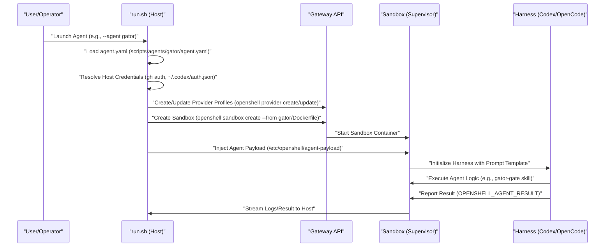

<!-- source: DeepWiki mcp.deepwiki.com · repo NVIDIA/OpenShell · page 10.7 Agent Launcher System (scripts/agents) · fetched 2026-10-26 -->

# Agent Launcher System (scripts/agents)

<details>
<summary>Relevant source files</summary>

The following files were used as context for generating this wiki page:

- [.agents/skills/launch-openshell-gator/SKILL.md](.agents/skills/launch-openshell-gator/SKILL.md)
- [scripts/agents/gator/Dockerfile](scripts/agents/gator/Dockerfile)
- [scripts/agents/gator/README.md](scripts/agents/gator/README.md)
- [scripts/agents/gator/agent.yaml](scripts/agents/gator/agent.yaml)
- [scripts/agents/gator/bin/gh](scripts/agents/gator/bin/gh)
- [scripts/agents/gator/bin/gh_guard_test.sh](scripts/agents/gator/bin/gh_guard_test.sh)
- [scripts/agents/gator/bin/review_feedback_ledger_test.sh](scripts/agents/gator/bin/review_feedback_ledger_test.sh)
- [scripts/agents/gator/prompts/gator.md](scripts/agents/gator/prompts/gator.md)
- [scripts/agents/gator/skills/gator-gate/SKILL.md](scripts/agents/gator/skills/gator-gate/SKILL.md)
- [scripts/agents/gator/skills/gator-gate/references/review-findings-schema.md](scripts/agents/gator/skills/gator-gate/references/review-findings-schema.md)
- [scripts/agents/run.sh](scripts/agents/run.sh)

</details>


The Agent Launcher System is a manifest-driven framework for deploying and supervising headless AI agents within OpenShell sandboxes. It provides a standardized way to package agents with specific prompt templates, security policies, provider credentials, and runtime behaviors.

## Overview

The system centers around the `run.sh` launcher script, which orchestrates the lifecycle of an agent from host-side preparation to in-sandbox execution. Agents are defined by an `agent.yaml` manifest located in subdirectories of `scripts/agents/` [scripts/agents/run.sh:159-171]().

### Core Components

| Component | Responsibility |
| :--- | :--- |
| **`run.sh`** | Host-side orchestrator. Parses manifests, injects credentials, builds/selects sandbox images, and launches the supervisor [scripts/agents/run.sh:30-50](). |
| **`agent.yaml`** | Declarative manifest defining the agent's ID, payload version, sandbox requirements, harness, providers, and skills [scripts/agents/gator/agent.yaml:4-94](). |
| **Supervisor** | In-sandbox process that manages the execution loop, handles poll intervals, and reports results [scripts/agents/gator/prompts/gator.md:22-25](). |
| **Harnesses** | Runtime adapters for specific LLM interfaces (e.g., `Codex`, `OpenCode`) [scripts/agents/gator/agent.yaml:15-20](). |
| **Skills** | Modular sets of instructions (Markdown) and supporting binaries injected into the agent's environment [scripts/agents/gator/agent.yaml:81-90]().

Sources: [scripts/agents/run.sh:1-171](), [scripts/agents/gator/agent.yaml:1-94](), [scripts/agents/gator/README.md:28-48]()

## Manifest Configuration (`agent.yaml`)

The `agent.yaml` file defines the identity and execution environment of the agent.

*   **`payload_version`**: An integer used to detect stale watchers. If the version on the default branch exceeds the sandbox's version, the agent must terminate [scripts/agents/gator/prompts/gator.md:16-20]().
*   **`sandbox`**: Specifies the name prefix and the image source (e.g., `agent://.` refers to the agent's own directory) [scripts/agents/gator/agent.yaml:9-13]().
*   **`harness`**: Defines the default LLM harness and supported models/reasoning levels [scripts/agents/gator/agent.yaml:15-20]().
*   **`runtime`**: Configures the run mode (`once` or `watch`) and polling intervals [scripts/agents/gator/agent.yaml:22-25]().
*   **`providers`**: Maps host-side credentials (e.g., `gh auth token`, `~/.codex/auth.json`) to environment variables inside the sandbox [scripts/agents/gator/agent.yaml:38-80]().
*   **`subagents`**: Defines secondary agents that can be dispatched by the primary agent for specialized tasks [scripts/agents/gator/agent.yaml:91-94]().

Sources: [scripts/agents/gator/agent.yaml:1-94](), [scripts/agents/gator/prompts/gator.md:16-20]()

## Data Flow: Host to Sandbox

The launcher bridges the "Natural Language Space" (user prompts) and "Code Entity Space" (sandboxes, providers, and harnesses) through a multi-stage injection process.

### Launcher Execution Flow
1.  **Parse Manifest**: `run.sh` uses a Ruby shim to parse `agent.yaml` and extract configuration [scripts/agents/run.sh:182-217]().
2.  **Provider Injection**: The launcher reads local credential files (like `auth.json`) and creates/updates provider profiles on the target gateway [scripts/agents/gator/README.md:32-37]().
3.  **Payload Baking**: Prompt templates, skills, and subagent manifests are rendered and copied into `/etc/openshell/agent-payload/` within the sandbox [scripts/agents/gator/README.md:22-28]().
4.  **Harness Initialization**: The selected harness (e.g., Codex) is started with the rendered `prompt_template` [scripts/agents/gator/README.md:44-46]().

### Diagram: Agent Launcher Data Flow

Sources: [scripts/agents/run.sh:159-217](), [scripts/agents/gator/README.md:22-48](), [scripts/agents/gator/agent.yaml:1-94]()

## Reference Implementation: Gator Agent

The **Gator Agent** is the reference implementation for the launcher system, designed to monitor and gate GitHub Pull Requests.

### Gator-Specific Components
*   **`gh` Wrapper**: A specialized binary at `scripts/agents/gator/bin/gh` that acts as a guard. It prevents duplicate comments for the same Head SHA and ensures that all gator dispositions include the `GATOR_MARKER` [scripts/agents/gator/bin/gh:9-10](). It also handles transient GitHub API failures and sub-agent failures gracefully [scripts/agents/gator/skills/gator-gate/SKILL.md:31-35](). The wrapper also contains logic to ignore legacy reviewer failure dispositions and draft-only blocker dispositions when a PR becomes ready for review [scripts/agents/gator/bin/gh:80-101]().
*   **`review-feedback-ledger`**: A tool that builds a tree-aware history of PR reviews, tracking resolved vs. open findings across different commits [scripts/agents/gator/README.md:32-33](). It processes GitHub GraphQL API data to identify review threads and comments [scripts/agents/gator/bin/review_feedback_ledger_test.sh:15-148]().
*   **`validate-review-findings`**: Enforces a strict JSON schema for code review findings, ensuring blockers have concrete evidence (reachability, impact, reproducer) [scripts/agents/gator/README.md:34-35](). The schema defines fields like `id`, `severity`, `invariant`, `sink`, `observable_impact`, and `reproducer` [scripts/agents/gator/skills/gator-gate/references/review-findings-schema.md:16-38]().
*   **`resolve-gator-review-threads`**: This binary allows a follow-up commit that fixes a Gator inline finding to resolve the corresponding Gator-owned GitHub review thread without affecting human review threads [scripts/agents/gator/README.md:47-49]().

### Subagent Dispatching
Gator utilizes the `principal-engineer-reviewer` subagent. The manifest maps this agent to the `REVIEWER_COMMAND` environment variable [scripts/agents/gator/agent.yaml:91-94](). The primary gator agent can then invoke this subagent to perform deterministic, bounded code reviews [scripts/agents/gator/prompts/gator.md:32-34](). This subagent is also used by the `create-spike` skill for deep codebase investigation.

### Diagram: Gator Review Logic
```mermaid
graph TD
    subgraph "Sandbox Environment"
        Supervisor["entrypoint.sh / Supervisor"]
        GatorSkill["gator-gate Skill (scripts/agents/gator/skills/gator-gate/SKILL.md)"]
        ReviewerSub["principal-engineer-reviewer (subagents/principal-engineer-reviewer.md)"]
        GHWrapper["gh Wrapper (scripts/agents/gator/bin/gh)"]
        Ledger["review-feedback-ledger (scripts/agents/gator/bin/review-feedback-ledger)"]
        Validation["validate-review-findings (scripts/agents/gator/bin/validate-review-findings)"]
        Resolver["resolve-gator-review-threads (scripts/agents/gator/bin/resolve-gator-review-threads)"]
    end

    Supervisor --> GatorSkill
    GatorSkill --> Ledger: "Query Review History"
    Ledger -- "Review History" --> GatorSkill
    GatorSkill -- "Dispatch REVIEWER_COMMAND" --> ReviewerSub: "Perform Code Review"
    ReviewerSub -- "JSON Findings" --> GatorSkill
    GatorSkill --> Validation: "Validate Findings Schema"
    Validation -- "Validated Findings" --> GatorSkill
    GatorSkill -- "Post Comment/Review" --> GHWrapper
    GHWrapper -- "Guard Duplicate Posts, Add Marker" --> GHAPI["GitHub API"]
    GatorSkill -- "Resolve Review Threads" --> Resolver
    Resolver -- "GraphQL Mutation" --> GHAPI
```
Sources: [scripts/agents/gator/agent.yaml:91-94](), [scripts/agents/gator/bin/gh:1-190](), [scripts/agents/gator/prompts/gator.md:31-36](), [scripts/agents/gator/README.md:32-35](), [scripts/agents/gator/skills/gator-gate/SKILL.md:31-35](), [scripts/agents/gator/bin/gh:80-101](), [scripts/agents/gator/bin/review_feedback_ledger_test.sh:15-148](), [scripts/agents/gator/skills/gator-gate/references/review-findings-schema.md:16-38](), [scripts/agents/gator/README.md:47-49]()

## Runtime Modes

The system supports two primary execution patterns defined in the `runtime` section of the manifest [scripts/agents/gator/agent.yaml:22-25]():

### 1. Once Mode (`--once`)
The harness runs a single reconciliation cycle and exits. The sandbox is typically destroyed after completion unless `--keep` is specified [scripts/agents/run.sh:113-115, 135-136]().

### 2. Watch Mode (`--watch`)
The supervisor keeps the sandbox alive and executes the harness in bounded cycles.
*   **Polling**: The supervisor sleeps for `poll_interval_seconds` between cycles [scripts/agents/gator/agent.yaml:24]().
*   **Result Sentinels**: The agent communicates status via a structured JSON line: `OPENSHELL_AGENT_RESULT {"status": "waiting", "next_poll_seconds": 900, "reason": "checks_pending"}` [scripts/agents/gator/prompts/gator.md:23-25]().
*   **Failure Handling**: Supports `max_transient_failures` before terminating the watcher [scripts/agents/gator/agent.yaml:25]().

Sources: [scripts/agents/run.sh:113-125](), [scripts/agents/gator/agent.yaml:22-25](), [scripts/agents/gator/prompts/gator.md:22-26]()

---

