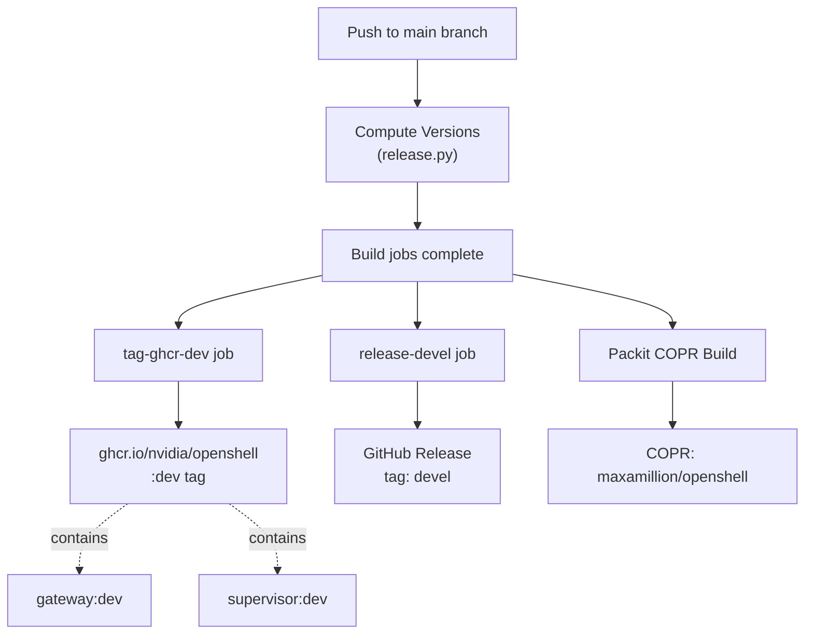
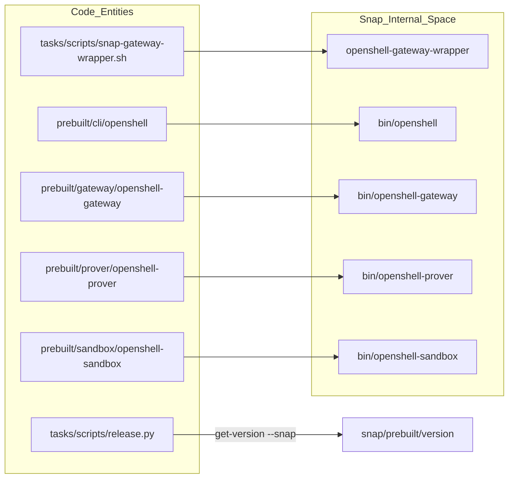
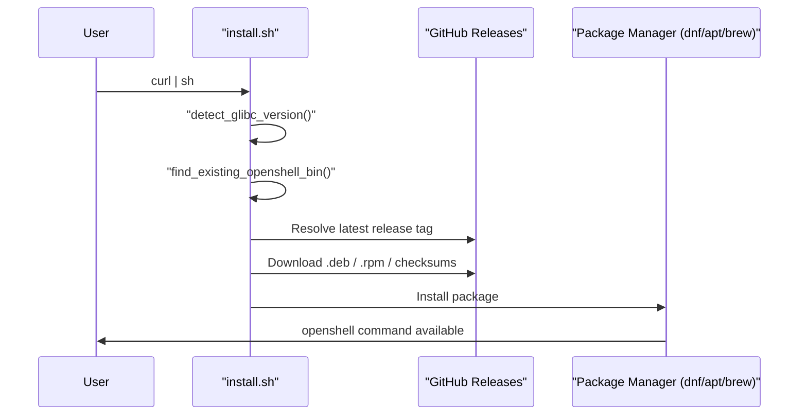

<!-- source: DeepWiki mcp.deepwiki.com · repo NVIDIA/OpenShell · page 13.3 Packaging and Distribution · fetched 2026-10-26 -->

# Packaging and Distribution

<details>
<summary>Relevant source files</summary>

The following files were used as context for generating this wiki page:

- [.github/actions/build-docker-image/action.yml](.github/actions/build-docker-image/action.yml)
- [.github/actions/release-helm-oci/action.yml](.github/actions/release-helm-oci/action.yml)
- [.github/actions/setup-buildx/action.yml](.github/actions/setup-buildx/action.yml)
- [.github/workflows/build-images.yml](.github/workflows/build-images.yml)
- [.github/workflows/build-rpm.yml](.github/workflows/build-rpm.yml)
- [.github/workflows/package-release-binaries.yml](.github/workflows/package-release-binaries.yml)
- [.github/workflows/rpm-package.yml](.github/workflows/rpm-package.yml)
- [.github/workflows/snap-package.yml](.github/workflows/snap-package.yml)
- [.packit.yaml](.packit.yaml)
- [LICENSE](LICENSE)
- [crates/openshell-cli/src/output.rs](crates/openshell-cli/src/output.rs)
- [deploy/deb/control.in](deploy/deb/control.in)
- [deploy/deb/control.in.license](deploy/deb/control.in.license)
- [deploy/deb/openshell-gateway.service](deploy/deb/openshell-gateway.service)
- [deploy/helm/openshell-workspace/templates/_helpers.tpl](deploy/helm/openshell-workspace/templates/_helpers.tpl)
- [deploy/rpm/CONFIGURATION.md](deploy/rpm/CONFIGURATION.md)
- [deploy/rpm/QUICKSTART.md](deploy/rpm/QUICKSTART.md)
- [deploy/rpm/TROUBLESHOOTING.md](deploy/rpm/TROUBLESHOOTING.md)
- [deploy/rpm/gateway.toml.default](deploy/rpm/gateway.toml.default)
- [docs/about/support-matrix.mdx](docs/about/support-matrix.mdx)
- [docs/how-it-works/policies/prover.mdx](docs/how-it-works/policies/prover.mdx)
- [e2e/kubernetes/openbao-tls-values.yaml](e2e/kubernetes/openbao-tls-values.yaml)
- [nix/test-guest/cache-seal.sh](nix/test-guest/cache-seal.sh)
- [nix/test-guest/configuration/snapd.yml](nix/test-guest/configuration/snapd.yml)
- [openshell.spec](openshell.spec)
- [scripts/keycloak-realm.json.license](scripts/keycloak-realm.json.license)
- [scripts/lint-mermaid/lint-mermaid.mjs](scripts/lint-mermaid/lint-mermaid.mjs)
- [scripts/update_license_headers.py](scripts/update_license_headers.py)

</details>


This page documents how OpenShell artifacts are published to distribution channels after successful builds and tests. Publishing covers Docker images to GHCR (GitHub Container Registry), binaries and wheels to GitHub Releases, and native Linux packages (RPM, Debian, and Snap).

## Overview

OpenShell publishes artifacts through multiple channels depending on the release type. The release system distinguishes between moving development builds (`:dev` tags and `devel` releases) and immutable stable releases (`:semver` tags and `v*.*.*` releases).

| Artifact Type | Development (`:dev`) | Stable (`:semver`) | Distribution Channel |
|---------------|---------------------|-------------------|---------------------|
| Docker images | `ghcr.io/nvidia/openshell/gateway:dev`<br/>`ghcr.io/nvidia/openshell/supervisor:dev` | `ghcr.io/nvidia/openshell/gateway:0.0.37`<br/>`ghcr.io/nvidia/openshell/latest` | GHCR (public) |
| CLI binaries | `devel` release | `v*.*.*` release | GitHub Releases |
| Python wheels | `devel` release | `v*.*.*` release | GitHub Releases |
| RPM Packages | COPR `main-commit` | COPR `release` | Fedora COPR / GitHub |
| Snap Packages | Edge channel | Stable channel | Snap Store |

**Publishing Workflow: Development Builds**



Sources: [.github/workflows/release-dev.yml:1-16](), [openshell.spec:15-19]()

## GHCR Image Publishing

Docker images are published to GHCR with different tagging strategies. Images are multi-platform manifests supporting `linux/amd64` and `linux/arm64`.

### Development and Stable Tags

The `tag-ghcr-dev` job in `release-dev.yml` creates a moving `:dev` tag pointing to the latest successful main-branch build [.github/workflows/build-images.yml:1-5](). The `tag-ghcr-release` job in `release-tag.yml` creates immutable version tags (e.g., `:0.0.37`) and updates the `:latest` pointer [not shown in provided content]().

The system uses `docker buildx imagetools create` to update tags without rebuilding the image, referencing the image by its `source_sha` or `github.sha` [.github/actions/setup-buildx/action.yml:25-31]().

```bash
# Example tagging logic from release-tag.yml
docker buildx imagetools create \
  --prefer-index=false \
  -t "${REGISTRY}/${component}:${VERSION}" \
  "${REGISTRY}/${component}:${SOURCE_TAG}"
```

Sources: [.github/actions/setup-buildx/action.yml:25-31](), [.github/workflows/build-images.yml:1-5]()

## Native Linux Packaging

OpenShell provides native packaging for major Linux distributions to simplify gateway deployment as a system service.

### RPM Packaging (Fedora/RHEL)

OpenShell uses an `openshell.spec` file and [Packit](https://packit.dev) for RPM distribution [.packit.yaml:4-10](). The package is split into several sub-packages:
- `openshell`: Contains the core CLI binary [openshell.spec:15-19]().
- `openshell-gateway`: Contains the gateway server and systemd user units [openshell.spec:49-53]().
- `openshell-prover`: Contains the standalone policy prover binary [openshell.spec:62-65]().
- `python3-openshell`: The Python SDK [openshell.spec:70-74]().

The RPM deployment is designed for rootless operation. On first start, the systemd unit `openshell-gateway.service` seeds a default configuration from `/usr/share/openshell-gateway/gateway.toml.default` to `~/.config/openshell/gateway.toml` [openshell.spec:121-124](), [deploy/rpm/CONFIGURATION.md:10-14](). The `build-rpm.yml` workflow uses Packit to build RPMs, downloading pre-built CLI and gateway binaries as inputs [.github/workflows/rpm-package.yml:34-48]().

The `openshell.spec` file also handles man page generation using `pandoc` [openshell.spec:33-34](), [openshell.spec:108-109]().

**RPM Package Build Process**

```mermaid
graph TD
    A[Source Code] --> B{Packit Configuration<br/>.packit.yaml};
    B --> C[RPM Spec File<br/>openshell.spec];
    C --> D[Pre-built Binaries<br/>(CLI, Gateway, Prover)];
    C --> E[Man Page Markdown<br/>deploy/man/*.md];
    C --> F[Default Gateway Config<br/>deploy/rpm/gateway.toml.default];
    C --> G[Systemd User Unit Template];

    D --"Installed to /usr/bin"--> H[openshell, openshell-gateway, openshell-prover];
    E --"Processed by pandoc"--> I[Man Pages];
    F --"Installed to /usr/share/openshell-gateway"--> J[gateway.toml.default];
    G --"Installed to ~/.config/openshell"--> K[openshell-gateway.service];

    subgraph "Packit Actions"
        B --"get-current-version"--> V[Version Determination];
        B --"create-archive"--> S0[Source0: openshell-VERSION.tar.gz];
        B --"create-archive"--> S1[Source1: openshell-VERSION-vendor.tar.xz];
        B --"fix-spec-file"--> C_patched[Patched openshell.spec];
    end

    subgraph "RPM Build"
        C_patched --> P[Package Build];
        S0 --> P;
        S1 --> P;
        H --> P;
        I --> P;
        J --> P;
        K --> P;
    end

    P --> RPM[RPM Packages];
    RPM --> COPR_REPO[Fedora COPR Repository];
```

Sources: [openshell.spec:15-19](), [openshell.spec:33-34](), [openshell.spec:49-53](), [openshell.spec:62-65](), [openshell.spec:70-74](), [openshell.spec:108-109](), [openshell.spec:121-124](), [.packit.yaml:4-10](), [.github/workflows/rpm-package.yml:34-48](), [deploy/rpm/CONFIGURATION.md:10-14]().

### Snap Packaging (Ubuntu/Universal)

The `snap-package.yml` workflow builds and publishes the OpenShell snap package. It takes `checkout-ref`, `upload-channel`, `github-environment`, and a `publish` flag as inputs [.github/workflows/snap-package.yml:8-23](). The workflow downloads pre-built CLI, gateway, and sandbox binaries from GitHub Actions artifacts [.github/workflows/snap-package.yml:86-109]() and places them into the `snap/prebuilt` directory [.github/workflows/snap-package.yml:123-127]().

The `snapcraft pack` command is then executed to build the snap package [.github/workflows/snap-package.yml:140-145](). If the `publish` input is true, the built snap is uploaded to the specified Snap Store channel using `snapcraft upload` [.github/workflows/snap-package.yml:177-194]().

**Snap Component Mapping**



The `snap-gateway-wrapper.sh` script is copied into the snap's `prebuilt` directory to act as a wrapper for the gateway binary [.github/workflows/snap-package.yml:129](). The snap version is determined by calling `tasks/scripts/release.py get-version --snap` and written to `snap/prebuilt/version` [.github/workflows/snap-package.yml:137]().

The `openshell-prover` binary is included in the snap package. For Snap installations, users should use `openshell.prover` instead of `openshell-prover` due to alias approval requirements [docs/how-it-works/policies/prover.mdx:39-42]().

Sources: [.github/workflows/snap-package.yml:8-23](), [.github/workflows/snap-package.yml:86-109](), [.github/workflows/snap-package.yml:123-127](), [.github/workflows/snap-package.yml:129](), [.github/workflows/snap-package.yml:137](), [.github/workflows/snap-package.yml:140-145](), [.github/workflows/snap-package.yml:177-194](), [docs/how-it-works/policies/prover.mdx:39-42]().

### Debian Packaging

Debian packages are built using a `control.in` template [deploy/deb/control.in:1-17](). The `control.in` file is patched with the correct version and architecture during the build process. The package includes the CLI, standalone policy prover, gateway daemon, and VM compute driver helper. It also installs a per-user systemd unit for the gateway, located under `/usr/lib/systemd/user/` [deploy/deb/control.in:10-17]().

The `openshell-gateway.service` unit for Debian is configured to run `openshell-gateway config preflight` and `openshell-gateway generate-certs` as `ExecStartPre` steps, similar to the RPM package [deploy/deb/openshell-gateway.service:14-15]().

Sources: [deploy/deb/control.in:1-17](), [deploy/deb/openshell-gateway.service:14-15]().

### Homebrew Formula

The Homebrew formula for OpenShell is not explicitly detailed in the provided files but is mentioned as a distribution channel. It would typically involve a Ruby script defining how to fetch, build, and install the OpenShell binaries on macOS and Linux.

Sources: [docs/how-it-works/policies/prover.mdx:63-65]()

## Helm OCI Charts

OpenShell publishes Helm charts to GHCR as OCI artifacts. The `release-helm-oci/action.yml` GitHub Action is responsible for this process.

The action logs into GHCR, installs Helm, stages the `openshell` gateway chart and `openshell-workspace` chart, patches their `Chart.yaml` with the correct `chart-version` and `app-version` inputs, and then packages and pushes them to `oci://ghcr.io/nvidia/openshell` [.github/actions/release-helm-oci/action.yml:36-65](), [.github/actions/release-helm-oci/action.yml:81-99]().

For public releases, a duplicate version guard prevents pushing an already existing chart version [.github/actions/release-helm-oci/action.yml:67-79](). Additionally, for development releases with a `pin-sha` input, a second chart is pushed with the version and appVersion set to the full commit SHA, allowing for exact version pinning alongside the floating `0.0.0-dev` tag [.github/actions/release-helm-oci/action.yml:101-121]().

**Helm OCI Chart Publishing Workflow**

```mermaid
graph TD
    A[Trigger Release Helm OCI Action] --> B{Login to GHCR};
    B --> C[Install Helm];
    C --> D[Stage Charts<br/>(openshell, openshell-workspace)];
    D --"Patch Chart.yaml"--> E[Update Chart Version<br/>and App Version];
    E --"If public release"--> F{Check for Duplicate OCI Version};
    F --"Duplicate found"--> G[Fail Action];
    F --"No duplicate"--> H[Package Helm Charts];
    H --> I[Push Charts to GHCR OCI];
    I --"If pin-sha provided"--> J[Push SHA-pinned Charts];
    J --> K[GHCR OCI Registry];
```

Sources: [.github/actions/release-helm-oci/action.yml:36-65](), [.github/actions/release-helm-oci/action.yml:67-79](), [.github/actions/release-helm-oci/action.yml:81-99](), [.github/actions/release-helm-oci/action.yml:101-121]().

## Man Pages

Man pages are generated from Markdown files using `pandoc` during the RPM build process [openshell.spec:33-34](), [openshell.spec:108-109](). This ensures that the CLI tools (`openshell`, `openshell-gateway`) have up-to-date documentation accessible via `man`.

Sources: [openshell.spec:33-34](), [openshell.spec:108-109]().

## SDK Package Publishing

The Python SDK is published as a wheel. The `openshell.spec` file defines a `python3-openshell` sub-package [openshell.spec:70-74]() and specifies `Recommends` for `python3-cloudpickle`, `python3-grpcio`, and `python3-protobuf` [openshell.spec:75-78](). These dependencies are recommended rather than required to allow for older distro packages to be overridden by `pip`/`uv` installations.

The Python SDK is also published to GitHub Releases as part of the `v*.*.*` and `devel` releases.

Sources: [openshell.spec:70-74](), [openshell.spec:75-78]().

## Driver VM Distribution

The `openshell-driver-vm` component requires specialized distribution because it embeds a custom Linux kernel and VMM (`libkrun`).

1.  **Kernel Build**: The `release-vm-kernel.yml` workflow builds `libkrunfw` (kernel firmware) and `libkrun` (VMM) [not shown in provided content](). The Linux kernel is compiled on `aarch64` Linux, and the resulting `kernel.c` is exported to macOS jobs to speed up Apple Silicon builds [not shown in provided content]().
2.  **Runtime Bundling**: These artifacts are uploaded to a rolling GitHub Release titled `vm-runtime` [not shown in provided content]().
3.  **Binary Embedding**: During the `openshell-driver-vm` build, the CI downloads these tarballs and embeds them into the final binary using `compress-vm-runtime.sh` and `build-supervisor-bundle.sh` [not shown in provided content]().

Sources: [nix/test-guest/cache-seal.sh:1-2]()

## Versioning Logic

Release versions are computed dynamically using `tasks/scripts/release.py`. The `compute-versions` job in release workflows ensures consistency across all build artifacts [not shown in provided content](). The `release.py` script defines a `Versions` dataclass to hold different version formats (Python, Cargo, NPM, Docker, DEB, Snap, RPM) [scripts/update_license_headers.py:21-34](). It uses Git tags to determine the base version and calculates development versions based on the distance from the latest tag [scripts/update_license_headers.py:109-148]().

| Context | Format Example | Command |
|---------|----------------|---------|
| Python | `0.0.37` | `release.py get-version --python` |
| Cargo | `0.0.37` | `release.py get-version --cargo` |
| RPM | `0.0.37` | `release.py get-version --rpm-version` |
| DEB | `0.0.37` | `release.py get-version --deb` |

Sources: [scripts/update_license_headers.py:21-34](), [scripts/update_license_headers.py:109-148](), [openshell.spec:5-10](), [.packit.yaml:19-24]().

## Distribution via install.sh

The `install.sh` script is the primary entry point for users. It detects the platform and fetches the appropriate package (DEB, RPM, or Homebrew).



Sources: [.github/workflows/package-release-binaries.yml:1-5]()

---

