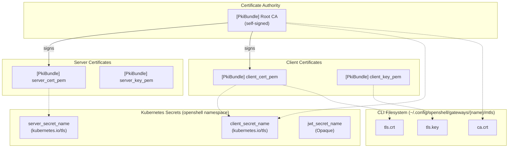
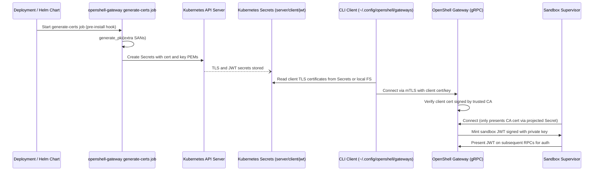

<!-- source: DeepWiki mcp.deepwiki.com · repo NVIDIA/OpenShell · page 5.4 PKI and TLS · fetched 2026-10-26 -->

# PKI and TLS

<details>
<summary>Relevant source files</summary>

The following files were used as context for generating this wiki page:

- [crates/openshell-bootstrap/Cargo.toml](crates/openshell-bootstrap/Cargo.toml)
- [crates/openshell-bootstrap/src/edge_token.rs](crates/openshell-bootstrap/src/edge_token.rs)
- [crates/openshell-bootstrap/src/lib.rs](crates/openshell-bootstrap/src/lib.rs)
- [crates/openshell-bootstrap/src/metadata.rs](crates/openshell-bootstrap/src/metadata.rs)
- [crates/openshell-bootstrap/src/mtls.rs](crates/openshell-bootstrap/src/mtls.rs)
- [crates/openshell-bootstrap/src/paths.rs](crates/openshell-bootstrap/src/paths.rs)
- [crates/openshell-bootstrap/src/pki.rs](crates/openshell-bootstrap/src/pki.rs)
- [crates/openshell-cli/src/tls.rs](crates/openshell-cli/src/tls.rs)
- [crates/openshell-core/src/paths.rs](crates/openshell-core/src/paths.rs)
- [crates/openshell-server/src/certgen.rs](crates/openshell-server/src/certgen.rs)
- [deploy/helm/openshell/skaffold.yaml](deploy/helm/openshell/skaffold.yaml)
- [deploy/helm/openshell/templates/cert-manager-pki.yaml](deploy/helm/openshell/templates/cert-manager-pki.yaml)
- [deploy/helm/openshell/templates/certgen.yaml](deploy/helm/openshell/templates/certgen.yaml)
- [docs/kubernetes/access-control.mdx](docs/kubernetes/access-control.mdx)
- [docs/kubernetes/managing-certificates.mdx](docs/kubernetes/managing-certificates.mdx)
- [docs/kubernetes/openshift.mdx](docs/kubernetes/openshift.mdx)

</details>


## Purpose and Scope

This page documents OpenShell's Public Key Infrastructure (PKI) and TLS certificate management system. It covers certificate generation, reconciliation, storage, and rotation for gateway authentication. It also describes authentication modes including mutual TLS (mTLS), OpenID Connect (OIDC), cert-manager integration in Kubernetes, and the internal sandbox JWT signing mechanism used for supervisor-to-gateway identity bootstrap.

---

## Certificate Architecture

OpenShell uses a tiered PKI to secure gateway communications. The default mode secures transport between the CLI, gateway, and sandbox supervisors using mTLS with certificates signed by an internal CA. 

Mutual TLS ensures endpoint identity verification. The sandbox supervisors authenticate the gateway using the CA certificate and authenticate to the gateway using sandbox JWTs signed by the gateway's JWT signing key.

### Gateway mTLS Hierarchy



- The root CA is self-signed and used internally.
- The server certificate authenticates the gateway TLS listener.
- The client certificate authorizes the CLI or supervisor clients.
- Kubernetes Secrets contain these artifacts for in-cluster operation.
- The CLI discovers TLS assets on the local filesystem for each gateway by default.

**Sources:** [crates/openshell-server/src/certgen.rs:4-19](), [crates/openshell-bootstrap/src/pki.rs:13-27]()

---

### Dual Certificate Architecture for cert-manager Integration

When integrating external PKI issuers (such as cert-manager ACME issuers), OpenShell supports a dual-certificate scheme:

| Certificate             | Purpose                                                    | Signed By                     |
|------------------------|------------------------------------------------------------|-------------------------------|
| Internal Server Cert   | Internal DNS/IP names for supervisor pods and services    | OpenShell-generated self-signed CA |
| External Server Cert   | Public DNS names for external clients                     | External CA via cert-manager or issuer |
| Client Cert           | Used by CLI clients for mTLS                              | OpenShell-generated CA        |

The gateway uses Server Name Indication (SNI) to present the appropriate certificate for incoming connections. Supervisors trust the internal cert verified by the OpenShell CA. CLI or external clients receive the externally signed certificate.

This allows leveraging public trusted CAs for external-facing gateways without exposing internal service names in publicly signed certs.

**Sources:** [deploy/helm/openshell/templates/cert-manager-pki.yaml:1-157](), [crates/openshell-bootstrap/src/pki.rs:32-45]()

---

## Certificate Generation and Bootstrapping

OpenShell bootstraps its PKI using the `generate-certs` subcommand of the `openshell-gateway` binary, implemented in `crates/openshell-server/src/certgen.rs`. The command supports multiple operation modes depending on the deployment environment.

### Deployment Modes

| Mode             | Trigger                          | Action                                                                                                           |
|------------------|---------------------------------|------------------------------------------------------------------------------------------------------------------|
| Kubernetes (full) | Default (in-cluster with no `jwt-only` flag) | Generates CA, server TLS secret, client TLS secret, and sandbox JWT signing secret as Kubernetes Secrets in the specified namespace. Also manages related ConfigMaps if backend TLS policy enabled. |
| JWT-only         | `--jwt-only` flag               | Creates only the JWT signing secret; used when cert-manager manages TLS certs externally.                       |
| Local            | `--output-dir <DIR>` flag       | Writes PEM certificates and keys to local filesystem in a stable layout. Includes client certs for CLI auto-discovery. |

The CLI and gateway rely on consistent PKI materials either locally (development or non-Kubernetes) or dynamically fetched in Kubernetes.

### Idempotency and State Reconciliation

The internal `decide_k8s` function checks the existence of server, client, and JWT secrets and returns an action:

- `SkipExists`: All secrets present; no changes needed.
- `CreateJwtOnly`: TLS secrets present but JWT secret missing; legacy upgrade path to create the JWT secret only.
- `CreateAll`: No secrets found; create full PKI.
- `PartialState`: Partially present state; error out to avoid inconsistent or incomplete deployment.

This behavior ensures safe incremental upgrades and cluster readiness without destroying valid keys unexpectedly.

```rust
fn decide_k8s(server_exists: bool, client_exists: bool, jwt_exists: bool) -> K8sAction {
    match (server_exists, client_exists, jwt_exists) {
        (true, true, true) => K8sAction::SkipExists,
        (true, true, false) => K8sAction::CreateJwtOnly,
        (false, false, false) => K8sAction::CreateAll,
        _ => K8sAction::PartialState,
    }
}
```

### Internal PKI Bundle Generation

`generate_pki` creates a full PKI bundle including:

- Self-signed root CA keypair.
- Server certificate with default and extra SANs.
- Client certificate for CLI with organizational fields.
- Ed25519 private key pair for JWT signing.

Certificate expiration is set to long-lived defaults suitable for ephemeral clusters.

```rust
pub fn generate_pki(extra_sans: &[String]) -> Result<PkiBundle> { ... }
```

### Local Mode (Filesystem) Bootstrapping

In `run_local`, the PEMs are written to the specified directory and to the CLI config directory for auto-discovery. File system permissions are set to restrict access.

### Kubernetes Mode (Secret Creation)

In `run_kubernetes`, Kubernetes API is used to:

- Create or update `kubernetes.io/tls` Secrets for the server and client certs.
- Create or update an `Opaque` Secret for JWT signing keys.
- Optionally create a `ConfigMap` for backend CA to support Envoy Gateway BackendTLSPolicy.

The client certs are projected only to CLI or client processes, sandbox supervisors only receive the CA.

---

## Cert-Manager Integration and Helm Support

The OpenShell Helm chart supports two major PKI provisioning modes:

| Mode               | Description                                                                                                                                             |
|--------------------|---------------------------------------------------------------------------------------------------------------------------------------------------------|
| Built-in PKI InitJob (default) | A Kubernetes Job runs the `generate-certs` command during install/upgrade, producing self-signed internal CA and certs.                            |
| cert-manager (recommended for production) | cert-manager manages CA and certificates lifecycle. The OpenShell Job runs in JWT-only mode to create sandbox JWT secrets. The chart includes manifests for Issuer and Certificate CRDs. |

Cert-manager support requires installation of its CRDs and controller separately.

### cert-manager Helm Templates

- Self-signed CA issuer and CA certificate.
- Internal server certificate signed by the private CA.
- Optionally an external certificate signed by a real issuer (e.g., ACME).
- Client certificate for CLI mTLS authentication.
- SNI-based certificate selection if external cert enabled.

The Helm job manifests run the gateway binary with `--jwt-only` to generate JWT secrets independently of TLS cert creation.

---

## Authentication Mechanisms Overview

OpenShell supports multiple authentication layers depending on deployment context:

| Mechanism       | Description                                                    | Usage Scenario                                         | Backing Artifacts                        |
|-----------------|----------------------------------------------------------------|-------------------------------------------------------|-----------------------------------------|
| Gateway mTLS    | CLI and supervisor authenticate via client certs against gateway CA | Local and Kubernetes deployments using mTLS client auth | Server & Client TLS certs, CA cert, stored in Secrets/FS |
| OIDC            | TLS with bearer tokens validated against an OIDC issuer       | Multi-user shared gateways, cloud native environments | OIDC issuer URL stored in GatewayMetadata |
| Edge Auth JWT   | Edge reverse proxy injects JWT bearer tokens                   | Shared environments using edge proxies (e.g. Cloudflare)| Edge token stored and injected by CLI interceptor |
| Sandbox JWTs    | Gateway issues JWTs for supervisor to authenticate RPC calls   | Supervisor-to-gateway identity validation             | JWT signing key stored in Secret         |

### Gateway mTLS

- Certificates are located by the CLI in `$XDG_CONFIG_HOME/openshell/gateways/{gateway_name}/mtls/` by default.
- The client certificate and key are required for CLI-to-gateway mTLS.
- The server certificate SANs include localhost, cluster service names, and internal docker/podman host aliases.
- Mutual TLS client cert verification can be disabled for OIDC deployments.

### OIDC Authentication

When enabled via the gateway configuration, the gateway validates bearer tokens from an OpenID Connect issuer:

- OIDC parameters, including `issuer`, `audience`, and scopes, are configured in gateway metadata.
- The CLI stores OIDC tokens securely in per-gateway config files.
- The gateway validates JWT tokens via JWKS endpoints of the issuer.
- OIDC supports role-based access control by inspection of claims.

### Edge Token Auth

For gateways behind edge reverse proxies, bearer tokens issued by the proxy are injected into gRPC requests. The CLI `EdgeAuthInterceptor` manages token injection and bypasses mTLS client cert usage.

### Sandbox JWTs

- The gateway uses a dedicated Ed25519 private key to mint JWTs per sandbox.
- Supervisors authenticate RPCs presenting sandbox JWTs, which the gateway verifies using the public key.
- JWT signing key pairs are stored in the Kubernetes secret alongside TLS secrets or generated locally.

---

## Implementation Details: Code-to-Entity Mapping

The following diagram maps abstract PKI and TLS concepts to concrete code entities in OpenShell:

```mermaid
classDiagram
    class CertgenArgs {
        +Option<PathBuf> output_dir
        +Option<String> namespace
        +bool jwt_only
        +Vec<String> server_sans
        +Option<String> server_secret_name
        +Option<String> client_secret_name
        +Option<String> jwt_secret_name
    }
    class PkiBundle {
        +String ca_cert_pem
        +String server_cert_pem
        +String server_key_pem
        +String client_cert_pem
        +String client_key_pem
        +String jwt_signing_key_pem
        +String jwt_public_key_pem
        +String jwt_key_id
    }
    class GatewayMetadata {
        +String name
        +String gateway_endpoint
        +Option<String> auth_mode
        +Option<String> oidc_issuer
        +Option<String> edge_team_domain
        +Option<String> oidc_audience
    }
    class TlsOptions {
        +Option<PathBuf> ca
        +Option<PathBuf> cert
        +Option<PathBuf> key
        +Option<String> edge_token
        +Option<String> oidc_token
        +bool gateway_insecure
    }
    class OidcToken {
        +String access_token
        +Option<String> refresh_token
        +Option<u64> expiry
    }

    CertgenArgs ..> PkiBundle : "generate_pki()"
    CertgenArgs ..> "run_kubernetes, run_local" : "Modes of execution"
    PkiBundle ..> CertgenArgs : "Used to create Secrets or PEM files"
    GatewayMetadata ..> TlsOptions : "coeff config for TLS and auth mode"
    GatewayMetadata ..> OidcToken : "stores OIDC tokens"
    TlsOptions ..> TlsOptions : "with_default_paths(server) resolves FS location"
```

---

## Key Functions and Classes

| Entity               | Location                                      | Role                                                                                  |
|----------------------|-----------------------------------------------|---------------------------------------------------------------------------------------|
| `generate_pki`       | [crates/openshell-bootstrap/src/pki.rs:55-134]() | Core PKI bundle generation with self-signed CA and certs including JWT signing key   |
| `run` (certgen)      | [crates/openshell-server/src/certgen.rs:110-134]() | Entrypoint for `generate-certs` CLI, dispatches local or Kubernetes output modes      |
| `run_local`           | [crates/openshell-server/src/certgen.rs:124-167]() | Writes certificates and keys to local FS, configures CLI auto-discovery               |
| `run_kubernetes`      | [crates/openshell-server/src/certgen.rs:156-560]() | Creates and reconciles Kubernetes Secrets and ConfigMaps for TLS and JWT              |
| `GatewayMetadata`    | [crates/openshell-bootstrap/src/metadata.rs:13-74]() | Stores CLI gateway info: endpoint, auth_mode, OIDC config, and connection parameters  |
| `TlsOptions`         | [crates/openshell-cli/src/tls.rs:29-106]()          | CLI TLS config: file paths, tokens, and cert resolution                               |
| `OidcToken`          | [crates/openshell-bootstrap/src/oidc_token.rs:4-40]() | Manages OIDC access and refresh tokens with secure persistence                        |
| `EdgeAuthInterceptor`| [crates/openshell-core/src/auth.rs]                    | gRPC client interceptor for injecting edge bearer tokens                            |

---

# End-to-End mTLS Client Bootstrap Data Flow

This diagram illustrates the lifecycle from PKI generation to client (CLI or supervisor) connection authenticated with certificates:



This flow shows how TLS secrets are provisioned, used by local clients for secure connection, and how sandbox supervisors authenticate with JWTs minted by the gateway instead of client certificates.

---

# Summary

OpenShell's PKI and TLS system provides strong security for all internal and external communication channels using:

- Automatic generation of a custom, self-signed CA PKI bundle.
- Kubernetes Secrets or local filesystem PEM storage, with clear idempotency and upgrade paths.
- Support for cert-manager integration during Kubernetes deployment for production-grade certificate lifecycle management.
- Multiple authentication mechanisms: mTLS primary for CLI and sandbox supervisors, OIDC for user access, and token injection for edge proxies.
- JWT signing keys for sandbox identity issuance for supervisor RPC authentication.
- Extensive CLI and gateway code handling certificate discovery, TLS configuration, and token management.

This design ensures secure, manageable gateway deployment in diverse environments from local testing to cloud-native production clusters.

---

**Sources:**

- [crates/openshell-server/src/certgen.rs:4-167]()

- [crates/openshell-bootstrap/src/pki.rs:13-177]()

- [crates/openshell-bootstrap/src/metadata.rs:13-74]()

- [crates/openshell-bootstrap/src/oidc_token.rs:4-40]()

- [crates/openshell-cli/src/tls.rs:29-197]()

- [deploy/helm/openshell/templates/cert-manager-pki.yaml:1-157]()

---

