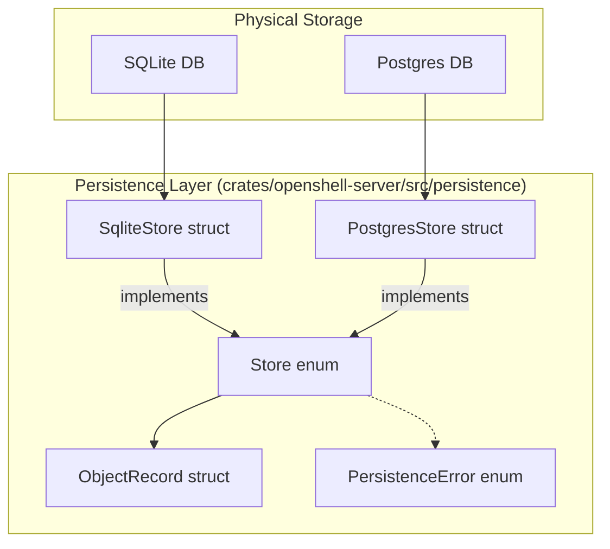
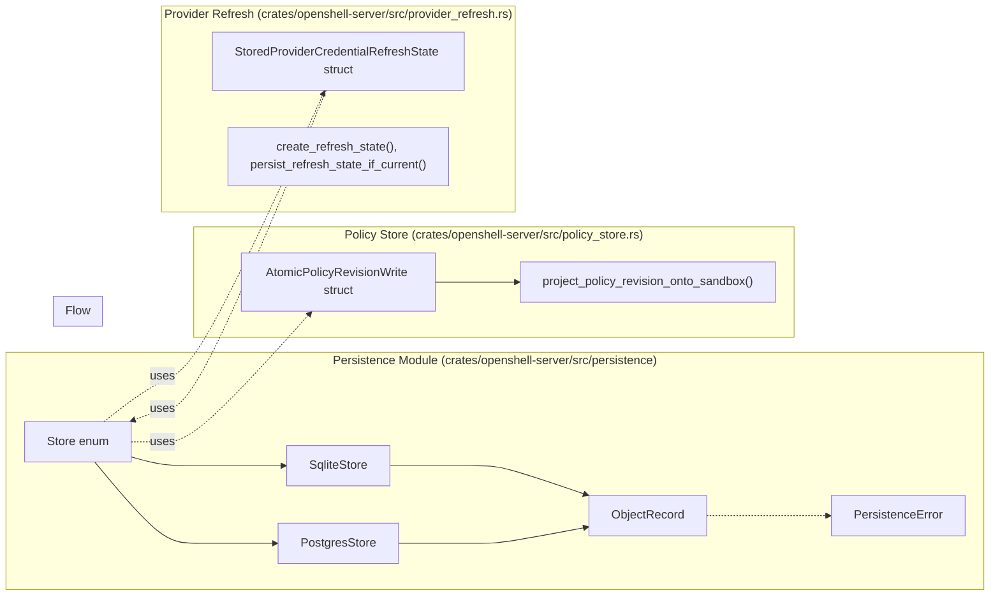

<!-- source: DeepWiki mcp.deepwiki.com · repo NVIDIA/OpenShell · page 5.6 Server Persistence Layer · fetched 2026-10-26 -->

# Server Persistence Layer

<details>
<summary>Relevant source files</summary>

The following files were used as context for generating this wiki page:

- [crates/openshell-server/src/multiplex.rs](crates/openshell-server/src/multiplex.rs)
- [crates/openshell-server/src/persistence/mod.rs](crates/openshell-server/src/persistence/mod.rs)
- [crates/openshell-server/src/persistence/postgres.rs](crates/openshell-server/src/persistence/postgres.rs)
- [crates/openshell-server/src/persistence/sqlite.rs](crates/openshell-server/src/persistence/sqlite.rs)
- [crates/openshell-server/src/persistence/tests.rs](crates/openshell-server/src/persistence/tests.rs)
- [crates/openshell-server/src/policy_store.rs](crates/openshell-server/src/policy_store.rs)
- [crates/openshell-server/src/provider_refresh.rs](crates/openshell-server/src/provider_refresh.rs)
- [docs/about/run-your-first-agent.mdx](docs/about/run-your-first-agent.mdx)
- [docs/how-it-works/policies/advisor.mdx](docs/how-it-works/policies/advisor.mdx)

</details>


The Server Persistence Layer manages the durable storage of OpenShell gateway state, including sandbox metadata, provider credentials, system settings, and security policies. It provides a unified `Store` abstraction to interact with the underlying database, transparently supporting both SQLite and PostgreSQL backends. This layer implements optimistic concurrency control, supports migrations, and includes specialized persistence for policy revisions and provider credential refresh state. Additionally, it maintains an in-memory index cache for sandbox lookups to optimize performance under load.

## Architecture Overview

At the heart of the persistence layer is the `Store` enum, which dispatches calls to either `SqliteStore` or `PostgresStore` implementations, chosen based on configuration [crates/openshell-server/src/persistence/mod.rs:194-198](). The server initializes one global `Store` instance and shares it across gRPC services via the `ServerState`.



Sources: [crates/openshell-server/src/persistence/mod.rs:194-198](), [crates/openshell-server/src/persistence/sqlite.rs:42-50](), [crates/openshell-server/src/persistence/postgres.rs:34-36]()

## The Store Abstraction

The `Store` trait abstracts common CRUD operations over a unified `objects` table, which stores diverse resources distinguished by their `object_type`. Key fields include `id`, `name`, `workspace`, and the protobuf-encoded `payload`. Metadata such as `created_at_ms`, `updated_at_ms`, labels (as JSON), and an optimistic concurrency `resource_version` are also managed [crates/openshell-server/src/persistence/mod.rs:97-111]().  

Operations support filtering by workspace or labels, pagination using keyset cursors, and atomic conditional writes (compare-and-swap semantics).

### Write Conditions and Concurrency Control

The persistence layer uses the `WriteCondition` enum to control write semantics [crates/openshell-server/src/persistence/mod.rs:175-183]():

- `MustCreate` ensures insertion succeeds only if the object does not yet exist; useful for leader leases or exclusive claims.
- `MatchResourceVersion(u64)` performs updates only if the current version matches the supplied one, preventing lost update races.
- `Unconditional` performs upsert semantics without version checks.

Conflicts or unique violations are returned as `PersistenceError::Conflict` or `PersistenceError::UniqueViolation`, respectively. Expected conflicts (e.g., losing a `MustCreate` race) are not marked as errors in tracing spans to avoid noise during normal concurrency [crates/openshell-server/src/persistence/mod.rs:52-61](), [crates/openshell-server/src/persistence/tests.rs:14-76]().

### Backend Support

OpenShell supports two primary database backends, configurable via the database URL scheme:

- **SQLite**: Used by default for local or single-node deployments. Supports in-memory mode for testing, and automatically hardens on-disk database files to be owner-only permission-restricted (0o600) for security [crates/openshell-server/src/persistence/sqlite.rs:39-50](). To optimize performance under heavy write loads (e.g., SSH session token minting), it employs WAL journaling with synchronous=FULL for critical writes, and a relaxed synchronous=NORMAL pool for less critical writes [crates/openshell-server/src/persistence/sqlite.rs:79-134]().

- **PostgreSQL**: Recommended for production and multi-replica setups. Utilizes a connection pool with configurable max connections (default 10). Supports advisory locks to serialize cross-object mutations safely [crates/openshell-server/src/persistence/postgres.rs:33-135]().

## Data Flow and Entity Model

The persistence layer converts between raw database records and Protobuf messages used in server logic. Objects stored include sandboxes, policies, providers, and credential refresh states.

```mermaid
graph LR
    subgraph PersistenceDB
        ObjectsTable["objects table"]
    end

    subgraph PersistenceEntities(crates/openshell-server/src/persistence)
        ObjectRecord["ObjectRecord (raw DB record)"]
        PolicyRecord["PolicyRecord (stored_policy_revision)"]
        DraftChunkRecord["DraftChunkRecord (stored_draft_chunk)"]
    end

    subgraph PolicyStoreLogic(crates/openshell-server/src/policy_store.rs)
        AtomicPolicyRevisionWrite["AtomicPolicyRevisionWrite (atomic policy write)"]
        ProjectPolicyRevision["project_policy_revision_onto_sandbox()"]
    end

    ObjectsTable --> ObjectRecord
    ObjectRecord -->|typed as| PolicyRecord
    ObjectRecord -->|typed as| DraftChunkRecord
    AtomicPolicyRevisionWrite --> PolicyRecord
    AtomicPolicyRevisionWrite --> ProjectPolicyRevision
    ProjectPolicyRevision --> PolicyRecord
```

Each stored object contains a protobuf-encoded payload. The policy store adds semantics for atomic writes that project annotations onto sandbox metadata atomically and maintain policy versioning consistency. The draft system supports incremental policy changes proposed by agents [crates/openshell-server/src/policy_store.rs:12-136]().

Sources: [crates/openshell-server/src/persistence/mod.rs:97-111](), [crates/openshell-server/src/persistence/mod.rs:206-219](), [crates/openshell-server/src/policy_store.rs:4-136]()

## Database Migrations

Schema migrations are embedded and run automatically on server startup to evolve the database layout.

- **SQLite migrations** are located in the `./migrations/sqlite` directory and embedded via `SQLITE_MIGRATOR` [crates/openshell-server/src/persistence/sqlite.rs:28-36]().
- **Postgres migrations** reside in `./migrations/postgres` and are embedded via `POSTGRES_MIGRATOR` [crates/openshell-server/src/persistence/postgres.rs:21-29]().

Migrations include data transformations such as legacy time field updates applied within transaction blocks and guarded by advisory locks (Postgres) or serialized via application logic (SQLite) to prevent conflicts [crates/openshell-server/src/persistence/sqlite.rs:74-133](), [crates/openshell-server/src/persistence/postgres.rs:66-108]().

## Policy Store

The `PolicyStoreExt` trait extends the base store with specialized methods for managing sandbox security policies and draft chunks [crates/openshell-server/src/policy_store.rs:137-196](). 

Key features:
- Atomic creation of policy revisions, projecting annotations onto sandbox metadata with optional backfilling of the initial static policy.
- Pagination and retrieval of policies by version.
- Updating policy loading status and superseding older policies.
- Managing draft policy chunks applied incrementally and evaluated before committing.

These abstractions enable the policy subsystem to safely manage evolving security declarations tied to sandboxes.

## Provider Credential Refresh State Persistence

To manage the lifecycle of dynamic credentials tied to providers (e.g., OAuth tokens), the persistence layer stores refresh states as first-class objects [crates/openshell-server/src/provider_refresh.rs:4-45]().

Highlights include:
- Refresh states are scoped by the provider ID to isolate namespace and avoid cross-contamination.
- Names for refresh objects encode the provider ID and credential keys (hex-encoded) for uniqueness.
- Updates use version-matching semantics to avoid race conditions in concurrent refresh operations.
- Functions support listing all refresh states keyed by provider, creating new refresh states atomically, and replacing only if the current version matches [crates/openshell-server/src/provider_refresh.rs:95-173]().

This persistence design ensures continuous, secure credential rotation in high-availability scenarios.

## Sandbox Index Cache

The server maintains an in-memory `SandboxIndex` to cache frequently accessed sandbox metadata. This index reduces database load and accelerates operations like gRPC log streaming and policy evaluation by avoiding repeated DB reads.

The cache tracks sandbox state grouped by workspace and sandbox ID, exposing fast lookups and event-driven updates to maintain consistency between in-memory and persisted state.

---

# Summary Diagram

This overview diagram depicts key system names mapped to their main code entities, bridging natural language concepts with concrete Rust types and modules.



Sources:  
- [crates/openshell-server/src/persistence/mod.rs:42-134,194-212]()  
- [crates/openshell-server/src/persistence/sqlite.rs:28-165]()  
- [crates/openshell-server/src/persistence/postgres.rs:21-135]()  
- [crates/openshell-server/src/policy_store.rs:4-196]()  
- [crates/openshell-server/src/provider_refresh.rs:4-188]()

---

The Server Persistence Layer is critical for the correctness, data integrity, and scalability of the OpenShell gateway, supporting both lightweight development setups and production-ready highly available clusters via robust backends, migrations, and concurrency control.

---

