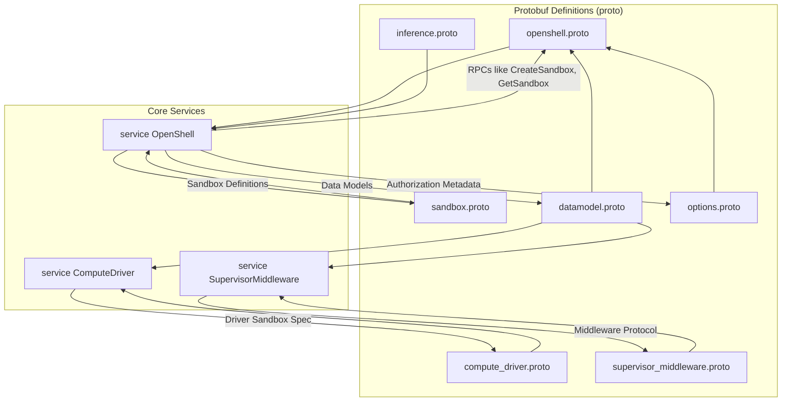
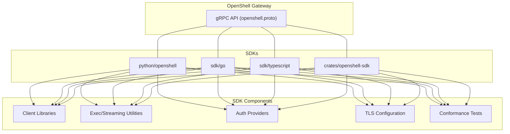

<!-- source: DeepWiki mcp.deepwiki.com · repo NVIDIA/OpenShell · page 9 APIs, SDKs and Extensibility · fetched 2026-10-26 -->

# APIs, SDKs and Extensibility

Relevant source files

The following files were used as context for generating this wiki page:

- [crates/openshell-cli/src/main.rs](crates/openshell-cli/src/main.rs)
- [crates/openshell-cli/src/run.rs](crates/openshell-cli/src/run.rs)
- [crates/openshell-cli/tests/provider_commands_integration.rs](crates/openshell-cli/tests/provider_commands_integration.rs)
- [crates/openshell-cli/tests/sandbox_create_lifecycle_integration.rs](crates/openshell-cli/tests/sandbox_create_lifecycle_integration.rs)
- [crates/openshell-server/src/compute/mod.rs](crates/openshell-server/src/compute/mod.rs)
- [crates/openshell-server/src/grpc/policy.rs](crates/openshell-server/src/grpc/policy.rs)
- [crates/openshell-server/src/grpc/provider.rs](crates/openshell-server/src/grpc/provider.rs)
- [crates/openshell-server/src/grpc/sandbox.rs](crates/openshell-server/src/grpc/sandbox.rs)
- [crates/openshell-server/src/storage_proto.rs](crates/openshell-server/src/storage_proto.rs)
- [proto/openshell.proto](proto/openshell.proto)
- [sdk/go/proto/openshellv1/openshell.pb.go](sdk/go/proto/openshellv1/openshell.pb.go)

This page provides a high-level overview of OpenShell's API surface, the available Software Development Kits (SDKs), and various extension points within the system. OpenShell is designed to be extensible, allowing users to integrate with existing systems and build custom functionalities. This page serves as a guide to understanding these interfaces and how they fit into the overall architecture. Detailed technical information for each topic is provided in dedicated child pages.

## gRPC API and Protobuf Definitions

OpenShell exposes its core functionalities through a gRPC API. This API is defined using Protocol Buffers (Protobuf), which provides a language-agnostic, efficient, and extensible format for serializing structured data. The Protobuf definitions are the canonical source of truth for the API, specifying the services, RPC methods, and data structures used for communication between clients and the OpenShell gateway. These definitions include core types like `Sandbox`, `Provider`, and `Policy`, as well as specialized definitions for compute drivers, supervisor middleware, inference, and data models. The API also incorporates authorization metadata to control access to various RPCs and includes mechanisms for compatibility checks.

For details, see [gRPC API and Protobuf Definitions](#9.1).

### OpenShell Protobuf Definitions

Sources: [proto/openshell.proto:1-14](), [proto/openshell.proto:23-29](), [proto/openshell.proto:48-54]()

## Python, Go, TypeScript and Rust SDKs

To facilitate interaction with the OpenShell gateway, official SDKs are provided for several popular programming languages: Python, Go, TypeScript, and Rust. These SDKs wrap the gRPC API, offering idiomatic client libraries that simplify common tasks such as creating and managing sandboxes, executing commands, and streaming output. The SDKs handle the underlying gRPC communication, authentication, and TLS configuration, allowing developers to focus on their application logic. They also include utilities for managing authentication providers and conformance tests to ensure compatibility.

For details, see [Python, Go, TypeScript and Rust SDKs](#9.2).

### SDKs and their Core Components

Sources: [sdk/go/proto/openshellv1/openshell.pb.go:10-13](), [crates/openshell-cli/src/run.rs:40](), [crates/openshell-cli/src/main.rs:21]()

## Gateway Interceptors

Gateway interceptors provide a powerful mechanism to extend and customize the behavior of the OpenShell gateway at the gRPC request level. These interceptors can be configured to perform various actions, such as validating incoming requests, injecting JWT extension tokens for enhanced authorization, enforcing failure and binding policies, and sourcing provider profiles. An example of a gateway interceptor is the `governance-interceptor`, which can be used to implement custom governance logic.

For details, see [Gateway Interceptors](#9.3).

## Supervisor Middleware

The supervisor middleware chain allows for deep customization of sandbox behavior. This chain consists of a series of middleware components that process requests and responses within the sandbox environment. The middleware protocol defines how these components interact, supporting both remote and built-in middleware. This extensibility enables advanced features like custom header manipulation, WebSocket handling, and content-guarding, as demonstrated by the `content-guard` example.

For details, see [Supervisor Middleware](#9.4).

---

