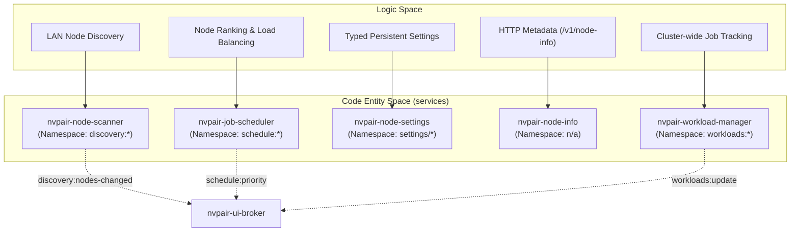
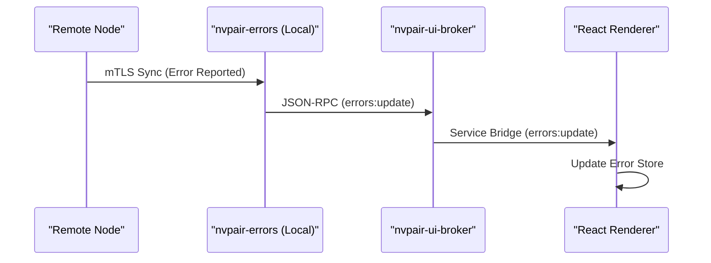

<!-- source: DeepWiki mcp.deepwiki.com · repo NVIDIA/Personal-AI-Router · page 3.5 Supporting Services — Scanner, Scheduler, Workloads, Errors, Settings · fetched 2026-10-26 -->

# Supporting Services — Scanner, Scheduler, Workloads, Errors, Settings

Relevant source files

The following files were used as context for generating this wiki page:

- [AGENTS.md](AGENTS.md)
- [desktop/docs/architecture.md](desktop/docs/architecture.md)
- [desktop/docs/services-api.md](desktop/docs/services-api.md)
- [desktop/docs/services-backend.md](desktop/docs/services-backend.md)

This section details the supporting Go services that provide the control plane and operational backbone of the Personal AI Router (PAIR). These workers are supervised by `nvpair-ui-broker` and communicate via newline-delimited JSON-RPC 2.0 over `stdio` [desktop/docs/architecture.md:34-42](). While the proxies and engine manager handle the heavy lifting of inference and model lifecycle, these services manage discovery, telemetry-based scheduling, global error state, and persistent node configuration.

### System Entity Map: Code to Logic

The following diagram bridges the logical system names to their specific Go implementations and JSON-RPC namespaces.

**Entity Association Diagram**

**Sources:** [desktop/docs/architecture.md:42-56](), [desktop/docs/services-api.md:147-153](), [desktop/docs/services-backend.md:21-34]()

---

### 1. nvpair-node-scanner
The scanner is the only **required** worker for the broker to function [AGENTS.md:38-39](). It manages the lifecycle of node discovery on the local network.

*   **mDNS Discovery:** It advertises and browses for `_nvpair-node._tcp` records [desktop/docs/overview.md:2.2]().
*   **SO_REUSEADDR:** The scanner utilizes `SO_REUSEADDR` to ensure multiple instances or rapid restarts do not lead to port bind failures during mDNS operations.
*   **Node Enrichment:** Once a node is discovered via mDNS, the scanner fetches rich metadata (GPU inventory, model lists) via HTTP to "enrich" the node record before notifying the broker [desktop/docs/overview.md:2.2]().
*   **Eviction:** It maintains the liveness state of discovered nodes, triggering `nodes:remove` notifications when nodes disappear from the network or fail heartbeats [desktop/docs/services-backend.md:119]().

**Sources:** [desktop/docs/architecture.md:47](), [desktop/docs/services-backend.md:26](), [desktop/docs/services-api.md:153]()

---

### 2. nvpair-job-scheduler
The scheduler provides the intelligence for cluster-wide routing by calculating the optimal node for a given request.

*   **Ranking Algorithm:** The scheduler ranks nodes based on a combination of factors:
    1.  **Model Availability:** Does the node have the requested model loaded?
    2.  **Pending Work:** How many active jobs are currently assigned to the node?
    3.  **GPU Pressure:** A normalized value (0–3) representing VRAM and compute utilization [desktop/docs/overview.md:2.4]().
*   **Telemetry Smoothing:** To prevent "thundering herd" issues where all requests rush to a newly idle node, the scheduler applies smoothing to telemetry updates, ensuring that rapid fluctuations in GPU usage don't cause unstable routing [desktop/docs/overview.md:2.4]().
*   **JSON-RPC Surface:** Handles `discovery:nodes-changed` to update its internal routing table and emits `schedule:priority` notifications to inform the proxies of the new ranking [desktop/docs/services-api.md:147-153]().

**Sources:** [desktop/docs/architecture.md:55](), [desktop/docs/services-api.md:147-153](), [desktop/docs/services-backend.md:34]()

---

### 3. nvpair-node-info
Unlike other services, `nvpair-node-info` primarily serves as an HTTP endpoint rather than a JSON-RPC heavy worker.

*   **Endpoint:** It exposes `/v1/node-info` on the node's management port [desktop/docs/overview.md:3.5]().
*   **Data Flow:**
    1.  Electron main polls this endpoint every 2 seconds for the local node and all discovered peers [desktop/docs/architecture.md:130-134]().
    2.  The response includes CPU, Memory, and detailed GPU/VRAM metrics.
    3.  Electron merges this data into the `metrics:update` store for UI rendering [desktop/docs/services-backend.md:102-109]().
*   **Failure Policy:** If the endpoint is unreachable, the poller backs off exponentially (4s, 8s, 16s, up to 30s) [desktop/docs/architecture.md:132-134]().

**Sources:** [desktop/docs/architecture.md:48](), [desktop/docs/services-backend.md:27](), [desktop/docs/services-backend.md:102-109]()

---

### 4. nvpair-node-settings
This service acts as a typed key-value store for node-specific persistence.

*   **Storage:** It persists settings to the local filesystem (e.g., `nvpair.json`).
*   **Typed Keys:** It manages settings such as:
    *   `settings/get-cluster-auto-sync`: Boolean for automatic cluster configuration syncing [desktop/docs/services-api.md:31]().
    *   `settings/get-force-ports`: Overrides for default engine/proxy ports [desktop/docs/services-api.md:32]().
*   **Node Identity:** It is responsible for persisting the stable UUID-based identity of the node, ensuring that identity remains consistent across restarts [desktop/docs/overview.md:2.2]().

**Sources:** [desktop/docs/architecture.md:51](), [desktop/docs/services-api.md:31-34](), [desktop/docs/services-backend.md:31]()

---

### 5. nvpair-workload-manager & nvpair-errors
These services synchronize transient operational state across the cluster.

| Service | Responsibility | Key Implementation Detail |
| :--- | :--- | :--- |
| **nvpair-workload-manager** | Cluster-wide workload relay | Aggregates local job starts/stops and broadcasts them so the UI shows activity across all nodes [desktop/docs/architecture.md:49](). |
| **nvpair-errors** | Error datastore + Sync | Maintains a registry of recent system errors. It synchronizes these errors between peers so a failure on a remote node is visible in the local UI [desktop/docs/architecture.md:54](). |
| **nvpair-manual-nodes** | User-added nodes | Manages nodes added manually by IP/Hostname. It performs a liveness probe every 10 seconds to validate connectivity [desktop/docs/overview.md:3.5](). |

**Workload & Error Data Flow**

**Sources:** [desktop/docs/architecture.md:54](), [desktop/docs/services-api.md:137-146](), [desktop/docs/services-backend.md:30]()

---
**Sources:**
- [AGENTS.md:34-42]()
- [desktop/docs/architecture.md:34-56]()
- [desktop/docs/architecture.md:130-134]()
- [desktop/docs/services-api.md:31-44]()
- [desktop/docs/services-api.md:137-153]()
- [desktop/docs/services-backend.md:21-34]()
- [desktop/docs/services-backend.md:102-119]()

---

