# Page: NVIDIA Personal AI Router (PAIR) — Overview

# NVIDIA Personal AI Router (PAIR) — Overview

<details>
<summary>Relevant source files</summary>

The following files were used as context for generating this wiki page:

- [.github/ISSUE_TEMPLATE/bug.yml](.github/ISSUE_TEMPLATE/bug.yml)
- [AGENTS.md](AGENTS.md)
- [README.md](README.md)
- [assets/pair-demo.gif](assets/pair-demo.gif)
- [assets/pair-demo.mp4](assets/pair-demo.mp4)

</details>


NVIDIA Personal AI Router (PAIR) is a local inference router designed for a group of compatible computers on the same network. It discovers participating nodes, manages supported inference engines (Ollama and LM Studio), and presents unified Ollama-compatible and OpenAI-compatible proxy endpoints to applications and agents [README.md:11-16]().

PAIR is optimized for concurrent local workloads, such as multi-agent applications, ensuring that prompts and responses remain on the local network when all configured components are local [README.md:18-20]().

> **Note:** PAIR routes independent requests to individual nodes. It does **not** pool GPU memory, shard single models across machines, or split a single in-flight inference request between nodes [README.md:22-24]().

## Key Capabilities

*   **Discovery:** Automatically finds other PAIR nodes on the network using mDNS [AGENTS.md:36-37]().
*   **Engine Management:** Installs and supervises engines like Ollama and LM Studio [README.md:102-105]().
*   **Intelligent Routing:** Directs requests based on model availability and current GPU pressure [README.md:15-16]().
*   **Secure Pairing:** Establishes trust between nodes using EAP-NOOB and a six-digit PIN for mutual TLS (mTLS) communication [AGENTS.md:117-118]().

## System Entities and Vocabulary

The PAIR ecosystem is defined by several core entities that map directly to services and data structures in the codebase:

| Entity | Description | Code Reference |
| :--- | :--- | :--- |
| **Node** | A single computer running PAIR. | `NodeRec` in [services/shared/noderec/noderec.go]() |
| **Cluster** | A group of trusted Nodes paired via PIN. | `nvpair-cluster-manager` in [services/cluster-manager/]() |
| **Engine** | An inference provider (e.g., Ollama, LM Studio). | `Engine` in [services/engine-manager/]() |
| **Model** | An AI model managed by an Engine. | `Model` in [services/engine-manager/]() |
| **Proxy** | The entry point for client API requests. | `ollama-proxy` / `lmstudio-proxy` |
| **Job** | An active inference request being routed. | `nvpair-job-scheduler` in [services/job-scheduler/]() |
| **Broker** | The central supervisor for all Go workers. | `nvpair-ui-broker` in [services/ui-broker/]() |

For a complete list of terms, see [Core Concepts and Vocabulary](#1.2).

## High-Level Architecture

PAIR uses a multi-process architecture where an Electron desktop application acts as a client to a tree of Go-based services [AGENTS.md:27-31]().

### Process Relationship Diagram
This diagram shows how the user-facing application connects to the underlying system entities.

```mermaid
graph TD
    subgraph "Desktop Space (TypeScript/Electron)"
        UI["React Renderer"] -- "window.pairApi" --> MB["ModularSupervisor (Electron Main)"]
    end

    subgraph "Service Space (Go)"
        MB -- "JSON-RPC (stdio)" --> Broker["nvpair-ui-broker"]
        Broker -- "Supervises" --> Scanner["nvpair-node-scanner"]
        Broker -- "Supervises" --> EngineMgr["nvpair-engine-manager"]
        Broker -- "Supervises" --> Proxies["Inference Proxies (Ollama/LM Studio)"]
        Broker -- "Supervises" --> ClusterMgr["nvpair-cluster-manager"]
    end

    Proxies -- "Routes to" --> RemoteNode["Remote PAIR Node (mTLS)"]
    EngineMgr -- "Controls" --> LocalEngine["Local Engine (Ollama/LM Studio)"]

    Sources: [AGENTS.md:35-42](), [desktop/src/electron/index.ts]()
```

### Request Flow Diagram
This diagram bridges the "Natural Language" intent of a user to the specific "Code Entities" that handle the request.

```mermaid
graph LR
    Client["'curl /v1/chat/completions'"] --> Proxy["ollama-proxy (Go)"]
    Proxy --> Scheduler["nvpair-job-scheduler (Go)"]
    
    subgraph "Routing Logic"
        Scheduler -- "Check Capacity" --> NodeList["Discovery Store"]
        NodeList -- "Selects" --> TargetNode["Target NodeID"]
    end

    TargetNode --> Transport["mTLS Client (shared/clustertrust)"]
    Transport --> Remote["Remote Node Port 14321"]

    Sources: [README.md:128-132](), [AGENTS.md:36-37](), [services/shared/clustertrust/]()
```

## Supported Platforms and Engines

PAIR supports a cross-platform environment, allowing different OS types to participate in the same cluster [README.md:40]().

*   **Operating Systems:** Windows 11, Linux (Debian/Ubuntu), macOS [README.md:37]().
*   **Architectures:** x64 and arm64 [README.md:38]().
*   **Engines:** Ollama and LM Studio [README.md:41]().

> **Important:** PAIR manages engines, but the engine's hardware requirements (GPU, VRAM) are independent of PAIR [README.md:43-50]().

## Documentation Map

*   **[Getting Started](#1.1)**: Installation, initial setup, pairing nodes, and running your first inference.
*   **[Core Concepts and Vocabulary](#1.2)**: Deep dive into the terminology and conceptual model of the system.
*   **System Architecture**: Detailed breakdown of the process model, discovery mechanisms, and security boundaries.
*   **Backend Services (Go)**: Technical details on the 13 Go binaries that power the routing engine.
*   **Desktop Application**: Overview of the Electron/React frontend and the service bridge.
*   **Operations and Diagnostics**: How to use `nvpair-tui` for headless nodes and collect sanitized logs.

---
**Sources:**
* [README.md:1-155]()
* [AGENTS.md:1-150]()
* [.github/ISSUE_TEMPLATE/bug.yml:24-38]()

---

# Page: Getting Started

# Getting Started

<details>
<summary>Relevant source files</summary>

The following files were used as context for generating this wiki page:

- [README.md](README.md)
- [desktop/scripts/build/installer.nsh](desktop/scripts/build/installer.nsh)
- [desktop/scripts/build/linux/after-install.sh](desktop/scripts/build/linux/after-install.sh)
- [desktop/scripts/build/linux/after-remove.sh](desktop/scripts/build/linux/after-remove.sh)
- [desktop/scripts/build/macos/uninstall.sh](desktop/scripts/build/macos/uninstall.sh)

</details>


The NVIDIA Personal AI Router (PAIR) is a local inference router designed to orchestrate LLM workloads across multiple machines on a local network. This guide provides the technical steps to install, configure, and perform the first inference across a PAIR cluster.

## Installation and Setup

PAIR is distributed as a multi-process Electron application. The installation process sets up the `nvpair-ui-broker` and its associated worker services, configures local firewall rules, and establishes the application data directories.

### Platform-Specific Installation

| Platform | Installer Type | Post-Install Actions |
| :--- | :--- | :--- |
| **Windows** | `.exe` (NSIS) | Sets up firewall rules for `localsubnet` [desktop/scripts/build/installer.nsh:112-121](). |
| **Linux** | `.deb` (Debian) | Installs `nvpair-tui` launcher to `/usr/bin` and configures AppArmor [desktop/scripts/build/linux/after-install.sh:27-71](). |
| **macOS** | `.dmg` | Registers `com.nvidia.nvpair.helper` for firewall management [desktop/scripts/build/macos/uninstall.sh:83-95](). |

**Linux Installation:**
```bash
sudo apt install ./NVPAIR-Setup-*.deb
```
The Debian installer creates a wrapper at `/usr/bin/nvpair` that points to the bundled Terminal UI (TUI) binary [desktop/scripts/build/linux/after-install.sh:27-32]().

**Sources:** [README.md:81-88](), [desktop/scripts/build/installer.nsh:11-33](), [desktop/scripts/build/linux/after-install.sh:1-78](), [desktop/scripts/build/macos/uninstall.sh:1-131]()

---

## First-Run and Engine Lifecycle

Upon launch, the Electron main process initializes the `ModularSupervisor`, which spawns the `nvpair-ui-broker` [README.md:98-100](). The broker then manages the lifecycle of inference engines via the `nvpair-engine-manager`.

### 1. Engine Installation
Users can install supported engines (Ollama or LM Studio) directly through the UI. The `nvpair-engine-manager` handles the binary download and environment setup [README.md:102-107]().

### 2. Model Management
Once an engine is running, models can be added. PAIR tracks model availability across the cluster to inform the `nvpair-job-scheduler` [README.md:109-113]().

### 3. Verification via Test Traffic
PAIR includes an internal synthetic traffic generator. Selecting **Test** in **Settings → Service** triggers `inference-dispatcher` to send requests through the local proxy to verify the end-to-end data flow [README.md:117-121]().

**Sources:** [README.md:98-121]()

---

## Cluster Pairing

PAIR uses the **EAP-NOOB** (Extensible Authentication Protocol - Nimble Out-of-Band) protocol to establish trust between nodes using a six-digit PIN.

### Pairing Flow Logic
1.  **Discovery**: Nodes advertise their presence via mDNS (`_nvpair-node._tcp`).
2.  **Invitation**: One node sends a cluster invitation to a discovered peer.
3.  **Authentication**: A 6-digit PIN is displayed on one machine and must be entered on the other.
4.  **Identity**: The `nvpair-cluster-manager` exchanges self-signed certificates to establish mTLS for all subsequent node-to-node communication.

### Implementation Diagram: Node Pairing
The following diagram illustrates the interaction between the UI and the backend Go services during the pairing process.

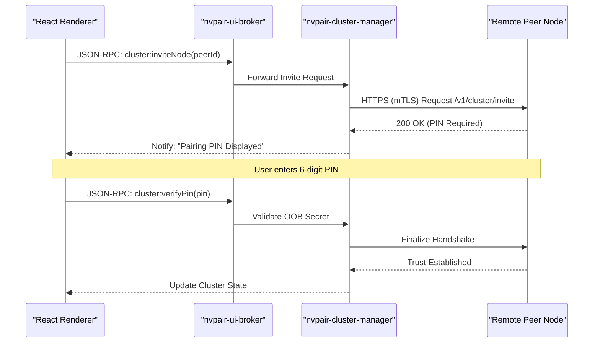
**Sources:** [README.md:155]() (Referencing cluster pairing concepts)

---

## Sending Your First Inference

PAIR exposes proxies that are compatible with Ollama and OpenAI API specifications. By default, these proxies listen on loopback interfaces to receive local application traffic.

### Inference Request Data Flow
When a `curl` request is sent to the proxy, the following sequence occurs:
1.  **Ingress**: `ollama-proxy` or `lmstudio-proxy` receives the HTTP request [README.md:129-132]().
2.  **Scheduling**: The proxy queries `nvpair-job-scheduler` for the best available node that has the requested model loaded.
3.  **Routing**: The request is forwarded to the selected node (either local via plaintext or remote via mTLS).
4.  **Execution**: The target engine (e.g., Ollama) processes the inference.

### Example Request
```bash
curl http://127.0.0.1:11434/v1/chat/completions \
  -H "Content-Type: application/json" \
  -d '{
    "model": "qwen4:12b",
    "messages": [{"role": "user", "content": "In one sentence, what does a router do?"}]
  }'
```

### Code-to-System Mapping: Inference Path
This diagram maps the logical request path to the specific Go binaries and internal communication methods.

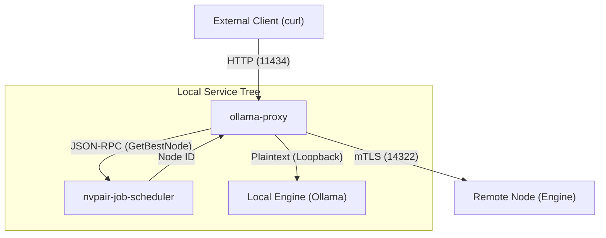

**Sources:** [README.md:129-153]()

---

## Uninstalling and Resetting Data

PAIR maintains application data (settings, certificates, logs) in platform-specific directories.

### Data Locations
*   **Windows**: `%LOCALAPPDATA%\Nvidia Corporation\Personal AI Router` [desktop/scripts/build/installer.nsh:60]().
*   **Linux**: `~/.config/Nvidia Corporation/Personal AI Router` [desktop/scripts/build/linux/after-remove.sh:72]().
*   **macOS**: `~/Library/Application Support/Nvidia Corporation/Personal AI Router` [desktop/scripts/build/macos/uninstall.sh:115]().

### Resetting App Data
To perform a "factory reset" without uninstalling the application:
1.  Close PAIR and all associated `nvpair-*` processes [desktop/scripts/build/installer.nsh:11-31]().
2.  Delete the directories listed above.
3.  Restart the application.

### Uninstallation Commands
*   **Windows**: Use "Add or Remove Programs". The uninstaller provides an option to remove user data [desktop/scripts/build/installer.nsh:67-76]().
*   **Linux**: 
    *   `sudo apt remove nvpair`: Removes binaries, keeps data.
    *   `sudo apt purge nvpair`: Removes binaries and wipes per-user data [desktop/scripts/build/linux/after-remove.sh:54-80]().
*   **macOS**: Drag the app to the Trash, or run the provided script with `--purge`:
    ```bash
    sudo /Applications/PAIR.app/Contents/Resources/installer-tools/uninstall-macos.sh --purge
    ```

**Sources:** [desktop/scripts/build/installer.nsh:11-110](), [desktop/scripts/build/linux/after-remove.sh:1-82](), [desktop/scripts/build/macos/uninstall.sh:1-131]()

---

# Page: Core Concepts and Vocabulary

# Core Concepts and Vocabulary

<details>
<summary>Relevant source files</summary>

The following files were used as context for generating this wiki page:

- [.github/ISSUE_TEMPLATE/bug.yml](.github/ISSUE_TEMPLATE/bug.yml)
- [.github/ISSUE_TEMPLATE/feature.yml](.github/ISSUE_TEMPLATE/feature.yml)
- [AGENTS.md](AGENTS.md)
- [CONTRIBUTING.md](CONTRIBUTING.md)

</details>


This page defines the domain terms and technical entities used throughout the NVIDIA Personal AI Router (PAIR) codebase. Understanding these concepts is essential for navigating the multi-process architecture and the interactions between the Electron frontend and Go backend services.

## System Entities

### Node
A **Node** represents a single instance of the PAIR application running on a machine. Each node is uniquely identified by a UUID generated at first run and persisted in the local settings [services/nvpair-ui-broker/README.md:12-15](). A node can function as both a client (sending inference requests) and a worker (hosting engines to fulfill requests).

### Cluster
A **Cluster** is a logical grouping of trusted nodes that have completed the pairing process. Nodes in a cluster share their model inventories and can route inference workloads to one another via mutual TLS (mTLS) [docs/architecture.mdx:145-150](). Cluster membership is managed by the `nvpair-cluster-manager` [AGENTS.md:36-39]().

### Engine
An **Engine** is a local LLM inference server that PAIR manages or interacts with. The two primary supported engines are **Ollama** and **LM Studio** [AGENTS.md:112-114](). The `nvpair-engine-manager` is responsible for the lifecycle (start, stop, install) of these engines [AGENTS.md:36-39]().

### Model
A **Model** refers to a specific LLM (e.g., `llama3:8b`) hosted by an Engine. PAIR tracks model availability across the cluster to make routing decisions. The system distinguishes between "Local Models" (on the current node) and "Cluster Models" (available on paired peers).

## Networking and Security

### Discovery
The process by which nodes find each other on a local area network (LAN). This is implemented using **mDNS** (Multicast DNS) via the `nvpair-node-scanner` worker, which advertises and browses for the `_nvpair-node._tcp` service record [AGENTS.md:38-39]().

### Pairing and PIN
**Pairing** is the workflow for establishing a secure, trusted relationship between two nodes. It uses the **EAP-NOOB** (Extensible Authentication Protocol - Nimble Out-of-Band) protocol, which involves a six-digit **PIN** displayed on one machine and entered on the other to prevent Man-in-the-Middle (MitM) attacks [docs/architecture.mdx:145-150]().

### mTLS (Mutual TLS)
Once paired, all node-to-node communication (control signals and inference traffic) is encrypted and authenticated using **mTLS**. Each node generates its own self-signed certificate, and the exchange of these certificates during pairing forms the basis of the cluster's trust [docs/architecture.mdx:145-150]().

### Proxy
A **Proxy** is a PAIR service that intercepts standard LLM API requests (e.g., Ollama or OpenAI formats) and routes them to the appropriate node in the cluster.
*   **Ollama Proxy**: Listens on port 11434.
*   **LM Studio Proxy**: Listens on port 1234.
These proxies allow existing tools to use the PAIR cluster without modification [AGENTS.md:36-39]().

## Workload Management

### Job / Workload
A **Job** (or Workload) represents a single inference request traveling through the system. The `nvpair-workload-manager` tracks the state of these jobs across the cluster for telemetry and UI updates [AGENTS.md:36-39]().

### Scheduler
The **Scheduler** (`nvpair-job-scheduler`) is the brain of the routing logic. When a proxy receives a request, the scheduler ranks available nodes based on:
1.  Model availability.
2.  Current GPU pressure.
3.  Pending job counts.
It then selects the optimal node to handle the request [AGENTS.md:36-39]().

### Broker and Worker
PAIR uses a supervision model:
*   **Broker**: The `nvpair-ui-broker` is the central orchestrator. It is the only process started directly by Electron [AGENTS.md:35-36]().
*   **Worker**: The broker spawns and supervises 11 specialized Go binaries (workers) such as the `scanner`, `scheduler`, and `proxies` [AGENTS.md:36-39]().

## Conceptual Mapping

### Natural Language to Code Entity Space: System Hierarchy
This diagram maps high-level concepts to the specific Go modules and Electron components that implement them.

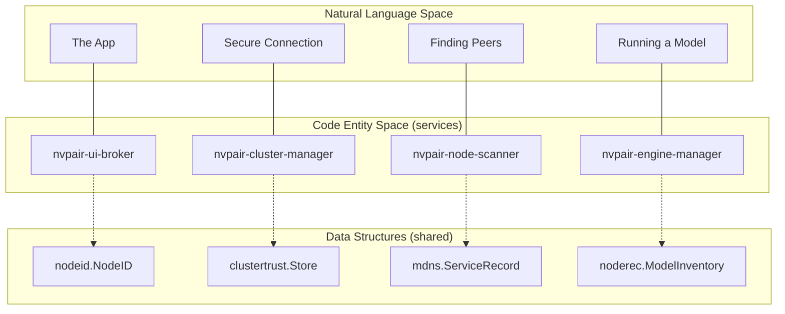
**Sources:** [AGENTS.md:35-42](), [CONTRIBUTING.md:190-200]()

### Request Flow: Code Entity Mapping
This diagram shows how a "Request" (Natural Language) maps to specific code paths and JSON-RPC methods during execution.

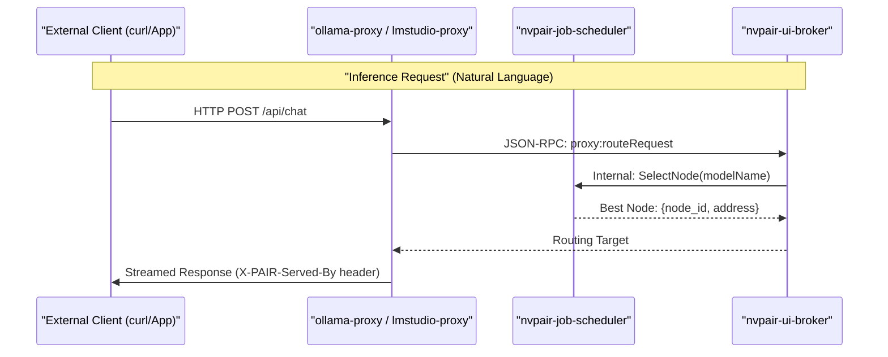
**Sources:** [AGENTS.md:117-128](), [CONTRIBUTING.md:190-200]()

## Summary Table of Components

| Term | Implementation | Role |
| :--- | :--- | :--- |
| **Broker** | `nvpair-ui-broker` | Process supervisor and JSON-RPC hub [AGENTS.md:35-36](). |
| **Scanner** | `nvpair-node-scanner` | mDNS discovery and node heartbeat [AGENTS.md:38-39](). |
| **Cluster Mgr** | `nvpair-cluster-manager` | EAP-NOOB pairing and mTLS identity [AGENTS.md:36-39](). |
| **Scheduler** | `nvpair-job-scheduler` | Load balancing and node selection [AGENTS.md:36-39](). |
| **TUI** | `nvpair-tui` | Terminal-based management interface [AGENTS.md:40-40](). |
| **Shared** | `services/shared/` | Common logic for IPC, logging, and types [AGENTS.md:76-77](). |

**Sources:**
* [AGENTS.md:9-45]()
* [AGENTS.md:73-89]()
* [CONTRIBUTING.md:8-10]()
* [CONTRIBUTING.md:177-203]()
* [docs/architecture.mdx:145-150]() (referenced via context)

---

# Page: System Architecture

# System Architecture

<details>
<summary>Relevant source files</summary>

The following files were used as context for generating this wiki page:

- [AGENTS.md](AGENTS.md)
- [CONTRIBUTING.md](CONTRIBUTING.md)
- [desktop/docs/architecture.md](desktop/docs/architecture.md)
- [desktop/docs/services-backend.md](desktop/docs/services-backend.md)

</details>


The NVIDIA Personal AI Router (PAIR) utilizes a multi-process, multi-layer architecture designed to decouple the user interface from the high-performance Go-based routing and inference logic. The system is split into two primary trees: `desktop/` (Electron/React) and `services/` (Go) [AGENTS.md:16-25]().

## Core Architectural Layers

PAIR's architecture is organized into four distinct layers that separate concerns from the UI down to the network transport:

1.  **UI Layer (Renderer):** A React application running in an Electron renderer process. It communicates exclusively through a typed bridge and never connects directly to backend workers [desktop/docs/architecture.md:8-11]().
2.  **Orchestration Layer (Electron Main):** Manages the lifecycle of the backend processes via the `ModularSupervisor` and handles JSON-RPC communication [desktop/docs/architecture.md:20-22]().
3.  **Control Plane (Go Workers):** A tree of specialized Go services supervised by `nvpair-ui-broker`. These handle discovery, pairing, scheduling, and engine management [desktop/docs/services-backend.md:18-19]().
4.  **Data Plane (Inference Proxies):** High-throughput HTTP proxies (`ollama-proxy`, `lmstudio-proxy`) that route inference traffic across the local network using mTLS for peer-to-peer security [desktop/docs/services-backend.md:24-25]().

### Process Hierarchy and Supervision

Electron acts as the root of the process tree but delegates all domain logic to the Go services. The `ModularSupervisor` in Electron Main is responsible for spawning exactly one backend binary: `nvpair-ui-broker` [AGENTS.md:35-37](). The broker then acts as a sidecar supervisor for the rest of the worker tree.

**System Process Map**
```mermaid
flowchart TD
    subgraph ["Electron Process (GUI)"]
        [src/electron/index.ts] --> ["ModularSupervisor"]
        ["ModularSupervisor"] --> ["JsonRpcSubprocess"]
    end

    subgraph ["Control Plane (Go)"]
        ["JsonRpcSubprocess"] <-->|"stdio JSON-RPC 2.0"| Broker["nvpair-ui-broker"]
        Broker --> Scanner["nvpair-node-scanner"]
        Broker --> Cluster["nvpair-cluster-manager"]
        Broker --> Engines["nvpair-engine-manager"]
        Broker --> Scheduler["nvpair-job-scheduler"]
        Broker --> Settings["nvpair-node-settings"]
    end

    subgraph ["Data Plane (HTTP)"]
        Broker --> OProxy["ollama-proxy"]
        Broker --> LMProxy["lmstudio-proxy"]
    end

    style Broker stroke-width:4px
```
Sources: [desktop/docs/architecture.md:15-32](), [desktop/docs/services-backend.md:42-68](), [AGENTS.md:35-42]()

## Communication Patterns

PAIR distinguishes between **Control Traffic** (how the app is managed) and **Inference Traffic** (how AI models are queried).

### Control Traffic (JSON-RPC)
The control plane uses newline-delimited JSON-RPC 2.0.
*   **Internal IPC:** Electron communicates with the `nvpair-ui-broker` over `stdio` [desktop/docs/architecture.md:105-110]().
*   **Service Bridge:** The renderer uses `window.pairApi` to send commands. These are routed through Electron Main to the broker, which relays them to the specific worker (e.g., `engine:install-model`) [desktop/docs/architecture.md:64-75]().
*   **State Flow:** PAIR follows a "commands down, events up" model. Results are not typically returned in the command response; instead, workers emit notifications (e.g., `engines:state-changed`) that update the UI's `ModularBridgeState` [desktop/docs/architecture.md:136-154]().

### Inference Traffic (HTTP)
Inference requests from client tools (like `curl` or a web UI) bypass the Electron process entirely for performance.
*   **Local Ingress:** Clients connect to local ports (e.g., 11434 for Ollama) in plaintext [desktop/docs/architecture.md:45]().
*   **Peer-to-Peer:** When a request is routed to a remote node, the proxy upgrades the connection to mTLS on port 14321 [desktop/docs/services-backend.md:24-25]().

For details, see [Node-to-Node Transport and Port Map](#2.5).

## Subsystem Overviews

### Process Model and IPC
The system maintains a strict hierarchy where `nvpair-ui-broker` manages up to 11 workers. If a worker fails, the broker handles the restart policy, while Electron monitors the broker's health via an `app:ready` handshake [desktop/docs/architecture.md:112-120]().
For details, see [Process Model and IPC](#2.1).

### Discovery and Node Identity
Nodes identify themselves using a stable UUID and advertise their presence on the local network via mDNS (`_nvpair-node._tcp`). The `nvpair-node-scanner` handles both advertising the local node and browsing for peers [desktop/docs/services-backend.md:26]().
For details, see [Discovery and Node Identity](#2.2).

### Cluster Pairing and Trust
Trust between nodes is established through an out-of-band (OOB) six-digit PIN using the EAP-NOOB protocol. Once paired, nodes exchange self-signed certificates to facilitate secure mTLS communication [desktop/docs/services-backend.md:33]().
For details, see [Cluster Pairing and Trust](#2.3).

### Inference Routing and Scheduling
The `nvpair-job-scheduler` maintains a real-time view of cluster health and GPU pressure. When a proxy receives a request, it asks the scheduler for the best available node that possesses the required model and capability [desktop/docs/services-backend.md:34]().
For details, see [Inference Routing and Scheduling](#2.4).

**Inference Request Flow**
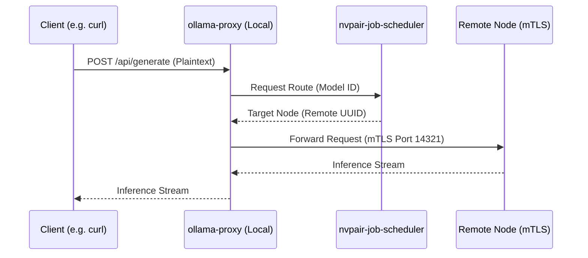
Sources: [desktop/docs/architecture.md:45-55](), [desktop/docs/services-backend.md:24-34]()

---

# Page: Process Model and IPC

# Process Model and IPC

<details>
<summary>Relevant source files</summary>

The following files were used as context for generating this wiki page:

- [AGENTS.md](AGENTS.md)
- [desktop/src/electron/connector/broker-crash-notification.ts](desktop/src/electron/connector/broker-crash-notification.ts)
- [desktop/src/electron/connector/index.ts](desktop/src/electron/connector/index.ts)
- [desktop/src/electron/globals.ts](desktop/src/electron/globals.ts)
- [desktop/src/electron/index.ts](desktop/src/electron/index.ts)
- [desktop/src/electron/ipc/service-bridge.ipc.ts](desktop/src/electron/ipc/service-bridge.ipc.ts)
- [desktop/src/electron/ipc/service.ipc.ts](desktop/src/electron/ipc/service.ipc.ts)

</details>


NVIDIA Personal AI Router (PAIR) utilizes a multi-process architecture to separate the Electron-based user interface from the high-performance Go-based routing and inference services. This model ensures that the UI remains responsive while the backend handles complex networking, scheduling, and engine management tasks.

## Process Hierarchy and Supervision

The system follows a strict hierarchical tree where the Electron main process acts as the root supervisor for the backend services.

### Hierarchy Overview
1.  **Electron Main Process**: The entry point of the application. It manages the application lifecycle and window management [desktop/src/electron/index.ts:10-26]().
2.  **ModularSupervisor**: A singleton within the Electron main process that manages the lifecycle of the primary backend service [desktop/src/electron/service-bridge/modular-supervisor.ts]().
3.  **nvpair-ui-broker**: The master service process. It is the only Go binary spawned directly by Electron [AGENTS.md:35-35]().
4.  **Worker Services (11 total)**: The broker supervises 11 specialized worker processes that handle discovery, proxies, engines, and more [AGENTS.md:36-39]().

### The nvpair-tui Exception
The `nvpair-tui` (Terminal User Interface) is a standalone binary. When executed, it spawns its own internal broker and worker tree rather than connecting to an existing one. It is designed for headless environments and must not be run simultaneously with the Electron desktop application [AGENTS.md:40-40]().

### Process Map: Code to Entity
The following diagram maps the logical system components to their corresponding implementation classes and binary names.

**Process Entity Mapping**
```mermaid
graph TD
    subgraph "Renderer Space (Web)"
        ["window.pairApi"] -- "IPC Invoke" --> ["service-bridge:invoke"]
    end

    subgraph "Main Process Space (Node.js)"
        ["Electron Main"] --> ["ModularSupervisor"]
        ["ModularSupervisor"] -- "Spawns" --> ["nvpair-ui-broker"]
        ["JsonRpcSubprocess"] -- "Wraps" --> ["nvpair-ui-broker"]
    end

    subgraph "Backend Space (Go)"
        ["nvpair-ui-broker"] -- "Supervises" --> W1["nvpair-node-scanner"]
        ["nvpair-ui-broker"] -- "Supervises" --> W2["nvpair-ollama-proxy"]
        ["nvpair-ui-broker"] -- "Supervises" --> W3["nvpair-engine-manager"]
        ["nvpair-ui-broker"] -- "Supervises" --> W4["nvpair-job-scheduler"]
        ["nvpair-ui-broker"] -- "Supervises" --> W5["... (7 more workers)"]
    end
```
**Sources:** [AGENTS.md:35-42](), [desktop/src/electron/service-bridge/modular-supervisor.ts](), [desktop/src/electron/ipc/service-bridge.ipc.ts:7-11]()

---

## Inter-Process Communication (IPC)

PAIR uses a layered IPC strategy to bridge the gap between the TypeScript/React frontend and the Go backend services.

### 1. Preload Bridge (`window.pairApi`)
The renderer process does not have direct access to Node.js or the filesystem. It communicates via a "Preload Bridge" exposed on the `window` object.
*   **window.pairApi**: Provides typed methods for interacting with backend services (e.g., `pairApi.engines.list()`) [desktop/src/electron/service-bridge/empty-handlers.ts:5-10]().
*   **window.windowApi**: Handles Electron-native window operations like minimizing or opening external links.

### 2. Service Bridge
The Service Bridge is the internal Electron mechanism that routes requests from the renderer to the `ModularSupervisor`.
*   **service-bridge:invoke**: A safe IPC handler in the main process that receives payloads from the renderer and passes them to the backend transport [desktop/src/electron/ipc/service-bridge.ipc.ts:8-10]().

### 3. JSON-RPC 2.0 over Stdio
The final link in the chain is the communication between the Electron Main process and the `nvpair-ui-broker`.
*   **Transport**: Newline-delimited JSON-RPC 2.0 sent over `stdin` and `stdout` [AGENTS.md:41-42]().
*   **Handshake**: The broker sends an `app:ready` notification to signal it is initialized [desktop/src/electron/connector/index.ts:67-74]().

**Data Flow: UI to Worker**
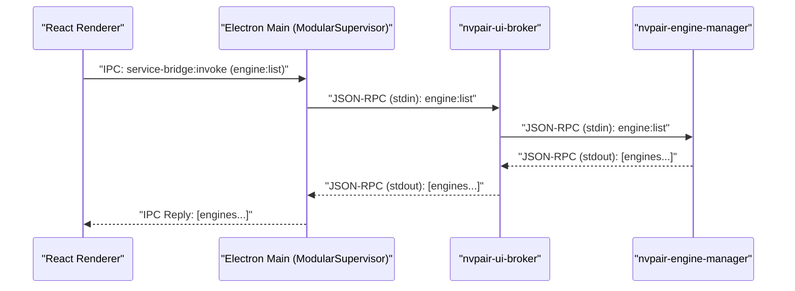
**Sources:** [AGENTS.md:41-42](), [desktop/src/electron/ipc/service-bridge.ipc.ts:7-11](), [desktop/src/electron/connector/index.ts:140-148]()

---

## Supervision and Restart Policy

The `ModularSupervisor` manages the `nvpair-ui-broker` lifecycle, ensuring the system remains stable even if a backend component fails.

### Broker Supervision
*   **Startup**: The supervisor initiates the broker and waits for a "Ready" state within a defined timeout (`MODULAR_STARTUP_READY_TIMEOUT_MS`) [desktop/src/electron/connector/index.ts:147-147]().
*   **Crash Detection**: If the broker exits unexpectedly, the supervisor triggers `handleBrokerCrash` [desktop/src/electron/connector/index.ts:82-99]().
*   **Notification**: A crash surfaces a UI message modal via `notifyBrokerCrash`, allowing the user to navigate to settings and attempt a manual restart [desktop/src/electron/connector/broker-crash-notification.ts:15-25]().

### Worker Supervision
The `nvpair-ui-broker` is responsible for its 11 workers.
*   **Spawn Policy**: All 11 workers are spawned at startup [AGENTS.md:38-39]().
*   **Fault Tolerance**: Only the `nvpair-node-scanner` is strictly required. Other workers are considered optional; their failure will not cause the broker to exit, though it will degrade functionality [AGENTS.md:38-39]().

### Lifecycle States
| State | Description |
| :--- | :--- |
| `disconnected` | No broker process is running [desktop/src/electron/connector/index.ts:23](). |
| `connecting` | The broker has been spawned but has not yet sent the `ready` signal [desktop/src/electron/connector/index.ts:137](). |
| `connected` | The broker is active and responding to JSON-RPC calls [desktop/src/electron/connector/index.ts:69](). |
| `reconnecting` | A startup attempt timed out, and the system is retrying [desktop/src/electron/connector/index.ts:153](). |

**Sources:** [desktop/src/electron/connector/index.ts:23-168](), [desktop/src/electron/connector/broker-crash-notification.ts:15-41](), [AGENTS.md:35-39]()

---

# Page: Discovery and Node Identity

# Discovery and Node Identity

<details>
<summary>Relevant source files</summary>

The following files were used as context for generating this wiki page:

- [AGENTS.md](AGENTS.md)
- [desktop/docs/architecture.md](desktop/docs/architecture.md)
- [desktop/docs/services-backend.md](desktop/docs/services-backend.md)

</details>


Discovery in Personal AI Router (PAIR) is the mechanism by which nodes on a local area network find each other, exchange identity metadata, and establish a shared view of the cluster's capabilities. This process is managed primarily by the `nvpair-node-scanner` worker, which uses mDNS for advertisement and browsing, supplemented by HTTP-based enrichment for hardware inventory.

## Discovery Architecture and Data Flow

The discovery process involves several components working in concert to move a node from a network advertisement to a fully enriched member of the `nvpair-ui-broker` node list.

### Code-to-System Mapping
The following diagram maps the high-level discovery concepts to their specific implementation entities in the Go services and Electron bridge.

**Discovery Entity Mapping**
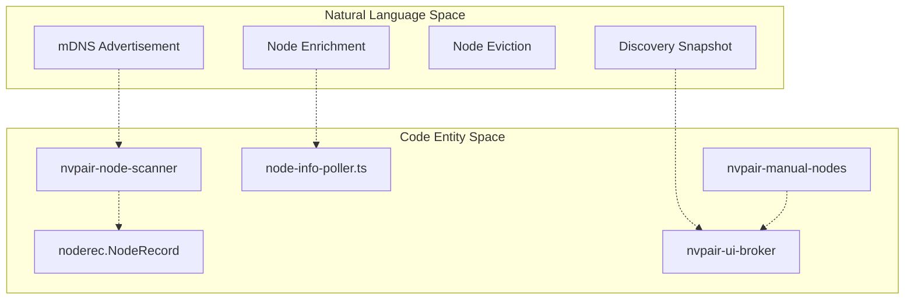
**Sources:** [desktop/docs/architecture.md:42-55](), [desktop/docs/services-backend.md:43-68]()

## Node Identity and mDNS

Every PAIR node is identified by a stable UUID generated during the first run and persisted by `nvpair-node-settings` [desktop/docs/architecture.md:51-51](). This identity is used to sign certificates and uniquely identify the node across network changes.

### mDNS Advertisement
The `nvpair-node-scanner` advertises the node using the `_nvpair-node._tcp` service type [desktop/docs/architecture.md:47-47](). 
- **Service Type:** `_nvpair-node._tcp`
- **Payload:** The mDNS TXT records include the node's unique ID and the port for its `nvpair-node-info` service.
- **Port Management:** The scanner utilizes `SO_REUSEADDR` to allow multiple instances or related services to bind effectively during discovery cycles [desktop/docs/services-backend.md:26-26]().

## Node Enrichment and Telemetry

Discovery only provides the network location (IP/Port) and ID. To make routing decisions, the system performs "Enrichment" by fetching detailed hardware and model inventory.

### The /v1/node-info Endpoint
Each node runs an `nvpair-node-info` service [desktop/docs/architecture.md:48-48](). This service exposes an HTTP endpoint that provides:
1. **GPU Inventory:** Number of GPUs, model names, and total VRAM.
2. **Model Inventory:** List of models currently loaded or available via local engines (Ollama/LM Studio).
3. **Utilization:** Real-time CPU, memory, and GPU pressure.

### Polling Logic
- **Backend Polling:** The `nvpair-node-scanner` samples a compact maximum-GPU utilization value from healthy nodes to feed the `nvpair-job-scheduler` [desktop/docs/services-backend.md:106-109]().
- **Frontend Polling:** The Electron main process runs `node-info-poller.ts`, which polls healthy nodes every two seconds [desktop/docs/architecture.md:130-132](). This data is merged into the `metrics:update` push channel for the UI [desktop/docs/services-backend.md:102-105]().
- **Backoff:** If a node fails to respond, the poller backs off exponentially (4s, 8s, 16s, up to 30s) before attempting again [desktop/docs/architecture.md:132-134]().

**Sources:** [desktop/docs/services-backend.md:83-83](), [desktop/docs/services-backend.md:102-112]()

## Manual Nodes

For environments where mDNS is restricted or nodes exist on different subnets, the `nvpair-manual-nodes` worker allows users to explicitly add node addresses [desktop/docs/architecture.md:52-52]().
- Manual nodes are treated as "Discovery Entries" by the broker.
- The system probes manual nodes every 10 seconds to verify availability [desktop/docs/services-backend.md:28-28]().

## Consolidation and Eviction

The `nvpair-ui-broker` acts as the central aggregator for all discovery sources.

### Discovery Snapshot
The broker consolidates nodes from `nvpair-node-scanner` and `nvpair-manual-nodes` into a single snapshot. When the inventory changes, the broker emits a `discovery:nodes-changed` notification [desktop/docs/services-backend.md:119-119]().

### Node Eviction
Nodes are removed from the active list under the following conditions:
1. **mDNS Goodbye:** The scanner receives a formal mDNS "goodbye" packet.
2. **TTL Expiry:** The mDNS record for a discovered node expires without a refresh.
3. **Manual Removal:** A user deletes a manual entry via the UI.

When a node is removed, the Electron bridge diffs the snapshot and emits a `nodes:remove` event to the React renderer stores [desktop/docs/services-backend.md:119-119]().

## Implementation Flow

The following diagram illustrates the sequence from a node appearing on the network to its appearance in the PAIR UI.

**Node Discovery Sequence**
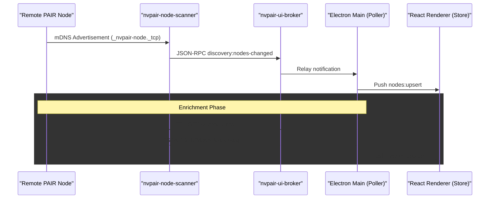

**Sources:** [desktop/docs/architecture.md:15-32](), [desktop/docs/architecture.md:130-135](), [desktop/docs/services-backend.md:116-119]()

---

# Page: Cluster Pairing and Trust

# Cluster Pairing and Trust

<details>
<summary>Relevant source files</summary>

The following files were used as context for generating this wiki page:

- [AGENTS.md](AGENTS.md)
- [SECURITY.md](SECURITY.md)
- [desktop/docs/architecture.md](desktop/docs/architecture.md)
- [desktop/docs/services-backend.md](desktop/docs/services-backend.md)

</details>


The `nvpair-cluster-manager` service is responsible for establishing and maintaining secure, authenticated relationships between nodes in a Personal AI Router (PAIR) deployment. It implements the **EAP-NOOB** (Extensible Authentication Protocol - Nimble Out-of-Band) protocol to bootstrap trust using a six-digit PIN, subsequently transitioning to **mutual TLS (mTLS)** using self-signed certificates for all peer-to-peer control and inference traffic.

## Trust Establishment Overview

Trust is not assumed based on local network presence. While `nvpair-node-scanner` discovers nodes via mDNS, these nodes remain "untrusted" until a pairing handshake is completed. The pairing process utilizes an out-of-band (OOB) step—the six-digit PIN—to prevent man-in-the-middle (MITM) attacks during the initial key exchange.

### Security Boundaries
*   **Authenticated:** Cluster membership management, remote engine control, and cross-node inference requests (via mTLS ingress on proxy ports) [SECURITY.md:54-56]().
*   **Unauthenticated:** mDNS discovery advertisements, initial `/v1/node-info` telemetry polling, and local loopback inference traffic [SECURITY.md:79-85, 102-110]().

## The EAP-NOOB Pairing Flow

PAIR implements a simplified version of RFC 9140 (EAP-NOOB). The flow moves from discovery to a persistent trusted state through several cryptographic phases.

### Pairing State Machine
1.  **Discovery:** Node A sees Node B via mDNS.
2.  **Invitation:** Node A sends a `cluster:invite` request to Node B.
3.  **Key Exchange (ECDH):** The nodes exchange public keys (Curve25519 or P-256) to establish a shared secret.
4.  **OOB Validation:** The UI displays a six-digit PIN on one node; the user must enter it on the other. This PIN validates the shared secret established in step 3.
5.  **Persistence:** Upon successful validation, the nodes exchange self-signed certificates and store them in the `trusted-nodes` store [SECURITY.md:98-100]().

### Sequence: PIN Bootstrap and mTLS Transition
The following diagram maps the logical pairing flow to the specific Go service entities and JSON-RPC methods.

**Pairing Logic and Code Entities**
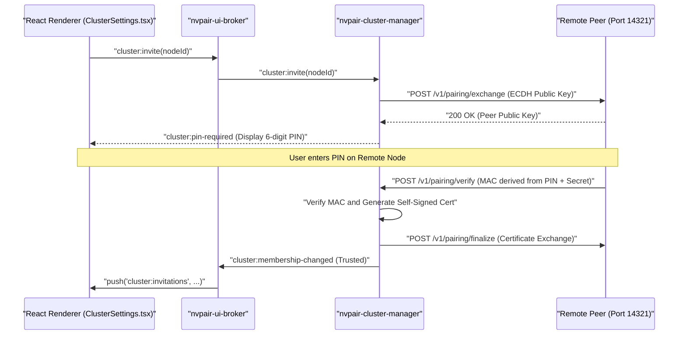
Sources: [desktop/docs/architecture.md:50](), [desktop/docs/services-backend.md:33](), [SECURITY.md:91-100]()

## Identity and Cryptography

Each node maintains a unique identity rooted in a generated UUID and a corresponding self-signed certificate.

### Trusted-Node Store
The `nvpair-cluster-manager` interacts with `nvpair-node-settings` to persist the identities of paired peers. This store includes:
*   **Node UUID:** The stable identifier for the peer.
*   **Public Key/Certificate:** The self-signed certificate used to validate mTLS connections.
*   **Trust Status:** Boolean flag indicating if the node is currently authorized.

### Mutual TLS (mTLS) Implementation
Once paired, the nodes use the exchanged certificates to secure two primary channels:
1.  **Control Plane:** Cross-node JSON-RPC relays (e.g., one node asking another to pull a model) [desktop/docs/architecture.md:49-50]().
2.  **Data Plane:** Inference requests routed via `ollama-proxy` or `lmstudio-proxy`. The proxies serve a "dual-personality" on their ports:
    *   **Loopback:** Plaintext HTTP for local clients (127.0.0.1) [SECURITY.md:69-72]().
    *   **Network:** mTLS-only for paired cluster members [SECURITY.md:70-72]().

## Cluster Membership Operations

The `nvpair-cluster-manager` provides a set of JSON-RPC methods to manage the lifecycle of these trusted relationships.

| Method | Description | Implementation Detail |
| :--- | :--- | :--- |
| `cluster:invite` | Initiates pairing with a discovered node. | Triggers EAP-NOOB ECDH exchange. |
| `cluster:accept` | Confirms a pending invitation. | Validates the OOB PIN. |
| `cluster:decline` | Rejects a pending invitation. | Clears ephemeral pairing state. |
| `cluster:leave` | Removes the local node from a cluster. | Notifies peers and wipes local trust store. |
| `cluster:remove` | Evicts a specific peer from the cluster. | Revokes the peer's certificate from the local trust store. |

### Component Relationships
The diagram below shows how the Cluster Manager integrates with other services to enforce security.

**Service Integration Map**
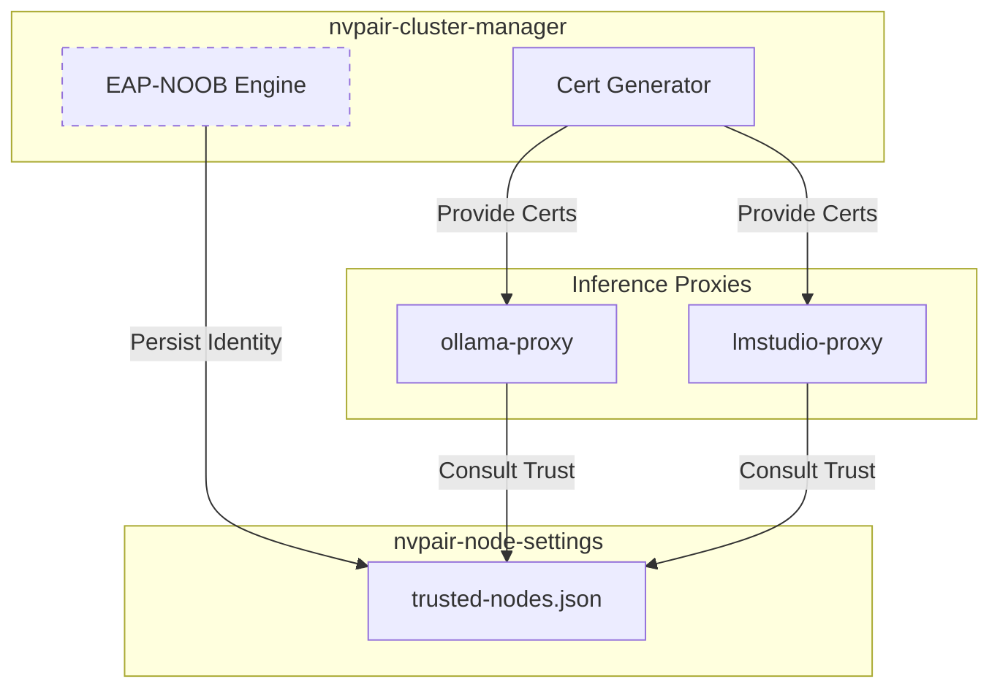
Sources: [desktop/docs/architecture.md:45-51](), [desktop/docs/services-backend.md:21-34](), [SECURITY.md:102-110]()

## Security Considerations and Risks

While the pairing system provides a robust baseline, several architectural boundaries must be noted:

*   **PIN Entropy:** The six-digit PIN is designed for convenience and low-entropy bootstrap. It is not a durable credential and does not protect against a compromised node that has already been paired [SECURITY.md:91-96]().
*   **mTLS Scope:** mTLS only protects PAIR-specific inter-node traffic. It does not encrypt Electron IPC, local engine APIs (like the raw Ollama port 11434), or mDNS discovery packets [SECURITY.md:102-109]().
*   **Revocation:** When a node is "Removed" via the UI, its certificate is deleted from the local `trusted-nodes` store, immediately causing the mTLS handshake to fail for future requests from that node [SECURITY.md:95-96]().

Sources: [SECURITY.md:67-124](), [desktop/docs/architecture.md:105-135]()

---

# Page: Inference Routing and Scheduling

# Inference Routing and Scheduling

<details>
<summary>Relevant source files</summary>

The following files were used as context for generating this wiki page:

- [AGENTS.md](AGENTS.md)
- [desktop/docs/architecture.md](desktop/docs/architecture.md)
- [desktop/docs/services-backend.md](desktop/docs/services-backend.md)

</details>


This section describes the lifecycle of an inference request as it travels from a client application (e.g., a chatbot or IDE extension) through the Personal AI Router (PAIR) infrastructure to a selected compute node. The system utilizes a distributed scheduling algorithm that balances model availability, GPU pressure, and pending workload volume.

## Request Flow Overview

Inference requests enter the system via the `ollama-proxy` or `lmstudio-proxy`. These proxies do not perform inference themselves; instead, they act as intelligent gateways that route traffic to the most appropriate engine (Ollama or LM Studio) within the trusted cluster.

### 1. Model-Capability Gating
When a request arrives at the proxy (e.g., `POST /api/chat`), the proxy first identifies the requested model. It queries the local discovery cache to filter for "eligible nodes"—nodes that are currently advertising the requested model in their inventory [desktop/docs/architecture.md:45-46]().

### 2. The Ranking Algorithm
The `nvpair-job-scheduler` is responsible for ordering the eligible nodes. It uses a multi-factor ranking algorithm to determine the "best" destination [desktop/docs/architecture.md:55]().

The scheduler calculates a score for each node based on:
*   **Pending Work:** The number of active inference jobs currently assigned to that node by the local proxy.
*   **GPU Pressure:** A value from 0 to 3 representing the load on the node's GPU, sampled via the `nvpair-node-info` telemetry endpoint [desktop/docs/services-backend.md:106-109]().
*   **Local Preference:** The scheduler prioritizes the local node if it possesses the model and is not under extreme pressure, minimizing network latency.

### 3. Failover and Local Reservations
If the top-ranked node fails to respond or returns a `404 Not Found` (indicating the model was recently removed), the proxy automatically attempts the request on the next node in the ordered failover list. The proxy maintains local reservations to ensure that if a node is selected, its "pending work" count is incremented immediately, preventing a "thundering herd" effect where multiple requests are sent to a node before its reported telemetry reflects the new load.

## Inference Routing Architecture

The following diagram illustrates the path of a request from a local client through the Go service layers.

**Diagram: Inference Request Path and Code Entities**

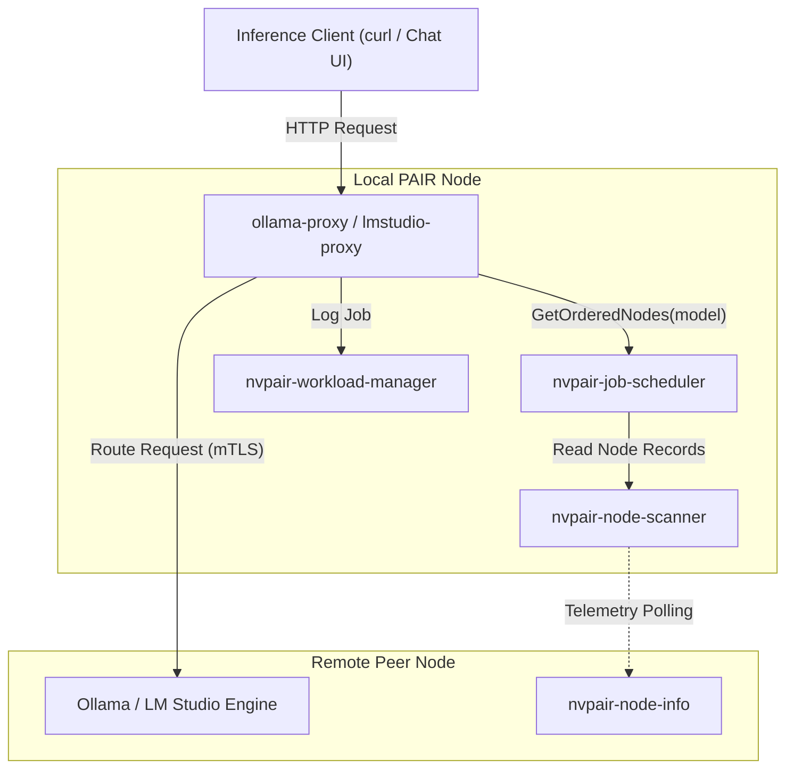

**Sources:** [desktop/docs/architecture.md:15-32](), [desktop/docs/services-backend.md:42-68](), [desktop/docs/services-backend.md:102-109]()

## Scheduler Implementation Details

The `nvpair-job-scheduler` operates as a background worker supervised by the `nvpair-ui-broker` [desktop/docs/architecture.md:34-37](). It consumes telemetry from the `nvpair-node-scanner` and provides a prioritized list of endpoints to the proxies via JSON-RPC.

### Data Flow for Scheduling

1.  **Node Enrichment:** The `nvpair-node-scanner` browses `_nvpair-node._tcp` mDNS records [desktop/docs/architecture.md:47]().
2.  **Telemetry Sampling:** The scanner (or Electron `node-info-poller.ts` for UI display) hits the `/v1/node-info` endpoint on discovered nodes to gather GPU utilization and VRAM availability [desktop/docs/services-backend.md:102-105]().
3.  **Ranking:** The scheduler combines this telemetry with active workload data relayed by the `nvpair-workload-manager` [desktop/docs/services-backend.md:29]().

### Known Limitations
*   **Cold Start Latency:** The scheduler does not currently account for model loading times (TTFT impact) if a model is present on disk but not currently loaded into VRAM.
*   **Global vs. Local View:** Each node's scheduler has a perfect view of its own outgoing jobs but relies on periodic telemetry for the state of remote peers. This can lead to brief synchronization lags in high-concurrency environments.

## Component Responsibilities

| Component | Role in Routing/Scheduling | File Reference |
| :--- | :--- | :--- |
| `nvpair-job-scheduler` | Ranks nodes based on GPU pressure and pending jobs. | [desktop/docs/architecture.md:55]() |
| `ollama-proxy` | Entry point for Ollama clients; executes the failover logic. | [desktop/docs/architecture.md:45]() |
| `lmstudio-proxy` | Entry point for OpenAI-compatible clients. | [desktop/docs/architecture.md:46]() |
| `nvpair-node-info` | Exposes the telemetry (GPU/RAM) used for ranking. | [desktop/docs/architecture.md:48]() |
| `nvpair-workload-manager` | Synchronizes active job counts across the cluster. | [desktop/docs/architecture.md:49]() |

**Sources:** [desktop/docs/architecture.md:42-56](), [desktop/docs/services-backend.md:21-35]()

## Sequence: Request Handling

The following sequence diagram shows the interaction between the Go services when a request is received.

**Diagram: Request Routing Sequence**

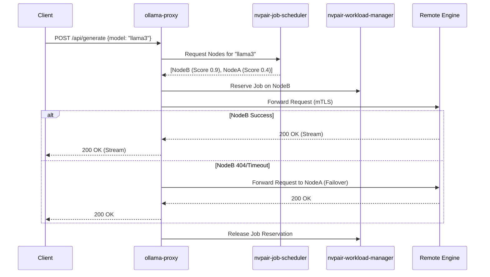

**Sources:** [desktop/docs/architecture.md:45-55](), [desktop/docs/services-backend.md:116-119](), [AGENTS.md:35-39]()

---

# Page: Node-to-Node Transport and Port Map

# Node-to-Node Transport and Port Map

<details>
<summary>Relevant source files</summary>

The following files were used as context for generating this wiki page:

- [SECURITY.md](SECURITY.md)
- [desktop/docs/architecture.md](desktop/docs/architecture.md)
- [desktop/docs/services-backend.md](desktop/docs/services-backend.md)

</details>


The NVIDIA Personal AI Router (PAIR) employs a multi-layered networking strategy to balance local ease-of-use with cluster-wide security. It utilizes a "dual-personality" port design where the same physical port serves both plaintext traffic for local loopback clients and encrypted mutual TLS (mTLS) traffic for authenticated cluster peers.

## Port Map and Service Surface

PAIR reserves a specific range of ports to ensure predictable discovery and communication between the broker, workers, and external inference engines.

| Port | Protocol | Scope | Service / Process | Purpose |
| :--- | :--- | :--- | :--- | :--- |
| **11434** | HTTP / mTLS | Mixed | `ollama-proxy` | Default Ollama API surface. Displaces native Ollama. |
| **1234** | HTTP / mTLS | Mixed | `lmstudio-proxy` | Default LM Studio API surface. Displaces native LM Studio. |
| **14318** | JSON-RPC | Loopback | `nvpair-ui-broker` | Control plane (when using TCP transport). |
| **14319** | HTTP | LAN | `nvpair-node-info` | Node telemetry, GPU utilization, and metadata. |
| **14320** | mDNS | LAN | `nvpair-node-scanner` | Service discovery (`_nvpair-node._tcp`). |
| **14321** | mTLS | LAN | `nvpair-cluster-manager` | Inter-node pairing, PIN exchange, and cluster ops. |
| **14322** | mTLS | LAN | `nvpair-workload-manager` | Cluster-wide job and workload replication. |
| **14323** | mTLS | LAN | `nvpair-errors` | Peer-to-peer error synchronization. |

**Sources:** [desktop/docs/architecture.md:42-55](), [desktop/docs/services-backend.md:21-35]()

## Dual-Personality Port Design

The inference proxies (`ollama-proxy` and `lmstudio-proxy`) implement a security boundary based on the source of the connection.

1.  **Plaintext Loopback:** The proxy accepts unauthenticated HTTP requests only if they originate from `127.0.0.1` or `::1`. This allows local applications (like a web UI or CLI) to function without managing certificates [SECURITY.md:67-72]().
2.  **mTLS Peer Ingress:** The same port accepts connections from other nodes in the cluster. These requests **must** be encrypted via mutual TLS using certificates exchanged during the pairing process [SECURITY.md:54-56]().

### Port Takeover Logic
To provide a seamless experience, PAIR proxies are designed to "displace" the underlying engines. If a user starts Ollama, it defaults to port `11434`. When PAIR starts, the `ollama-proxy` attempts to bind to `11434`. If the port is occupied by the engine, the `nvpair-engine-manager` coordinates a port shift or adoption so that the proxy becomes the primary entry point for all traffic, allowing it to inject routing and failover logic [SECURITY.md:140-140]().

## Data Flow: Local vs. Remote Inference

The following diagram illustrates how a request is handled based on its origin and the target node selected by the `nvpair-job-scheduler`.

### Inference Routing Logic
Title: "Inference Request Transport Flow"
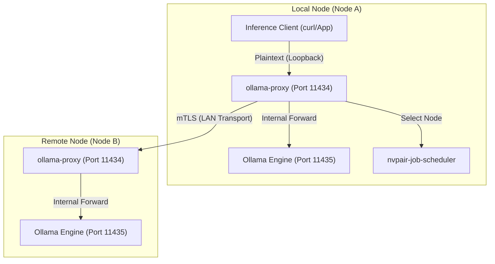
**Sources:** [SECURITY.md:67-77](), [desktop/docs/architecture.md:15-32](), [desktop/docs/services-backend.md:42-68]()

## Node Identity and Discovery Transport

Node identity is established via a stable UUID and a self-signed certificate generated by the `nvpair-cluster-manager` [SECURITY.md:98-100](). 

-   **Discovery:** `nvpair-node-scanner` advertises the node on the LAN using mDNS (`_nvpair-node._tcp`) [desktop/docs/architecture.md:47-47]().
-   **Metadata:** Rich telemetry (GPU pressure, VRAM) is fetched via `nvpair-node-info` on port `14319`. Electron polls this endpoint every 2 seconds to update the UI [desktop/docs/services-backend.md:100-109]().
-   **Pairing:** The EAP-NOOB protocol is used over port `14321` to bootstrap trust using a 6-digit PIN [SECURITY.md:91-97]().

### Identity and Trust Association
Title: "Identity to Transport Mapping"
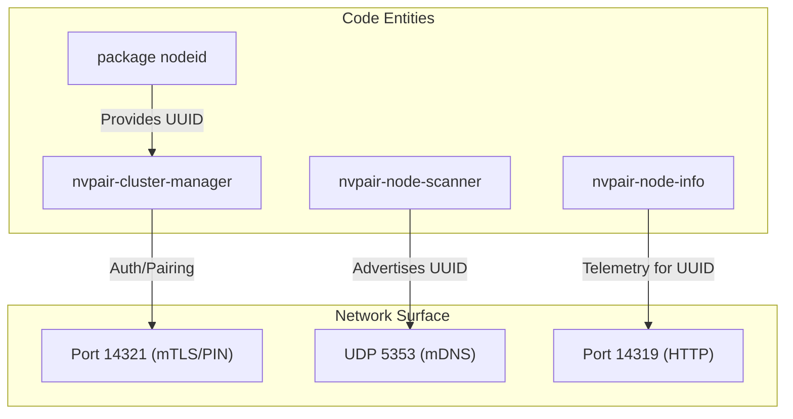
**Sources:** [desktop/docs/architecture.md:42-55](), [desktop/docs/services-backend.md:77-86](), [SECURITY.md:98-102]()

## Security Implications

| Surface | Authentication | Encryption | Risk Mitigation |
| :--- | :--- | :--- | :--- |
| **Loopback Proxy** | None (Source IP Check) | None | Restricted to `127.0.0.1` to prevent open relay [SECURITY.md:69-72](). |
| **Peer Proxy Ingress** | mTLS (Certificate) | TLS 1.3 | Requires prior EAP-NOOB pairing [SECURITY.md:54-56](). |
| **Node Info** | None | None | Data is read-only telemetry; no inference data [SECURITY.md:106-107](). |
| **Broker IPC** | OS Permissions | None | Uses stdio or local sockets/named pipes [SECURITY.md:113-117](). |

**Sources:** [SECURITY.md:67-123]()

---

# Page: Backend Services (Go)

# Backend Services (Go)

<details>
<summary>Relevant source files</summary>

The following files were used as context for generating this wiki page:

- [.gitignore](.gitignore)
- [AGENTS.md](AGENTS.md)
- [CONTRIBUTING.md](CONTRIBUTING.md)

</details>


The backend of the NVIDIA Personal AI Router (PAIR) is a distributed system composed of 13 Go binaries located in the `services/` directory [AGENTS.md:73-77](). These services handle the core logic of the application, including inference routing, engine management, cluster discovery, and secure pairing, while the Electron desktop application acts primarily as a management client [AGENTS.md:27-31]().

### Service Architecture and Supervision

The backend follows a hub-and-spoke supervision model. The **`nvpair-ui-broker`** serves as the central orchestrator, supervised directly by the Electron main process [AGENTS.md:35-37](). Upon startup, the broker spawns and supervises 11 specialized worker processes [AGENTS.md:38-39](). Communication between the UI and the workers, as well as between workers themselves, occurs via newline-delimited **JSON-RPC 2.0** over standard streams (stdio) [AGENTS.md:41-42]().

### Process Map: Natural Language to Code Entities

The following diagram maps high-level system responsibilities to the specific Go binaries and packages that implement them.

**System Responsibility to Binary Mapping**
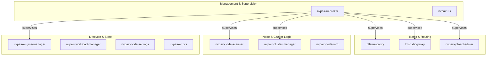
**Sources:** [AGENTS.md:35-40](), [CONTRIBUTING.md:194-198]()

---

### Core Components

#### 3.1. nvpair-ui-broker — Broker and Worker Supervisor
The broker is the entry point for the backend. It manages the lifecycle of all worker processes, providing automatic restarts and backoff logic. It aggregates state from workers—such as engine availability and cluster discovery—and exposes a unified JSON-RPC API to the Electron frontend.
*   **For details, see [nvpair-ui-broker — Broker and Worker Supervisor](#3.1)**

#### 3.2. Inference Proxies — Ollama and LM Studio
These services (`ollama-proxy` and `lmstudio-proxy`) act as the primary interface for local AI applications. They provide a routing overlay that merges model lists from all nodes in the cluster and dispatches inference requests to the most suitable node via mTLS.
*   **For details, see [Inference Proxies — Ollama and LM Studio](#3.2)**

#### 3.3. Engine Manager — Engine and Model Lifecycle
The `nvpair-engine-manager` handles the installation and execution of local inference engines (Ollama and LM Studio). It tracks model download progress, manages engine configuration, and handles port takeover logic to ensure the PAIR proxy can intercept traffic.
*   **For details, see [Engine Manager — Engine and Model Lifecycle](#3.3)**

#### 3.4. Cluster Manager and EAP-NOOB Pairing
The `nvpair-cluster-manager` establishes a secure trust domain between nodes. It implements the EAP-NOOB protocol (RFC 9140) for out-of-band PIN pairing and manages the mutual TLS (mTLS) certificates used for encrypted inter-node communication.
*   **For details, see [Cluster Manager and EAP-NOOB Pairing](#3.4)**

#### 3.5. Supporting Services
This category includes several critical workers:
*   **`nvpair-node-scanner`**: Uses mDNS to discover other PAIR nodes on the local network.
*   **`nvpair-job-scheduler`**: Ranks available nodes based on GPU pressure and model availability.
*   **`nvpair-workload-manager`**: Relays real-time telemetry about active inference jobs.
*   **`nvpair-node-settings` & `nvpair-errors`**: Manage persistent configuration and cluster-wide error logging.
*   **For details, see [Supporting Services — Scanner, Scheduler, Workloads, Errors, Settings](#3.5)**

---

### Shared Foundations

#### 3.6. Shared Go Module (nvpair-shared)
All Go services depend on a common library located in `services/shared/`. This module provides standardized implementations for JSON-RPC handling, mDNS advertising, IPC transports, and the node identity system.
*   **For details, see [Shared Go Module (nvpair-shared)](#3.6)**

### Build System and Versioning

The Go backend uses a unified versioning manifest in `services/versions.json` [AGENTS.md:126-129](). Binaries are built using `build.sh` (Linux/macOS) or `build.bat` (Windows), which stamps version information into the binaries via `-ldflags` [AGENTS.md:80-82](). The desktop build process automatically invokes these scripts to ensure the UI is always paired with the correct backend versions [AGENTS.md:57-58]().

**Backend Component Interaction**
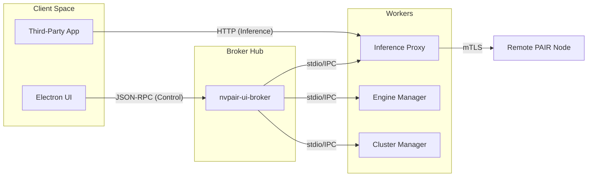
**Sources:** [AGENTS.md:33-42](), [CONTRIBUTING.md:190-200]()

---

# Page: nvpair-ui-broker — Broker and Worker Supervisor

# nvpair-ui-broker — Broker and Worker Supervisor

<details>
<summary>Relevant source files</summary>

The following files were used as context for generating this wiki page:

- [AGENTS.md](AGENTS.md)
- [CONTRIBUTING.md](CONTRIBUTING.md)
- [desktop/docs/services-api.md](desktop/docs/services-api.md)
- [desktop/docs/services-backend.md](desktop/docs/services-backend.md)

</details>


The `nvpair-ui-broker` is the central orchestrator and process supervisor of the Personal AI Router (PAIR) backend services. It is the only backend process started directly by the Electron application's `ModularSupervisor` [desktop/docs/services-backend.md:18-19](). Its primary responsibilities include lifecycle management of the 11 worker processes, relaying JSON-RPC traffic between the UI and workers, and coordinating engine advertising.

## Worker Supervision

The broker manages the lifecycle of the PAIR service ecosystem. Upon startup, it spawns the worker binaries located in the application's binary directory [AGENTS.md:35-39]().

### Supervision Logic
*   **Spawn Policy**: The broker attempts to launch all 11 workers. While the `nvpair-node-scanner` is considered critical, other workers are treated as optional; their failure to start does not terminate the broker [AGENTS.md:38-39]().
*   **Restart and Backoff**: The broker monitors worker health. If a worker exits unexpectedly, the broker manages restarts using a budget-based approach to prevent infinite crash loops.
*   **IPC Transport**: Communication between the broker and its workers typically occurs via newline-delimited JSON-RPC 2.0 over `stdio` pipes, though it supports named pipes or sockets via the `--ipc` flag [AGENTS.md:41-42]().

### Supervised Workers
The following workers are managed by the broker:
| Worker | Role |
| :--- | :--- |
| `nvpair-node-scanner` | mDNS discovery and node announcement |
| `ollama-proxy` | Ollama-compatible routing and mTLS ingress |
| `lmstudio-proxy` | LM Studio routing and mTLS ingress |
| `nvpair-engine-manager` | Local engine (Ollama/LM Studio) lifecycle |
| `nvpair-cluster-manager` | EAP-NOOB pairing and cluster trust |
| `nvpair-job-scheduler` | Routing priority and telemetry relay |
| `nvpair-node-info` | Node metadata and telemetry provider |
| `nvpair-workload-manager` | Cluster-wide workload replication |
| `nvpair-errors` | Centralized error registry |
| `nvpair-node-settings` | Persisted configuration store |
| `nvpair-manual-nodes` | Management of user-added static nodes |

**Sources:** [AGENTS.md:35-42](), [desktop/docs/services-backend.md:21-34]()

## Engine Advertising and Polling

The broker acts as a bridge for engine state. It coordinates with `nvpair-engine-manager` to track the availability of local AI engines like Ollama and LM Studio.

*   **Polling Frequency**: The system monitors engine health and model availability. While Electron polls `/v1/node-info` every 2 seconds for UI metrics [desktop/docs/services-backend.md:102-105](), the backend scanner samples GPU utilization on a similar cadence to feed the scheduler [desktop/docs/services-backend.md:106-109]().
*   **Service Readiness**: The broker emits an `app:ready` notification once the core supervision tree is established [desktop/docs/services-backend.md:92-93]().

## Workload Brokering and Scheduling

The broker facilitates the flow of inference metadata to the `nvpair-job-scheduler`.

1.  **Node Stamping**: As discovery updates arrive via `discovery:nodes-changed`, the broker ensures node identities are consistent across the service tree [desktop/docs/services-backend.md:119]().
2.  **Telemetry Relay**: The broker relays `schedule:priority` notifications from the scheduler to the UI, allowing the renderer to visualize which nodes are currently preferred for new jobs [desktop/docs/services-api.md:152]().
3.  **Workload Tracking**: Through the `nvpair-workload-manager`, the broker relays cluster-wide workload updates, allowing all nodes to maintain a shared view of active inference tasks [desktop/docs/services-backend.md:29]().

## JSON-RPC API Surface

The broker exposes a unified JSON-RPC 2.0 interface. It acts as a router, forwarding requests to the appropriate worker based on the method namespace.

### Key Methods and Notifications
*   **App Lifecycle**: `app:ready` (Notification) - Signals that the broker has initialized workers [desktop/docs/services-backend.md:88-92]().
*   **Discovery**: `discovery:subscribe` and `discovery:nodes-changed` - Used to manage the live list of network peers [desktop/docs/services-api.md:35](), [desktop/docs/services-backend.md:119]().
*   **Proxy Control**: `proxy:get-status` and `proxy:unsubscribe` - Manages the state of the inference proxies [desktop/docs/services-api.md:39-40]().
*   **Internal Routing**: The broker handles `internal:set-reserved-port` to coordinate port assignments between the engine manager and the proxies [desktop/docs/services-api.md:38]().

**Sources:** [desktop/docs/services-api.md:35-41](), [desktop/docs/services-backend.md:88-98]()

## Data Flow and Process Hierarchy

The following diagrams illustrate the relationship between the Electron frontend, the broker, and the supervised workers.

### Diagram 1: Process Ownership and IPC
```mermaid
graph TD
    subgraph "Electron Process"
        A["ModularSupervisor"]
    end

    subgraph "Broker Process"
        B["nvpair-ui-broker"]
    end

    subgraph "Worker Processes"
        C["nvpair-node-scanner"]
        D["ollama-proxy"]
        E["nvpair-engine-manager"]
        F["nvpair-job-scheduler"]
        G["...Other Workers"]
    end

    A <-->|"stdio JSON-RPC"| B
    B -->|"spawn / supervise"| C
    B -->|"spawn / supervise"| D
    B -->|"spawn / supervise"| E
    B -->|"spawn / supervise"| F
    B -->|"spawn / supervise"| G

    C -.->|"JSON-RPC Relay"| B
    D -.->|"JSON-RPC Relay"| B
    E -.->|"JSON-RPC Relay"| B
    F -.->|"JSON-RPC Relay"| B
```
**Sources:** [desktop/docs/services-backend.md:42-68](), [AGENTS.md:35-42]()

### Diagram 2: System Entity Mapping
This diagram maps high-level system responsibilities to the specific code entities that implement them.

```mermaid
graph LR
    subgraph "Natural Language Space"
        Direction["'Find other nodes'"]
        Health["'Is Ollama running?'"]
        Schedule["'Who is least busy?'"]
        Error["'Something went wrong'"]
    end

    subgraph "Code Entity Space"
        Direction --- Scanner["nvpair-node-scanner"]
        Health --- Engine["nvpair-engine-manager"]
        Schedule --- Sched["nvpair-job-scheduler"]
        Error --- Err["nvpair-errors"]
        
        Scanner --> Broker["nvpair-ui-broker"]
        Engine --> Broker
        Sched --> Broker
        Err --> Broker
        
        Broker --- Bridge["handleServiceBridgeInvoke (empty-handlers.ts)"]
    end
```
**Sources:** [desktop/docs/services-backend.md:21-34](), [desktop/docs/services-backend.md:77-86]()

## CLI Flags and Transport

The broker behavior can be modified via command-line arguments:
*   **`--ipc`**: Switches the transport from `stdio` to a platform-specific IPC mechanism (e.g., named pipes on Windows or Unix domain sockets on Linux/macOS) [AGENTS.md:41-42]().
*   **Binary Pathing**: The broker expects workers to be in the same directory as its own executable or a path specified during the Electron `ModularSupervisor` initialization [desktop/docs/services-backend.md:79]().

**Sources:** [AGENTS.md:35-42](), [desktop/docs/services-backend.md:79-80]()

---

# Page: Inference Proxies — Ollama and LM Studio

# 3.2. Inference Proxies — Ollama and LM Studio

<details>
<summary>Relevant source files</summary>

The following files were used as context for generating this wiki page:

- [desktop/docs/architecture.md](desktop/docs/architecture.md)
- [desktop/docs/services-api.md](desktop/docs/services-api.md)
- [desktop/docs/services-backend.md](desktop/docs/services-backend.md)

</details>


The inference proxies (`ollama-proxy` and `lmstudio-proxy`) are the primary data-plane components of the Personal AI Router (PAIR) architecture. They provide API-compatible entry points for local inference clients while transparently routing requests across a trusted cluster of nodes.

## Purpose and Scope

The proxies serve three main functions:
1.  **Port Takeover**: They occupy the default ports for Ollama (`11434`) and LM Studio (`1234`), allowing them to intercept traffic from third-party applications without requiring client configuration changes [desktop/docs/architecture.md:42-46]().
2.  **Cluster Routing**: They implement a routing overlay that can direct local requests to remote cluster peers based on model availability and scheduler priority [desktop/docs/services-backend.md:24-25]().
3.  **Security Boundary**: They manage the transition between plaintext loopback traffic (local clients) and mutual TLS (mTLS) encrypted traffic (inter-node cluster communication) [desktop/docs/services-backend.md:24-25]().

## System Architecture and Data Flow

The proxies are supervised by the `nvpair-ui-broker` and communicate with other backend services via JSON-RPC over stdio [desktop/docs/architecture.md:34-37]().

### Inference Request Path
The following diagram illustrates how a request from a local LLM client is routed through the proxy to either a local engine or a remote peer.

**Diagram: Inference Routing Overlay**
```mermaid
flowchart TD
    Client["LLM Client (e.g. Continue, Open WebUI)"]
    Proxy["ollama-proxy / lmstudio-proxy"]
    Scheduler["nvpair-job-scheduler"]
    LocalEngine["Local Engine (Ollama/LM Studio)"]
    RemoteNode["Remote Peer Node"]

    Client -->|"HTTP (Plaintext, Port 11434/1234)"| Proxy
    Proxy <-->|"RPC: schedule:priority"| Scheduler
    
    Proxy -- "Route Local" --> LocalEngine
    Proxy -- "Route Remote (mTLS, Port 14321)" --> RemoteNode
```
**Sources:** [desktop/docs/architecture.md:15-32](), [desktop/docs/services-backend.md:42-68](), [desktop/docs/services-api.md:152]()

## Key Implementation Details

### Discovery Subscription and Model Fan-out
The proxies subscribe to discovery updates via the broker. When a client requests a list of models (e.g., `GET /v1/models` or `GET /api/tags`), the proxy performs a **model-list fan-out**:
*   It queries the local engine for its inventory.
*   It aggregates model lists from all discovered and trusted nodes in the cluster.
*   It returns a merged JSON response to the client, making the entire cluster's model library appear as a single local resource.

### Dual-Personality Networking
The proxies implement a specific security and connectivity model for ingress traffic:
*   **Loopback-only Plaintext**: The proxy listens on `127.0.0.1` for local client requests. These are unauthenticated to maintain compatibility with standard LLM tools [desktop/docs/services-backend.md:24-25]().
*   **mTLS Ingress**: For requests arriving from other PAIR nodes, the proxy (via the cluster manager's shared transport) requires mutual TLS. This ensures that only paired and trusted nodes can utilize local compute resources [desktop/docs/services-backend.md:24-25]().

### Port Persistence and Takeover
If a native Ollama or LM Studio instance is already running on the target port, the `nvpair-engine-manager` coordinates a "takeover." The engine is moved to a high-numbered reserved port, and the proxy binds to the standard port to act as the gateway [desktop/docs/services-api.md:126-132]().

## Control Interface (JSON-RPC)

The proxies expose several methods to the `nvpair-ui-broker` and Electron bridge for managing routing behavior.

### Node Selection and Backend Control
| Method | Type | Description |
| :--- | :--- | :--- |
| `node/select` | Request | Manually targets a specific node for the next request [desktop/docs/services-api.md:64](). |
| `node/set-priority` | Request | Adjusts the routing weight for a specific node [desktop/docs/services-api.md:67](). |
| `node/set-local-backend` | Request | Configures which local engine process the proxy should treat as the primary local provider [desktop/docs/services-api.md:66](). |
| `nodes/list` | Request | Returns the proxy's current internal view of the cluster routing table [desktop/docs/services-api.md:68](). |

### Proxy Notifications
The proxies emit notifications to keep the UI synchronized with traffic and cluster state:
*   `ready`: Emitted when the proxy has successfully bound to its port [desktop/docs/services-api.md:61]().
*   `proxy/request`: Emitted when a new inference job begins, allowing the UI to show active workloads [desktop/docs/services-api.md:59]().
*   `node/updated`: Emitted when a remote node's model inventory or health status changes [desktop/docs/services-api.md:58]().

**Sources:** [desktop/docs/services-api.md:48-72](), [desktop/docs/services-backend.md:116-119]()

## Code Entity Map

The following diagram maps the logical proxy functions to the specific Go and TypeScript entities defined in the codebase.

**Diagram: Code Entity Mapping**
```mermaid
flowchart LR
    subgraph "TypeScript (Electron/UI)"
        Bridge["modular-state.ts"]
        Constants["modular-binaries.ts"]
    end

    subgraph "Go (Services)"
        OllamaProxy["ollama-proxy binary"]
        LMStudioProxy["lmstudio-proxy binary"]
        SchedulerWire["schedulerwire package"]
    end

    Constants -- "Defines" --> OllamaProxy
    Constants -- "Defines" --> LMStudioProxy
    Bridge -- "Subscribes to" --> OllamaProxy
    OllamaProxy -- "Uses" --> SchedulerWire
    LMStudioProxy -- "Uses" --> SchedulerWire
```
**Sources:** [desktop/docs/services-backend.md:77-86](), [desktop/docs/architecture.md:39-55](), [desktop/docs/services-api.md:152-153]()

---

# Page: Engine Manager — Engine and Model Lifecycle

# Engine Manager — Engine and Model Lifecycle

<details>
<summary>Relevant source files</summary>

The following files were used as context for generating this wiki page:

- [AGENTS.md](AGENTS.md)
- [desktop/docs/services-api.md](desktop/docs/services-api.md)
- [desktop/docs/services-backend.md](desktop/docs/services-backend.md)

</details>


The `nvpair-engine-manager` is the Go worker responsible for the end-to-end lifecycle of inference engines (Ollama and LM Studio) and the models they host. It handles binary detection, installation, process supervision, and model management (pulling, deleting, and status streaming). It provides a unified JSON-RPC interface that allows both local and remote cluster peers to control engine states.

### Engine Registry and Detection

The manager uses a manifest-driven approach to identify and manage engines. It tracks the installation state, version, and running status of supported backends.

*   **Detection**: At startup, the manager scans standard system paths to detect existing installations of Ollama and LM Studio.
*   **Manifest**: Engine definitions, including download URLs and versioning, are driven by internal configurations linked to the project's versioning strategy [services/versions.json:1-10]().
*   **State Tracking**: The manager maintains a state machine for each engine: `Stopped`, `Starting`, `Running`, `Stopping`, and `Error` [desktop/docs/services-api.md:106-106]().

### Engine Lifecycle Management

The manager orchestrates the installation and execution of engine binaries. It ensures that engines are correctly configured to work within the PAIR ecosystem, specifically regarding port management.

| Function | Description |
| :--- | :--- |
| `engine:install` | Downloads and sets up the engine binary for the current platform [desktop/docs/services-api.md:113-113](). |
| `engine:start` | Launches the engine process. If the default port (e.g., 11434 for Ollama) is taken by a PAIR proxy, the manager coordinates the takeover [desktop/docs/services-api.md:127-127](). |
| `engine:stop` | Gracefully terminates the engine process [desktop/docs/services-api.md:129-129](). |
| `engine:set-port` | Reconfigures the port the engine listens on to avoid conflicts with other services or proxies [desktop/docs/services-api.md:126-126](). |

**Sources:** [desktop/docs/services-api.md:97-135](), [desktop/docs/services-backend.md:21-34](), [AGENTS.md:35-40]()

### Model Lifecycle and Progress Streaming

`nvpair-engine-manager` abstracts the engine-specific APIs for model operations into a consistent JSON-RPC surface. This includes long-running operations like downloading large model files.

*   **Model Inventory**: Fetches the list of currently available models via `engine:models` [desktop/docs/services-api.md:115-115]().
*   **Progress Streaming**: For `engine:remote-pull-model`, the manager emits `engine:pull-progress` notifications, allowing the UI to render real-time download percentages and speeds [desktop/docs/services-api.md:103-103]().
*   **Remote Operations**: Enables cluster peers to trigger model downloads or deletions on the local node via `engine:remote-pull-model` and `engine:remote-delete-model` [desktop/docs/services-api.md:117-121]().

### Data Flow: Model Pull Request

The following diagram illustrates the flow from a User Interface action to the underlying engine execution.

**Model Management Flow**
```mermaid
sequenceDiagram
    participant UI as "React Renderer"
    participant EB as "Electron Service Bridge"
    participant BR as "nvpair-ui-broker"
    participant EM as "nvpair-engine-manager"
    participant OL as "Ollama/LM Studio Process"

    UI->>EB: invoke("engine:remote-pull-model", {model: "llama3"})
    EB->>BR: JSON-RPC Request (stdio)
    BR->>EM: JSON-RPC Request (IPC)
    EM->>OL: HTTP POST /api/pull (Localhost)
    
    loop Progress Updates
        OL-->>EM: HTTP Chunk (Status/Bytes)
        EM-->>BR: notification("engine:pull-progress")
        BR-->>EB: notification("engine:pull-progress")
        EB-->>UI: push("engine:pull-progress")
    end

    EM-->>BR: Response (Success)
    BR-->>EB: Response (Success)
    EB-->>UI: Promise Resolved
```
**Sources:** [desktop/docs/services-backend.md:116-119](), [desktop/docs/services-api.md:103-121](), [AGENTS.md:27-31]()

### Port Takeover and Adoption

A critical role of the Engine Manager is handling the "Port 11434" (Ollama) and "Port 1234" (LM Studio) contention. 

1.  **Proxy Displacement**: When PAIR starts, the `ollama-proxy` or `lmstudio-proxy` typically attempts to bind to the standard engine ports to intercept traffic from third-party apps.
2.  **Engine Relocation**: The `nvpair-engine-manager` detects this and instructs the actual engine (e.g., Ollama) to bind to a high-numbered internal port (e.g., 14318) instead.
3.  **Communication**: The manager then informs the proxy of the engine's new location so the proxy can correctly route local inference requests to the hidden engine process.

### Remote Engine Control

In a cluster environment, nodes can request engine actions from one another. This is facilitated by the `remote:*` methods in the JSON-RPC surface.

| Method | Role in Cluster |
| :--- | :--- |
| `engine:remote-start` | Allows a peer node to wake up an engine on this node to handle incoming jobs [desktop/docs/services-api.md:122-122](). |
| `engine:remote-install` | Triggered when a peer sees this node lacks a required engine for a scheduled workload [desktop/docs/services-api.md:119-119](). |
| `engine:remote-load-model` | Pre-warms a specific model on a peer node before inference begins [desktop/docs/services-api.md:120-120](). |

**Sources:** [desktop/docs/services-api.md:117-124](), [desktop/docs/services-backend.md:88-91]()

### Code Entity Map: Engine Management

This diagram maps the conceptual engine lifecycle to the specific code entities responsible for the implementation.

**Engine Logic Mapping**
```mermaid
classDiagram
    class "nvpair-engine-manager" {
        <<Binary>>
        +HandleEngineAction()
        +StreamPullProgress()
    }

    class "nvpair-ui-broker" {
        <<Supervisor>>
        +RelayNotification()
        +ForwardRequest()
    }

    class "modular-supervisor.ts" {
        <<Electron Main>>
        +startBroker()
        +handleEngineState()
    }

    class "engine-store.ts" {
        <<React/Zustand>>
        +engines: Map
        +updateState()
    }

    "modular-supervisor.ts" ..> "nvpair-ui-broker" : spawns
    "nvpair-ui-broker" ..> "nvpair-engine-manager" : supervises
    "nvpair-engine-manager" --|> "engine:state-changed" : emits
    "engine:state-changed" ..> "engine-store.ts" : updates UI
```
**Sources:** [desktop/docs/services-backend.md:42-68](), [desktop/docs/services-backend.md:77-86](), [AGENTS.md:35-39]()

---

# Page: Cluster Manager and EAP-NOOB Pairing

# Cluster Manager and EAP-NOOB Pairing

<details>
<summary>Relevant source files</summary>

The following files were used as context for generating this wiki page:

- [SECURITY.md](SECURITY.md)
- [desktop/docs/architecture.md](desktop/docs/architecture.md)
- [desktop/docs/services-api.md](desktop/docs/services-api.md)

</details>


The `nvpair-cluster-manager` is the central authority for node identity and the establishment of cryptographic trust between nodes in a PAIR cluster. It implements the **EAP-NOOB** (Extensible Authentication Protocol - Nimble Out-of-Band) protocol as defined in **RFC 9140** to bootstrap secure communication using a six-digit Out-of-Band (OOB) PIN.

Once paired, nodes communicate via **mutual TLS (mTLS)** using self-signed certificates, enabling secure inter-node operations such as remote engine control and workload replication.

## Node Identity and Cryptography

Each node in a PAIR cluster is uniquely identified by a stable UUID generated upon first run. The `nvpair-cluster-manager` manages the lifecycle of the node's cryptographic material, including a self-signed certificate used for mTLS ingress and egress.

### Identity Components
*   **Node UUID**: A persistent unique identifier stored in the node's settings.
*   **Self-Signed Certificate**: Generated locally to represent the node's identity in the mTLS mesh.
*   **Trusted-Node Store**: A persistent registry of peer UUIDs and their corresponding public keys/certificates established during the EAP-NOOB exchange.

**Sources:** [SECURITY.md:58-60](), [desktop/docs/architecture.md:50-51]()

## EAP-NOOB Pairing Implementation

PAIR uses the `eap-noob` module to implement the Nimble Out-of-Band authentication protocol. This allows two nodes to establish a shared secret and exchange certificates without a pre-existing PKI, relying instead on a short-lived, user-provided PIN.

### Key Exchange and Security
The pairing process involves:
1.  **Curve25519 / P-256**: Used for the primary key exchange to establish a secure channel.
2.  **OOB PIN**: A six-digit decimal PIN used to authenticate the exchange and prevent Man-in-the-Middle (MitM) attacks.
3.  **Ephemeral State**: Pairing states (e.g., `invite-received`, `invite-expired`) are managed by the manager and relayed to the UI via JSON-RPC notifications.

### Pairing Data Flow
The following diagram illustrates the transition from user action in the UI to the protocol execution in the Go backend.

**Pairing Logic: UI to Code Entity Mapping**
```mermaid
sequenceDiagram
    participant UI as "React Renderer (ClusterSettings)"
    participant Bridge as "Electron Service Bridge"
    participant CM as "nvpair-cluster-manager (Go)"
    participant EAP as "eap-noob module (RFC 9140)"

    UI->>Bridge: "pairApi.cluster.inviteNode(targetNodeId)"
    Bridge->>CM: "cluster:invite-node" [services-api.md:86]()
    CM->>EAP: "InitializeExchange()"
    EAP-->>CM: "Generate PIN / OOB Data"
    CM-->>Bridge: "cluster:invite-received" (Notification) [services-api.md:80]()
    Bridge-->>UI: "Push: cluster:invite-received"
    
    Note over UI, EAP: User enters 6-digit PIN on Peer Node
    
    CM->>EAP: "VerifyPIN(pin)"
    EAP-->>CM: "Shared Secret Established"
    CM->>CM: "Persist Peer Cert in Trusted-Node Store"
    CM-->>Bridge: "cluster:trust-changed" [services-api.md:81]()
```
**Sources:** [SECURITY.md:91-101](), [desktop/docs/services-api.md:73-95](), [desktop/docs/architecture.md:50-51]()

## Inter-Node Protocol (Port 14321)

The cluster manager listens on a dedicated port for inter-node control traffic. While discovery and initial metadata exchange may occur over plain HTTP, all sensitive cluster operations are promoted to mTLS.

| Port | Protocol | Purpose | Authentication |
| :--- | :--- | :--- | :--- |
| **14321** | HTTP/mTLS | Cluster Management & Peer RPC | mTLS (Post-Pairing) |
| **14320** | HTTP | Node Info & Telemetry | Plaintext / Unauthenticated |

### JSON-RPC Interface
The `nvpair-cluster-manager` exposes a `cluster:*` and `nodes:*` namespace for the Electron frontend to orchestrate membership.

| Method | Role |
| :--- | :--- |
| `cluster:create` | Initializes a new cluster identity for the local node. |
| `cluster:invite-node` | Starts the EAP-NOOB handshake with a discovered peer. |
| `cluster:respond-to-invite` | Accepts or declines an incoming pairing request using the PIN. |
| `cluster:leave` | Dissolves the local node's membership and clears trusted keys. |
| `nodes:remove` | Evicts a specific peer from the local trusted-node store. |

**Sources:** [SECURITY.md:54-56](), [desktop/docs/services-api.md:73-93](), [SECURITY.md:102-109]()

## Security Boundaries and Risks

The cluster manager's design acknowledges specific trade-offs regarding the local network environment:

1.  **Low Entropy PIN**: The 6-digit PIN is a bootstrap convenience and not a durable credential. It is intended for use only when both devices are on a trusted network [SECURITY.md:91-97]().
2.  **mTLS Scope**: mTLS protects cluster-specific channels (e.g., remote model loading). It does not automatically encrypt loopback inference traffic or mDNS discovery packets [SECURITY.md:102-110]().
3.  **Local-First Trust**: PAIR assumes the local network is a trust-relevant boundary. The manager does not protect against a compromised node already within the cluster [SECURITY.md:79-85]().

### Trusted Node Store Implementation
The manager maintains a persistent store of peer identities. When a request arrives at the mTLS ingress (port 14321), the manager:
1.  Validates the client certificate against the local CA or the OOB-exchanged public key.
2.  Maps the certificate identity to a known `NodeID`.
3.  Authorizes the request (e.g., `engine:remote-start`) based on cluster membership.

**Sources:** [SECURITY.md:67-72](), [SECURITY.md:98-101](), [desktop/docs/services-api.md:117-124]()

---

# Page: Supporting Services — Scanner, Scheduler, Workloads, Errors, Settings

# Supporting Services — Scanner, Scheduler, Workloads, Errors, Settings

<details>
<summary>Relevant source files</summary>

The following files were used as context for generating this wiki page:

- [AGENTS.md](AGENTS.md)
- [desktop/docs/architecture.md](desktop/docs/architecture.md)
- [desktop/docs/services-api.md](desktop/docs/services-api.md)
- [desktop/docs/services-backend.md](desktop/docs/services-backend.md)

</details>


This section details the supporting Go services that provide the control plane and operational backbone of the Personal AI Router (PAIR). These workers are supervised by `nvpair-ui-broker` and communicate via newline-delimited JSON-RPC 2.0 over `stdio` [desktop/docs/architecture.md:34-42](). While the proxies and engine manager handle the heavy lifting of inference and model lifecycle, these services manage discovery, telemetry-based scheduling, global error state, and persistent node configuration.

### System Entity Map: Code to Logic

The following diagram bridges the logical system names to their specific Go implementations and JSON-RPC namespaces.

**Entity Association Diagram**
```mermaid
flowchart TD
    subgraph "Logic Space"
        Discovery["LAN Node Discovery"]
        Ranking["Node Ranking & Load Balancing"]
        State["Typed Persistent Settings"]
        Telemetry["HTTP Metadata (/v1/node-info)"]
        Workload["Cluster-wide Job Tracking"]
    end

    subgraph "Code Entity Space (services)"
        Scanner["nvpair-node-scanner\n(Namespace: discovery:*)"]
        Scheduler["nvpair-job-scheduler\n(Namespace: schedule:*)"]
        Settings["nvpair-node-settings\n(Namespace: settings/*)"]
        Info["nvpair-node-info\n(Namespace: n/a)"]
        WorkMgr["nvpair-workload-manager\n(Namespace: workloads:*)"]
    end

    Discovery --> Scanner
    Ranking --> Scheduler
    State --> Settings
    Telemetry --> Info
    Workload --> WorkMgr

    Scanner -.->|"discovery:nodes-changed"| Broker["nvpair-ui-broker"]
    Scheduler -.->|"schedule:priority"| Broker
    WorkMgr -.->|"workloads:update"| Broker
```
**Sources:** [desktop/docs/architecture.md:42-56](), [desktop/docs/services-api.md:147-153](), [desktop/docs/services-backend.md:21-34]()

---

### 1. nvpair-node-scanner
The scanner is the only **required** worker for the broker to function [AGENTS.md:38-39](). It manages the lifecycle of node discovery on the local network.

*   **mDNS Discovery:** It advertises and browses for `_nvpair-node._tcp` records [desktop/docs/overview.md:2.2]().
*   **SO_REUSEADDR:** The scanner utilizes `SO_REUSEADDR` to ensure multiple instances or rapid restarts do not lead to port bind failures during mDNS operations.
*   **Node Enrichment:** Once a node is discovered via mDNS, the scanner fetches rich metadata (GPU inventory, model lists) via HTTP to "enrich" the node record before notifying the broker [desktop/docs/overview.md:2.2]().
*   **Eviction:** It maintains the liveness state of discovered nodes, triggering `nodes:remove` notifications when nodes disappear from the network or fail heartbeats [desktop/docs/services-backend.md:119]().

**Sources:** [desktop/docs/architecture.md:47](), [desktop/docs/services-backend.md:26](), [desktop/docs/services-api.md:153]()

---

### 2. nvpair-job-scheduler
The scheduler provides the intelligence for cluster-wide routing by calculating the optimal node for a given request.

*   **Ranking Algorithm:** The scheduler ranks nodes based on a combination of factors:
    1.  **Model Availability:** Does the node have the requested model loaded?
    2.  **Pending Work:** How many active jobs are currently assigned to the node?
    3.  **GPU Pressure:** A normalized value (0–3) representing VRAM and compute utilization [desktop/docs/overview.md:2.4]().
*   **Telemetry Smoothing:** To prevent "thundering herd" issues where all requests rush to a newly idle node, the scheduler applies smoothing to telemetry updates, ensuring that rapid fluctuations in GPU usage don't cause unstable routing [desktop/docs/overview.md:2.4]().
*   **JSON-RPC Surface:** Handles `discovery:nodes-changed` to update its internal routing table and emits `schedule:priority` notifications to inform the proxies of the new ranking [desktop/docs/services-api.md:147-153]().

**Sources:** [desktop/docs/architecture.md:55](), [desktop/docs/services-api.md:147-153](), [desktop/docs/services-backend.md:34]()

---

### 3. nvpair-node-info
Unlike other services, `nvpair-node-info` primarily serves as an HTTP endpoint rather than a JSON-RPC heavy worker.

*   **Endpoint:** It exposes `/v1/node-info` on the node's management port [desktop/docs/overview.md:3.5]().
*   **Data Flow:**
    1.  Electron main polls this endpoint every 2 seconds for the local node and all discovered peers [desktop/docs/architecture.md:130-134]().
    2.  The response includes CPU, Memory, and detailed GPU/VRAM metrics.
    3.  Electron merges this data into the `metrics:update` store for UI rendering [desktop/docs/services-backend.md:102-109]().
*   **Failure Policy:** If the endpoint is unreachable, the poller backs off exponentially (4s, 8s, 16s, up to 30s) [desktop/docs/architecture.md:132-134]().

**Sources:** [desktop/docs/architecture.md:48](), [desktop/docs/services-backend.md:27](), [desktop/docs/services-backend.md:102-109]()

---

### 4. nvpair-node-settings
This service acts as a typed key-value store for node-specific persistence.

*   **Storage:** It persists settings to the local filesystem (e.g., `nvpair.json`).
*   **Typed Keys:** It manages settings such as:
    *   `settings/get-cluster-auto-sync`: Boolean for automatic cluster configuration syncing [desktop/docs/services-api.md:31]().
    *   `settings/get-force-ports`: Overrides for default engine/proxy ports [desktop/docs/services-api.md:32]().
*   **Node Identity:** It is responsible for persisting the stable UUID-based identity of the node, ensuring that identity remains consistent across restarts [desktop/docs/overview.md:2.2]().

**Sources:** [desktop/docs/architecture.md:51](), [desktop/docs/services-api.md:31-34](), [desktop/docs/services-backend.md:31]()

---

### 5. nvpair-workload-manager & nvpair-errors
These services synchronize transient operational state across the cluster.

| Service | Responsibility | Key Implementation Detail |
| :--- | :--- | :--- |
| **nvpair-workload-manager** | Cluster-wide workload relay | Aggregates local job starts/stops and broadcasts them so the UI shows activity across all nodes [desktop/docs/architecture.md:49](). |
| **nvpair-errors** | Error datastore + Sync | Maintains a registry of recent system errors. It synchronizes these errors between peers so a failure on a remote node is visible in the local UI [desktop/docs/architecture.md:54](). |
| **nvpair-manual-nodes** | User-added nodes | Manages nodes added manually by IP/Hostname. It performs a liveness probe every 10 seconds to validate connectivity [desktop/docs/overview.md:3.5](). |

**Workload & Error Data Flow**
```mermaid
sequenceDiagram
    participant Peer as "Remote Node"
    participant ErrSvc as "nvpair-errors (Local)"
    participant Broker as "nvpair-ui-broker"
    participant UI as "React Renderer"

    Peer->>ErrSvc: mTLS Sync (Error Reported)
    ErrSvc->>Broker: JSON-RPC (errors:update)
    Broker->>UI: Service Bridge (errors:update)
    UI->>UI: Update Error Store
```
**Sources:** [desktop/docs/architecture.md:54](), [desktop/docs/services-api.md:137-146](), [desktop/docs/services-backend.md:30]()

---
**Sources:**
- [AGENTS.md:34-42]()
- [desktop/docs/architecture.md:34-56]()
- [desktop/docs/architecture.md:130-134]()
- [desktop/docs/services-api.md:31-44]()
- [desktop/docs/services-api.md:137-153]()
- [desktop/docs/services-backend.md:21-34]()
- [desktop/docs/services-backend.md:102-119]()

---

# Page: Shared Go Module (nvpair-shared)

# Shared Go Module (nvpair-shared)

<details>
<summary>Relevant source files</summary>

The following files were used as context for generating this wiki page:

- [AGENTS.md](AGENTS.md)
- [CONTRIBUTING.md](CONTRIBUTING.md)

</details>


The `nvpair-shared` module, located at `services/shared/`, serves as the foundational library for all Go-based services within the Personal AI Router (PAIR) ecosystem. It provides common primitives for inter-process communication (IPC), node identity, discovery records, networking, and cluster security.

By centralizing these cross-cutting concerns, the system ensures consistent behavior across the 13 distinct Go binaries (e.g., broker, scanner, proxies) and simplifies the implementation of the JSON-RPC 2.0 protocol used for control-plane traffic.

### Module Integration
Because each Go service in the `services/` directory is its own independent module, they consume `nvpair-shared` using the Go `replace` directive in their respective `go.mod` files. This allows for local development without requiring the shared module to be published to a remote repository.

**Example `go.mod` Entry:**
```go
module github.com/NVIDIA/Personal-AI-Router/services/nvpair-ui-broker

go 1.25

replace github.com/NVIDIA/Personal-AI-Router/services/shared => ../shared

require (
    github.com/NVIDIA/Personal-AI-Router/services/shared v0.0.0
)
```

**Sources:** [AGENTS.md:73-77](), [services/nvpair-ui-broker/go.mod:1-10]() (representative example).

---

### Core Packages and Providers

The shared module is partitioned into specialized packages, each handling a specific domain of the PAIR architecture.

| Package | Purpose | Key Entities / Functions |
| :--- | :--- | :--- |
| `appdir` | Cross-platform data directory resolution. | `GetDataDir()`, `GetLogDir()` |
| `applog` | Structured JSONL logging with rotation. | `NewLogger()`, `Rotate()` |
| `clustertrust` | Certificate management for mTLS. | `LoadCert()`, `TrustStore` |
| `cors` | Standardized CORS policies for HTTP proxies. | `DefaultConfig()` |
| `discovery` | Data structures for mDNS node records. | `NodeRecord`, `ServiceInstance` |
| `errors` | Unified error types and codes for JSON-RPC. | `ErrorCode`, `NewError()` |
| `ipc` | Transport logic for stdio and named pipes. | `NewStdioConn()`, `PipeDialer` |
| `jsonrpc` | JSON-RPC 2.0 framing and dispatching. | `Request`, `Response`, `Handler` |
| `mdns` | Wrapper for mDNS advertising and browsing. | `Advertiser`, `Browser` |
| `netmon` | Network interface and connectivity monitoring. | `InterfaceWatcher` |
| `netpick` | Port selection and availability logic. | `FindAvailablePort()` |
| `nodeactivity` | Tracking local/remote inference activity. | `ActivityTracker` |
| `nodeid` | Stable UUID generation and persistence. | `GetNodeID()` |
| `noderec` | Consolidation of node metadata and state. | `NodeInfo`, `EngineStatus` |
| `reach` | Connectivity testing between cluster nodes. | `Probe()`, `LatencyCheck` |
| `schedulerwire` | Shared types for job scheduling telemetry. | `JobRequest`, `NodeRank` |
| `splitlisten` | Dual-listener for mTLS and plaintext. | `SplitListener` |

**Sources:** [AGENTS.md:76-77](), [docs/architecture.mdx:45-60]().

---

### Implementation Detail: Node Identity and Discovery

The `nodeid` and `discovery` packages define how a PAIR node identifies itself and how it is seen by others. Every node generates a stable UUID stored in the `appdir`. This ID is used in mDNS records defined in the `discovery` package to allow peers to locate each other without manual IP configuration.

#### Data Flow: Discovery to Record
This diagram illustrates how a discovered mDNS service is transformed into a code-level `NodeRecord`.

**Discovery Record Mapping**
```mermaid
graph TD
    subgraph "Network Space (mDNS)"
        A["_nvpair-node._tcp.local"] -- "Browse" --> B["mDNS Service Instance"]
    end

    subgraph "Code Entity Space (nvpair-shared)"
        B -- "Parse TXT Records" --> C["discovery.NodeRecord"]
        C --> D["noderec.NodeInfo"]
        
        D -- "nodeid" --> E["UUID"]
        D -- "noderec.EngineStatus" --> F["Engine Inventory"]
    end

    subgraph "Consumption"
        F --> G["nvpair-ui-broker"]
        F --> H["nvpair-job-scheduler"]
    end
```
**Sources:** [docs/architecture.mdx:88-105](), [AGENTS.md:35-39]().

---

### JSON-RPC and IPC Transport

The `jsonrpc` and `ipc` packages form the backbone of the "Service Bridge." The broker uses these to supervise workers and relay messages from the Electron frontend.

*   **`jsonrpc`**: Implements the JSON-RPC 2.0 specification. It handles the serialization of `Request` and `Response` objects and provides a `Dispatcher` to route incoming method calls to Go functions.
*   **`ipc`**: Provides the low-level transport. While PAIR defaults to `stdio` (stdin/stdout) for worker communication, the `ipc` package supports named pipes (Windows) and Unix domain sockets (Linux/macOS) via the `--ipc` flag.

#### IPC Communication Flow
```mermaid
sequenceDiagram
    participant E as Electron (ModularSupervisor)
    participant B as nvpair-ui-broker (jsonrpc.Dispatcher)
    participant W as Worker (jsonrpc.Handler)

    E->>B: {"jsonrpc":"2.0","method":"engine:install","params":{...},"id":1}
    Note over B: ipc.NewStdioConn() reads line
    B->>W: Relay via internal JSON-RPC
    W-->>B: {"jsonrpc":"2.0","result":"ok","id":1}
    B-->>E: Write to stdout
```
**Sources:** [docs/architecture.mdx:142-158](), [AGENTS.md:41-44]().

---

### Network and Security Primitives

#### `splitlisten` and `clustertrust`
A unique requirement of PAIR is the "Dual Personality" port. A single service must often accept plaintext traffic from `localhost` (for local inference tools like Ollama) while requiring mTLS for cluster peers. 

The `splitlisten.SplitListener` wraps a standard TCP listener. It inspects the source IP:
1.  **Local Loopback**: Traffic is passed to the service as plaintext.
2.  **Remote IP**: Traffic must undergo a TLS handshake using certificates managed by `clustertrust`.

#### `netpick`
To avoid port conflicts with existing installations of Ollama or LM Studio, `netpick` provides logic to probe for available ports in the `14318–14323` range and implement "Port Takeover" where the PAIR proxy displaces a local engine to provide routing capabilities.

**Sources:** [docs/architecture.mdx:210-230](), [AGENTS.md:110-114]().

---

### Error Handling and Logging

#### `errors`
The `errors` package defines a centralized list of error codes that are shared between the Go services and the TypeScript frontend. This ensures that when a `nvpair-engine-manager` fails to download a model, the Electron UI can catch a specific `ERR_ENGINE_DOWNLOAD_FAILED` code rather than parsing string messages.

#### `applog`
All services use `applog` to write to `nvpair.jsonl`. This package ensures:
*   **No PII**: It provides helpers to avoid logging prompts or keys [AGENTS.md:117-119]().
*   **Rotation**: Automatically rotates logs to prevent disk exhaustion.
*   **Structured Format**: Outputs JSON so that the `collect-logs` utility can easily parse and sanitize the data for support requests.

**Sources:** [AGENTS.md:117-122](), [CONTRIBUTING.md:199-200]().

---

# Page: Desktop Application (Electron + React)

# Desktop Application (Electron + React)

<details>
<summary>Relevant source files</summary>

The following files were used as context for generating this wiki page:

- [desktop/README.md](desktop/README.md)
- [desktop/docs/architecture.md](desktop/docs/architecture.md)
- [desktop/docs/frontend-api.md](desktop/docs/frontend-api.md)
- [desktop/package.json](desktop/package.json)

</details>


The PAIR desktop application provides the user interface and orchestration layer for the Personal AI Router system. It is built using **Electron**, **React**, and **TypeScript**, serving as a host for the modular Go backend services. The application follows a strict multi-process architecture where the UI (Renderer) is isolated from the system-level backend processes by a typed IPC bridge.

### System Overview Diagram
The following diagram illustrates the relationship between the high-level system components and their corresponding code entities.

**PAIR Desktop Process Mapping**
```mermaid
flowchart TD
    subgraph "Renderer Process (React)"
        UI["UI Components"]
        ZStore["Zustand Stores"]
        PApi["pair-api.ts"]
    end

    subgraph "Main Process (Electron)"
        MBridge["ModularBridgeState"]
        MSuper["ModularSupervisor"]
        Connector["Connector State Machine"]
    end

    subgraph "Backend Space (Go)"
        Broker["nvpair-ui-broker"]
        Workers["Modular Workers"]
    end

    UI --> PApi
    PApi -->|"window.pairApi"| MBridge
    MBridge <--> MSuper
    MSuper <-->|"stdio JSON-RPC"| Broker
    Broker --- Workers
```
**Sources:** [desktop/docs/architecture.md:15-32](), [desktop/docs/frontend-api.md:19-31]()

---

## 4.1 Electron Main Process
The Electron main process (`src/electron/`) is the system's "control plane." It is responsible for the lifecycle of the application, window management, and supervising the backend service tree.

*   **Modular Supervision:** Electron spawns the `nvpair-ui-broker` binary, which in turn manages all other workers [desktop/docs/architecture.md:34-37]().
*   **Connectivity:** A state machine tracks the `connected` or `disconnected` status of the backend, ensuring the UI remains responsive even if the services are restarting [desktop/docs/architecture.md:112-129]().
*   **System Integration:** Handles tray menus, application updates, and the installation of the `nvpair` command-line tool to the user's PATH [desktop/docs/architecture.md:78-84](), [desktop/docs/architecture.md:95-100]().

For implementation details on supervisor logic and IPC handling, see **[Electron Main Process](#4.1)**.

**Sources:** [desktop/docs/architecture.md:10-12](), [desktop/docs/architecture.md:105-134]()

---

## 4.2 Service Bridge and IPC Contracts
Communication between the React UI and the system is strictly mediated by a typed bridge. This prevents the renderer from accessing Node.js APIs or backend processes directly.

*   **Typed Contracts:** Channels are defined in `ws-channels.ts` (logical service calls) and `ipc-channels.ts` (Electron-native operations) [desktop/docs/frontend-api.md:11-16]().
*   **Invoke/Push Pattern:** The bridge supports both `invoke` (request-response) and `push` (server-sent events) patterns to keep the UI in sync with the backend [desktop/docs/architecture.md:66-73]().
*   **Preload Layer:** The `window.pairApi` surface provides a clean TypeScript interface for the renderer to interact with discovery, engines, and clusters [desktop/docs/frontend-api.md:36-120]().

For details on the contract definitions and bridge implementation, see **[Service Bridge and IPC Contracts](#4.2)**.

**Sources:** [desktop/docs/architecture.md:64-76](), [desktop/docs/frontend-api.md:8-16]()

---

## 4.3 React Renderer — Stores, Components, and UI
The renderer layer (`src/ui/`) is a React application that manages user interactions and displays the system state.

*   **State Management:** Uses Zustand stores to project backend state (nodes, engines, models, workloads) into the UI [desktop/docs/architecture.md:145-155]().
*   **Reactive Updates:** The UI does not poll for state; it subscribes to push events from the service bridge to update local stores [desktop/docs/architecture.md:138-149]().
*   **Component Library:** Includes specialized views for the Model Hub, Cluster Settings, and a synthetic Inference Demo for testing routing performance [desktop/docs/frontend-api.md:76-85]().

For details on the UI architecture and state flow, see **[React Renderer — Stores, Components, and UI](#4.3)**.

**Sources:** [desktop/docs/architecture.md:138-155](), [desktop/docs/frontend-api.md:36-120]()

---

## 4.4 macOS Privileged Helper
On macOS, PAIR includes a specialized helper to manage system-level configurations that typically require elevated permissions, such as Application Firewall rules.

*   **Swift Daemon:** A LaunchDaemon (`com.nvidia.nvpair.helper`) that communicates via XPC.
*   **Firewall Configuration:** Allows the application to configure networking rules without requiring a full installer or manual user intervention for every port change.

For details on the Swift implementation and XPC protocol, see **[macOS Privileged Helper](#4.4)**.

---

## Code Layout and Development
The `desktop/` directory is organized into distinct functional areas to maintain the process boundary.

| Directory | Purpose |
| :--- | :--- |
| `src/electron/` | Main process: broker supervision, service bridge, IPC [desktop/README.md:18-18]() |
| `src/preload/` | Typed preload bridge (`window.pairApi`) [desktop/README.md:19-19]() |
| `src/ui/` | React renderer [desktop/README.md:20-20]() |
| `src/shared/` | Types and utilities shared across processes [desktop/README.md:21-21]() |
| `scripts/` | Build, license, and contract verification tooling [desktop/README.md:23-23]() |

**Sources:** [desktop/README.md:15-26](), [desktop/package.json:15-85]()

---

# Page: Electron Main Process

# Electron Main Process

<details>
<summary>Relevant source files</summary>

The following files were used as context for generating this wiki page:

- [desktop/src/electron/app-data-migration.ts](desktop/src/electron/app-data-migration.ts)
- [desktop/src/electron/app-data-wipe-orchestrator.ts](desktop/src/electron/app-data-wipe-orchestrator.ts)
- [desktop/src/electron/application-icon-menu.ts](desktop/src/electron/application-icon-menu.ts)
- [desktop/src/electron/config/ui-config.ts](desktop/src/electron/config/ui-config.ts)
- [desktop/src/electron/connector/broker-crash-notification.ts](desktop/src/electron/connector/broker-crash-notification.ts)
- [desktop/src/electron/connector/index.ts](desktop/src/electron/connector/index.ts)
- [desktop/src/electron/csp.ts](desktop/src/electron/csp.ts)
- [desktop/src/electron/event-loop-monitor.ts](desktop/src/electron/event-loop-monitor.ts)
- [desktop/src/electron/globals.ts](desktop/src/electron/globals.ts)
- [desktop/src/electron/index.ts](desktop/src/electron/index.ts)

</details>


The Electron Main Process serves as the foundational orchestrator for the NVIDIA Personal AI Router (PAIR). It is responsible for the lifecycle of the backend service tree, system-level integrations (tray, menus, PATH installation), security enforcement (CSP), and state management for the application's connection to its internal broker.

## Process Lifecycle and Management

The main process acts as the parent for the entire PAIR ecosystem. It manages the `ModularSupervisor`, which in turn supervises the Go-based backend binaries.

### Modular Supervisor and Connector
The `Connector` is a state machine that manages the connection between the Electron UI and the `nvpair-ui-broker` [desktop/src/electron/connector/index.ts:23-24](). It transitions through `disconnected`, `connecting`, `connected`, and `reconnecting` states [desktop/src/electron/connector/index.ts:32-36]().

*   **ModularSupervisor**: A singleton that manages the actual spawning and health monitoring of the broker subprocess [desktop/src/electron/connector/index.ts:59-65]().
*   **Ready Handshake**: The connector waits for the supervisor to signal readiness (via the `app:ready` JSON-RPC handshake) before marking the service as `connected` [desktop/src/electron/connector/index.ts:147-148]().
*   **Crash Handling**: If the broker exits unexpectedly, the `handleBrokerCrash` function triggers an OS-level notification and updates the UI state to allow for a manual restart from the Settings menu [desktop/src/electron/connector/broker-crash-notification.ts:15-25]().

### Event Loop Monitoring
To ensure the main process remains responsive, PAIR implements an `event-loop-monitor`. This utility samples the event loop every 500ms [desktop/src/electron/event-loop-monitor.ts:8](). If the loop is blocked for more than 1000ms, it logs a warning [desktop/src/electron/event-loop-monitor.ts:39-44](). This is critical because a blocked main process halts all structured logging from backend services and can cause false positives in timeout measurements.

**Sources:** [desktop/src/electron/connector/index.ts:1-179](), [desktop/src/electron/event-loop-monitor.ts:1-47](), [desktop/src/electron/connector/broker-crash-notification.ts:1-41]()

---

## Data Management and Migration

### App-Data Migration
When the application directory structure changes (e.g., during version upgrades), the `migrateAppDataDirectory` function moves existing configuration and data files to the new location [desktop/src/electron/app-data-migration.ts:64-70]().
*   **Atomic Move**: It attempts to move the entire tree atomically if no destination exists [desktop/src/electron/app-data-migration.ts:80-89]().
*   **Merge Logic**: If a destination already exists, it performs a non-destructive merge, leaving conflicting files in the source directory to prevent data loss [desktop/src/electron/app-data-migration.ts:91-112]().
*   **Entry Skipping**: Certain entries, such as the `nvpair` launcher bin, are skipped during migration to avoid breaking the user's system `PATH` [desktop/src/electron/app-data-migration.ts:54-58]().

### Wipe Orchestrator
The `wipeAppDataAndRelaunch` function provides a "factory reset" capability [desktop/src/electron/app-data-wipe-orchestrator.ts:37-38]().
1.  **Shutdown**: It stops the tray and destroys the connector/service tree [desktop/src/electron/app-data-wipe-orchestrator.ts:41-42]().
2.  **Script Execution**: It spawns a detached `wipe` script, passing the current PID so the script can wait for Electron to exit before deleting data [desktop/src/electron/app-data-wipe-orchestrator.ts:45-48]().
3.  **Relaunch**: For packaged builds, the script is instructed to relaunch the application once the wipe is complete [desktop/src/electron/app-data-wipe-orchestrator.ts:24-26]().

**Sources:** [desktop/src/electron/app-data-migration.ts:1-121](), [desktop/src/electron/app-data-wipe-orchestrator.ts:1-67]()

---

## System Integration and Security

### Content Security Policy (CSP)
The main process enforces a strict CSP for the renderer process to mitigate XSS and unauthorized data exfiltration.
*   **Connect-Src**: Restricts network requests to `'self'` and local loopback (`127.0.0.1`, `localhost`) [desktop/src/electron/csp.ts:5-11]().
*   **Script/Style-Src**: Restricts execution to local assets only, with `'unsafe-inline'` permitted for styles to support certain UI components [desktop/src/electron/csp.ts:9-10]().
*   **Media/Worker-Src**: Specifically allows `blob:` URLs to support SVG rasterization and PDF.js workers [desktop/src/electron/csp.ts:12-24]().

### Tray and Menus
*   **Application Icon Menu**: Configures the platform-specific dock/taskbar menus. On Windows, it uses `app.setUserTasks` to provide an "Exit" option directly from the taskbar icon [desktop/src/electron/application-icon-menu.ts:27-39]().
*   **UI Configuration**: Manages `ui-config.json`, which stores the `firstRun` flag, the global `modularLogLevel`, and macOS-specific privileged helper status [desktop/src/electron/config/ui-config.ts:13-26]().

### Diagram: Main Process Entity Mapping
This diagram maps logical system responsibilities to the specific code entities in the Electron Main Process.

```mermaid
graph TD
    subgraph "Natural Language Space"
        L1["Service Lifecycle"]
        L2["Data Migration"]
        L3["Security Policy"]
        L4["System Integration"]
    end

    subgraph "Code Entity Space"
        E1["ModularSupervisor"]
        E2["Connector (index.ts)"]
        E3["migrateAppDataDirectory"]
        E4["buildCspHeader"]
        E5["registerApplicationIconMenu"]
        E6["UiConfig Store"]
    end

    L1 --> E1
    L1 --> E2
    L2 --> E3
    L3 --> E4
    L4 --> E5
    L4 --> E6

    E1 -- "spawns" --> B["nvpair-ui-broker"]
    E2 -- "manages" --> E1
    E4 -- "applied to" --> W["BrowserWindow"]
```
**Sources:** [desktop/src/electron/csp.ts:4-31](), [desktop/src/electron/application-icon-menu.ts:13-40](), [desktop/src/electron/config/ui-config.ts:1-123]()

---

## Startup Sequence

The entry point for the application is `desktop/src/electron/index.ts`. It initializes the environment before handing off to the main logic.

1.  **Global Initialization**: Sets the application name and initializes platform-specific paths [desktop/src/electron/index.ts:12-16]().
2.  **Logging**: The `initFileLogger` is called using the established paths to begin capturing main process logs [desktop/src/electron/index.ts:17]().
3.  **Module Load**: The actual main process logic is imported dynamically via `./main` [desktop/src/electron/index.ts:19]().

### Diagram: Initialization Data Flow
```mermaid
sequenceDiagram
    participant Index as index.ts
    participant Paths as ElectronPathProvider
    participant Logger as initFileLogger
    participant Main as main.ts
    participant Conn as Connector

    Index->>Paths: new ElectronPathProvider(app)
    Index->>Index: initPlatform(paths)
    Index->>Logger: initFileLogger(paths)
    Index->>Main: import('./main')
    Main->>Conn: initializeConnector()
    Conn->>Conn: setStatus('connecting')
    Conn->>ModularSupervisor: start()
    ModularSupervisor->>Conn: waitUntilReady()
    Conn->>Conn: setStatus('connected')
```
**Sources:** [desktop/src/electron/index.ts:10-26](), [desktop/src/electron/connector/index.ts:134-168](), [desktop/src/electron/globals.ts:8-16]()

## Summary of Key Files

| File | Responsibility |
| :--- | :--- |
| `index.ts` | Entry point, path initialization, and logger setup. |
| `connector/index.ts` | State machine for the backend connection and supervisor management. |
| `app-data-migration.ts` | Logic for moving user data between application versions. |
| `csp.ts` | Generation of the Content Security Policy header. |
| `event-loop-monitor.ts` | Monitoring main process responsiveness. |
| `config/ui-config.ts` | Persistence for UI-specific settings and first-run state. |

**Sources:** [desktop/src/electron/index.ts:1-26](), [desktop/src/electron/connector/index.ts:1-53](), [desktop/src/electron/app-data-migration.ts:50-64](), [desktop/src/electron/csp.ts:4-6](), [desktop/src/electron/event-loop-monitor.ts:31-47](), [desktop/src/electron/config/ui-config.ts:1-20]()

---

# Page: Service Bridge and IPC Contracts

# Service Bridge and IPC Contracts

<details>
<summary>Relevant source files</summary>

The following files were used as context for generating this wiki page:

- [desktop/docs/frontend-api.md](desktop/docs/frontend-api.md)
- [desktop/docs/services-api.md](desktop/docs/services-api.md)
- [desktop/docs/services-parity.md](desktop/docs/services-parity.md)
- [desktop/src/electron/ipc/app-data.ipc.ts](desktop/src/electron/ipc/app-data.ipc.ts)
- [desktop/src/electron/ipc/bootstrap.ipc.ts](desktop/src/electron/ipc/bootstrap.ipc.ts)
- [desktop/src/electron/ipc/index.ts](desktop/src/electron/ipc/index.ts)
- [desktop/src/electron/ipc/safe-handle.ts](desktop/src/electron/ipc/safe-handle.ts)
- [desktop/src/electron/ipc/service-bridge.ipc.ts](desktop/src/electron/ipc/service-bridge.ipc.ts)
- [desktop/src/electron/ipc/service.ipc.ts](desktop/src/electron/ipc/service.ipc.ts)
- [desktop/src/electron/ipc/settings.ipc.ts](desktop/src/electron/ipc/settings.ipc.ts)
- [desktop/src/electron/ipc/update.ipc.ts](desktop/src/electron/ipc/update.ipc.ts)
- [desktop/src/electron/ipc/window.ipc.ts](desktop/src/electron/ipc/window.ipc.ts)

</details>


The **Service Bridge** is the typed communication layer that connects the Electron renderer process to the Go backend services. It abstracts the underlying IPC mechanisms—Electron's `ipcMain`/`ipcRenderer` and the JSON-RPC over `stdio` transport used by the Go binaries—into a unified, type-safe API available on the `window` object.

## Architecture Overview

Communication in PAIR follows a strict hierarchy. The renderer process never communicates with the Go backend directly; instead, it uses the **Preload Bridge** to send messages to the Electron Main process, which then relays them to the `nvpair-ui-broker`.

### Data Flow Diagram

```mermaid
flowchart TD
    subgraph "Renderer Process"
        UI["React UI"]
        API["window.pairApi"]
    end

    subgraph "Electron Main Process"
        Bridge["Service Bridge (ipc-bridge.ts)"]
        Supervisor["ModularSupervisor"]
        Connector["Connector State Machine"]
    end

    subgraph "Go Backend"
        Broker["nvpair-ui-broker"]
        Workers["Go Workers (11 binaries)"]
    end

    UI -- "Calls" --> API
    API -- "Typed IPC" --> Bridge
    Bridge -- "JSON-RPC" --> Supervisor
    Supervisor -- "stdio" --> Broker
    Broker -- "JSON-RPC" --> Workers
```
**Sources:** [desktop/docs/frontend-api.md:19-31](), [desktop/docs/services-parity.md:38-55]()

## Type-Safe IPC (IpcChannelMap)

Electron-native operations (window management, updates, settings) are handled via `IpcChannelMap`. This map defines the request and response shapes for every Electron IPC call, ensuring that the renderer and main processes remain in sync.

### Key Components
- **`safeHandle`**: The single trust boundary between Electron's untyped `ipcMain.handle` and the typed IPC system. It verifies the sender's origin before executing the handler [[desktop/src/electron/ipc/safe-handle.ts:34-51]()].
- **Channel Registration**: IPC handlers are grouped by domain (e.g., `window`, `service`, `update`) and registered during app startup [[desktop/src/electron/ipc/index.ts:13-22]()].

| Module | Purpose | Example Channels |
| :--- | :--- | :--- |
| **Window** | UI state and Electron windows | `window:close`, `window:maximize`, `tray:resize` |
| **Service** | Broker and Go binary lifecycle | `service:get-status`, `service:restart`, `service:get-versions` |
| **Update** | App update orchestration | `update:check`, `update:download`, `update:install` |
| **App Data** | User data management | `app:get-wipe-plan`, `app:wipe-data` |

**Sources:** [desktop/src/electron/ipc/safe-handle.ts:4-10](), [desktop/src/electron/ipc/window.ipc.ts:13-98](), [desktop/src/electron/ipc/service.ipc.ts:47-126]()

## Service Bridge (ws-channels.ts)

The Service Bridge handles logical communication with the Go backend. Although named `WsInvokeChannelMap` and `WsPushChannelMap`, these do **not** imply a WebSocket connection; they represent logical service messages relayed over Electron IPC [[desktop/docs/frontend-api.md:33-35]()].

### Logical Channel Mapping

```mermaid
classDiagram
    class WsInvokeChannelMap {
        app:get-initial
        nodes:get-initial
        discovery:get-nodes
        cluster:invite-node
        engines:get-initial
        engine:command
    }
    class WsPushChannelMap {
        nodes:upsert
        engines:state-changed
        metrics:update
        workloads:upsert
        errors:update
    }
    WsInvokeChannelMap --|> IpcChannelMap : Relayed via service-bridge:invoke
    WsPushChannelMap --|> IpcChannelMap : Relayed via service-bridge:push
```

### Implementation Details
- **`handleServiceBridgeInvoke`**: The central dispatcher in Electron Main that receives requests from the renderer and forwards them to the `ModularSupervisor` [[desktop/src/electron/ipc/service-bridge.ipc.ts:7-11]()].
- **ModularBridgeState**: Manages the local cache of backend state (nodes, engines, workloads) within the Electron Main process to ensure the UI has immediate access to data upon mounting [[desktop/docs/frontend-api.md:78-85]()].

**Sources:** [desktop/docs/frontend-api.md:121-159](), [desktop/src/electron/ipc/service-bridge.ipc.ts:7-11]()

## Preload Bridge (window.pairApi)

The `window.pairApi` object is the only supported API for the React renderer. It is injected via Electron's preload script and provides a high-level, promise-based interface to the service bridge.

### API Sub-namespaces
- **`pairApi.nodes`**: Manages the cluster node map, removals, and membership snapshots [[desktop/docs/frontend-api.md:47-53]()].
- **`pairApi.cluster`**: Handles EAP-NOOB PIN pairing, inbound/outbound invites, and cluster identity [[desktop/docs/frontend-api.md:55-65]()].
- **`pairApi.engines`**: Manages engine lifecycle (install/toggle) and model operations (pull/load/delete) [[desktop/docs/frontend-api.md:76-85]()].
- **`pairApi.metrics`**: Streams CPU, Memory, GPU, and VRAM telemetry [[desktop/docs/frontend-api.md:117-119]()].

**Sources:** [desktop/docs/frontend-api.md:36-119]()

## Service Contracts and Drift Detection

To prevent runtime errors caused by mismatched versions between the TypeScript frontend and Go backend, PAIR employs a strict contract verification system.

- **`services-api.md`**: A generated document that serves as the source of truth for the JSON-RPC surface. It lists every method, its direction, and whether it is currently consumed by the Electron bridge [[desktop/docs/services-api.md:1-11]()].
- **Drift Detection**: The build system includes a `verify-service-contracts` gate. This tool extracts the RPC methods from the `services/` Go source code and cross-checks them against the `WsInvokeChannelMap` and `WsPushChannelMap` in the desktop tree [[desktop/docs/services-api.md:3-7]()].
- **Exceptions**: Any backend methods that are intentionally ignored by the UI (e.g., internal debugging methods) are documented in `service-contract-exceptions.json` [[desktop/docs/services-api.md:11-14]()].

### Known Parity Limitations
- **Remote Telemetry**: Because the backend metrics poll uses plain HTTP, remote nodes that do not expose a plaintext `/v1/node-info` endpoint will not show live GPU/VRAM metrics in the UI [[desktop/docs/services-parity.md:88-91]()].
- **Remote OS**: The current contract does not report the operating system of remote cluster peers; they appear with a placeholder until the backend is updated [[desktop/docs/services-parity.md:92-94]()].

**Sources:** [desktop/docs/services-api.md:13-46](), [desktop/docs/services-parity.md:83-94]()

---

# Page: React Renderer — Stores, Components, and UI

# React Renderer — Stores, Components, and UI

<details>
<summary>Relevant source files</summary>

The following files were used as context for generating this wiki page:

- [desktop/docs/frontend-api.md](desktop/docs/frontend-api.md)
- [desktop/src/electron/inference-demo-schedule.ts](desktop/src/electron/inference-demo-schedule.ts)
- [desktop/src/electron/inference-demo.ts](desktop/src/electron/inference-demo.ts)
- [desktop/src/electron/ipc/debug-log-export.ts](desktop/src/electron/ipc/debug-log-export.ts)
- [desktop/src/electron/ipc/inference-demo.ipc.ts](desktop/src/electron/ipc/inference-demo.ipc.ts)

</details>


The React Renderer layer is responsible for providing the graphical user interface for PAIR. It consumes the backend services via a typed IPC bridge and maintains a local reactive state using **Zustand** stores. The UI is designed to manage the lifecycle of local AI engines, monitor cluster-wide workloads, and facilitate secure node pairing.

## Architecture and Data Flow

The renderer does not communicate with the Go backend directly. Instead, it uses `window.pairApi`, which is exposed via an Electron preload script. This bridge translates frontend method calls into JSON-RPC 2.0 messages sent over `stdio` to the `nvpair-ui-broker`.

### Communication Topology
The following diagram illustrates how a UI action (like clicking "Install Engine") travels through the system and how the resulting state change flows back to the UI.

**Diagram: UI to Backend Command and State Loop**
```mermaid
flowchart TD
    subgraph "Renderer Process (React)"
        UI["UI Component (e.g., ModelManager)"]
        Store["Zustand Store (e.g., useEngineStore)"]
        API["pairApi (window.pairApi)"]
    end

    subgraph "Electron Main Process"
        Bridge["Service Bridge / Preload"]
        Supervisor["ModularSupervisor"]
    end

    subgraph "Go Backend"
        Broker["nvpair-ui-broker"]
        EngineMgr["nvpair-engine-manager"]
    end

    UI -- "1. Call API" --> API
    API -- "2. IPC (WsInvoke)" --> Bridge
    Bridge -- "3. JSON-RPC over stdio" --> Broker
    Broker -- "4. Spawn/Command" --> EngineMgr
    
    EngineMgr -- "5. Progress/State Event" --> Broker
    Broker -- "6. JSON-RPC Notification" --> Bridge
    Bridge -- "7. IPC (WsPush)" --> API
    API -- "8. Trigger Callback" --> Store
    Store -- "9. Reactive Update" --> UI
```
**Sources:** [desktop/docs/frontend-api.md:19-31](), [desktop/src/ui/api/pair-api.ts:1-20]()

## State Management (Zustand Stores)

The frontend uses a set of domain-specific Zustand stores to cache backend state and provide reactive hooks for UI components.

| Store | Purpose | Primary Data Sources |
| :--- | :--- | :--- |
| `useNodeStore` | Tracks all nodes in the current cluster, their health, and metadata. | `nodes:upsert`, `nodes:remove` |
| `useEngineStore` | Manages local engine status (Ollama/LM Studio), installed models, and download progress. | `engines:state-changed`, `engines:progress-changed` |
| `useWorkloadStore` | Monitors active inference jobs across the entire cluster. | `workloads:upsert`, `workloads:remove` |
| `useDiscoveryStore` | Lists un-paired nodes found on the local network via mDNS. | `discovery:nodes-changed` |
| `useClusterStore` | Manages the local node's identity and inbound/outbound pairing invitations. | `cluster:invite-received`, `connection:cluster-identity` |
| `useErrorStore` | Aggregates and displays service-level errors from all backend workers. | `errors:update` |

**Sources:** [desktop/docs/frontend-api.md:38-120](), [desktop/docs/frontend-api.md:142-159]()

## The `pairApi` Surface

The `pairApi` is the primary interface for the React layer to interact with the rest of the system. It is categorized into functional namespaces.

### Key API Namespaces
- **`pairApi.engines`**: Used for lifecycle commands like `install()`, `uninstall()`, and `toggle()`. It also handles model management (e.g., `pullModel()`, `deleteModel()`) [desktop/docs/frontend-api.md:76-104]().
- **`pairApi.cluster`**: Facilitates the EAP-NOOB pairing process. Functions include `inviteNode(ipAddress)` to start a PIN-based handshake and `respondToInvite()` to accept/decline inbound requests [desktop/docs/frontend-api.md:55-66]().
- **`pairApi.discovery`**: Provides a list of `AvailableNode` objects discovered via mDNS that are not yet part of the cluster [desktop/docs/frontend-api.md:67-75]().
- **`pairApi.workloads`**: Provides a real-time stream of cluster-wide inference activity, including which node is serving which model [desktop/docs/frontend-api.md:105-110]().

## Key UI Components

### Model Hub and Manager
The `ModelHub` allows users to browse a curated list of models for supported engines. The `ModelManager` provides the interface for viewing local models, checking for updates, and managing disk space. It relies on the `engines:search-hub` invoke channel [desktop/docs/frontend-api.md:84-84]().

### Cluster and Service Settings
- **ClusterSettings**: Manages node identity (name) and handles the pairing UI (PIN entry, invite management).
- **ServiceSettings**: Configures port assignments for proxies (e.g., Ollama 11434) and engines, utilizing the `setPorts` command [desktop/docs/frontend-api.md:81-81]().

## Inference Demo

The Inference Demo is a synthetic traffic generator that simulates a multi-user load on the cluster for 60 seconds.

### Implementation Details
- **Scheduling**: The schedule is calculated in `buildDemoSchedule`, which plans requests across different "cohorts" to ensure all targets (node/model pairs) are exercised [desktop/src/electron/inference-demo-schedule.ts:60-87]().
- **Execution**: The Electron main process spawns the `inference-dispatcher` Go binary for each scheduled request [desktop/src/electron/inference-demo.ts:31-34]().
- **State Reporting**: The demo state (Idle, Probing, Running) is broadcast to the UI via the `demo:state` push channel [desktop/src/electron/inference-demo.ts:102-104]().

**Diagram: Inference Demo Logic**
```mermaid
flowchart LR
    subgraph "Electron Main"
        Schedule["buildDemoSchedule()"]
        Timer["setTimeout Timers"]
        Dispatcher["spawn(inference-dispatcher)"]
    end

    subgraph "UI"
        Toast["InferenceDemoToast"]
        Store["useDemoStore"]
    end

    subgraph "Network"
        Proxy["Local/Remote Proxy (Port 11434/1234)"]
    end

    Schedule -- "Plan Slots" --> Timer
    Timer -- "On Tick" --> Dispatcher
    Dispatcher -- "HTTP Request" --> Proxy
    Dispatcher -- "Exit Code" --> Timer
    
    Timer -- "Push 'demo:state'" --> Store
    Store -- "Render" --> Toast
```
**Sources:** [desktop/src/electron/inference-demo-schedule.ts:20-26](), [desktop/src/electron/inference-demo.ts:16-25](), [desktop/src/electron/ipc/inference-demo.ipc.ts:11-15]()

## Debugging and Logs
The UI provides a mechanism to export a comprehensive debug bundle. This bundle includes the current Zustand state (`modularState`), metadata about the environment, and the last N lines of the structured JSONL logs [desktop/src/electron/ipc/debug-log-export.ts:104-123]().

**Sources:** [desktop/src/electron/ipc/debug-log-export.ts:67-124]()

---

# Page: macOS Privileged Helper

# macOS Privileged Helper

<details>
<summary>Relevant source files</summary>

The following files were used as context for generating this wiki page:

- [desktop/docs/macos-privileged-helper.md](desktop/docs/macos-privileged-helper.md)
- [desktop/native/HelperControl/main.swift](desktop/native/HelperControl/main.swift)
- [desktop/native/PrivilegedHelper/main.swift](desktop/native/PrivilegedHelper/main.swift)
- [desktop/native/Shared/HelperProtocol.swift](desktop/native/Shared/HelperProtocol.swift)
- [desktop/scripts/build/macos/build-helper.ts](desktop/scripts/build/macos/build-helper.ts)
- [desktop/scripts/build/macos/com.nvidia.nvpair.helper.plist](desktop/scripts/build/macos/com.nvidia.nvpair.helper.plist)
- [desktop/scripts/build/macos/hooks.ts](desktop/scripts/build/macos/hooks.ts)

</details>


Personal AI Router (PAIR) ships as a drag-to-install `.dmg` on macOS, which lacks a traditional installer step. To ensure the bundled networked binaries function correctly within the macOS Application Firewall, PAIR utilizes an Apple [`SMAppService`](https://developer.apple.com/documentation/servicemanagement/smappservice) LaunchDaemon bundled inside the `.app` [desktop/docs/macos-privileged-helper.md:8-12](). This helper allows the application to configure firewall rules on first launch without requiring a full system installer [desktop/docs/macos-privileged-helper.md:8-13]().

The implementation requires macOS 13.0 or later due to the `SMAppService` dependency [desktop/docs/macos-privileged-helper.md:14-14]().

## Components and Architecture

The system consists of two Swift binaries, a LaunchDaemon configuration, and a TypeScript service in the Electron main process.

| Component | Path in `.app` | Language | Role |
| :--- | :--- | :--- | :--- |
| **Daemon** (`com.nvidia.nvpair.helper`) | `Contents/MacOS/com.nvidia.nvpair.helper` | Swift | Runs as **root** via launchd; applies `socketfilterfw` rules [desktop/docs/macos-privileged-helper.md:20-20](). |
| **Control tool** (`nvpair-helper-ctl`) | `Contents/MacOS/nvpair-helper-ctl` | Swift | User-context CLI spawned by Electron; manages registration via `SMAppService` [desktop/docs/macos-privileged-helper.md:21-21](). |
| **LaunchDaemon plist** | `Contents/Library/LaunchDaemons/com.nvidia.nvpair.helper.plist` | plist | launchd configuration including `BundleProgram` and `MachServices` [desktop/docs/macos-privileged-helper.md:22-22](). |
| **Shared protocol** | `native/Shared/HelperProtocol.swift` | Swift | Defines the XPC interface and security constants for both binaries [desktop/docs/macos-privileged-helper.md:23-23](). |
| `MacPrivilegeService` | `src/electron/services/mac-privilege-service.ts` | TS | The TypeScript wrapper Electron uses to drive the helper [desktop/docs/macos-privileged-helper.md:24-24](). |

### System Flow: Natural Language to Code Entities

This diagram maps the high-level runtime flow to the specific code entities responsible for each stage.

```mermaid
graph TD
    subgraph "Electron Context (User)"
        Main["main.ts (runMacPrivilegedSetup)"] -- calls --> MPS["MacPrivilegeService.ts"]
        MPS -- spawns --> CTL["nvpair-helper-ctl (Swift)"]
    end

    subgraph "System Services (Root)"
        CTL -- "SMAppService.daemon().register()" --> SD["SMAppService (macOS)"]
        SD -- launches --> Daemon["com.nvidia.nvpair.helper (Swift)"]
        CTL -- "XPC (HelperProtocol.swift)" --> Daemon
        Daemon -- "exec(/usr/libexec/ApplicationFirewall/socketfilterfw)" --> FW["Application Firewall"]
    end
```
**Sources:** [desktop/docs/macos-privileged-helper.md:32-40](), [desktop/native/HelperControl/main.swift:7-11](), [desktop/native/PrivilegedHelper/main.swift:28-29]()

## Registration and Lifecycle

The `runMacPrivilegedSetup()` function executes once per launch [desktop/docs/macos-privileged-helper.md:42-42](). It follows a specific state machine to ensure the helper is installed and the firewall is configured:

1.  **Status Check**: The control tool runs `cmdStatus()` to determine if the daemon is registered and reachable [desktop/native/HelperControl/main.swift:152-164]().
2.  **Version Sync**: If the daemon version does not match the app version (common after a Squirrel.Mac update), the service is uninstalled and reinstalled to refresh the binary [desktop/docs/macos-privileged-helper.md:48-49]().
3.  **Registration**: If not registered, `cmdInstall()` calls `daemon.register()` [desktop/native/HelperControl/main.swift:108-110]().
4.  **Approval**: If `SMAppService.Status` returns `.requiresApproval`, the tool opens System Settings via `openSystemSettingsLoginItems()` [desktop/native/HelperControl/main.swift:123-126]().
5.  **Firewall Configuration**: Once enabled, the daemon executes `configureFirewall` to add rules for networked binaries [desktop/docs/macos-privileged-helper.md:50-52]().

**Sources:** [desktop/docs/macos-privileged-helper.md:42-63](), [desktop/native/HelperControl/main.swift:108-164]()

## XPC Protocol and Security

The `PAIRHelperProtocol` defined in `HelperProtocol.swift` defines the fixed command surface. There is no support for arbitrary shell commands [desktop/native/Shared/HelperProtocol.swift:67-68]().

### Protocol Interface
*   `getVersion(reply:)`: Returns the build version stamped during compilation [desktop/native/Shared/HelperProtocol.swift:72-72]().
*   `configureFirewall(appPath:reply:)`: Adds and unblocks networked binaries [desktop/native/Shared/HelperProtocol.swift:79-79]().
*   `removeFirewall(appPath:reply:)`: Removes rules for networked binaries [desktop/native/Shared/HelperProtocol.swift:83-83]().

### Security Constraints
The system uses strict code-signing requirements to prevent unauthorized access to the root daemon:

*   **Verified Caller**: The daemon ignores the `appPath` argument sent via XPC. Instead, it derives the target bundle from the verified identity of the connecting process [desktop/native/Shared/HelperProtocol.swift:75-78]().
*   **Team ID Pinning**: All binaries must satisfy the `developerIdAnchor`, which requires an Apple-issued Developer ID chain and NVIDIA's Team ID (`6KR3T733EC`) [desktop/native/Shared/HelperProtocol.swift:19-20, 40-45]().
*   **Bidirectional Pinning**: The daemon pins `ctlCodeSigningRequirement` on inbound connections [desktop/native/Shared/HelperProtocol.swift:51-54](), and the control tool pins `daemonCodeSigningRequirement` on outbound connections [desktop/native/Shared/HelperProtocol.swift:56-59]().

**Sources:** [desktop/native/Shared/HelperProtocol.swift:40-84](), [desktop/native/PrivilegedHelper/main.swift:88-95]()

## Firewall Configuration Implementation

The daemon targets a specific set of binaries located in `Contents/Resources/cli-bin` that require network access [desktop/native/PrivilegedHelper/main.swift:110-111]().

### Networked Binaries List
The following binaries receive firewall rules via `socketfilterfw --add` and `--unblockapp`:
*   `ollama-proxy`, `lmstudio-proxy`, `nvpair-node-info`, `nvpair-node-scanner`, `nvpair-workload-manager`, `nvpair-errors`, `nvpair-cluster-manager`, `nvpair-engine-manager` [desktop/native/PrivilegedHelper/main.swift:38-47]().

### Verification Logic
Before calling the system firewall tool, the daemon performs multiple safety checks:
1.  **Symlink Rejection**: Uses `O_NOFOLLOW` to ensure the target is a real file/directory, preventing TOCTOU attacks [desktop/native/PrivilegedHelper/main.swift:119, 128]().
2.  **Signature Re-verification**: Re-verifies the individual binary's NVIDIA signature using `nvidiaSignedRequirement` before granting access [desktop/native/PrivilegedHelper/main.swift:66-73]().
3.  **Ancestor Check**: Rejects the path if any ancestor directory is world-writable [desktop/native/PrivilegedHelper/main.swift:145-153]().

**Sources:** [desktop/native/PrivilegedHelper/main.swift:28-86, 118-153](), [desktop/docs/macos-privileged-helper.md:76-88]()

## Build Pipeline

The helper binaries are compiled using a custom TypeScript build script (`build-helper.ts`) that invokes `swiftc` directly [desktop/scripts/build/macos/build-helper.ts:4-13]().

### Compilation Steps
1.  **SDK Discovery**: Resolves the macOS SDK path using `xcrun --show-sdk-path` [desktop/scripts/build/macos/build-helper.ts:55-64]().
2.  **Version Stamping**: Reads `package.json` and generates `HelperVersion.swift` so the daemon can report its version for lifecycle management [desktop/scripts/build/macos/build-helper.ts:78-89]().
3.  **Cross-Compilation**: Compiles for both `arm64` and `x86_64` targets using the `-target` flag [desktop/scripts/build/macos/build-helper.ts:117-118]().
4.  **Universal Binary**: Uses `lipo` to create a single universal Mach-O binary for each component [desktop/scripts/build/macos/build-helper.ts:128-129]().

### Binary Compilation Map

```mermaid
graph TD
    subgraph "Source Files"
        S1["HelperProtocol.swift"]
        S2["HelperVersion.swift (Generated)"]
        S3["PrivilegedHelper/main.swift"]
        S4["HelperControl/main.swift"]
    end

    subgraph "Build Process (build-helper.ts)"
        SwiftC["swiftc -target universal"]
        Lipo["lipo -create"]
    end

    S1 & S2 & S3 --> SwiftC
    S1 & S2 & S4 --> SwiftC
    SwiftC --> Lipo
    
    Lipo --> D["com.nvidia.nvpair.helper"]
    Lipo --> C["nvpair-helper-ctl"]
```
**Sources:** [desktop/scripts/build/macos/build-helper.ts:147-160]()

---

# Page: Build System and Tooling

# Build System and Tooling

<details>
<summary>Relevant source files</summary>

The following files were used as context for generating this wiki page:

- [Makefile](Makefile)
- [desktop/electron-builder.config.ts](desktop/electron-builder.config.ts)
- [desktop/electron.vite.config.ts](desktop/electron.vite.config.ts)
- [desktop/package.json](desktop/package.json)

</details>


The Personal AI Router (PAIR) build system manages a hybrid environment consisting of a **TypeScript/Electron** desktop application and **13 Go-based backend services**. The system is designed to provide a unified developer experience via a root-level `Makefile` while utilizing specialized tooling for each ecosystem, such as `electron-vite` for the frontend and shell/batch scripts for the Go services.

### Build Architecture Overview

The build process is divided into two primary domains: the **Desktop Tree** (`/desktop`) and the **Services Tree** (`/services`). These are orchestrated to ensure that the Go binaries are compiled and staged within the Electron application's resource directory before packaging.

#### Natural Language to Code Entity Mapping

| System Concept | Code Entity / Script | Role |
| :--- | :--- | :--- |
| **Monorepo Entrypoint** | `Makefile` | High-level task runner for Linux/macOS. |
| **Desktop Bundler** | `electron-vite` | Compiles Main, Preload, and Renderer processes. |
| **Service Compiler** | `build-modular-binaries.ts` | Compiles Go services into `desktop/cli-bin`. |
| **App Packager** | `electron-builder` | Creates installers (NSIS, DMG, DEB). |
| **License Auditor** | `spdx-headers.mjs` | Enforces license headers across all files. |

Sources: [Makefile:4-10](), [desktop/package.json:37-43](), [desktop/electron.vite.config.ts:49-113]().

### The Root Makefile

The `Makefile` serves as the primary developer interface for non-Windows environments. It wraps canonical commands to provide a consistent entry point for installation, building, and linting.

```mermaid
graph TD
    subgraph "Developer Commands"
        M_dev["make dev"]
        M_build["make build"]
        M_check["make check"]
    end

    subgraph "Internal Tasks"
        T_deps["deps-go & deps-node"]
        T_bin["build-binaries"]
        T_desk["build-desktop"]
        T_lint["lint & typecheck"]
    end

    M_dev --> T_deps
    M_build --> T_bin
    M_build --> T_desk
    M_check --> T_lint
    M_check --> T_desk
```

Sources: [Makefile:12-48](), [Makefile:129-134]().

### Desktop Build Pipeline
The desktop pipeline uses `electron-vite` to handle the three-process architecture of Electron. A critical aspect of this pipeline is the compilation of Go services via `scripts/build-modular-binaries.ts`, which places the resulting executables into the `desktop/cli-bin` directory. These binaries are then bundled into the final application by `electron-builder`.

For details on asset bundling, binary staging, and installer generation, see [Desktop Build Pipeline](#5.1).

Sources: [desktop/package.json:59-64](), [desktop/electron.vite.config.ts:12-22](), [desktop/electron-builder.config.ts:83-112]().

### Services Build Pipeline and Versioning
The backend consists of 13 Go binaries. The build system ensures that these services are compiled with correct version metadata using `-ldflags`. The source of truth for all component versions is `services/versions.json`. While the desktop app bundles these into `cli-bin`, a standalone services bundle can also be generated for use in headless environments or the `nvpair-tui`.

For details on Go compilation, version stamping, and the `versions.json` schema, see [Services Build Pipeline and Versioning](#5.2).

Sources: [Makefile:137-138](), [desktop/package.json:37-43]().

### Code Quality and Tooling
PAIR enforces strict quality gates to maintain monorepo health. This includes:
*   **Linting and Formatting**: ESLint and Prettier.
*   **Type Safety**: Multiple `tsconfig` projects (node, web, test).
*   **Dead Code Analysis**: Custom scripts using `knip`.
*   **License Compliance**: Verification of SPDX headers in every source file.
*   **Contract Validation**: Ensuring the TypeScript IPC definitions match the Go JSON-RPC service definitions.

For details on linting configurations and quality gate scripts, see [Code Quality and Linting](#5.3).

Sources: [desktop/package.json:17-24](), [desktop/package.json:83-85](), [Makefile:112-117]().

### Build Toolchain Requirements
The build system requires specific minimum versions of the following tools:
*   **Go**: 1.25+
*   **Node.js**: 25.5.0+
*   **npm**: Included with Node.
*   **jq**: Required for JSON processing in shell scripts.

The `make tools` command can be used to verify the local environment against these requirements.

Sources: [Makefile:19-21](), [Makefile:59-83]().

---

# Page: Desktop Build Pipeline

# Desktop Build Pipeline

<details>
<summary>Relevant source files</summary>

The following files were used as context for generating this wiki page:

- [desktop/electron-builder.config.ts](desktop/electron-builder.config.ts)
- [desktop/electron.vite.config.ts](desktop/electron.vite.config.ts)
- [desktop/scripts/build-collect-logs.ts](desktop/scripts/build-collect-logs.ts)
- [desktop/scripts/build-inference-dispatcher.ts](desktop/scripts/build-inference-dispatcher.ts)
- [desktop/scripts/build-modular-binaries.ts](desktop/scripts/build-modular-binaries.ts)
- [desktop/scripts/build/generate-app-icons.ts](desktop/scripts/build/generate-app-icons.ts)
- [desktop/scripts/build/installer.nsh](desktop/scripts/build/installer.nsh)
- [desktop/scripts/build/linux/after-install.sh](desktop/scripts/build/linux/after-install.sh)
- [desktop/scripts/build/linux/after-remove.sh](desktop/scripts/build/linux/after-remove.sh)
- [desktop/scripts/collect-go-licenses.ts](desktop/scripts/collect-go-licenses.ts)
- [desktop/scripts/generate-licenses.ts](desktop/scripts/generate-licenses.ts)
- [desktop/scripts/verify-build-scripts.ts](desktop/scripts/verify-build-scripts.ts)
- [desktop/scripts/verify-service-contracts.ts](desktop/scripts/verify-service-contracts.ts)
- [desktop/scripts/vite-alias.ts](desktop/scripts/vite-alias.ts)

</details>


The NVIDIA Personal AI Router (PAIR) desktop build pipeline is responsible for orchestrating the compilation of high-performance Go backend services, bundling the Electron/React frontend, and generating cross-platform installers. The pipeline emphasizes reproducible builds by using a manifest-driven approach for binary inventory and license compliance.

## Build Orchestration Overview

The build process is managed via `npm` scripts that invoke specialized TypeScript build utilities. The pipeline is designed to be cross-platform; since the Go services are pure Go (no `cgo`), a host on any supported OS can cross-compile binaries for Windows, Linux, or macOS.

### High-Level Build Flow

| Step | Script / Tool | Description |
| :--- | :--- | :--- |
| **Frontend Bundling** | `electron-vite` | Compiles React renderer, Preload, and Main processes [desktop/electron.vite.config.ts:49-113](). |
| **Service Compilation** | `build-modular-binaries.ts` | Compiles 13 Go services from `services/` into `cli-bin/` [desktop/scripts/build-modular-binaries.ts:4-16](). |
| **Tooling Compilation** | `build-inference-dispatcher.ts` | Compiles the standalone synthetic traffic generator into `tools/` [desktop/scripts/build-inference-dispatcher.ts:8-13](). |
| **Asset Generation** | `generate-app-icons.ts` | Assembles `.icns`, `.ico`, and Linux hicolor PNG sets [desktop/scripts/build/generate-app-icons.ts:4-28](). |
| **License Collection** | `generate-licenses.ts` | Aggregates licenses for npm deps and Go modules into `THIRD_PARTY_NOTICES.md` [desktop/scripts/generate-licenses.ts:4-21](). |
| **Packaging** | `electron-builder` | Packages the bundles into installers (NSIS, .deb, .dmg) [desktop/electron-builder.config.ts:4-11](). |

**Sources:** [desktop/electron.vite.config.ts](), [desktop/scripts/build-modular-binaries.ts](), [desktop/scripts/build-inference-dispatcher.ts](), [desktop/scripts/build/generate-app-icons.ts](), [desktop/scripts/generate-licenses.ts](), [desktop/electron-builder.config.ts]().

## Frontend Bundling (`electron-vite`)

PAIR uses `electron-vite` for rapid development and optimized production builds. A key architectural decision is setting `externalizeDeps: false` for the `main` and `preload` processes [desktop/electron.vite.config.ts:12-22](). This ensures all npm dependencies are inlined into the final bundles, allowing the packaged application to ship with zero `node_modules/` folder.

### Configuration Highlights
*   **Main Process**: Entry point is `src/electron/index.ts` [desktop/electron.vite.config.ts:56](). It includes a `copyIconsPlugin` to ensure tray and window icons are available at runtime [desktop/electron.vite.config.ts:24-47]().
*   **Preload Process**: Entry point is `src/preload/index.ts` [desktop/electron.vite.config.ts:76]().
*   **Renderer**: Rooted in `src/ui` [desktop/electron.vite.config.ts:85](). Uses a relative `base: './'` to ensure assets resolve correctly when loaded via the `file://` protocol in Electron [desktop/electron.vite.config.ts:91]().

**Sources:** [desktop/electron.vite.config.ts:12-22](), [desktop/electron.vite.config.ts:56](), [desktop/electron.vite.config.ts:76](), [desktop/electron.vite.config.ts:85-91]().

## Backend Service Pipeline

The desktop application acts as a supervisor for multiple Go-based microservices. These must be compiled and staged in specific directories before packaging.

### Modular Binaries (`build-modular-binaries.ts`)
This script compiles the 13 core services (e.g., `nvpair-ui-broker`, `nvpair-cluster-manager`) into the `cli-bin/` directory [desktop/scripts/build-modular-binaries.ts:5-16]().
*   **Version Stamping**: Versions are read from `services/versions.json` and injected via `-ldflags "-X main.Version=..."` [desktop/scripts/build-modular-binaries.ts:14-16]().
*   **Manifest Safety**: A `cli-bin/manifest.json` is generated, recording source fingerprints, component versions, and SHA256 hashes [desktop/scripts/build-modular-binaries.ts:71-80](). This allows `npm start` to skip redundant builds [desktop/scripts/build-modular-binaries.ts:25-27]().
*   **Contract Enforcement**: The script warns if a service defined in `versions.json` is missing from the `MODULAR_RUNTIME_BINARIES` constant [desktop/scripts/build-modular-binaries.ts:158-170]().

### Inference Dispatcher (`build-inference-dispatcher.ts`)
The `inference-dispatcher` is a standalone HTTP client used by the "Inference Demo" feature [desktop/scripts/build-inference-dispatcher.ts:8-13](). It is built into a separate `tools/` directory because it is not a supervised service and does not speak JSON-RPC [desktop/scripts/build-inference-dispatcher.ts:8-9]().

### Log Sanitizer (`build-collect-logs.ts`)
The `collectlogs` Go utility is compiled into `out/collect-logs/` [desktop/scripts/build-collect-logs.ts:13-15](). It is bundled so that users can generate sanitized logs for support without needing the Go toolchain installed [desktop/scripts/build-collect-logs.ts:7-11]().

**Sources:** [desktop/scripts/build-modular-binaries.ts](), [desktop/scripts/build-inference-dispatcher.ts](), [desktop/scripts/build-collect-logs.ts]().

## Asset and Compliance Generation

### Icon Assembly
The `generate-app-icons.ts` script transforms a master set of PNGs in `resources/app-icon/` into platform-specific formats [desktop/scripts/build/generate-app-icons.ts:4-17]().
*   **macOS**: Uses `@fiahfy/icns` to manually assemble a `.icns` container from sized PNGs, avoiding the need for the macOS-only `iconutil` [desktop/scripts/build/generate-app-icons.ts:24-28]().
*   **Linux**: Generates a standard Freedesktop hicolor icon set (16x16 through 512x512) [desktop/scripts/build/generate-app-icons.ts:49-50]().

### License Attribution
PAIR generates a unified `THIRD_PARTY_NOTICES.md` at the repository root [desktop/scripts/generate-licenses.ts:5-6]().
*   **Go Licenses**: `collect-go-licenses.ts` uses `go list -deps` to find every third-party module linked into the 13 binaries [desktop/scripts/collect-go-licenses.ts:8-16](). It iterates through all `GO_TARGETS` (Windows, Linux, Darwin x x64, arm64) to ensure OS-specific dependencies (like `go-winio`) are captured [desktop/scripts/collect-go-licenses.ts:42-49]().
*   **npm Licenses**: Uses `license-checker-rseidelsohn` to scan production dependencies [desktop/scripts/generate-licenses.ts:22]().

**Sources:** [desktop/scripts/build/generate-app-icons.ts](), [desktop/scripts/generate-licenses.ts](), [desktop/scripts/collect-go-licenses.ts]().

## Build Verification and Gates

To ensure build integrity, several "gate" scripts run in CI and locally:

1.  **`verify-build-scripts.ts`**: Ensures that installer scripts (`.sh`, `.nsh`) use LF line endings, have proper shebangs, and end with a single newline [desktop/scripts/verify-build-scripts.ts:7-11]().
2.  **`verify-service-contracts.ts`**: Checks for drift between the backend Go service definitions and the frontend TypeScript bridge types.
3.  **`electron-builder` Asset Assertion**: The `electron-builder.config.ts` includes `assertCliBinPackagingInputs` and `assertToolsPackagingInputs`, which validate that the `cli-bin/` and `tools/` directories contain exactly the binaries required for the target architecture and platform before packaging begins [desktop/electron-builder.config.ts:83-156]().

**Sources:** [desktop/scripts/verify-build-scripts.ts](), [desktop/electron-builder.config.ts:83-156]().

## Data Flow: Code to Artifact

The following diagram illustrates how source entities in the repository are transformed into packaged artifacts.

### Build Transformation Map

```mermaid
graph TD
    subgraph "Natural Language Space"
        A["Go Service Source"]
        B["React UI Source"]
        C["App Icon Master Set"]
        D["Dependency Manifests"]
    end

    subgraph "Code Entity Space"
        A --> E["build-modular-binaries.ts"]
        B --> F["electron-vite.config.ts"]
        C --> G["generate-app-icons.ts"]
        D --> H["generate-licenses.ts"]
        
        E --> I["cli-bin/ (Go Binaries)"]
        F --> J["out/ui/ (JS/HTML/CSS)"]
        G --> K["resources/icons/ (icns, ico, png)"]
        H --> L["THIRD_PARTY_NOTICES.md"]
        
        I --> M["electron-builder"]
        J --> M
        K --> M
        L --> M
        
        M --> N["Installer (.exe, .deb, .dmg)"]
    end

    style A fill:none,stroke-dasharray: 5 5
    style B fill:none,stroke-dasharray: 5 5
    style C fill:none,stroke-dasharray: 5 5
    style D fill:none,stroke-dasharray: 5 5
```
**Sources:** [desktop/scripts/build-modular-binaries.ts](), [desktop/electron.vite.config.ts](), [desktop/scripts/build/generate-app-icons.ts](), [desktop/scripts/generate-licenses.ts]().

## Installer Customization

PAIR uses custom hooks for platform-specific installers to manage service lifecycles and security configurations.

### Windows (NSIS)
The `installer.nsh` script provides macros for the Windows installation process:
*   **`pairCloseRunningProcesses`**: Uses `taskkill` to force-close the broker and all 12 worker processes before an update or uninstall [desktop/scripts/build/installer.nsh:11-33]().
*   **`pairRemoveUserData`**: Wipes `%LOCALAPPDATA%\Nvidia Corporation\Personal AI Router` during a full uninstall [desktop/scripts/build/installer.nsh:67-76]().
*   **`pairAddFirewallRules`**: Configures the Windows Firewall to allow inbound traffic on port 14318 (node-info) specifically for the `localsubnet` to enable LAN discovery while maintaining security [desktop/scripts/build/installer.nsh:112-121]().

### Linux (Debian)
*   **`after-install.sh`**: Replaces the default `electron-builder` template to set up a SUID Chromium sandbox and install an AppArmor profile for Ubuntu 24.04 compatibility [desktop/scripts/build/linux/after-install.sh:5-44](). It also creates a `/usr/bin/` wrapper that launches the `nvpair-tui` terminal interface [desktop/scripts/build/linux/after-install.sh:15-32]().
*   **`after-remove.sh`**: Handles clean removal of the AppArmor profile and conditionally wipes user data in `~/.config/Nvidia Corporation/` only if the user performs an `apt purge` [desktop/scripts/build/linux/after-remove.sh:45-80]().

**Sources:** [desktop/scripts/build/installer.nsh](), [desktop/scripts/build/linux/after-install.sh](), [desktop/scripts/build/linux/after-remove.sh]().

### Build Pipeline Logic

```mermaid
flowchart LR
    subgraph "Preparation"
        V1["verify-build-scripts.ts"]
        V2["verify-service-contracts.ts"]
    end

    subgraph "Compilation"
        MB["build-modular-binaries.ts"]
        ID["build-inference-dispatcher.ts"]
        CL["build-collect-logs.ts"]
    end

    subgraph "Staging"
        CB["cli-bin/"]
        TL["tools/"]
        OCL["out/collect-logs/"]
    end

    V1 --> MB
    V2 --> MB
    MB --> CB
    ID --> TL
    CL --> OCL

    CB --> EB["electron-builder.config.ts"]
    TL --> EB
    OCL --> EB
    
    EB -->|assertCliBinPackagingInputs| PKG["Final Installer"]
```
**Sources:** [desktop/scripts/verify-build-scripts.ts](), [desktop/scripts/build-modular-binaries.ts](), [desktop/scripts/build-inference-dispatcher.ts](), [desktop/electron-builder.config.ts:83-156]().

---

# Page: Services Build Pipeline and Versioning

# Services Build Pipeline and Versioning

<details>
<summary>Relevant source files</summary>

The following files were used as context for generating this wiki page:

- [.github/PULL_REQUEST_TEMPLATE.md](.github/PULL_REQUEST_TEMPLATE.md)
- [.gitignore](.gitignore)
- [Makefile](Makefile)

</details>


The Personal AI Router (PAIR) Go services are built as a suite of 13 independent binaries that form the backend of the application. This page details the automated pipeline used to compile these services, the versioning strategy that ensures consistency across the monorepo, and the relationship between the Go services and the Electron desktop application.

## Build Pipeline Overview

The services build pipeline is designed to produce a consistent set of binaries for multiple platforms (Windows, macOS, Linux). The process can be triggered via the root `Makefile` for development or via platform-specific scripts in the `services/` directory for release packaging.

### Build Orchestration

There are three primary ways the Go services are built:

1.  **Desktop Integration (`build-binaries`)**: When building the full desktop application, the Electron build process invokes a script to compile Go services directly into `desktop/cli-bin/` [Makefile:129-130]().
2.  **Standalone Services (`build-services`)**: For headless environments or the Terminal UI (TUI), the `services/build.sh` (or `build.bat` on Windows) script compiles the services into `services/build/bin/` [Makefile:137-138]().
3.  **Test-Time Compilation**: The Go integration test suite in `services/tests/` builds the necessary worker binaries into a temporary directory at runtime to ensure tests always run against the latest code [Makefile:121-122]().

### Data Flow: From Source to Binary

The build process follows a strict flow to ensure that every binary is stamped with the correct version information from the single source of truth.

```mermaid
graph TD
    subgraph "Source Control"
        VJSON["services/versions.json"]
        GO_SRC["Go Source Files (*.go)"]
    end

    subgraph "Build Scripts"
        BSH["services/build.sh / build.bat"]
        BMB["desktop/scripts/build-modular-binaries.ts"]
    end

    subgraph "Compiler"
        GOC["go build -ldflags"]
    end

    subgraph "Artifacts"
        BIN_OUT["services/build/bin/ (13 Binaries)"]
        CLI_BIN["desktop/cli-bin/ (Desktop Context)"]
    end

    VJSON -->|Read Version/Commit| BSH
    VJSON -->|Read Version/Commit| BMB
    GO_SRC --> GOC
    BSH --> GOC
    BMB --> GOC
    GOC -->|Output| BIN_OUT
    GOC -->|Output| CLI_BIN
```
**Sources:** [Makefile:129-139](), [services/build.sh](), [desktop/scripts/build-modular-binaries.ts]()

## Versioning Strategy

PAIR uses a "Single Source of Truth" model for versioning to prevent drift between the 13 microservices and the UI.

### The `versions.json` Manifest
The file `services/versions.json` contains the SemVer version for every service. During the build, the script reads this file and uses Go's `-ldflags` to inject these values into the `main.version` variable of each binary.

### VERSIONING.md and SemVer Rules
The project follows Semantic Versioning (SemVer). Contributors are required to bump the version in `services/versions.json` whenever a change is made to a specific service. This requirement is enforced via the Pull Request checklist [.github/PULL_REQUEST_TEMPLATE.md:26-26]().

*   **Major**: Breaking changes to the JSON-RPC contract or mTLS protocol.
*   **Minor**: New features (e.g., a new engine supported in `nvpair-engine-manager`).
*   **Patch**: Bug fixes or internal refactoring.

### Relationship to `desktop/package.json`
While the services have individual versions in `versions.json`, the overall PAIR application version is defined in `desktop/package.json`. The desktop version generally encompasses the suite of services it bundles. During a release, the versions are synchronized to ensure the `nvpair-ui-broker` can correctly supervise workers that match its expected version.

## Service Binaries Output

The build pipeline produces 13 distinct binaries. These are compiled from their respective modules within the `services/` directory.

| Binary Name | Role | Source Path |
| :--- | :--- | :--- |
| `nvpair-ui-broker` | Main supervisor and JSON-RPC gateway | `services/ui-broker/` |
| `nvpair-node-scanner` | mDNS discovery and node inventory | `services/node-scanner/` |
| `nvpair-cluster-manager` | EAP-NOOB pairing and mTLS trust | `services/cluster-manager/` |
| `nvpair-engine-manager` | Ollama/LM Studio lifecycle | `services/engine-manager/` |
| `nvpair-job-scheduler` | Workload ranking and node selection | `services/job-scheduler/` |
| `nvpair-workload-manager` | Cluster-wide workload tracking | `services/workload-manager/` |
| `nvpair-node-settings` | Persistent KV store for node config | `services/node-settings/` |
| `nvpair-node-info` | HTTP metadata server (Port 14321) | `services/node-info/` |
| `nvpair-manual-nodes` | User-defined static node management | `services/manual-nodes/` |
| `nvpair-errors` | Centralized error aggregation | `services/errors/` |
| `ollama-proxy` | HTTP proxy for Ollama API | `services/ollama-proxy/` |
| `lmstudio-proxy` | HTTP proxy for LM Studio API | `services/lmstudio-proxy/` |
| `nvpair-tui` | Terminal User Interface | `services/tui/` |

**Sources:** [Makefile:53-56](), [services/]()

## Build Commands and Maintenance

### Development Build
Developers on Linux or macOS use the `Makefile` to manage the build lifecycle:

*   `make deps-go`: Fetches dependencies and runs a verification build to `/dev/null` to populate the build cache without polluting the tree [Makefile:89-93]().
*   `make build-binaries`: Compiles all services specifically for the Electron app's `cli-bin` directory [Makefile:129-130]().
*   `make clean`: Removes all generated artifacts, including `services/build/`, `desktop/cli-bin/`, and per-module binaries [Makefile:49-56]().

### CI and Verification
The build pipeline includes several "gates" to ensure code quality before binaries are finalized:
*   **Contract Check**: `npm run service-contracts:check` ensures the TypeScript definitions in the frontend match the JSON-RPC handlers in the Go services [Makefile:107-108]().
*   **Header Check**: `node scripts/spdx-headers.mjs` verifies that every source file contains the required SPDX license headers [Makefile:112-113]().

### Artifact Locations and Git Policy
To keep the repository clean, all build artifacts are explicitly ignored by Git. This includes the `pair-logs-*` bundles, the `token-map.json` used for log de-anonymization, and all compiled binaries in `scripts/` or `desktop/cli-bin/` [.gitignore:9-17]().

**Sources:** [Makefile:49-56](), [.gitignore:1-24](), [.github/PULL_REQUEST_TEMPLATE.md:18-26]()

---

# Page: Code Quality and Linting

# Code Quality and Linting

<details>
<summary>Relevant source files</summary>

The following files were used as context for generating this wiki page:

- [desktop/.prettierrc.yaml](desktop/.prettierrc.yaml)
- [desktop/dead-code-omissions.json](desktop/dead-code-omissions.json)
- [desktop/eslint.config.ts](desktop/eslint.config.ts)
- [desktop/knip.json](desktop/knip.json)
- [desktop/scripts/analyze-dead-code.ts](desktop/scripts/analyze-dead-code.ts)
- [desktop/scripts/vendor-kaizen-ui-foundations-css.ts](desktop/scripts/vendor-kaizen-ui-foundations-css.ts)

</details>


This page details the quality gates and static analysis tools enforced within the Personal AI Router (PAIR) `desktop/` tree. These gates ensure architectural consistency, type safety, license compliance, and the removal of unused code across the Electron main process, preload scripts, and React renderer.

## Quality Gate Overview

The PAIR desktop tree utilizes a multi-layered validation strategy that combines industry-standard tools (ESLint, Prettier, TypeScript) with custom analysis scripts to handle the complexities of a multi-process Electron application.

### Data Flow: Static Analysis Pipeline

The following diagram illustrates how source code is processed by the various quality gates.

**Static Analysis Data Flow**
```mermaid
graph TD
    subgraph "Source Code"
        [TS_Files] --> "src/**/*.{ts,tsx}"
        [Scripts] --> "scripts/*.ts"
    end

    subgraph "Linting & Formatting"
        [TS_Files] --> ESLint["ESLint (eslint.config.ts)"]
        [TS_Files] --> Prettier[".prettierrc.yaml"]
    end

    subgraph "Type Safety"
        [TS_Files] --> TSC_Main["tsc -p tsconfig.node.json"]
        [TS_Files] --> TSC_Web["tsc -p tsconfig.web.json"]
    end

    subgraph "Dead Code Analysis"
        [TS_Files] --> Knip["Knip (knip.json)"]
        Knip --> Filter["analyze-dead-code.ts"]
        [Omissions] --> "dead-code-omissions.json"
        [Omissions] --> Filter
    end

    subgraph "Compliance"
        [TS_Files] --> SPDX["spdx-headers.mjs"]
    end

    ESLint --> [Report]
    Prettier --> [Report]
    TSC_Main --> [Type Errors]
    Filter --> [dead-code-report.md]
    SPDX --> [License Failures]
```
**Sources:** `desktop/eslint.config.ts:1-10` (), `desktop/knip.json:1-13` (), `desktop/scripts/analyze-dead-code.ts:5-15` ()

---

## Linting and Formatting

### ESLint Configuration
The project uses a flat configuration file `eslint.config.ts` [desktop/eslint.config.ts:10]() which leverages `@electron-toolkit/eslint-config-ts`. It enforces specific rules for React hooks and refresh behavior to ensure stable UI updates.

*   **Key Rules:**
    *   `@typescript-eslint/no-unused-vars`: Set to `error`, but allows variables prefixed with `_` [desktop/eslint.config.ts:34-37]().
    *   `react-refresh/only-export-components`: Warns if non-component exports are mixed in React files to preserve Fast Refresh [desktop/eslint.config.ts:32]().
    *   `no-empty`: Errors on empty catch blocks unless specifically allowed [desktop/eslint.config.ts:38]().

### Prettier Configuration
Formatting is strictly enforced via `.prettierrc.yaml` to maintain a consistent style across the codebase.
*   **Indentation:** 4 spaces, no tabs [desktop/.prettierrc.yaml:5-6]().
*   **Quotes:** Single quotes [desktop/.prettierrc.yaml:8]().
*   **Semicolons:** Disabled (`semi: false`) [desktop/.prettierrc.yaml:7]().
*   **Line Length:** 100 characters [desktop/.prettierrc.yaml:4]().

**Sources:** `desktop/eslint.config.ts:1-53` (), `desktop/.prettierrc.yaml:1-12` ()

---

## Dead-Code Analysis

PAIR employs a specialized dead-code detection system controlled by `scripts/analyze-dead-code.ts`. This script orchestrates two distinct passes:
1.  **Cross-File Analysis:** Uses `knip` to find unused exports, files, and dependencies [desktop/scripts/analyze-dead-code.ts:6-7]().
2.  **In-File Analysis:** Generates temporary strict `tsconfig` files to run `tsc --noEmit` with `noUnusedLocals` and `noUnusedParameters` enabled [desktop/scripts/analyze-dead-code.ts:81-92]().

### Omission Management
To handle false positives (e.g., libraries loaded by Vite config but not imported in source), the system references `dead-code-omissions.json`.

| Category | Purpose | Example from Codebase |
| :--- | :--- | :--- |
| `dependencies` | Packages used by build tools | `tailwindcss`, `@tailwindcss/postcss` [desktop/dead-code-omissions.json:11]() |
| `exports` | Symbols used dynamically | `@electron-toolkit/preload` [desktop/dead-code-omissions.json:6]() |

### Implementation Details
The `analyze-dead-code.ts` script filters Knip output against the omissions list using `isOmittedFile`, `isOmittedExport`, and `isOmittedDependency` [desktop/scripts/analyze-dead-code.ts:57-77](). It specifically looks for TypeScript error codes such as `TS6133` (declared but never read) and `TS7027` (unreachable code) [desktop/scripts/analyze-dead-code.ts:162-169]().

**Entity Mapping: Dead Code Analysis**
```mermaid
classDiagram
    class analyze_dead_code_ts {
        +runKnip()
        +runTscStrict()
        +loadOmissions()
        +writeStrictTsconfigs()
    }
    class knip_json {
        +entry points
        +project files
    }
    class dead_code_omissions_json {
        +files[]
        +exports[]
        +dependencies[]
    }

    analyze_dead_code_ts --> knip_json : "Configures Entry Points"
    analyze_dead_code_ts --> dead_code_omissions_json : "Filters Results"
    analyze_dead_code_ts --> TSCONFIG_NODE : "Generates Strict Config"
    analyze_dead_code_ts --> TSCONFIG_WEB : "Generates Strict Config"
```
**Sources:** `desktop/scripts/analyze-dead-code.ts:27-55` (), `desktop/knip.json:3-13` (), `desktop/dead-code-omissions.json:1-12` ()

---

## TypeScript Type-Checking

The project maintains separate TypeScript configurations for the different execution environments in Electron:
1.  **Node.js Context:** `tsconfig.node.json` covers the Electron main process and scripts [desktop/scripts/analyze-dead-code.ts:24]().
2.  **Web Context:** `tsconfig.web.json` covers the React renderer and UI components [desktop/scripts/analyze-dead-code.ts:25]().
3.  **Shared Logic:** Common types and utilities used by both.

During the dead-code check, these are extended into "strict" versions that disable `composite` and enable `noUnusedLocals` [desktop/scripts/analyze-dead-code.ts:81-92]().

**Sources:** `desktop/scripts/analyze-dead-code.ts:21-26` (), `desktop/scripts/analyze-dead-code.ts:81-92` ()

---

## License Compliance (SPDX)

Every source file in the repository is required to include a standard SPDX license header:
*   `SPDX-FileCopyrightText: Copyright (c) 2026 NVIDIA CORPORATION & AFFILIATES. All rights reserved.`
*   `SPDX-License-Identifier: Apache-2.0`

This requirement is enforced by `scripts/spdx-headers.mjs`. This script scans the tree to ensure the header is present and correctly formatted at the top of every `.ts`, `.tsx`, `.js`, and `.yaml` file [desktop/.prettierrc.yaml:1-2](), [desktop/eslint.config.ts:1-2](), [desktop/scripts/vendor-kaizen-ui-foundations-css.ts:1-2]().

**Sources:** `desktop/.prettierrc.yaml:1-2` (), `desktop/eslint.config.ts:1-2` (), `desktop/scripts/vendor-kaizen-ui-foundations-css.ts:1-2` ()

---

## Vendoring and Offline Integrity

The script `scripts/vendor-kaizen-ui-foundations-css.ts` serves as a quality gate for external CSS assets. It fetches NVIDIA Kaizen UI foundations and processes them to ensure the application can run in air-gapped or offline environments.

*   **Function `removeRemoteFontFaces`**: Strips `@font-face` rules that point to external URLs [desktop/scripts/vendor-kaizen-ui-foundations-css.ts:28-30]().
*   **Function `ensureOfflineCss`**: Validates that no `https://` imports or URL references remain in the CSS after processing, throwing an error if any are detected [desktop/scripts/vendor-kaizen-ui-foundations-css.ts:49-63]().

**Sources:** `desktop/scripts/vendor-kaizen-ui-foundations-css.ts:13-26` (), `desktop/scripts/vendor-kaizen-ui-foundations-css.ts:49-63` ()

---

# Page: Testing

# Testing

<details>
<summary>Relevant source files</summary>

The following files were used as context for generating this wiki page:

- [AGENTS.md](AGENTS.md)
- [CONTRIBUTING.md](CONTRIBUTING.md)

</details>


The NVIDIA Personal AI Router (PAIR) employs a three-tier testing strategy to ensure reliability across its multi-process architecture. Testing spans from isolated TypeScript unit tests in the Electron renderer to cross-process integration tests that drive real Go binaries and network discovery.

### Testing Strategy Overview

The testing hierarchy is designed to validate the system at different levels of abstraction:

1.  **Desktop Unit Tests (Vitest):** Validate the React UI, Zustand stores, and Electron main-process logic using extensive mocks and a specialized test fixture environment.
2.  **Go Component Tests:** Per-module unit tests within `services/` that validate individual worker logic (e.g., scheduling algorithms, mDNS record parsing) in isolation.
3.  **Cross-Process Integration Tests:** End-to-end tests located in `services/tests/` that spawn the actual compiled binaries to verify IPC, mTLS handshakes, and cluster-wide workload routing.

### System Test Map
The following diagram maps the testing tiers to the codebase entities they exercise.

"Testing Tier to Code Entity Map"
```mermaid
graph TD
    subgraph "Desktop Tier (Vitest)"
        A["tests/modular/*.test.ts"] -- "Tests" --> B["src/renderer/stores/"]
        A -- "Tests" --> C["src/electron/ModularSupervisor.ts"]
        D["tests/fixtures/isolation.ts"] -- "Mocks" --> E["window.pairApi"]
    end

    subgraph "Go Component Tier (go test)"
        F["services/nvpair-job-scheduler/*_test.go"] -- "Tests" --> G["scheduler.go"]
        H["services/shared/mdns/*_test.go"] -- "Tests" --> I["mdns/reader.go"]
    end

    subgraph "Integration Tier (services/tests)"
        J["services/tests/main_test.go"] -- "Spawns" --> K["nvpair-ui-broker"]
        J -- "Spawns" --> L["nvpair-node-scanner"]
        J -- "Exercises" --> M["JSON-RPC over Stdio"]
    end
```
Sources: [AGENTS.md:60-88](), [CONTRIBUTING.md:123-135]()

---

### Desktop Unit Tests (Vitest)

The desktop suite focuses on the Electron main process and the React renderer. It utilizes **Vitest** for execution and provides a robust fixture system to simulate the multi-process backend without spawning real Go workers.

*   **Modular Tests:** Located in `desktop/tests/modular/`, these tests exercise the `ModularSupervisor` and the service bridge.
*   **Fixtures:** The `tests/fixtures/isolation.ts` file sets up a controlled environment, including a temporary `PAIR_USER_DATA` directory and network interceptors to prevent leakage.
*   **Coverage:** The suite includes coverage reporting via `coverage-summary.ts`.

For details on running these tests and managing mocks, see **[Desktop Unit Tests (Vitest)](#6.1)**.

Sources: [AGENTS.md:60-62](), [CONTRIBUTING.md:96-103]()

---

### Go Component and Cross-Process Tests

The backend testing is split between isolated logic checks and full-binary integration.

#### Component Tests
Each Go module in the `services/` directory contains its own unit tests. These are standard Go tests executed via `go test ./...` within the specific component directory. They are ideal for testing pure functions, such as the ranking algorithm in `nvpair-job-scheduler` or identity generation in `nvpair-cluster-manager`.

#### Cross-Process Integration
The `services/tests/` directory contains a specialized test suite that treats the Go workers as black boxes.
*   **Binary Lifecycle:** The `TestMain` function builds all workers into a temporary directory before execution.
*   **Live Engine Tests:** Optional tests for Ollama and LM Studio can be enabled via environment variables (e.g., `NVPAIR_LIVE_OLLAMA`) to verify compatibility with real inference engines.
*   **Network Requirements:** These tests often require a functioning mDNS responder and may skip themselves if port conflicts are detected on the host.

For details on Go test configuration and live engine requirements, see **[Go Component and Cross-Process Tests](#6.2)**.

"Go Testing Flow"
```mermaid
sequenceDiagram
    participant T as "services/tests"
    participant B as "nvpair-ui-broker"
    participant W as "nvpair-node-scanner"
    
    T->>T: "Build binaries to tmp/"
    T->>B: "Spawn via exec.Command"
    B->>W: "Broker spawns Scanner"
    W-->>B: "mDNS Discovery Update"
    B-->>T: "JSON-RPC Notification"
    T->>T: "Assert Node Found"
```
Sources: [AGENTS.md:75-88](), [CONTRIBUTING.md:123-138]()

---

### Execution Summary

| Command | Scope | Tier |
| :--- | :--- | :--- |
| `npm test` | `desktop/` | Vitest Unit Tests |
| `go test ./...` (in component) | `services/module/` | Go Unit Tests |
| `go test ./...` (in `services/tests`) | `services/` | Cross-Process Integration |
| `make test` | Repository-wide | All of the above (Linux/macOS) |

Sources: [AGENTS.md:92-98](), [CONTRIBUTING.md:76-82]()

---

# Page: Desktop Unit Tests (Vitest)

# Desktop Unit Tests (Vitest)

<details>
<summary>Relevant source files</summary>

The following files were used as context for generating this wiki page:

- [desktop/scripts/coverage-summary.ts](desktop/scripts/coverage-summary.ts)
- [desktop/scripts/test-clean.ts](desktop/scripts/test-clean.ts)
- [desktop/src/declarations/vite-raw.d.ts](desktop/src/declarations/vite-raw.d.ts)

</details>


The PAIR desktop unit test suite is built on **Vitest**. It is designed to validate the Electron main process logic, React components, and the shared service bridge without requiring the full overhead of spawning Go binaries or Electron windows. The suite emphasizes **isolation**, **typed mocking**, and **filesystem sandboxing**.

## Test Infrastructure and Environment

The test suite uses a specialized environment to ensure that tests do not interfere with the developer's local PAIR installation or with other concurrent test workers.

### Filesystem Isolation
To prevent tests from corrupting real application data, the suite uses a temporary directory strategy. 
- **Worker Isolation**: Each Vitest worker process is assigned a unique `PAIR_USER_DATA` root directory under the system's temporary directory, prefixed with `pair-test-worker-` [desktop/scripts/test-clean.ts:8-10]().
- **Per-Test Sandboxing**: Individual tests can further isolate their state using `tests/fixtures/tmpdir.ts`, which creates a `pair-test-<rand>` directory [desktop/scripts/test-clean.ts:10-11]().
- **Cleanup**: Because interrupted test runs can leave behind these directories, the `test-clean.ts` script is provided to reclaim disk space by scanning `os.tmpdir()` for these specific prefixes [desktop/scripts/test-clean.ts:24-26]().

### Network and Mocking
The suite utilizes **typed mocks** to simulate the behavior of the Go backend services and the Electron IPC bridge.
- **Network Interceptor**: Prevents tests from making real outbound network calls, ensuring deterministic results and allowing for the simulation of failure states (e.g., 500 errors, timeouts).
- **Service Bridge Mocks**: The `WsInvokeChannelMap` and `IpcChannelMap` are mocked to allow tests to "invoke" backend methods and receive predictable responses without a running broker [desktop/src/declarations/vite-raw.d.ts:4-8]().

### Logical Organization of Tests

| Component | Directory | Description |
| :--- | :--- | :--- |
| **Modular Logic** | `tests/modular/` | Tests for the `ModularSupervisor`, service bridge, and backend connectors. |
| **Fixtures** | `tests/fixtures/` | Shared utilities for isolation, network interception, and temporary data. |
| **Scripts** | `desktop/scripts/` | Tooling for coverage reporting and artifact cleanup. |

---

## Test Execution and Data Flow

The following diagram illustrates how a unit test interacts with the mocked PAIR environment.

### Unit Test Execution Flow
```mermaid
graph TD
    subgraph "Vitest Worker Process"
        A["Unit Test (Vitest)"] --> B["Mocked pairApi"]
        B --> C["Service Bridge Mock"]
        C --> D["Typed Response Fixture"]
        A --> E["Temporary UserData"]
        E --> F["pair-test-worker-*"]
    end

    subgraph "Filesystem (os.tmpdir)"
        F
    end

    A -- "Assertions" --> G["Vitest Reporter"]
    G --> H["coverage-summary.json"]
```
Sources: [desktop/scripts/test-clean.ts:8-11](), [desktop/scripts/coverage-summary.ts:17-24]()

---

## Coverage Analysis (`coverage-summary.ts`)

PAIR uses a custom coverage reporting script to solve a specific issue with Vitest's V8 provider. When a project uses multiple environments (e.g., `unit` and `e2e`), V8 may emit duplicate source paths in `coverage-summary.json`—one with actual coverage and one with 0% [desktop/scripts/coverage-summary.ts:16-20]().

The `coverage-summary.ts` script performs the following:
1.  **Normalization**: Converts all paths to a standard format [desktop/scripts/coverage-summary.ts:73]().
2.  **Deduplication**: Keeps the entry with the highest line percentage for each file [desktop/scripts/coverage-summary.ts:75-76]().
3.  **Real Totals**: Recalculates the "All files" total based on the deduped data, providing a more accurate representation than the default reporter [desktop/scripts/coverage-summary.ts:108-121]().

### Coverage Metrics Tracked
| Metric | Description |
| :--- | :--- |
| **L (Lines)** | Percentage of source code lines executed [desktop/scripts/coverage-summary.ts:98](). |
| **F (Functions)** | Percentage of defined functions called [desktop/scripts/coverage-summary.ts:100](). |
| **B (Branches)** | Percentage of logical branches (if/else) traversed [desktop/scripts/coverage-summary.ts:102](). |

---

## Artifact Management (`test-clean.ts`)

To maintain a clean development environment, `test-clean.ts` is used to purge orphaned directories. It targets directories matching `pair-test-` and `pair-e2e-` [desktop/scripts/test-clean.ts:26]().

### Cleanup Logic
The script recursively calculates the size of the artifacts before removal using `dirSize` [desktop/scripts/test-clean.ts:48-64](). It uses `fs.rmSync` with a retry policy to handle files that might be temporarily locked by the OS [desktop/scripts/test-clean.ts:39]().

```mermaid
graph LR
    subgraph "Cleanup Orchestrator"
        START["main()"] --> SCAN["removeTmpdirs()"]
        SCAN --> WALK["readdirSync(os.tmpdir)"]
        WALK --> MATCH{"Prefix Match?"}
        MATCH -- "pair-test-*" --> SIZE["dirSize()"]
        MATCH -- "pair-e2e-*" --> SIZE
        SIZE --> DELETE["fs.rmSync(recursive)"]
        DELETE --> LOG["Log Bytes Freed"]
    end
```
Sources: [desktop/scripts/test-clean.ts:28-46](), [desktop/scripts/test-clean.ts:73-79]()

---

## Commands

The following commands are used to manage and run the unit test suite:

-   **`npm test`**: Runs the full suite of unit tests.
-   **`npm run test:unit`**: Runs unit tests and automatically triggers `coverage-summary.ts` upon completion [desktop/scripts/coverage-summary.ts:26-27]().
-   **`npm run test:unit:watch`**: Runs Vitest in watch mode for active development.
-   **`tsx scripts/test-clean.ts`**: Manually triggers the cleanup of temporary test directories [desktop/scripts/test-clean.ts:73-81]().
-   **`tsx scripts/coverage-summary.ts <substring>`**: Filters the coverage report to specific subdirectories (e.g., `tsx scripts/coverage-summary.ts inference/runner`) [desktop/scripts/coverage-summary.ts:9-10]().

Sources: [desktop/scripts/coverage-summary.ts:8-10](), [desktop/scripts/test-clean.ts:4-18]()

---

# Page: Go Component and Cross-Process Tests

# Go Component and Cross-Process Tests

<details>
<summary>Relevant source files</summary>

The following files were used as context for generating this wiki page:

- [AGENTS.md](AGENTS.md)
- [CONTRIBUTING.md](CONTRIBUTING.md)

</details>


The NVIDIA Personal AI Router (PAIR) employs a multi-tiered testing strategy for its Go-based backend. This includes isolated unit tests for individual components and a comprehensive cross-process integration suite that orchestrates real binaries to validate inter-service communication, discovery, and routing logic.

## Testing Strategy Overview

The Go testing infrastructure is divided into two primary categories:
1.  **Component Tests**: Located within each service or shared package directory, focusing on internal logic and unit-level validation [AGENTS.md:73-77]().
2.  **Cross-Process Tests**: Located in `services/tests/`, these tests drive real compiled binaries to verify the system as a whole [AGENTS.md:77-78]().

### Natural Language to Code Entity Mapping: Test Infrastructure

| System Concept | Code Entity / Path | Role |
| :--- | :--- | :--- |
| **Component Test** | `go test ./...` (per module) | Validates internal package logic and JSON-RPC handlers. |
| **Integration Suite** | `services/tests/` | Orchestrates multiple workers to test end-to-end flows. |
| **Test Orchestrator** | `TestMain` in `services/tests/main_test.go` | Builds all 13 binaries into a temporary directory before execution. |
| **Live Engine Opt-in** | `NVPAIR_LIVE_OLLAMA` | Environment variable to enable tests against a running Ollama instance. |
| **Service Builder** | `buildWorkers()` | Internal function in `main_test.go` that prepares the test environment. |

Sources: [AGENTS.md:73-89](), [CONTRIBUTING.md:123-138]()

## Component-Level Testing

Each of the 13 Go binaries and the shared module packages contain localized tests. These tests are executed by running `go test ./...` from the respective module directory [AGENTS.md:84-85]().

### Key Component Test Areas
*   **Shared Module (`services/shared`)**: Tests for core utilities like `mdns`, `jsonrpc`, `clustertrust` (mTLS), and `netpick` (port selection).
*   **JSON-RPC Handlers**: Components like `nvpair-ui-broker` and `nvpair-engine-manager` test their method handlers by simulating JSON-RPC requests over pipes or buffers.
*   **Logic Isolation**: The `nvpair-job-scheduler` tests its ranking algorithm by providing mock node pressure and workload states.

Sources: [AGENTS.md:73-78](), [CONTRIBUTING.md:130-135]()

## Cross-Process Integration Tests

The integration suite in `services/tests/` is a standalone Go module designed to simulate the full PAIR environment. Unlike unit tests, these tests interact with the actual compiled binaries produced by the Go compiler.

### Test Execution Flow
When `go test` is invoked in `services/tests/`, the `TestMain` function performs a setup phase:
1.  **Binary Compilation**: It calls a build routine (equivalent to `build.sh`) to compile all workers into a temporary directory [AGENTS.md:77-78]().
2.  **Environment Isolation**: Each test case typically spawns its own `nvpair-ui-broker`, which in turn supervises the necessary workers for that specific test scenario [AGENTS.md:35-39]().
3.  **Cleanup**: Binaries and temporary data directories are purged after the test suite completes.

### Sequence: Cross-Process Test Setup
```mermaid
sequenceDiagram
    participant G as Go Test Runner
    participant TM as TestMain (main_test.go)
    participant B as Builder (buildWorkers)
    participant T as Integration Test Case
    participant W as Worker Binaries

    G->>TM: Start Suite
    TM->>B: buildWorkers()
    Note over B: Compiles 13 binaries to /tmp/nvpair-tests-*
    B-->>TM: Build Success
    TM->>T: Run TestScenario
    T->>W: Spawn nvpair-ui-broker (real binary)
    W->>W: Broker spawns Workers (Scanner, Scheduler, etc.)
    T->>W: Send JSON-RPC via Stdio
    W-->>T: Return Result
    T->>G: Report Pass/Fail
```
Sources: [AGENTS.md:35-45](), [AGENTS.md:77-78](), [CONTRIBUTING.md:123-129]()

## Live Engine and Environment Requirements

Some tests require specific environment conditions or external dependencies. To prevent false negatives, these tests utilize "skipping" logic rather than failing when requirements are not met.

### mDNS Responder Requirement
Tests involving `nvpair-node-scanner` require a functional mDNS responder on the host system (e.g., Avahi on Linux, mDNSResponder on macOS/Windows). If the responder is unavailable or blocked, discovery tests will skip [AGENTS.md:85-86]().

### Port Conflict Handling
The test suite attempts to bind to the standard PAIR ports (e.g., 14321, 11434). If these ports are already occupied by a running instance of PAIR or another application, the tests will skip to avoid interference.

### Opt-in Live Engine Tests
Tests that interact with real inference engines are disabled by default to prevent unintended modification of system state. They are enabled via environment variables:
*   `NVPAIR_LIVE_OLLAMA`: Enables tests that attempt to pull models or run inference via a local Ollama instance [AGENTS.md:86-88]().
*   `NVPAIR_LIVE_LMSTUDIO`: Enables tests targeting a running LM Studio instance [AGENTS.md:86-88]().

### Data Flow: Live Engine Testing
```mermaid
graph LR
    subgraph "Test Environment"
        [IntegrationTest] -- "JSON-RPC" --> [EngineManager]
        [EngineManager] -- "HTTP/REST" --> [LocalEngine]
    end

    subgraph "External Engines (Opt-in)"
        [LocalEngine] -.-> [Ollama_Service]
        [LocalEngine] -.-> [LM_Studio_Service]
    end

    subgraph "Environment Controls"
        [NVPAIR_LIVE_OLLAMA] -- "Enable" --> [LocalEngine]
        [NVPAIR_LIVE_LMSTUDIO] -- "Enable" --> [LocalEngine]
    end
```
Sources: [AGENTS.md:84-89](), [CONTRIBUTING.md:137-139]()

## Test Evidence and Logging

During cross-process tests, service logs are captured to assist in debugging.
*   **Standard Output**: The broker and workers communicate via stdio [AGENTS.md:41-42](). Tests capture this stream to verify JSON-RPC responses.
*   **Privacy Guarantees**: Even in testing, the system enforces the policy of never logging prompts, response bodies, or pairing PINs [AGENTS.md:117-119]().
*   **Log Sanitization**: When tests fail, logs can be collected using the `scripts/collect-logs` utilities, which automatically redact PII (Personal Identifiable Information) [CONTRIBUTING.md:60-61]().

Sources: [AGENTS.md:117-119](), [CONTRIBUTING.md:56-61]()

---

# Page: API Reference

# API Reference

<details>
<summary>Relevant source files</summary>

The following files were used as context for generating this wiki page:

- [desktop/docs/frontend-api.md](desktop/docs/frontend-api.md)
- [desktop/docs/services-api.md](desktop/docs/services-api.md)
- [desktop/docs/services-parity.md](desktop/docs/services-parity.md)

</details>


The NVIDIA Personal AI Router (PAIR) exposes three distinct API surfaces that facilitate local inference, cross-process coordination, and frontend-to-backend communication. This reference provides a high-level overview of these surfaces, ranging from public-facing HTTP endpoints to internal JSON-RPC protocols.

## API Surface Overview

PAIR is architected around a multi-process model where the frontend (Electron/React) communicates with a central broker, which in turn orchestrates specialized worker services.

| API Surface | Protocol | Target Audience | Primary Use Case |
| :--- | :--- | :--- | :--- |
| **HTTP Proxy API** | HTTP/JSON | External Apps | OpenAI/Ollama compatible inference routing. |
| **Broker JSON-RPC** | JSON-RPC 2.0 | Internal Services | Control plane: discovery, engine management, pairing. |
| **Frontend TS API** | Electron IPC | UI Components | Exposing backend state to the React renderer. |

### API Connectivity Map

The following diagram illustrates how these APIs bridge the "Natural Language Space" (User/App requests) to the "Code Entity Space" (specific service handlers and IPC channels).

```mermaid
graph TD
    subgraph "External Apps / CLI"
        A["curl / OpenAI SDK"] -- "HTTP (11434 / 1234)" --> Proxy
    end

    subgraph "Code Entity Space: nvpair-ui-broker"
        Proxy["ollama-proxy / lmstudio-proxy"] -- "JSON-RPC" --> Broker["nvpair-ui-broker"]
        Broker -- "JSON-RPC" --> Workers["Internal Workers (Scanner, Scheduler, etc.)"]
    end

    subgraph "Code Entity Space: Electron"
        Main["Electron Main Process"] -- "stdio IPC" --> Broker
        UI["React Renderer"] -- "window.pairApi" --> Bridge["Service Bridge"]
        Bridge -- "IPC" --> Main
    end

    style A stroke-dasharray: 5 5
```
**Sources:** [desktop/docs/frontend-api.md:19-31](), [desktop/docs/services-parity.md:38-55]()

---

## 7.1 HTTP Proxy API (OpenAPI)

The **HTTP Proxy API** is the primary entry point for inference. It acts as a routing layer that mimics the APIs of popular local LLM engines like Ollama and LM Studio. When a request hits these endpoints, the `nvpair-job-scheduler` determines the best node in the cluster to handle the workload.

*   **Ollama Compatibility:** Supports `/api/chat`, `/api/generate`, and `/api/tags`.
*   **OpenAI Compatibility:** Supports `/v1/chat/completions` and `/v1/models`.
*   **Metadata:** Responses include an `X-PAIR-Served-By` header indicating which node UUID fulfilled the request.

For endpoint specifications and routing logic, see **[HTTP Proxy API (OpenAPI)](#7.1)**.

**Sources:** [desktop/docs/services-parity.md:25-26](), [desktop/docs/services-parity.md:62-65]()

---

## 7.2 Broker JSON-RPC API

The **Broker JSON-RPC API** is the internal backbone of the system. The `nvpair-ui-broker` acts as a central message bus, supervising 11+ worker processes and providing a unified API surface for the Electron main process.

### Logical Namespaces
The API is organized into namespaces that map to specific backend responsibilities:
*   `discovery:*`: Managed by `nvpair-node-scanner` for mDNS node tracking.
*   `engine:*`: Managed by `nvpair-engine-manager` for lifecycle (install/start/stop).
*   `cluster:*`: Managed by `nvpair-cluster-manager` for EAP-NOOB pairing and mTLS.
*   `workloads:*`: Real-time tracking of active inference jobs across the cluster.

For a full list of methods and notification patterns, see **[Broker JSON-RPC API](#7.2)**.

**Sources:** [desktop/docs/services-api.md:1-153](), [desktop/docs/services-parity.md:38-55]()

---

## 7.3 Frontend TypeScript API (window.pairApi)

The **Frontend TypeScript API** (`window.pairApi`) is the interface provided to the React renderer via Electron's preload bridge. It abstracts the complexities of JSON-RPC and IPC into typed TypeScript methods and observable event callbacks.

### Service Bridge Mapping
The bridge maps logical "Invoke" channels (request/response) and "Push" channels (notifications) to the UI stores.

```mermaid
flowchart LR
    subgraph "Renderer Space"
        Store["Zustand Store"]
        API["window.pairApi"]
    end

    subgraph "Main Process Space"
        Bridge["Service Bridge (ws-channels.ts)"]
        IPC["IPC Handlers (ipc-channels.ts)"]
    end

    API -- "Invoke" --> Bridge
    Bridge -- "Push" --> Store
    API -- "Native Ops" --> IPC
```

### Key Modules
*   `pairApi.engines`: Controls local/remote engine lifecycle [desktop/docs/frontend-api.md:76-103]().
*   `pairApi.cluster`: Handles PIN-based pairing invitations [desktop/docs/frontend-api.md:55-66]().
*   `pairApi.nodes`: Provides the authoritative map of discovered and trusted nodes [desktop/docs/frontend-api.md:47-54]().

For implementation details and the full channel map, see **[Frontend TypeScript API (window.pairApi)](#7.3)**.

**Sources:** [desktop/docs/frontend-api.md:6-16](), [desktop/docs/frontend-api.md:121-159]()

---

# Page: HTTP Proxy API (OpenAPI)

# HTTP Proxy API (OpenAPI)

<details>
<summary>Relevant source files</summary>

The following files were used as context for generating this wiki page:

- [desktop/docs/services-api.md](desktop/docs/services-api.md)
- [desktop/docs/services-parity.md](desktop/docs/services-parity.md)

</details>


The NVIDIA Personal AI Router (PAIR) exposes a set of HTTP endpoints that allow local applications to perform inference across a distributed cluster of nodes. By acting as a routing layer, PAIR presents a unified API surface that is compatible with major LLM ecosystems, specifically **Ollama** and **OpenAI**.

## Overview

The HTTP Proxy API is primarily served by two worker processes: `ollama-proxy` and `lmstudio-proxy`. These proxies intercept local traffic on standard ports (e.g., 11434 for Ollama) and either handle the request locally or route it to a remote peer in the cluster based on model availability and hardware pressure `[desktop/docs/services-parity.md:25-26]()`.

### Base URLs
The base URL for the API depends on which proxy is being targeted and the current port configuration. Users can find the active addresses in the **Endpoints** window of the PAIR desktop application.
- **Ollama Proxy:** Typically `http://localhost:11434`
- **LM Studio Proxy:** Typically `http://localhost:1234`
- **Node Info:** Typically `http://localhost:14320/v1/node-info` `[desktop/docs/services-parity.md:83-85]()`

## Supported Endpoints

### Ollama-Compatible Endpoints
These endpoints mimic the Ollama API, allowing tools like LangChain or local LLM UIs to work with PAIR without modification.

| Endpoint | Method | Description |
| :--- | :--- | :--- |
| `/api/chat` | POST | Generate a chat completion using a specific model. |
| `/api/generate` | POST | Generate a completion for a single prompt. |
| `/api/tags` | GET | List models available across the entire cluster. |

### OpenAI-Compatible Endpoints
PAIR provides a compatibility layer for the OpenAI API specification, enabling integration with the OpenAI SDK and compatible clients.

| Endpoint | Method | Description |
| :--- | :--- | :--- |
| `/v1/chat/completions` | POST | OpenAI-style chat completions. |
| `/v1/models` | GET | List all models available in the cluster. |

### PAIR-Specific Endpoints
| Endpoint | Method | Description |
| :--- | :--- | :--- |
| `/v1/node-info` | GET | Returns hardware telemetry (CPU, GPU, VRAM) and node identity `[desktop/docs/services-parity.md:83-85]()`. |

## Request Routing and Metadata

When a request is sent to a PAIR proxy, the `nvpair-job-scheduler` determines the best node to handle the workload. If the request is routed to a remote peer, it is transmitted over an mTLS-encrypted tunnel `[desktop/docs/services-parity.md:34-34]()`.

### X-PAIR-Served-By Header
Every inference response includes the `X-PAIR-Served-By` header. This header contains the `hostUuid` of the node that actually performed the inference, allowing clients to track where workloads are being executed within the cluster.

### Diagram: HTTP Request Data Flow
This diagram illustrates how a request from a Natural Language client (like a Chat UI) transitions into the code entities that manage routing and execution.

```mermaid
graph TD
    subgraph "Natural Language Space"
        User["User Prompt"]
        ClientApp["Chat UI / SDK"]
    end

    subgraph "Code Entity Space (Local Node)"
        Proxy["ollama-proxy / lmstudio-proxy"]
        Scheduler["nvpair-job-scheduler"]
        Broker["nvpair-ui-broker"]
    end

    subgraph "Code Entity Space (Remote Node)"
        RemoteIngress["Proxy mTLS Ingress"]
        Engine["Ollama / LM Studio Engine"]
    end

    User --> ClientApp
    ClientApp -- "HTTP POST /api/chat" --> Proxy
    Proxy -- "Request Node Selection" --> Scheduler
    Scheduler -- "Ranked Nodes" --> Proxy
    Proxy -- "mTLS Tunnel" --> RemoteIngress
    RemoteIngress -- "Local Loopback" --> Engine
    Engine -- "Inference Result + X-PAIR-Served-By" --> Proxy
    Proxy -- "Response" --> ClientApp
```
**Sources:** `[desktop/docs/services-parity.md:25-26]()`, `[desktop/docs/services-parity.md:34-34]()`, `[desktop/docs/services-api.md:147-153]()`

## API Specification (Fern / OpenAPI)

PAIR utilizes [Fern](https://buildwithfern.com) to manage its API definitions. The source of truth for the HTTP surface is located in the `fern/` directory of the repository.

- **`openapi.yml`**: The standard OpenAPI 3.0 specification defining the endpoints, request schemas, and response formats.
- **`fern.config.json`**: Configuration for the Fern compiler.
- **`generators.yml`**: Defines the output formats (e.g., TypeScript SDKs, Python SDKs, or documentation).

### Diagram: API Definition to Implementation
This diagram bridges the static API definitions to the runtime Go services that implement them.

```mermaid
graph LR
    subgraph "Definition Space"
        OpenAPI["openapi.yml"]
        Fern["fern/ folder"]
    end

    subgraph "Implementation Space (Go Services)"
        OllamaProxy["ollama-proxy (proxy.go)"]
        LMStudioProxy["lmstudio-proxy (proxy.go)"]
        NodeInfo["nvpair-node-info (httpserver.go)"]
    end

    OpenAPI -.-> OllamaProxy
    OpenAPI -.-> LMStudioProxy
    Fern -.-> NodeInfo
    
    OllamaProxy -- "Registers" --> Port11434["Port 11434"]
    LMStudioProxy -- "Registers" --> Port1234["Port 1234"]
    NodeInfo -- "Registers" --> Port14320["Port 14320"]
```
**Sources:** `[desktop/docs/services-api.md:48-69]()`, `[desktop/docs/services-api.md:94-95]()`, `[desktop/docs/services-parity.md:42-45]()`

## Telemetry and Node Info

The `/v1/node-info` endpoint is a critical part of the PAIR infrastructure. While the broker provides high-level discovery snapshots, the desktop application polls this endpoint directly to retrieve real-time telemetry `[desktop/docs/services-parity.md:83-85]()`.

The response includes:
- **`hostUuid`**: The stable unique identifier for the node `[desktop/docs/services-parity.md:62-65]()`.
- **GPU Metrics**: Utilization and VRAM usage.
- **CPU/RAM**: System-level resource consumption.

**Note:** Currently, remote telemetry is limited to nodes that allow plain HTTP access to this endpoint; nodes restricted by internal firewalls may only show discovery-level data `[desktop/docs/services-parity.md:88-91]()`.

**Sources:**
- `desktop/docs/services-api.md:48-69, 73-92, 147-153`
- `desktop/docs/services-parity.md:19-36, 40-52, 59-81, 83-98`

---

# Page: Broker JSON-RPC API

# Broker JSON-RPC API

<details>
<summary>Relevant source files</summary>

The following files were used as context for generating this wiki page:

- [desktop/docs/services-api.md](desktop/docs/services-api.md)
- [desktop/docs/services-backend.md](desktop/docs/services-backend.md)
- [desktop/docs/services-parity.md](desktop/docs/services-parity.md)

</details>


The `nvpair-ui-broker` serves as the central orchestration hub for the Personal AI Router (PAIR) backend services. It implements a JSON-RPC 2.0 interface over standard input/output (stdio) to communicate with the Electron main process. The broker acts as a supervisor for all other worker processes and a message relay that consolidates multiple service namespaces into a single unified API surface.

## Architecture and Data Flow

The broker is the sole process started directly by the Electron `ModularSupervisor` [desktop/docs/services-backend.md:18-19](). It manages the lifecycle of 11 worker binaries, including proxies, scanners, and managers [desktop/docs/services-backend.md:21-35]().

### Request/Response Pattern
The API follows standard JSON-RPC 2.0. The Electron process sends requests to the broker's `stdin`, and the broker routes these to the appropriate internal worker or handles them locally.

### Notification Subscriptions
The broker uses a "Pub/Sub" model for state updates. Upon receiving an `app:ready` signal, the Electron `ServiceBridge` subscribes to various namespaces (discovery, engine, cluster, etc.) to receive asynchronous notifications [desktop/docs/services-backend.md:88-90]().

### Service Topology
```mermaid
flowchart TD
    subgraph "Electron (Frontend/Main)"
        MS["ModularSupervisor"]
        SB["ServiceBridge"]
    end

    subgraph "nvpair-ui-broker (Orchestrator)"
        Broker["nvpair-ui-broker"]
        Supervisor["Worker Supervisor"]
    end

    subgraph "Workers (Backend Services)"
        Scanner["nvpair-node-scanner"]
        Engines["nvpair-engine-manager"]
        Cluster["nvpair-cluster-manager"]
        Proxies["ollama-proxy / lmstudio-proxy"]
        Scheduler["nvpair-job-scheduler"]
        Others["...others"]
    end

    MS <-->|"JSON-RPC (stdio)"| Broker
    Broker <--> Supervisor
    Broker <-->|"Internal IPC"| Scanner
    Broker <-->|"Internal IPC"| Engines
    Broker <-->|"Internal IPC"| Cluster
    Broker <-->|"Internal IPC"| Proxies
    Broker <-->|"Internal IPC"| Scheduler
    Broker <-->|"Internal IPC"| Others

    style Broker stroke-width:4px
```
**Sources:** [desktop/docs/services-backend.md:42-68](), [desktop/docs/services-backend.md:79-80]()

## API Namespaces

The API is divided into logical namespaces corresponding to the backend workers.

### 1. Discovery and Nodes (`discovery:*`, `nodes:*`)
Used for mDNS node discovery and manual node management. The broker provides a consolidated snapshot of the network state.

| Method | Type | Description |
| :--- | :--- | :--- |
| `discovery:nodes-changed` | Notification | Emitted when nodes are added, removed, or updated [desktop/docs/services-backend.md:119](). |
| `nodes:list` | Request | Retrieves the current list of all known nodes [desktop/docs/services-api.md:68](). |
| `node/add-manual` | Request | Manually adds a node by IP/Hostname [desktop/docs/services-api.md:62](). |
| `node/remove-manual` | Request | Removes a manually added node [desktop/docs/services-api.md:63](). |

### 2. Engine Manager (`engine:*`)
Controls the lifecycle of inference engines (Ollama, LM Studio) and model operations.

| Method | Type | Description |
| :--- | :--- | :--- |
| `engine:state-changed` | Notification | Signal for engine start/stop/error transitions [desktop/docs/services-api.md:106](). |
| `engine:install-progress` | Notification | Streams percentage and status during engine installation [desktop/docs/services-api.md:101](). |
| `engine:pull-progress` | Notification | Streams model download progress [desktop/docs/services-api.md:103](). |
| `engine:start` / `engine:stop` | Request | Local engine control [desktop/docs/services-api.md:127-129](). |
| `engine:remote-pull-model` | Request | Triggers a model download on a cluster peer [desktop/docs/services-api.md:121](). |

### 3. Cluster Management (`cluster:*`)
Handles EAP-NOOB pairing, node identity, and trust relationships.

| Method | Type | Description |
| :--- | :--- | :--- |
| `cluster:invite-received` | Notification | Incoming pairing request from a peer [desktop/docs/services-api.md:80](). |
| `cluster:create` | Request | Initializes a new cluster identity [desktop/docs/services-api.md:84](). |
| `cluster:invite-node` | Request | Generates a PIN to invite a specific node [desktop/docs/services-api.md:86](). |
| `cluster:respond-to-invite` | Request | Accepts or declines a pairing invitation [desktop/docs/services-api.md:89](). |

### 4. Workloads and Errors (`workloads:*`, `errors:*`)
Relays telemetry about active inference jobs and system-wide errors.

| Method | Type | Description |
| :--- | :--- | :--- |
| `proxy/request` | Notification | Emitted when an inference request starts/ends [desktop/docs/services-api.md:59](). |
| `errors:update` | Notification | Syncs error logs across the cluster [desktop/docs/services-api.md:141](). |
| `errors:clear` | Request | Flushes the error registry [desktop/docs/services-api.md:143](). |

**Sources:** [desktop/docs/services-api.md:48-153](), [desktop/docs/services-parity.md:59-77]()

## Handshake and Lifecycle

### The `app:ready` Handshake
The broker does not immediately accept all requests. It first initializes its workers and then emits a specific notification to signal readiness.

1.  **Spawn**: Electron starts `nvpair-ui-broker`.
2.  **Worker Initialization**: Broker spawns `nvpair-node-scanner`, `nvpair-engine-manager`, etc.
3.  **Ready Signal**: Broker emits `{"jsonrpc": "2.0", "method": "app:ready", "params": {}}` [desktop/docs/services-backend.md:92-98]().
4.  **Subscription**: Electron calls `discovery:subscribe`, `engine:subscribe`, etc.
5.  **State Sync**: Electron calls `nodes:list`, `engine:get-installed`, and `cluster:get-node-id` to populate the UI [desktop/docs/services-parity.md:79-81]().

### Connection Mapping: Code to Logic
The following diagram maps high-level API namespaces to the specific Go service binaries that implement them.

```mermaid
graph LR
    subgraph "JSON-RPC Namespaces"
        NS_Disc["discovery:* / nodes:*"]
        NS_Eng["engine:*"]
        NS_Clus["cluster:*"]
        NS_Err["errors:*"]
        NS_Work["workloads:* / proxy:*"]
    end

    subgraph "Code Entities (Go Binaries)"
        Bin_Scanner["nvpair-node-scanner"]
        Bin_EngMan["nvpair-engine-manager"]
        Bin_ClusMan["nvpair-cluster-manager"]
        Bin_Errors["nvpair-errors"]
        Bin_Proxies["ollama-proxy / lmstudio-proxy"]
    end

    NS_Disc --> Bin_Scanner
    NS_Eng --> Bin_EngMan
    NS_Clus --> Bin_ClusMan
    NS_Err --> Bin_Errors
    NS_Work --> Bin_Proxies

    style Bin_Scanner stroke-dasharray: 5 5
    style Bin_EngMan stroke-dasharray: 5 5
    style Bin_ClusMan stroke-dasharray: 5 5
```
**Sources:** [desktop/docs/services-backend.md:21-35](), [desktop/docs/services-api.md:1-153]()

## Special Methods and Exceptions

### Ping Method
The broker supports a `ping` request to verify IPC health. This is used by the `ModularSupervisor` to ensure the process hasn't deadlocked.

### The Telemetry Exception
While most control data flows through JSON-RPC, **Node Telemetry** (CPU, GPU, VRAM usage) is an exception. The broker does not relay rich telemetry. Instead, the Electron `node-info-poller.ts` polls each node's `/v1/node-info` HTTP endpoint directly every 2 seconds [desktop/docs/services-backend.md:102-105]().

### Unused Methods
Several methods are implemented in the backend but not currently consumed by the Electron bridge (e.g., `engine:logs`, `scheduler:tick`) [desktop/docs/services-api.md:18-43]().

**Sources:** [desktop/docs/services-backend.md:79-83](), [desktop/docs/services-api.md:18-43]()

---

# Page: Frontend TypeScript API (window.pairApi)

# Frontend TypeScript API (window.pairApi)

<details>
<summary>Relevant source files</summary>

The following files were used as context for generating this wiki page:

- [desktop/docs/frontend-api.md](desktop/docs/frontend-api.md)
- [desktop/docs/services-parity.md](desktop/docs/services-parity.md)
- [desktop/src/electron/ipc/service-bridge.ipc.ts](desktop/src/electron/ipc/service-bridge.ipc.ts)

</details>


The `window.pairApi` is the primary interface provided to the React renderer for interacting with the PAIR backend services and the Electron main process. It acts as a typed bridge, abstracting the underlying JSON-RPC over stdio and Electron IPC transports into a logical service-oriented API.

## Architecture and Data Flow

The API follows a multi-layered transport architecture. While the renderer uses logical "channels," these do not imply a WebSocket connection; instead, they are routed through Electron's context-isolated preload scripts to the main process, which then communicates with the `nvpair-ui-broker` via JSON-RPC 2.0.

### Logical Transport Diagram
"Logical Transport and Process Bridge"
```mermaid
flowchart TD
    subgraph "Renderer Process (React)"
        UI["UI Components / Zustand Stores"]
        API["window.pairApi"]
    end

    subgraph "Electron Main Process"
        Preload["Preload Bridge (contextBridge)"]
        SBridge["service-bridge.ipc.ts"]
        MSupervisor["ModularSupervisor"]
    end

    subgraph "Go Backend"
        Broker["nvpair-ui-broker"]
        Workers["Backend Workers (Engines, Cluster, etc.)"]
    end

    UI -->|"calls"| API
    API -->|"postMessage / IPC"| Preload
    Preload <-->|"service-bridge:invoke"| SBridge
    SBridge <-->|"JSON-RPC (stdio)"| MSupervisor
    MSupervisor <--> Broker
    Broker <--> Workers
```
**Sources:** [desktop/docs/frontend-api.md:19-31](), [desktop/src/electron/ipc/service-bridge.ipc.ts:7-11]()

## API Surface Structure

The API is divided into functional namespaces, each corresponding to a specific backend domain. The source of truth for these channels is defined in `ws-channels.ts` (logical invoke/push) and `ipc-channels.ts` (native Electron operations).

### 1. App and Connection (`pairApi.app`, `pairApi.connection`)
Manages the initial handshake and global application state.

*   **`app.getInitial()`**: Retrieves the `AppInitialSnapshot`, including connection status and the local node's unique ID [desktop/docs/frontend-api.md:40-40]().
*   **`connection.onStateRequestRefresh(callback)`**: Triggered when the backend requires the UI to refresh its domain snapshot [desktop/docs/frontend-api.md:44-44]().
*   **`connection.onClusterIdentity(callback)`**: Reports changes to the local node's cluster identity [desktop/docs/frontend-api.md:45-45]().

### 2. Discovery and Nodes (`pairApi.discovery`, `pairApi.nodes`)
Handles mDNS discovery of peers and the management of the cluster membership list.

| Method / Listener | Description |
| :--- | :--- |
| `discovery.getNodes()` | Returns `AvailableNode[]` found via mDNS. Includes `hostUuid`, `ipAddress`, and `trusted`/`clustered` flags [desktop/docs/frontend-api.md:69-73](). |
| `nodes.getInitial()` | Returns the current node map and fetch status for known cluster members [desktop/docs/frontend-api.md:49-49](). |
| `nodes.removeMember(nodeId)` | Evicts a node from the cluster [desktop/docs/frontend-api.md:50-50](). |
| `nodes.onUpsert(callback)` | Pushes updates when a node is added or its metadata changes [desktop/docs/frontend-api.md:51-51](). |

**Sources:** [desktop/docs/frontend-api.md:47-75](), [desktop/docs/services-parity.md:59-65]()

### 3. Cluster Management (`pairApi.cluster`)
Implements the EAP-NOOB pairing flow and trust establishment.

*   **`inviteNode(ipAddress)`**: Initiates the PIN-based pairing sequence with a remote IP [desktop/docs/frontend-api.md:58-58]().
*   **`respondToInvite(inviteId, accept, pin?)`**: Accepts or declines an inbound request, providing the 6-digit PIN if accepting [desktop/docs/frontend-api.md:60-60]().
*   **`cancelInvite(inviteId)`**: Invalidates a pending outbound invite and its PIN [desktop/docs/frontend-api.md:61-62]().
*   **`onInviteReceived(callback)`**: Notifies the UI of a new inbound pairing request [desktop/docs/frontend-api.md:64-64]().

**Sources:** [desktop/docs/frontend-api.md:55-66]()

### 4. Engines and Models (`pairApi.engines`)
Controls the lifecycle of inference backends (Ollama/LM Studio) and their respective models.

*   **Engine Commands**: A single `engine:command` channel handles `toggle`, `install`, `uninstall`, `update`, and `setPorts` [desktop/docs/frontend-api.md:87-94]().
*   **Model Management**: Supports `pullModel`, `loadModel`, `unloadModel`, and `deleteModel` [desktop/docs/frontend-api.md:95-98]().
*   **`searchHub(engineType)`**: Fetches the curated model catalog (Ollama Library or LM Studio Hub) [desktop/docs/frontend-api.md:84-84]().
*   **State Updates**: The renderer does not receive immediate state from commands; it listens for `onStateChanged`, `onProgress`, and `onProgressRemove` notifications [desktop/docs/frontend-api.md:101-103]().

**Sources:** [desktop/docs/frontend-api.md:76-103]()

### 5. Workloads and Errors (`pairApi.workloads`, `pairApi.errors`)
Monitors active inference jobs and system-wide error states.

*   **`workloads.onUpsert`**: Reports new jobs or status changes (e.g., scheduled, processing) [desktop/docs/frontend-api.md:108-108]().
*   **`errors.getInitial()`**: Returns all active `ServiceError` objects synced across the cluster [desktop/docs/frontend-api.md:113-113]().
*   **`errors.clear(id)`**: Dismisses a specific error globally [desktop/docs/frontend-api.md:114-114]().

**Sources:** [desktop/docs/frontend-api.md:105-115]()

## Entity Mapping: API to Code

The following diagram maps high-level API concepts to the specific TypeScript types and backend JSON-RPC namespaces used in the implementation.

"Code Entity Mapping"
```mermaid
classDiagram
    class window_pairApi {
        +nodes: NodesNamespace
        +cluster: ClusterNamespace
        +engines: EnginesNamespace
    }

    class WsInvokeChannelMap {
        <<interface>>
        "nodes:get-initial"
        "cluster:invite-node"
        "engine:command"
    }

    class WsPushChannelMap {
        <<interface>>
        "nodes:upsert"
        "engines:state-changed"
        "workloads:upsert"
    }

    class BackendNamespace {
        <<service>>
        discovery:*
        engine:*
        cluster:*
        workloads:*
    }

    window_pairApi ..> WsInvokeChannelMap : "triggers"
    window_pairApi ..> WsPushChannelMap : "subscribes"
    WsInvokeChannelMap --> BackendNamespace : "RPC call"
    BackendNamespace --> WsPushChannelMap : "Notification"
```
**Sources:** [desktop/docs/frontend-api.md:121-159](), [desktop/docs/frontend-api.md:13-15]()

## Channel Reference

### Logical Invoke Channels (Request/Response)
| Channel | Request Type | Response Type |
| :--- | :--- | :--- |
| `app:get-initial` | `void` | `AppInitialSnapshot` |
| `discovery:get-nodes` | `void` | `AvailableNode[]` |
| `cluster:invite-node` | `{ ipAddress: string }` | `Invite` |
| `engine:command` | `EngineCommandPayload` | `null` |
| `errors:clear` | `string` (Error ID) | `null` |

### Logical Push Channels (Notifications)
| Channel | Payload Type |
| :--- | :--- |
| `nodes:upsert` | `NodeItem` |
| `engines:state-changed` | `EngineStatePatch` |
| `metrics:update` | `NodeItemMetrics` |
| `cluster:invite-received` | `Invite` |

**Sources:** [desktop/docs/frontend-api.md:123-159]()

---

# Page: Operations and Diagnostics

# Operations and Diagnostics

<details>
<summary>Relevant source files</summary>

The following files were used as context for generating this wiki page:

- [.gitignore](.gitignore)
- [AGENTS.md](AGENTS.md)

</details>


Operating the NVIDIA Personal AI Router (PAIR) involves managing a distributed system of local and remote inference engines. This page provides a high-level overview of the tools and procedures for monitoring system health, collecting diagnostic information for troubleshooting, and validating routing performance.

## System Monitoring and Terminal Access

While the primary interface for PAIR is the Electron desktop application, headless environments (such as remote servers or SSH sessions) require a specialized interface. PAIR provides a terminal-based dashboard that mirrors the desktop application's functionality.

### Terminal Interface (nvpair-tui)
The `nvpair-tui` utility is a terminal user interface built with the Bubble Tea framework. It allows operators to monitor node status, view active workloads, manage engines, and inspect logs without a graphical environment.

*   **Operation**: It functions as a standalone client. Because it spawns its own internal `nvpair-ui-broker`, it **must not** be run simultaneously with the desktop application on the same machine to avoid port and resource conflicts.
*   **Capabilities**: Includes tabs for Errors, Nodes, Proxies, Workloads, Engines, Cluster management, and real-time Log viewing.

For details, see [Terminal Interface (nvpair-tui)](#8.1).

### Natural Language to Code Entity Mapping: TUI Components
The following diagram maps the TUI's visual components to their underlying Go implementations within the `nvpair-tui` service.

```mermaid
graph TD
    subgraph "TUI View (Bubble Tea)"
        "UI_Tabs"["Tabs Controller"]
        "Node_View"["Nodes Tab"]
        "Error_View"["Errors Tab"]
        "Log_View"["Logs Tab"]
    end

    subgraph "Service Entities (services/nvpair-tui)"
        "TUI_App"["app.go: App Struct"]
        "TUI_Model"["model.go: Model Struct"]
        "TUI_Update"["update.go: Update()"]
    end

    subgraph "Broker Connection"
        "RPC_Client"["jsonrpc.Client"]
    end

    "UI_Tabs" --> "TUI_Model"
    "Node_View" --> "TUI_Update"
    "Error_View" --> "TUI_Update"
    "TUI_Update" --> "RPC_Client"
    "RPC_Client" -- "discovery:get-nodes" --> "nvpair-ui-broker"
```
**Sources:** [AGENTS.md:40-42](), [services/nvpair-tui/README.md]() (implied by TUI structure).

---

## Diagnostics and Log Collection

PAIR generates structured logs in JSONL format to facilitate automated analysis while protecting user privacy.

### Log Collection and Sanitization
The system includes a diagnostic pipeline via `scripts/collect-logs.sh` (Linux/macOS) and `collect-logs.ps1` (Windows). This pipeline automates the gathering of logs from the local node and, optionally, remote cluster nodes.

*   **Sanitization**: The `collectlogs` Go binary automatically redacts sensitive information, including hostnames, IP addresses, and UUIDs, replacing them with consistent tokens (e.g., `NODE-1`). A `token-map.json` is generated locally to allow the administrator to reverse these tokens if necessary, but this map is never included in the shared diagnostic bundle.
*   **Privacy Policy**: The system is designed to **never** log inference prompts, response bodies, or pairing PINs. Only operational metadata (engine status, model names, job IDs) is captured.

For details, see [Log Collection and Sanitization](#8.2).

**Sources:** [AGENTS.md:117-119](), [.gitignore:9-12](), [.gitignore:15-15]().

---

## Traffic Validation and Load Testing

To ensure the router and scheduler are functioning correctly across a cluster, PAIR includes utilities for generating synthetic traffic.

### Inference Demo and Dispatcher
The "Inference Demo" is a built-in feature that generates 60 seconds of synthetic inference traffic to exercise the routing logic and failover mechanisms.

*   **Orchestration**: The Electron main process schedules these requests via `inference-demo.ts` and `inference-demo-schedule.ts`.
*   **Execution**: The `inference-dispatcher` Go binary is used to send the actual HTTP requests. It targets the local proxy ports (e.g., the Ollama or LM Studio compatible ports) rather than the engines directly, ensuring the `nvpair-job-scheduler` is involved in every request.
*   **Privacy**: The dispatcher uses `stdio: ignore` and does not log the content of the synthetic prompts or responses.

For details, see [Inference Demo and Dispatcher](#8.3).

### Natural Language to Code Entity Mapping: Inference Flow
This diagram illustrates how a diagnostic demo request moves from the UI through the dispatcher to the routing logic.

```mermaid
graph LR
    subgraph "Desktop UI"
        "Demo_Button"["InferenceDemoToast.tsx"]
    end

    subgraph "Electron Main"
        "Demo_Sched"["inference-demo-schedule.ts"]
        "Demo_Logic"["inference-demo.ts"]
    end

    subgraph "External Utility"
        "Dispatcher"["inference-dispatcher (Go binary)"]
    end

    subgraph "Routing Layer"
        "Ollama_Proxy"["ollama-proxy: Port 11434"]
        "Scheduler"["nvpair-job-scheduler"]
    end

    "Demo_Button" -- "demo:start" --> "Demo_Sched"
    "Demo_Sched" --> "Demo_Logic"
    "Demo_Logic" -- "spawn" --> "Dispatcher"
    "Dispatcher" -- "HTTP POST /api/generate" --> "Ollama_Proxy"
    "Ollama_Proxy" -- "Select Node" --> "Scheduler"
```
**Sources:** [desktop/src/electron/inference-demo.ts](), [desktop/src/electron/inference-demo-schedule.ts](), [scripts/inference-dispatcher/main.go]().

---

## Summary of Operations Utilities

| Utility | Location | Purpose |
| :--- | :--- | :--- |
| `nvpair-tui` | `services/nvpair-tui/` | Headless monitoring and management. |
| `collect-logs.sh/ps1` | `scripts/` | Automated diagnostic gathering and redaction. |
| `collectlogs` | `scripts/collectlogs/` | The Go engine behind log sanitization. |
| `inference-dispatcher` | `scripts/inference-dispatcher/` | CLI tool for generating test inference traffic. |

**Sources:** [AGENTS.md:15-17](), [AGENTS.md:40-40](), [.gitignore:15-17]().

---

# Page: Terminal Interface (nvpair-tui)

# Terminal Interface (nvpair-tui)

<details>
<summary>Relevant source files</summary>

The following files were used as context for generating this wiki page:

- [AGENTS.md](AGENTS.md)
- [desktop/docs/services-backend.md](desktop/docs/services-backend.md)

</details>


The `nvpair-tui` is a standalone terminal-based user interface built using the [Bubble Tea](https://github.com/charmbracelet/bubbletea) framework. It is designed for headless environments, remote SSH sessions, or users who prefer a command-line experience over the Electron desktop application. While it provides a similar functional surface to the desktop app, it operates under a distinct process model tailored for terminal use.

## Purpose and Scope

The terminal interface serves as a full-featured control plane for a Personal AI Router (PAIR) node. It allows for:
*   **Monitoring:** Viewing cluster health, node telemetry, active workloads, and error logs.
*   **Management:** Controlling engine lifecycles (Ollama/LM Studio), managing model downloads, and configuring cluster pairings.
*   **Diagnostics:** Real-time log streaming and manual node management.

### The Exclusive Runtime Rule
A critical operational constraint is that `nvpair-tui` **must not run alongside the desktop application** on the same machine. Both applications attempt to manage the underlying Go service tree. If both are active, they will compete for control over the broker and workers, leading to port conflicts and unstable service states `[AGENTS.md:40-40]()`, `[desktop/docs/services-backend.md:35-35]()`.

## Architecture and Process Model

Unlike the desktop application where the Electron `ModularSupervisor` manages the broker, `nvpair-tui` acts as its own supervisor.

### Self-Managed Broker
When `nvpair-tui` starts, it spawns its own instance of `nvpair-ui-broker`. The TUI communicates with this broker via JSON-RPC 2.0 over standard I/O (stdin/stdout). The broker, in turn, supervises the standard 11 worker services required for PAIR operations `[AGENTS.md:35-42]()`.

### Data Flow Diagram: TUI Integration
The following diagram illustrates how the TUI bridges the user's terminal to the Go backend services.

```mermaid
graph TD
    subgraph "Terminal Environment"
        TUI["nvpair-tui (Bubble Tea)"]
    end

    subgraph "Service Tree (Supervised by TUI)"
        Broker["nvpair-ui-broker"]
        Scanner["nvpair-node-scanner"]
        Engines["nvpair-engine-manager"]
        Proxies["ollama-proxy / lmstudio-proxy"]
        Scheduler["nvpair-job-scheduler"]
        Others["Other Workers (Cluster, Settings, etc.)"]
    end

    TUI <-->|"JSON-RPC (stdio)"| Broker
    Broker --> Scanner
    Broker --> Engines
    Broker --> Proxies
    Broker --> Scheduler
    Broker --> Others
```
**Sources:** `[AGENTS.md:35-42]()`, `[desktop/docs/services-backend.md:42-68]()`

## Interface Structure (Tabs)

The TUI organizes information into several functional tabs, mirroring the navigation structure of the desktop application.

| Tab | Purpose | Code Entity / Service Source |
| :--- | :--- | :--- |
| **Overview** | High-level status of the local node and cluster. | `nvpair-ui-broker` |
| **Errors** | Aggregated error logs from all local workers. | `nvpair-errors` |
| **Nodes** | List of discovered nodes in the mDNS network. | `nvpair-node-scanner` |
| **Proxies** | Status of Ollama and LM Studio API listeners. | `ollama-proxy`, `lmstudio-proxy` |
| **Workloads** | Active and historical inference jobs. | `nvpair-workload-manager` |
| **Engines** | Management of local AI engines and model files. | `nvpair-engine-manager` |
| **Cluster** | EAP-NOOB pairing and trusted node management. | `nvpair-cluster-manager` |
| **Manual** | Configuration for non-mDNS static nodes. | `nvpair-manual-nodes` |
| **Settings** | Global node configuration and persistence. | `nvpair-node-settings` |
| **Logs** | Real-time tailing of service-level JSONL logs. | `nvpair-ui-broker` (Relay) |

**Sources:** `[desktop/docs/services-backend.md:21-35]()`, `[AGENTS.md:36-39]()`

## Implementation Details

### Bubble Tea Framework
The TUI uses the Elm architecture (Model-Update-View). 
*   **Model:** Holds the current state of all services (e.g., list of nodes, engine status).
*   **Update:** Processes incoming JSON-RPC notifications from the broker and updates the model.
*   **View:** Renders the terminal UI using Lip Gloss for styling.

### Service Mapping to Code Entities
The TUI interacts with the backend through specific JSON-RPC namespaces defined in the Go services.

```mermaid
graph LR
    subgraph "nvpair-tui Logic"
        UI_Update["Update(msg)"]
        UI_View["View()"]
    end

    subgraph "JSON-RPC Namespaces"
        DiscNS["discovery:*"]
        EngNS["engine:*"]
        ClustNS["cluster:*"]
        WorkNS["workloads:*"]
    end

    subgraph "Go Service Implementation"
        ScannerGo["nvpair-node-scanner"]
        EngineGo["nvpair-engine-manager"]
        ClusterGo["nvpair-cluster-manager"]
        WorkloadGo["nvpair-workload-manager"]
    end

    UI_Update -.-> DiscNS
    UI_Update -.-> EngNS
    UI_Update -.-> ClustNS
    UI_Update -.-> WorkNS

    DiscNS --- ScannerGo
    EngNS --- EngineGo
    ClustNS --- ClusterGo
    WorkNS --- WorkloadGo
```
**Sources:** `[AGENTS.md:75-78]()`, `[desktop/docs/services-backend.md:116-119]()`

## Key Functions and Data Flow

1.  **Startup:** `nvpair-tui` executes the broker binary found in the application directory. It passes flags to ensure the broker uses `stdio` for communication rather than named pipes or sockets `[AGENTS.md:41-42]()`.
2.  **Handshake:** The TUI waits for the `app:ready` notification from the broker before enabling the interface tabs `[desktop/docs/services-backend.md:88-92]()`.
3.  **Subscription:** Upon readiness, the TUI sends subscription requests for all relevant streams: `discovery:nodes-changed`, `engine:status-changed`, and `workloads:update` `[desktop/docs/services-backend.md:88-90]()`.
4.  **Telemetry:** While the broker handles most state, the TUI (like the desktop app) may perform direct HTTP polling to `nvpair-node-info` (port 14321) for high-frequency metrics like GPU utilization `[desktop/docs/services-backend.md:102-105]()`.

## Keyboard Shortcuts
*   **Tab / Shift+Tab:** Navigate between different views (Overview, Nodes, etc.).
*   **Arrows / J/K:** Scroll through lists (e.g., list of models or logs).
*   **Enter:** Select or toggle items (e.g., starting an engine).
*   **Q / Ctrl+C:** Gracefully shut down the TUI and the supervised broker/workers.

**Sources:**
* `AGENTS.md:33-48`
* `desktop/docs/services-backend.md:16-68`
* `desktop/docs/services-backend.md:73-112`

---

# Page: Log Collection and Sanitization

# Log Collection and Sanitization

<details>
<summary>Relevant source files</summary>

The following files were used as context for generating this wiki page:

- [.gitignore](.gitignore)
- [desktop/scripts/build-collect-logs.ts](desktop/scripts/build-collect-logs.ts)
- [desktop/src/electron/ipc/debug-log-export.ts](desktop/src/electron/ipc/debug-log-export.ts)

</details>


The Log Collection and Sanitization pipeline provides a secure, privacy-preserving mechanism for operators and users to gather diagnostic data. The system ensures that sensitive information—such as user prompts, response bodies, pairing PINs, and local network identifiers—is never included in the logs or is systematically replaced with anonymous tokens before being shared.

## Overview

The pipeline consists of two primary entry points:
1.  **Shell Wrappers**: `scripts/collect-logs.sh` (Linux/macOS) and `collect-logs.ps1` (Windows) which orchestrate the collection process.
2.  **Sanitization Binary**: A specialized Go tool `collectlogs` that performs the actual data transformation and redaction.

### Privacy Policy
The following data points are strictly excluded from all logs by design:
*   **No Prompts/Responses**: The inference proxies (`ollama-proxy`, `lmstudio-proxy`) do not log the content of `messages` or `prompt` fields, nor the generated response bodies.
*   **No PINs**: The `nvpair-cluster-manager` suppresses the 6-digit EAP-NOOB pairing PINs from all log output.
*   **Sanitization**: Hostnames, IP addresses, UUIDs, and system usernames are replaced with deterministic tokens (e.g., `USER-1`, `IP-1`).

## Data Flow and Implementation

The collection process follows a multi-stage pipeline where raw logs from the local machine (and optionally remote cluster nodes) are aggregated and then passed through the `collectlogs` binary.

### Logical Data Flow
"Natural Language Space" to "Code Entity Space" mapping:

```mermaid
graph TD
    subgraph "Local Node"
        A["nvpair.jsonl (Raw Logs)"] -- "Read" --> E["collectlogs Binary"]
        B["rotated logs (*.1, *.2)"] -- "Read" --> E
        C["app.log (Electron)"] -- "Read" --> E
    end

    subgraph "Remote Nodes (via -in flag)"
        D["Remote Logs"] -- "ssh/scp" --> E
    end

    E -- "Redact & Tokenize" --> F["Sanitized Bundle (.zip/.tar.gz)"]
    E -- "Map Reversal" --> G["token-map.json (Private)"]

    style G stroke-dasharray: 5 5
```
**Sources:** [scripts/collect-logs.sh:1-50](), [desktop/scripts/build-collect-logs.ts:4-18]()

### The `collectlogs` Go Binary
The `collectlogs` tool is the core engine for sanitization. It is compiled during the desktop build process and packaged with the application to ensure users do not need a Go toolchain installed to generate diagnostic reports [desktop/scripts/build-collect-logs.ts:4-11]().

Key functions of the sanitizer:
*   **Tokenization**: It identifies patterns for IPv4/IPv6 addresses, UUIDs, and hostnames. Each unique value is assigned a token.
*   **Reversal Map**: A `token-map.json` file is generated locally. This file contains the mapping of `Original Value -> Token`. **Crucially**, this file is excluded from the final bundle and must never be shared, as it allows de-anonymizing the logs [/.gitignore:9-12]().
*   **Structured Parsing**: It processes `nvpair.jsonl` files, ensuring that the JSON structure remains valid while the values within are sanitized.

## Multi-Node Collection
For clustered environments, the `collect-logs.sh` script supports an `-in` (include node) flag. This allows an operator to pull logs from multiple machines into a single sanitized report.

| Feature | Description |
| :--- | :--- |
| **Local Aggregation** | Reads from the standard `userData` path determined by the OS. |
| **Remote Fetching** | Uses `scp` to pull logs from peer nodes defined in the cluster. |
| **Parallel Sanitization** | The Go binary processes all gathered logs in a single pass to ensure token consistency across nodes (e.g., `Node-A` has the same token in all files). |

**Sources:** [scripts/collect-logs.sh:1-20](), [desktop/src/electron/ipc/debug-log-export.ts:67-102]()

## Desktop Export Implementation

In the Electron application, the `saveDebugLogs` function provides a GUI-driven way to export logs. It builds a "Debug Log Bundle" which includes high-level system metadata and a snapshot of the current modular state.

### Code Entity Relationship: Log Exporting

```mermaid
classDiagram
    class DebugLogExport {
        +buildDebugLogBundle() string
        +saveDebugLogs(ownerWindow)
    }
    class ModularBridgeState {
        +getLogs() LogEntry[]
        +getAvailableNodes() Node[]
    }
    class ModularSupervisor {
        +getLogLevel() string
    }

    DebugLogExport ..> ModularBridgeState : "reads logs & state"
    DebugLogExport ..> ModularSupervisor : "queries log levels"
    DebugLogExport ..> fs : "reads nvpair.jsonl"
```
**Sources:** [desktop/src/electron/ipc/debug-log-export.ts:67-124](), [desktop/src/electron/service-bridge/modular-state.ts:1-50](), [desktop/src/electron/service-bridge/modular-supervisor.ts:1-20]()

### Exported Metadata
When logs are exported via the UI, the following metadata is captured to assist in debugging [desktop/src/electron/ipc/debug-log-export.ts:79-102]():
*   **Application Info**: `appVersion`, `packageVersion`, `isPackaged`.
*   **Environment**: `platform`, `arch`, `hostname` (sanitized later), `userDataPath`.
*   **Process State**: `modularLogLevel`, `envLogLevel`, and the status of the 11 managed worker binaries.
*   **Node State**: `selfId`, `availableNodes`, and `nodeInfoPollTargets` [desktop/src/electron/ipc/debug-log-export.ts:104-110]().

## Build and Packaging
The sanitizer is compiled using `CGO_ENABLED=0` to ensure the resulting binary is statically linked and portable across different Linux distributions and Windows versions [desktop/scripts/build-collect-logs.ts:17-17]().

*   **Output Path**: `desktop/out/collect-logs/` [desktop/scripts/build-collect-logs.ts:30-30]().
*   **Build Script**: `desktop/scripts/build-collect-logs.ts` handles cross-compilation for `win32`, `darwin`, and `linux` [desktop/scripts/build-collect-logs.ts:39-44]().

**Sources:** [desktop/scripts/build-collect-logs.ts:61-90](), [/.gitignore:14-15]()

---

# Page: Inference Demo and Dispatcher

# Inference Demo and Dispatcher

<details>
<summary>Relevant source files</summary>

The following files were used as context for generating this wiki page:

- [desktop/scripts/build-inference-dispatcher.ts](desktop/scripts/build-inference-dispatcher.ts)
- [desktop/src/electron/inference-demo-schedule.ts](desktop/src/electron/inference-demo-schedule.ts)
- [desktop/src/electron/inference-demo.ts](desktop/src/electron/inference-demo.ts)
- [desktop/src/electron/ipc/inference-demo.ipc.ts](desktop/src/electron/ipc/inference-demo.ipc.ts)

</details>


The Inference Demo is a built-in synthetic traffic generator designed to demonstrate the multi-node routing and load-balancing capabilities of NVIDIA Personal AI Router (PAIR). It uses a specialized Go binary, the `inference-dispatcher`, to simulate concurrent user requests across all available engines and models in a cluster within a strict 60-second window.

## Overview and Privacy Guarantees

The system is designed to provide a "live" visualization of the PAIR scheduler in action without compromising user privacy or system stability.

*   **Privacy**: The dispatcher is invoked with `stdio: ignore` for inference tasks [desktop/src/electron/inference-demo.ts:255-256](). It does not log prompts or response bodies to the standard PAIR logs, ensuring that synthetic traffic does not clutter diagnostic data [desktop/src/electron/inference-demo.ts:33-49]().
*   **Targeting**: The demo always targets the **proxy ports** (e.g., 11434 for Ollama, 1234 for LM Studio) rather than direct engine ports. This ensures that every request passes through the PAIR routing logic, failover mechanisms, and telemetry collection [desktop/src/electron/inference-demo.ts:30-33]().
*   **Isolation**: The `inference-dispatcher` is a standalone tool. It does not speak JSON-RPC and is not supervised by the broker; it is treated as a standard HTTP client [desktop/scripts/build-inference-dispatcher.ts:8-13]().

## System Components

### Inference Dispatcher (`scripts/inference-dispatcher/`)
A pure Go utility that performs HTTP inference requests. It supports two primary modes:
1.  **Inventory Discovery**: Called with `--list-models` to return a JSON array of available models on a specific backend [desktop/src/electron/inference-demo.ts:139-152]().
2.  **Inference Execution**: Performs a single completion or chat request against a targeted model and backend [desktop/src/electron/inference-demo.ts:241-252]().

### Inference Demo Scheduler (`inference-demo-schedule.ts`)
A pure functional planning module that builds a 60-second execution plan. It calculates "cohorts" and "agents" to ensure that even in large clusters, every model is touched at least once while respecting a hard 60-second ceiling [desktop/src/electron/inference-demo-schedule.ts:37-42]().

### Inference Demo Manager (`inference-demo.ts`)
The Electron main process controller that manages the lifecycle of a demo run. It probes for models, arms timers based on the schedule, and spawns the dispatcher processes [desktop/src/electron/inference-demo.ts:27-33]().

## Logical Data Flow: Planning to Execution

The following diagram illustrates how the system transitions from the React UI request to the execution of Go-based inference tasks.

**Inference Demo Request Flow**
```mermaid
graph TD
    subgraph "Renderer Process (React)"
        UI["InferenceDemoToast"] -- "demo:start" --> Bridge["window.pairApi"]
    end

    subgraph "Main Process (Electron)"
        IPC["inference-demo.ipc.ts"] -- "calls" --> Mgr["inference-demo.ts (startInferenceDemo)"]
        Mgr -- "1. Probe" --> DispatcherProbe["inference-dispatcher --list-models"]
        Mgr -- "2. Plan" --> Sched["inference-demo-schedule.ts (buildDemoSchedule)"]
        Sched -- "ScheduledRequest[]" --> Mgr
        Mgr -- "3. Execute (setTimeout)" --> Spawn["child_process.spawn"]
    end

    subgraph "External / Network"
        Spawn -- "HTTP POST" --> Proxy["ollama-proxy / lmstudio-proxy"]
        Proxy -- "Routes to" --> RemoteNode["Remote PAIR Node"]
    end

    style UI stroke-width:2px
    style Mgr stroke-width:2px
    style DispatcherProbe stroke-dasharray: 5 5
```
**Sources:** [desktop/src/electron/ipc/inference-demo.ipc.ts:11-15](), [desktop/src/electron/inference-demo.ts:241-260](), [desktop/src/electron/inference-demo-schedule.ts:60-87]()

## Implementation Details

### Scheduling Logic
The schedule is "open-loop," meaning offsets are absolute wall-clock positions. No request waits for a previous one to complete [desktop/src/electron/inference-demo-schedule.ts:57-58]().

| Parameter | Value | Description |
| :--- | :--- | :--- |
| `DEMO_MAX_SUBMIT_SECONDS` | 60s | Hard ceiling; no process is spawned after this limit [desktop/src/electron/inference-demo-schedule.ts:70-71](). |
| `DEMO_STAGES` | 6 stages | The number of requests an "agent" makes in one run [desktop/src/electron/inference-demo-schedule.ts:32-33](). |
| `cohorts` | 5 | Staggered start times for groups of agents [desktop/src/electron/inference-demo-schedule.ts:39](). |

### The `demo:state` Channel
The Electron main process broadcasts the current state of the demo (e.g., `active`, `idle`, `progress`) to all renderer windows via the `demo:state` IPC push channel [desktop/src/electron/inference-demo.ts:102-104](). This allows the UI to update progress bars and success/error counts in real-time.

### Process Management
The manager tracks `live` processes in a `Set<ChildProcess>` [desktop/src/electron/inference-demo.ts:60](). 
*   **Stop**: Cancels future timers but allows in-flight requests to finish [desktop/src/electron/inference-demo.ts:41-44]().
*   **Teardown**: The `destroyInferenceDemoSync` function (used on app quit) forcefully kills all processes in the `live` set [desktop/src/electron/inference-demo.ts:43-44]().

## Build and Packaging
The `inference-dispatcher` is compiled as a standalone tool during the build process. Unlike the core services, it is placed in a `tools/` directory rather than `cli-bin/` to exempt it from the broker's service inventory checks [desktop/scripts/build-inference-dispatcher.ts:8-13]().

**Code Mapping: Build to Execution**
```mermaid
graph LR
    subgraph "Build Time"
        BuildScript["build-inference-dispatcher.ts"] -- "compiles" --> Bin["tools/inference-dispatcher"]
    end

    subgraph "Runtime"
        DemoTS["inference-demo.ts"] -- "binaryPath()" --> Bin
        Bin -- "execFile" --> Inventory["Model Inventory"]
        Bin -- "spawn" --> Traffic["Synthetic Traffic"]
    end

    subgraph "Filesystem"
        InventoryFile["go.mod"] -- "source" --> BuildScript
    end
```
**Sources:** [desktop/scripts/build-inference-dispatcher.ts:51-54](), [desktop/src/electron/inference-demo.ts:73-80]()

**Sources:**
*   [desktop/scripts/build-inference-dispatcher.ts:1-179]()
*   [desktop/src/electron/inference-demo-schedule.ts:1-87]()
*   [desktop/src/electron/inference-demo.ts:1-179]()
*   [desktop/src/electron/ipc/inference-demo.ipc.ts:1-15]()

---

# Page: Contributing and Governance

# Contributing and Governance

<details>
<summary>Relevant source files</summary>

The following files were used as context for generating this wiki page:

- [CODE_OF_CONDUCT.md](CODE_OF_CONDUCT.md)
- [CONTRIBUTING.md](CONTRIBUTING.md)
- [GOVERNANCE.md](GOVERNANCE.md)
- [SECURITY.md](SECURITY.md)

</details>


This page outlines the standards, processes, and governance model for the NVIDIA Personal AI Router (PAIR) project. As an open-source project, PAIR relies on community contributions to maintain reliability and security in local-network inference routing.

## Overview of Participation

PAIR is developed through a transparent pull-request review process. Contributors are expected to maintain the "local-first" privacy model and ensure that all changes adhere to the project's security boundaries and architectural constraints.

### Key Community Standards
*   **Harassment-Free Experience:** All participants must follow the [Contributor Covenant Code of Conduct](CODE_OF_CONDUCT.md:6-23) ().
*   **Maintainer Responsibility:** Project maintainers are responsible for clarifying standards and taking corrective action against unacceptable behavior [CODE_OF_CONDUCT.md:47-57] ().
*   **Reporting Misconduct:** Abusive or harassing behavior should be reported to `GitHub_Conduct@nvidia.com` [CODE_OF_CONDUCT.md:69-75] ().

Sources: [CODE_OF_CONDUCT.md:6-23](), [CODE_OF_CONDUCT.md:47-57](), [CODE_OF_CONDUCT.md:69-75]()

## Governance Model

PAIR follows a maintainer-led governance model where changes are accepted based on technical merit and alignment with project goals.

### How Changes Are Accepted
1.  **Pull Request Submission:** Contributors open a PR describing the problem and outcome [GOVERNANCE.md:13-16] ().
2.  **Maintainer Review:** A maintainer reviews the code and merges it once it meets all quality and security standards [GOVERNANCE.md:17-17] ().
3.  **Manual Verification:** Because the repository does not run automated CI gates on PRs, contributors must run local checks and record results in the PR [GOVERNANCE.md:21-23] ().
4.  **Releases:** Releases involve synchronized updates to version manifests, notices, and documentation [GOVERNANCE.md:25-34] ().

For details on the step-by-step submission process, see [Contribution Workflow](#9.1).

Sources: [GOVERNANCE.md:13-34]()

## Security Policy

Security is a primary concern for PAIR due to its role in handling inference traffic and cluster trust.

### Vulnerability Reporting
**Do not report security vulnerabilities through public issues or PRs** [SECURITY.md:11-13] (). Suspected vulnerabilities should be reported privately via:
*   The [NVIDIA Vulnerability Disclosure Program form](https://www.nvidia.com/en-us/security/report-vulnerability) [SECURITY.md:20-20] ().
*   Email to `psirt@nvidia.com` [SECURITY.md:21-21] ().

### Security Boundaries and Trust
Contributors must respect the following architectural boundaries:
*   **Loopback Restriction:** Plaintext inference endpoints are restricted to `127.0.0.1` to prevent unauthorized network access [SECURITY.md:67-72] ().
*   **mTLS:** Inter-node cluster traffic must use mutual TLS after a PIN-based bootstrap [SECURITY.md:54-56] ().
*   **Data Privacy:** Prompts and generated response bodies must never be logged [CONTRIBUTING.md:199-199] ().

For more on the security model and licensing, see [Security Policy and Licensing](#9.2).

Sources: [SECURITY.md:11-72](), [CONTRIBUTING.md:199-199]()

## Development and Contribution Workflow

The PAIR codebase spans a TypeScript/Electron frontend and a suite of Go backend services.

### Contribution Process
1.  **Setup:** Clone the repository and install dependencies (Node.js 25.5.0+, Go 1.25+) [CONTRIBUTING.md:68-74] ().
2.  **Licensing:** Every new file **must** include a two-line SPDX license header [CONTRIBUTING.md:140-148] ().
3.  **Local Validation:** Use `make check` (Linux/macOS) or specific `npm` and `go test` commands to verify changes before submission [CONTRIBUTING.md:76-84] ().

### Contribution Logic Flow
The following diagram maps the contribution requirements to the code entities responsible for enforcing them.

**Contribution Validation Map**
```mermaid
graph TD
    subgraph "Natural Language Requirements"
        A["SPDX License Headers"]
        B["Type Safety"]
        C["Service Contracts"]
        D["Unit Testing"]
    end

    subgraph "Code Entity Space (Scripts & Tools)"
        A --> E["scripts/spdx-headers.mjs"]
        B --> F["tsconfig.json"]
        C --> G["npm run service-contracts:check"]
        D --> H["vitest (desktop/tests)"]
        D --> I["go test (services)"]
    end

    E --> J["make check"]
    F --> J
    G --> J
    H --> K["PR Approval"]
    I --> K
    J --> K
```
Sources: [CONTRIBUTING.md:76-103](), [CONTRIBUTING.md:158-161]()

## Governance and Security Relationships

The following diagram illustrates how governance policies interact with the security architecture of the system.

**Governance to Security Architecture Bridge**
```mermaid
graph LR
    subgraph "Governance (Rules)"
        R1["Private Disclosure"]
        R2["DCO Sign-off"]
        R3["Manual Verification"]
    end

    subgraph "Security Architecture (Code Entities)"
        S1["nvpair-cluster-manager"]
        S2["mTLS / eap-noob"]
        S3["ollama-proxy / lmstudio-proxy"]
    end

    R1 -.->|Protects| S2
    R3 -.->|Validates| S1
    R3 -.->|Validates| S3
    S1 -->|Bootstraps| S2
    S3 -->|Enforces| S4["Loopback Only"]
```
Sources: [SECURITY.md:54-72](), [GOVERNANCE.md:11-23]()

## Child Pages
*   [Contribution Workflow](#9.1): Detailed guide on forking, PR templates, running local gates, and the DCO sign-off process.
*   [Security Policy and Licensing](#9.2): Comprehensive view of the security model, PSIRT reporting, Apache 2.0 requirements, and third-party notices.

---

# Page: Contribution Workflow

# Contribution Workflow

<details>
<summary>Relevant source files</summary>

The following files were used as context for generating this wiki page:

- [.github/ISSUE_TEMPLATE/bug.yml](.github/ISSUE_TEMPLATE/bug.yml)
- [.github/ISSUE_TEMPLATE/feature.yml](.github/ISSUE_TEMPLATE/feature.yml)
- [.github/ISSUE_TEMPLATE/task.yml](.github/ISSUE_TEMPLATE/task.yml)
- [.github/PULL_REQUEST_TEMPLATE.md](.github/PULL_REQUEST_TEMPLATE.md)
- [CONTRIBUTING.md](CONTRIBUTING.md)
- [GOVERNANCE.md](GOVERNANCE.md)

</details>


The NVIDIA Personal AI Router (PAIR) project follows a manual-verification contribution model. Because the repository does not employ automated CI gates for pull requests, contributors are responsible for running local validation suites and providing evidence of correctness within their submissions. All contributions must adhere to the **Developer Certificate of Origin (DCO)** by signing off every commit.

## Development Lifecycle

The contribution process bridges the gap between the **Natural Language Space** (issues and feature descriptions) and the **Code Entity Space** (Go services and Electron components).

### 1. Preparation and Environment Setup
Before contributing, ensure the local environment meets the minimum requirements: Node.js 25.5.0+ and Go 1.25+ [CONTRIBUTING.md:73-74](). The repository uses a root-level `Makefile` to orchestrate multi-language builds.

| Command | Purpose |
| :--- | :--- |
| `make dev` | Installs Go dependencies and `npm` packages [CONTRIBUTING.md:78](). |
| `make build` | Compiles Go binaries into `desktop/cli-bin/` and builds Electron bundles [CONTRIBUTING.md:79](). |
| `make check` | Runs linting, type-checking, and SPDX header verification [CONTRIBUTING.md:81](). |
| `make test` | Executes both Vitest (desktop) and `go test` (services) suites [CONTRIBUTING.md:82](). |

**Sources:** [CONTRIBUTING.md:68-84](), [CONTRIBUTING.md:96-103]()

### 2. Issue and Feature Proposal
Contributors should use the provided GitHub templates to align with maintainers before substantial implementation.

*   **Bug Reports:** Must include environment details (GPU, Driver, OS) and sanitized logs [ .github/ISSUE_TEMPLATE/bug.yml:42-85]().
*   **Feature Requests:** Must define the user problem and "Desired Outcome" before proposing implementation [ .github/ISSUE_TEMPLATE/feature.yml:33-48]().
*   **Tasks:** Used for documentation or repository hygiene [ .github/ISSUE_TEMPLATE/task.yml:4-22]().

**Sources:** [.github/ISSUE_TEMPLATE/bug.yml:1-96](), [.github/ISSUE_TEMPLATE/feature.yml:1-74](), [.github/ISSUE_TEMPLATE/task.yml:1-61]()

---

## Technical Workflow Diagram: From Issue to PR

The following diagram maps the logical flow of a contribution to the specific code entities and files involved in the validation process.

**Contribution Logic to Code Mapping**
```mermaid
graph TD
    subgraph "Natural Language Space"
        Issue["GitHub Issue/Feature Template"]
        PR_Desc["PR Description (Problem/Outcome)"]
    end

    subgraph "Code Entity Space (Local Validation)"
        SPDX["scripts/spdx-headers.mjs"]
        Lint["eslint.config.ts"]
        GoTest["services/tests/ (Cross-process)"]
        ViTest["desktop/tests/modular/ (Unit)"]
        VerJson["services/versions.json"]
    end

    Issue -->|Fork & Branch| PR_Desc
    PR_Desc -->|Validation Step 1| SPDX
    PR_Desc -->|Validation Step 2| Lint
    PR_Desc -->|Validation Step 3| ViTest
    PR_Desc -->|Validation Step 4| GoTest
    GoTest -->|Final Check| VerJson
    VerJson -->|git commit -s| DCO["DCO Sign-off"]
```
**Sources:** [CONTRIBUTING.md:140-161](), [CONTRIBUTING.md:20-27](), [GOVERNANCE.md:21-23]()

---

## Pull Request Requirements

A Pull Request (PR) is only considered "Ready for Review" if it satisfies the criteria defined in the `PULL_REQUEST_TEMPLATE.md`.

### The PR Template Fields
*   **Problem & Outcome:** A clear explanation of the user-visible change [.github/PULL_REQUEST_TEMPLATE.md:1-5]().
*   **Validation:** Exact commands and environment details used for testing [.github/PULL_REQUEST_TEMPLATE.md:10-13]().
*   **Risk:** Analysis of compatibility, security, or migration concerns [.github/PULL_REQUEST_TEMPLATE.md:14-17]().
*   **Version Bump:** Any change to a service must be reflected in `services/versions.json` [.github/PULL_REQUEST_TEMPLATE.md:26]().

### Developer Certificate of Origin (DCO)
Every commit must be signed off using `git commit -s`. This certifies that the contributor has the right to submit the code under the project's Apache 2.0 license [.github/PULL_REQUEST_TEMPLATE.md:21]().

### License Headers
Every new file must include a two-line SPDX header. The project provides a script to automate this:
*   Check: `node scripts/spdx-headers.mjs`
*   Apply: `node scripts/spdx-headers.mjs --fix`

**Sources:** [.github/PULL_REQUEST_TEMPLATE.md:1-26](), [CONTRIBUTING.md:140-175]()

---

## Verification Model

PAIR uses a **Manual-Verification Model** [GOVERNANCE.md:21-23](). Since there are no automated CI gates, the maintainer review process relies heavily on the "Validation" section of the PR.

### Service-Contract Integrity
When modifying the JSON-RPC interface between the Go services and the Electron renderer, contributors must run:
`npm run service-contracts:check` [CONTRIBUTING.md:102]()

This ensures that the TypeScript types in the renderer stay in sync with the Go struct definitions in the broker.

**Data Flow: Service Change Validation**
```mermaid
graph LR
    subgraph "Go Service Layer"
        Broker["nvpair-ui-broker"]
        Shared["services/shared/jsonrpc"]
    end

    subgraph "Verification Tools"
        ContractCheck["npm run service-contracts:check"]
        GoTest["go test ./services/..."]
    end

    subgraph "Electron Layer"
        Bridge["desktop/src/main/service-bridge/"]
        Preload["desktop/src/preload/index.ts"]
    end

    Broker -->|JSON-RPC Schema| ContractCheck
    ContractCheck -->|Validate Types| Bridge
    Bridge -->|Expose API| Preload
    Shared -->|Common Logic| GoTest
```
**Sources:** [CONTRIBUTING.md:96-103](), [CONTRIBUTING.md:191-203]()

## Review and Merging
1.  **Submission:** Contributor opens PR with full validation logs.
2.  **Review:** Maintainers review code for architecture alignment (e.g., ensuring the renderer does not connect directly to Go workers) [CONTRIBUTING.md:191-200]().
3.  **Security Audit:** Any security-sensitive changes are handled via a private process defined in `SECURITY.md` rather than public PRs [GOVERNANCE.md:18-19]().
4.  **Acceptance:** Once accepted, a maintainer merges the PR. Releases are handled as a separate controlled process [GOVERNANCE.md:35-36]().

**Sources:** [GOVERNANCE.md:8-23](), [CONTRIBUTING.md:177-203]()

---

# Page: Security Policy and Licensing

# Security Policy and Licensing

<details>
<summary>Relevant source files</summary>

The following files were used as context for generating this wiki page:

- [.github/ISSUE_TEMPLATE/config.yml](.github/ISSUE_TEMPLATE/config.yml)
- [LICENSE](LICENSE)
- [SECURITY.md](SECURITY.md)
- [SUPPORT.md](SUPPORT.md)
- [THIRD_PARTY_NOTICES.md](THIRD_PARTY_NOTICES.md)

</details>


NVIDIA Personal AI Router (PAIR) is designed as a "LAN-first" application where security is managed through explicit trust establishment (pairing) and network boundaries. This page details the security architecture, vulnerability reporting procedures, licensing requirements, and support channels.

## 1. Vulnerability Reporting

NVIDIA is dedicated to the security and trust of its software products. **Do not report security vulnerabilities through public GitHub issues or pull requests** [SECURITY.md:11-12]().

If you identify a potential vulnerability in PAIR, use one of the following private channels:
*   **NVIDIA PSIRT:** Submit the [NVIDIA Vulnerability Disclosure Program form](https://www.nvidia.com/en-us/security/report-vulnerability) [SECURITY.md:20]().
*   **Email:** Contact [psirt@nvidia.com](mailto:psirt@nvidia.com). For encrypted communication, use the [NVIDIA public PGP key](https://www.nvidia.com/en-us/security/pgp-key) [SECURITY.md:21-22]().
*   **GitHub Security Tab:** If enabled, use the "Report a vulnerability" feature in the repository's Security tab [SECURITY.md:23-24]().

Reports should include the affected version/commit, vulnerability class, reproduction steps, a proof of concept (if available), and the expected impact [SECURITY.md:26-32]().

## 2. Security Architecture and Trust Boundaries

PAIR operates as a multi-process system where different layers handle specific security concerns.

### 2.1 Process Isolation and IPC
The Electron renderer process is isolated from the operating system and communicates with the Electron main process via a typed preload bridge [SECURITY.md:46](). The Electron main process manages the `nvpair-ui-broker`, communicating over standard input/output using newline-delimited JSON-RPC 2.0 [SECURITY.md:47-48]().

### 2.2 Inference Endpoint Security
PAIR's inference proxies (Ollama and LM Studio compatible) implement a dual-personality listener:
1.  **Loopback Restriction:** Plaintext HTTP requests are accepted **only** from the loopback address (`127.0.0.1` or `::1`) [SECURITY.md:69-70](). This prevents the node from becoming an open relay for unauthenticated network traffic.
2.  **mTLS Ingress:** The same port serves a mutual-TLS (mTLS) ingress for paired cluster members [SECURITY.md:70-71]().

### 2.3 Cluster Pairing (EAP-NOOB)
Trust between nodes is established using a six-digit PIN to bootstrap the EAP-NOOB protocol [SECURITY.md:54]().
*   **Bootstrap:** The PIN is a low-entropy convenience for initial key exchange and should not be treated as a durable credential [SECURITY.md:91-94]().
*   **Identity:** After pairing, the `nvpair-cluster-manager` establishes certificate-based trust using self-signed certificates and mTLS for all inter-node control and inference traffic [SECURITY.md:54-56]().

### 2.4 Data Privacy and Telemetry
*   **Log Sanitization:** PAIR includes a sanitizer that replaces hostnames, IP addresses, UUIDs, and usernames with stable labels (e.g., `NODE_1`) before logs are shared for support [SUPPORT.md:31-34]().
*   **No Payload Logging:** Prompts, generated content, and response bodies are explicitly excluded from logs to protect user privacy [SECURITY.md:122-123]().

### 2.5 Code Entity to Security Boundary Map

**Diagram: Security Surface and Code Entities**
```mermaid
graph TD
    subgraph "External_Network"
        [Attacker]
    end

    subgraph "Local_Machine"
        subgraph "Electron_Process"
            [Renderer_UI] -- "window.pairApi" --> [Preload_Bridge]
            [Preload_Bridge] -- "IPC" --> [Electron_Main]
        end

        subgraph "Go_Services"
            [Electron_Main] -- "stdio_JSON-RPC" --> [nvpair-ui-broker]
            [nvpair-ui-broker] -- "IPC" --> [nvpair-cluster-manager]
            [nvpair-ui-broker] -- "IPC" --> [ollama-proxy]
        end

        [Local_Client_App] -- "Plaintext_Loopback" --> [ollama-proxy]
    end

    subgraph "Remote_Paired_Node"
        [Remote_Proxy]
    end

    [ollama-proxy] -- "mTLS_Port_143xx" --> [Remote_Proxy]
    [nvpair-cluster-manager] -- "EAP-NOOB_PIN" --> [Remote_Proxy]
    [Attacker] -- "Blocked_Plaintext" --> [ollama-proxy]
    
    style [Attacker] stroke-dasharray: 5 5
```
Sources: [SECURITY.md:46-56](), [SECURITY.md:69-72](), [SECURITY.md:113-118]()

## 3. Licensing

### 3.1 Apache License 2.0
The PAIR codebase is distributed under the **Apache License, Version 2.0** [LICENSE:3-4](). This is a permissive license that allows for use, reproduction, and distribution of the work and derivative works [LICENSE:71-73]().

### 3.2 SPDX Header Requirements
All source files in the repository must include SPDX license identifiers to ensure clear copyright attribution and licensing terms.
*   **Copyright:** `Copyright (c) 2026 NVIDIA CORPORATION & AFFILIATES. All rights reserved.`
*   **License:** `SPDX-License-Identifier: Apache-2.0`

Example header for markdown/HTML:
```html
<!--
SPDX-FileCopyrightText: Copyright (c) 2026 NVIDIA CORPORATION & AFFILIATES. All rights reserved.
SPDX-License-Identifier: Apache-2.0
-->
```
Sources: [SECURITY.md:2-3](), [SUPPORT.md:2-3](), [THIRD_PARTY_NOTICES.md:2-3]()

### 3.3 Third-Party Notices
PAIR incorporates various third-party open-source components, including npm dependencies, Go modules, and the Electron runtime [THIRD_PARTY_NOTICES.md:12-19]().
*   **Notice File:** The `THIRD_PARTY_NOTICES.md` file contains the full license text for all incorporated components [THIRD_PARTY_NOTICES.md:14-15]().
*   **Generation:** This file is generated using `npm run licenses` in the `desktop/` directory [THIRD_PARTY_NOTICES.md:8-9]().

## 4. Support Policy

Community support is provided on a best-effort basis. Maintainers prioritize reports based on severity, security impact, and reproducibility [SUPPORT.md:8-9,41-48]().

### 4.1 Support Channels
| Request Type | Channel |
| :--- | :--- |
| **Bugs** | [GitHub Bug Report Template](https://github.com/NVIDIA/Personal-AI-Router/issues/new?template=bug.yml) |
| **Features** | [GitHub Feature Request Template](https://github.com/NVIDIA/Personal-AI-Router/issues/new?template=feature.yml) |
| **Security** | Private Disclosure (NVIDIA PSIRT) |
| **Tasks/Docs** | [GitHub Task Request Template](https://github.com/NVIDIA/Personal-AI-Router/issues/new?template=task.yml) |

Sources: [SUPPORT.md:15-18](), [.github/ISSUE_TEMPLATE/config.yml:5-11]()

### 4.2 Data Flow for Support Requests

**Diagram: Support Diagnostic Data Flow**
```mermaid
graph LR
    subgraph "User_Environment"
        [nvpair.jsonl] --> [Sanitizer_Script]
        [App_Logs] --> [Sanitizer_Script]
        [System_Info] --> [Sanitizer_Script]
    end

    subgraph "Sanitization_Process"
        [Sanitizer_Script] -- "Replace_IPs" --> [token-map.json]
        [Sanitizer_Script] -- "Remove_Prompts" --> [Sanitized_Bundle]
    end

    subgraph "Public_GitHub"
        [Sanitized_Bundle] --> [GitHub_Issue]
    end

    [GitHub_Issue] --> [Maintainer_Review]
```
Sources: [SUPPORT.md:31-37](), [SECURITY.md:122-123]()

---

# Page: Glossary

# Glossary

<details>
<summary>Relevant source files</summary>

The following files were used as context for generating this wiki page:

- [.github/ISSUE_TEMPLATE/bug.yml](.github/ISSUE_TEMPLATE/bug.yml)
- [.github/ISSUE_TEMPLATE/feature.yml](.github/ISSUE_TEMPLATE/feature.yml)
- [AGENTS.md](AGENTS.md)
- [CONTRIBUTING.md](CONTRIBUTING.md)
- [desktop/docs/architecture.md](desktop/docs/architecture.md)
- [desktop/docs/frontend-api.md](desktop/docs/frontend-api.md)
- [desktop/docs/services-api.md](desktop/docs/services-api.md)
- [desktop/docs/services-backend.md](desktop/docs/services-backend.md)

</details>


This glossary defines the technical terms, abbreviations, and domain concepts specific to the **NVIDIA Personal AI Router (PAIR)** codebase. It serves as a reference for onboarding engineers to understand how conceptual terms map to specific Go services and Electron TypeScript entities.

## Core Entities

### Node
A **Node** represents a single physical or virtual machine running the PAIR service stack. Every node is identified by a stable UUID generated upon first run and stored in the node settings.
*   **Code Pointers**:
    *   `NodeItem` type: [desktop/docs/frontend-api.md:146-146]()
    *   `AvailableNode` type: [desktop/docs/frontend-api.md:69-73]()
    *   Node Identity management: [desktop/docs/architecture.md:51-51]()

### Cluster
A **Cluster** is a logical group of Nodes that have established mutual trust. Clustered nodes can route inference requests to one another using **mTLS** (Mutual TLS). A node can only belong to one cluster at a time.
*   **Code Pointers**:
    *   `nvpair-cluster-manager`: [desktop/docs/architecture.md:50-50]()
    *   `ClusterIdentityPayload`: [desktop/docs/frontend-api.md:159-159]()
    *   Pairing logic: [desktop/docs/architecture.md:198-198]()

### Engine
An **Engine** is the underlying inference server that PAIR manages. Currently supported engines are **Ollama** and **LM Studio**. PAIR handles the lifecycle (install, start, stop) and model inventory of these engines.
*   **Code Pointers**:
    *   `nvpair-engine-manager`: [desktop/docs/architecture.md:53-53]()
    *   `EngineStatePatch`: [desktop/docs/frontend-api.md:149-149]()
    *   Engine command handlers: [desktop/docs/frontend-api.md:87-99]()

### Proxy
A **Proxy** is a PAIR service that sits in front of an Engine. It provides an API-compatible endpoint (e.g., Ollama-compatible or OpenAI-compatible) and handles the routing logic to send requests to the most appropriate node in the cluster.
*   **Code Pointers**:
    *   `ollama-proxy`: [desktop/docs/architecture.md:45-45]()
    *   `lmstudio-proxy`: [desktop/docs/architecture.md:46-46]()

## Architectural Components

### Broker
The `nvpair-ui-broker` is the central orchestrator for all Go services on a local node. It is the only process spawned directly by the Electron application and is responsible for supervising the lifecycle of all other "Worker" services.
*   **Code Pointers**:
    *   Binary definition: [desktop/docs/architecture.md:44-44]()
    *   Supervision logic: [AGENTS.md:35-39]()
    *   JSON-RPC relay: [desktop/docs/architecture.md:107-110]()

### Worker
A **Worker** is any Go service supervised by the Broker. Examples include the `nvpair-node-scanner`, `nvpair-job-scheduler`, and `nvpair-engine-manager`.
*   **Code Pointers**:
    *   Worker inventory: [desktop/docs/architecture.md:42-55]()
    *   Spawning logic: [AGENTS.md:38-38]()

### Service Bridge
The **Service Bridge** is the IPC layer in the Electron Main process that facilitates communication between the React Renderer and the Go Broker. It translates JSON-RPC messages from the backend into TypeScript events for the frontend.
*   **Code Pointers**:
    *   `ModularSupervisor`: [desktop/docs/architecture.md:79-79]()
    *   `JsonRpcSubprocess`: [desktop/docs/architecture.md:80-80]()
    *   `ModularBridgeState`: [desktop/docs/architecture.md:82-82]()

### Preload Bridge
The **Preload Bridge** (`window.pairApi`) is the secure API exposed to the React Renderer. It allows the UI to invoke backend commands and subscribe to state updates without having direct access to Node.js or IPC internals.
*   **Code Pointers**:
    *   `window.pairApi`: [desktop/docs/frontend-api.md:8-9]()
    *   `WsInvokeChannelMap`: [desktop/docs/frontend-api.md:33-33]()

## Data Flow & Diagrams

### Natural Language to Code Entity Mapping
This diagram bridges user-facing concepts to the specific code symbols used to implement them.

"Conceptual to Code Entity Map"
```mermaid
flowchart TD
    subgraph "Natural Language Concept"
        A["'Discovery'"]
        B["'Pairing / PIN'"]
        C["'Routing'"]
        D["'Model Management'"]
    end

    subgraph "Code Entity Space"
        A1["nvpair-node-scanner"]
        B1["nvpair-cluster-manager"]
        C1["nvpair-job-scheduler"]
        D1["nvpair-engine-manager"]
    end

    A --- A1
    B --- B1
    C --- C1
    D --- D1
```
**Sources**: [desktop/docs/architecture.md:42-55](), [desktop/docs/services-backend.md:21-35]()

### Process Hierarchy and Communication
The following diagram illustrates the supervision tree and the protocols used between layers.

"PAIR Process Supervision & IPC"
```mermaid
flowchart TD
    subgraph "Electron Process"
        Main["Electron Main"]
        UI["React Renderer"]
        Bridge["ModularSupervisor"]
    end

    subgraph "Broker Process"
        Broker["nvpair-ui-broker"]
    end

    subgraph "Worker Processes"
        Scanner["nvpair-node-scanner"]
        Engines["nvpair-engine-manager"]
        Scheduler["nvpair-job-scheduler"]
        Proxies["ollama-proxy"]
    end

    UI <-->|"window.pairApi (Preload)"| Main
    Main <-->|"stdio JSON-RPC"| Broker
    Broker ---|"Supervision"| Scanner
    Broker ---|"Supervision"| Engines
    Broker ---|"Supervision"| Scheduler
    Broker ---|"Supervision"| Proxies
```
**Sources**: [desktop/docs/architecture.md:15-32](), [AGENTS.md:35-43]()

## Technical Definitions

| Term | Definition | Implementation Detail |
| :--- | :--- | :--- |
| **JSON-RPC 2.0** | The primary protocol for control-plane communication. | Delivered over `stdio` with newline delimiters. [desktop/docs/architecture.md:107-107]() |
| **mDNS** | Multicast DNS used for local network discovery. | Handled by `nvpair-node-scanner` using `_nvpair-node._tcp`. [desktop/docs/architecture.md:47-47]() |
| **EAP-NOOB** | Protocol used for secure out-of-band pairing via a 6-digit PIN. | Orchestrated by `nvpair-cluster-manager`. [desktop/docs/architecture.md:50-50]() |
| **Workload** | An active inference task or session tracked across the cluster. | Managed by `nvpair-workload-manager`. [desktop/docs/architecture.md:49-49]() |
| **TUI** | Terminal User Interface. | A standalone Go binary `nvpair-tui` for headless operation. [desktop/docs/architecture.md:57-60]() |
| **mTLS** | Mutual TLS for authenticated node-to-node communication. | Used for all inference traffic between clustered nodes. [desktop/docs/architecture.md:198-198]() |

**Sources**: [desktop/docs/architecture.md:42-60](), [desktop/docs/services-backend.md:21-35](), [AGENTS.md:35-43]()