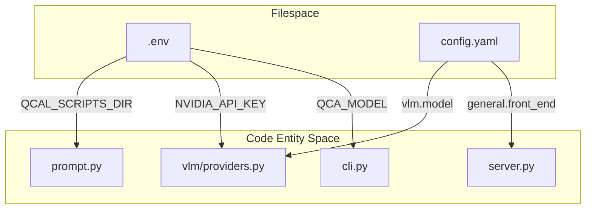
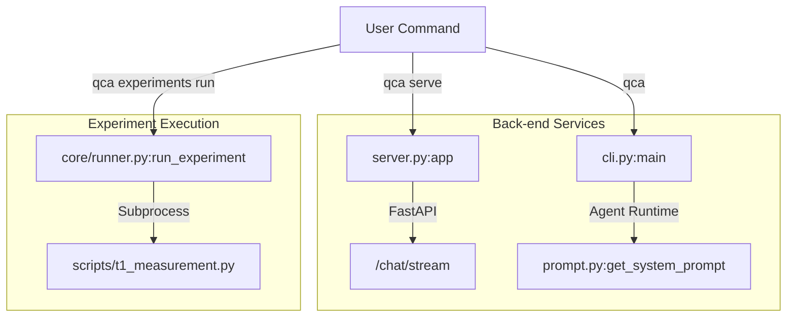

<!-- source: DeepWiki mcp.deepwiki.com · repo NVIDIA/Quantum-Calibration-Agent-Blueprint · page 1.1 Getting Started · fetched 2026-10-26 -->

# Getting Started

<details>
<summary>Relevant source files</summary>

The following files were used as context for generating this wiki page:

- [.env.example](.env.example)
- [README.md](README.md)
- [config.yaml](config.yaml)
- [docs/latest/quick-start/index.mdx](docs/latest/quick-start/index.mdx)
- [docs/latest/quick-start/installation.mdx](docs/latest/quick-start/installation.mdx)
- [fern/docs.yml](fern/docs.yml)
- [pyproject.toml](pyproject.toml)

</details>


This guide provides step-by-step instructions for setting up the Quantum Calibration Agent (QCA). It covers prerequisites, installation, environment configuration, and the various ways to launch the system.

## Prerequisites

Before installing QCA, ensure your environment meets the following requirements:

*   **Python 3.11+**: Required for the backend and agent runtime [pyproject.toml:6-6]().
*   **Node.js 18+ & npm 9+**: Required for building and running the Next.js Web UI [README.md:31-31]().
*   **API Credentials**: An API key from a supported LLM provider.
    *   **NVIDIA API Catalog** (Default): [build.nvidia.com](https://build.nvidia.com) [README.md:33-33]().
    *   **Anthropic**: [console.anthropic.com](https://console.anthropic.com) [README.md:34-34]().
    *   **OpenAI**: [platform.openai.com](https://platform.openai.com) [README.md:35-35]().

Sources: [README.md:28-35](), [pyproject.toml:6-6]()

---

## Installation

Follow these steps to clone the repository and set up the Python and Node.js environments.

### 1. Clone and Python Setup
```bash
# Clone the repository
git clone https://github.com/NVIDIA/Quantum-Calibration-Agent-Blueprint.git
cd Quantum-Calibration-Agent-Blueprint

# Create and activate virtual environment
python -m venv .venv
source .venv/bin/activate  # Windows: .venv\Scripts\activate

# Install the package in editable mode with development dependencies
pip install -e ".[test,docs]"
```
The `pip install -e .` command installs core dependencies including `deepagents`, `langchain-nvidia-ai-endpoints`, `fastapi`, and `plotly` [pyproject.toml:7-22]().

### 2. Web UI Setup
```bash
# Install frontend dependencies
cd ui
npm install
cd ..
```

Sources: [README.md:39-50](), [pyproject.toml:1-38](), [docs/latest/quick-start/index.mdx:18-36]()

---

## Configuration

QCA uses a combination of a `.env` file for secrets and a `config.yaml` for system-level settings.

### Environment Variables (.env)
Create a `.env` file by copying the provided example:
```bash
cp .env.example .env
```
Edit the `.env` file to include your API keys and preferred model:

| Variable | Description | Example |
| :--- | :--- | :--- |
| `NVIDIA_API_KEY` | Key for NVIDIA API Catalog | `nvapi-your-key` |
| `QCA_MODEL` | Provider and model string | `nvidia:nvidia/nemotron-3-nano-30b-a3b` |
| `QCAL_SCRIPTS_DIR` | Path to experiment scripts | `./scripts` |

### System Configuration (config.yaml)
The `config.yaml` file defines the backend server parameters and VLM (Vision Language Model) defaults:

*   **Backend**: Configures the FastAPI server host, port, and endpoint paths [config.yaml:16-29]().
*   **VLM**: Sets the default provider (e.g., `"nvidia"`), model, and sampling parameters for visual analysis [config.yaml:32-38]().

### Configuration Data Flow
The following diagram illustrates how configuration files are consumed by the system entities.

**Configuration Ingestion Flow**

Sources: [.env.example:1-21](), [config.yaml:16-54](), [docs/latest/quick-start/installation.mdx:69-105]()

---

## Launching the System

You can interact with QCA through three primary interfaces.

### 1. Full System (Web UI + Backend)
This is the recommended mode for visual experiment analysis and workflow monitoring.

*   **Start Backend**: `qca serve` launches the FastAPI server defined in `server.py` [README.md:66-66]().
*   **Start Web UI**: `cd ui && npm run dev` starts the Next.js development server [README.md:69-69]().
*   **Access**: Open `http://localhost:3000`.

### 2. Interactive TUI
For a rich terminal experience, simply run:
```bash
qca
```
This invokes the `main` function in `cli.py` [pyproject.toml:38-38](), launching an interactive Terminal User Interface (TUI) powered by `deepagents-cli` [README.md:77-78]().

### 3. Non-Interactive CLI
You can execute specific tasks directly from the shell without entering an interactive session:
```bash
# List all discovered experiments
qca experiments list

# Run a specific calibration script
qca experiments run t1_measurement

# Check the status of an automated workflow
qca workflow status <workflow_id>
```

### System Launch Sequence
This diagram shows the relationship between the user commands and the underlying code execution.

**Execution Entry Points**


Sources: [README.md:62-86](), [pyproject.toml:37-38](), [docs/latest/quick-start/index.mdx:53-105]()

---

## Verifying the Setup

To ensure everything is configured correctly, run the following verification commands:

1.  **Check CLI Version**: `qca --version` should return `qca 0.1.0` [docs/latest/quick-start/installation.mdx:59-67]().
2.  **Test Discovery**: `qca experiments list` should display the built-in scripts like `t1_measurement` and `qubit_spectroscopy` [docs/latest/quick-start/index.mdx:95-97]().
3.  **Test Backend API**: With `qca serve` running, verify the endpoint:
    ```bash
    curl http://localhost:8000/api/experiments/list
    ```

Sources: [docs/latest/quick-start/index.mdx:106-121](), [docs/latest/quick-start/installation.mdx:106-130]()

---

