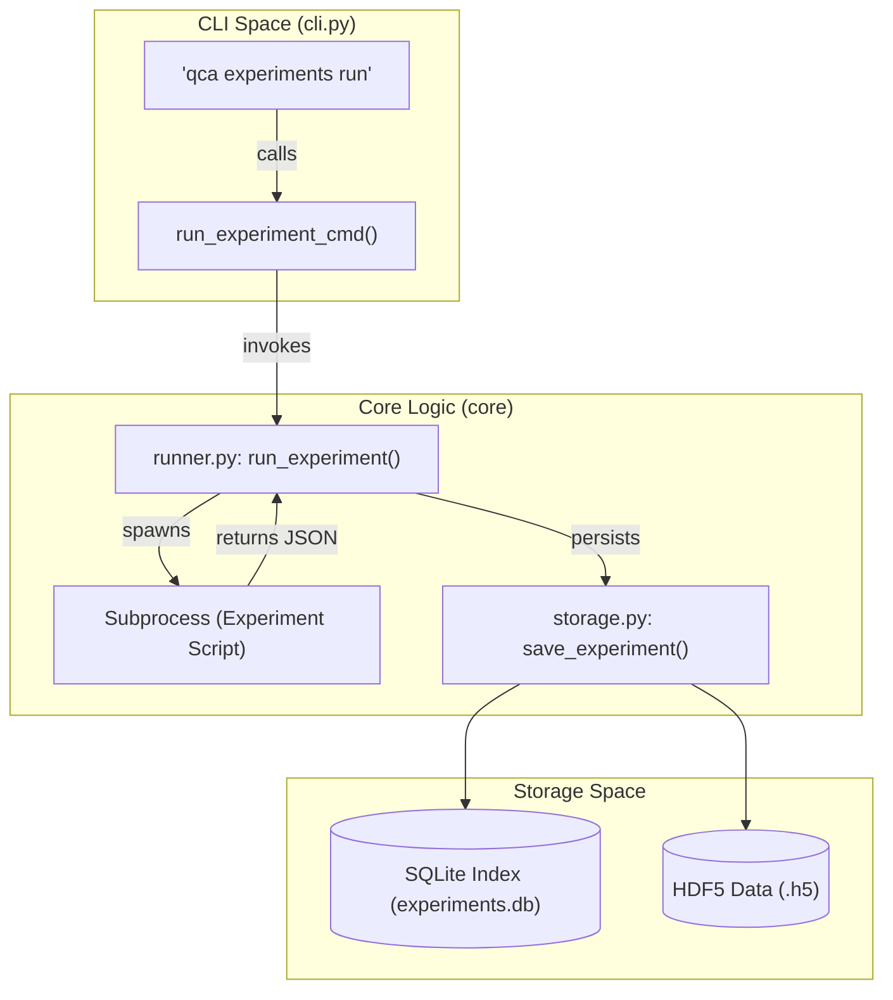
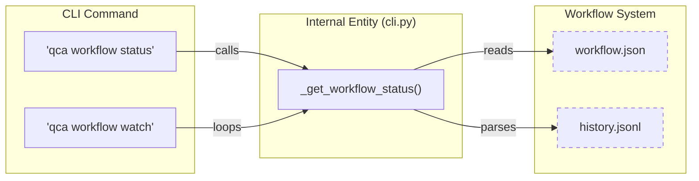

<!-- source: DeepWiki mcp.deepwiki.com · repo NVIDIA/Quantum-Calibration-Agent-Blueprint · page 2.1 CLI Commands Reference · fetched 2026-10-26 -->

# CLI Commands Reference

Relevant source files

The following files were used as context for generating this wiki page:

- [cli.py](cli.py)
- [core/__init__.py](core/__init__.py)
- [docs/latest/user-guide/cli-overview.mdx](docs/latest/user-guide/cli-overview.mdx)
- [docs/latest/user-guide/experiments/running-experiments.mdx](docs/latest/user-guide/experiments/running-experiments.mdx)

The `qca` command-line interface is the primary entry point for interacting with the Quantum Calibration Agent. It provides a multi-modal interface that supports an interactive Text User Interface (TUI), a non-interactive agent mode for automated tasks, a FastAPI backend server for the Web UI, and a suite of low-level subcommands for direct system management.

## System Entry Point and Global Options

The CLI is implemented using the `typer` library in `cli.py`. It serves as a dispatcher that routes requests to either the `deepagents-cli` runtime (for agentic interaction) or specific core modules (for experiment and workflow management).

### Execution Modes

| Mode | Command | Implementation |
| :--- | :--- | :--- |
| **Interactive TUI** | `qca` | Launches `DeepAgentsApp` with custom NVIDIA branding [cli.py:159-163](). |
| **Non-Interactive** | `qca -n "task"` | Executes a single prompt through the agent and exits [cli.py:530-534](). |
| **Backend Server** | `qca serve` | Starts the FastAPI server defined in `server.py` [cli.py:561-570](). |
| **Subcommands** | `qca <group> <cmd>` | Direct execution of logic without LLM intervention [cli.py:580-1120](). |

### Global Flags
*   `--non-interactive` (`-n`): Run a single agent task and exit [cli.py:530]().
*   `--model`: Override the default model (Default: `QCA_MODEL` env var) [cli.py:65]().
*   `--resume` (`-r`): Resume a specific conversation thread ID [cli.py:541]().
*   `--auto-approve` (`-y`): Skip manual confirmation for tool calls [cli.py:535]().

**Sources:** [cli.py:18-40](), [cli.py:520-555](), [docs/latest/user-guide/cli-overview.mdx:38-48]()

---

## Experiments Subcommands

The `experiments` group manages the discovery, validation, and execution of quantum calibration scripts located in the `scripts/` directory.

### `experiments list`
Scans the `scripts/` directory using `discover_experiments()` to identify valid experiment functions.
*   **Data Flow**: `cli.py` → `core/discovery.py:discover_experiments()` → `core/discovery.py:_extract_schema_from_file()`.
*   **Output**: Returns a list of experiment names and brief descriptions [cli.py:586-608]().

### `experiments schema <name>`
Retrieves the detailed parameter specification for a specific experiment.
*   **Implementation**: Uses `get_experiment_schema(name)` which parses Python type hints and `Annotated` metadata [core/discovery.py:133-146]().
*   **Details**: Includes parameter types, default values, and valid ranges [docs/latest/user-guide/experiments/running-experiments.mdx:42-70]().

### `experiments validate <path>`
Performs a static analysis of a Python script to ensure it conforms to the QCA experiment contract.
*   **Checks**: Verifies the existence of a public function, a `-> dict` return annotation, and typed parameters [cli.py:633-657]().

### `experiments run <name>`
Executes an experiment in a managed subprocess.
*   **Implementation**: Calls `run_experiment()` in `core/runner.py`.
*   **Logic**:
    1.  Validates input `--params` against the discovered schema [core/runner.py:126-128]().
    2.  Spawns a subprocess using a wrapper that captures `stdout`/`stderr` [core/runner.py:184-210]().
    3.  Saves the resulting `ExperimentResult` to the HDF5/SQLite storage via `save_experiment()` [core/storage.py:165-210]().

**CLI to Core Mapping: Experiment Execution**

**Sources:** [cli.py:580-705](), [core/discovery.py:30-60](), [core/runner.py:110-150](), [docs/latest/user-guide/experiments/running-experiments.mdx:81-108]()

---

## History and Data Subcommands

These commands provide administrative access to the `data/` directory, allowing users to query past results and extract raw arrays.

### `history list`
Queries the SQLite index for past runs.
*   **Options**: `--type` (filter by script), `--last` (limit results) [cli.py:724-730]().
*   **Implementation**: Calls `list_experiments()` in `core/storage.py` [core/storage.py:270-305]().

### `history show <id>`
Displays all metadata, scalar results, and available data keys for a specific run ID [cli.py:769-805]().

### `data arrays <id>`
Lists the names of all multi-dimensional arrays stored within a specific experiment's HDF5 file [cli.py:863-884]().

### `data get <id> <array_name>`
Retrieves raw numerical data for a specific array.
*   **Implementation**: `get_array_data(experiment_id, array_name)` [core/storage.py:388-410]().
*   **Data Flow**: Opens the HDF5 file at `data/experiments/YYYY/MM/DD/<id>.h5` and reads the specified dataset [core/storage.py:395-400]().

**Sources:** [cli.py:710-915](), [core/storage.py:20-50](), [docs/latest/user-guide/cli-overview.mdx:171-230]()

---

## Workflow Subcommands

The `workflow` group manages long-running, multi-step calibration DAGs (Directed Acyclic Graphs).

### `workflow list`
Lists all workflow definitions (`workflow.json`) found in the `data/workflows/` directory [cli.py:925-945]().

### `workflow status <id>`
Displays the current execution state of a workflow, including which nodes are `pending`, `running`, `success`, or `failed` [cli.py:976-1002]().

### `workflow watch <id>`
Provides a live-updating view of the workflow's progress using a `rich.live.Live` display [cli.py:1100-1120](). It polls the workflow state every 2 seconds.

### `workflow validate <id>`
Checks a workflow JSON file for structural integrity, ensuring all dependencies exist and there are no circular references [cli.py:1029-1052]().

**CLI to Code Entity Association: Workflow Management**

**Sources:** [cli.py:920-1120](), [docs/latest/user-guide/cli-overview.mdx:260-310]()

---

## The `serve` Command

The `qca serve` command initializes the system's web backend.

*   **Command**: `qca serve [--host HOST] [--port PORT]` [cli.py:561]().
*   **Implementation**:
    1.  Imports `uvicorn`.
    2.  Launches the FastAPI app defined in `server.py` [cli.py:568-570]().
*   **Responsibilities**:
    *   Exposes REST endpoints for the Web UI [server.py:50-100]().
    *   Manages the streaming agent interface via `/chat/stream` [server.py:144-160]().
    *   Spawns background processes for workflow execution [server.py:440-460]().

**Sources:** [cli.py:561-570](), [server.py:1-40]()

---

