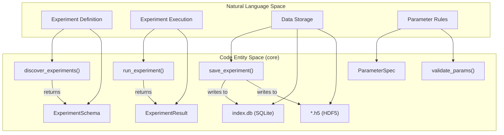
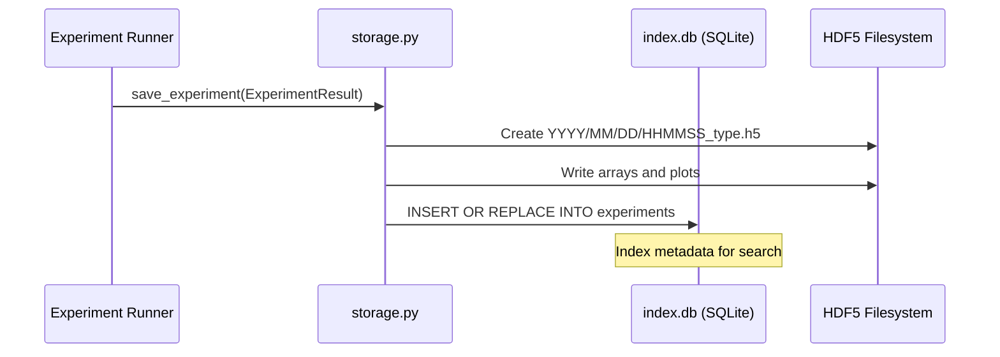

<!-- source: DeepWiki mcp.deepwiki.com · repo NVIDIA/Quantum-Calibration-Agent-Blueprint · page 4 Core Engine · fetched 2026-10-26 -->

# Core Engine

Relevant source files

The following files were used as context for generating this wiki page:

- [core/discovery.py](core/discovery.py)
- [core/models.py](core/models.py)
- [core/runner.py](core/runner.py)
- [core/storage.py](core/storage.py)

The `core/` package serves as the foundational layer of the Quantum Calibration Agent (QCA) blueprint. It provides the data structures, discovery mechanisms, and execution logic required to manage quantum experiments and their resulting data.

The Core Engine is designed to be independent of the Agent and Web UI layers, allowing it to be used as a standalone library for experiment management and data storage.

### System Overview and Code Entities

The following diagram illustrates how high-level system concepts map to specific code entities within the `core/` package.

**Natural Language to Code Entity Mapping**

Sources: [core/discovery.py:25-36](), [core/models.py:51-59](), [core/runner.py:76-101](), [core/storage.py:64-70]()

---

### Data Models
The system relies on a set of strictly defined dataclasses to ensure consistency across the discovery, execution, and storage phases. These models handle the serialization of experiment metadata, parameter constraints, and complex result sets (including multidimensional arrays and plots).

*   **`ParameterSpec`**: Defines the name, type, and optional range constraints for experiment inputs [core/models.py:23-39]().
*   **`ExperimentSchema`**: Represents the static definition of an experiment script discovered on disk [core/models.py:51-59]().
*   **`ExperimentResult`**: Encapsulates the complete output of a run, including scalars, NumPy-compatible arrays, and Plotly visualizations [core/models.py:87-114]().

For details, see [Data Models](#4.1).

---

### Experiment Discovery
QCA uses an AST (Abstract Syntax Tree) based discovery mechanism to identify available experiments without executing the scripts. This allows the system to safely inspect user-provided Python files in the `scripts/` directory to extract function signatures and documentation.

*   **Static Analysis**: The `discover_experiments` function parses Python files into AST nodes to identify public functions [core/discovery.py:25-51]().
*   **Type Extraction**: It specifically looks for type hints (e.g., `Annotated[float, (0, 1)]`) to automatically build validation rules [core/discovery.py:193-224]().

For details, see [Experiment Discovery](#4.2).

---

### Experiment Runner
Experiments are executed in isolated subprocesses to prevent crashes in the main agent or server process from affecting the entire system. The runner manages the lifecycle of these subprocesses, handles parameter validation, and captures real-time logs.

*   **Subprocess Isolation**: `run_experiment` constructs a Python command that imports the target script and passes parameters via `stdin` [core/runner.py:116-128]().
*   **Execution Modes**: Supports both simple buffered execution and real-time streaming of `stderr` to log files via `_run_with_logging` [core/runner.py:161-172]().

For details, see [Experiment Runner](#4.3).

---

### Storage Layer
The storage system employs a dual-tier architecture designed for both fast metadata searching and efficient high-volume data persistence.

*   **SQLite Index**: Stores experiment metadata (ID, type, status, timestamp) for rapid filtering and search operations [core/storage.py:30-61]().
*   **HDF5 Data Store**: Stores large numerical arrays and serialized plot data in a hierarchical format, organized on disk by date [core/storage.py:71-128]().

**Storage Interaction Flow**

Sources: [core/storage.py:64-155]()

For details, see [Storage Layer](#4.4).

---
**Sources:**
- [core/models.py:1-124]()
- [core/discovery.py:1-236]()
- [core/runner.py:1-210]()
- [core/storage.py:1-155]()

---

