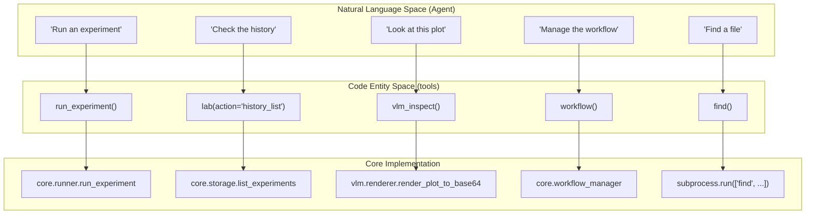
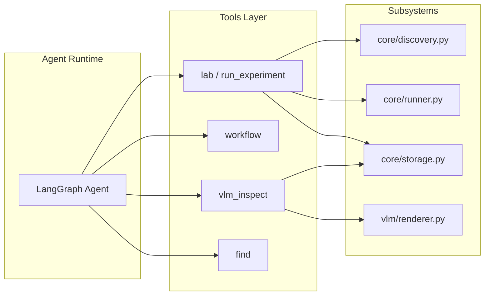

<!-- source: DeepWiki mcp.deepwiki.com · repo NVIDIA/Quantum-Calibration-Agent-Blueprint · page 5 Agent Tools · fetched 2026-10-26 -->

# Agent Tools

Relevant source files

The following files were used as context for generating this wiki page:

- [tools/__init__.py](tools/__init__.py)
- [tools/find_tool.py](tools/find_tool.py)
- [tools/lab_tool.py](tools/lab_tool.py)

The Quantum Calibration Agent (QCA) utilizes a set of specialized LangChain tools to interact with the quantum hardware environment, manage data, and execute complex workflows. These tools are registered and exposed to the LLM to bridge the gap between natural language intent and the underlying Python core logic.

### Tool Registration
All tools are exported from the `tools` package and are decorated with the `@tool` decorator from `langchain_core.tools` [tools/__init__.py:18-23](). This registration allows the agent to discover capabilities such as experiment execution, data retrieval, and visual inspection.

### Natural Language to Code Mapping: Tooling Layer
The following diagram illustrates how the Agent's high-level tool definitions map to the specific Python functions and modules in the codebase.

**Diagram: Agent Tool Mapping**

Sources: [tools/__init__.py:18-23](), [tools/lab_tool.py:34-57](), [tools/find_tool.py:24-40]()

---

### Lab and Run Experiment Tools
The `lab` tool serves as the primary query interface for the agent. It is a multi-action tool used to discover experiment capabilities, inspect schemas, and retrieve historical data or statistics [tools/lab_tool.py:35-57](). 

The `run_experiment` tool is strictly separated from the `lab` tool to ensure that "Read" operations (queries) and "Write" operations (executions) are handled with appropriate safety boundaries [tools/lab_tool.py:95-113]().

*   **Lab Actions**: `info`, `schema`, `history_list`, `history_show`, `list_arrays`, `get_array`, `get_stats`.
*   **Execution**: `run_experiment` handles parameter validation and subprocess spawning.

For details, see [Lab and Run Experiment Tools](#5.1).

### Workflow Tool
The `workflow` tool enables the agent to manage long-running, multi-step calibration DAGs (Directed Acyclic Graphs). It provides actions to list active workflows, validate DAG structures, and update the state of specific nodes [tools/workflow_tool.py:23-50](). It utilizes a dot-notation mechanism (e.g., `node_id.status`) to allow the agent to perform granular updates to the workflow JSON state.

For details, see [Workflow Tool](#5.2).

### VLM Inspect Tool
The `vlm_inspect` tool bridges the gap between raw data and visual reasoning. It allows the agent to request a visual analysis of experiment results. The tool retrieves Plotly JSON data from storage, renders it into a PNG via the `vlm/renderer.py` pipeline, and sends the image along with a specialized prompt to a Vision Language Model (VLM) [tools/vlm_tool.py:26-45]().

For details, see [VLM Inspect Tool](#5.3).

### Find Tool
The `find` tool is a filesystem utility that allows the agent to locate scripts, data files, or logs within the repository. It acts as a wrapper around the system `find` command, providing the agent with a way to explore the directory structure without requiring direct shell access [tools/find_tool.py:24-40]().

For details, see [Find Tool](#5.4).

---

### System Integration Overview
The tools act as the interface between the LangGraph agent and the various subsystems of the QCA blueprint.

**Diagram: Tool-Subsystem Interaction**

Sources: [tools/lab_tool.py:25-27](), [tools/vlm_tool.py:18-22](), [tools/find_tool.py:18-20]()

---

