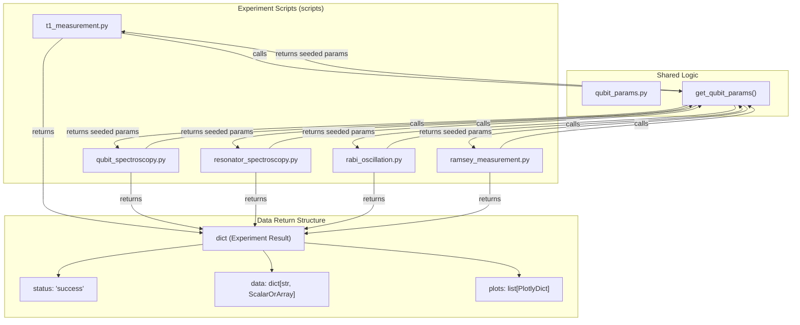
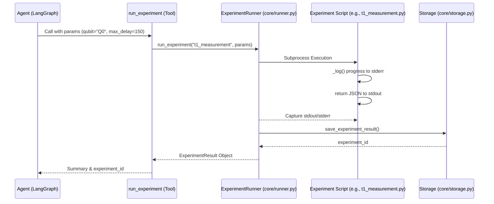

<!-- source: DeepWiki mcp.deepwiki.com · repo NVIDIA/Quantum-Calibration-Agent-Blueprint · page 7.1 Built-in Calibration Experiments · fetched 2026-10-26 -->

# Built-in Calibration Experiments

Relevant source files

The following files were used as context for generating this wiki page:

- [scripts/qubit_params.py](scripts/qubit_params.py)
- [scripts/qubit_spectroscopy.py](scripts/qubit_spectroscopy.py)
- [scripts/rabi_oscillation.py](scripts/rabi_oscillation.py)
- [scripts/ramsey_measurement.py](scripts/ramsey_measurement.py)
- [scripts/resonator_spectroscopy.py](scripts/resonator_spectroscopy.py)
- [scripts/t1_measurement.py](scripts/t1_measurement.py)

The Quantum Calibration Agent (QCA) includes a suite of six built-in experiment scripts located in the `scripts/` directory. These scripts simulate realistic quantum characterization measurements, including wall-clock execution delays, parameter validation via `Annotated` types, and rich data returns containing scalars, arrays, and Plotly visualizations.

### The Qubit Parameters Helper

All built-in experiments rely on a shared utility, `qubit_params.py`, to ensure consistency across different measurements for the same qubit.

#### Implementation: `_get_qubit_params`
The function `_get_qubit_params` [scripts/qubit_params.py:22-46]() uses the qubit identifier (e.g., "Q0") to seed a `numpy.random.default_rng`. This ensures that while parameters like `qubit_freq` or `t1` have realistic variations, they remain reproducible for a specific qubit throughout a session.

| Parameter | Base Value | Variation | Range / Units |
| :--- | :--- | :--- | :--- |
| `qubit_freq` | 4.85 GHz | ±0.3 | 4.55 - 5.15 GHz |
| `resonator_freq` | 6.02 GHz | ±0.2 | 5.82 - 6.22 GHz |
| `pi_amp` | 0.32 a.u. | ±15% | 0.27 - 0.37 a.u. |
| `t1` | 45.0 µs | ±30% | 31 - 58 µs |
| `t2_star` | 12.0 µs | ±30% | 8 - 16 µs |
| `q_factor` | 5000 | ±20% | 4000 - 6000 |

**Sources:** [scripts/qubit_params.py:18-50]()

---

### Resonator Spectroscopy

The `resonator_spectroscopy` script [scripts/resonator_spectroscopy.py:33-40]() sweeps microwave frequency to find the resonance dip of the readout resonator.

#### Parameters and Implementation
*   **Sweep Range**: Defined by `center_freq` and `span` [scripts/resonator_spectroscopy.py:35-36]().
*   **Physics Simulation**: Models the S21 magnitude response as a Lorentzian dip [scripts/resonator_spectroscopy.py:105-112]().
*   **Return Values**: Returns the `magnitude` array (dB), probe `frequencies` (GHz), and a fitted `resonator_freq` [scripts/resonator_spectroscopy.py:133-157]().

**Sources:** [scripts/resonator_spectroscopy.py:16-180]()

---

### Qubit Spectroscopy

The `qubit_spectroscopy` script [scripts/qubit_spectroscopy.py:33-40]() sweeps the drive frequency to identify the $|0\rangle \rightarrow |1\rangle$ transition frequency.

#### Parameters and Implementation
*   **Input Constraints**: Uses `Annotated` to restrict `center_freq` to [4.0, 5.5] GHz [scripts/qubit_spectroscopy.py:35]().
*   **Physics Simulation**: Generates a Lorentzian peak in the `excited_population` [scripts/qubit_spectroscopy.py:117-127]().
*   **Signal Detection**: Calculates a Signal-to-Noise Ratio (SNR) based on `num_averages` [scripts/qubit_spectroscopy.py:132-141]().

**Sources:** [scripts/qubit_spectroscopy.py:16-202]()

---

### Rabi Oscillation

The `rabi_oscillation` script [scripts/rabi_oscillation.py:33-39]() sweeps the drive pulse amplitude to calibrate the $\pi$ pulse (the amplitude required to flip the qubit state).

#### Parameters and Implementation
*   **Key Inputs**: `max_amplitude` (0.1 to 1.0 a.u.) and `pulse_width` (µs) [scripts/rabi_oscillation.py:35-37]().
*   **Physics Simulation**: Models population as $P_e = \sin^2(\pi \cdot \frac{amp}{amp_{\pi}})$ with added decoherence decay [scripts/rabi_oscillation.py:105-112]().
*   **Fitting**: Identifies the first peak in the population to determine `pi_amplitude` and `pi_half_amplitude` [scripts/rabi_oscillation.py:119-167]().

**Sources:** [scripts/rabi_oscillation.py:16-202]()

---

### T1 Measurement

The `t1_measurement` script [scripts/t1_measurement.py:33-38]() measures the longitudinal relaxation time ($T_1$) by applying a $\pi$ pulse and varying the delay before measurement.

#### Parameters and Implementation
*   **Input**: `max_delay` up to 500.0 µs [scripts/t1_measurement.py:35]().
*   **Physics Simulation**: Models an exponential decay $P_e = A \cdot e^{-t/T_1} + B$ [scripts/t1_measurement.py:104-108]().
*   **Data Flow**: Returns `delays` and `excited_population` arrays along with the scalar `t1_time` [scripts/t1_measurement.py:134-153]().

**Sources:** [scripts/t1_measurement.py:16-187]()

---

### Ramsey Measurement

The `ramsey_measurement` script [scripts/ramsey_measurement.py:33-39]() measures the dephasing time ($T_2^*$) using a $\pi/2 - \tau - \pi/2$ pulse sequence with an artificial detuning.

#### Parameters and Implementation
*   **Artificial Detuning**: Controlled by the `artificial_detuning` parameter (MHz) to create observable fringes [scripts/ramsey_measurement.py:37]().
*   **Physics Simulation**: Models Ramsey fringes as $P_e = 0.5 \cdot (1 + \cos(2\pi\delta t) \cdot e^{-t/T_2^*})$ [scripts/ramsey_measurement.py:111-117]().
*   **Visualization**: The plot includes both the raw data and the upper/lower decay envelopes [scripts/ramsey_measurement.py:180-194]().

**Sources:** [scripts/ramsey_measurement.py:16-194]()

---

### Experiment Execution and Data Flow

The following diagram illustrates how the experiment scripts interact with the `qubit_params` helper and the standardized return structure required by the `ExperimentRunner`.

**Experiment Entity Relationship**

**Sources:** [scripts/qubit_params.py:22-50](), [scripts/t1_measurement.py:132-187](), [scripts/qubit_spectroscopy.py:151-202]()

---

### System Integration: From Script to UI

This diagram shows how the `ExperimentRunner` in the core engine invokes these scripts and how the resulting data is processed for the Web UI and the Agent.

**Script Execution Pipeline**

**Sources:** [scripts/t1_measurement.py:29-30](), [scripts/t1_measurement.py:132-187]()

### Summary Table of Built-in Experiments

| Script Name | Primary Goal | Key Output | Shared Helper |
| :--- | :--- | :--- | :--- |
| `resonator_spectroscopy` | Find readout dip | `resonator_freq` | `get_qubit_params` |
| `qubit_spectroscopy` | Find qubit transition | `qubit_freq` | `get_qubit_params` |
| `rabi_oscillation` | Calibrate $\pi$ pulse | `pi_amplitude` | `get_qubit_params` |
| `t1_measurement` | Measure relaxation | `t1_time` | `get_qubit_params` |
| `ramsey_measurement` | Measure dephasing | `t2_star` | `get_qubit_params` |

**Sources:** [scripts/qubit_params.py:50](), [scripts/resonator_spectroscopy.py:33](), [scripts/qubit_spectroscopy.py:33](), [scripts/rabi_oscillation.py:33](), [scripts/t1_measurement.py:33](), [scripts/ramsey_measurement.py:33]()

---

