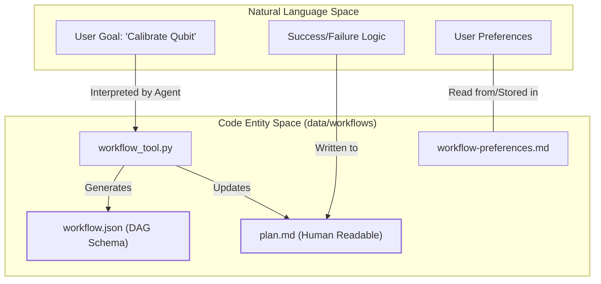
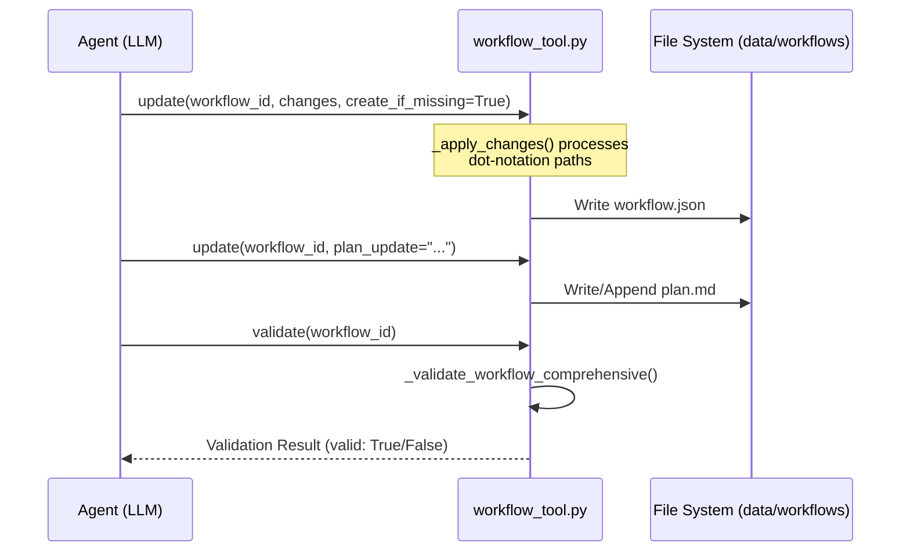

<!-- source: DeepWiki mcp.deepwiki.com · repo NVIDIA/Quantum-Calibration-Agent-Blueprint · page 8.1 Workflow Planning and Creation · fetched 2026-10-26 -->

# Workflow Planning and Creation

Relevant source files

The following files were used as context for generating this wiki page:

- [data/knowledge/documents/.gitkeep](data/knowledge/documents/.gitkeep)
- [data/knowledge/memory/workflow-preferences.md](data/knowledge/memory/workflow-preferences.md)
- [docs/latest/user-guide/workflows/index.mdx](docs/latest/user-guide/workflows/index.mdx)
- [tools/workflow_tool.py](tools/workflow_tool.py)

The Workflow system in the Quantum Calibration Agent (QCA) allows for the orchestration of complex, multi-step experiment sequences defined as Directed Acyclic Graphs (DAGs). Workflow planning is the process by which the agent translates high-level user goals (e.g., "Calibrate qubit 0") into a structured sequence of experiments with explicit dependencies, success criteria, and parameter logic.

## The Planning Process

Workflow planning is a collaborative process between the agent and the user, supported by the agent's internal memory and specialized tools.

### 1. Goal Discussion and Memory Retrieval
Before generating a DAG, the agent is instructed to discuss the goal with the user. During this phase, the agent accesses `data/knowledge/memory/workflow-preferences.md` [data/knowledge/memory/workflow-preferences.md:1-20]() to retrieve historical preferences, device-specific settings, or successful patterns previously established.

### 2. Plan Documentation (`plan.md`)
The agent typically creates a `plan.md` file within the workflow directory (`data/workflows/{workflow_id}/plan.md`). This document serves as a human-readable companion to the JSON DAG, detailing:
*   The overall objective of the calibration sequence.
*   The logic behind the chosen node sequence.
*   Specific success/failure criteria for each step.
*   Expected parameter transitions between experiments.

### 3. DAG Construction (`workflow.json`)
The core of the workflow is the `workflow.json` file. The agent uses the `workflow` tool with the `update` action to construct this file [tools/workflow_tool.py:34-82]().

#### Workflow Schema
The `workflow.json` follows a specific schema required for execution:
*   **`id`**: A unique string identifier for the workflow.
*   **`name`**: A descriptive name for the UI.
*   **`status`**: The global state (`created`, `running`, `paused`, `completed`, `failed`) [tools/workflow_tool.py:30-30]().
*   **`nodes`**: A list of node objects.
*   **`context`**: A shared dictionary for storing extracted results (e.g., frequencies, amplitudes) that downstream nodes can reference [docs/latest/user-guide/workflows/index.mdx:87-96]().

#### Node Schema
Each node represents a discrete experiment step:
*   **`id`**: Unique identifier within the workflow.
*   **`name`**: Human-readable label.
*   **`experiment`**: The name of the experiment script to run (e.g., `qubit_spectroscopy`).
*   **`parameters`**: A dictionary of arguments for the experiment.
*   **`dependencies`**: A list of node IDs that must complete successfully before this node starts [docs/latest/user-guide/workflows/index.mdx:14-20]().
*   **`state`**: Current node status (`pending`, `running`, `success`, `failed`, `skipped`) [tools/workflow_tool.py:31-31]().

## System Topology: Planning Entities

The following diagram bridges the natural language concepts of "Planning" to the specific code entities and file structures used by the QCA.

**Workflow Planning Entity Map**

Sources: [tools/workflow_tool.py:26-31](), [docs/latest/user-guide/workflows/index.mdx:22-26](), [data/knowledge/memory/workflow-preferences.md:1-20]()

## Implementation Details

### State Updates via Dot Notation
The agent manages the workflow state using a dot-notation update mechanism implemented in `_apply_changes` [tools/workflow_tool.py:34-82](). This allows the agent to modify specific parts of the DAG without overwriting the entire file.

*   **Simple keys**: `{"status": "running"}`
*   **Nested context**: `{"context.qubit_freq": 4.52}`
*   **Specific nodes**: `{"nodes.node_1.state": "success"}`

### Comprehensive Validation
Before a workflow can be transitioned from `created` to `running`, it must pass the `_validate_workflow_comprehensive` check [tools/workflow_tool.py:85-205](). This function ensures:
1.  The directory and `workflow.json` exist [tools/workflow_tool.py:102-131]().
2.  The JSON syntax is valid [tools/workflow_tool.py:137-148]().
3.  Required fields (`id`, `name`, `nodes`) are present [tools/workflow_tool.py:153-172]().
4.  Node IDs are unique and dependencies refer to existing nodes [tools/workflow_tool.py:206-213]().

### Data Flow: From Plan to Disk

The following diagram illustrates how the agent's internal planning logic results in persistent storage files.

**Workflow Creation Data Flow**

Sources: [tools/workflow_tool.py:34-82](), [tools/workflow_tool.py:85-151]()

## Agent Memory and Preferences
The agent uses `data/knowledge/memory/workflow-preferences.md` to persist cross-workflow knowledge. If a user repeatedly asks for a specific "Success Criteria" (e.g., "T1 must be > 50us"), the agent records this in the `## Success Criteria` section [data/knowledge/memory/workflow-preferences.md:5-7](). During future planning phases, the agent incorporates these constraints into the `plan.md` and node parameters automatically.

Sources:
* [tools/workflow_tool.py:16-213]()
* [docs/latest/user-guide/workflows/index.mdx:1-110]()
* [data/knowledge/memory/workflow-preferences.md:1-20]()

---

