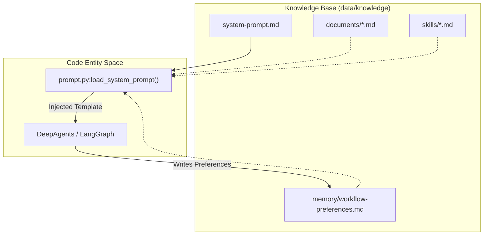

<!-- source: DeepWiki mcp.deepwiki.com · repo NVIDIA/Quantum-Calibration-Agent-Blueprint · page 9 Knowledge Base · fetched 2026-10-26 -->

# Knowledge Base

Relevant source files

The following files were used as context for generating this wiki page:

- [data/knowledge/documents/.gitkeep](data/knowledge/documents/.gitkeep)
- [data/knowledge/memory/workflow-preferences.md](data/knowledge/memory/workflow-preferences.md)
- [docs/latest/user-guide/knowledge-base.mdx](docs/latest/user-guide/knowledge-base.mdx)
- [prompt.py](prompt.py)

The Knowledge Base serves as the persistent context layer for the Quantum Calibration Agent (QCA). It provides the agent with a structured repository of reference materials, operational guidelines, and evolving memories of user preferences. By decoupling static documentation from dynamic execution logic, the system allows for flexible updates to the agent's behavior without requiring code changes.

## Directory Structure and Tiered Knowledge

The knowledge base is organized into a three-tier hierarchy within the `data/knowledge/` directory. This structure separates immutable reference material from the agent's internal reasoning skills and its long-term memory of user interactions.

| Tier | Directory | Purpose |
| :--- | :--- | :--- |
| **Documents** | `data/knowledge/documents/` | Static reference materials, device specifications, and calibration notes. |
| **Skills** | `data/knowledge/skills/` | Markdown-based instruction sets for specific tasks like experiment execution or VLM analysis. |
| **Memory** | `data/knowledge/memory/` | Dynamic files where the agent records long-term preferences and success criteria. |

### Knowledge Organization Flow

The following diagram illustrates how the `prompt.py` module aggregates these tiers into a unified context for the agent runtime.

**Knowledge Aggregation Diagram**

**Sources:**
- [prompt.py:23-35]()
- [docs/latest/user-guide/knowledge-base.mdx:63-72]()

## Skills and System Prompt

The "Skills" tier contains specialized instructions that guide the agent through complex multi-step processes. These are stored as Markdown files in `data/knowledge/skills/` and cover domains such as workflow planning, experiment script writing, and VLM configuration.

The `prompt.py` module is responsible for loading the primary `system-prompt.md` and injecting runtime environment variables (e.g., current datetime, platform type, and relative directory paths) using the `load_system_prompt()` function. This ensures the agent is always aware of its operating environment and the locations of its tools.

For details on how these skills are templated and the specific content of the instruction sets, see [Skills and System Prompt](#9.1).

**Sources:**
- [prompt.py:43-77]()
- [docs/latest/user-guide/knowledge-base.mdx:50-55]()

## Agent Memory

Unlike static documents, the **Memory** tier is designed for bidirectional interaction. The primary file, `workflow-preferences.md`, acts as a long-term storage for the agent to remember user-specific conventions, such as preferred parameter ranges or success criteria for specific qubits.

The agent reads these preferences during the planning phase of a workflow and is capable of updating the file when a user provides corrective feedback. This allows the agent to "learn" and refine its approach to calibration over time without manual configuration updates.

For details on the memory schema and how the agent performs read/write operations on its preferences, see [Agent Memory](#9.2).

**Sources:**
- [data/knowledge/memory/workflow-preferences.md:1-20]()
- [docs/latest/user-guide/knowledge-base.mdx:56-60]()

## Knowledge Access and Discovery

The knowledge base is accessible through both the Web UI and the CLI, providing transparency into what the agent "knows."

*   **CLI Discovery**: Users can list available knowledge files using `qca knowledge list` and view specific contents via `qca knowledge show <name>`.
*   **Web UI**: A dedicated "Knowledge" panel allows users to browse categories and view the same Markdown files the agent references.
*   **Automatic Injection**: The agent automatically references relevant documents during conversations based on the paths provided in the system prompt.

**Sources:**
- [docs/latest/user-guide/knowledge-base.mdx:20-39]()
- [prompt.py:64-72]()

---

