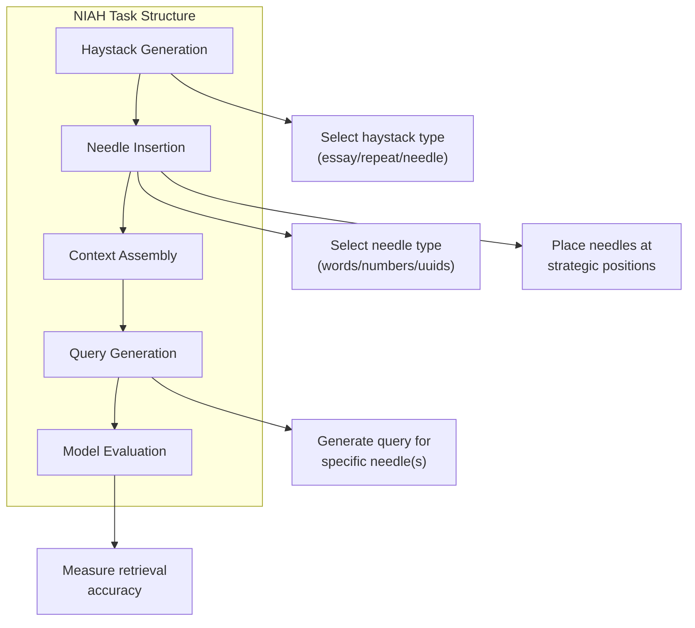
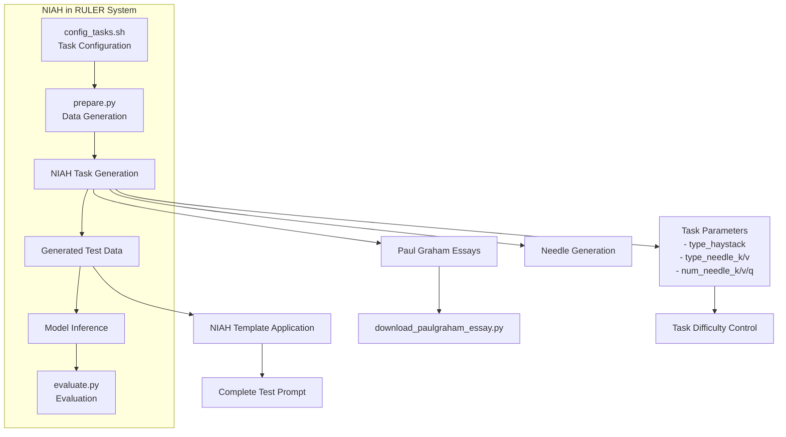
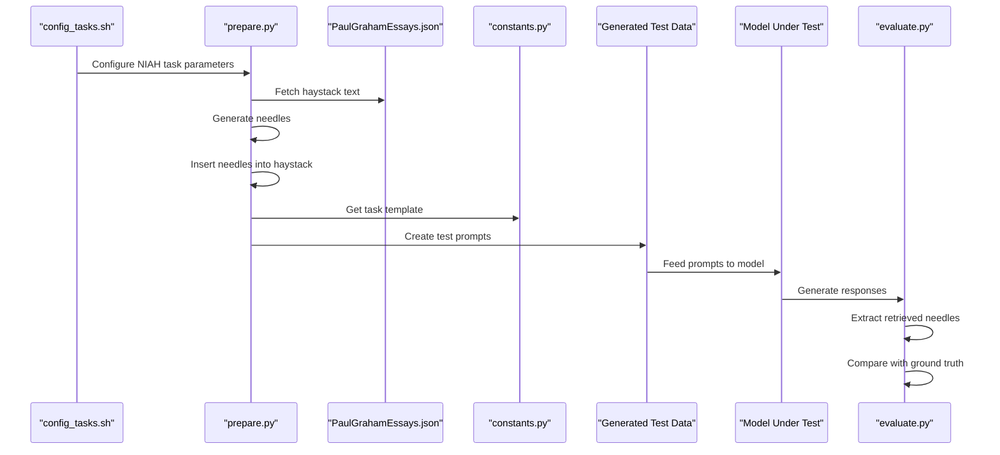

<!-- source: DeepWiki mcp.deepwiki.com · repo NVIDIA/RULER · page 3.2 Needle-in-a-Haystack (NIAH) · fetched 2026-10-26 -->

# Needle-in-a-Haystack (NIAH)

<details>
<summary>Relevant source files</summary>

The following files were used as context for generating this wiki page:

- [scripts/data/synthetic/json/PaulGrahamEssays_URLs.txt](scripts/data/synthetic/json/PaulGrahamEssays_URLs.txt)
- [scripts/data/synthetic/json/download_paulgraham_essay.py](scripts/data/synthetic/json/download_paulgraham_essay.py)
- [scripts/data/synthetic/niah.py](scripts/data/synthetic/niah.py)

</details>


## Purpose and Scope

The Needle-in-a-Haystack (NIAH) task is a retrieval-based evaluation method within the RULER benchmark that assesses a language model's ability to locate and retrieve specific information embedded within a much larger context. This page documents the NIAH task implementation, its configurations, data sources, and how it functions within the overall RULER evaluation system. For information about other benchmark tasks in RULER, see [Benchmark Tasks](#3).

## Task Definition

NIAH is designed to test a model's ability to find specific pieces of information (needles) hidden within a large amount of text (haystack). The task presents a simple yet effective challenge: can the model retrieve the specific information when prompted, even when that information is buried deep within a long context?

This task is inspired by prior work in evaluating LLM context utilization but extends it with configurable complexity parameters that allow for a more nuanced assessment of model capabilities.



Sources: [scripts/data/synthetic/constants.py:25-29]()

## Key Components

### Haystack Types

The NIAH task supports three types of haystacks:

1. **essay**: Uses Paul Graham essays as the haystack content, providing natural language text
2. **repeat**: Uses repeated noise sentences to create a uniform haystack
3. **needle**: Creates a haystack with "distracted needles" - additional needles scattered throughout to create confusion

### Needle Types

Needles are the specific pieces of information that the model must retrieve. They come in three forms:

1. **words**: Adjective-noun combinations (e.g., "green elephant")
2. **numbers**: 7-digit numerical sequences (e.g., "3856294")
3. **uuids**: 32-character alphanumeric identifiers (e.g., "7a91c25b8e4fd63052f9ec18d27c4609")

### Task Parameters

NIAH allows for precise configuration of task complexity through several parameters:

| Parameter | Description | Default |
|-----------|-------------|---------|
| type_haystack | Type of haystack (essay/repeat/needle) | essay |
| type_needle_k | Type of needle key (words/numbers/uuids) | words |
| type_needle_v | Type of needle value (words/numbers/uuids) | words |
| num_needle_k | Number of different needle keys to insert | 1 |
| num_needle_v | Number of values to retrieve from a single key | 1 |
| num_needle_q | Number of keys to query | 1 |

Sources: [README.md:123-126]()

## System Integration



Sources: [README.md:43-45](), [scripts/data/synthetic/constants.py:25-29](), [scripts/data/synthetic/json/download_paulgraham_essay.py:1-83]()

## Data Sources

The NIAH task utilizes Paul Graham essays as one of its primary data sources for the haystack text. These essays are downloaded from two sources:

1. The [LLMTest_NeedleInAHaystack GitHub repository](https://github.com/gkamradt/LLMTest_NeedleInAHaystack)
2. Paul Graham's personal website (http://www.paulgraham.com)

The download process is handled by the `download_paulgraham_essay.py` script, which fetches the essays from the URLs listed in `PaulGrahamEssays_URLs.txt` and combines them into a single JSON file.

Sources: [scripts/data/synthetic/json/download_paulgraham_essay.py:1-83](), [scripts/data/synthetic/json/PaulGrahamEssays_URLs.txt:1-218]()

## Task Template and Generation

The NIAH task uses a specific template defined in `constants.py`:

```
Some special magic {type_needle_v} are hidden within the following text. Make sure to memorize it. I will quiz you about the {type_needle_v} afterwards.
{context}
What are all the special magic {type_needle_v} for {query} mentioned in the provided text?
```

The evaluation system expects models to generate 128 tokens in response. The template includes an answer prefix to guide the model's response format:

```
The special magic {type_needle_v} for {query} mentioned in the provided text are
```

Sources: [scripts/data/synthetic/constants.py:25-29]()

## Implementation Process



Sources: [scripts/data/synthetic/constants.py:25-29]()

## NIAH Test Progression

When evaluating a model using NIAH, the task is typically administered at increasing context lengths to assess how the model's retrieval ability degrades with longer contexts. The standard progression in RULER includes context lengths of 4K, 8K, 16K, 32K, 64K, and 128K tokens.

This progression allows for determining the "effective context length" of a model - the maximum length at which the model can still perform the task with acceptable accuracy.

## Use Cases

NIAH serves several evaluation purposes:

1. **Context Utilization**: Tests whether models can access information throughout their claimed context window
2. **Long-range Retrieval**: Evaluates models' ability to find and extract specific information from long contexts
3. **Effective Context Length**: Helps determine the true usable context length of models, which often differs from the claimed length

## Performance Analysis

Models generally show high performance (often >95%) on NIAH with short contexts (4K tokens) but exhibit varying degrees of degradation as context length increases. This pattern helps identify each model's effective context length, which is often shorter than the advertised maximum context length.

The NIAH task is particularly valuable because:

1. It has a clear upper bound on performance
2. It isolates a specific capability (retrieval)
3. It can be parameterized to create varying levels of difficulty

Sources: [README.md:43-45]()

---

