# Page: Overview

# Overview

<details>
<summary>Relevant source files</summary>

The following files were used as context for generating this wiki page:

- [README.md](README.md)
- [resources/Rivermax_SDK.jpg](resources/Rivermax_SDK.jpg)

</details>


The NVIDIA Rivermax hub repository serves as the central gateway for developers building high-performance, IP-based media and data streaming applications. It provides a unified entry point to the specialized software kits, reference implementations, and utility tools required to leverage the NVIDIA Rivermax SDK.

## Purpose and Scope

This repository acts as a navigational hub rather than a monorepo for the codebase [README.md:7-9](). Its primary goals are:
*   **Centralized Access**: Providing a single location for official documentation, SDK downloads, and community support links [README.md:30-41]().
*   **Ecosystem Mapping**: Organizing specialized child repositories that handle distinct parts of the developer lifecycle, from low-level API examples to high-level C++ abstractions [README.md:22-28]().
*   **Problem Solving**: Addressing the complex requirements of professional media streaming (e.g., SMPTE ST 2110) through optimized networking that utilizes kernel bypass and hardware offloads [README.md:11-16]().

## System Architecture Overview

The Rivermax ecosystem bridges high-level application logic with low-level hardware capabilities. The following diagram illustrates how the repositories in this hub interact with the core SDK and NVIDIA networking hardware.

### Repository and Entity Map
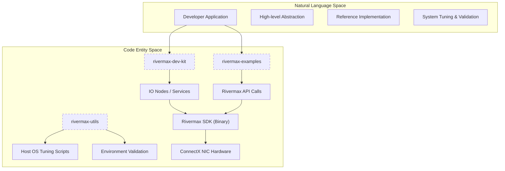
**Sources:** [README.md:22-28](), [README.md:13-16]()

## Core Components

The Rivermax solution is divided into three specialized repositories, each serving a specific technical need.

### 1. rivermax-dev-kit
A high-level C++ software kit designed to accelerate development. It provides flexible "IO nodes" and developer-friendly services to abstract the complexities of the raw Rivermax API [README.md:24-24]().
*   For details, see [rivermax-dev-kit](#2.1).

### 2. rivermax-examples
A collection of reference applications provided as source code. These demos demonstrate direct usage of the Rivermax API for various streaming scenarios [README.md:26-26]().
*   For details, see [rivermax-examples](#2.2).

### 3. rivermax-utils
A suite of utility scripts and tools used for host environment preparation, OS tuning (Linux and Windows), and validating the network configuration [README.md:28-28]().
*   For details, see [rivermax-utils](#2.3).

## Key Technology Pillars

Rivermax is built to satisfy the rigorous demands of industries such as Media & Entertainment (M&E), Broadcast, and Healthcare [README.md:15-16]().

### SDK and Standards
The SDK facilitates optimized data streaming by utilizing NVIDIA ConnectX NIC hardware offloads and GPUDirect technologies [README.md:13-15](). It supports industry standards including:
*   **SMPTE ST 2110**: Professional media over IP.
*   **PTP (IEEE 1588)**: Precision timing for synchronization.

For a deep dive into the SDK architecture, hardware requirements, and supported standards, see [What Is Rivermax](#1.1).

### Infrastructure Integration
The following diagram maps the logical flow from the user-facing repositories to the underlying system components.

### Logical Data Flow
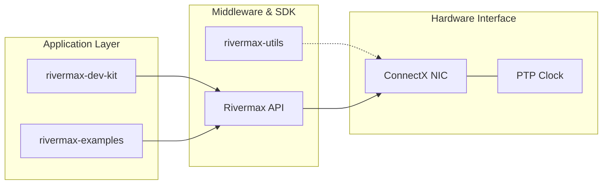
**Sources:** [README.md:13-16](), [README.md:22-28]()

## Navigation and Support

The repository structure is designed to guide users based on their current stage of development.
*   **New Users**: Should start with the [Official Documentation](https://developer.nvidia.com/networking/rivermax) and use `rivermax-utils` to prepare their environment [README.md:34-35]().
*   **Application Developers**: Can choose between the `rivermax-dev-kit` for rapid prototyping or `rivermax-examples` for fine-grained API control [README.md:24-26]().
*   **Support**: Issues with specific applications should be filed in their respective GitHub repositories, while SDK and licensing queries are handled via the NVIDIA Developer Portal [README.md:39-41]().

For more information on the repository layout and choosing the right starting point, see [Repository Structure and Navigation](#1.2).

**Sources:**
* [README.md:1-42]()
* [resources/Rivermax_SDK.jpg:1-28]()

---

# Page: What Is Rivermax

# What Is Rivermax

<details>
<summary>Relevant source files</summary>

The following files were used as context for generating this wiki page:

- [README.md](README.md)
- [resources/Rivermax_SDK.jpg](resources/Rivermax_SDK.jpg)

</details>


This page provides a technical deep dive into the NVIDIA Rivermax SDK, an optimized networking library designed for high-throughput media and data streaming. It covers the core value proposition, the hardware-software synergy with ConnectX NICs, and the architectural implementation that enables line-rate performance with minimal CPU overhead.

## Core Value Proposition

NVIDIA® Rivermax® is an SDK specifically engineered to handle the rigorous requirements of professional media-over-IP and high-bandwidth data streaming [README.md:13-14](). By utilizing kernel-bypass technology and hardware-based packet pacing, Rivermax enables standard COTS (Commercial Off-The-Shelf) servers to achieve performance previously only possible with dedicated FPGA-based hardware.

### Target Industries
*   **Media and Entertainment (M&E) & Broadcast:** Real-time uncompressed video transport [README.md:15-16]().
*   **Healthcare:** High-resolution medical imaging and remote surgery data [README.md:16-16]().
*   **Smart Cities:** Large-scale sensor data ingestion and AI-driven video analytics [README.md:16-16]().

### Key Standards Support
Rivermax is built around industry-standard protocols to ensure interoperability across broadcast and data ecosystems:
*   **SMPTE ST 2110:** Professional media over managed IP networks (Video, Audio, and Ancillary data).
*   **SMPTE ST 2022-7:** Seamless Protection Switching (hitless redundancy) for reliability.
*   **PTP / IEEE 1588:** Precision Time Protocol for sub-microsecond clock synchronization.
*   **SMPTE ST 2110-21:** Traffic shaping and delivery timing for video bitstreams.

**Sources:** [README.md:11-17]()

## Hardware and Performance Optimization

Rivermax is optimized for **NVIDIA ConnectX® Network Interface Cards (NICs)** (starting from ConnectX-5 and newer) [README.md:3-5](). The synergy between the SDK and the hardware is the foundation of its performance.

### GPUDirect Technology
Rivermax integrates with NVIDIA GPU accelerated computing technologies [README.md:15-15](). Using **GPUDirect**, Rivermax can move data directly between the NIC and GPU memory, bypassing the host CPU and system memory (RAM). This significantly reduces latency and frees up CPU cycles for application logic.

### Hardware Offloads
*   **Packet Pacing:** The NIC hardware handles the precise timing of packet transmission required by SMPTE ST 2110-21, preventing network congestion and jitter without CPU intervention.
*   **Kernel Bypass:** Data is transferred directly to user-space buffers, avoiding the overhead of the operating system's networking stack.

**Sources:** [README.md:1-17]()

## SDK Architecture

The Rivermax architecture follows a layered approach that abstracts the complexity of high-speed networking while maintaining direct access to hardware performance.

### Architecture Diagram
The following diagram illustrates the relationship between the application, the Rivermax SDK, and the underlying hardware components.

**Title: Rivermax System Architecture**
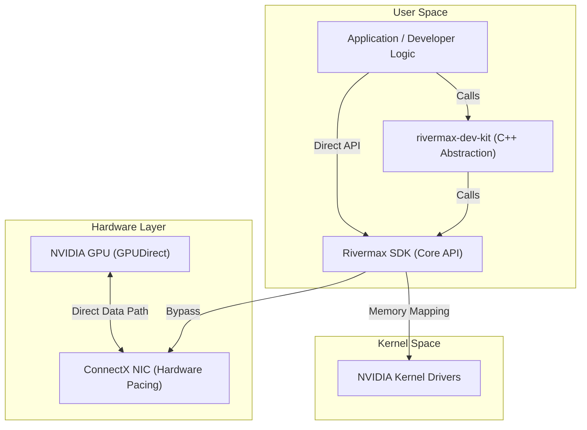
**Sources:** [README.md:24-28](), [resources/Rivermax_SDK.jpg:1-5]()

## Implementation and Data Flow

Rivermax operates by managing memory buffers and hardware queues to facilitate "zero-copy" data transfers.

### Data Path Integration
The SDK provides a core API that developers can interact with directly (demonstrated in `rivermax-examples`) or through a higher-level abstraction (provided by `rivermax-dev-kit`) [README.md:24-26]().

**Title: Code Entity Data Flow**
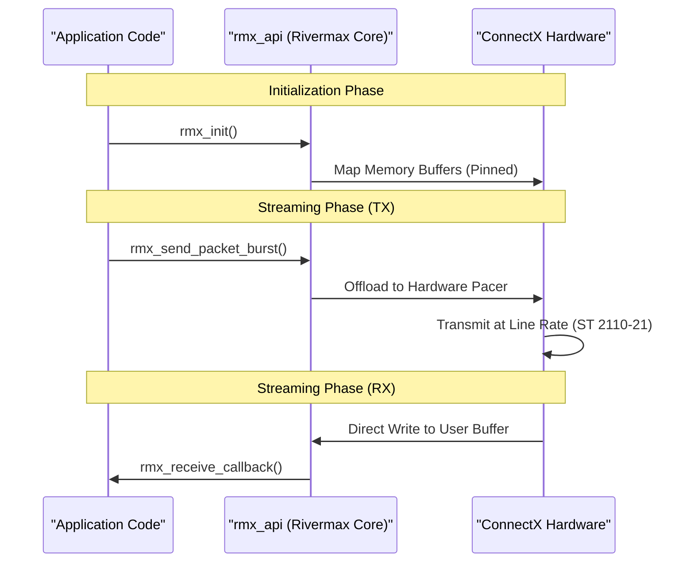

### Key Software Components
The Rivermax ecosystem is split into three functional areas to support the development lifecycle:

| Repository | Purpose | Target Audience |
| :--- | :--- | :--- |
| **rivermax-dev-kit** | High-level C++ abstraction using "IO nodes" to simplify development [README.md:24-24](). | Application Developers |
| **rivermax-examples** | Reference implementations showing raw API usage [README.md:26-26](). | System Architects / Core Integrators |
| **rivermax-utils** | Scripts for OS tuning, PTP validation, and performance benchmarking [README.md:28-28](). | DevOps / System Engineers |

**Sources:** [README.md:22-29]()

---

# Page: Repository Structure and Navigation

# Repository Structure and Navigation

<details>
<summary>Relevant source files</summary>

The following files were used as context for generating this wiki page:

- [README.md](README.md)

</details>


This page describes the organizational structure of the NVIDIA Rivermax hub repository and its relationship with the specialized child repositories. It outlines the technical rationale for the distributed repository model and provides a navigation guide for developers based on their specific implementation requirements.

## Hub Repository Layout

The [NVIDIA/Rivermax](https://github.com/NVIDIA/Rivermax) repository functions as a "Hub" or "Gateway" rather than a container for source code. Its primary role is to provide a unified entry point for documentation, architectural overviews, and links to the functional components of the Rivermax ecosystem [README.md:9-10]().

### File Structure

The repository maintains a minimalist structure focused on discovery and visual documentation:

| Path | Description |
| :--- | :--- |
| `README.md` | The main entry point containing the ecosystem overview, repository links, and support information [README.md:1-42](). |
| `resources/` | Contains static assets used for documentation, such as the `Rivermax_SDK.jpg` architecture diagram [README.md:5](). |

**Sources:** [README.md:1-42]()

---

## Distributed Repository Model

The Rivermax codebase is intentionally split across multiple GitHub repositories rather than a single monorepo. This modularity allows for independent versioning, specialized CI/CD pipelines, and distinct dependency management for different use cases.

### The Three Pillars of Rivermax

The ecosystem is divided into three functional areas:

1.  **rivermax-dev-kit**: A high-level C++ abstraction layer. It is designed to simplify development by providing "IO nodes" that wrap complex Rivermax API calls into developer-friendly services [README.md:24]().
2.  **rivermax-examples**: Reference implementations that demonstrate direct usage of the Rivermax SDK API. These are intended for developers who need fine-grained control or wish to understand the raw SDK primitives [README.md:26]().
3.  **rivermax-utils**: A collection of operational tools. These scripts handle environment validation, performance tuning, and host configuration [README.md:28]().

### Repository Relationship Diagram

The following diagram illustrates how the Hub repository directs users to the specialized codebases based on their technical needs.

**Hub to Specialized Repository Mapping**
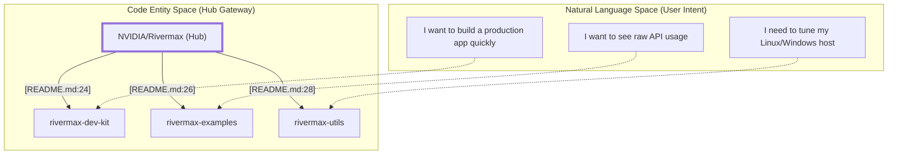

**Sources:** [README.md:22-29]()

---

## Navigation Guide by Use Case

To navigate the Rivermax ecosystem effectively, developers should choose their starting point based on the following technical criteria:

### 1. High-Level Application Development
If the goal is to implement SMPTE ST 2110 or generic data streaming without managing low-level memory pinning or packet pacing manually, navigate to **rivermax-dev-kit** [README.md:24]().
*   **Key Entity:** `IO nodes` (C++ classes that encapsulate streaming logic).
*   **Benefit:** Reduced boilerplate and faster time-to-market.

### 2. Learning and Direct Integration
If the goal is to integrate Rivermax directly into an existing engine or to understand the SDK's internal mechanics, navigate to **rivermax-examples** [README.md:26]().
*   **Key Entity:** `Rivermax API` (Direct C-style SDK calls).
*   **Benefit:** Maximum control over hardware features and memory management.

### 3. System Administration and Benchmarking
For initial setup, network interface card (NIC) configuration, or troubleshooting performance bottlenecks, navigate to **rivermax-utils** [README.md:28]().
*   **Key Entity:** `Utility scripts` (Python/Bash/PowerShell scripts for OS tuning).
*   **Benefit:** Ensures the underlying hardware and OS are optimized for kernel-bypass networking.

### Ecosystem Data Flow

The diagram below shows how these repositories interact with the underlying Rivermax SDK and the hardware.

**System Data Flow and Component Interaction**
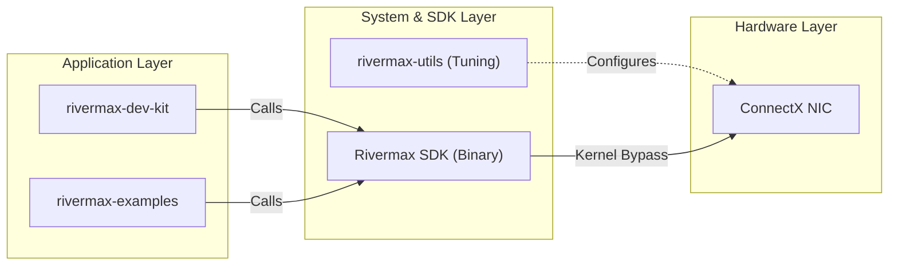

**Sources:** [README.md:13-16](), [README.md:24-28]()

---

## Support and Maintenance Policy

Code across all Rivermax GitHub repositories is provided **"As Is"** [README.md:20](). While the repositories are maintained by NVIDIA, they serve as reference implementations.

*   **Bugs/Feature Requests:** Issues should be filed in the specific repository where the code resides (e.g., an issue with a utility script goes to `rivermax-utils`) [README.md:40]().
*   **SDK/Licensing:** Formal support for the binary SDK itself is handled via the NVIDIA Developer Portal [README.md:39]().
*   **Community:** General architectural questions are directed to the NVIDIA Developer Forums [README.md:41]().

**Sources:** [README.md:20](), [README.md:37-41]()

---

# Page: Ecosystem Repositories

# Ecosystem Repositories

<details>
<summary>Relevant source files</summary>

The following files were used as context for generating this wiki page:

- [README.md](README.md)

</details>


The NVIDIA Rivermax ecosystem is organized into three specialized repositories, each serving a distinct purpose in the development and maintenance lifecycle of media and data streaming applications. This modular approach allows developers to choose the appropriate level of abstraction, ranging from raw API reference implementations to high-level C++ development kits and operational utility scripts.

### Repository Landscape

The following diagram illustrates how the three repositories interact with the underlying Rivermax SDK and the developer's application logic.

**Rivermax Ecosystem Integration Flow**
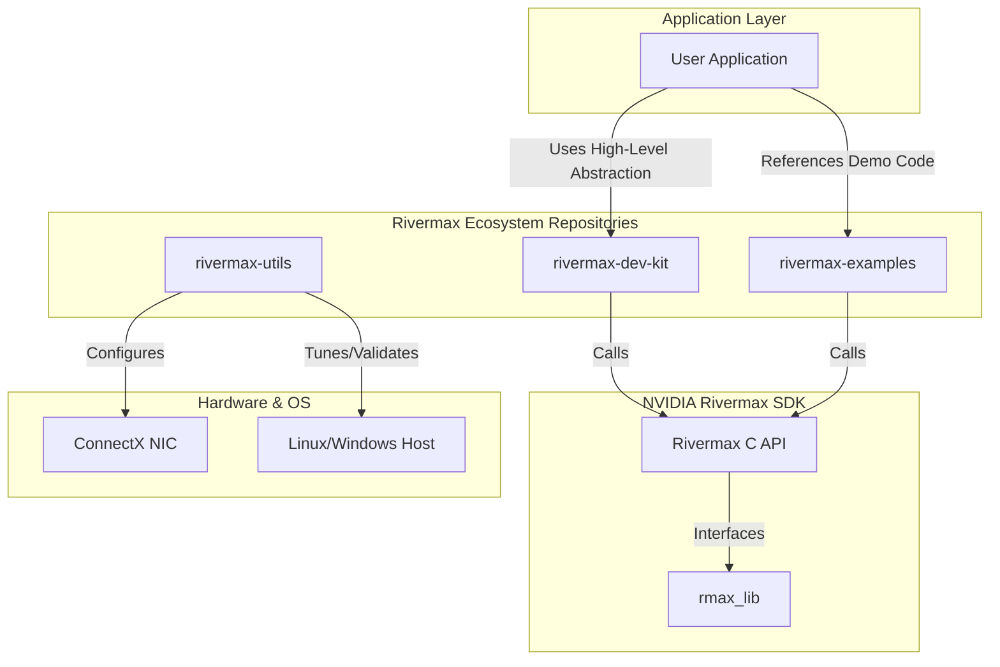
Sources: [README.md:22-28](), [README.md:9-18]()

---

## rivermax-dev-kit

The `rivermax-dev-kit` is a high-level C++ software kit designed to accelerate the development process. It abstracts the complexities of the raw Rivermax C API into flexible IO nodes and developer-friendly services.

*   **Role:** Productivity and Abstraction.
*   **Key Features:** Modular IO node architecture, simplified buffer management, and pre-integrated services for common streaming patterns.
*   **Target Audience:** Developers building production-grade applications who prefer a modern C++ framework over manual API orchestration.

For detailed architecture and usage, see [rivermax-dev-kit](#2.1).

Sources: [README.md:24-24]()

---

## rivermax-examples

The `rivermax-examples` repository serves as the primary reference implementation suite for the Rivermax SDK. It contains standalone demo applications that interact directly with the SDK's C API.

*   **Role:** Reference and Education.
*   **Key Features:** Demonstrates direct usage of the Rivermax API for various media essences (video, audio, data) and showcases core SDK features like packet pacing and memory pinning.
*   **Target Audience:** Developers needing to understand the low-level mechanics of the SDK or those seeking a "copy-paste" starting point for custom C-based implementations.

For a catalog of available demos and implementation details, see [rivermax-examples](#2.2).

Sources: [README.md:26-26]()

---

## rivermax-utils

The `rivermax-utils` repository provides a collection of essential scripts and tools for managing the host environment and validating performance.

*   **Role:** Operations and Optimization.
*   **Key Features:** Host OS tuning scripts (Linux/Windows), network interface configuration tools, environment validation checks, and performance benchmarking utilities.
*   **Target Audience:** System administrators and DevOps engineers responsible for preparing the hardware and OS for high-throughput, low-latency streaming.

For information on environment preparation and tuning tools, see [rivermax-utils](#2.3).

Sources: [README.md:28-28]()

---

## Summary of Repository Roles

The table below summarizes the intended use case for each repository within the developer lifecycle.

| Repository | Primary Focus | Language | Complexity |
| :--- | :--- | :--- | :--- |
| **`rivermax-dev-kit`** | Application Framework | C++ | High (Abstraction) |
| **`rivermax-examples`** | API Reference | C / C++ | Low (Direct API) |
| **`rivermax-utils`** | Environment/Ops | Shell / Python / Misc | N/A (Tooling) |

Sources: [README.md:22-28]()

---

# Page: rivermax-dev-kit

# rivermax-dev-kit

<details>
<summary>Relevant source files</summary>

The following files were used as context for generating this wiki page:

- [README.md](README.md)

</details>


The `rivermax-dev-kit` is a high-level C++ software kit designed to accelerate the development of applications utilizing the NVIDIA Rivermax SDK. While the core Rivermax SDK provides a low-level, high-performance API for media and data streaming, the Dev Kit acts as an abstraction layer that simplifies complex tasks such as memory management, thread synchronization, and protocol compliance (e.g., SMPTE ST 2110) [README.md:24-24]().

## Purpose and Value Proposition

The primary goal of the Dev Kit is to reduce the "time to market" for developers by providing pre-built components for common streaming workflows. It is particularly useful for developers who prefer an object-oriented C++ interface over the procedural C-style API of the base SDK.

| Feature | Direct Rivermax API | Rivermax Dev Kit |
| :--- | :--- | :--- |
| **Complexity** | High (Manual buffer/pacing management) | Lower (Abstracted IO Nodes) |
| **Abstraction** | Low-level C API | High-level C++ Classes |
| **Flexibility** | Maximum (Full control over every packet) | High (Modular node-based architecture) |
| **Development Speed** | Slower (Requires deep SDK knowledge) | Faster (Uses pre-validated services) |

**Sources:** [README.md:24-24]()

## IO Node Architecture

The Dev Kit is built around a modular **IO Node** architecture. This design allows developers to treat data sources and sinks as independent entities that can be connected to form a processing pipeline.

### Core Components
*   **Generic IO Nodes**: Abstract base classes that handle the lifecycle of a stream (Initialization, Start, Stop, Teardown).
*   **Receiver Nodes**: Handle incoming network traffic, buffer management, and payload extraction.
*   **Sender Nodes**: Handle packetization, hardware-based pacing, and transmission.

### Code Entity Mapping: IO Flow
The following diagram illustrates how high-level C++ entities in the Dev Kit manage the data flow from the network to the application layer.

**Dev Kit Data Path Architecture**
```mermaid
graph TD
    subgraph "Network Layer"
        "NIC"["ConnectX NIC"]
    end

    subgraph "Rivermax Dev Kit (C++ Abstraction)"
        "StreamService"["rtp_service::StreamService"]
        "IONode"["io_node::IONodeBase"]
        "BufferMgr"["memory::BufferManager"]
        "PacingService"["pacing::PacingService"]
    end

    subgraph "Rivermax SDK (Low-Level)"
        "RmaxAPI"["rmx_api_functions"]
    end

    "NIC" <--> "RmaxAPI"
    "RmaxAPI" --> "StreamService"
    "StreamService" --> "IONode"
    "IONode" --> "BufferMgr"
    "PacingService" -. "Controls" .-> "RmaxAPI"
```
**Sources:** [README.md:24-24]()

## Developer-Friendly Services

The Dev Kit provides several internal services that automate the heavy lifting required for professional media streaming:

1.  **Memory Management**: Automated pinning of memory buffers to ensure compatibility with Zero-copy and GPUDirect technologies.
2.  **Clock Synchronization**: Integration with PTP (Precision Time Protocol) to ensure frames are timestamped accurately according to SMPTE standards.
3.  **Traffic Shaping**: High-level wrappers for SMPTE ST 2110-21 compliant packet pacing, preventing network congestion and buffer overflows.
4.  **Redundancy**: Simplifies the implementation of SMPTE ST 2022-7 (Seamless Protection Switching) by managing dual-network paths within a single logical node.

### System Interaction: Sender Implementation
This diagram shows the relationship between Dev Kit classes when implementing a media sender.

**Sender Logic Entity Mapping**
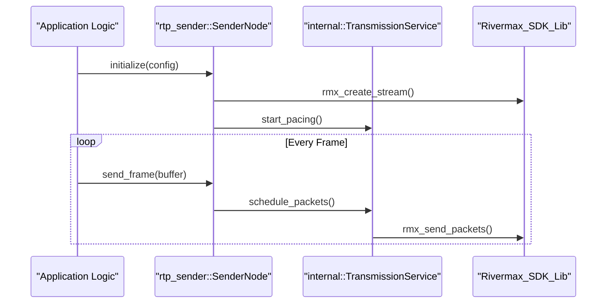
**Sources:** [README.md:24-24]()

## When to Choose Rivermax Dev Kit

Choosing between the `rivermax-dev-kit` and the raw `rivermax-examples` depends on the project requirements:

### Choose `rivermax-dev-kit` if:
*   You are building a complex, production-grade C++ application.
*   You require a modular architecture where different media essences (Video, Audio, Ancillary) are handled by separate objects.
*   You want to leverage built-in SMPTE ST 2110 logic without implementing the specification from scratch.
*   You prefer RAII (Resource Acquisition Is Initialization) patterns for resource management.

### Choose `rivermax-examples` (Direct API) if:
*   You need the absolute minimum overhead for a specialized use case.
*   You are writing a C application or a wrapper for another language (e.g., Python, Rust).
*   You are performing low-level research or benchmarking of the SDK itself.
*   You need to implement a proprietary protocol not covered by the Dev Kit's abstractions.

**Sources:** [README.md:24-28]()

---

# Page: rivermax-examples

# rivermax-examples

<details>
<summary>Relevant source files</summary>

The following files were used as context for generating this wiki page:

- [README.md](README.md)

</details>


The `rivermax-examples` repository serves as the foundational reference implementation suite for the NVIDIA Rivermax SDK. Unlike high-level abstraction layers, this repository provides direct, low-level demonstrations of the Rivermax API [README.md:26-27](). It is designed to guide developers through the core mechanics of memory management, packet pacing, and hardware offload integration.

## Role as Reference Implementation

The examples within this repository are provided as source code to illustrate how applications can achieve kernel-bypass performance and hardware-based synchronization [README.md:20-21](). By interfacing directly with the Rivermax SDK, these applications demonstrate the minimum overhead required for high-bandwidth media and data streaming.

### Key Functional Pillars
*   **Direct API Usage**: Implementation of the `rmx_` function calls for stream initialization, memory registration, and buffer management.
*   **Data Path Optimization**: Demonstrations of zero-copy data transfers and GPUDirect integration for low-latency processing.
*   **Standards Compliance**: Reference code for implementing SMPTE ST 2110 (Video, Audio, Ancillary data) and ST 2022-7 (Redundancy) at the packet level.

**Sources:** [README.md:11-21](), [README.md:26-27]()

## Application Architecture and Data Flow

The applications in `rivermax-examples` follow a structured flow to ensure the NIC hardware can take over packet timing and delivery, which is critical for professional broadcast standards like SMPTE ST 2110-21.

### Initialization and Memory Flow
The following diagram illustrates the typical sequence an example application follows to establish a high-performance media stream using the Rivermax SDK.

**Diagram: Rivermax Example Stream Lifecycle**
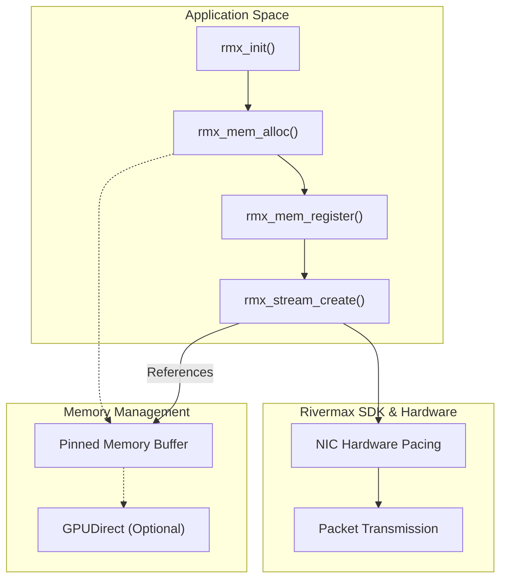
**Sources:** [README.md:13-16](), [README.md:26-27]()

## Demo Application Types

The repository includes various demo applications tailored to specific use cases in Media and Entertainment (M&E), Healthcare, and Smart Cities [README.md:15-16](). These demos are categorized by their primary function:

| Application Type | Description | Key Code Entities |
| :--- | :--- | :--- |
| **Generic Receive** | Demonstrates how to join multicast groups and ingest raw RTP streams using kernel-bypass. | `rmx_input_stream`, `rmx_receive()` |
| **Generic Transmit** | Shows how to schedule packets for transmission with hardware-accurate timing. | `rmx_output_stream`, `rmx_send()` |
| **ST 2110 Reference** | Specific implementations for Video (-20), Audio (-30), and Metadata (-40) essences. | `rmx_st2110_header`, `rmx_packet_pacing` |
| **Redundancy (2022-7)** | Demonstrates seamless protection switching by merging dual network paths. | `rmx_redundancy_group` |

**Sources:** [README.md:13-16](), [README.md:26-27]()

## From Natural Language to Code Entities

To help developers transition from conceptual requirements to implementation, the following diagram maps common streaming requirements to the specific Rivermax API entities used within the `rivermax-examples` repository.

**Diagram: Requirement to Code Mapping**
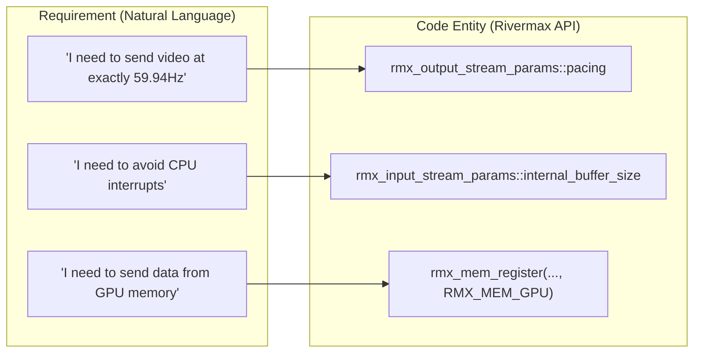
**Sources:** [README.md:13-16](), [README.md:26-27]()

## Usage as a Starting Point

Developers are encouraged to use these examples as a template for custom integrations. Because the code is provided "As Is" [README.md:20](), it serves as a sandbox for:
1.  **Benchmarking**: Using the example apps to validate that the local environment (configured via `rivermax-utils`) achieves expected line-rate performance [README.md:28]().
2.  **Prototyping**: Modifying the payload handling in the transmit/receive loops to integrate custom codecs or data formats.
3.  **API Learning**: Understanding the relationship between `rmx_` objects and the underlying ConnectX NIC hardware offloads [README.md:13-15]().

**Sources:** [README.md:20-21](), [README.md:26-28]()

---

# Page: rivermax-utils

# rivermax-utils

<details>
<summary>Relevant source files</summary>

The following files were used as context for generating this wiki page:

- [README.md](README.md)

</details>


The `rivermax-utils` repository is a specialized collection of scripts and tools designed to streamline the deployment, optimization, and maintenance of the NVIDIA Rivermax environment. While the SDK provides the core streaming capabilities, `rivermax-utils` focuses on the underlying infrastructure—ensuring the Host OS, Network Interface Cards (NICs), and system configurations are tuned for high-throughput, low-latency media streaming [README.md:28-28]().

## System Tuning and Environment Validation

The utilities in this repository address the strict performance requirements of professional media standards like SMPTE ST 2110. Achieving zero-packet-loss at high bitrates (e.g., 4K/8K video) requires specific OS-level optimizations that these tools automate.

### Linux Performance Tuning
For Linux environments, the utilities focus on kernel-bypass efficiency and interrupt management. Key areas of optimization include:
*   **CPU Governor Configuration:** Setting the scaling governor to `performance` to prevent frequency scaling latency.
*   **Interrupt Affinity:** Aligning NIC interrupts with specific CPU cores to minimize context switching.
*   **Hugepages Allocation:** Configuring memory management to support the large, pinned memory buffers required by the Rivermax SDK.

### Windows Performance Tuning
On Windows, the utilities assist in configuring the system for the Rivermax Windows driver, focusing on:
*   **Registry Optimizations:** Adjusting network stack parameters for high-performance UDP processing.
*   **Power Profiles:** Ensuring the system operates in a high-performance state to maintain consistent packet pacing.

### Hardware and Network Configuration
The tools provide automated workflows for managing NVIDIA ConnectX SmartNICs, which are foundational to Rivermax hardware offloads.

| Category | Functionality | Code Entity Reference |
| :--- | :--- | :--- |
| **Validation** | Verifies firmware versions and driver compatibility. | `rmx_validate_env` |
| **Configuration** | Sets up VPI (Virtual Protocol Interconnect) and Ethernet modes. | `rmx_nic_config` |
| **PTP Setup** | Configures Precision Time Protocol (IEEE 1588) parameters on the NIC. | `rmx_ptp_setup` |

**Sources:** [README.md:28-28](), [README.md:34-35]()

## Operational Maintenance and Benchmarking

Beyond initial setup, `rivermax-utils` provides tools for ongoing operational health monitoring and performance benchmarking.

### Performance Benchmarking Flow
The benchmarking utilities allow developers to simulate high-load scenarios to verify that the host system can handle the required number of ST 2110 streams without drops.

**Benchmarking Execution Logic**
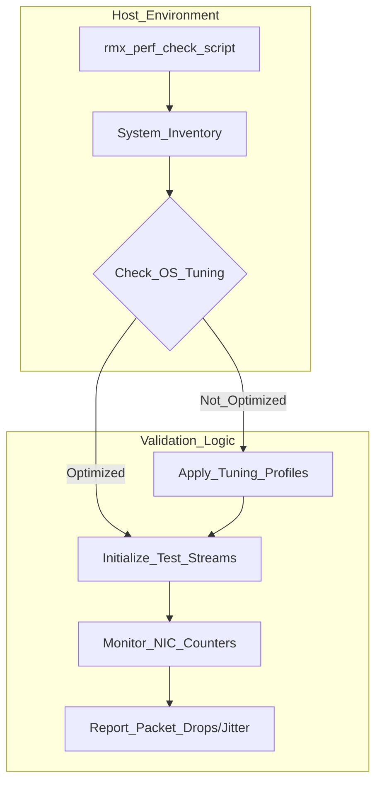
**Sources:** [README.md:28-28](), [README.md:13-16]()

## Integration with Rivermax Ecosystem

The `rivermax-utils` repository acts as the foundation for the other components in the Rivermax hub. Before running examples or developing with the Dev Kit, the environment must be prepared using these utilities.

**Repository Interdependencies**
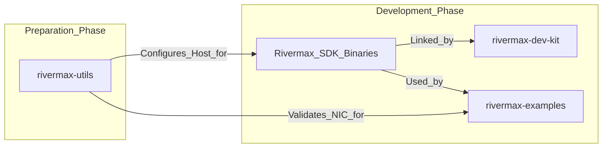

### Key Components Summary
*   **Environment Validation:** Scripts to ensure the hardware and software prerequisites (ConnectX NICs, OFED/WinOF-2 drivers) are met [README.md:35-35]().
*   **Network Interface Tuning:** Tools to configure hardware offloads such as packet pacing and header-data split.
*   **Operational Scripts:** Maintenance tools for firmware updates and log collection for support purposes [README.md:40-40]().

**Sources:** [README.md:9-18](), [README.md:24-28]()

---

# Page: Architecture and Key Concepts

# Architecture and Key Concepts

<details>
<summary>Relevant source files</summary>

The following files were used as context for generating this wiki page:

- [README.md](README.md)
- [resources/Rivermax_SDK.jpg](resources/Rivermax_SDK.jpg)

</details>


This page provides a technical overview of the NVIDIA Rivermax system architecture. Rivermax is designed as a layered system that bridges high-performance hardware capabilities—specifically NVIDIA ConnectX Network Interface Cards (NICs)—with sophisticated software abstractions for professional media and data streaming.

The architecture focuses on three primary pillars:
1.  **Hardware Acceleration**: Leveraging NIC offloads for timing and packet pacing.
2.  **Kernel Bypass**: Moving data directly between the application and the hardware to minimize latency and CPU overhead.
3.  **Standard Compliance**: Implementing professional media-over-IP standards like SMPTE ST 2110 and ST 2022-7.

### System Hierarchy

The following diagram illustrates the relationship between the application layer, the Rivermax SDK, and the underlying hardware components.

**Rivermax Layered Architecture**
```mermaid
graph TD
    subgraph "Application Space"
        [Application] --> [Rivermax_Dev_Kit]
        [Application] --> [Rivermax_API]
    end

    subgraph "Rivermax SDK"
        [Rivermax_API] --> [Data_Path_Manager]
        [Data_Path_Manager] --> [Memory_Management]
        [Data_Path_Manager] --> [Packet_Pacing_Engine]
    end

    subgraph "Kernel Space"
        [Rivermax_Driver]
    end

    subgraph "Hardware Layer"
        [Memory_Management] -- "GPUDirect / RDMA" --> [ConnectX_NIC]
        [Packet_Pacing_Engine] -- "Hardware Offload" --> [ConnectX_NIC]
        [ConnectX_NIC] --> [Physical_Network]
    end

    style [Rivermax_API] stroke-width:2px
    style [ConnectX_NIC] stroke-width:2px
```
**Sources:** [README.md:13-17](), [README.md:24-28](), [resources/Rivermax_SDK.jpg:1-5]()

---

### SDK Architecture and Data Path

The Rivermax SDK architecture is optimized for high-throughput, jitter-sensitive media traffic. At its core, it utilizes a kernel-bypass mechanism that allows the application to interact directly with the NIC's transmit and receive queues. This bypass is critical for achieving the deterministic performance required by broadcast standards.

Key components of the data path include:
*   **Hardware Packet Pacing**: Offloading the timing of RTP packet transmission to the ConnectX NIC to ensure compliance with SMPTE ST 2110-21 traffic shaping.
*   **Memory Management**: Support for pinned host memory and GPUDirect, enabling direct data transfer between the NIC and GPU memory without intermediate CPU copies.
*   **Flow Control**: Efficient handling of media "essences" (video, audio, and metadata) as discrete data streams.

For details, see [SDK Architecture and Data Path](#3.1).

**Sources:** [README.md:13-15](), [resources/Rivermax_SDK.jpg:1-10]()

---

### Media Streaming Standards

Rivermax is built to satisfy the rigorous requirements of the professional broadcast industry. The architecture natively supports the SMPTE ST 2110 suite, which defines the transport of uncompressed digital media over IP networks.

The system architecture incorporates:
*   **SMPTE ST 2110**: Separation of video (-20), audio (-30), and ancillary data (-40) into individual streams.
*   **SMPTE ST 2022-7**: Seamless Protection Switching, providing network redundancy by sending identical streams over two different network paths.
*   **PTP (IEEE 1588)**: Precision Time Protocol support to ensure all devices on the network are synchronized to a common clock, essential for lip-sync and multi-camera alignment.

For details, see [Media Streaming Standards](#3.2).

**Sources:** [README.md:13-16](), [README.md:34-35]()

---

### Component Interaction Map

This diagram bridges the conceptual architecture with the repository structure provided in this hub.

**Code Entity and Repository Mapping**
```mermaid
graph LR
    subgraph "rivermax-dev-kit Repository"
        [rtx_io_node] -- "High-level Abstraction" --> [rmx_api]
    end

    subgraph "rivermax-examples Repository"
        [simple_publisher_demo] -- "Direct Call" --> [rmx_api]
        [simple_receiver_demo] -- "Direct Call" --> [rmx_api]
    end

    subgraph "rivermax-utils Repository"
        [tuning_scripts] -- "Optimizes" --> [OS_Kernel]
        [validation_tools] -- "Checks" --> [ConnectX_NIC]
    end

    subgraph "Rivermax SDK (Binary)"
        [rmx_api]
    end
```
**Sources:** [README.md:24-28](), [README.md:40-41]()

---

# Page: SDK Architecture and Data Path

# SDK Architecture and Data Path

<details>
<summary>Relevant source files</summary>

The following files were used as context for generating this wiki page:

- [README.md](README.md)
- [resources/Rivermax_SDK.jpg](resources/Rivermax_SDK.jpg)

</details>


The NVIDIA Rivermax SDK is designed to provide a high-performance, kernel-bypass data path for media and data streaming. By leveraging NVIDIA ConnectX network interface cards (NICs), Rivermax offloads intensive networking tasks—such as packet pacing, timing, and memory management—from the CPU to the hardware. This architecture ensures deterministic performance required for professional media standards like SMPTE ST 2110.

## Internal Architecture Overview

The Rivermax architecture consists of a layered approach that bridges user-space applications directly to the hardware. This bypasses the standard OS networking stack, eliminating kernel overhead and context switching.

### System Components and Code Entities

The following diagram illustrates the relationship between the high-level architectural components and the specific code entities found in the Rivermax ecosystem.

**Architecture to Code Mapping**
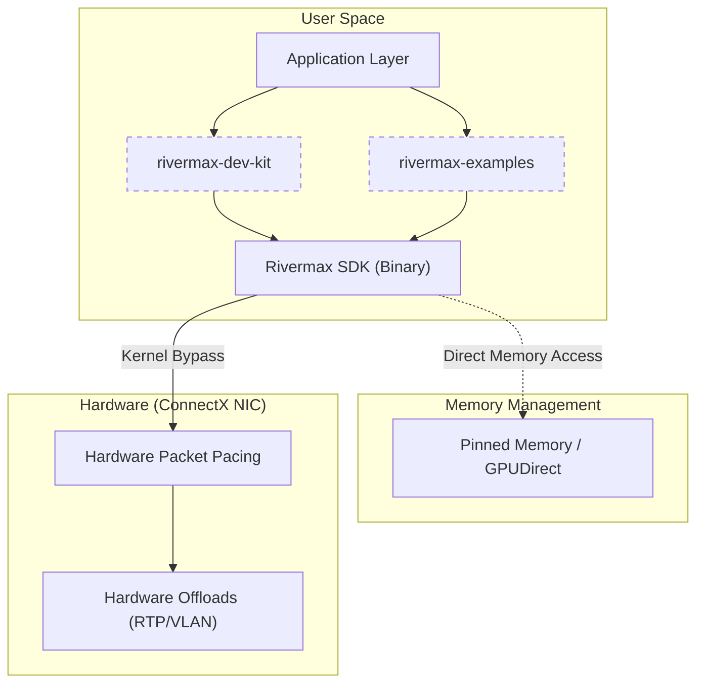
**Sources:** [README.md:13-28](), [README.md:34-35]()

## Key Architectural Pillars

### 1. Kernel-Bypass Networking
Rivermax utilizes a kernel-bypass mechanism to allow applications to interact directly with the NIC. This is critical for achieving the high throughput and low latency required for 4K/8K video streams. By avoiding the Linux or Windows networking stack, Rivermax reduces CPU utilization and jitter.

### 2. Hardware Packet Pacing
One of the most significant features of the Rivermax architecture is its reliance on NIC hardware for traffic shaping. 
*   **SMPTE ST 2110-21 compliance:** The NIC handles the precise timing of packet transmission to meet the Narrow (N) or Wide (W) sender types defined by the standard.
*   **Implementation:** The application provides a sequence of packets to the SDK, and the ConnectX hardware ensures they are released onto the wire at the exact nanosecond intervals required.

### 3. Memory Management: Pinned Memory and GPUDirect
To facilitate high-speed data transfers, Rivermax manages memory buffers using specialized techniques:
*   **Pinned Memory:** Buffers are "locked" in physical memory so the NIC can access them directly via DMA (Direct Memory Access) without CPU intervention.
*   **GPUDirect:** For workloads involving video processing, Rivermax can stream data directly between the NIC and NVIDIA GPU memory. This avoids the "double-copy" penalty where data would otherwise travel from NIC to System RAM and then to GPU RAM.

## Media Essence Data Flow

The flow of media essence (Video, Audio, or Metadata) from an application to the network follows a strictly optimized path.

**Data Path: Essence to Network**
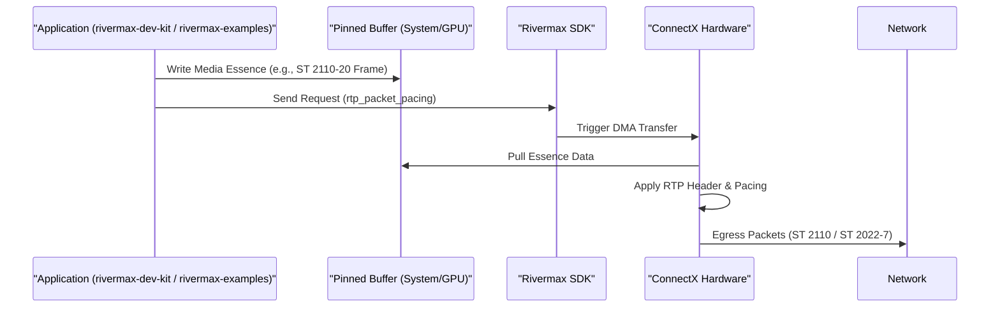
**Sources:** [README.md:13-16](), [README.md:24-28]()

## Implementation Layers

The Rivermax ecosystem provides different levels of abstraction for developers to interact with this architecture:

| Layer | Repository | Purpose |
| :--- | :--- | :--- |
| **Abstraction Layer** | `rivermax-dev-kit` | Provides high-level C++ classes and "IO Nodes" to simplify session management and buffer handling. |
| **Reference Layer** | `rivermax-examples` | Direct C API usage examples demonstrating raw buffer registration and packet transmission. |
| **Utility Layer** | `rivermax-utils` | Scripts for tuning the OS (e.g., interrupt affinity, huge pages) to support the high-speed data path. |

**Sources:** [README.md:24-28]()

## Hardware Offloads and Standards Support
The architecture is purpose-built to support industry-standard protocols directly in the hardware path:
*   **SMPTE ST 2110:** Individual essence flows (Video -20, Audio -30, Ancillary -40).
*   **SMPTE ST 2022-7:** Seamless Protection Switching, where the SDK manages dual-path redundancy at the hardware level.
*   **PTP (IEEE 1588):** Hardware-based time-stamping to ensure all packets are synchronized to a Grandmaster clock.

**Sources:** [README.md:13-16](), [README.md:34-35]()

---

# Page: Media Streaming Standards

# Media Streaming Standards

<details>
<summary>Relevant source files</summary>

The following files were used as context for generating this wiki page:

- [README.md](README.md)
- [resources/Rivermax_SDK.jpg](resources/Rivermax_SDK.jpg)

</details>


NVIDIA Rivermax is engineered to meet the rigorous requirements of professional media-over-IP environments. It provides high-performance implementations of the industry standards necessary for uncompressed video, audio, and ancillary data transmission over standard Ethernet networks. This page details the implementation and data flow for SMPTE ST 2110, SMPTE ST 2022-7, and the synchronization protocols that underpin them.

## SMPTE ST 2110: Professional Media Over IP Networks

The SMPTE ST 2110 suite of standards specifies the carriage, synchronization, and description of separate elementary essence streams over IP for real-time professional media applications. Unlike older standards that multiplexed signals into a single stream, ST 2110 treats Video, Audio, and Ancillary data as independent flows [README.md:13-16]().

### Core Essence Standards
*   **ST 2110-20 (Uncompressed Video):** Rivermax facilitates the transmission of raw video frames by offloading the packetization and pacing to the ConnectX NIC hardware.
*   **ST 2110-30 (PCM Digital Audio):** Supports high-fidelity audio streams with sub-millisecond latency.
*   **ST 2110-40 (Ancillary Data):** Handles metadata such as closed captions, timecodes, and HDR descriptors.

### Traffic Shaping (ST 2110-21)
Rivermax utilizes hardware-based packet pacing to comply with ST 2110-21. This ensures that IP traffic is distributed evenly over time, preventing "bursty" traffic that could overwhelm network switch buffers.

#### Data Flow: Essence to Network
The following diagram illustrates how media essence flows through the Rivermax SDK and interacts with the hardware for ST 2110 compliance.

**Title: ST 2110 Essence Data Path**
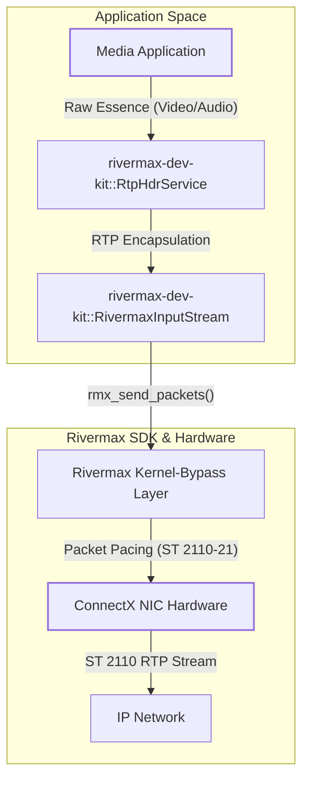
Sources: [README.md:13-16](), [README.md:24-28]()

---

## SMPTE ST 2022-7: Seamless Protection Switching

To ensure high availability in broadcast environments, Rivermax supports SMPTE ST 2022-7. This standard provides "hitless" redundancy by transmitting two identical copies of a stream over two independent network paths.

### Implementation Logic
1.  **Transmission:** The application sends a single essence stream to the Rivermax SDK. The SDK/NIC duplicates the packets and sends them via two different physical ports (Path A and Path B).
2.  **Reception:** The receiver listens to both paths. The Rivermax SDK performs "Seamless Protection Switching" by examining the RTP sequence numbers. If a packet is lost on Path A but arrives on Path B, the SDK delivers the Path B packet to the application, ensuring no data loss occurs.

**Title: ST 2022-7 Redundancy Mapping**
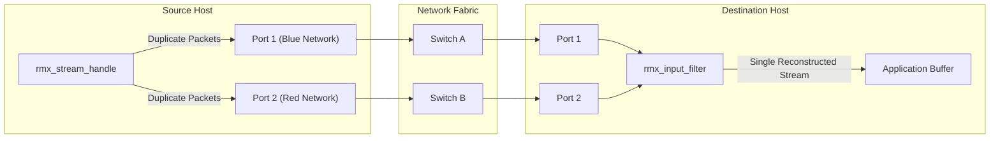
Sources: [README.md:13-16](), [README.md:34-36]()

---

## PTP (IEEE 1588): Precision Time Protocol

Synchronization is the backbone of ST 2110. Rivermax relies on the Precision Time Protocol (PTP) to ensure that all devices on the network share a common "Grandmaster" clock with nanosecond-level accuracy.

### Role in Rivermax
*   **Alignment:** PTP allows Rivermax to align disparate video and audio streams at the receiver.
*   **Hardware Timestamping:** ConnectX NICs provide hardware-level timestamping for every incoming and outgoing packet, which is critical for maintaining PTP accuracy and meeting ST 2110-21 pacing requirements.
*   **System Tuning:** The `rivermax-utils` repository provides scripts to validate PTP synchronization status on the host OS [README.md:28-29]().

### Synchronization Hierarchy
| Component | Responsibility |
| :--- | :--- |
| **Grandmaster Clock** | The absolute time source for the entire network. |
| **PTP Stack (Linux/Windows)** | Manages the synchronization between the NIC hardware clock and the OS system clock. |
| **Rivermax SDK** | Uses the NIC hardware clock to schedule packet transmission and timestamp packet arrival. |

**Title: Synchronization and Pacing Entity Relationship**
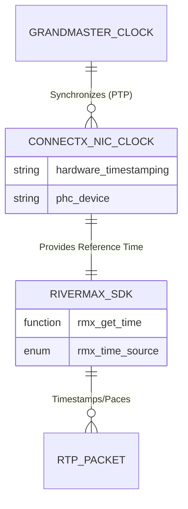
Sources: [README.md:13-16](), [README.md:28-29](), [README.md:34-36]()

---

## Summary of Standards Support

| Standard | Purpose | Rivermax Implementation |
| :--- | :--- | :--- |
| **ST 2110-20/30/40** | Media Essence | Direct API support for uncompressed buffers [README.md:13-16](). |
| **ST 2110-21** | Traffic Shaping | Hardware-based packet pacing on ConnectX NICs. |
| **ST 2022-7** | Redundancy | Multi-path seamless switching for RX and TX. |
| **IEEE 1588 (PTP)** | Synchronization | Hardware timestamping and clock integration [README.md:13-16](). |

Sources: [README.md:13-16](), [README.md:34-36]()

---

# Page: Getting Started

# Getting Started

<details>
<summary>Relevant source files</summary>

The following files were used as context for generating this wiki page:

- [README.md](README.md)

</details>


This page provides a practical onboarding guide for developers new to the NVIDIA Rivermax ecosystem. It outlines the necessary prerequisites, the workflow for acquiring the SDK, and the recommended path for navigating the three primary open-source repositories to move from environment setup to application deployment.

### Onboarding Workflow Overview

The transition from a clean system to a functional Rivermax application follows a structured path involving hardware verification, SDK installation, host tuning, and finally, code implementation using either the low-level examples or the high-level development kit.

#### System Preparation and SDK Acquisition
Before interacting with the codebase, developers must ensure their hardware environment meets the requirements for kernel-bypass networking. This involves utilizing NVIDIA ConnectX network interface cards (NICs) and obtaining the Rivermax SDK, which is distributed via the NVIDIA Developer Portal rather than GitHub [README.md:3-5]().

For detailed hardware requirements and installation steps, see [Prerequisites and SDK Installation](#4.1).

#### Navigating the Repositories
Once the SDK is installed, developers should interact with the three specialized repositories based on their current stage in the development lifecycle:

| Repository | Purpose | Use Case |
| :--- | :--- | :--- |
| `rivermax-utils` | Environment Validation | Host OS tuning, performance benchmarking, and PTP synchronization checks [README.md:28-28](). |
| `rivermax-examples` | Reference Implementation | Understanding direct `Rivermax API` usage for custom integrations [README.md:26-26](). |
| `rivermax-dev-kit` | Application Framework | Rapid development using high-level C++ abstractions and `IO nodes` [README.md:24-24](). |

#### Developer Journey Map

The following diagram maps the conceptual "Getting Started" stages to the specific repositories and resources within the Rivermax ecosystem.

**Rivermax Onboarding Path**
```mermaid
graph TD
    subgraph "Phase 1: Environment"
        A["NVIDIA Developer Portal"] -- "Download SDK" --> B["Host System"]
        B -- "Tuning & Validation" --> C["rivermax-utils"]
    end

    subgraph "Phase 2: Learning"
        C -- "Explore API" --> D["rivermax-examples"]
        D -- "Direct API Calls" --> E["Custom Application"]
    end

    subgraph "Phase 3: Production"
        C -- "Framework Integration" --> F["rivermax-dev-kit"]
        F -- "IO Node Architecture" --> G["Scalable Media App"]
    end

    style A stroke-dasharray: 5 5
    style B stroke-dasharray: 5 5
```
**Sources:** [README.md:22-28](), [README.md:34-35]()

---

### Prerequisites and SDK Installation

Development with Rivermax requires specific hardware and software configurations to achieve high-throughput, low-latency media streaming. 

*   **Hardware:** Requires NVIDIA ConnectX-5 or newer NICs to support hardware-based packet pacing and kernel-bypass.
*   **Software:** Supports both Linux and Windows operating systems.
*   **SDK Access:** The core Rivermax SDK is proprietary and must be downloaded from the official NVIDIA networking pages [README.md:34-35](). 
*   **Environment Tuning:** After SDK installation, the `rivermax-utils` repository provides the necessary scripts to configure the host for optimal performance, including CPU pinning and memory management [README.md:28-28]().

For a complete list of supported platforms and step-by-step setup instructions, see [Prerequisites and SDK Installation](#4.1).

**Sources:** [README.md:13-16](), [README.md:34-35]()

---

### Support and Community Resources

NVIDIA provides multiple channels for support depending on the nature of the inquiry. Because the code in the GitHub repositories is provided "As Is" [README.md:20-20](), it is important to direct questions to the appropriate venue:

*   **SDK & Licensing:** Managed through the NVIDIA Developer Portal [README.md:39-39]().
*   **Bug Reports:** Technical issues related to the examples or dev-kit should be filed as "Issues" within their respective GitHub repositories [README.md:40-40]().
*   **Community Discussion:** General architectural questions and best practices are hosted on the NVIDIA Developer Forums [README.md:41-41]().

For more information on how to engage with the Rivermax team and community, see [Support and Community Resources](#4.2).

**Sources:** [README.md:37-41]()

---

# Page: Prerequisites and SDK Installation

# Prerequisites and SDK Installation

<details>
<summary>Relevant source files</summary>

The following files were used as context for generating this wiki page:

- [README.md](README.md)
- [resources/Rivermax_SDK.jpg](resources/Rivermax_SDK.jpg)

</details>


This page details the hardware and software requirements for deploying NVIDIA Rivermax, the process for acquiring the SDK, and the initial steps for platform-specific installation. NVIDIA Rivermax is a high-performance networking SDK designed for media and data streaming, leveraging kernel-bypass and NIC hardware offloads [README.md:11-16]().

## Hardware Requirements

The primary requirement for Rivermax is a compatible NVIDIA network interface card (NIC). The SDK is optimized to work with the **ConnectX** family of adapters to provide hardware-level features such as packet pacing, precise timing, and GPUDirect [README.md:13-16]().

| Component | Requirement |
| :--- | :--- |
| **Network Interface Card** | NVIDIA ConnectX-5, ConnectX-6, ConnectX-7 (or newer) |
| **Processor** | x86_64 or ARM64 (platform dependent) |
| **Acceleration** | NVIDIA GPU (Optional, for GPUDirect technologies) |

## Operating System Support

Rivermax supports both Linux and Windows environments, though specific installation steps and tuning requirements vary by platform [README.md:35-35]().

*   **Linux:** Various distributions including Ubuntu, CentOS, and RHEL.
*   **Windows:** Windows 10/11 and Windows Server versions.

## SDK Acquisition and Licensing

The Rivermax SDK is not hosted directly on GitHub. It must be downloaded from the NVIDIA Developer Portal.

1.  **Download:** Access the [NVIDIA Rivermax Getting Started](https://developer.nvidia.com/networking/rivermax-getting-started) page [README.md:3-5]().
2.  **Licensing:** Rivermax requires a valid license to operate. Licensing information and SDK support can be requested through the [NVIDIA Developer Portal](https://developer.nvidia.com/networking/rivermax) [README.md:39-39]().

## Installation Workflow

The installation process involves setting up the driver, installing the Rivermax SDK, and tuning the host environment for high-throughput, low-latency media streaming.

### System Components Overview

The following diagram illustrates the relationship between the SDK, the hardware, and the external utilities used for installation and configuration.

**Rivermax Environment Architecture**

```mermaid
graph TD
    subgraph "Host OS (Linux/Windows)"
        direction TB
        App["User Application"]
        SDK["Rivermax SDK (API)"]
        Driver["MLNX_OFED / WinOF-2 Driver"]
    end

    subgraph "External Resources"
        Portal["NVIDIA Developer Portal"]
        UtilsRepo["rivermax-utils Repository"]
    end

    subgraph "Hardware Layer"
        NIC["ConnectX NIC"]
        PTP["PTP/IEEE 1588 Clock"]
    end

    Portal -- "Download SDK & License" --> SDK
    UtilsRepo -- "Tuning Scripts" --> Driver
    App -- "Calls" --> SDK
    SDK -- "Kernel Bypass" --> Driver
    Driver -- "Offloads" --> NIC
    NIC -- "Sync" --> PTP
```
Sources: [README.md:11-16](), [README.md:28-28](), [README.md:34-35]()

### Platform-Specific Steps

#### 1. Driver Installation
Before installing the SDK, the appropriate NVIDIA networking drivers must be installed:
*   **Linux:** MLNX_OFED or NVIDIA-Networking-Stack.
*   **Windows:** WinOF-2.

#### 2. SDK Installation
After downloading the SDK package (e.g., `.deb`, `.rpm`, or `.msi`):
*   **Linux:** Use the package manager (e.g., `sudo dpkg -i rivermax-sdk.deb`).
*   **Windows:** Run the installer executable and follow the wizard.

#### 3. Environment Preparation
High-bandwidth media streaming (e.g., SMPTE ST 2110) requires specific host tuning, such as configuring hugepages, CPU pinning, and interrupt moderation.

NVIDIA provides the `rivermax-utils` repository specifically for these tasks [README.md:28-28]().

**Rivermax Setup Utilities**

| Tool Category | Purpose | Repository Link |
| :--- | :--- | :--- |
| **Host Tuning** | OS optimization for Linux/Windows | [rivermax-utils](https://github.com/NVIDIA/rivermax-utils) |
| **Validation** | Environment and performance verification | [rivermax-utils](https://github.com/NVIDIA/rivermax-utils) |
| **Benchmarking** | Throughput and latency testing | [rivermax-utils](https://github.com/NVIDIA/rivermax-utils) |

Sources: [README.md:28-28](), [README.md:34-35]()

## Mapping Code Entities to Installation

When moving from installation to development, the following code entities represent the primary entry points for the SDK and its associated wrappers.

**SDK to Code Entity Mapping**

```mermaid
graph LR
    subgraph "NVIDIA Rivermax Repositories"
        R_SDK["Rivermax SDK (Binary/Headers)"]
        R_EXAMPLES["rivermax-examples"]
        R_DKIT["rivermax-dev-kit"]
        R_UTILS["rivermax-utils"]
    end

    subgraph "Code Entities"
        API["Rivermax API (C Header)"]
        IONode["rtmax::IONode (C++ Wrapper)"]
        Scripts["tuning_scripts (Shell/Python)"]
    end

    R_SDK --> API
    R_DKIT --> IONode
    R_UTILS --> Scripts
    R_EXAMPLES -- "Reference" --> API
    IONode -- "Simplifies" --> API
```
Sources: [README.md:22-29]()

## Support and Maintenance

*   **SDK Support:** For issues regarding the binary SDK or licensing, use the [NVIDIA Developer Portal](https://developer.nvidia.com/networking/rivermax) [README.md:39-39]().
*   **Code Issues:** For issues with the example code or the development kit, file an issue in the respective GitHub repository (e.g., `rivermax-examples` or `rivermax-dev-kit`) [README.md:40-40]().
*   **Community:** General questions can be directed to the [NVIDIA Developer Forums](https://forums.developer.nvidia.com) [README.md:41-41]().

Sources: [README.md:37-42]()

---

# Page: Support and Community Resources

# Support and Community Resources

<details>
<summary>Relevant source files</summary>

The following files were used as context for generating this wiki page:

- [README.md](README.md)

</details>


This page outlines the available support channels and community resources for the NVIDIA Rivermax ecosystem. It defines the communication paths for technical SDK inquiries, licensing, and repository-specific issue reporting.

## Support Ecosystem Overview

The Rivermax support structure is divided into three primary tiers: Official SDK Support, Community Forums, and GitHub Issue Tracking. Each tier serves a specific purpose depending on whether the query relates to the core binary SDK, general integration advice, or specific sample code implementations.

### Support Channel Mapping

| Channel | Purpose | Primary Contact Point |
| :--- | :--- | :--- |
| **NVIDIA Developer Portal** | SDK binaries, Licensing, Proprietary driver issues | [Developer Portal](https://developer.nvidia.com/networking/rivermax) |
| **GitHub Issues** | Bugs in examples, dev-kit, or utility scripts | Individual Repo Issue Trackers |
| **NVIDIA Developer Forums** | General architecture questions, community knowledge | [Developer Forums](https://forums.developer.nvidia.com) |

### Code Policy: "As Is" Implementation
It is important for developers to note that the source code provided across the GitHub repositories (`rivermax-dev-kit`, `rivermax-examples`, and `rivermax-utils`) is provided **As Is**. This code is validated by the specific code owners against specific hardware and software configurations prior to upload [README.md:20-20](). While these repositories serve as reference implementations, they are not covered under the same formal SLA as the core Rivermax SDK binaries.

Sources: [README.md:20-20](), [README.md:37-42]()

## Data Flow for Support Requests

The following diagram illustrates the decision logic for routing technical inquiries to the correct entity.

### Support Routing Logic
```mermaid
graph TD
    "User_Inquiry"["User Technical Inquiry"] --> "Categorize"{"Is it SDK Core or Sample Code?"}
    
    "Categorize" -- "Core SDK / License" --> "DevPortal"["NVIDIA Developer Portal"]
    "Categorize" -- "Sample App / Script" --> "GitHub"["GitHub Repository Issues"]
    "Categorize" -- "General Knowledge" --> "Forums"["NVIDIA Developer Forums"]

    subgraph "NVIDIA_Official" ["Official SDK Support"]
        "DevPortal" --> "SDK_Team"["Rivermax SDK Engineering"]
    end

    subgraph "Open_Source_Support" ["Community & Samples Support"]
        "GitHub" --> "Repo_Owner"["Repository Maintainers"]
        "Forums" --> "Community"["NVIDIA Community & MVPs"]
    end

    "Repo_Owner" -- "Code Fix" --> "rivermax-examples"["rivermax-examples"]
    "Repo_Owner" -- "Code Fix" --> "rivermax-dev-kit"["rivermax-dev-kit"]
    "Repo_Owner" -- "Code Fix" --> "rivermax-utils"["rivermax-utils"]
```
Sources: [README.md:37-42](), [README.md:24-28]()

## Repository-Specific Support

When encountering issues with the implementation code, developers should file issues directly in the repository where the code resides [README.md:40-40]().

### Technical Scope by Repository

The table below maps specific technical components to their respective support locations:

| Component | Code Entity / Scope | Support Location |
| :--- | :--- | :--- |
| **Core API** | `rivermax.h`, `rtp_api` | [Developer Portal](https://developer.nvidia.com/networking/rivermax) |
| **C++ Abstractions** | `rivermax-dev-kit` IO Nodes | [rivermax-dev-kit Issues](https://github.com/NVIDIA/rivermax-dev-kit) |
| **Reference Demos** | `rivermax-examples` source code | [rivermax-examples Issues](https://github.com/NVIDIA/rivermax-examples) |
| **System Tuning** | `rivermax-utils` scripts | [rivermax-utils Issues](https://github.com/NVIDIA/rivermax-utils) |

### System Entity Relationship
This diagram maps the high-level support concepts to the actual repository entities described in the hub.

```mermaid
graph LR
    subgraph "External_Resources" ["External Resources"]
        "SDK_Binaries"["Rivermax SDK Binaries"]
        "Licensing"["Licensing & Entitlements"]
    end

    subgraph "GitHub_Space" ["GitHub Code Entity Space"]
        "Hub_Repo"["NVIDIA/Rivermax (Hub)"]
        "DevKit"["NVIDIA/rivermax-dev-kit"]
        "Examples"["NVIDIA/rivermax-examples"]
        "Utils"["NVIDIA/rivermax-utils"]
    end

    "Hub_Repo" -- "Links to" --> "DevKit"
    "Hub_Repo" -- "Links to" --> "Examples"
    "Hub_Repo" -- "Links to" --> "Utils"

    "SDK_Binaries" -. "Prerequisite for" .-> "DevKit"
    "SDK_Binaries" -. "Prerequisite for" .-> "Examples"

    "DevKit" -- "Support Path" --> "GitHub_Issues"["File GitHub Issue"]
    "Examples" -- "Support Path" --> "GitHub_Issues"
    "Utils" -- "Support Path" --> "GitHub_Issues"
    "SDK_Binaries" -- "Support Path" --> "Dev_Portal"["Contact Developer Portal"]
```
Sources: [README.md:9-18](), [README.md:34-35](), [README.md:39-41]()

## Community Engagement

For broader discussions regarding Media-over-IP standards (ST 2110, ST 2022-7) or general integration strategies using NVIDIA ConnectX NICs, the **NVIDIA Developer Forums** serve as the primary knowledge base [README.md:41-41]().

*   **Forum Usage:** Search for "Rivermax" or "Networking" tags to find existing solutions for performance tuning and hardware compatibility.
*   **Documentation:** Official product documentation and getting started guides are maintained on the [NVIDIA Rivermax Product Page](https://developer.nvidia.com/networking/rivermax) [README.md:34-34]().

Sources: [README.md:34-35](), [README.md:41-41]()

---

# Page: Glossary

# Glossary

<details>
<summary>Relevant source files</summary>

The following files were used as context for generating this wiki page:

- [README.md](README.md)
- [resources/Rivermax_SDK.jpg](resources/Rivermax_SDK.jpg)

</details>


This page provides technical definitions for codebase-specific terms, industry standards, and architectural concepts essential for working with the NVIDIA Rivermax SDK. It serves as a bridge between high-level domain concepts and the specific implementations found across the Rivermax ecosystem repositories.

## Domain Concepts and Standards

### SMPTE ST 2110
A suite of standards from the Society of Motion Picture and Television Engineers (SMPTE) that describes how to send digital media over IP networks. Rivermax is specifically optimized to handle the high-bandwidth requirements of these standards [README.md:13-16]().
*   **ST 2110-20**: Uncompressed active video.
*   **ST 2110-30**: PCM Digital Audio.
*   **ST 2110-40**: Ancillary data (closed captions, timecodes).
*   **ST 2110-21**: Traffic shaping and delivery timing for video, which Rivermax handles via hardware-compliant packet pacing.

### SMPTE ST 2022-7 (Seamless Protection Switching)
A standard for redundant hitless switching. It involves sending two identical streams of packets over two different network paths. The receiver merges these streams, discarding duplicates, to ensure uninterrupted playback even if one network path fails.

### PTP (Precision Time Protocol / IEEE 1588)
A protocol used to synchronize clocks throughout a computer network. In professional media, PTP is the "digital genlock" that ensures all senders and receivers are synchronized to a grandmaster clock with sub-microsecond precision.

### GPUDirect
An NVIDIA technology that enables a direct path for data exchange between the GPU and third-party devices (like a ConnectX NIC). In Rivermax, this allows video frames to be transferred directly from the NIC to GPU memory (or vice versa) without CPU intervention or intermediate system memory copies [README.md:15-16]().

---

## Codebase and SDK Entities

### Rivermax SDK
The core library provided by NVIDIA for optimized networking. It utilizes kernel-bypass techniques to achieve high throughput and low latency [README.md:13-14]().

### rivermax-dev-kit
A high-level C++ software kit designed to simplify application development. It provides an abstraction layer over the raw Rivermax API using a node-based architecture [README.md:24-24]().

### rivermax-examples
A collection of reference implementations showing how to use the Rivermax API directly for various media streaming use cases [README.md:26-27]().

### rivermax-utils
A set of operational tools and scripts used for environment validation, performance tuning (e.g., setting CPU affinity, configuring hugepages), and NIC configuration [README.md:28-28]().

---

## Architectural Mapping

The following diagram illustrates how the conceptual components of a media stream map to the software entities within the Rivermax ecosystem.

### Logic to Code Entity Mapping
This diagram bridges the gap between the "Natural Language Space" of media streaming and the "Code Entity Space" of the repositories.

```mermaid
graph TD
    subgraph "Natural Language Space"
        A["Media Essence (Video/Audio)"]
        B["Redundancy (ST 2022-7)"]
        C["Hardware Tuning"]
        D["API Integration"]
    end

    subgraph "Code Entity Space"
        E["rivermax-dev-kit"]
        F["rivermax-examples"]
        G["rivermax-utils"]
    end

    A -->|"High-level Abstraction"| E
    B -->|"Implementation Samples"| F
    D -->|"Direct API Usage"| F
    C -->|"Validation Scripts"| G
```
**Sources:** [README.md:22-29]()

### Data Flow and SDK Architecture
This diagram represents the internal data path from the application layer down to the hardware, as supported by the SDK architecture.

```mermaid
graph LR
    subgraph "User Space"
        App["Application"]
        SDK["Rivermax SDK API"]
        RDK["rivermax-dev-kit Nodes"]
    end

    subgraph "Kernel Space (Bypassed)"
        K["Standard OS Network Stack"]
    end

    subgraph "Hardware (NIC)"
        CX["ConnectX NIC"]
        Pacing["Hardware Packet Pacing"]
    end

    App --> RDK
    RDK --> SDK
    SDK -.->|"Kernel Bypass"| CX
    CX --> Pacing
    Pacing -->|"ST 2110-21 Stream"| Network["Physical Network"]
```
**Sources:** [README.md:1-16](), [resources/Rivermax_SDK.jpg:1-10]()

---

## Technical Terminology Table

| Term | Definition | Code/Reference Pointer |
| :--- | :--- | :--- |
| **Kernel Bypass** | A technique where the network card communicates directly with user-space memory, skipping the OS kernel to reduce latency and CPU overhead. | [README.md:13-14]() |
| **IO Node** | An abstraction in the `rivermax-dev-kit` representing a source or destination of a media stream. | [README.md:24-24]() |
| **Packet Pacing** | The process of sending packets at a constant, calculated rate to avoid network congestion and comply with ST 2110-21. | [README.md:13-16]() |
| **As Is** | The licensing/support status of the GitHub examples; they are tested for specific configurations but provided without formal warranty. | [README.md:20-20]() |
| **ConnectX** | The family of NVIDIA Network Interface Cards (NICs) required to run Rivermax. | [README.md:34-35]() |

**Sources:** [README.md:1-42](), [resources/Rivermax_SDK.jpg:1-10]()