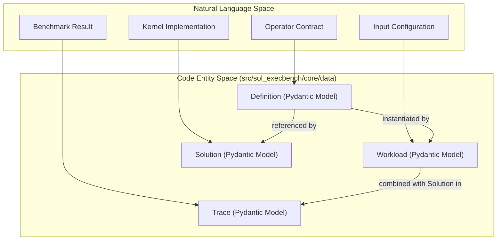
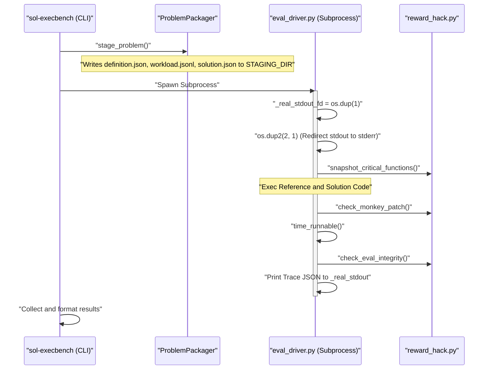

<!-- source: DeepWiki mcp.deepwiki.com · repo NVIDIA/SOL-ExecBench · page 10 Glossary · fetched 2026-10-26 -->

# Glossary

Relevant source files

The following files were used as context for generating this wiki page:

- [README.md](README.md)
- [pyproject.toml](pyproject.toml)
- [src/sol_execbench/core/data/solution.py](src/sol_execbench/core/data/solution.py)
- [src/sol_execbench/driver/templates/eval_driver.py](src/sol_execbench/driver/templates/eval_driver.py)
- [src/sol_execbench/sol_score.py](src/sol_execbench/sol_score.py)

This page defines the core terminology, domain concepts, and implementation-specific jargon used throughout the SOL-ExecBench codebase. It serves as a technical reference for engineers onboarding to the evaluation pipeline, data schemas, or benchmarking engine.

## Core Concepts & Terminology

### Definition
A **Definition** is the formal contract of a computational operator. It defines the symbolic axes, tensor shapes, data types, and the "ground truth" reference implementation. Two kernels are considered to solve the same problem if and only if they share a Definition.
*   **Implementation:** Managed by the `Definition` Pydantic model in `src/sol_execbench/core/data/definition.py`.
*   **Identity Rule:** Determined by the combination of `axes` (specifically `const` types) and the operator signature.

### Workload
A **Workload** is a concrete instantiation of a Definition. It binds specific integer values to all `var` (variable) axes and defines the source of input data (e.g., random, specific scalars, or loaded from disk).
*   **Implementation:** Managed by the `Workload` model in `src/sol_execbench/core/data/workload.py`.
*   **Data Sourcing:** Supports `random`, `scalar`, `safetensors`, and `custom` (generated by the reference code).

### Solution
A **Solution** is a specific implementation of a kernel (e.g., in Triton or CUDA C++) designed to satisfy a Definition. It contains the source code, build instructions (`spec`), and metadata about the author and target hardware.
*   **Implementation:** Managed by the `Solution` model in `src/sol_execbench/core/data/solution.py` [src/sol_execbench/core/data/solution.py:16-26]().
*   **Languages:** Supports a variety of DSLs including `pytorch`, `triton`, `cute_dsl`, `cutile`, `cuda_cpp`, and `cutlass` [src/sol_execbench/core/data/solution.py:28-55]().

### Trace
A **Trace** is the immutable execution record of a single benchmark run (one Solution + one Workload). It contains the final status (e.g., `PASSED`, `REWARD_HACK`), numerical error statistics, and latency measurements.
*   **Implementation:** Managed by the `Trace` model in `src/sol_execbench/core/data/trace.py`.

---

## Technical Abbreviations & Jargon

| Term | Definition | Code Pointer |
| :--- | :--- | :--- |
| **DPS** | **Destination Passing Style**. A calling convention where the caller pre-allocates output tensors and passes them as the final arguments to the kernel. The kernel writes in-place and returns `None`. | [src/sol_execbench/core/data/solution.py:148-151]() |
| **SOLAR** | **Speed-Of-Light Analytical Report**. An analytical tool used to calculate the theoretical hardware limit (roofline) for a given operator on specific hardware (e.g., B200). | [README.md:18-18]() |
| **SOL-Score** | A normalized performance metric: $S(T_k) = 1 / (1 + (T_k - T_{SOL}) / (T_b - T_{SOL}))$. | [src/sol_execbench/sol_score.py:1-25]() |
| **CUPTI** | **CUDA Profiling Tools Interface**. Used for high-precision hardware-level kernel timing that excludes CPU launch overhead. | [pyproject.toml:24-24]() |
| **Reward Hack** | Any attempt by a kernel to "cheat" the benchmark (e.g., by monkey-patching timers or enqueuing work on side streams). | [src/sol_execbench/driver/templates/eval_driver.py:126-133]() |

---

## System Architecture & Data Flow

The following diagram illustrates the relationship between the high-level data concepts and the Python classes that implement them.

### Data Model Entity Map

**Sources:** [src/sol_execbench/core/data/solution.py:16-26](), [src/sol_execbench/driver/templates/eval_driver.py:138-147]()

---

## Benchmarking Engine Concepts

### L2 Cache Clearing
To ensure reproducible cold-cache timing, the engine flushes the GPU L2 cache between iterations by zeroing a large (256 MB) dummy buffer.
*   **Implementation:** Managed within the `timing.py` module to ensure consistent performance measurement.

### Argument Pinning
A defense against "id-caching" attacks where a kernel might cache results based on the Python `id()` of input tensors. The driver clones tensors so each iteration uses a fresh memory address.
*   **Implementation:** Handled during the input generation and benchmarking phase to prevent deceptive kernel optimizations.

### Clock Locking
The process of pinning GPU core and memory clocks to a fixed frequency using `nvidia-smi` to eliminate variance from thermal throttling or "boost" behaviors.
*   **Implementation:** Managed via the `clock_lock` module [src/sol_execbench/driver/templates/eval_driver.py:114-114]().

---

## Execution Flow: CLI to Subprocess

The evaluation follows a "Staging" pattern where files are prepared in a temporary directory before a self-contained driver script is executed in a clean subprocess.

### Evaluation Sequence

**Sources:** [src/sol_execbench/driver/templates/eval_driver.py:38-43](), [src/sol_execbench/driver/templates/eval_driver.py:114-133](), [src/sol_execbench/driver/templates/eval_driver.py:188-201]()

---

## Reward Hack Defenses

The framework implements several specific checks to ensure the integrity of performance measurements:

1.  **Monkey Patch Detection:** Captures the `id()` of critical functions and verifies they haven't changed before timing [src/sol_execbench/driver/templates/eval_driver.py:188-201]().
2.  **Thread Injection Detection:** Monitors active threads via `check_thread_injection` to ensure the kernel didn't spawn background work to offload computation [src/sol_execbench/driver/templates/eval_driver.py:131-131]().
3.  **Lazy/Proxy Tensors:** Checks via `check_lazy_outputs` that outputs are strictly of type `torch.Tensor` and not a subclass or proxy that might defer execution [src/sol_execbench/driver/templates/eval_driver.py:129-129]().
4.  **Eval-Driver Integrity:** Snapshots critical internal functions of the `eval_driver.py` (like `time_runnable` and `compute_error_stats`) via `snapshot_critical_functions` to ensure user code didn't overwrite the benchmarking logic [src/sol_execbench/driver/templates/eval_driver.py:188-201]().

**Sources:** [src/sol_execbench/driver/templates/eval_driver.py:126-133](), [src/sol_execbench/driver/templates/eval_driver.py:188-201]()