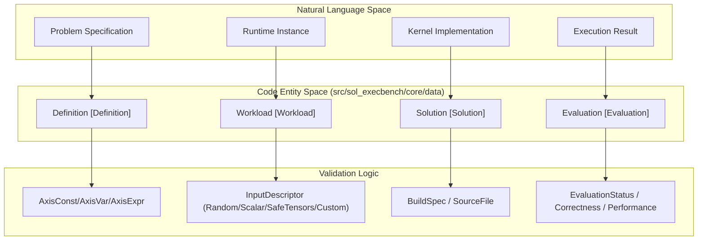
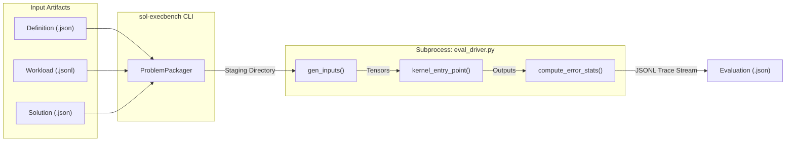

<!-- source: DeepWiki mcp.deepwiki.com · repo NVIDIA/SOL-ExecBench · page 2 Data Schemas · fetched 2026-10-26 -->

# Data Schemas

Relevant source files

The following files were used as context for generating this wiki page:

- [README.md](README.md)
- [src/sol_execbench/core/data/solution.py](src/sol_execbench/core/data/solution.py)

This section provides a high-level overview of the four core JSON schemas that define the data contract for SOL-ExecBench. These schemas ensure that problem definitions, runtime workloads, kernel solutions, and execution results remain interoperable across different hardware targets and programming models.

The relationship between these schemas follows a strict hierarchy: a **Definition** defines the mathematical contract; a **Workload** makes that contract concrete with specific shapes and data; a **Solution** provides an implementation to satisfy the contract; and a **Trace** records the outcome of applying a Solution to a Workload.

### System Overview and Entity Mapping

The following diagram bridges the conceptual "Natural Language Space" to the "Code Entity Space" by mapping schema components to their corresponding Pydantic models and logic in the codebase.

**Schema to Code Entity Mapping**

Sources: [src/sol_execbench/core/data/solution.py:16-25](), [src/sol_execbench/core/data/trace.py:16-25](), [src/sol_execbench/core/data/trace.py:113-132]()

---

### 2.1. Definition Schema
The **Definition** is the formal specification of a computational operator. It acts as the ground-truth contract that both the reference implementation and the optimized solution must follow.

*   **Axes:** Defines symbolic dimensions as `const` (fixed), `var` (dynamic per workload), or `expr` (calculated via mathematical expressions).
*   **Tensors:** Specifies named `inputs` and `outputs` with their shapes (linked to axes) and `dtype` (e.g., `float16`, `bfloat16`, `float8_e4m3fn`).
*   **Reference:** A mandatory Python source string containing a reference implementation (typically using PyTorch) to generate golden outputs.
*   **Custom Inputs:** An optional `custom_inputs_entrypoint` for generating structured data (like ragged tensors or valid router indices) that simple random generation cannot handle.

For details, see [Definition Schema](#2.1).

Sources: [src/sol_execbench/core/data/solution.py:80-94](), [src/sol_execbench/core/data/solution.py:131-157]()

---

### 2.2. Workload Schema
A **Workload** makes a Definition executable by binding concrete integer values to all `var` axes and defining the data sourcing strategy for every input.

*   **Input Descriptors:** Supports sourcing types including `random` (generated on-the-fly), `scalar` (direct Python values), `safetensors` (loaded from disk), and `custom` (generated by the definition's entrypoint).
*   **Tolerance Configuration:** Defines per-workload correctness thresholds, including `max_atol`, `max_rtol`, and `required_matched_ratio`. This allows for tighter bounds on numerically stable shapes and looser bounds for challenging ones.

For details, see [Workload Schema](#2.2).

Sources: [src/sol_execbench/core/data/workload.py:1-120]()

---

### 2.3. Solution Schema
The **Solution** contains the actual kernel code and the metadata required to build and execute it. It is the primary object submitted for evaluation.

*   **Build Spec:** Defined by the `BuildSpec` class, it specifies `languages` (e.g., `triton`, `cuda_cpp`, `cutlass`), `target_hardware` (e.g., `B200`, `LOCAL`), and the `entry_point` in `<file_path>::<function_name>` format.
*   **Calling Convention:** Supports **Destination-Passing Style (DPS)** via the `destination_passing_style` flag. If true, the solution accepts output tensors as the last arguments to be modified in-place.
*   **Sources:** An array of `SourceFile` objects containing the relative `path` and text `content` that the evaluator reconstructs in a staging directory.

For details, see [Solution Schema](#2.3).

Sources: [src/sol_execbench/core/data/solution.py:28-54](), [src/sol_execbench/core/data/solution.py:80-94](), [src/sol_execbench/core/data/solution.py:131-157]()

---

### 2.4. Trace Schema
A **Trace** (represented by the `Evaluation` model) is the immutable output of the evaluation pipeline. It records exactly what happened when a specific Solution was run against a specific Workload.

*   **Evaluation Status:** The `EvaluationStatus` enum captures outcomes such as `PASSED`, `INCORRECT_NUMERICAL`, `COMPILE_ERROR`, or `REWARD_HACK`.
*   **Correctness & Performance:** The `Correctness` model stores `max_relative_error` and `max_absolute_error`, while the `Performance` model stores `latency_ms` and `speedup_factor`.
*   **Environment Snapshot:** The `Environment` model records the hardware identifier and software library versions used during the run to ensure reproducibility.

For details, see [Trace Schema](#2.4).

Sources: [src/sol_execbench/core/data/trace.py:27-49](), [src/sol_execbench/core/data/trace.py:58-71](), [src/sol_execbench/core/data/trace.py:86-111](), [src/sol_execbench/core/data/trace.py:113-132]()

---

### Data Flow and Schema Interaction

The following diagram illustrates how data flows through the system using these four schemas as the primary interfaces between the CLI and the Evaluation Driver.

**Evaluation Data Flow**

Sources: [src/sol_execbench/core/data/trace.py:113-132](), [src/sol_execbench/core/data/solution.py:131-145]()

---

