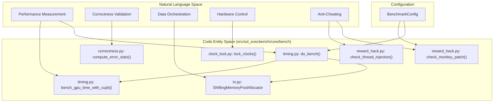
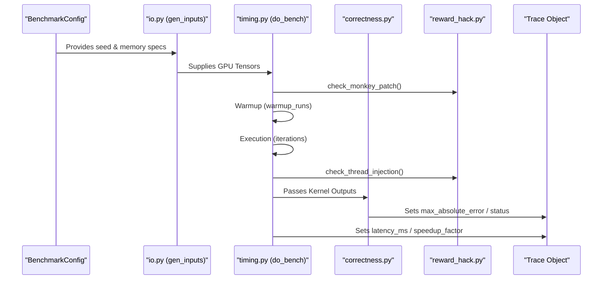

<!-- source: DeepWiki mcp.deepwiki.com · repo NVIDIA/SOL-ExecBench · page 4 Core Benchmarking Engine · fetched 2026-10-26 -->

# Core Benchmarking Engine

Relevant source files

The following files were used as context for generating this wiki page:

- [src/sol_execbench/core/bench/reward_hack.py](src/sol_execbench/core/bench/reward_hack.py)
- [src/sol_execbench/core/bench/timing.py](src/sol_execbench/core/bench/timing.py)

The `core/bench` package is the heart of SOL-ExecBench, responsible for the high-fidelity execution and measurement of GPU kernels. It provides a robust infrastructure designed to ensure that performance data is accurate, results are mathematically correct, and the evaluation process is resistant to "reward-hacking" or cheating.

The engine is orchestrated by the `BenchmarkConfig` class [src/sol_execbench/core/bench/config/benchmark_config.py:24-35](), which defines parameters such as warmup iterations, measurement repetitions, and whether to lock clocks or benchmark the reference implementation.

### System Architecture: Code Entity Space

The following diagram illustrates how the logical benchmarking components map to specific modules within the `src/sol_execbench/core/bench` directory.

**Benchmarking Subsystems Mapping**

Sources: [src/sol_execbench/core/bench/config/benchmark_config.py:24-43](), [src/sol_execbench/core/bench/timing.py:157-204](), [src/sol_execbench/core/bench/reward_hack.py:48-88]()

---

### [4.1 Timing and Performance Measurement](#)
The performance engine centers around `timing.py`. It provides two primary measurement paths: standard CUDA event-based timing via `do_bench` and high-precision hardware profiling via `bench_gpu_time_with_cupti` [src/sol_execbench/core/bench/timing.py:157-164](). To ensure consistency, the engine performs L2 cache flushing using a 256 MB buffer [src/sol_execbench/core/bench/timing.py:61-65]() and supports `clone_args` to prevent cross-iteration data contamination [src/sol_execbench/core/bench/timing.py:73-79]().

For details, see [Timing and Performance Measurement](#4.1).

### [4.2 Correctness Checking](#)
Correctness is verified in `correctness.py` by comparing kernel outputs against a reference implementation. The engine uses a robust tolerance formula: `max_atol + max_rtol * |ref|`. It also enforces strict checks for `NaN` and `Inf` values and includes a sanity check to ensure kernels are not simply returning all-zero buffers to bypass error thresholds.

For details, see [Correctness Checking](#4.2).

### [4.3 Input/Output Utilities](#)
The `io.py` module manages the lifecycle of GPU memory. It handles the generation of random tensors across various dtypes (including FP4/FP8 packing) and uses a `ShiftingMemoryPoolAllocator` [src/sol_execbench/core/bench/timing.py:30-30](). This allocator is critical for pre-allocating output buffers, ensuring that memory allocation overhead does not pollute kernel execution time.

For details, see [Input/Output Utilities](#4.3).

### [4.4 GPU Clock Locking](#)
To achieve reproducible results, `clock_lock.py` interfaces with `nvidia-smi` to fix GPU core and memory frequencies. This prevents dynamic frequency scaling (boost clocks) from introducing variance between runs. The engine supports device-specific presets and is controlled via the `lock_clocks` field in `BenchmarkConfig` [src/sol_execbench/core/bench/config/benchmark_config.py:32-32]().

For details, see [GPU Clock Locking](#4.4).

### [4.5 Reward Hack Detection](#)
The `reward_hack.py` module implements multiple layers of defense against kernel submissions that attempt to "cheat" the benchmark. These defenses include `check_monkey_patch` to monitor CUDA event timing [src/sol_execbench/core/bench/reward_hack.py:48-56](), `check_thread_injection` to detect unauthorized background threads [src/sol_execbench/core/bench/reward_hack.py:73-81](), and `check_lazy_outputs` to identify proxy tensors that defer computation [src/sol_execbench/core/bench/reward_hack.py:89-97]().

For details, see [Reward Hack Detection](#4.5).

---

### Execution Flow: From Configuration to Trace

The benchmarking engine transforms a `Workload` and a `Solution` into a `Trace` containing performance and correctness metrics.

**Data Transformation Flow**

Sources: [src/sol_execbench/core/bench/config/benchmark_config.py:30-34](), [src/sol_execbench/core/bench/timing.py:47-58](), [src/sol_execbench/core/bench/reward_hack.py:48-88]()

| Component | Responsibility | Primary Code Entry Point |
| :--- | :--- | :--- |
| **Config** | Defines iteration counts and seeds | `BenchmarkConfig` |
| **Timing** | Measures kernel latency via CUDA Events or CUPTI | `do_bench` / `bench_gpu_time_with_cupti` |
| **Correctness** | Validates numerical accuracy | `compute_error_stats` |
| **I/O** | Manages tensor allocation and dtypes | `gen_inputs` |
| **Safety** | Detects benchmarking subversion | `check_monkey_patch` / `check_lazy_outputs` |

Sources: [src/sol_execbench/core/bench/config/benchmark_config.py:24-35](), [src/sol_execbench/core/bench/timing.py:157-164](), [src/sol_execbench/core/bench/reward_hack.py:16-22]()

---

