# Page: SOL-ExecBench Overview

# SOL-ExecBench Overview

<details>
<summary>Relevant source files</summary>

The following files were used as context for generating this wiki page:

- [README.md](README.md)
- [pyproject.toml](pyproject.toml)

</details>


**Speed-Of-Light ExecBench** is a rigorous GPU kernel evaluation and benchmarking framework designed to evaluate custom GPU kernel solutions for correctness and performance [README.md:11-12](). It serves as a benchmarking platform for AI-generated kernels across a wide variety of Domain Specific Languages (DSLs) supported by NVIDIA hardware [README.md:11-12]().

The framework compares candidate solutions against reference implementations to ensure numerical correctness, identifies "reward hacking" (cheating) attempts, and measures performance under reproducible conditions using locked GPU clocks [README.md:13-16]().

### System Architecture and Flow

The system is organized into three distinct layers that manage the lifecycle of a benchmark from CLI invocation to result reporting. The orchestration logic is centered around the `sol-execbench` CLI entrypoint and the `ProblemPackager`.

**High-Level Execution Flow:**
1.  The **CLI** parses user input and identifies the problem/solution [README.md:48-56]().
2.  The **ProblemPackager** stages all necessary files (definitions, workloads, source code) into a temporary directory.
3.  A **Subprocess** is spawned to compile C++/CUDA code if required (using `build_ext.py`).
4.  The **Evaluation Driver** (`eval_driver.py`) runs as a self-contained subprocess to execute the kernel, check correctness, and measure timing.
5.  **JSONL Traces** are streamed back to the CLI for display and logging [README.md:77-78]().

**System Component Diagram**
```mermaid
graph TD
    subgraph "User_Space"
        ["sol-execbench CLI"]
    end

    subgraph "Orchestration_Layer"
        Packager["sol_execbench.driver.packager:ProblemPackager"]
        BatchRunner["scripts/run_dataset.py"]
    end

    subgraph "Execution_Subprocess"
        Driver["sol_execbench/driver/templates/eval_driver.py"]
        Timing["sol_execbench.core.bench.timing:time_runnable"]
        Correctness["sol_execbench.core.bench.correctness:compute_error_stats"]
        RewardHack["sol_execbench.core.bench.reward_hack:detect_reward_hack"]
    end

    subgraph "Data_Layer"
        Definition["definition.json"]
        Workload["workload.jsonl"]
        Solution["solution.json"]
        Trace["Trace (output JSONL)"]
    end

    ["sol-execbench CLI"] --> Packager
    BatchRunner --> ["sol-execbench CLI"]
    Packager --> Driver
    Driver --> Timing
    Driver --> Correctness
    Driver --> RewardHack
    Definition -.-> Packager
    Workload -.-> Packager
    Solution -.-> Packager
    Driver -.-> Trace
```
Sources: [README.md:48-118](), [pyproject.toml:27-28]()

### Key Concepts

#### 1. Supported DSLs and Languages
SOL-ExecBench supports a diverse set of GPU programming models, including specialized libraries like `cuda-tile` and `nvidia-cudnn-frontend` [README.md:20](), [pyproject.toml:14-15]():
*   **Python-based:** PyTorch, Triton, CuTe DSL, cuTile, cuDNN Frontend.
*   **C++-based:** CUDA C++, CUTLASS, cuDNN, cuBLAS.

#### 2. SOL-Score
The framework uses **SOL-Score** as its primary metric [README.md:18](). This metric grades kernel performance based on the theoretical hardware roofline of an NVIDIA B200 GPU, derived from **SOLAR** (Speed-Of-Light Analytical Report) estimates [README.md:18]().

#### 3. Anti-Cheating (Reward Hack Detection)
To ensure the integrity of benchmarks, the framework includes defense mechanisms to detect timing manipulation, stream injection, and monkey-patching of measurement utilities. This is handled by the `sol_execbench.core.bench.reward_hack` module.

#### 4. Calling Conventions
The framework supports two primary ways for kernels to handle data:
*   **Destination-Passing Style (DPS):** The kernel modifies pre-allocated output tensors in-place.
*   **Return-Value Style:** The kernel returns new tensors directly.

**Code Entity Relationship Diagram**
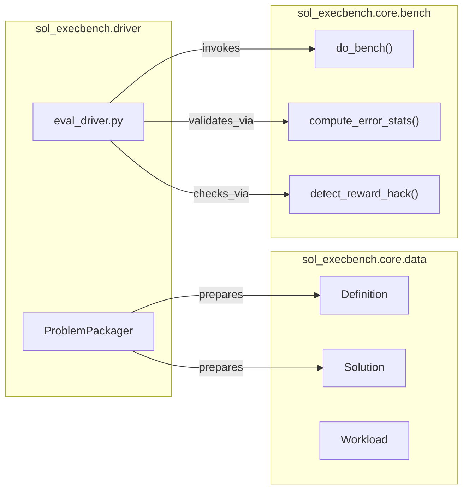
Sources: [README.md:104-118](), [pyproject.toml:11-26]()

### Subsystem Overviews

#### Getting Started
New users should begin by setting up the Docker environment, which includes the NVIDIA Container Toolkit and necessary drivers (version 580+) [README.md:22-28](). The setup involves downloading benchmark data via `scripts/download_data.sh` and building the container using `scripts/run_docker.sh` [README.md:30-45]().
For details, see [Getting Started](#1.1).

#### Project Structure and Configuration
The repository uses `uv` for dependency management and `Ruff` for linting [pyproject.toml:43-72](). The core logic is split between `sol_execbench.core` (data models and benchmarking logic) and `sol_execbench.driver` (execution orchestration). Build requirements are managed via `hatchling` [pyproject.toml:1-3]().
For details, see [Project Structure and Configuration](#1.2).

#### Data Schemas
The framework is built on four core JSON schemas:
*   **Definition:** Kernel signatures and reference code [README.md:128]().
*   **Workload:** Specific input shapes and tolerances [README.md:129]().
*   **Solution:** Source code and build instructions for the candidate [README.md:131]().
*   **Trace:** The final performance and correctness results [README.md:133]().

#### Evaluation Pipeline
The pipeline manages the lifecycle of an evaluation, from staging files in a temporary directory to executing the `eval_driver.py` template in a controlled subprocess. It can be invoked for single problems via the CLI or for entire datasets via `scripts/run_dataset.py` [README.md:83-122]().

#### Core Benchmarking Engine
The `sol_execbench.core.bench` package contains the "source of truth" for measurement, including CUDA event timing, L2 cache clearing, and numerical error calculation.

#### Docker Environment
The provided Docker setup ensures a reproducible environment with CUDA 13.1, CUTLASS 4.4.1, and all necessary DSL dependencies like `cuda-tile` and `nvidia-cudnn-frontend` pre-installed [pyproject.toml:11-26](), [README.md:38-45]().

---

# Page: Getting Started

# Getting Started

<details>
<summary>Relevant source files</summary>

The following files were used as context for generating this wiki page:

- [README.md](README.md)
- [docker/Dockerfile](docker/Dockerfile)
- [uv.lock](uv.lock)

</details>


This page provides a step-by-step guide for setting up the **SOL-ExecBench** environment, downloading the required datasets, and running your first kernel evaluation. SOL-ExecBench is a rigorous GPU kernel evaluation framework designed to benchmark AI-generated kernel solutions across various DSLs (PyTorch, Triton, CUTLASS, etc.) with automated checks for correctness, performance, and reward hacking [README.md:11-20]().

## Prerequisites

Before starting, ensure your host machine meets the following requirements:

*   **NVIDIA Driver**: Version 580 or higher [README.md:26-26]().
*   **Docker**: Installed with the [NVIDIA Container Toolkit](https://docs.nvidia.com/datacenter/cloud-native/container-toolkit/latest/install-guide.html) [README.md:24-24]().
*   **Hugging Face CLI**: Required for dataset downloads (`pip install huggingface-hub[cli]`) [README.md:25-25]().
*   **Python**: Version 3.12 or higher is required for the host and environment [uv.lock:3-3]().

## 1. Download Benchmark Data

The benchmark requires two primary datasets: the core SOL-ExecBench problems and the FlashInfer traces. Use the provided script to fetch these:

```bash
./scripts/download_data.sh
```
[README.md:32-34]()

This script orchestrates the download of:
1.  **SOL-ExecBench**: Downloads the `nvidia/SOL-ExecBench` dataset into `data/SOL-ExecBench/` [README.md:36-36]().
2.  **FlashInfer Trace**: Downloads the `flashinfer-ai/flashinfer-trace` dataset into `data/flashinfer-trace` [README.md:36-36]().

### Data Flow: From Hugging Face to Local Filesystem

The following diagram illustrates how the download process transforms remote dataset assets into the local directory structure required by the CLI.

**Dataset Ingestion Flow**
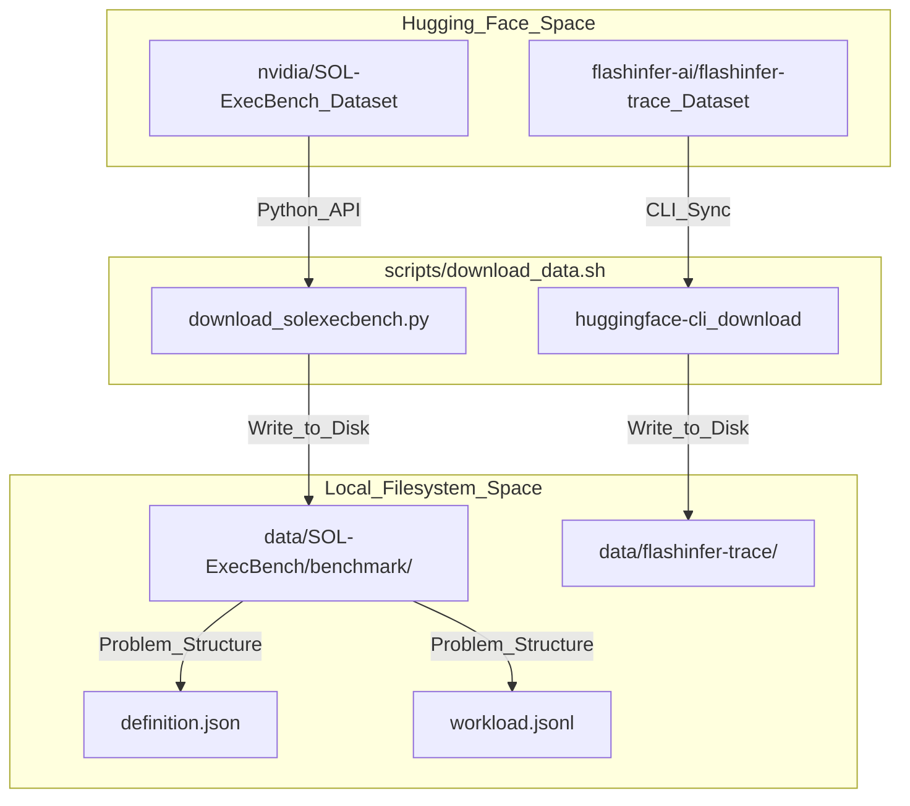
Sources: [README.md:30-36](), [scripts/run_dataset.py:110-113]()

## 2. Environment Setup (Docker)

SOL-ExecBench uses a Docker-based environment to ensure all CUDA toolchains and DSL dependencies (like CUTLASS and cuDNN) are correctly configured.

### Build and Launch
Run the helper script to build the image and enter an interactive shell:
```bash
./scripts/run_docker.sh --build
```
[README.md:40-42]()

### Docker Environment Implementation
The Dockerfile uses `nvidia/cuda:13.1.1-cudnn-devel-ubuntu24.04` as a base [docker/Dockerfile:5-5](). It installs several key components:
*   **CUTLASS**: Cloned to `/usr/local/cutlass` and exported via `CUTLASS_DIR` [docker/Dockerfile:21-22]().
*   **uv**: Used for fast Python dependency management, installing from `uv.lock` to ensure reproducible environments [docker/Dockerfile:30-30](), [docker/Dockerfile:67-68]().
*   **Clock Locking**: The container user is granted `NOPASSWD` access to `nvidia-smi` to allow the benchmark engine to lock GPU clocks for reproducible timing [docker/Dockerfile:46-46]().

**Environment Architecture**
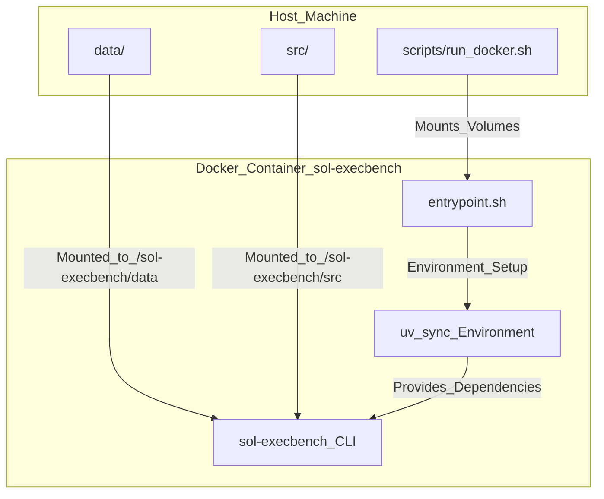
Sources: [docker/Dockerfile:5-84](), [README.md:40-44]()

## 3. Running Your First Evaluation

Once inside the container, you can evaluate a kernel solution using the `sol-execbench` CLI. The CLI is registered as a console script via `uv sync` during the build [docker/Dockerfile:76-78]().

### Single Problem Evaluation
To evaluate one of the provided examples (e.g., a CuTe DSL kernel):
```bash
sol-execbench examples/cute_dsl/jamba_attn_proj \
  --solution examples/cute_dsl/jamba_attn_proj/solution_cute_dsl.json
```
[README.md:66-68]()

### Batch Dataset Evaluation
To run an entire subset of the downloaded benchmark data, use the `run_dataset.py` script. This script can auto-build a `solution.json` from a single code file if provided via `--solution-name` [README.md:109-110]().

```bash
uv run scripts/run_dataset.py data/SOL-ExecBench/benchmark/L1 --solution-name reference.py
```
[README.md:116-116]()

## Key Configuration & Dependencies

The project's dependencies and build system are managed by `uv` and defined in `pyproject.toml` and `uv.lock` [uv.lock:1-9]().

| Dependency | Purpose |
| :--- | :--- |
| `aiohttp` | Async HTTP requests for dataset management [uv.lock:21-22]() |
| `CUTLASS` | C++ template library for high-performance GEMM [docker/Dockerfile:21-23]() |
| `uv` | High-performance Python package and project manager [docker/Dockerfile:30-30]() |
| `nvidia-smi` | GPU management for clock locking [docker/Dockerfile:46-46]() |

### GPU Clock Locking
For stable benchmarking, the `--lock-clocks` flag (or `lock_clocks` in `BenchmarkConfig`) triggers the system to lock GPU and DRAM clocks [README.md:80-80](), [README.md:92-92](). This behavior is critical for preventing performance variance due to thermal throttling or power management.

Sources: [docker/Dockerfile:1-85](), [uv.lock:1-52](), [README.md:1-122]()

---

# Page: Project Structure and Configuration

# Project Structure and Configuration

<details>
<summary>Relevant source files</summary>

The following files were used as context for generating this wiki page:

- [pyproject.toml](pyproject.toml)
- [uv.lock](uv.lock)

</details>


This page details the organizational layout of the `SOL-ExecBench` repository, its build configuration via `pyproject.toml`, and the developer tooling required to maintain code quality and compliance.

## Repository Layout

The repository is organized to separate core benchmarking logic from dataset definitions, examples, and infrastructure.

| Directory | Purpose |
| :--- | :--- |
| `src/sol_execbench/` | Primary source code containing the CLI, evaluation driver, and core benchmarking engine. |
| `tests/` | Unit and end-to-end tests, including hardware-gated tests for specific GPU architectures. |
| `examples/` | Sample kernel implementations across various DSLs (Triton, CUDA, etc.) used for demonstration and testing. |
| `scripts/` | Utility scripts for batch evaluation (`run_dataset.py`) and environment management. |
| `docker/` | Dockerfiles and entrypoint scripts to ensure a reproducible benchmarking environment. |
| `docs/` | Documentation source files. |

### Source Code Organization (`src/sol_execbench/`)

The internal structure of the source directory follows a modular design:
*   **`cli.py`**: The entry point for the `sol-execbench` command-line tool [pyproject.toml:28-28]().
*   **`core/`**: Contains the fundamental logic for timing, correctness checking, and anti-cheating measures.
*   **`schemas/`**: Pydantic models defining the data contract for Definitions, Workloads, Solutions, and Traces.

### High-Level Data Flow Diagram

The following diagram illustrates how the project structure facilitates the flow from a problem definition to a performance trace.

**Kernel Evaluation Data Flow**
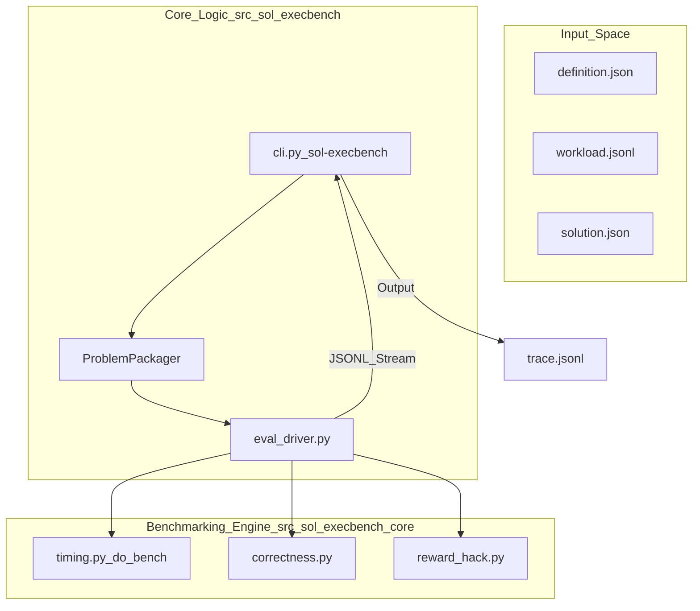
Sources: [pyproject.toml:28-28]()

## Build Configuration (`pyproject.toml`)

The project uses `hatchling` as the build backend [pyproject.toml:1-3]() and `uv` for dependency management, utilizing a `uv.lock` file for reproducible environments [uv.lock:1-9]().

### Key Dependencies
The project requires Python 3.12+ [pyproject.toml:10-10]() and relies on several NVIDIA-specific libraries for kernel development:
*   **Deep Learning**: `torch==2.9.0` [pyproject.toml:12-12]().
*   **DSLs**: `cuda-tile==1.1.0`, `nvidia-cudnn-frontend==1.18.0`, and `nvidia-cutlass-dsl[cu13]==4.4.1` [pyproject.toml:14-16]().
*   **Infrastructure**: `pydantic>=2.12.5` for schema validation [pyproject.toml:17-17](), `click>=8.0` and `rich>=13.0` for the CLI interface [pyproject.toml:19-20](), and `safetensors>=0.7.0` for efficient tensor I/O [pyproject.toml:18-18]().
*   **Specialized Extensions**: `torch-c-dlpack-ext`, `apache-tvm-ffi`, and `cupti-python` [pyproject.toml:22-24]().

### Python Package Entry Points
The main CLI tool is registered via the `project.scripts` table:
*   `sol-execbench`: Points to the `cli` function in `sol_execbench.cli` [pyproject.toml:28-28]().

### Test Configuration
Pytest is configured to run in parallel by default using `pytest-xdist` [pyproject.toml:33-34]() with the `-n auto` flag [pyproject.toml:37-37](). Custom markers are defined to gate tests that require specific hardware or toolchains:
*   `cpp`: For tests requiring a C++/CUDA compiler toolchain [pyproject.toml:39-39]().
*   `requires_cutile`: For tests requiring cuTile, which is restricted to Blackwell (SM100+) architecture [pyproject.toml:40-40]().

Sources: [pyproject.toml:1-41](), [uv.lock:1-52]()

## Developer Tooling and Compliance

To maintain high code quality and adhere to NVIDIA's standards, several tools are integrated into the workflow.

### Linting and Formatting
The project uses **Ruff** for both linting and code formatting. The configuration excludes generated files and specific directories from strict linting to allow for diverse kernel implementation styles:
*   **Exclusions**: `.git`, `.venv`, `__pycache__`, `build`, `dist`, `data`, and `examples` are excluded [pyproject.toml:45-55]().
*   **Linting Rules**: The `E741` rule (ambiguous variable name) is specifically ignored [pyproject.toml:58-58]().

### Package Management with uv
The project uses `uv` with a specific index for PyTorch to ensure CUDA 13.0 compatibility on Linux and Windows platforms [pyproject.toml:60-71]().

### Developer Tooling Integration
The following diagram maps the developer tools to their respective roles in the codebase.

**Developer Tooling and Entity Mapping**
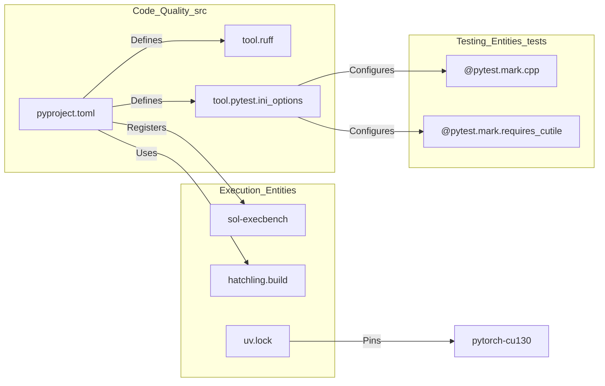

Sources: [pyproject.toml:1-72](), [uv.lock:1-10]()

---

# Page: Data Schemas

# Data Schemas

<details>
<summary>Relevant source files</summary>

The following files were used as context for generating this wiki page:

- [README.md](README.md)
- [src/sol_execbench/core/data/solution.py](src/sol_execbench/core/data/solution.py)

</details>


This section provides a high-level overview of the four core JSON schemas that define the data contract for SOL-ExecBench. These schemas ensure that problem definitions, runtime workloads, kernel solutions, and execution results remain interoperable across different hardware targets and programming models.

The relationship between these schemas follows a strict hierarchy: a **Definition** defines the mathematical contract; a **Workload** makes that contract concrete with specific shapes and data; a **Solution** provides an implementation to satisfy the contract; and a **Trace** records the outcome of applying a Solution to a Workload.

### System Overview and Entity Mapping

The following diagram bridges the conceptual "Natural Language Space" to the "Code Entity Space" by mapping schema components to their corresponding Pydantic models and logic in the codebase.

**Schema to Code Entity Mapping**
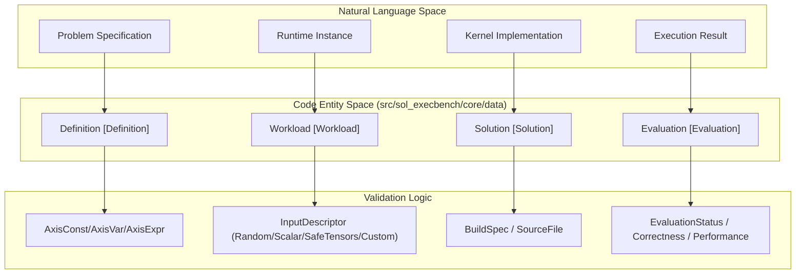
Sources: [src/sol_execbench/core/data/solution.py:16-25](), [src/sol_execbench/core/data/trace.py:16-25](), [src/sol_execbench/core/data/trace.py:113-132]()

---

### 2.1. Definition Schema
The **Definition** is the formal specification of a computational operator. It acts as the ground-truth contract that both the reference implementation and the optimized solution must follow.

*   **Axes:** Defines symbolic dimensions as `const` (fixed), `var` (dynamic per workload), or `expr` (calculated via mathematical expressions).
*   **Tensors:** Specifies named `inputs` and `outputs` with their shapes (linked to axes) and `dtype` (e.g., `float16`, `bfloat16`, `float8_e4m3fn`).
*   **Reference:** A mandatory Python source string containing a reference implementation (typically using PyTorch) to generate golden outputs.
*   **Custom Inputs:** An optional `custom_inputs_entrypoint` for generating structured data (like ragged tensors or valid router indices) that simple random generation cannot handle.

For details, see [Definition Schema](#2.1).

Sources: [src/sol_execbench/core/data/solution.py:80-94](), [src/sol_execbench/core/data/solution.py:131-157]()

---

### 2.2. Workload Schema
A **Workload** makes a Definition executable by binding concrete integer values to all `var` axes and defining the data sourcing strategy for every input.

*   **Input Descriptors:** Supports sourcing types including `random` (generated on-the-fly), `scalar` (direct Python values), `safetensors` (loaded from disk), and `custom` (generated by the definition's entrypoint).
*   **Tolerance Configuration:** Defines per-workload correctness thresholds, including `max_atol`, `max_rtol`, and `required_matched_ratio`. This allows for tighter bounds on numerically stable shapes and looser bounds for challenging ones.

For details, see [Workload Schema](#2.2).

Sources: [src/sol_execbench/core/data/workload.py:1-120]()

---

### 2.3. Solution Schema
The **Solution** contains the actual kernel code and the metadata required to build and execute it. It is the primary object submitted for evaluation.

*   **Build Spec:** Defined by the `BuildSpec` class, it specifies `languages` (e.g., `triton`, `cuda_cpp`, `cutlass`), `target_hardware` (e.g., `B200`, `LOCAL`), and the `entry_point` in `<file_path>::<function_name>` format.
*   **Calling Convention:** Supports **Destination-Passing Style (DPS)** via the `destination_passing_style` flag. If true, the solution accepts output tensors as the last arguments to be modified in-place.
*   **Sources:** An array of `SourceFile` objects containing the relative `path` and text `content` that the evaluator reconstructs in a staging directory.

For details, see [Solution Schema](#2.3).

Sources: [src/sol_execbench/core/data/solution.py:28-54](), [src/sol_execbench/core/data/solution.py:80-94](), [src/sol_execbench/core/data/solution.py:131-157]()

---

### 2.4. Trace Schema
A **Trace** (represented by the `Evaluation` model) is the immutable output of the evaluation pipeline. It records exactly what happened when a specific Solution was run against a specific Workload.

*   **Evaluation Status:** The `EvaluationStatus` enum captures outcomes such as `PASSED`, `INCORRECT_NUMERICAL`, `COMPILE_ERROR`, or `REWARD_HACK`.
*   **Correctness & Performance:** The `Correctness` model stores `max_relative_error` and `max_absolute_error`, while the `Performance` model stores `latency_ms` and `speedup_factor`.
*   **Environment Snapshot:** The `Environment` model records the hardware identifier and software library versions used during the run to ensure reproducibility.

For details, see [Trace Schema](#2.4).

Sources: [src/sol_execbench/core/data/trace.py:27-49](), [src/sol_execbench/core/data/trace.py:58-71](), [src/sol_execbench/core/data/trace.py:86-111](), [src/sol_execbench/core/data/trace.py:113-132]()

---

### Data Flow and Schema Interaction

The following diagram illustrates how data flows through the system using these four schemas as the primary interfaces between the CLI and the Evaluation Driver.

**Evaluation Data Flow**
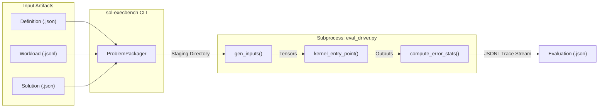
Sources: [src/sol_execbench/core/data/trace.py:113-132](), [src/sol_execbench/core/data/solution.py:131-145]()

---

# Page: Definition Schema

# Definition Schema

<details>
<summary>Relevant source files</summary>

The following files were used as context for generating this wiki page:

- [README.md](README.md)
- [docs/solution.md](docs/solution.md)

</details>


The **Definition Schema** provides the formal specification for a computational workload in SOL-ExecBench. It acts as the operator's contract, defining the symbolic axes, tensor shapes, data types, and a correct PyTorch reference implementation. A `definition.json` file is the single source of truth used to validate solutions and generate workloads.

## Top-Level Schema

The `Definition` class is a Pydantic model that enforces the structure of the `definition.json` file. It inherits from `BaseModelWithDocstrings` to ensure metadata is preserved in the JSON schema [src/sol_execbench/core/data/definition.py:136-143]().

| Field | Type | Required | Description |
| :--- | :--- | :--- | :--- |
| `name` | `NonEmptyString` | Yes | Unique human-readable name for the kernel. |
| `op_type` | `str` | No | Compute category (e.g., `gemm`, `rmsnorm`). |
| `axes` | `dict[str, AxisSpec]` | Yes | Map of symbolic names to `AxisConst`, `AxisVar`, or `AxisExpr`. |
| `inputs` | `dict[str, TensorSpec]` | Yes | Named input tensors/scalars. |
| `outputs` | `dict[str, TensorSpec]` | Yes | Named output tensors. |
| `reference` | `str` | Yes | Python source code containing a `run` function. |
| `custom_inputs_entrypoint`| `str` | No | Function name in `reference` for structured input generation. |

Sources: [src/sol_execbench/core/data/definition.py:136-168](), [docs/definition.md:21-31]()

## Axes: Dimension Definitions

Axes define the symbolic dimensions used by tensors. There are three types of axes:

1.  **`AxisConst`**: Fixed at definition time. Used for dimensions that do not change across workloads (e.g., a model's hidden size) [src/sol_execbench/core/data/definition.py:35-49]().
2.  **`AxisVar`**: Determined at runtime by the `Workload`. These represent dynamic dimensions like batch size or sequence length [src/sol_execbench/core/data/definition.py:51-63]().
3.  **`AxisExpr`**: Computed from other axes using mathematical expressions [src/sol_execbench/core/data/definition.py:65-79]().

### Expression Evaluation
`AxisExpr` supports basic arithmetic via `resolve_shape_expression`. Supported operators include `+`, `-`, `*`, `/`, `//`, `%`, `**`, and unary `+/-` [src/sol_execbench/core/data/shapes.py:19-32](). The evaluator uses Python's `ast` module to safely parse these expressions [src/sol_execbench/core/data/shapes.py:73-82]().

### Axis to Code Mapping
The following diagram shows how the `Definition` axes map to the internal Pydantic classes and the evaluation logic.

**Axis Entity Mapping**
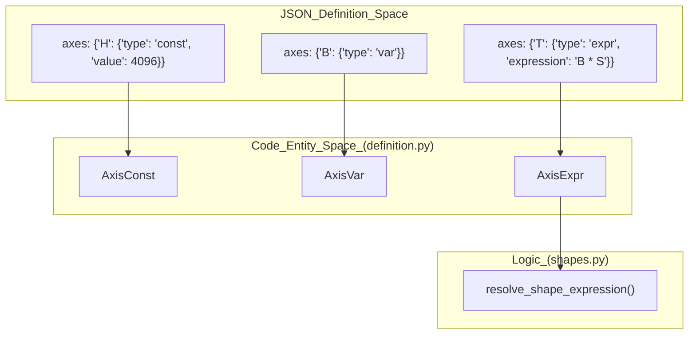
Sources: [src/sol_execbench/core/data/definition.py:35-79](), [src/sol_execbench/core/data/shapes.py:35-82]()

## Tensor Specifications

The `TensorSpec` class defines the requirements for each input and output [src/sol_execbench/core/data/definition.py:117-131]().

*   **`shape`**: A list of axis names. If `null`, the input is treated as a Python scalar (`int`, `float`, or `bool`). If `[]`, it is a 0-D `torch.Tensor` [docs/definition.md:103-108]().
*   **`dtype`**: Must be one of the supported strings in the `DType` enum [src/sol_execbench/core/data/definition.py:81-115]().

### Supported Data Types
SOL-ExecBench supports a wide range of types, including standard IEEE floats, Brain Floats, and low-precision formats like FP8 and FP4 [src/sol_execbench/core/data/dtypes.py:57-75]().

| Category | DType Strings |
| :--- | :--- |
| **Floating Point** | `float64`, `float32`, `float16`, `bfloat16` |
| **Quantized/Low-bit** | `float8_e4m3fn`, `float8_e5m2`, `float4_e2m1`, `float4_e2m1fn_x2` |
| **Integer/Bool** | `int64`, `int32`, `int16`, `int8`, `bool` |

Sources: [src/sol_execbench/core/data/definition.py:81-115](), [src/sol_execbench/core/data/dtypes.py:57-75]()

## Reference Implementation

The `reference` field contains Python code that serves as the "ground truth" for correctness [src/sol_execbench/core/data/definition.py:160-163]().

### Requirements
1.  **Entrypoint**: Must define a function `def run(...)` [docs/definition.md:114]().
2.  **Signature**: The `run` function arguments must match the keys defined in the `inputs` dictionary.
3.  **Returns**: Must return the tensors specified in the `outputs` dictionary [docs/definition.md:116]().
4.  **Validation**: The Pydantic model uses `_validate_reference_code` to ensure the code is syntactically valid and contains the required `run` function [src/sol_execbench/core/data/definition.py:169-171]().

### Custom Inputs Entrypoint
For workloads requiring structured data (e.g., valid indices for a Router or non-decreasing ragged offsets), the `custom_inputs_entrypoint` field identifies a second function within the `reference` code [docs/definition.md:125-132]().

**Signature**: `def custom_fn(axes_and_scalars: dict[str, int], device: torch.device) -> dict[str, torch.Tensor]` [src/sol_execbench/core/data/definition.py:153]().

**Data Flow for Custom Inputs**
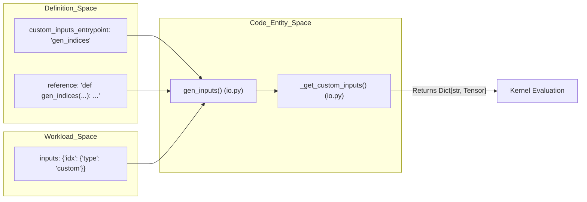
Sources: [src/sol_execbench/core/data/definition.py:152-153](), [docs/definition.md:139-150](), [src/sol_execbench/core/bench/io.py:344-383]()

## Validation Rules

The `Definition` model performs several automated checks during instantiation:
*   **Reference Validity**: Uses `ast.parse` to ensure the Python code is valid and contains a `run` function [src/sol_execbench/core/data/definition.py:169-171]().
*   **Axis Integrity**: Ensures `AxisExpr` only references axes that are defined in the `axes` dictionary.
*   **Tensor-Axis Alignment**: Validates that every axis name used in `TensorSpec.shape` exists in the `axes` dictionary.
*   **Name Collision**: Ensures input and output names do not overlap [src/sol_execbench/core/data/definition.py:158-159]().

Sources: [src/sol_execbench/core/data/definition.py:145-171]()

---

# Page: Workload Schema

# Workload Schema

<details>
<summary>Relevant source files</summary>

The following files were used as context for generating this wiki page:

- [README.md](README.md)
- [bench_config.example.json](bench_config.example.json)

</details>


A **Workload** makes a Definition concrete and executable by binding specific values to all variable axes and specifying the source of input data. It represents the exact configuration under which a kernel solution is benchmarked. In a typical evaluation, the system runs a solution against a set of workloads defined in a `workload.jsonl` file [README.md:126-129]().

## Top-Level Schema

Workloads are stored as JSONL (JSON Lines), where each line is a standalone JSON object representing one benchmark configuration [README.md:129-129]().

| Field | Type | Required | Description |
| :--- | :--- | :--- | :--- |
| `uuid` | string | Yes | Unique identifier for the workload. |
| `axes` | object | Yes | Map of `var` axis names to concrete integer values. |
| `inputs` | object | Yes | Map of input names to input descriptors. |
| `tolerance` | object | No | Per-workload correctness bounds (overrides defaults). |

Sources: [README.md:126-130]()

## Input Descriptors

The `inputs` field defines how the evaluator should source or generate tensor data for the kernel. The `type` field determines the strategy used.

### 1. `random`
Generates a random tensor using the shape and dtype specified in the `definition.json`.
*   **Usage:** `"input_name": {"type": "random"}`.
*   **Implementation:** Handled by `io.gen_inputs()` which uses `torch.randn` or custom random generators for specific dtypes, including specialized packing for FP4 and FP8 [README.md:94-94]().

### 2. `scalar`
Passes a fixed Python scalar directly to the function. This is used for inputs where `shape` is `null` in the Definition.
*   **Fields:** `value` (int, float, or bool).
*   **Usage:** `"eps": {"type": "scalar", "value": 1e-6}`.

### 3. `safetensors`
Loads data from a `.safetensors` file, typically used for real-world weights or specific indices.
*   **Fields:** `path` (relative path to file), `tensor_key` (key inside the container).
*   **Usage:** `"weight": {"type": "safetensors", "path": "data.safetensors", "tensor_key": "w1"}`.

### 4. `custom`
Delegates tensor generation to the `custom_inputs_entrypoint` defined in the problem's reference code. This is used for data with structural constraints (e.g., valid router indices in MoE).

---

## Correctness and Tolerance

Each workload can specify its own tolerance configuration. If omitted, the evaluator uses global defaults.

| Field | Type | Default | Description |
| :--- | :--- | :--- | :--- |
| `max_atol` | float | `1e-2` | Maximum absolute error threshold. |
| `max_rtol` | float | `1e-2` | Maximum relative error threshold. |
| `required_matched_ratio` | float | `0.99` | Fraction of elements that must pass. |
| `max_error_cap` | float \| null | `null` | Hard ceiling on max absolute error. |
| `allow_negative_inf` | bool | `false` | If true, matching `-inf` values are ignored in error calculation. |

**Correctness Formula:**
An element $i$ is considered correct if:
$$|output_i - reference_i| \le max\_atol + max\_rtol \times |reference_i|$$
The workload passes if the ratio of correct elements $\ge required\_matched\_ratio$ AND (if set) the largest absolute error is $\le max\_error\_cap$.

Sources: [README.md:14-15]()

---

## Implementation and Data Flow

The `sol-execbench` core uses Pydantic models to validate these schemas and provides utility functions for handling JSONL files.

### Workload Loading Logic
The following diagram illustrates how the system interacts with the workload schema during the evaluation setup.

**Workload Serialization Flow**
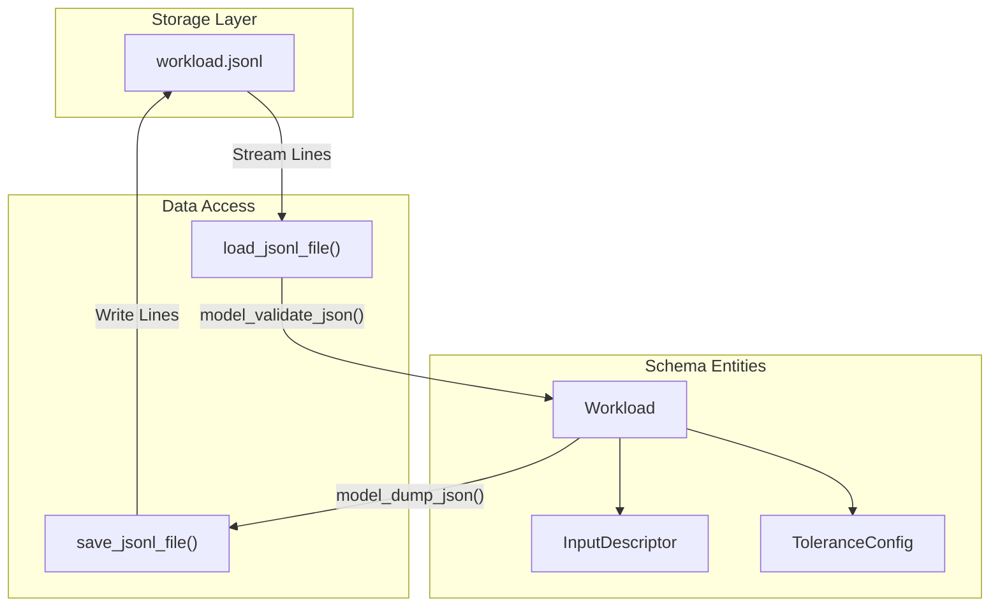
Sources: [README.md:128-130]()

### Evaluator Execution Flow
The evaluator resolves the workload into concrete tensors before calling the solution.

**Natural Language to Code Mapping: Workload Resolution**
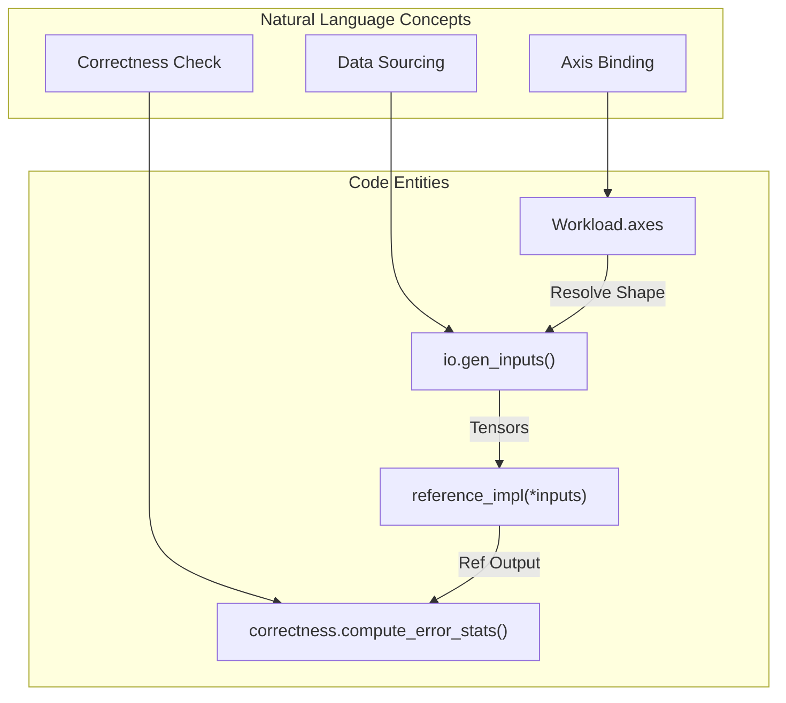
Sources: [README.md:14-16](), [README.md:94-94]()

### Evaluation Configuration
The `BenchmarkConfig` allows users to override evaluator defaults, such as the RNG seed used for `random` input descriptors or the number of iterations used for timing the resolved workload.

| Field | Type | Default | Description |
| :--- | :--- | :--- | :--- |
| `warmup_runs` | int | `10` | GPU warmup iterations before timing [bench_config.example.json:2](). |
| `iterations` | int | `50` | Timing iterations averaged into the latency report [bench_config.example.json:3](). |
| `seed` | int | `200` | RNG seed for input generation [bench_config.example.json:6](). |

Sources: [README.md:84-95](), [bench_config.example.json:1-7]()

---

# Page: Solution Schema

# Solution Schema

<details>
<summary>Relevant source files</summary>

The following files were used as context for generating this wiki page:

- [docs/solution.md](docs/solution.md)
- [src/sol_execbench/core/data/solution.py](src/sol_execbench/core/data/solution.py)

</details>


A **Solution** represents a concrete kernel implementation for a specific problem defined by a `Definition`. It encapsulates the source code, build metadata, and submission identity. The schema is defined as a Pydantic model `Solution` in [src/sol_execbench/core/data/solution.py:220-255]().

## Top-Level Schema

The `solution.json` file contains the following top-level fields:

| Field | Type | Required | Description |
|-------|------|----------|-------------|
| `name` | `NonEmptyString` | Yes | Unique identifier for the solution (e.g., `rmsnorm_triton_v1`). |
| `definition` | `NonEmptyString` | Yes | The `name` of the `Definition` this solution targets. |
| `author` | `NonEmptyString` | Yes | Identifier for the agent or human author. |
| `description` | `Optional[str]` | No | Brief explanation of the optimization technique used. |
| `spec` | `BuildSpec` | Yes | Build and execution configuration. |
| `sources` | `list[SourceFile]` | Yes | Array of source code files embedded as strings. |

Sources: [src/sol_execbench/core/data/solution.py:220-255](), [docs/solution.md:28-38]()

## Build Specification (`spec`)

The `BuildSpec` object [src/sol_execbench/core/data/solution.py:131-157]() defines how the evaluator should compile and execute the kernel.

| Field | Type | Default | Description |
|-------|------|---------|-------------|
| `languages` | `list[SupportedLanguages]` | - | Supported languages (e.g., `pytorch`, `triton`, `cuda_cpp`). |
| `target_hardware` | `list[SupportedHardware]` | - | Target hardware: `["B200"]`, `["LOCAL"]`, or both. |
| `entry_point` | `NonEmptyString` | - | Format: `"filename::function_name"`. |
| `destination_passing_style` | `bool` | `True` | Whether outputs are passed as pre-allocated arguments. |
| `binding` | `Optional[SupportedBindings]` | `None` | Binding type for C++/CUDA (defaults to `torch`). |
| `dependencies` | `list[NonEmptyString]` | `[]` | Required libraries (e.g., `CUTLASS_3_7`, `triton >= 2.3`). |
| `compile_options` | `Optional[CompileOptions]` | `None` | Extra flags for GCC/NVCC. |

### Destination Passing Style (DPS) vs. Return-Value Style

SOL-ExecBench defaults to **Destination Passing Style (DPS)**. In this mode, the evaluator pre-allocates all output tensors defined in the `Definition` and passes them as the final positional arguments to the entry point function [docs/solution.md:55-60]().

*   **DPS (Default):** `def run(input_a, input_b, output_c):` - The function writes to `output_c` in-place (e.g., `output_c[:] = ...`) and returns `None`.
*   **Return-Value Style:** `def run(input_a, input_b):` - The function returns the output tensor(s). This is enabled by setting `destination_passing_style: false` [src/sol_execbench/core/data/solution.py:148-151]().

The argument order for DPS is strictly: all inputs in the order they appear in `Definition.inputs`, followed by all outputs in the order they appear in `Definition.outputs` [docs/solution.md:73-81]().

Sources: [src/sol_execbench/core/data/solution.py:131-157](), [docs/solution.md:41-81]()

## Supported Languages and Bindings

The evaluator supports a variety of programming models, categorized into Python-based and C++-based families. These families cannot be mixed within a single solution [src/sol_execbench/core/data/solution.py:175-200]().

| Language Key | Family | Build Mechanism |
|--------------|--------|-----------------|
| `pytorch`, `triton`, `cute_dsl`, `cutile`, `cudnn_frontend` | Python | Direct import / JIT |
| `cuda_cpp`, `cutlass`, `cudnn`, `cublas` | C++ | `torch.utils.cpp_extension` |

### C++ Compilation (`compile_options`)
For C++ solutions, the `CompileOptions` class [src/sol_execbench/core/data/solution.py:117-129]() allows specifying additive flags:
*   `cflags`: Extra flags for the C++ compiler (gcc/g++).
*   `cuda_cflags`: Extra flags for NVCC (defaults to `["-O3", "--use_fast_math"]`).
*   `ld_flags`: Extra flags for the linker (defaults to `["-lcuda"]`).

The `ProblemPackager` automatically injects architecture-specific gencode flags (e.g., `sm_100a` for Blackwell targets) during the staging process [src/sol_execbench/core/package.py:118-124]().

Sources: [src/sol_execbench/core/data/solution.py:28-55](), [src/sol_execbench/core/data/solution.py:117-129](), [docs/solution.md:140-154]()

## Source File Embedding

The `sources` field is an array of `SourceFile` objects [src/sol_execbench/core/data/solution.py:80-113](). Each object contains a `path` (relative to the staging root) and the full `content` of the file.

```json
"sources": [
  {
    "path": "kernel.cu",
    "content": "#include <torch/extension.h>\nvoid MyKernel(torch::Tensor out, ...) { ... }"
  }
]
```

**Security Validation:** The `SourceFile` model validates that paths are not absolute and do not contain parent directory traversal (`..`) [src/sol_execbench/core/data/solution.py:95-113]().

Sources: [src/sol_execbench/core/data/solution.py:80-113](), [docs/solution.md:124-138]()

## Data Flow: Solution to Execution

The following diagram illustrates how the `Solution` schema is processed by the system to reach the hardware.

### System Entity Mapping: Solution to Hardware
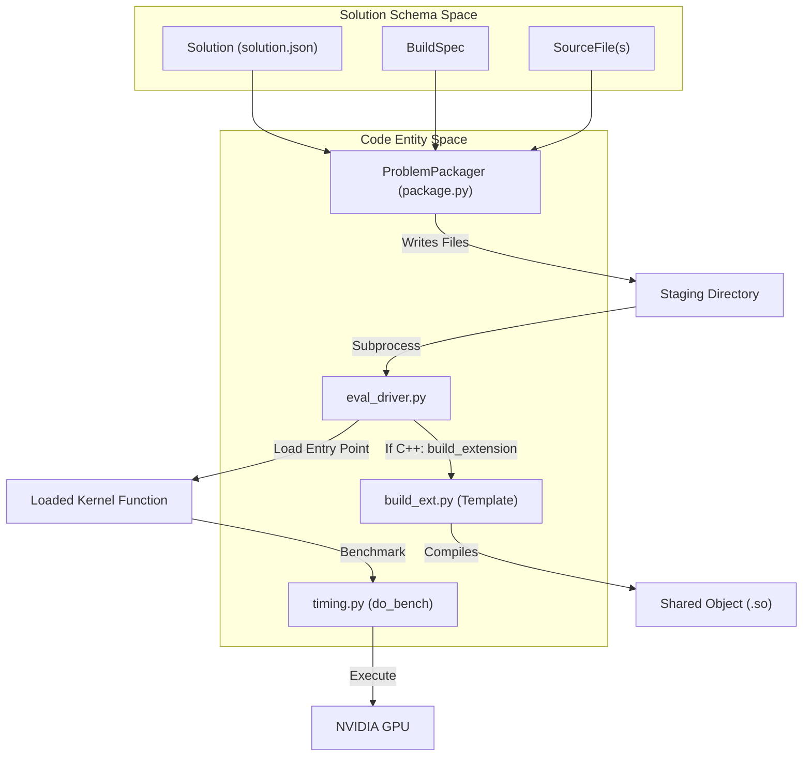
Sources: [src/sol_execbench/core/package.py:28-135](), [src/sol_execbench/core/eval_driver.py:12-80]()

### Language-Specific Dispatch Logic
The `eval_driver.py` script determines the loading strategy based on the `languages` list in the solution's `BuildSpec`.

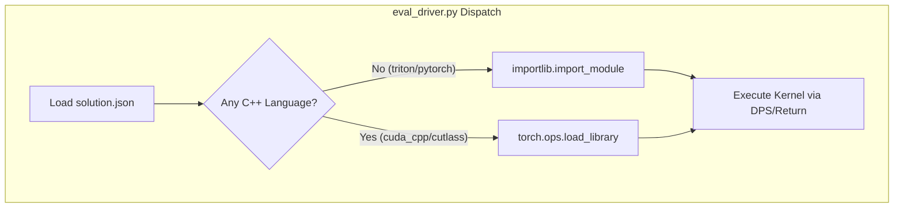
Sources: [src/sol_execbench/core/eval_driver.py:240-300]()

## Dependencies

The `dependencies` field supports a restricted set of libraries to ensure environment stability and reproducibility.

| Library | Specifier Example | Action |
|---------|-------------------|--------|
| **CUTLASS** | `"CUTLASS_3_7"` | Evaluator injects header paths for version 3.7. |
| **Triton** | `"triton >= 2.3"` | Validated against the environment; build fails if missing. |
| **cuDNN** | `"cudnn"` | Links against cuDNN libraries in C++ solutions via `ld_flags`. |
| **cuBLAS** | `"cublas"` | Links against cuBLAS libraries in C++ solutions. |

Sources: [src/sol_execbench/core/data/solution.py:145-147](), [docs/solution.md:107-122]()

---

# Page: Trace Schema

# Trace Schema

<details>
<summary>Relevant source files</summary>

The following files were used as context for generating this wiki page:

- [README.md](README.md)
- [src/sol_execbench/core/data/trace.py](src/sol_execbench/core/data/trace.py)

</details>


A **Trace** is an atomic, immutable record of a single benchmark execution. It serves as the primary data contract between the evaluation subprocess (`eval_driver.py`) and the CLI runner, capturing the linkage between a `Definition`, a `Solution`, and a specific `Workload` instance. The collection of these traces forms the database of benchmark results used for scoring and performance analysis.

### Trace Data Flow
The following diagram illustrates how the `Trace` object is populated during the evaluation lifecycle, bridging the gap between the high-level evaluation status and the low-level performance metrics collected from the GPU.

**Trace Generation Lifecycle**
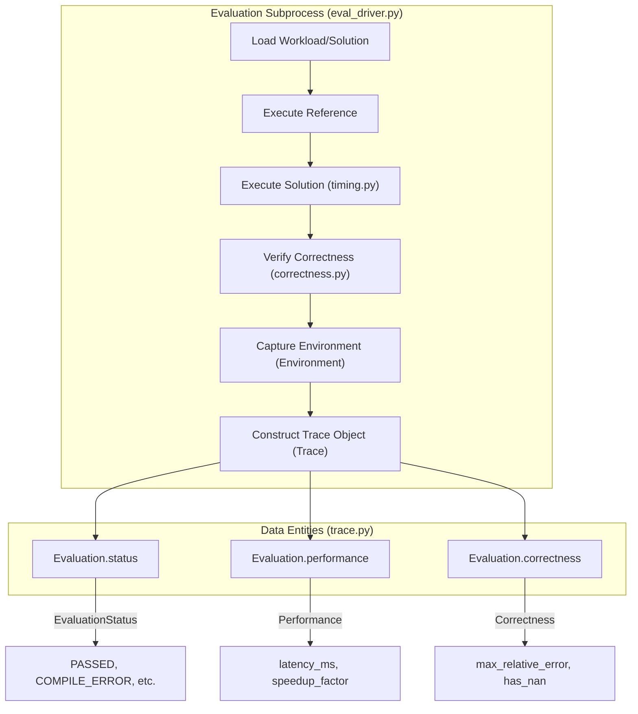
Sources: [src/sol_execbench/core/data/trace.py:16-118](), [src/sol_execbench/core/data/trace.py:171-185]()

---

### Top-Level Structure

The `Trace` object (defined in `src/sol_execbench/core/data/trace.py`) encapsulates four primary domains: identity, input configuration, evaluation results, and environment metadata.

| Field | Type | Required | Description |
| :--- | :--- | :--- | :--- |
| `definition` | `NonEmptyString` | Yes | The name of the `Definition` being evaluated. |
| `solution` | `Optional[str]` | No | The name of the `Solution` implementation. |
| `workload` | `Workload` | Yes | The concrete `Workload` parameters (axes and input descriptors). |
| `evaluation` | `Optional[Evaluation]` | No | The detailed results of the run, including status and metrics. |

Sources: [src/sol_execbench/core/data/trace.py:171-185]()

---

### Evaluation Results (`Evaluation`)

The `Evaluation` class contains the outcome of the benchmark. Its contents are strictly validated based on the `status` field via a Pydantic `model_validator`.

#### Status Codes (`EvaluationStatus`)
The `status` field indicates the final state of the evaluation:
- `PASSED`: Evaluation completed successfully with correct results. [src/sol_execbench/core/data/trace.py:93-94]()
- `INVALID_REFERENCE`: Definition reference code failed to run. [src/sol_execbench/core/data/trace.py:95-96]()
- `INCORRECT_SHAPE`: Solution produced output with incorrect tensor shape. [src/sol_execbench/core/data/trace.py:97-98]()
- `INCORRECT_NUMERICAL`: Solution produced results exceeding tolerances. [src/sol_execbench/core/data/trace.py:99-100]()
- `INCORRECT_DTYPE`: Solution produced output with incorrect data type. [src/sol_execbench/core/data/trace.py:101-102]()
- `RUNTIME_ERROR`: Solution encountered a runtime error during execution. [src/sol_execbench/core/data/trace.py:103-104]()
- `COMPILE_ERROR`: Solution failed to build (e.g., `nvcc` or Triton JIT failure). [src/sol_execbench/core/data/trace.py:105-106]()
- `TIMEOUT`: Evaluation did not complete within the configured timeout. [src/sol_execbench/core/data/trace.py:107-108]()
- `REWARD_HACK`: Anti-cheating logic detected a benchmark manipulation attempt (monkey-patching, thread injection, etc.). [src/sol_execbench/core/data/trace.py:109-110]()

Sources: [src/sol_execbench/core/data/trace.py:86-111]()

#### Correctness Fields (`Correctness`)
Captured via numerical evaluation comparing solution output against the reference:
- `max_relative_error`: Maximum relative error observed across all output elements. [src/sol_execbench/core/data/trace.py:39-40]()
- `max_absolute_error`: Maximum absolute error observed across all output elements. [src/sol_execbench/core/data/trace.py:41-42]()
- `has_nan`: True when the solution or reference output contains NaN values. [src/sol_execbench/core/data/trace.py:43-44]()
- `has_inf`: True when the solution or reference output contains Inf values (but no NaN). [src/sol_execbench/core/data/trace.py:45-46]()

Sources: [src/sol_execbench/core/data/trace.py:27-48]()

#### Performance Fields (`Performance`)
Captured via timing evaluation:
- `latency_ms`: Solution execution latency in milliseconds. [src/sol_execbench/core/data/trace.py:65-66]()
- `reference_latency_ms`: Reference implementation latency in milliseconds for comparison. [src/sol_execbench/core/data/trace.py:67-68]()
- `speedup_factor`: Calculated as `reference_latency_ms / latency_ms`. [src/sol_execbench/core/data/trace.py:69-70]()

Sources: [src/sol_execbench/core/data/trace.py:58-70]()

---

### Field Nullability Mapping

To maintain data integrity, the `Evaluation` model enforces presence or absence of metrics based on the status code using the `_validate_status_correctness_performance` validator. [src/sol_execbench/core/data/trace.py:133-168]()

| Status | `correctness` | `performance` |
| :--- | :--- | :--- |
| `PASSED` | **Required** | **Required** |
| `INCORRECT_NUMERICAL` | **Required** | **Forbidden** |
| All other errors | **Forbidden** | **Forbidden** |

Sources: [src/sol_execbench/core/data/trace.py:145-168]()

---

### Environment Snapshot (`Environment`)

The `Environment` class provides the context necessary to reproduce the performance results.

- `hardware`: Hardware identifier where the evaluation was performed (e.g., `'NVIDIA_H100'`). [src/sol_execbench/core/data/trace.py:80-81]()
- `libs`: A dictionary mapping library names to version strings (e.g., `{"torch": "2.5.1", "triton": "3.1.0"}`). [src/sol_execbench/core/data/trace.py:82-83]()

**Code Entity Mapping: Environment Capture**
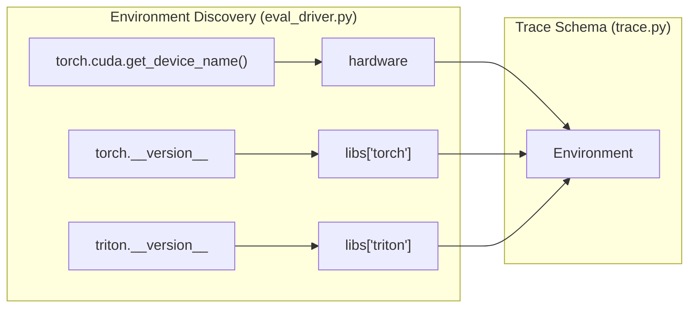
Sources: [src/sol_execbench/core/data/trace.py:73-83]()

---

### Example Trace (JSON)

Below is an example of a `Trace` object serialized to JSON, as emitted by the evaluation driver.

```json
{
  "definition": "test_vecadd",
  "solution": "test_vecadd_solution",
  "workload": {
    "uuid": "sub-test-0001",
    "axes": {},
    "inputs": {
      "x": {"type": "random"},
      "y": {"type": "random"}
    }
  },
  "evaluation": {
    "status": "PASSED",
    "timestamp": "2026-01-01T12:00:00Z",
    "log": "Benchmarking kernel...\n",
    "correctness": {
      "max_relative_error": 0.0,
      "max_absolute_error": 0.0,
      "has_nan": false,
      "has_inf": false
    },
    "performance": {
      "latency_ms": 0.015,
      "reference_latency_ms": 0.045,
      "speedup_factor": 3.0
    },
    "environment": {
      "hardware": "NVIDIA_H100_80GB_HBM3",
      "libs": {
        "torch": "2.5.1",
        "triton": "3.1.0"
      }
    }
  }
}
```
Sources: [src/sol_execbench/core/data/trace.py:113-131](), [src/sol_execbench/core/data/trace.py:171-185]()

---

# Page: Evaluation Pipeline

# Evaluation Pipeline

<details>
<summary>Relevant source files</summary>

The following files were used as context for generating this wiki page:

- [src/sol_execbench/cli/main.py](src/sol_execbench/cli/main.py)
- [src/sol_execbench/driver/templates/eval_driver.py](src/sol_execbench/driver/templates/eval_driver.py)

</details>


The SOL-ExecBench evaluation pipeline is designed to provide a reproducible, isolated, and tamper-resistant environment for measuring GPU kernel performance and correctness. The process transitions from high-level problem definitions to low-level hardware execution through a multi-stage workflow involving file staging, subprocess isolation, and automated compilation.

### Pipeline Overview

The evaluation follows a linear path from the CLI entry point to the generation of performance traces:

1.  **Invocation**: The user provides a problem directory or explicit JSON/JSONL files to the `sol-execbench` CLI [[src/sol_execbench/cli/main.py:18-21]]().
2.  **Staging**: The `ProblemPackager` creates a temporary directory and populates it with all necessary assets, including source code, configuration files, and the `eval_driver.py` template [[src/sol_execbench/driver/packager.py:34-40]]().
3.  **Compilation**: For C++ or CUDA kernels, a compilation subprocess is triggered using a specialized `build_ext.py` template to produce a shared library [[src/sol_execbench/driver/templates/build_ext.py:1-10]]().
4.  **Execution**: The `eval_driver.py` script runs in a fresh subprocess to ensure environment isolation and prevent state leakage between workloads [[src/sol_execbench/driver/packager.py:168-175]]().
5.  **Collection**: Results are streamed back to the CLI as JSONL `Trace` objects and displayed in a formatted table [[src/sol_execbench/cli/main.py:103-107]]().

### System Architecture and Data Flow

The following diagram illustrates how the logical phases of the pipeline map to specific code entities and files within the repository.

**Evaluation Data Flow**
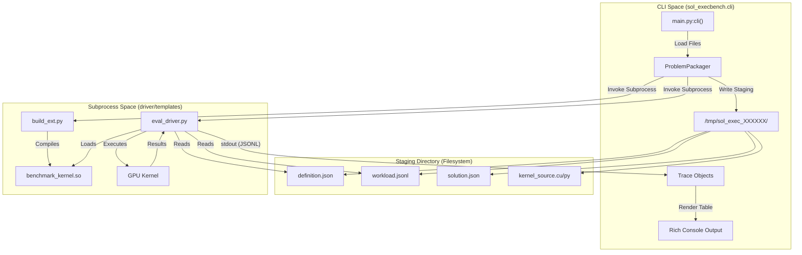
Sources: [src/sol_execbench/cli/main.py:39-49](), [src/sol_execbench/driver/packager.py:34-60](), [src/sol_execbench/driver/templates/eval_driver.py:18-23]()

### 3.1 CLI Interface (sol-execbench)
The `sol-execbench` command is the primary entry point for individual kernel evaluation. It handles argument parsing, resolves file paths (supporting both a unified `problem_dir` or explicit `--definition`, `--workload`, and `--solution` flags), and manages the lifecycle of the evaluation subprocesses [[src/sol_execbench/cli/main.py:180-217]](). It also supports optional GPU clock locking via `--lock-clocks` to ensure benchmark stability [[src/sol_execbench/cli/main.py:220-230]]().

For details, see [CLI Interface (sol-execbench)](#3.1).

### 3.2 Problem Packager and Staging
Before any code is executed, the `ProblemPackager` class orchestrates the "Staging" phase. This involves creating a filesystem-isolated directory where the kernel's environment is reconstructed [[src/sol_execbench/driver/packager.py:34-40]](). A critical responsibility of this phase is injecting hardware-specific metadata, such as `sm_100a` gencode flags for Blackwell GPUs or `sm_90a` for Hopper, into the build configuration to ensure the kernel is optimized for the target hardware [[src/sol_execbench/driver/packager.py:34-60]]().

For details, see [Problem Packager and Staging](#3.2).

### 3.3 Evaluation Driver (eval_driver.py)
The `eval_driver.py` is a self-contained Python script injected into the staging directory. It executes in a separate process to maintain a clean `torch` and `triton` state [[src/sol_execbench/driver/templates/eval_driver.py:18-23]](). It is responsible for:
*   Redirecting `stdout` to `stderr` before importing heavy libraries to keep the JSONL stream clean [[src/sol_execbench/driver/templates/eval_driver.py:38-43]]().
*   Loading the kernel (either via `importlib` for Python/Triton or `torch.ops.load_library` for C++).
*   Generating inputs and allocating outputs based on the `Definition` and `Workload` specifications [[src/sol_execbench/driver/templates/eval_driver.py:53-87]]().
*   Executing the kernel and calculating correctness and performance metrics while monitoring for reward-hacking attempts [[src/sol_execbench/driver/templates/eval_driver.py:113-133]]().

For details, see [Evaluation Driver (eval_driver.py)](#3.3).

### 3.4 Batch Evaluation (run_dataset.py)
For large-scale testing across the entire SOL-ExecBench dataset, the `scripts/run_dataset.py` script provides a batch-processing wrapper. It automates the discovery of problems across categories, manages parallel or sequential execution, and generates a consolidated summary of the entire dataset's performance.

For details, see [Batch Evaluation (run_dataset.py)](#3.4).

### Pipeline Execution Flow
The following sequence diagram details the interaction between the core classes during a typical evaluation run.

**Sequence: CLI to GPU Execution**
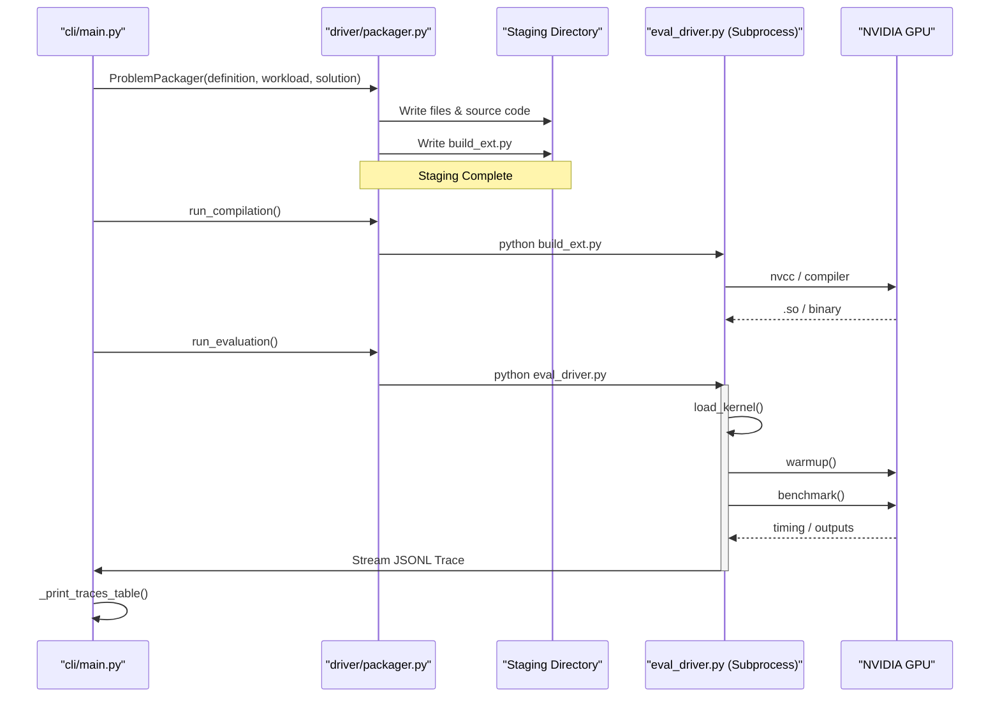
Sources: [src/sol_execbench/cli/main.py:220-250](), [src/sol_execbench/driver/packager.py:168-190](), [src/sol_execbench/driver/templates/eval_driver.py:53-87]()

---

# Page: CLI Interface (sol-execbench)

# CLI Interface (sol-execbench)

<details>
<summary>Relevant source files</summary>

The following files were used as context for generating this wiki page:

- [src/sol_execbench/cli/main.py](src/sol_execbench/cli/main.py)

</details>


The `sol-execbench` command is the primary entry point for evaluating a single GPU kernel solution against a specific problem definition and set of workloads. It orchestrates the staging of source files, handles compilation for C++-based DSLs, executes the evaluation driver in a protected subprocess, and aggregates results into a human-readable or machine-parsable format.

### Execution Modes

The CLI supports two primary invocation modes for specifying the problem and solution files:

1.  **Problem Directory Mode**: Pass a single positional argument `problem_dir`. The CLI automatically looks for `definition.json` and `workload.jsonl` within that directory [src/sol_execbench/cli/main.py:83-100](). It can also auto-detect `solution.json` and `config.json` if present in the same directory [src/sol_execbench/cli/main.py:98-99]().
2.  **Explicit File Mode**: Use individual flags (`--definition`, `--workload`, `--solution`) to point to files located anywhere on the filesystem [src/sol_execbench/cli/main.py:185-201]().

### CLI Arguments and Flags

The CLI is implemented using the `click` library [src/sol_execbench/cli/main.py:34]().

| Flag | Type | Description |
| :--- | :--- | :--- |
| `problem_dir` | Argument | Positional path to a directory containing problem files [src/sol_execbench/cli/main.py:181-183](). |
| `--definition` | Option | Path to the `definition.json` file [src/sol_execbench/cli/main.py:185-189](). |
| `--workload` | Option | Path to the `workload.jsonl` file [src/sol_execbench/cli/main.py:191-195](). |
| `--solution` | Option | Path to the `solution.json` file [src/sol_execbench/cli/main.py:197-201](). |
| `--config` | Option | Path to a `BenchmarkConfig` JSON file [src/sol_execbench/cli/main.py:203-207](). |
| `--compile-timeout`| Option | Timeout in seconds for C++/CUDA compilation (default: 120) [src/sol_execbench/cli/main.py:209-213](). |
| `--timeout` | Option | Timeout in seconds for the evaluation subprocess (default: 600) [src/sol_execbench/cli/main.py:215-216](). |
| `--lock-clocks` | Flag | Attempt to lock GPU clocks via `nvidia-smi` before benchmarking [src/sol_execbench/cli/main.py:228-232](). |
| `--keep-staging` | Flag | Do not delete the temporary staging directory after execution [src/sol_execbench/cli/main.py:234-238](). |
| `--json` | Flag | Output the final traces as a JSON array to stdout instead of a table [src/sol_execbench/cli/main.py:223-227](). |
| `--output`, `-o` | Option | Path to save the trace results (JSONL format) [src/sol_execbench/cli/main.py:218-222](). |

**Sources:** [src/sol_execbench/cli/main.py:180-240]()

---

### Data Flow and Implementation

The CLI uses the `ProblemPackager` class [src/sol_execbench/driver/packager.py:18]() to prepare the execution environment. It creates a temporary "staging" directory where all necessary files (definitions, workloads, and kernel source code) are materialized before launching the evaluation driver.

#### System Architecture: CLI to Subprocess

The following diagram illustrates how the CLI entities interact with the filesystem and the driver subprocess.

**CLI Execution Flow**
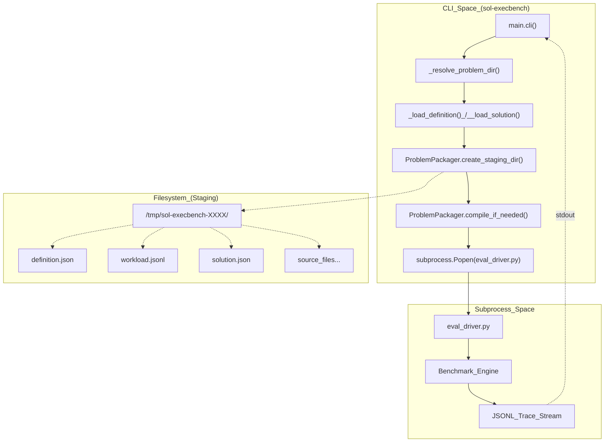
**Sources:** [src/sol_execbench/cli/main.py:243-324](), [src/sol_execbench/driver/packager.py:18-40]()

---

### Results Display and Rich Integration

When not in `--json` mode, the CLI uses the `Rich` library [src/sol_execbench/cli/main.py:35-37]() to render a formatted table of results to `stderr` [src/sol_execbench/cli/main.py:49](). This ensures that benchmark data is clearly visible even if the user redirects `stdout`.

#### Table Columns
*   **Status**: Displays the `EvaluationStatus` (e.g., `PASSED`, `INCORRECT_NUMERICAL`, `RUNTIME_ERROR`) with color coding [src/sol_execbench/cli/main.py:123-131]().
*   **Latency (ms)**: The measured execution time of the solution kernel [src/sol_execbench/cli/main.py:136]().
*   **Ref (ms)**: The execution time of the reference implementation [src/sol_execbench/cli/main.py:137]().
*   **Speedup**: The ratio of reference latency to solution latency [src/sol_execbench/cli/main.py:138]().
*   **Max Abs/Rel Err**: Numerical error statistics extracted from the `Trace` object [src/sol_execbench/cli/main.py:142-151]().

#### Error Logging
If a workload fails with a status other than `PASSED` or `INCORRECT_NUMERICAL`, the CLI captures the `ev.log` (which includes stdout/stderr from the driver subprocess) and prints it below the summary table [src/sol_execbench/cli/main.py:160-177]().

**Sources:** [src/sol_execbench/cli/main.py:103-179]()

---

### Internal Component Mapping

This diagram maps CLI concepts to the specific Pydantic models and logic classes defined in the core package.

**Code Entity Mapping**
```mermaid
classDiagram
    class "cli.main" {
        +cli()
        +_print_traces_table()
        +_load_definition()
        +_load_solution()
    }
    class "ProblemPackager" {
        +create_staging_dir()
        +compile_if_needed()
        +get_eval_command()
    }
    class "Trace" {
        +evaluation: Evaluation
        +environment: Environment
    }
    class "Evaluation" {
        +status: EvaluationStatus
        +performance: PerformanceStats
        +correctness: CorrectnessStats
        +log: str
    }

    "cli.main" ..> "ProblemPackager" : "uses_to_stage_files"
    "cli.main" ..> "Trace" : "parses_from_driver_output"
    "Trace" *-- "Evaluation" : "contains"
    "Evaluation" ..> "EvaluationStatus" : "reports"
```
**Sources:** [src/sol_execbench/cli/main.py:39-47](), [src/sol_execbench/driver/packager.py:18-40]()

### Key Implementation Details

*   **Source Resolution**: When loading a `Solution`, the CLI automatically reads local file paths specified in the `sources` list and embeds their content into the `Solution` object if the `content` field is empty [src/sol_execbench/cli/main.py:65-74]().
*   **Clock Management**: If `--lock-clocks` is specified, the CLI invokes `lock_clocks()` from the `core.bench` package. It uses a `try...finally` block to ensure `unlock_clocks()` is called even if the evaluation crashes [src/sol_execbench/cli/main.py:274-324]().
*   **Trace Streaming**: The CLI reads the output of the `eval_driver.py` subprocess line-by-line. Each line is expected to be a valid JSON representation of a `Trace` object, which is then parsed into the Pydantic model [src/sol_execbench/cli/main.py:302-308]().
*   **Subprocess Execution**: The CLI uses `subprocess.Popen` to run the evaluation driver, capturing `stdout` to parse `Trace` objects and `stderr` for logging [src/sol_execbench/cli/main.py:291-300]().

**Sources:** [src/sol_execbench/cli/main.py:52-81](), [src/sol_execbench/cli/main.py:274-324]()

---

# Page: Problem Packager and Staging

# Problem Packager and Staging

<details>
<summary>Relevant source files</summary>

The following files were used as context for generating this wiki page:

- [src/sol_execbench/cli/main.py](src/sol_execbench/cli/main.py)
- [src/sol_execbench/driver/templates/build_ext.py](src/sol_execbench/driver/templates/build_ext.py)

</details>


The `ProblemPackager` is the central orchestration component responsible for preparing a kernel solution for execution. It bridges high-level data models (`Definition`, `Workload`, `Solution`) and the low-level execution environment by creating a self-contained staging directory. This process includes file serialization, automatic CUDA architecture flag injection, and the generation of subprocess commands for compilation and evaluation.

## Purpose and Scope

Before a kernel can be benchmarked, it must be isolated from the host environment to ensure reproducibility and prevent side effects. The `ProblemPackager` performs the following critical tasks:
1.  **Staging**: Creates a temporary directory and writes all necessary JSON descriptors and source code files.
2.  **Gencode Injection**: Automatically detects the GPU architecture (e.g., Blackwell `sm_100a`) and injects the appropriate `nvcc` flags into the build specification.
3.  **Command Generation**: Produces the exact shell commands required to compile C++/CUDA extensions and to invoke the `eval_driver.py`.

### Architectural Context

The following diagram illustrates how the `ProblemPackager` sits between the CLI and the Subprocess execution layers.

**Diagram: Problem Packager Data Flow**
```mermaid
graph TD
    subgraph "CLI Space"
        A["src/sol_execbench/cli/main.py"] -- "instantiates" --> B["ProblemPackager"]
    end

    subgraph "Staging Directory (Temp)"
        B -- "writes" --> D["definition.json"]
        B -- "writes" --> E["workload.jsonl"]
        B -- "writes" --> F["solution.json"]
        B -- "writes" --> G["Source Files (*.py, *.cu, *.h)"]
    end

    subgraph "Subprocess Space"
        B -- "returns" --> H["compile_cmd"]
        B -- "returns" --> I["execute_cmd"]
        H -- "executes" --> J["src/sol_execbench/driver/templates/build_ext.py"]
        I -- "executes" --> K["src/sol_execbench/driver/templates/eval_driver.py"]
    end

    A -- "calls" --> H
    A -- "calls" --> I
```
Sources: `[src/sol_execbench/driver/packager.py:31-48]()`, `[src/sol_execbench/cli/main.py:284-315]()`

## Implementation Details

The `ProblemPackager` is defined in `src/sol_execbench/driver/packager.py`. It takes Pydantic models as input and manages the lifecycle of the staging directory.

### Key Class: ProblemPackager
The class constructor accepts the core data models and an optional staging path. If no path is provided, it creates a temporary directory using `tempfile.mkdtemp()` `[src/sol_execbench/driver/packager.py:53-70]()`.

| Function | Responsibility |
| :--- | :--- |
| `stage()` | Serializes `definition.json`, `workload.jsonl`, `solution.json`, and all `sources` to the staging path `[src/sol_execbench/driver/packager.py:100-118]()`. |
| `get_compile_cmd()` | Generates the `python build_ext.py` command with appropriate flags `[src/sol_execbench/driver/packager.py:133-160]()`. |
| `get_execute_cmd()` | Generates the `python eval_driver.py` command, passing paths to the staged JSON files `[src/sol_execbench/driver/packager.py:162-180]()`. |

Sources: `[src/sol_execbench/driver/packager.py:48-180]()`

## Automatic Gencode Injection

A key feature of the packager is ensuring that C++ and CUDA kernels are compiled for the correct hardware. It inspects the `target_hardware` field of the `Solution` and the current system's GPU.

### Blackwell and LOCAL Targets
If the solution targets `LOCAL` or specifically `sm_100a` (Blackwell), the packager modifies the `compile_options` within the solution spec before staging:
- It checks for Blackwell support using `torch.cuda.get_device_capability()` `[src/sol_execbench/driver/packager.py:84-88]()`.
- It appends `-gencode=arch=compute_100,code=sm_100a` to the `cuda_cflags` if a Blackwell GPU is detected `[src/sol_execbench/driver/packager.py:91-98]()`.

This automation removes the burden from the user to specify complex architecture-specific flags in their `solution.json`.

Sources: `[src/sol_execbench/driver/packager.py:72-98]()`

## Staging Directory Structure

When `stage()` is called, the directory is populated as follows:

```text
/tmp/sol-execbench-XXXXXX/
├── definition.json       # Kernel axes and tensor specs
├── workload.jsonl       # Concrete input values/bindings
├── solution.json         # Build spec and entry point (modified with gencodes)
└── [source_files...]     # All files defined in solution.spec.sources (e.g., kernel.cu, model.py)
```

Sources: `[src/sol_execbench/driver/packager.py:100-118]()`

## Subprocess Command Generation

The packager facilitates the transition to the execution phase by providing pre-formatted commands.

### Compilation Command
For C++ based languages (CUDA, CUTLASS, cuDNN, cuBLAS), the `get_compile_cmd` function produces a command that invokes the internal `build_ext.py` utility.
- **Path**: `src/sol_execbench/driver/templates/build_ext.py`
- **Behavior**: `build_ext.py` uses `torch.utils.cpp_extension.load` to compile all source files in the current directory into `benchmark_kernel.so` `[src/sol_execbench/driver/templates/build_ext.py:51-60]()`.

### Execution Command
The `get_execute_cmd` function targets the `eval_driver.py`.
- **Path**: `src/sol_execbench/driver/templates/eval_driver.py`
- **Arguments**:
    - `--definition`: Path to staged `definition.json`
    - `--workload`: Path to staged `workload.jsonl`
    - `--solution`: Path to staged `solution.json`

**Diagram: Mapping System Logic to Code Entities**
```mermaid
graph LR
    subgraph "ProblemPackager Logic"
        P["ProblemPackager"] -- "modifies" --> S["Solution.spec.compile_options"]
        P -- "calls" --> ST["stage()"]
        P -- "calls" --> GCC["get_compile_cmd()"]
        P -- "calls" --> GEC["get_execute_cmd()"]
    end

    subgraph "File System / IO"
        ST -- "writes" --> F1["definition.json"]
        ST -- "writes" --> F2["workload.jsonl"]
        ST -- "writes" --> F3["solution.json"]
    end

    subgraph "Subprocess Templates"
        GCC -- "references" --> T1["src/sol_execbench/driver/templates/build_ext.py"]
        GEC -- "references" --> T2["src/sol_execbench/driver/templates/eval_driver.py"]
    end
```
Sources: `[src/sol_execbench/driver/packager.py:133-180]()`, `[src/sol_execbench/driver/templates/build_ext.py:20-60]()`

---

# Page: Evaluation Driver (eval_driver.py)

# Evaluation Driver (eval_driver.py)

<details>
<summary>Relevant source files</summary>

The following files were used as context for generating this wiki page:

- [src/sol_execbench/driver/templates/build_ext.py](src/sol_execbench/driver/templates/build_ext.py)
- [src/sol_execbench/driver/templates/eval_driver.py](src/sol_execbench/driver/templates/eval_driver.py)

</details>


The `eval_driver.py` script is a self-contained Python template that serves as the execution engine for a single kernel evaluation. It is designed to run within a subprocess, isolated from the main CLI process, to ensure that kernel crashes, memory leaks, or environment mutations (like `torch.cuda` initialization) do not destabilize the benchmarking suite.

## Overview and Purpose

When `sol-execbench` initiates an evaluation, the `ProblemPackager` stages the `eval_driver.py` template into a temporary directory. This script is responsible for the entire lifecycle of a benchmark run:
1.  **Environment Setup**: Redirecting stdout to stderr before `torch` import to prevent library chatter from corrupting the JSONL stream [src/sol_execbench/driver/templates/eval_driver.py:38-45]().
2.  **Problem Loading**: Loading `definition.json`, `workload.jsonl`, and `solution.json` from the local staging directory [src/sol_execbench/driver/templates/eval_driver.py:90-108]().
3.  **Kernel Loading**: Importing the solution and reference implementations [src/sol_execbench/driver/templates/eval_driver.py:168-184]().
4.  **Data Preparation**: Generating or loading tensors using `gen_inputs` based on the `Workload` and `Definition` schemas [src/sol_execbench/driver/templates/eval_driver.py:120-125]().
5.  **Execution & Timing**: Running the kernel using `time_runnable` with hardware-accurate timing [src/sol_execbench/driver/templates/eval_driver.py:134-134]().
6.  **Correctness Verification**: Comparing solution outputs against reference outputs via `compute_error_stats` [src/sol_execbench/driver/templates/eval_driver.py:116-117]().
7.  **Result Streaming**: Emitting `Trace` objects as JSONL to the original stdout for the CLI to consume.

### Execution Flow Diagram

The following diagram illustrates how the `eval_driver.py` orchestrates the evaluation within the subprocess.

**Subprocess Execution Lifecycle**
```mermaid
graph TD
    subgraph "Subprocess_eval_driver_py"
        START["Entry_Point"] --> REDIR["os_dup2_2_1_Redirect_stdout_to_stderr"]
        REDIR --> IMP["Import_torch_and_Solution_Kernel"]
        IMP --> LOAD["_load_problem_Load_staged_JSON_files"]
        
        subgraph "Workload_Loop"
            GEN["gen_inputs_Prepare_Tensors"] --> REF["Execute_Reference_run_function"]
            REF --> BENCH["time_runnable_Execute_and_Time_Solution"]
            BENCH --> CORR["compute_error_stats_Verify_Results"]
            CORR --> TRACE["Create_Trace_object"]
            TRACE --> STREAM["Print_JSONL_to_real_stdout"]
        end
        
        LOAD --> GEN
        STREAM --> NEXT{"More_Workloads"}
        NEXT -- "Yes" --> GEN
        NEXT -- "No" --> END["Exit"]
    end

    CLI["sol_execbench_CLI"] -- "subprocess_run" --> START
    STREAM -- "Pipe_JSONL" --> CLI
```
Sources: [src/sol_execbench/driver/templates/eval_driver.py:38-147](), [src/sol_execbench/driver/templates/eval_driver.py:53-87]()

---

## Implementation Details

### Early Stdout Redirection
To ensure that all logs (including C++ extension build logs or library initialization warnings) are captured without corrupting the result stream, `eval_driver.py` performs a low-level redirection of file descriptor 1 to file descriptor 2 (stderr) before importing `torch` [src/sol_execbench/driver/templates/eval_driver.py:38-43](). It saves a handle to the original stdout (`_real_stdout`) to print the final JSON results [src/sol_execbench/driver/templates/eval_driver.py:40-41]().

### Kernel Calling Conventions
The driver handles the interface between the benchmarking engine and the user kernel through the `_call_and_collect_outputs` helper [src/sol_execbench/driver/templates/eval_driver.py:53-62](). It supports two primary calling styles:
*   **Destination-Passing Style (DPS)**: If `destination_passing_style` is True, the driver calls `allocate_outputs` and passes these pre-allocated tensors to the kernel [src/sol_execbench/driver/templates/eval_driver.py:70-75]().
*   **Return-Value Style**: If False, the driver captures the kernel's return value and uses `normalize_outputs` to convert it into a standardized dictionary of tensors [src/sol_execbench/driver/templates/eval_driver.py:77-86]().

### Reward Hack Detection and Integrity
The driver implements aggressive anti-cheating measures. Before importing user code, it takes an `_integrity_snapshot` of critical function IDs [src/sol_execbench/driver/templates/eval_driver.py:186-201](). During execution, it invokes several checks:
*   `check_monkey_patch`: Ensures core PyTorch/Benchmarking functions haven't been replaced [src/sol_execbench/driver/templates/eval_driver.py:130-130]().
*   `check_thread_injection`: Detects unauthorized background threads [src/sol_execbench/driver/templates/eval_driver.py:131-131]().
*   `check_lazy_outputs`: Verifies that outputs are actual tensors and not proxy objects [src/sol_execbench/driver/templates/eval_driver.py:129-129]().

---

## C++/CUDA Compilation (build_ext.py)

For solutions written in CUDA C++, CUTLASS, or cuBLAS, the system uses `build_ext.py` to compile the source into a shared object (`benchmark_kernel.so`) [src/sol_execbench/driver/templates/build_ext.py:51-60]().

| Component | Role |
| :--- | :--- |
| **Source Collection** | Automatically finds `.cu`, `.cpp`, and `.c` files in the staging directory [src/sol_execbench/driver/templates/build_ext.py:36-40](). |
| **Compile Options** | Applies `cuda_cflags`, `cflags`, and `ld_flags` from the `Solution` schema [src/sol_execbench/driver/templates/build_ext.py:28-33](). |
| **Include Paths** | Injects paths for the local staging directory and `CUTLASS_DIR` [src/sol_execbench/driver/templates/build_ext.py:44-49](). |
| **Artifact** | Renames the platform-specific output to a stable `benchmark_kernel.so` [src/sol_execbench/driver/templates/build_ext.py:63-67](). |

### System Entity Mapping

This diagram maps the conceptual "Evaluation" steps to the specific code entities and files involved.

**Code Entity Mapping**
```mermaid
graph LR
    subgraph "Staging_Directory"
        DEF["definition_json"]
        SOL["solution_json"]
        WRK["workload_jsonl"]
        ED["eval_driver_py"]
        BE["build_ext_py"]
    end

    subgraph "sol_execbench_core_bench"
        TIM["timing_py_time_runnable"]
        COR["correctness_py_compute_error_stats"]
        IO["io_py_gen_inputs_allocate_outputs"]
        RH["reward_hack_py_check_monkey_patch"]
    end

    ED -- "loads_via_load_problem" --> DEF
    ED -- "loads_via_load_problem" --> WRK
    ED -- "calls" --> IO
    ED -- "calls" --> TIM
    ED -- "calls" --> COR
    ED -- "calls" --> RH
    
    BE -- "parses" --> SOL
    BE -- "produces" --> SO["benchmark_kernel_so"]
```
Sources: [src/sol_execbench/driver/templates/eval_driver.py:90-148](), [src/sol_execbench/driver/templates/build_ext.py:22-28]()

---

## Data Flow and Output

The driver communicates with the parent CLI process primarily through stdout using `Trace` objects.

1.  **Workload Processing**: For each workload in `workload.jsonl`, the driver generates inputs and runs both the reference and solution [src/sol_execbench/driver/templates/eval_driver.py:160-184]().
2.  **Performance Measurement**: `time_runnable` is used to collect latency statistics (min, max, mean, median) [src/sol_execbench/driver/templates/eval_driver.py:134-134]().
3.  **Correctness Check**: `compute_error_stats` calculates absolute and relative errors [src/sol_execbench/driver/templates/eval_driver.py:116-117]().
4.  **Trace Emission**: The driver constructs a `Trace` object containing `EvaluationStatus`, `Correctness`, and `Performance` data, then serializes it to JSONL [src/sol_execbench/driver/templates/eval_driver.py:138-147]().

Sources: [src/sol_execbench/driver/templates/eval_driver.py:53-148]()

---

# Page: Batch Evaluation (run_dataset.py)

# Batch Evaluation (run_dataset.py)

<details>
<summary>Relevant source files</summary>

The following files were used as context for generating this wiki page:

- [README.md](README.md)
- [src/sol_execbench/cli/main.py](src/sol_execbench/cli/main.py)

</details>


The `scripts/run_dataset.py` script is a high-level batch runner designed to automate the evaluation of multiple kernels across the SOL-ExecBench dataset. It handles problem discovery, solution generation from reference implementations or custom files, and incremental execution to avoid redundant benchmarking.

## Overview and Purpose

`run_dataset.py` acts as an orchestration layer over the core `sol-execbench` CLI. While the core CLI focuses on single-problem evaluation, the batch runner allows users to evaluate entire categories (e.g., L1, L2) or the complete benchmark suite with a single command. It is particularly useful for establishing baseline performance using reference implementations or for validating a set of new kernel optimizations against the entire dataset.

### Key Capabilities
*   **Dataset Discovery**: Automatically identifies problem directories containing `definition.json` and `workload.jsonl` [scripts/run_dataset.py:53-77]().
*   **Automatic Solution Construction**: Can dynamically wrap the reference Python code from a `definition.json` into a valid `Solution` object [scripts/run_dataset.py:167-196]().
*   **Incremental Re-runs**: Skips problems that already have a result file in the output directory, facilitating long-running batch jobs [scripts/run_dataset.py:262-265]().
*   **Summary Reporting**: Aggregates results into a formatted table showing pass/fail status, speedup, and error metrics [scripts/run_dataset.py:275-300]().

Sources: [README.md:103-122](), [scripts/run_dataset.py:53-77](), [scripts/run_dataset.py:167-196]().

## Dataset Discovery and Categories

The script supports two modes of operation based on the provided `problems_dir` argument:
1.  **Single Problem Mode**: If the directory contains a `definition.json`, it is treated as a standalone problem [scripts/run_dataset.py:228-232]().
2.  **Dataset Root Mode**: If no definition is found at the root, the script searches for sub-directories matching known categories [scripts/run_dataset.py:234-239]().

### Supported Categories
The script recognizes the following categories by default:
*   `L1`: Level 1 kernels (simple element-wise or reduction).
*   `L2`: Level 2 kernels (more complex tiling/memory patterns).
*   `FlashInfer-Bench`: Kernels derived from the FlashInfer library.
*   `Quant`: Quantization-related kernels (FP8, INT8, etc.).

**Table: Category Discovery Logic**
| Feature | Logic |
| :--- | :--- |
| **Category Filter** | Controlled by the `--category` flag [scripts/run_dataset.py:311](). |
| **Problem Validation** | A directory must contain both `definition.json` and `workload.jsonl` [scripts/run_dataset.py:73-75](). |
| **Sorting** | Problems are processed in alphabetical order by directory name [scripts/run_dataset.py:72](). |

Sources: [scripts/run_dataset.py:53-77](), [scripts/run_dataset.py:228-239](), [scripts/run_dataset.py:311-313]().

## Solution Construction

A unique feature of `run_dataset.py` is its ability to "bootstrap" solutions. This allows benchmarking even if a formal `solution.json` has not been written yet.

### Reference-to-Solution Mapping
The `build_reference_solution` function extracts the `reference` field from a problem's `Definition` and wraps it in a `Solution` schema, targeting the `pytorch` language [scripts/run_dataset.py:167-196](). 

### Destination-Passing Style (DPS) Inference
To ensure the kernel is called correctly, the script uses Python's `ast` module in `_infer_dps()` to inspect the `run()` function's signature [scripts/run_dataset.py:85-114](). If the last parameter name in the source code matches the last output name defined in the `definition.json`, the script automatically sets `destination_passing_style: True` [scripts/run_dataset.py:110-111]().

**Diagram: Solution Generation Data Flow**
This diagram shows how the `run_dataset.py` logic transforms raw problem files into a temporary `Solution` entity for the evaluation pipeline.

```mermaid
graph TD
    subgraph "Filespace"
        D["definition.json"]
        R["reference.py / solution.py"]
    end

    subgraph "run_dataset.py Logic"
        DP["discover_problems()"]
        BS["build_solution_for_problem()"]
        ID["_infer_dps() via ast.parse()"]
        BRS["build_reference_solution()"]
    end

    subgraph "Code Entity Space"
        SOL["Solution Object (dict)"]
        SPEC["SolutionSpec (pytorch)"]
    end

    D --> DP
    DP --> BS
    R --> BS
    BS --> ID
    ID --> SOL
    BS --> BRS
    BRS --> SOL
    SOL --> SPEC
```

Sources: [scripts/run_dataset.py:85-114](), [scripts/run_dataset.py:117-136](), [scripts/run_dataset.py:167-196]().

## Execution Flow

The batch runner iterates through discovered problems and invokes the `sol-execbench` CLI as a subprocess for each one.

### Subprocess Invocation
For each problem, the script:
1.  Constructs the `Solution` dictionary (either from a file or from the reference code).
2.  Writes the solution to a temporary JSON file.
3.  Calls `subprocess.run` with the following arguments [scripts/run_dataset.py:246-258]():
    *   `--definition`: Path to the problem's definition.
    *   `--workload`: Path to the problem's workload.
    *   `--solution`: Path to the generated temporary solution.
    *   `--json`: Enables JSON output for programmatic parsing of results.
    *   `--lock-clocks`: Passed if the batch runner was invoked with `--lock-clocks` [scripts/run_dataset.py:255]().

### Incremental Re-runs
The script checks for the existence of `{problem_name}.json` in the output directory [scripts/run_dataset.py:262](). If found and the `--rerun` flag is not set, it skips the evaluation and loads the previous result to include in the final summary table [scripts/run_dataset.py:264-265]().

**Diagram: Batch Execution Pipeline**
This diagram maps the CLI invocation to the internal subprocess management.

```mermaid
sequenceDiagram
    participant RD as "scripts/run_dataset.py"
    participant CLI as "sol-execbench (CLI)"
    participant DRV as "eval_driver.py (Subprocess)"

    RD->>RD: "discover_problems()"
    loop "For each problem"
        RD->>RD: "build_solution_for_problem()"
        RD->>CLI: "subprocess.run(['sol-execbench', ...])"
        CLI->>DRV: "launch eval_driver.py"
        DRV-->>CLI: "stream Trace JSONL"
        CLI-->>RD: "stdout (JSON Trace)"
        RD->>RD: "append to results list"
    end
    RD->>RD: "print_summary_table()"
```

Sources: [scripts/run_dataset.py:241-273](), [scripts/run_dataset.py:262-265](), [src/sol_execbench/cli/main.py:180-220]().

## Output and Reporting

After all problems are processed, the script generates a summary table using the `rich` library [scripts/run_dataset.py:275-300]().

### Summary Metrics
The table includes:
*   **Status**: SUCCESS, FAILED, or COMPILE_ERROR.
*   **Speedup**: The `speedup_factor` relative to the reference implementation.
*   **Max Relative Error**: The maximum relative error found across all workloads.
*   **Latency**: The measured latency in milliseconds.
*   **SOL-Score**: While not always in the table, the script can compute scores using the `sol_score` function [src/sol_execbench/sol_score.py:1-24]().

The final output is also saved as a comprehensive JSON file if the `--output` flag is provided, containing the full `Trace` for every problem in the batch [scripts/run_dataset.py:328-330]().

Sources: [scripts/run_dataset.py:275-300](), [scripts/run_dataset.py:328-330](), [src/sol_execbench/sol_score.py:1-24]().

---

# Page: Core Benchmarking Engine

# Core Benchmarking Engine

<details>
<summary>Relevant source files</summary>

The following files were used as context for generating this wiki page:

- [src/sol_execbench/core/bench/reward_hack.py](src/sol_execbench/core/bench/reward_hack.py)
- [src/sol_execbench/core/bench/timing.py](src/sol_execbench/core/bench/timing.py)

</details>


The `core/bench` package is the heart of SOL-ExecBench, responsible for the high-fidelity execution and measurement of GPU kernels. It provides a robust infrastructure designed to ensure that performance data is accurate, results are mathematically correct, and the evaluation process is resistant to "reward-hacking" or cheating.

The engine is orchestrated by the `BenchmarkConfig` class [src/sol_execbench/core/bench/config/benchmark_config.py:24-35](), which defines parameters such as warmup iterations, measurement repetitions, and whether to lock clocks or benchmark the reference implementation.

### System Architecture: Code Entity Space

The following diagram illustrates how the logical benchmarking components map to specific modules within the `src/sol_execbench/core/bench` directory.

**Benchmarking Subsystems Mapping**
```mermaid
graph TD
    subgraph "Natural Language Space"
        A["Performance Measurement"]
        B["Correctness Validation"]
        C["Data Orchestration"]
        D["Hardware Control"]
        E["Anti-Cheating"]
    end

    subgraph "Code Entity Space (src/sol_execbench/core/bench)"
        A --> A1["timing.py: do_bench()"]
        A --> A2["timing.py: bench_gpu_time_with_cupti()"]
        B --> B1["correctness.py: compute_error_stats()"]
        C --> C1["io.py: ShiftingMemoryPoolAllocator"]
        D --> D1["clock_lock.py: lock_clocks()"]
        E --> E1["reward_hack.py: check_monkey_patch()"]
        E --> E2["reward_hack.py: check_thread_injection()"]
    end

    subgraph "Configuration"
        F["BenchmarkConfig"]
    end

    F --> A1
    F --> E1
    A1 --> C1
    A1 --> A2
```
Sources: [src/sol_execbench/core/bench/config/benchmark_config.py:24-43](), [src/sol_execbench/core/bench/timing.py:157-204](), [src/sol_execbench/core/bench/reward_hack.py:48-88]()

---

### [4.1 Timing and Performance Measurement](#)
The performance engine centers around `timing.py`. It provides two primary measurement paths: standard CUDA event-based timing via `do_bench` and high-precision hardware profiling via `bench_gpu_time_with_cupti` [src/sol_execbench/core/bench/timing.py:157-164](). To ensure consistency, the engine performs L2 cache flushing using a 256 MB buffer [src/sol_execbench/core/bench/timing.py:61-65]() and supports `clone_args` to prevent cross-iteration data contamination [src/sol_execbench/core/bench/timing.py:73-79]().

For details, see [Timing and Performance Measurement](#4.1).

### [4.2 Correctness Checking](#)
Correctness is verified in `correctness.py` by comparing kernel outputs against a reference implementation. The engine uses a robust tolerance formula: `max_atol + max_rtol * |ref|`. It also enforces strict checks for `NaN` and `Inf` values and includes a sanity check to ensure kernels are not simply returning all-zero buffers to bypass error thresholds.

For details, see [Correctness Checking](#4.2).

### [4.3 Input/Output Utilities](#)
The `io.py` module manages the lifecycle of GPU memory. It handles the generation of random tensors across various dtypes (including FP4/FP8 packing) and uses a `ShiftingMemoryPoolAllocator` [src/sol_execbench/core/bench/timing.py:30-30](). This allocator is critical for pre-allocating output buffers, ensuring that memory allocation overhead does not pollute kernel execution time.

For details, see [Input/Output Utilities](#4.3).

### [4.4 GPU Clock Locking](#)
To achieve reproducible results, `clock_lock.py` interfaces with `nvidia-smi` to fix GPU core and memory frequencies. This prevents dynamic frequency scaling (boost clocks) from introducing variance between runs. The engine supports device-specific presets and is controlled via the `lock_clocks` field in `BenchmarkConfig` [src/sol_execbench/core/bench/config/benchmark_config.py:32-32]().

For details, see [GPU Clock Locking](#4.4).

### [4.5 Reward Hack Detection](#)
The `reward_hack.py` module implements multiple layers of defense against kernel submissions that attempt to "cheat" the benchmark. These defenses include `check_monkey_patch` to monitor CUDA event timing [src/sol_execbench/core/bench/reward_hack.py:48-56](), `check_thread_injection` to detect unauthorized background threads [src/sol_execbench/core/bench/reward_hack.py:73-81](), and `check_lazy_outputs` to identify proxy tensors that defer computation [src/sol_execbench/core/bench/reward_hack.py:89-97]().

For details, see [Reward Hack Detection](#4.5).

---

### Execution Flow: From Configuration to Trace

The benchmarking engine transforms a `Workload` and a `Solution` into a `Trace` containing performance and correctness metrics.

**Data Transformation Flow**
```mermaid
sequenceDiagram
    participant Config as "BenchmarkConfig"
    participant IO as "io.py (gen_inputs)"
    participant Timing as "timing.py (do_bench)"
    participant Correct as "correctness.py"
    participant Hack as "reward_hack.py"
    participant Trace as "Trace Object"

    Config->>IO: Provides seed & memory specs
    IO->>Timing: Supplies GPU Tensors
    Timing->>Hack: check_monkey_patch()
    Timing->>Timing: Warmup (warmup_runs)
    Timing->>Timing: Execution (iterations)
    Timing->>Hack: check_thread_injection()
    Timing->>Correct: Passes Kernel Outputs
    Correct->>Trace: Sets max_absolute_error / status
    Timing->>Trace: Sets latency_ms / speedup_factor
```
Sources: [src/sol_execbench/core/bench/config/benchmark_config.py:30-34](), [src/sol_execbench/core/bench/timing.py:47-58](), [src/sol_execbench/core/bench/reward_hack.py:48-88]()

| Component | Responsibility | Primary Code Entry Point |
| :--- | :--- | :--- |
| **Config** | Defines iteration counts and seeds | `BenchmarkConfig` |
| **Timing** | Measures kernel latency via CUDA Events or CUPTI | `do_bench` / `bench_gpu_time_with_cupti` |
| **Correctness** | Validates numerical accuracy | `compute_error_stats` |
| **I/O** | Manages tensor allocation and dtypes | `gen_inputs` |
| **Safety** | Detects benchmarking subversion | `check_monkey_patch` / `check_lazy_outputs` |

Sources: [src/sol_execbench/core/bench/config/benchmark_config.py:24-35](), [src/sol_execbench/core/bench/timing.py:157-164](), [src/sol_execbench/core/bench/reward_hack.py:16-22]()

---

# Page: Timing and Performance Measurement

# Timing and Performance Measurement

<details>
<summary>Relevant source files</summary>

The following files were used as context for generating this wiki page:

- [src/sol_execbench/core/bench/config/benchmark_config.py](src/sol_execbench/core/bench/config/benchmark_config.py)
- [src/sol_execbench/core/bench/timing.py](src/sol_execbench/core/bench/timing.py)

</details>


The benchmarking engine in SOL-ExecBench is designed to provide high-precision, reproducible GPU kernel latency measurements while defending against common benchmarking pitfalls such as L2 cache hits, JIT compilation overhead, and "caching attacks" where solutions might attempt to bypass computation by memoizing results based on input memory addresses.

The core logic resides in `timing.py`, which provides functions for both standard CUDA Event-based timing and advanced CUPTI-based hardware tracing.

## Core Timing Logic: `bench_time_with_cuda_events`

The `bench_time_with_cuda_events` function is the primary utility for measuring a kernel's performance. It implements a rigorous measurement loop that includes warming up the GPU, clearing the L2 cache, and executing multiple timed iterations.

### Implementation Workflow

1.  **Resource Allocation**: Before timing starts, the system allocates a buffer for clearing the L2 cache by doubling the detected L2 cache size of the device [src/sol_execbench/core/bench/timing.py:61-65](). It also initializes two lists of `torch.cuda.Event` objects (start and end) for each iteration [src/sol_execbench/core/bench/timing.py:274-275]().
2.  **Warmup Phase**: The function runs a configurable number of warmup iterations to ensure the GPU is in a high-performance state and any JIT compilation (e.g., Triton or `torch.compile`) has completed [src/sol_execbench/core/bench/timing.py:250-251]().
3.  **Argument Pinning**: To prevent "caching attacks"—where a kernel might use `id(input_tensor)` as a key to return a pre-computed result—the timing loop maintains a `_pinned` list. This ensures that the memory addresses of inputs from previous iterations are not recycled by the Python interpreter during the benchmark loop [src/sol_execbench/core/bench/timing.py:277-283]().
4.  **Timed Execution Loop**:
    *   **Setup**: If a `setup` callable is provided, it is executed to generate fresh inputs. These inputs are "pinned" to prevent address recycling [src/sol_execbench/core/bench/timing.py:285-295]().
    *   **Cache Clearing**: If `cold_l2_cache` is enabled, the buffer is zeroed to flush the L2 cache [src/sol_execbench/core/bench/timing.py:68-70]().
    *   **Synchronization**: An explicit `torch.cuda.synchronize()` is called before recording the start event to ensure previous operations (like cache clearing) are complete [src/sol_execbench/core/bench/timing.py:300-302]().
    *   **Measurement**: The kernel `fn` is executed, bracketed by `start_event.record()` and `end_event.record()` [src/sol_execbench/core/bench/timing.py:303-305]().
5.  **Result Aggregation**: After all iterations, the system synchronizes the device and calculates the elapsed time between each event pair in milliseconds [src/sol_execbench/core/bench/timing.py:309-313]().

### Performance Measurement Data Flow

The following diagram illustrates how the timing engine interacts with the kernel and GPU hardware.

**Timing Execution Flow**
```mermaid
graph TD
    subgraph "Host (CPU)"
        [A] -- "bench_time_with_cuda_events()" --> [B]
        [B] -- "_get_empty_cache_for_benchmark()" --> [C]
        [C] -- "Warmup Iterations" --> [D]
        [D] -- "Timed Loop (rep times)" --> [E]
        [E] -- "setup() -> Fresh Args" --> [F]
        [F] -- "Pin Args (Prevent id() reuse)" --> [G]
        [G] -- "_clear_cache(L2_Buffer)" --> [H]
        [H] -- "torch.cuda.synchronize()" --> [I]
        [I] -- "start_event.record()" --> [J]
        [J] -- "Execute Kernel fn" --> [K]
        [K] -- "end_event.record()" --> [L]
        [L] -- "Final torch.cuda.synchronize()" --> [M]
        [M] -- "Calculate ms via Event.elapsed_time" --> [N]
    end
    
    subgraph "Device (GPU)"
        [G] -.-> [G1]
        [G1] -- "Flush L2 Cache" --> [J1]
        [J] -.-> [J1]
        [J1] -- "Kernel Execution" --> [K]
    end
    
    [N] --> [O]
    [O] -- "_summarize_statistics()" --> [P]
    [P] -- "Result (min/max/mean/median)" --> [Q]
```
Sources: [src/sol_execbench/core/bench/timing.py:230-316](), [src/sol_execbench/core/bench/timing.py:61-71]()

## Advanced Hardware Tracing: `bench_gpu_time_with_cupti`

For even higher precision, SOL-ExecBench includes `bench_gpu_time_with_cupti`. This uses the CUDA Profiling Tools Interface (CUPTI) to measure actual hardware execution time, effectively excluding CPU-side launch overhead [src/sol_execbench/core/bench/timing.py:166-170]().

*   **Precise Attribution**: It captures `ActivityKind.CONCURRENT_KERNEL` and `MEMCPY`/`MEMSET` activities [src/sol_execbench/core/bench/timing.py:127-133]().
*   **Demangling**: Kernel names are automatically demangled using `__cxa_demangle` for readability in trace logs [src/sol_execbench/core/bench/timing.py:92-97]().

Sources: [src/sol_execbench/core/bench/timing.py:157-228]()

## Statistical Summarization

The timing engine supports multiple modes for reporting final latency via `_summarize_statistics`.

| Mode | Description |
| :--- | :--- |
| `mean` | Arithmetic average of all timed iterations [src/sol_execbench/core/bench/timing.py:54-55](). |
| `median` | Middle value (50th percentile) [src/sol_execbench/core/bench/timing.py:56-57](). |
| `all` | Returns the raw list of all iteration timings [src/sol_execbench/core/bench/timing.py:52-53](). |

Sources: [src/sol_execbench/core/bench/timing.py:47-58]()

## Anti-Caching and Integrity

A critical feature of the benchmarking engine is the prevention of memory address recycling. In Python, if a tensor is deleted, its memory address (returned by `id()`) can be immediately reused. An adversarial kernel could exploit this by caching results based on input addresses.

SOL-ExecBench mitigates this by:
1.  **Cloning Arguments**: The `clone_args` utility ensures that each iteration works on a distinct copy of the data by calling `arg.clone()` on tensors [src/sol_execbench/core/bench/timing.py:73-79]().
2.  **The Pinned Buffer**: The `_pinned` list stores references to inputs used in previous iterations. This prevents the Python garbage collector from freeing that memory, thus ensuring the `id()` of those objects cannot be reused for new inputs in the current benchmark run [src/sol_execbench/core/bench/timing.py:277-283]().
3.  **VRAM Protection**: To avoid Out-Of-Memory (OOM) errors during long benchmark runs, the pinning mechanism is capped at 15 GB [src/sol_execbench/core/bench/timing.py:283-295]().

## Configuration: `BenchmarkConfig`

The behavior of the timing engine is governed by the `BenchmarkConfig` dataclass [src/sol_execbench/core/bench/config/benchmark_config.py:24]().

| Field | Default | Description |
| :--- | :--- | :--- |
| `warmup_runs` | 10 | Number of iterations before timing begins [src/sol_execbench/core/bench/config/benchmark_config.py:30](). |
| `iterations` | 50 | Number of timed iterations to collect [src/sol_execbench/core/bench/config/benchmark_config.py:31](). |
| `lock_clocks` | `False` | Whether to attempt GPU clock locking [src/sol_execbench/core/bench/config/benchmark_config.py:32](). |
| `seed` | 200 | Random seed for input generation consistency [src/sol_execbench/core/bench/config/benchmark_config.py:34](). |

Sources: [src/sol_execbench/core/bench/config/benchmark_config.py:30-34]()

## Integration with the Benchmark Engine

The following diagram maps the logical timing concepts to the specific code entities that implement them.

**Code Entity Map: Timing Subsystem**
```mermaid
classDiagram
    class BenchmarkConfig {
        +int warmup_runs
        +int iterations
        +bool lock_clocks
    }
    
    class TimingModule {
        +time_runnable(runnable, config)
        +bench_time_with_cuda_events(fn, warmup, rep)
        +bench_gpu_time_with_cupti(fn, warmup, rep)
        +clone_args(args)
        -_clear_cache(cache)
        -_summarize_statistics(times)
    }
    
    class CuptiKernelInfo {
        +str name
        +float start
        +float end
        +from_activity(activity)
    }

    TimingModule ..> BenchmarkConfig : "consumes"
    TimingModule ..> CuptiKernelInfo : "creates during tracing"
    TimingModule ..> ShiftingMemoryPoolAllocator : "uses for DPS"
```
Sources: [src/sol_execbench/core/bench/timing.py:101-111](), [src/sol_execbench/core/bench/timing.py:30-31](), [src/sol_execbench/core/bench/config/benchmark_config.py:24-35]()

---

# Page: Correctness Checking

# Correctness Checking

<details>
<summary>Relevant source files</summary>

The following files were used as context for generating this wiki page:

- [src/sol_execbench/driver/templates/eval_driver.py](src/sol_execbench/driver/templates/eval_driver.py)
- [tests/sol_execbench/core/bench/test_timing.py](tests/sol_execbench/core/bench/test_timing.py)

</details>


Correctness checking in SOL-ExecBench ensures that kernel outputs are numerically accurate compared to a reference implementation. The system implements a robust validation pipeline that handles floating-point tolerances, non-finite values (NaN/Inf), and common "cheat" patterns like all-zero outputs.

The primary logic resides in `src/sol_execbench/core/bench/correctness.py`, which provides utilities for deterministic seeding and statistical error computation.

## Core Error Logic

The system uses a two-stage validation process: first, a "sanity check" for non-finite values and degenerate outputs, followed by a statistical comparison using a configurable tolerance formula.

### The Tolerance Formula
SOL-ExecBench adopts the `torch.allclose` style for determining if an element is correct:
$$\text{error} \le \text{max\_atol} + \text{max\_rtol} \times |\text{reference}|$$

A solution is considered passing if the ratio of elements satisfying this condition meets or exceeds the `required_matched_ratio` [src/sol_execbench/core/bench/correctness.py:126-139]().

### Data Flow and Entity Mapping

The following diagram illustrates how the `compute_error_stats` function processes solution outputs against reference tensors using the `ToleranceSpec`.

**Correctness Validation Flow**
```mermaid
graph TD
    subgraph "Input Data"
        OUTPUT["solution_output (torch.Tensor)"]
        REF["reference_output (torch.Tensor)"]
        TOL["ToleranceSpec"]
    end

    subgraph "src/sol_execbench/core/bench/correctness.py"
        SANITY["check_tensor_sanity()"]
        STATS["compute_error_stats()"]
        NEG_INF["Handle allow_negative_inf"]
    end

    OUTPUT --> STATS
    REF --> STATS
    TOL --> STATS

    STATS --> SANITY
    SANITY -- "If non-finite or all-zeros" --> FAIL["Return Correctness(exceeds=True)"]
    
    SANITY -- "If Sane" --> NEG_INF
    NEG_INF --> CALC["Calculate abs_error & rel_error"]
    
    CALC --> RATIO{"Check matched_ratio < br> vs required_matched_ratio"}
    CALC --> CAP{"Check max_abs < br> vs max_error_cap"}
    
    RATIO --> RESULT["Return Correctness Object"]
    CAP --> RESULT
```
Sources: [src/sol_execbench/core/bench/correctness.py:37-88](), [src/sol_execbench/core/bench/correctness.py:91-149]()

## Sanity Checks

Before performing detailed statistical analysis, `check_tensor_sanity` performs two critical checks to filter out invalid computations.

### NaN and Infinity Detection
By default, any `NaN` or `Inf` in either the solution or the reference tensor triggers an immediate failure [src/sol_execbench/core/bench/correctness.py:53-65](). 
* **NaN Priority**: If both `NaN` and `Inf` are present, `has_nan` is set to `True` as it indicates a more severe numerical failure [src/sol_execbench/core/bench/correctness.py:67-73]().
* **Negative Infinity Handling**: Some kernels (e.g., Softmax with masking) naturally produce `-inf`. If `allow_negative_inf` is enabled in the `ToleranceSpec`, positions where **both** tensors contain `-inf` are treated as valid and excluded from error calculations [src/sol_execbench/core/bench/correctness.py:59-63]().

### All-Zeros Sanity Check
To prevent "reward hacking" where a kernel might return an uninitialized (zeroed) buffer to save time, the system checks if the solution is all zeros while the reference has a non-zero norm. If this occurs, the check fails immediately with the reference norm reported as the absolute error [src/sol_execbench/core/bench/correctness.py:75-86]().

Sources: [src/sol_execbench/core/bench/correctness.py:37-88]()

## Statistical Error Computation

The `compute_error_stats` function performs the heavy lifting of numerical comparison.

| Metric | Implementation Detail | Code Reference |
| :--- | :--- | :--- |
| **Absolute Error** | `torch.abs(output - reference)` calculated in `float32`. | [src/sol_execbench/core/bench/correctness.py:101-119]() |
| **Relative Error** | `abs_error / clamp(|reference|, min=max_atol)` to avoid division by zero. | [src/sol_execbench/core/bench/correctness.py:144-145]() |
| **Matched Ratio** | Percentage of elements that satisfy the `allclose` formula. | [src/sol_execbench/core/bench/correctness.py:132-134]() |
| **Max Error Cap** | A hard ceiling on absolute error; if any element exceeds this, the solution fails regardless of ratio. | [src/sol_execbench/core/bench/correctness.py:140-141]() |

### Implementation Mapping
The following diagram maps the logical steps of error computation to the specific PyTorch operations used in the implementation.

**Computation Logic Mapping**
```mermaid
graph LR
    subgraph "Statistical Logic"
        direction TB
        A["Absolute Diff"]
        B["Tolerance Bound"]
        C["Comparison Mask"]
        D["Ratio Calculation"]
    end

    subgraph "PyTorch Implementation"
        direction TB
        A1["torch.abs(x - y)"]
        B1["max_atol + max_rtol * torch.abs(y)"]
        C1["(abs_error > tol_bound) | ~torch.isfinite(abs_error)"]
        D1["1.0 - (exceeds_count / total_elements)"]
    end

    A -.-> A1
    B -.-> B1
    C -.-> C1
    D -.-> D1
```
Sources: [src/sol_execbench/core/bench/correctness.py:119-135]()

## Subprocess Execution and Collection
Correctness checking is orchestrated by the `eval_driver.py` template, which is executed in an isolated subprocess during evaluation [src/sol_execbench/driver/templates/eval_driver.py:21-23](). 

1. **Reference Execution**: The driver loads the `Definition` and executes the reference Python code to obtain the "ground truth" tensors [src/sol_execbench/driver/templates/eval_driver.py:171-183]().
2. **Kernel Execution**: The user solution is called via `_call_and_collect_outputs` (supporting both Destination-Passing Style and Return-Value style) [src/sol_execbench/driver/templates/eval_driver.py:53-86]().
3. **Comparison**: The driver calls `compute_error_stats` for each output defined in the problem [src/sol_execbench/driver/templates/eval_driver.py:116-117]().
4. **Trace Generation**: The results are serialized into a `Trace` object and printed to the original stdout (saved as `_real_stdout`) for the parent process to collect [src/sol_execbench/driver/templates/eval_driver.py:40-43]().

Sources: [src/sol_execbench/driver/templates/eval_driver.py:1-201]()

## Reproducibility
To ensure that correctness checks are deterministic (especially when the reference or input generation involves randomness), the `set_seed` utility synchronizes seeds across:
1. Python `random` module.
2. PyTorch CPU.
3. PyTorch CUDA (all devices).

Sources: [src/sol_execbench/core/bench/correctness.py:29-34]()

---

# Page: Input/Output Utilities

# Input/Output Utilities

<details>
<summary>Relevant source files</summary>

The following files were used as context for generating this wiki page:

- [src/sol_execbench/core/bench/config/benchmark_config.py](src/sol_execbench/core/bench/config/benchmark_config.py)
- [src/sol_execbench/driver/templates/eval_driver.py](src/sol_execbench/driver/templates/eval_driver.py)

</details>


The `io.py` utility module provides the infrastructure for generating, loading, and managing tensor data required for kernel execution and validation. It handles complex data types including packed FP4/FP8 formats, implements heuristic-based random data generation to ensure numerical stability, and provides memory management utilities for pre-allocating output buffers.

## Random Tensor Generation

The core of the input utility system is the ability to generate realistic random data that respects the semantic constraints of different operators (e.g., ensuring weights are small, masks are binary, or variances are positive).

### DType Support and Packing
The utility supports standard PyTorch dtypes and specialized low-precision formats. For `torch.float4_e2m1fn_x2`, it implements a custom quantization and packing routine that converts two FP4 values into a single `uint8` byte [src/sol_execbench/core/bench/io.py:34-67]().

| DType Group | Implementation Detail |
| :--- | :--- |
| **Standard Floats** | Uses `torch.randn` for FP32, FP16, and BF16 [src/sol_execbench/core/bench/io.py:73-74](). |
| **FP8 (E4M3/E5M2)** | Generates FP32 randn, clamps to `[-2.0, 2.0]`, and casts to FP8 [src/sol_execbench/core/bench/io.py:77-79](). |
| **FP4 (Packed)** | Uses `_cast_to_fp4x2` to quantize FP32 values into packed 4-bit elements [src/sol_execbench/core/bench/io.py:80-81](). |
| **Integers** | Uses `torch.randint` with ranges tailored to the bit-width (e.g., -128 to 128 for Int8) [src/sol_execbench/core/bench/io.py:88-96](). |

### Heuristic-Based Initialization
To prevent numerical instability (like NaN gradients or exploding activations), `_generate_heuristic_random` applies specific distributions based on tensor names and shapes [src/sol_execbench/core/bench/io.py:222-224]().

**Heuristic Mapping Logic:**
*   **Weight Matrices:** Initialized with a small standard deviation ($1/\sqrt{N}$) [src/sol_execbench/core/bench/io.py:230-234]().
*   **Normalization Params:** Weights (gamma) are initialized to 1.0, and biases (beta) to 0.0 [src/sol_execbench/core/bench/io.py:236-241]().
*   **Binary/Causal Masks:** Generated as boolean or 0/1 tensors [src/sol_execbench/core/bench/io.py:243-254]().
*   **Positive Tensors:** (e.g., `std`, `var`) are forced to be positive using `abs()` plus a small epsilon [src/sol_execbench/core/bench/io.py:260-263]().
*   **RoPE Embeddings:** Sin/Cos tensors are generated within `[-1, 1]` [src/sol_execbench/core/bench/io.py:256-258]().

**Sources:** [src/sol_execbench/core/bench/io.py:34-98](), [src/sol_execbench/core/bench/io.py:222-284]()

---

## Input Orchestration

The `gen_inputs` function serves as the high-level coordinator, transforming a `Workload` and `Definition` into a dictionary of live PyTorch tensors [src/sol_execbench/core/bench/io.py:321-324]().

### Data Flow: Workload to Tensors
The following diagram illustrates how different input descriptor types in the `Workload` schema are resolved into GPU tensors.

**Input Resolution Pipeline**
```mermaid
graph TD
    subgraph "Workload Spec"
        A["Workload.inputs"] --> B1["RandomInput"]
        A --> B2["ScalarInput"]
        A --> B3["SafetensorsInput"]
        A --> B4["CustomInput"]
    end

    subgraph "io.py Logic"
        B1 --> C1["_generate_heuristic_random()"]
        B2 --> C2["torch.tensor(value)"]
        B3 --> C3["safetensors.torch.load_file()"]
        B4 --> C4["Import custom_inputs_entrypoint"]
    end

    C1 --> D["Tensor Dictionary (GPU)"]
    C2 --> D
    C3 --> D
    C4 --> D

    D --> E["Kernel Execution"]
```
**Sources:** [src/sol_execbench/core/bench/io.py:321-384](), [src/sol_execbench/core/data/workload.py:1-50]()

### Loading Mechanisms
1.  **Safetensors:** Loads specific tensors from a `.safetensors` file path defined in the workload using `load_safetensors` [src/sol_execbench/core/bench/io.py:346-353]().
2.  **Custom Entrypoints:** If the definition specifies a `custom_inputs_entrypoint`, the system dynamically imports the specified module and calls the function to generate the input dictionary [src/sol_execbench/core/bench/io.py:368-379]().

---

## Output Management

SOL-ExecBench supports two primary kernel styles: **Destination-Passing Style (DPS)**, where the caller provides the output buffer, and **Return-Value Style**, where the kernel allocates and returns tensors.

### ShiftingMemoryPoolAllocator
To ensure that kernels do not rely on "lucky" memory alignments or previous execution artifacts, the `ShiftingMemoryPoolAllocator` manages a large pre-allocated buffer [src/sol_execbench/core/bench/io.py:431-435](). This is heavily utilized by `time_runnable` to prevent id-based caching attacks [src/sol_execbench/core/bench/timing.py:30-31]().

*   **Pre-allocation:** It allocates a single large chunk of GPU memory (default 256MB) [src/sol_execbench/core/bench/io.py:444-448]().
*   **Shifting:** Each time `get_output_buffer` is called, it returns a slice of this pool. The starting offset shifts by a small amount (e.g., 256 bytes) between iterations to catch out-of-bounds access or alignment bugs [src/sol_execbench/core/bench/io.py:453-471]().

### Output Normalization
The `normalize_outputs` function ensures consistency between different kernel return types. It converts single tensors, lists, or dictionaries into a standardized dictionary format keyed by the output names defined in the `Definition` [src/sol_execbench/core/bench/io.py:387-391](). The `eval_driver.py` uses this to process results from return-value style kernels before correctness checking [src/sol_execbench/driver/templates/eval_driver.py:80-86]().

**Sources:** [src/sol_execbench/core/bench/io.py:387-428](), [src/sol_execbench/core/bench/io.py:431-471](), [src/sol_execbench/driver/templates/eval_driver.py:53-86]()

---

## Code Entity Map

This diagram maps the logical IO operations to the specific classes and functions implemented in `io.py` and their orchestration in the `eval_driver.py`.

**Entity Relationship Diagram**
```mermaid
classDiagram
    class IO_Utilities {
        +gen_inputs(definition, workload)
        +normalize_outputs(outputs, output_specs)
        +allocate_outputs(definition, resolved_axes, device)
    }

    class TensorGenerators {
        +_rand_tensor(shape, dtype)
        +_generate_heuristic_random(name, spec)
        +_cast_to_fp4x2(tensor)
    }

    class MemoryManagement {
        +ShiftingMemoryPoolAllocator
        +get_output_buffer(shape, dtype)
    }

    class EvalDriver {
        +_call_and_collect_outputs(fn, inputs, dps, ...)
    }

    IO_Utilities --> TensorGenerators : "uses for RandomInput"
    IO_Utilities --> MemoryManagement : "uses for DPS buffers"
    EvalDriver --> IO_Utilities : "calls gen_inputs & allocate_outputs"
    
    note for TensorGenerators "Handles FP4/FP8/Int packing"
    note for MemoryManagement "Prevents cache/alignment hits"
```

**Sources:** [src/sol_execbench/core/bench/io.py:34-67](), [src/sol_execbench/core/bench/io.py:321-324](), [src/sol_execbench/core/bench/io.py:431-435](), [src/sol_execbench/driver/templates/eval_driver.py:53-86]()

---

# Page: GPU Clock Locking

# GPU Clock Locking

<details>
<summary>Relevant source files</summary>

The following files were used as context for generating this wiki page:

- [docker/Dockerfile](docker/Dockerfile)
- [src/sol_execbench/core/bench/config/benchmark_config.py](src/sol_execbench/core/bench/config/benchmark_config.py)

</details>


GPU clock locking is a critical component of the SOL-ExecBench core benchmarking engine. It ensures reproducible performance measurements by pinning GPU and DRAM frequencies to fixed values, eliminating the 10-30% latency variance typically caused by dynamic boost clock fluctuations and thermal throttling [src/sol_execbench/core/bench/clock_lock.py:16-20]().

## Implementation Overview

The clock locking system interfaces with the hardware via `nvidia-smi` commands executed through subprocesses with `sudo`. It supports pre-defined profiles for major NVIDIA architectures and allows for environment-based overrides.

### Key Components and Data Flow

The system relies on three primary layers:
1.  **Configuration**: `device_config.py` defines the standard frequencies for supported GPUs.
2.  **Logic**: `clock_lock.py` handles the orchestration of locking, unlocking, and verifying frequencies.
3.  **Integration**: `entrypoint.sh` automates the locking process when the Docker container starts.

### Clock Locking Process Flow

The following diagram illustrates the sequence of operations performed during a clock lock request.

**Diagram: Clock Locking Sequence**
```mermaid
sequenceDiagram
    participant EP as "docker/entrypoint.sh"
    participant CL as "sol_execbench.core.bench.clock_lock"
    participant DC as "sol_execbench.core.bench.config.device_config"
    participant SMI as "nvidia-smi (via sudo)"

    EP->>CL: "lock_clocks(device_name)"
    CL->>DC: "get_clock_preset(device_name)"
    DC-->>CL: "ClockPreset(gpu_mhz, dram_mhz)"
    
    Note over CL: Check for ENV overrides
    
    CL->>SMI: "sudo nvidia-smi -lgc <gpu_mhz>"
    CL->>SMI: "sudo nvidia-smi -lmc <dram_mhz>"
    
    CL->>CL: "time.sleep(VERIFY_DELAY_S)"
    
    CL->>SMI: "nvidia-smi --query-gpu=clocks.current..."
    SMI-->>CL: "actual_clocks"
    
    alt Clocks Match
        CL-->>EP: "True"
        Note over EP: export SOL_EXECBENCH_CLOCKS_LOCKED=1
    else Mismatch
        CL->>SMI: "sudo nvidia-smi -rgc (Reset)"
        CL-->>EP: "False"
    end
```
**Sources:** [src/sol_execbench/core/bench/clock_lock.py:70-142](), [docker/entrypoint.sh:10-27](), [src/sol_execbench/core/bench/config/device_config.py:39-57]()

---

## Device Presets and Configuration

Clock frequencies are managed via the `ClockPreset` dataclass [src/sol_execbench/core/bench/config/device_config.py:24-29](). The system matches the GPU name string (e.g., from `torch.cuda.get_device_name()`) against the keys in `CLOCK_LOCK_PRESETS` [src/sol_execbench/core/bench/config/device_config.py:32-36]().

| GPU Architecture | GPU Core Clock (MHz) | DRAM Clock (MHz) |
| :--- | :--- | :--- |
| NVIDIA B200 | 1500 | 3996 |
| NVIDIA H100 | 1410 | 1593 |
| NVIDIA A100 | 1065 | 1215 |

**Sources:** [src/sol_execbench/core/bench/config/device_config.py:32-36]()

### Environment Overrides
Users can bypass presets by setting specific environment variables:
*   `SOL_EXECBENCH_GPU_CLK_MHZ`: Sets a custom GPU core clock [src/sol_execbench/core/bench/clock_lock.py:88-93]().
*   `SOL_EXECBENCH_DRAM_CLK_MHZ`: Sets a custom DRAM clock [src/sol_execbench/core/bench/clock_lock.py:89-96]().

The `BenchmarkConfig` dataclass also includes a `lock_clocks` boolean field (defaulting to `False`) to signal if clock locking is requested for a specific run [src/sol_execbench/core/bench/config/benchmark_config.py:32]().

---

## Core Functions in `clock_lock.py`

The module `src/sol_execbench/core/bench/clock_lock.py` provides the following functional interface:

### `lock_clocks(device_name)`
Performs the locking of both graphics and memory clocks. It uses `sudo -n nvidia-smi -lgc` (Lock Graphics Clock) and `sudo -n nvidia-smi -lmc` (Lock Memory Clock) [src/sol_execbench/core/bench/clock_lock.py:111-126](). If the memory clock fails to lock, it automatically attempts to roll back the graphics clock lock [src/sol_execbench/core/bench/clock_lock.py:131]().

### `verify_clocks(expected_gpu_mhz, expected_dram_mhz)`
Queries the current state of the GPU using `nvidia-smi --query-gpu=clocks.current.graphics,clocks.current.memory` [src/sol_execbench/core/bench/clock_lock.py:168-173](). It validates that the actual frequencies are within a `tolerance_mhz` (default 50 MHz) of the requested values [src/sol_execbench/core/bench/clock_lock.py:146-206]().

### `unlock_clocks()`
Resets the clocks to their default dynamic state using the `-rgc` (Reset Graphics Clock) and `-rmc` (Reset Memory Clock) flags [src/sol_execbench/core/bench/clock_lock.py:218-233]().

### `probe_clock_lock_available()`
A diagnostic utility that attempts to lock the graphics clock to 1 MHz and immediately reset it to check if the current user has passwordless `sudo` access to `nvidia-smi` [src/sol_execbench/core/bench/clock_lock.py:50-67]().

**Sources:** [src/sol_execbench/core/bench/clock_lock.py:50-233]()

---

## Docker Integration

The Docker environment is designed to be the primary consumer of the clock locking system. To facilitate this, the `Dockerfile` explicitly grants the user `NOPASSWD` sudo access for `/usr/bin/nvidia-smi` [docker/Dockerfile:46]().

**Diagram: Entrypoint Logic and Environment State**
```mermaid
graph TD
    subgraph "docker/entrypoint.sh"
        A["Start Container"] --> B{"lock_clocks()"}
        B -- "Success" --> C["export SOL_EXECBENCH_CLOCKS_LOCKED=1"]
        B -- "Failure" --> D["export SOL_EXECBENCH_CLOCKS_LOCKED=0"]
        C --> E["Execute CMD"]
        D --> E
        E --> F["trap 'cleanup' EXIT"]
        F --> G["unlock_clocks()"]
    end

    subgraph "src/sol_execbench/core/bench/clock_lock.py"
        H["are_clocks_locked()"] -.->|"Reads Env"| C
        H -.->|"Reads Env"| D
    end
```

### Entrypoint Behavior
1.  **Startup**: Before launching the benchmark server or CLI, `entrypoint.sh` calls `lock_clocks` via a small Python snippet [docker/entrypoint.sh:10-21]().
2.  **Environment Marking**: If successful, it exports `SOL_EXECBENCH_CLOCKS_LOCKED=1`. This allows the benchmarking engine to verify that the environment is stable before recording metrics [docker/entrypoint.sh:22-26]().
3.  **Cleanup**: A shell `trap` is set on `EXIT` to ensure `unlock_clocks()` is called even if the container crashes or receives a `SIGTERM` [docker/entrypoint.sh:58-59]().

**Sources:** [docker/entrypoint.sh:10-62](), [src/sol_execbench/core/bench/clock_lock.py:31-33](), [docker/Dockerfile:46]()

---

# Page: Reward Hack Detection

# Reward Hack Detection

<details>
<summary>Relevant source files</summary>

The following files were used as context for generating this wiki page:

- [src/sol_execbench/core/bench/reward_hack.py](src/sol_execbench/core/bench/reward_hack.py)
- [tests/sol_execbench/core/bench/test_reward_hack.py](tests/sol_execbench/core/bench/test_reward_hack.py)

</details>


The `reward_hack.py` module provides a suite of anti-cheating defenses designed to detect and prevent "reward hacking"—techniques where a submitted kernel might attempt to artificially lower its measured latency or bypass correctness checks. These defenses are critical for maintaining the integrity of the SOL-ExecBench leaderboard by ensuring that measured performance reflects actual GPU execution time on the default stream without side effects or environment manipulation.

### Defense Overview

The system implements five primary detection mechanisms:
1.  **Monkey-patch detection**: Ensuring PyTorch timing functions haven't been replaced.
2.  **Thread injection detection**: Preventing background threads from performing work or manipulating state.
3.  **Lazy/Proxy tensor detection**: Ensuring kernels return real `torch.Tensor` objects rather than symbolic or deferred execution objects.
4.  **Stream injection detection**: Detecting work hidden on non-default CUDA streams (verified via synchronizing wall-clock comparison).
5.  **Eval-driver integrity checks**: Verifying that the benchmarking infrastructure itself hasn't been tampered with.

Sources: [src/sol_execbench/core/bench/reward_hack.py:16-22]()

---

### Implementation Details

#### 1. Timing Function Protection
To prevent a submission from overwriting `torch.cuda.Event.elapsed_time` with a version that returns hardcoded low values (e.g., `lambda self, end: 0.0`), the module captures the function's memory address (`id()`) at the moment the module is first loaded, before any user code is imported.

*   **Initialization**: The address is stored in `_ELAPSED_TIME_ADDR` [src/sol_execbench/core/bench/reward_hack.py:34-41]().
*   **Verification**: The `check_monkey_patch()` function compares the current `id()` of the timing function against the saved snapshot. If they differ, it indicates the function was replaced [src/sol_execbench/core/bench/reward_hack.py:48-70]().

#### 2. Thread Injection Detection
Submissions must not spawn background threads to offload computation or monitor the benchmarking process.
*   **Mechanism**: The evaluation driver captures `threading.active_count()` before and after the kernel execution.
*   **Detection**: `check_thread_injection()` raises a `RewardHackDetected` error if the count increases [src/sol_execbench/core/bench/reward_hack.py:73-87](). This ensures that the user code does not leave background tasks running that could interfere with subsequent measurements.

#### 3. Lazy and Proxy Tensor Detection
Some frameworks use "Lazy Tensors" or "Fake Tensors" to defer computation. If a kernel returns such an object, the benchmark might measure only the graph construction time rather than the actual kernel execution.
*   **Mechanism**: `check_lazy_outputs()` performs a strict type check using `type(t) is not torch.Tensor` [src/sol_execbench/core/bench/reward_hack.py:89-102]().
*   **Strictness**: This rejects all subclasses (e.g., `FakeTensor`), ensuring that the output memory is fully allocated and computation is not deferred [tests/sol_execbench/core/bench/test_reward_hack.py:92-101]().

#### 4. Stream Injection Detection
A common "hack" involves launching kernels on a side CUDA stream. Since standard `torch.cuda.Event` timing usually synchronizes only the default stream, work on other streams might not be fully captured.
*   **Mechanism**: The evaluation driver performs a synchronizing wall-clock comparison. It measures the kernel execution using wall-clock timers while wrapping the call in explicit synchronizations.
*   **Validation**: If the wall-clock time of this synchronized run significantly exceeds the measured GPU event latency, the submission is flagged as a reward hack.

#### 5. Eval-Driver Integrity
This defense protects the evaluation driver script from being modified at runtime by the user's imported code (e.g., a kernel trying to overwrite `time_runnable` to return fake results).
*   **Snapshotting**: `snapshot_critical_functions()` captures the `id()` of critical benchmarking functions from the driver's namespace before the user's solution is imported [src/sol_execbench/core/bench/reward_hack.py:105-118]().
*   **Verification**: `check_eval_integrity()` validates that these identities remain unchanged after the kernel has run [src/sol_execbench/core/bench/reward_hack.py:121-140]().

---

### Logic Flow Diagrams

#### Defense Lifecycle in Evaluation
The following diagram illustrates how the `reward_hack.py` entities interact with the evaluation lifecycle.

**Title: Reward Hack Detection Lifecycle**
```mermaid
graph TD
    subgraph "Initialization_Phase"
        [Module_Load] --> [Capture__ELAPSED_TIME_ADDR]
        [Capture__ELAPSED_TIME_ADDR] --> [snapshot_critical_functions]
    end

    subgraph "Pre_Execution_Checks"
        [snapshot_critical_functions] --> [check_monkey_patch]
        [check_monkey_patch] --> [Capture_threading_active_count]
    end

    subgraph "Kernel_Execution"
        [Capture_threading_active_count] --> [User_Kernel_Call]
    end

    subgraph "Post_Execution_Checks"
        [User_Kernel_Call] --> [check_thread_injection]
        [check_thread_injection] --> [check_lazy_outputs]
        [check_lazy_outputs] --> [Stream_Sync_Comparison]
        [Stream_Sync_Comparison] --> [check_eval_integrity]
    end

    [check_eval_integrity] --> [Emit_Trace_PASSED]
    
    %% Error Handling
    [check_monkey_patch] -.->|Fail| [RewardHackDetected_Exception]
    [check_thread_injection] -.->|Fail| [RewardHackDetected_Exception]
    [check_lazy_outputs] -.->|Fail| [RewardHackDetected_Exception]
    [Stream_Sync_Comparison] -.->|Fail| [RewardHackDetected_Exception]
    [check_eval_integrity] -.->|Fail| [RewardHackDetected_Exception]
    [RewardHackDetected_Exception] --> [Emit_Trace_REWARD_HACK]
```
Sources: [src/sol_execbench/core/bench/reward_hack.py:34-140]()

#### Code Entity Association
This diagram maps the natural language defense concepts to the specific code entities in `reward_hack.py`.

**Title: Reward Hack Code Mapping**
```mermaid
graph LR
    subgraph "Natural_Language_Concept"
        ["Monkey Patching"]
        ["Thread Safety"]
        ["Lazy Evaluation"]
        ["Driver Tampering"]
    end

    subgraph "Code_Entity_Space"
        [check_monkey_patch]
        [_ELAPSED_TIME_ADDR]
        [check_thread_injection]
        [check_lazy_outputs]
        [check_eval_integrity]
        [snapshot_critical_functions]
    end

    ["Monkey Patching"] --- [check_monkey_patch]
    [check_monkey_patch] --- [_ELAPSED_TIME_ADDR]
    ["Thread Safety"] --- [check_thread_injection]
    ["Lazy Evaluation"] --- [check_lazy_outputs]
    ["Driver Tampering"] --- [check_eval_integrity]
    [check_eval_integrity] --- [snapshot_critical_functions]
```
Sources: [src/sol_execbench/core/bench/reward_hack.py:48-140]()

---

### Key Functions Reference

| Function | Purpose | Implementation Detail |
| :--- | :--- | :--- |
| `check_monkey_patch` | Detects timing overrides | Compares `id(torch.cuda.Event.elapsed_time)` against `_ELAPSED_TIME_ADDR`. [src/sol_execbench/core/bench/reward_hack.py:48-70]() |
| `check_thread_injection` | Detects background work | Compares `threading.active_count()` before and after. [src/sol_execbench/core/bench/reward_hack.py:73-87]() |
| `check_lazy_outputs` | Prevents deferred execution | Validates `type(output) is torch.Tensor` strictly. [src/sol_execbench/core/bench/reward_hack.py:89-102]() |
| `snapshot_critical_functions` | Captures driver state | Stores `id()` of driver functions in a dictionary. [src/sol_execbench/core/bench/reward_hack.py:105-118]() |
| `check_eval_integrity` | Protects driver code | Verifies driver function `id()` hasn't changed post-import. [src/sol_execbench/core/bench/reward_hack.py:121-140]() |

Sources: [src/sol_execbench/core/bench/reward_hack.py:34-140]()

---

# Page: SOL-Score

# SOL-Score

<details>
<summary>Relevant source files</summary>

The following files were used as context for generating this wiki page:

- [README.md](README.md)
- [src/sol_execbench/sol_score.py](src/sol_execbench/sol_score.py)

</details>


The **SOL-Score** (Speed-Of-Light Score) is the primary performance metric used by SOL-ExecBench to evaluate GPU kernel efficiency. Unlike raw latency or speedup factors, the SOL-Score anchors performance against a theoretical hardware limit—the Speed-Of-Light (SOL)—derived from analytical roofline models. This allows for a normalized comparison across different workloads and algorithm complexities, specifically targeting the NVIDIA Blackwell (B200) architecture as the baseline [README.md:18-18]().

### The Scoring Formula

The SOL-Score $S(T_k)$ for a kernel with measured latency $T_k$ is calculated using an anchored scoring formula in `sol_score.py`. The formula is designed to map performance to a range where higher values represent closer proximity to the hardware's theoretical limit [src/sol_execbench/sol_score.py:1-24]().

$$S(T_k) = \frac{1}{1 + \frac{T_k - T_{SOL}}{T_b - T_{SOL}}}$$

Where:
*   **$T_k$**: The measured latency of the candidate kernel runtime in milliseconds [src/sol_execbench/sol_score.py:14-14]().
*   **$T_{SOL}$**: The "Speed-Of-Light" runtime (ms)—the theoretical minimum time required to execute the workload based on raw SOLAR estimates [src/sol_execbench/sol_score.py:16-16]().
*   **$T_b$**: The optimized scoring baseline runtime (ms). In SOL-ExecBench, this is typically set as an optimized PyTorch implementation of the reference solution [src/sol_execbench/sol_score.py:11-15]().

#### Interpretation of Scores
*   **$S(T_k) = 1.0$**: The kernel has achieved the theoretical Speed-Of-Light ($T_k = T_{SOL}$).
*   **$S(T_k) = 0.5$**: The kernel performance matches the baseline ($T_k = T_b$).
*   **$S(T_k) \to 0$**: The kernel is significantly slower than the baseline.

**Note on Edge Cases**: If the gap between the baseline and SOL ($T_b - T_{SOL}$) is zero or negative, the function returns $1.0$ if the kernel matches or beats the SOL, and $0.0$ otherwise [src/sol_execbench/sol_score.py:22-23]().

### SOLAR: Speed-Of-Light Analytical Report

The $T_{SOL}$ values are obtained via **SOLAR**, an analytical tool that estimates the roofline of a kernel on specific hardware [README.md:18-18](). SOLAR considers:
1.  **Memory Bandwidth Limits**: The time required to move the necessary tensors across the GPU memory hierarchy.
2.  **Compute Throughput Limits**: The time required to perform the mathematical operations (FLOPs) based on the specific data types (e.g., FP16, FP8, FP4) and hardware execution units.

In SOL-ExecBench, the $T_{SOL}$ represents the inescapable physical bottleneck of the hardware [README.md:11-18]().

### Implementation and Data Flow

The scoring logic is integrated into the post-evaluation phase. After the evaluation driver measures the kernel latency and produces a Trace, the system calculates the SOL-Score to update the final report.

#### SOL-Score Calculation Logic
The calculation is encapsulated in the `sol_score` function [src/sol_execbench/sol_score.py:1-5](). It requires the measured latency from the execution trace and the corresponding SOL and reference latencies defined in the workload or problem metadata.

**Data Flow: From Latency to Score**
The following diagram illustrates how raw measurements are transformed into the SOL-Score.

"SOL-Score Calculation Flow"
```mermaid
graph TD
    subgraph "Execution_Phase"
        A["eval_driver.py"] -- "Measures" --> B["latency_ms_(T_k)"]
    end

    subgraph "Metadata_Retrieval"
        C["workload.jsonl"] -- "Provides" --> D["sol_latency_ms_(T_SOL)"]
        C -- "Provides" --> E["reference_latency_ms_(T_b)"]
    end

    subgraph "Scoring_Engine"
        B --> F["sol_score()"]
        D --> F
        E --> F
        F -- "Formula" --> G["SOL-Score_(0.0-1.0)"]
    end

    G --> H["Rich_Table_/_JSON_Output"]
```
Sources: [src/sol_execbench/sol_score.py:1-24](), [README.md:106-118]()

### The B200 Baseline

SOL-ExecBench anchors its theoretical limits to the **NVIDIA B200 (Blackwell)** architecture [README.md:18-18](). This choice ensures that the benchmark remains forward-looking and challenging for modern DSLs like Triton, CuTe, and cuTile. 

When running benchmarks, the `sol-execbench` tool uses these B200-anchored $T_{SOL}$ values for the leaderboard-style SOL-Score, though local `speedup_factor` relative to the current GPU's reference implementation is also provided in the trace output [README.md:118-118]().

### Code Entities and Metrics

The following table maps the mathematical variables to the code entities found within the schemas and the scoring module.

| Math Symbol | Code Entity | Description |
| :--- | :--- | :--- |
| $T_k$ | `t_k` | The actual time taken by the candidate kernel [src/sol_execbench/sol_score.py:14-14](). |
| $T_{SOL}$ | `t_sol` | The SOLAR-calculated theoretical limit [src/sol_execbench/sol_score.py:16-16](). |
| $T_b$ | `t_b` | The time taken by the optimized scoring baseline [src/sol_execbench/sol_score.py:15-15](). |
| $S(T_k)$ | `sol_score` | The final normalized metric [src/sol_execbench/sol_score.py:1-1]() |

#### Entity Relationship Diagram
This diagram bridges the conceptual "SOL-Score" to the data structures used during evaluation.

"Metric Mapping to Code Entities"
```mermaid
classDiagram
    class TraceSchema {
        +float latency_ms
        +float reference_latency_ms
        +float speedup_factor
    }
    class WorkloadSchema {
        +float sol_latency_ms
        +float reference_latency_ms
    }
    class SOLScoreModule {
        <<Function>>
        +sol_score(t_k, t_b, t_sol) float
    }

    TraceSchema ..> SOLScoreModule : "Provides t_k"
    WorkloadSchema ..> SOLScoreModule : "Provides t_sol and t_b"
    SOLScoreModule ..> TraceSchema : "Calculates score field"
```
Sources: [src/sol_execbench/sol_score.py:1-24](), [README.md:115-118]()

### Usage in the CLI

The SOL-Score is automatically calculated and displayed by the `sol-execbench` CLI and the `run_dataset.py` batch runner [README.md:48-56](), [README.md:105-110](). When a user runs a solution, the final summary table includes the SOL-Score alongside correctness results, allowing for immediate assessment of how much "headroom" remains for optimization relative to the B200 Speed-Of-Light.

Sources: [README.md:18-18](), [README.md:83-102](), [src/sol_execbench/sol_score.py:1-24]()

---

# Page: Supported GPU Programming Models

# Supported GPU Programming Models

<details>
<summary>Relevant source files</summary>

The following files were used as context for generating this wiki page:

- [README.md](README.md)
- [src/sol_execbench/core/data/solution.py](src/sol_execbench/core/data/solution.py)

</details>


SOL-ExecBench supports a diverse range of GPU programming models, spanning high-level Python DSLs to low-level C++ template libraries. The evaluation pipeline is designed to handle both JIT-compiled Python kernels and AOT-compiled C++ extensions, providing a unified interface for benchmarking performance and correctness across different abstraction layers.

The system categorizes these models into two primary families based on their compilation and execution flow: **Python-based** (interpreted or JIT-compiled) and **C++-based** (compiled into shared objects via PyTorch bindings).

### Programming Model Overview

The following table summarizes the supported languages and their integration patterns within the `Solution` schema:

| Language Family | `SupportedLanguages` Enum | Entry Point Format | Integration Mechanism |
|:---|:---|:---|:---|
| **Python** | `pytorch` | `file.py::func` | Direct Python import/call |
| **Triton** | `triton` | `file.py::func` | Python JIT (Triton compiler) |
| **NVIDIA DSLs** | `cute_dsl`, `cutile`, `cudnn_frontend` | `file.py::func` | Python-based graph/layout DSLs |
| **CUDA / C++** | `cuda_cpp`, `cutlass`, `cudnn`, `cublas` | `file.cu::func` | `torch.utils.cpp_extension` (AOT) |

Sources: [src/sol_execbench/core/data/solution.py:35-55](), [src/sol_execbench/core/data/solution.py:138-144]()

---

### Execution and Data Flow

The evaluation pipeline bridges the "Natural Language Space" (programming model names) to the "Code Entity Space" (specific Python classes and build scripts) by routing solutions based on their `languages` specification.

#### Programming Model Routing Logic
```mermaid
graph TD
    subgraph "Solution Specification [src/sol_execbench/core/data/solution.py]"
        SOL["Solution Object"]
        LANGS["BuildSpec.languages"]
    end

    subgraph "Evaluation Pipeline [src/sol_execbench/core/eval_driver.py]"
        DRIVER["eval_driver.py"]
        LOADER["importlib.import_module"]
        BUILDER["build_ext.py"]
    end

    SOL --> LANGS
    LANGS -- "SupportedLanguages.CUDA_CPP / CUTLASS" --> CPP_FLOW["C++ AOT Compilation"]
    LANGS -- "SupportedLanguages.PYTORCH / TRITON" --> PY_FLOW["Python Direct Execution"]

    CPP_FLOW --> BUILDER
    BUILDER --> SO_LIB["benchmark_kernel.so"]
    SO_LIB --> DRIVER

    PY_FLOW --> LOADER
    LOADER --> DRIVER
    DRIVER --> KERNEL_CALL["Call Entry Point Function"]
```
Sources: [src/sol_execbench/core/data/solution.py:28-55](), [src/sol_execbench/core/data/solution.py:131-157]()

---

### Python-Based Kernels

Python-based models include pure PyTorch implementations, Triton JIT kernels, and NVIDIA's modern Python DSLs. These solutions are executed directly by the `eval_driver.py` without a separate compilation step outside of what the libraries themselves handle (e.g., Triton's internal JIT).

*   **PyTorch (`pytorch`)**: Used for reference implementations or high-level library calls. [src/sol_execbench/core/data/solution.py:36-37]()
*   **Triton (`triton`)**: Support for OpenAI Triton kernels. The entry point is typically a Python function that launches a `@triton.jit` kernel. [src/sol_execbench/core/data/solution.py:38-39]()
*   **CuTe DSL (`cute_dsl`)**: High-level layout and copy abstractions in Python. [src/sol_execbench/core/data/solution.py:40-41]()
*   **cuTile (`cutile`)**: Specialized DSL for Blackwell (sm_100) hardware features. [src/sol_execbench/core/data/solution.py:42-43]()
*   **cuDNN Frontend (`cudnn_frontend`)**: Python graph API for cuDNN operations. [src/sol_execbench/core/data/solution.py:44-45]()

For details on function signatures and DPS conventions for these models, see [Python-Based Kernels (PyTorch, Triton, CuTe DSL, cuTile, cuDNN Frontend)](#6.1).

Sources: [src/sol_execbench/core/data/solution.py:35-45](), [README.md:20-20]()

---

### C++-Based Kernels

C++ and CUDA solutions provide the highest level of control over hardware. These are integrated into the pipeline using PyTorch's C++ extension mechanism, which compiles the provided `SourceFile` entries into a shared library (`.so`) before execution.

*   **CUDA C++ (`cuda_cpp`)**: Raw CUDA kernels (`.cu` files) with C++ host code and inline PTX support. [src/sol_execbench/core/data/solution.py:53-54]()
*   **CUTLASS (`cutlass`)**: Template-based kernels utilizing the NVIDIA CUTLASS library. [src/sol_execbench/core/data/solution.py:47-48]()
*   **cuBLAS / cuDNN (`cublas`, `cudnn`)**: C++ implementations calling NVIDIA's optimized primitive libraries. [src/sol_execbench/core/data/solution.py:49-52]()

The pipeline uses `CompileOptions` to handle dependencies and inject necessary `nvcc` flags (e.g., `-O3`, `--use_fast_math`). [src/sol_execbench/core/data/solution.py:117-129]()

For details on the compilation flow and PyTorch `torch::Tensor` bindings, see [C++-Based Kernels (CUDA C++, CUTLASS, cuDNN, cuBLAS)](#6.2).

Sources: [src/sol_execbench/core/data/solution.py:47-55](), [src/sol_execbench/core/data/solution.py:80-94]()

---

### Calling Conventions: Destination Passing Style (DPS)

Regardless of the programming model, SOL-ExecBench supports both **Destination Passing Style (DPS)** and return-value style, controlled by the `destination_passing_style` flag in the `BuildSpec`.

#### DPS Argument Mapping
```mermaid
graph LR
    subgraph "Definition Schema [src/sol_execbench/core/data/definition.py]"
        IN["inputs: [Tensor_A, Tensor_B]"]
        OUT["outputs: [Tensor_C]"]
    end

    subgraph "Solution Function Signature"
        FUNC["BuildSpec.entry_point(A, B, C)"]
    end

    IN -- "Positional 0, 1" --> FUNC
    OUT -- "Positional 2 (Pre-allocated)" --> FUNC
```
Sources: [src/sol_execbench/core/data/solution.py:142-151]()

*   **DPS Enabled (`True`)**: The solution must accept the output tensors as the last arguments. This is the default. [src/sol_execbench/core/data/solution.py:148-151]()
*   **DPS Disabled (`False`)**: The solution should return the output tensors (or a tuple of tensors) to the caller. [src/sol_execbench/core/data/solution.py:148-151]()

### Related Pages
*   [Python-Based Kernels (PyTorch, Triton, CuTe DSL, cuTile, cuDNN Frontend)](#6.1)
*   [C++-Based Kernels (CUDA C++, CUTLASS, cuDNN, cuBLAS)](#6.2)

---

# Page: Python-Based Kernels (PyTorch, Triton, CuTe DSL, cuTile, cuDNN Frontend)

# Python-Based Kernels (PyTorch, Triton, CuTe DSL, cuTile, cuDNN Frontend)

<details>
<summary>Relevant source files</summary>

The following files were used as context for generating this wiki page:

- [src/sol_execbench/core/data/solution.py](src/sol_execbench/core/data/solution.py)
- [src/sol_execbench/driver/templates/eval_driver.py](src/sol_execbench/driver/templates/eval_driver.py)

</details>


This page covers the implementation and integration of Python-family kernel languages within SOL-ExecBench. These languages leverage the Python runtime and Just-In-Time (JIT) compilation to execute high-performance GPU kernels.

## Overview of Python-Family Integration

SOL-ExecBench supports several Python-based DSLs and frameworks. Unlike C++ kernels which require a separate compilation phase into a shared object, Python kernels are typically invoked directly via an `entry_point` specified in the `solution.json` [src/sol_execbench/core/data/solution.py:142-144]().

### Function Signature Conventions

The `eval_driver.py` supports two primary calling conventions:
1.  **Return-Value Style**: The function creates and returns the output tensors. This is common in pure PyTorch and cuDNN Frontend solutions [src/sol_execbench/driver/templates/eval_driver.py:76-86]().
2.  **Destination-Passing Style (DPS)**: The function receives pre-allocated output tensors as arguments and modifies them in-place. This is the default style for SOL-ExecBench [src/sol_execbench/core/data/solution.py:148-151]().

The style is configured via the `destination_passing_style` boolean in the solution specification [src/sol_execbench/core/data/solution.py:148-151]().

### Data Flow: Python Kernel Execution

The following diagram illustrates how the `eval_driver.py` interacts with a Python-based kernel solution.

**Python Kernel Execution Flow**
```mermaid
graph TD
    subgraph "eval_driver.py Subprocess"
        A["Load solution.json"] --> B["Import entry_point function"]
        B --> C["gen_inputs (io.py)"]
        C --> D{"destination_passing_style?"}
        D -- "true" --> E["allocate_outputs (io.py)"]
        E --> F["time_runnable (timing.py)"]
        D -- "false" --> F
        F --> G["_call_and_collect_outputs"]
        G --> H["compute_error_stats (correctness.py)"]
        H --> I["Stream Trace JSONL"]
    end
```
Sources: `[src/sol_execbench/driver/templates/eval_driver.py:53-87]()`, `[src/sol_execbench/core/data/solution.py:148-151]()`

---

## Supported Languages

The `SupportedLanguages` enum defines the valid Python-family identifiers [src/sol_execbench/core/data/solution.py:28-55]().

### 1. PyTorch (`pytorch`)
Used for baseline implementations or when utilizing PyTorch's internal specialized kernels (e.g., `ATen`).
*   **Pattern**: Can be DPS or return-value style.
*   **Implementation**: Standard Python function using `torch.*` ops.

### 2. Triton (`triton`)
Triton provides a Python DSL for writing highly efficient JIT-compiled GPU kernels [src/sol_execbench/core/data/solution.py:38-39]().
*   **Pattern**: Uses `@triton.jit` for the kernel and a wrapper function for launching.
*   **Numerical Stability**: Often requires explicit casting to `tl.float32` for intermediate accumulations to match high-precision reference outputs.

### 3. CuTe DSL (`cute_dsl`)
The Python interface for NVIDIA's CuTe (part of CUTLASS) [src/sol_execbench/core/data/solution.py:40-41]().
*   **Pattern**: Uses `mark_layout_dynamic()` on tensors before passing them to `cute.compile` to handle varying shapes without recompilation.
*   **Caching**: Solutions typically use a global variable to cache the compiled kernel to avoid JIT overhead during the timed loop.

### 4. cuTile (`cutile`)
A Python DSL specifically for NVIDIA Blackwell (sm_100+) architectures [src/sol_execbench/core/data/solution.py:42-43]().
*   **Pattern**: Uses `@ct.kernel` decorators and explicit tile loading/storing.
*   **Hardware Gating**: Requires `sm_100` hardware targets.

### 5. cuDNN Frontend (`cudnn_frontend`)
The cuDNN Graph API allows building complex operation graphs in Python that cuDNN optimizes and executes [src/sol_execbench/core/data/solution.py:44-45]().

---

## Implementation Patterns

### CuTe DSL: Dynamic Layout Caching
Because CuTe kernels are often specialized to specific shapes, the Python DSL provides a mechanism to handle dynamic dimensions while maintaining performance.

**Code Entity Mapping: CuTe DSL Caching**
```mermaid
graph LR
    subgraph "Solution Source"
        CA["_compiled_kernel"] -- "Global Cache" --> CB["cute.compile(...)"]
        RUN["entry_point function"] -- "Invokes" --> CA
        RUN -- "Converts" --> DL["torch.utils.dlpack.from_dlpack(...)"]
        DL -- "Annotates" --> MLD["mark_layout_dynamic(...)"]
    end
```
Sources: `[src/sol_execbench/core/data/solution.py:40-41]()`

### Argument Ordering in DPS
In Destination-Passing Style, the evaluator enforces a strict argument order: all inputs first (in the order defined in the `Definition`), followed by all outputs [src/sol_execbench/driver/templates/eval_driver.py:53-75]().

| Argument Type | Source | Position |
| :--- | :--- | :--- |
| **Inputs** | `Definition.inputs` | First `N` arguments |
| **Outputs** | `Definition.outputs` | Final `M` arguments |

**Code Entity Mapping: DPS Signature**
```mermaid
graph TD
    subgraph "Definition Schema"
        IN["inputs: [A, B, eps]"]
        OUT["outputs: [C, stats]"]
    end
    subgraph "Solution entry_point"
        SIG["def run(A, B, eps, C, stats)"]
    end
    IN --> SIG
    OUT --> SIG
```
Sources: `[src/sol_execbench/driver/templates/eval_driver.py:70-75]()`, `[src/sol_execbench/core/data/solution.py:148-151]()`

---

## Build Specification (`BuildSpec`)

The `BuildSpec` class governs how these Python kernels are treated by the orchestrator [src/sol_execbench/core/data/solution.py:131-157]().

*   **`languages`**: A list of `SupportedLanguages`. Note that Python and C++ languages cannot be mixed in a single solution [src/sol_execbench/core/data/solution.py:139-139]().
*   **`entry_point`**: Format is `"{file_path}::{function_name}"` [src/sol_execbench/core/data/solution.py:142-144]().
*   **`dependencies`**: For Python kernels, this can include required libraries or packages [src/sol_execbench/core/data/solution.py:145-147]().

### Security and Validation
The `SourceFile` model ensures that source paths do not use absolute paths or parent directory traversal (`..`) to prevent escaping the staging directory [src/sol_execbench/core/data/solution.py:95-113]().

Sources: `[src/sol_execbench/core/data/solution.py:16-172]()`, `[src/sol_execbench/driver/templates/eval_driver.py:159-167]()`

---

# Page: C++-Based Kernels (CUDA C++, CUTLASS, cuDNN, cuBLAS)

# C++-Based Kernels (CUDA C++, CUTLASS, cuDNN, cuBLAS)

<details>
<summary>Relevant source files</summary>

The following files were used as context for generating this wiki page:

- [src/sol_execbench/core/data/solution.py](src/sol_execbench/core/data/solution.py)
- [src/sol_execbench/driver/templates/build_ext.py](src/sol_execbench/driver/templates/build_ext.py)

</details>


This page details the integration and execution of C++-based kernels within SOL-ExecBench. This family of languages includes raw CUDA C++, template-heavy CUTLASS implementations, and high-performance library calls via cuDNN and cuBLAS. Unlike Python-based DSLs, these kernels require a distinct two-phase "compile-then-execute" flow managed by the benchmarking engine.

## Overview of the C++ Integration

SOL-ExecBench supports C++ kernels primarily through the `torch` binding [src/sol_execbench/core/data/solution.py:76-77](), which leverages `torch.utils.cpp_extension` to create Python-accessible modules from source code [src/sol_execbench/driver/templates/build_ext.py:20-51](). The system handles the boilerplate of environment setup, gencode flag injection, and shared object linking.

### Key Components
*   **Source Files**: Typically organized into `.cu` (CUDA source), `.cpp` (C++ host code), and `.h` (headers). The `SourceFile` model validates that paths do not contain absolute references or parent directory traversals [src/sol_execbench/core/data/solution.py:80-113]().
*   **Pybind11 Entry Point**: Every C++ solution must define a function symbol exposed to Python, typically via `PYBIND11_MODULE`. The `entry_point` in the `BuildSpec` must follow the `{file_path}::{function_name}` format [src/sol_execbench/core/data/solution.py:142-144]().
*   **Compile Options**: Specified in the `solution.json`, including `cflags`, `cuda_cflags` (defaulting to `-O3 --use_fast_math`), and `ld_flags` (defaulting to `-lcuda`) [src/sol_execbench/core/data/solution.py:117-129]().

**Sources:** [src/sol_execbench/core/data/solution.py:76-144](), [src/sol_execbench/driver/templates/build_ext.py:20-51]().

## Two-Phase Execution Flow

C++ kernels follow a rigid lifecycle: the `ProblemPackager` stages the source code, the `eval_driver.py` invokes a specialized build script (`build_ext.py`), and finally, the resulting `.so` artifact is loaded for benchmarking.

### Data Flow: From Source to Benchmark
The following diagram illustrates how a `Solution` object containing C++ source code is transformed into an executable kernel.

**C++ Kernel Compilation and Loading Path**
```mermaid
graph TD
    subgraph "Staging Phase (ProblemPackager)"
        A["solution.json"] -- "extract SourceFile.content" --> B["staging_dir/"]
        B --> B1["kernel.cu"]
        B --> B2["main.cpp"]
    end

    subgraph "Compilation Phase (build_ext.py)"
        B1 & B2 --> C["torch.utils.cpp_extension.load"]
        D["gencode flags"] -- "SM injection" --> C
        E["CompileOptions"] -- "cflags/ldflags" --> C
        C --> F["benchmark_kernel.so"]
    end

    subgraph "Execution Phase (eval_driver.py)"
        F -- "import" --> G["Python Module"]
        G -- "getattr(entry_point)" --> H["Kernel Entry Point"]
        H -- "ATen/CUDA Context" --> I["GPU Execution"]
    end
```
**Sources:** [src/sol_execbench/core/data/solution.py:80-130](), [src/sol_execbench/driver/templates/build_ext.py:16-71]().

## CUDA C++ Kernels

CUDA C++ solutions typically involve a host launcher and a device kernel. The system supports complex implementations including vectorized memory access and shared memory reductions.

### Implementation Pattern
1.  **Device Kernel**: Defined with `__global__` and optimized for specific architectures (e.g., SM90/SM100).
2.  **Host Launcher**: A C++ function that calculates grid/block dimensions and launches the kernel on a specific `cudaStream_t`.
3.  **Torch Wrapper**: Validates `torch::Tensor` properties (dtype, device, contiguity) before calling the launcher. The signature uses `torch::Tensor` by value for inputs and by reference for outputs to support Destination Passing Style (DPS).

### Destination Passing Style (DPS)
For C++ kernels, DPS means the `run` function accepts output tensors as the last arguments [src/sol_execbench/core/data/solution.py:148-151](). The evaluator pre-allocates these tensors, and the C++ code writes results in-place.

**Sources:** [src/sol_execbench/core/data/solution.py:148-151]().

## CUTLASS, cuDNN, and cuBLAS

These specialized C++ languages utilize NVIDIA's high-performance libraries. They require specific linker flags and dependency declarations.

### Library Integration
*   **CUTLASS**: Solutions can specify `cutlass` in `dependencies` [src/sol_execbench/core/data/solution.py:145-147](). The `build_ext.py` template automatically includes `/usr/local/cutlass/include` and the utility headers [src/sol_execbench/driver/templates/build_ext.py:44-49]().
*   **cuDNN and cuBLAS**: Solutions for these libraries involve creating handles and calling standard APIs. These require adding `"-lcudnn"` or `"-lcublas"` to `ld_flags` via the `CompileOptions` model [src/sol_execbench/core/data/solution.py:127-128]().

**Code Entity Mapping: Library Bindings**
```mermaid
classDiagram
    class BuildSpec {
        +List languages
        +String entry_point
        +CompileOptions compile_options
        +List dependencies
    }
    class CompileOptions {
        +List cflags
        +List cuda_cflags
        +List ld_flags
    }
    class BuildExtTemplate {
        +load(name="benchmark_kernel")
        +extra_include_paths
    }
    class PyTorchExtension {
        +PYBIND11_MODULE()
        +void run(torch::Tensor inputs, torch::Tensor outputs)
    }

    BuildSpec --> CompileOptions : "contains"
    BuildSpec --> BuildExtTemplate : "configures"
    BuildExtTemplate --> PyTorchExtension : "compiles"
    PyTorchExtension --|> "CUDA C++ / CUTLASS / cuDNN" : "implements"
```
**Sources:** [src/sol_execbench/core/data/solution.py:117-157](), [src/sol_execbench/driver/templates/build_ext.py:27-60]().

## Compilation and Build System

The benchmarking engine automates the compilation of these C++ components into a standard artifact.

### build_ext.py and Artifacts
The `build_ext.py` script is a template that parses `solution.json`, collects all `.cu`, `.cpp`, `.cc`, `.cxx`, and `.c` files in the staging directory, and calls `ext.load` [src/sol_execbench/driver/templates/build_ext.py:27-51](). It renames the resulting platform-specific shared object (which often contains Python version and architecture suffixes) to a uniform `benchmark_kernel.so` [src/sol_execbench/driver/templates/build_ext.py:62-69]().

### Gencode Flag Injection
To ensure kernels are optimized for the target hardware, the system injects appropriate `gencode` flags into `cuda_cflags`. If `target_hardware` is set to `B200` [src/sol_execbench/core/data/solution.py:63](), flags for `sm_100a` are typically injected during the staging process by the `ProblemPackager`.

### Summary of Compile Options
| Option | Purpose | Default |
| :--- | :--- | :--- |
| `cflags` | Extra flags for GCC/G++ [src/sol_execbench/core/data/solution.py:123-124]() | `[]` |
| `cuda_cflags` | Extra flags for NVCC [src/sol_execbench/core/data/solution.py:125-126]() | `["-O3", "--use_fast_math"]` |
| `ld_flags` | Extra flags for the linker [src/sol_execbench/core/data/solution.py:127-128]() | `["-lcuda"]` |

**Sources:** [src/sol_execbench/core/data/solution.py:117-129](), [src/sol_execbench/driver/templates/build_ext.py:27-71]().

---

# Page: Example Problems

# Example Problems

<details>
<summary>Relevant source files</summary>

The following files were used as context for generating this wiki page:

- [README.md](README.md)
- [src/sol_execbench/core/data/solution.py](src/sol_execbench/core/data/solution.py)

</details>


SOL-ExecBench includes a diverse set of example problems designed to demonstrate the benchmark's support for various GPU programming models and DSLs. These examples serve as both functional templates for creating new problems and as a validation suite for the evaluation pipeline.

The examples are primarily located in the `examples/` directory, organized by the target Domain Specific Language (DSL) or programming model [README.md:63-68](). Additional test samples used for verifying system integrity (like reward-hack detection) are located in `tests/sol_execbench/samples/` [tests/sol_execbench/samples/:1-1]().

### Problem Structure

Each example problem follows a standardized directory layout to ensure compatibility with the `ProblemPackager` and `eval_driver.py`.

| File | Role | Description |
| :--- | :--- | :--- |
| `definition.json` | **Problem Contract** | Defines tensor shapes (using `axes`), dtypes, and the reference implementation [README.md:128-128](). |
| `workload.jsonl` | **Test Cases** | Binds `var` axes to concrete integer values and specifies input generation types [README.md:129-129](). |
| `kernel.py` / `.cu` | **Implementation** | The actual kernel code (Triton, CuTe, CUDA, etc.) to be benchmarked. |
| `solution_*.json` | **Metadata** | Encapsulates the source code, dependencies, and build options for the evaluation engine [README.md:131-131](). |
| `reference.py` | **Golden Truth** | (Optional) A standalone Python file containing the `run` function for correctness checking. |

For a deep dive into the schema requirements of these files, see [Data Schemas](#2).

### Mapping DSLs to Example Implementations

The following diagram illustrates how different high-level problem descriptions (Natural Language/Math) are mapped to specific code entities across the supported DSLs.

**Kernel DSL Association Map**
```mermaid
graph TD
    subgraph "NaturalLanguageSpace"
        NORM["Normalization (RMSNorm)"]
        MM["Matrix Multiplication (GEMM)"]
        ROPE["Rotary Embeddings (RoPE)"]
        ACT["Activations (SwiGLU)"]
    end

    subgraph "CodeEntitySpace"
        NORM --> TR_RM["examples/triton/rmsnorm/kernel.py"]
        NORM --> CU_RM["examples/cuda_cpp/rmsnorm/kernel.cu"]
        
        MM --> CT_JB["examples/cute_dsl/jamba_attn_proj/kernel.py"]
        MM --> CL_GM["examples/cutlass/gemm/kernel.cu"]
        
        ROPE --> CU_FL["examples/cuda_cpp/flux_rope/kernel.cu"]
        
        ACT --> PY_GM["examples/pytorch/gemma3_swiglu/definition.json"]
    end

    style TR_RM stroke-dasharray: 5 5
    style CU_RM stroke-dasharray: 5 5
```
Sources: [examples/triton/rmsnorm/definition.json:1-45](), [examples/cuda_cpp/rmsnorm/definition.json:1-45](), [examples/cute_dsl/jamba_attn_proj/definition.json:1-59](), [examples/pytorch/gemma3_swiglu/definition.json:1-63]()

---

### Triton Examples
The Triton examples demonstrate how to write Just-In-Time (JIT) compiled kernels using the Triton Python DSL [src/sol_execbench/core/data/solution.py:38-39](). These examples typically feature a `kernel.py` containing a function decorated with `@triton.jit`.

*   **RMSNorm**: A basic implementation of Root Mean Square Normalization captured from Llama-3.1-8B [examples/triton/rmsnorm/definition.json:44-44]().
*   **Nemotron RMSNorm**: Demonstrates normalization specific to the Nemotron model architecture.
*   **OLMo3 Post-Norm**: Shows a post-normalization pattern used in the OLMo3 model.

For details, see [Triton Examples](#7.1).

### CUDA C++ and CUTLASS Examples
These examples represent the C++ family of kernels [src/sol_execbench/core/data/solution.py:46-55](). They require a compilation step handled by `build_ext.py` within the evaluation driver.

*   **Flux RoPE**: Implements the rotary position embedding for the FLUX.1-schnell model [examples/cuda_cpp/flux_rope/definition.json:69-69](). It demonstrates complex number rotation in real space [examples/cuda_cpp/flux_rope/definition.json:68-68]().
*   **CUTLASS GEMM**: A high-performance matrix multiplication using the CUTLASS template library, modeling a transformer linear projection [examples/cutlass/gemm/definition.json:4-4]().

For details, see [CUDA C++ and CUTLASS Examples](#7.2).

### PyTorch, CuTe DSL, cuTile, and cuDNN Examples
This category covers high-level Python integrations and specialized NVIDIA libraries.

*   **PyTorch (Gemma3 SwiGLU)**: Demonstrates a fused gate-up projection with GELU-tanh activation using pure PyTorch operators [examples/pytorch/gemma3_swiglu/definition.json:61-61]().
*   **CuTe DSL (Jamba)**: Uses the CuTe Python DSL to implement a fused attention output projection with residual addition [examples/cute_dsl/jamba_attn_proj/definition.json:57-57]().
*   **cuDNN (Softmax)**: Showcases the use of the cuDNN graph API for a standard softmax operation [examples/cudnn/softmax/definition.json:4-4]().

For details, see [PyTorch, CuTe DSL, cuTile, and cuDNN Examples](#7.3).

---

### Execution Flow for Examples

The following diagram shows how an example problem directory is processed by the core system components.

**Example Processing Pipeline**
```mermaid
graph LR
    DIR["examples/triton/rmsnorm/"] --> PACK["ProblemPackager"]
    PACK --> STAGE["StagingDirectory"]
    
    subgraph "ExecutionSubprocess"
        STAGE --> DRIVER["eval_driver.py"]
        DRIVER --> BENCH["timing.py"]
        DRIVER --> CORR["correctness.py"]
    end
    
    CORR --> TRACE["Trace_JSONL"]
    BENCH --> TRACE
```
Sources: [examples/triton/rmsnorm/workload.jsonl:1-15](), [examples/triton/rmsnorm/reference.py:1-14]()

### Summary Table of Key Examples

| Problem Name | DSL | Key Feature | Reference |
| :--- | :--- | :--- | :--- |
| `rmsnorm_h4096` | Triton | Variable Batch Size | [examples/triton/rmsnorm/definition.json:4-14]() |
| `flux_rope` | CUDA C++ | Complex RoPE Logic | [examples/cuda_cpp/flux_rope/definition.json:1-26]() |
| `gemm_n4096_k4096` | CUTLASS | Template Metaprogramming | [examples/cutlass/gemm/definition.json:1-20]() |
| `linear_backward` | PyTorch | Custom Input Entrypoint | [examples/pytorch/linear_backward/definition.json:9-19]() |
| `jamba_attn_proj` | CuTe DSL | Fused Residual Add | [examples/cute_dsl/jamba_attn_proj/definition.json:1-17]() |

Sources:
- [src/sol_execbench/core/data/solution.py:28-55]()
- [examples/cuda_cpp/flux_rope/definition.json:1-70]()
- [examples/cuda_cpp/rmsnorm/definition.json:1-45]()
- [examples/cudnn/softmax/definition.json:1-32]()
- [examples/cute_dsl/jamba_attn_proj/definition.json:1-59]()
- [examples/cutlass/gemm/definition.json:1-42]()
- [examples/pytorch/gemma3_swiglu/definition.json:1-63]()
- [examples/pytorch/linear_backward/definition.json:1-20]()
- [examples/triton/rmsnorm/definition.json:1-45]()
- [examples/triton/rmsnorm/workload.jsonl:1-15]()

---

# Page: Triton Examples

# Triton Examples

<details>
<summary>Relevant source files</summary>

The following files were used as context for generating this wiki page:

- [README.md](README.md)
- [src/sol_execbench/driver/templates/eval_driver.py](src/sol_execbench/driver/templates/eval_driver.py)

</details>


This page provides a technical walkthrough of the Triton-based examples bundled with SOL-ExecBench. These examples demonstrate how to implement fused kernels for Large Language Model (LLM) normalization layers using Triton's JIT-compiled Python DSL.

The examples cover three distinct patterns:
1.  **Basic RMSNorm**: A standard root-mean-square normalization.
2.  **Nemotron RMSNorm**: A fused residual addition followed by RMSNorm.
3.  **OLMo3 Post-Norm**: A post-normalization residual pattern (residual + RMSNorm).

## Core Triton Implementation Pattern

All Triton examples in SOL-ExecBench follow a common structural pattern consisting of a JIT-compiled kernel and a Python wrapper function. Solutions are categorized under `SupportedLanguages.TRITON` [src/sol_execbench/core/data/solution.py:38-39]().

### System Mapping: Triton DSL to SOL-ExecBench

The following diagram maps the Triton code entities to the SOL-ExecBench evaluation components.

**Triton-to-Bench Mapping**
```mermaid
graph TD
    subgraph "Solution_Space_[solution.json]"
        EP["entry_point: 'kernel.py::rmsnorm_fwd'"]
        DPS["destination_passing_style: true"]
    end

    subgraph "Kernel_File_[kernel.py]"
        WRAP["rmsnorm_fwd(x, weight, output)"]
        JIT["@triton.jit _rmsnorm_fwd_kernel(...)"]
        T_LOAD["tl.load(...)"]
        T_STORE["tl.store(...)"]
    end

    subgraph "Evaluation_Driver_[eval_driver.py]"
        CALL["_call_and_collect_outputs"]
        ALLOC["allocate_outputs"]
    end

    EP --> WRAP
    WRAP --> JIT
    JIT --> T_LOAD
    JIT --> T_STORE
    CALL --> WRAP
    ALLOC -- "Pre-allocates" --> WRAP
```
**Sources:** [examples/triton/rmsnorm/solution_triton.json:12-17](), [examples/triton/rmsnorm/kernel.py:5-51](), [src/sol_execbench/core/data/solution.py:142-144](), [src/sol_execbench/driver/templates/eval_driver.py:53-86]()

---

## 1. Basic RMSNorm (`rmsnorm`)

This example implements Root Mean Square Normalization as captured from the Llama-3.1-8B architecture. It uses a fixed `hidden_size` of 4096 [examples/triton/rmsnorm/definition.json:2-13]().

### Data Flow and Precision
The kernel performs computation in `float32` for numerical stability, even when the input/output tensors are `bfloat16`.

1.  **Load**: Data is loaded from global memory using `tl.load` and cast to `tl.float32` [examples/triton/rmsnorm/kernel.py:20-21]().
2.  **Reduction**: The mean of squares is computed along the row [examples/triton/rmsnorm/kernel.py:24-25]().
3.  **Normalization**: The input is divided by the RMS value [examples/triton/rmsnorm/kernel.py:26-29]().
4.  **Store**: The result is cast back to the original dtype and written to the `output_ptr` [examples/triton/rmsnorm/kernel.py:37-38]().

### Kernel Configuration
The wrapper function `rmsnorm_fwd` calculates the `BLOCK_SIZE` as the next power of 2 of the hidden dimension and sets the grid to match the `batch_size` [examples/triton/rmsnorm/kernel.py:42-45]().

**Sources:** [examples/triton/rmsnorm/kernel.py:5-51](), [examples/triton/rmsnorm/definition.json:1-45]()

---

## 2. Nemotron RMSNorm (`nemotron_rms_norm`)

This example represents a fused kernel used in the NVIDIA Llama-3.3-Nemotron-70B model. It fuses two operations: `hidden_states = residual + hidden_states` followed by `RMSNorm` [examples/triton/nemotron_rms_norm/definition.json:1-2]().

### Workload Specification
The definition defines a constant `hidden_size` of 8192 [examples/triton/nemotron_rms_norm/definition.json:12-16](). The reference implementation demonstrates the mathematical requirement:

```python
# Residual addition
x = residual + hidden_states
# RMSNorm in float32
variance = x_fp32.pow(2).mean(-1, keepdim=True)
output = weight * (x_fp32 * torch.rsqrt(variance + eps)).to(torch.bfloat16)
```
**Sources:** [examples/triton/nemotron_rms_norm/definition.json:61-61]()

---

## 3. OLMo3 Post-Norm (`olmo3_post_norm`)

The OLMo3 architecture uses a "Post-normalization" pattern where the residual is added *after* the normalization: `output = residual + RMSNorm(sublayer_output)` [examples/triton/olmo3_post_norm/definition.json:2-2]().

### Logic Flow Diagram
The following diagram illustrates the data flow within the `olmo3_post_norm` reference and how it differs from standard pre-norm architectures.

**OLMo3 Post-Norm Data Flow**
```mermaid
graph LR
    subgraph "Inputs"
        SO["sublayer_output"]
        RES["residual"]
        W["weight"]
    end

    subgraph "RMSNorm_Block"
        VAR["Compute Variance (mean of squares)"]
        NORM["Normalize: x * rsqrt(var + eps)"]
        SCALE["Apply Scale (weight)"]
    end

    subgraph "Final_Step"
        ADD["Addition (residual + normalized)"]
    end

    SO --> VAR
    VAR --> NORM
    NORM --> SCALE
    W --> SCALE
    SCALE --> ADD
    RES --> ADD
    ADD --> OUT["output"]
```
**Sources:** [examples/triton/olmo3_post_norm/definition.json:61-61]()

### Key Differences
*   **Axes**: Uses a `hidden_size` of 4096 [examples/triton/olmo3_post_norm/definition.json:14-14]().
*   **Precision**: Explicitly converts the `weight` parameter to `float32` before scaling to maintain precision during the normalization multiply [examples/triton/olmo3_post_norm/definition.json:61-61]().

---

## Solution File Structure

Triton solutions in SOL-ExecBench are defined in a `solution.json` file. This file embeds the source code and metadata required for the `eval_driver.py` to execute the kernel. The `BuildSpec` class validates these fields [src/sol_execbench/core/data/solution.py:131-156]().

| Field | Description | Example Value |
| :--- | :--- | :--- |
| `languages` | List of languages (must include `triton`) | `["triton"]` |
| `entry_point` | Path to the wrapper function [src/sol_execbench/core/data/solution.py:142-144]() | `"kernel.py::rmsnorm_fwd"` |
| `destination_passing_style` | Whether the kernel writes to a pre-allocated output [src/sol_execbench/core/data/solution.py:148-151]() | `true` |
| `sources` | List of `SourceFile` objects [src/sol_execbench/core/data/solution.py:80-93]() | `[{"path": "kernel.py", "content": "..."}]` |

**Sources:** [examples/triton/rmsnorm/solution_triton.json:1-26](), [src/sol_execbench/core/data/solution.py:131-156]()

## Workload Execution

Workloads are defined in `.jsonl` files. Each line represents a unique execution point with specific axis bindings (e.g., `batch_size`).

```json
{"uuid": "33bf737d...", "axes": {"batch_size": 7}, "inputs": {"hidden_states": {"type": "random"}, "weight": {"type": "random"}}}
```
When `sol-execbench` runs these examples, the `eval_driver.py` loads the `definition.json` and `workload.jsonl` from the staging directory [src/sol_execbench/driver/templates/eval_driver.py:90-108](). It then iterates through each workload, generates the random tensors using `gen_inputs`, and passes them to the Triton wrapper via `_call_and_collect_outputs` [src/sol_execbench/driver/templates/eval_driver.py:53-86]().

**Sources:** [examples/triton/rmsnorm/workload.jsonl:1-15](), [src/sol_execbench/driver/templates/eval_driver.py:53-108]()

---

# Page: CUDA C++ and CUTLASS Examples

# CUDA C++ and CUTLASS Examples

<details>
<summary>Relevant source files</summary>

The following files were used as context for generating this wiki page:

- [src/sol_execbench/core/data/solution.py](src/sol_execbench/core/data/solution.py)
- [src/sol_execbench/driver/templates/build_ext.py](src/sol_execbench/driver/templates/build_ext.py)

</details>


This page provides a technical walkthrough of the C++-based kernel examples in SOL-ExecBench, specifically focusing on CUDA C++ and CUTLASS implementations. These examples demonstrate how to integrate low-level GPU code with the PyTorch-based evaluation pipeline using the `cuda_cpp` and `cutlass` solution types.

## Multi-File Structure and Build Pattern

Unlike Python-based DSLs (like Triton), C++ solutions typically follow a multi-file structure to separate the CUDA kernel logic, the host-side launcher, and the PyTorch/Pybind11 bindings. This separation allows for cleaner code and easier debugging of the kernel logic independently of the binding code.

### File Roles

| File | Purpose | Key Entities |
| :--- | :--- | :--- |
| `kernel.h` | Header file defining the C++ interface for the kernel launcher. | Function prototypes (e.g., `rmsnorm_h4096_launcher`) [examples/cuda_cpp/rmsnorm/kernel.h:21-27]() |
| `kernel.cu` | Implementation of the `__global__` CUDA kernel and the host-side launcher function. | `__global__` functions, `warp_reduce_sum`, `launcher` functions [examples/cuda_cpp/rmsnorm/kernel.cu:41-46]() |
| `main.cpp` | Pybind11 entry point. Performs tensor validation and calls the launcher. | `PYBIND11_MODULE`, `run` function [examples/cuda_cpp/rmsnorm/main.cpp:24-59]() |

### Data Flow: Python to CUDA
The following diagram illustrates how data flows from the `eval_driver.py` (Python) through the Pybind11 layer into the raw CUDA kernel.

**C++ Kernel Execution Flow**
```mermaid
graph TD
    subgraph "Python_Space"
        A["eval_driver.py"] -- "Calls" --> B["benchmark_kernel.so"]
    end

    subgraph "CPP_Space_main.cpp"
        B -- "invokes" --> C["run()"]
        C -- "TORCH_CHECK" --> D["Input_Validation"]
        D -- "at::cuda::getCurrentCUDAStream()" --> E["Get_Stream"]
    end

    subgraph "CUDA_Space_kernel.cu"
        E -- "calls" --> F["rmsnorm_h4096_launcher()"]
        F -- "data_ptr<at::BFloat16>()" --> G["Get_Raw_Pointers"]
        G -- "<<<grid, block>>>" --> H["__global___Kernel"]
    end
```
**Sources:** [examples/cuda_cpp/rmsnorm/main.cpp:24-59](), [examples/cuda_cpp/rmsnorm/kernel.cu:131-157]()

## CUDA C++ Example: RMSNorm

The `rmsnorm` example (hidden size 4096) demonstrates a high-performance implementation optimized for the NVIDIA B200 architecture.

### Implementation Highlights
- **Vectorized Access:** The kernel uses `__nv_bfloat162` to load two elements per instruction, maximizing memory throughput [examples/cuda_cpp/rmsnorm/kernel.cu:63-65]().
- **Two-Stage Reduction:**
    1.  **Shared Memory:** Threads within a block perform partial sum-of-squares reductions into `__shared__ float s_sum[1024]` [examples/cuda_cpp/rmsnorm/kernel.cu:78-88]().
    2.  **Warp Shuffle:** The final reduction is performed using `__shfl_down_sync` within the first warp for maximum efficiency [examples/cuda_cpp/rmsnorm/kernel.cu:16-21]().
- **Precision:** While inputs/outputs are `bfloat16`, all intermediate accumulations and the `rsqrtf` calculation are performed in `float32` [examples/cuda_cpp/rmsnorm/kernel.cu:71-107]().

### Configuration in solution.json
To compile these files, the `solution.json` must specify the source files and any necessary include paths or libraries.
- **`languages`**: Set to `["cuda_cpp"]` [src/sol_execbench/core/data/solution.py:138-139]().
- **`binding`**: Defaults to `torch` for C++/CUDA solutions [src/sol_execbench/core/data/solution.py:152-154]().
- **`compile_options`**: Includes `cuda_cflags` (defaulting to `-O3 --use_fast_math`), `cflags`, and `ld_flags` [src/sol_execbench/core/data/solution.py:117-130]().

**Sources:** [examples/cuda_cpp/rmsnorm/kernel.cu:1-166](), [examples/cuda_cpp/rmsnorm/main.cpp:1-65](), [src/sol_execbench/core/data/solution.py:117-160]()

## CUDA C++ Example: FLUX RoPE

The `flux_rope` example demonstrates a complex rotary position embedding (RoPE) applied to query/key tensors.

### Definition and Axes
The problem defines variable axes for `batch_size` and `seq_len`, while fixing `num_attention_heads` at 24 and `attention_head_dim` at 128 [examples/cuda_cpp/flux_rope/definition.json:3-27]().
- **Inputs**: `query_or_key`, `freqs_cos`, `freqs_sin` [examples/cuda_cpp/flux_rope/definition.json:28-55]().
- **Logic**: It performs a complex rotation: `(x1*cos - x2*sin, x1*sin + x2*cos)` on paired features [examples/cuda_cpp/flux_rope/definition.json:2]().

**Sources:** [examples/cuda_cpp/flux_rope/definition.json:1-70]()

## CUTLASS Example: GEMM

The CUTLASS example demonstrates how to use the CUTLASS template library for high-performance matrix multiplication (`C = A @ B`).

### Layout and Transposition
PyTorch tensors are stored in **Row-Major** order by default. However, many CUTLASS templates default to **Column-Major**. To avoid expensive physical transpositions, the example uses the following mathematical identity:
- Row-major $C(M, N) = A(M, K) \times B(K, N)$ is equivalent to:
- Column-major $C^T(N, M) = B^T(N, K) \times A^T(K, M)$ [examples/cutlass/gemm/kernel.cu:20-23]().

### CUTLASS Kernel Configuration
The kernel is instantiated using the `cutlass::gemm::device::Gemm` template:
```cpp
using CutlassGemm = cutlass::gemm::device::Gemm<float, ColumnMajor, float, ColumnMajor, float, ColumnMajor>;
```
**Sources:** [examples/cutlass/gemm/kernel.cu:7-12]()

### Mapping Code to CUTLASS Arguments
The `gemm_launcher` maps PyTorch tensor dimensions and pointers to the `CutlassGemm::Arguments` struct.

**CUTLASS Mapping Logic**
```mermaid
classDiagram
    class PyTorch_Tensor {
        +data_ptr()
        +size(0) M
        +size(1) K
    }
    class Cutlass_Arguments {
        +problem_size "{N, M, K}"
        +ref_A "{B_ptr, N}"
        +ref_B "{A_ptr, K}"
        +ref_C "{C_ptr, N}"
        +epilogue "{alpha, beta}"
    }
    PyTorch_Tensor --> Cutlass_Arguments : "Swaps M/N for Row-to-Col conversion"
```
**Sources:** [examples/cutlass/gemm/kernel.cu:24-40]()

## Compilation and Binding Pattern

The build process for these examples is handled by the `build_ext.py` template within the evaluation driver.

1.  **Staging**: All source files defined in the `Solution` model are written to a temporary directory [src/sol_execbench/core/data/solution.py:80-94]().
2.  **Compilation**: The system uses `torch.utils.cpp_extension.load` to compile all `.cu`, `.cpp`, `.cc`, `.cxx`, and `.c` files found in the directory into a shared object (`benchmark_kernel.so`) [src/sol_execbench/driver/templates/build_ext.py:35-60]().
3.  **Environment Integration**: The build template automatically includes the CUTLASS library path (defaulting to `/usr/local/cutlass`) in the include paths [src/sol_execbench/driver/templates/build_ext.py:44-49]().
4.  **Linking**: The `TORCH_EXTENSION_NAME` macro [examples/cuda_cpp/rmsnorm/main.cpp:63]() is used to ensure the module name matches what the `eval_driver.py` expects to import.
5.  **Execution**: The `run` function defined in `main.cpp` [examples/cuda_cpp/rmsnorm/main.cpp:24]() must match the `entry_point` specified in the `BuildSpec` [src/sol_execbench/core/data/solution.py:142-144]().

**Sources:** [src/sol_execbench/driver/templates/build_ext.py:16-71](), [src/sol_execbench/core/data/solution.py:117-157](), [examples/cuda_cpp/rmsnorm/main.cpp:61-65]()

---

# Page: PyTorch, CuTe DSL, cuTile, and cuDNN Examples

# PyTorch, CuTe DSL, cuTile, and cuDNN Examples

<details>
<summary>Relevant source files</summary>

The following files were used as context for generating this wiki page:

- [src/sol_execbench/core/data/solution.py](src/sol_execbench/core/data/solution.py)
- [src/sol_execbench/driver/templates/eval_driver.py](src/sol_execbench/driver/templates/eval_driver.py)

</details>


This section provides a technical walkthrough of kernel implementations using high-level Python frameworks (PyTorch), Domain Specific Languages (CuTe DSL, cuTile), and specialized library backends (cuDNN). These examples demonstrate how SOL-ExecBench handles diverse programming models, ranging from pure Python tensor operations to hardware-specific DSLs targeting NVIDIA Blackwell architectures.

## PyTorch Examples

PyTorch solutions represent the baseline for ease of implementation. They typically utilize `torch.nn.functional` or standard tensor operators. These solutions use the `pytorch` language specifier in the `BuildSpec` [src/sol_execbench/core/data/solution.py:36-37]().

### Gemma3 SwiGLU Activation
The `gemma3_swiglu` example implements a fused gate and up-projection followed by a GELU-tanh activation, a common pattern in Modern MLP layers.

*   **Implementation**: The solution uses `F.linear` for projections and `F.gelu(..., approximate='tanh')` for the activation.
*   **Data Flow**: The input `x` is projected twice (gate and up). The gate projection is activated and then element-wise multiplied by the up projection.

### Linear Backward
The `linear_backward` example demonstrates a "return-value" style solution where multiple gradient tensors are returned. This is configured by setting `destination_passing_style: false` in the solution metadata [src/sol_execbench/core/data/solution.py:148-151]().

*   **Custom Inputs**: It uses a `custom_inputs_entrypoint` to scale random tensors by the square root of dimensions, preventing numerical instability during benchmarking.
*   **Operations**: Computes `grad_input` (grad_output @ weight) and `grad_weight` (grad_output.mT @ x).
*   **Normalization**: The `eval_driver.py` uses `normalize_outputs` to handle the returned tuple and map it back to the expected output names defined in the `Definition` [src/sol_execbench/driver/templates/eval_driver.py:80-86]().

| Feature | Gemma3 SwiGLU | Linear Backward |
| :--- | :--- | :--- |
| **Language** | `pytorch` | `pytorch` |
| **Return Style** | Single Tensor (DPS) | Tuple (Return-value) |
| **Key Function** | `F.gelu` | `torch.matmul` / `@` |

**Sources:** [src/sol_execbench/core/data/solution.py:36-151](), [src/sol_execbench/driver/templates/eval_driver.py:80-86]()

---

## CuTe DSL: Jamba Attention Projection

The CuTe DSL example (`jamba_attn_proj`) showcases a hybrid approach: using PyTorch for heavy Matrix Multiplication (GEMM) and a custom CuTe DSL kernel for a fused residual addition. It uses the `cute_dsl` language type [src/sol_execbench/core/data/solution.py:40-41]().

### Implementation Details
1.  **Layout Mapping**: The kernel uses `mark_layout_dynamic()` to bridge PyTorch tensors (via DLPack) to CuTe's layout system.
2.  **Tiling**: It defines a 2D elementwise layout using `make_ordered_layout` and `make_layout_tv` to map threads to values.
3.  **Fragment Iteration**: The kernel partitions the global tensors into thread-local fragments and performs the addition in registers before storing back to global memory.

### Logic Flow: CuTe DSL Hybrid Execution
The following diagram illustrates how the `run` function coordinates between PyTorch and the CuTe JIT compiler.

**CuTe DSL Execution Flow**
```mermaid
graph TD
    subgraph ["Python_Space_kernel_py"]
        A["run_function"] --> B["torch_matmul_attn_output_o_proj_weight_t"]
        B --> C["from_dlpack_conversion"]
        C --> D["mark_layout_dynamic_mapping"]
        D -- "Check Cache" --> E{"is_compiled_add_None"}
        E -- "Yes" --> F["cute_compile_elementwise_add_2d"]
        E -- "No" --> G["invoke_compiled_add"]
        F --> G
    end

    subgraph ["CuTe_DSL_Space"]
        G --> H["elementwise_add_2d_JIT"]
        H --> I["device_add_kernel"]
        I --> J["cute_copy_Global_to_Fragment"]
        J --> K["frgA_plus_frgB"]
        K --> L["cute_copy_Fragment_to_Global"]
    end
```
**Sources:** [src/sol_execbench/core/data/solution.py:40-41](), [src/sol_execbench/driver/templates/eval_driver.py:53-86]()

---

## cuTile: Jamba Attention Projection (Blackwell)

The `cuTile` implementation of `jamba_attn_proj` provides a higher-level abstraction for Blackwell (SM100) hardware features. This uses the `cutile` language type [src/sol_execbench/core/data/solution.py:42-43]().

### Hardware Requirements
*   **Target**: Specifically optimized for `sm_100` and `B200` targets [src/sol_execbench/core/data/solution.py:63-64]().
*   **Evaluation Driver**: The driver automatically handles the necessary imports and synchronization for these specialized DSLs [src/sol_execbench/driver/templates/eval_driver.py:45-49]().

### Kernel Patterns
*   **MMA Abstraction**: Uses `ct.mma(a, b, accumulator)` which abstracts the underlying Tensor Core instructions for the SM100 architecture.
*   **Loading/Storing**: Uses `ct.load` and `ct.store` with explicit tile shapes and padding modes for boundary handling.

**Sources:** [src/sol_execbench/core/data/solution.py:42-64](), [src/sol_execbench/driver/templates/eval_driver.py:45-49]()

---

## cuDNN: Softmax Example

The cuDNN example demonstrates the `cudnn` or `cudnn_frontend` language types. C++ based cuDNN solutions use the `torch` binding to interface with Python [src/sol_execbench/core/data/solution.py:44-50](), [src/sol_execbench/core/data/solution.py:76-77]().

### cuDNN Implementation Logic
1.  **Descriptor Setup**: Creates a `cudnnTensorDescriptor_t` and configures it for the tensor dimensions.
2.  **Stream Management**: Synchronizes the cuDNN handle with the current PyTorch CUDA stream using `at::cuda::getCurrentCUDAStream()`.
3.  **Execution**: Calls the cuDNN backend or frontend APIs to execute the softmax graph or operator.

### Mapping: Code Entities to cuDNN API
This diagram maps the implementation variables to the cuDNN library components as they appear in a C++ solution using PyTorch bindings.

**cuDNN Softmax Mapping**
```mermaid
graph LR
    subgraph ["PyTorch_Tensor_Binding"]
        PTR["tensor_data_ptr"]
        SIZE["tensor_sizes_and_strides"]
    end

    subgraph ["cuDNN_Library_State"]
        H["cudnnHandle_t"]
        D["cudnnTensorDescriptor_t"]
    end

    subgraph ["cuDNN_API_Execution"]
        F["cudnnSoftmaxForward_or_GraphExecute"]
    end

    PTR --> F
    SIZE --> D
    D --> F
    H --> F
    
    style F stroke-width:4px
```

**Sources:** [src/sol_execbench/core/data/solution.py:44-77](), [src/sol_execbench/driver/templates/eval_driver.py:70-86]()

---

# Page: Testing

# Testing

<details>
<summary>Relevant source files</summary>

The following files were used as context for generating this wiki page:

- [tests/conftest.py](tests/conftest.py)
- [tests/sol_execbench/test_e2e.py](tests/sol_execbench/test_e2e.py)

</details>


This page provides an overview of the SOL-ExecBench test suite. The project utilizes `pytest` for automated testing, incorporating hardware-specific markers and specialized fixtures to handle the complexities of GPU kernel benchmarking.

## Test Suite Structure

The test suite is divided into core unit tests and high-level integration/sample tests. It is designed to run efficiently using `pytest-xdist` for parallel execution where possible, as configured in the `pyproject.toml` `addopts` [pyproject.toml:34-35]().

### Directory Layout
*   `tests/sol_execbench/core/`: Contains unit tests for data models and benchmarking utilities.
*   `tests/sol_execbench/test_e2e.py`: Main entry point for end-to-end evaluation tests [tests/sol_execbench/test_e2e.py:16-28]().
*   `tests/sol_execbench/samples/`: Contains self-contained problem samples used by E2E tests, including "evil" samples designed to test reward-hack detection [tests/sol_execbench/test_e2e.py:49-49]().
*   `tests/docker/dependencies/`: Contains tests to verify the installation and compatibility of various DSLs (Triton, CUTLASS, etc.) within the Docker environment.

Sources: [tests/sol_execbench/test_e2e.py:16-49](), [pyproject.toml:34-35]()

## Pytest Configuration and Markers

SOL-ExecBench uses custom `pytest` markers and configuration logic in `tests/conftest.py` to gate tests based on hardware availability and resource requirements.

### Hardware-Gating Markers
The suite dynamically detects GPU capabilities using `_gpu_sm_version()` [tests/conftest.py:22-32]().

| Marker | Description |
| :--- | :--- |
| `requires_sm100` | Skips the test if the GPU architecture is below SM 100 (Blackwell). Defined in [tests/conftest.py:35-38](). |
| `requires_cutile` | Automatically applied to tests requiring `cuda-tile` if SM version is < 100 [tests/conftest.py:66-71](). |
| `timing_serial` | Used for sensitive GPU timing tests. These are skipped by default and must be run with `-m timing_serial -n 0` to ensure serial execution [tests/conftest.py:41-46](). |

### The `tmp_cache_dir` Fixture
To ensure test isolation and prevent interference between concurrent test runs (especially when compiling kernels), the suite uses the `tmp_cache_dir` fixture. This fixture sets a unique `SOLEXECBENCH_CACHE_PATH` for each test, providing an isolated build cache [tests/conftest.py:76-86]().

### Testing Architecture Overview

Title: Pytest Configuration and Hardware Gating
```mermaid
graph TD
    subgraph "PytestRunner [tests/conftest.py]"
        A["pytest"] --> B["pytest_configure"]
        B --> C["pytest_collection_modifyitems"]
        C --> D["UnitTests [tests/sol_execbench/core/]"]
        C --> E["E2ETests [tests/sol_execbench/test_e2e.py]"]
    end

    subgraph "HardwareGating"
        D & E --> F["_gpu_sm_version()"]
        F -- "sm < 100" --> G["Skip requires_sm100"]
        F -- "sm < 100" --> H["Skip requires_cutile"]
        C -- "not -m timing_serial" --> I["Skip timing_serial"]
    end

    subgraph "EnvironmentIsolation"
        J["tmp_cache_dir fixture"] --> K["SOLEXECBENCH_CACHE_PATH"]
        K --> L["Isolated Build Staging"]
    end
```
Sources: [tests/conftest.py:22-86](), [pyproject.toml:34-39]()

## Unit Tests

The unit tests focus on the individual components of the `sol_execbench.core` package. They ensure that the Pydantic data models correctly validate schemas and that the benchmarking logic (timing, correctness, and anti-cheating) behaves as expected in isolation.

Key test areas include:
*   **Data Models**: Validation of `Definition`, `Solution`, and `Workload` schemas.
*   **Benchmarking Core**: Verification of `do_bench` timing accuracy and `compute_error_stats` numerical logic.
*   **Reward Hack Detection**: Unit-level checks for the various detection mechanisms in `reward_hack.py`.

For details, see [Unit Tests](#8.1).

## End-to-End and Sample Tests

End-to-end (E2E) tests in `test_e2e.py` verify the entire pipeline by loading samples, packaging them via `ProblemPackager`, and executing them in a subprocess [tests/sol_execbench/test_e2e.py:184-213]().

Key test areas include:
*   **Pipeline Validation**: Loading `Definition`, `Workload`, and `Solution` objects from `samples/` and asserting `EvaluationStatus.PASSED` [tests/sol_execbench/test_e2e.py:132-145]().
*   **Adversarial Testing**: Using `EvilCase` descriptors (e.g., `evil_monkey_patch`, `evil_thread_inject`, `evil_lazy_output`) to verify that the framework detects cheaters [tests/sol_execbench/test_e2e.py:103-107]().
*   **Custom Inputs**: Testing `custom_inputs_entrypoint` logic via the `custom_inputs_matmul` sample [tests/sol_execbench/test_e2e.py:110-115]().

For details, see [End-to-End and Sample Tests](#8.2).

### Component Association Diagram

Title: Test Component to Code Entity Mapping
```mermaid
graph LR
    subgraph "Code Entity Space"
        MODEL["Definition [sol_execbench/core/definition.py]"]
        PACKAGER["ProblemPackager [sol_execbench/driver/problem_packager.py]"]
        HACK["reward_hack.py [sol_execbench/core/bench/reward_hack.py]"]
        EVAL["eval_driver.py [sol_execbench/driver/templates/eval_driver.py]"]
    end

    subgraph "Natural Language / Test Space"
        UT_DATA["Data Model Tests"] -.-> MODEL
        E2E_PACK["test_e2e.py"] -.-> PACKAGER
        UT_HACK["EvilCase Tests"] -.-> HACK
        E2E_SAMPLES["Sample Execution"] -.-> EVAL
    end
```
Sources: [tests/sol_execbench/test_e2e.py:39-47](), [tests/sol_execbench/test_e2e.py:184-196](), [tests/sol_execbench/test_e2e.py:69-76]()

---

# Page: Unit Tests

# Unit Tests

<details>
<summary>Relevant source files</summary>

The following files were used as context for generating this wiki page:

- [tests/conftest.py](tests/conftest.py)
- [tests/sol_execbench/core/bench/test_reward_hack.py](tests/sol_execbench/core/bench/test_reward_hack.py)
- [tests/sol_execbench/core/bench/test_timing.py](tests/sol_execbench/core/bench/test_timing.py)

</details>


The SOL-ExecBench test suite ensures the reliability of the core benchmarking engine and the integrity of the data models used for kernel evaluation. The tests are located in `tests/sol_execbench/core/` and cover data validation, performance measurement accuracy, and security defenses against benchmark tampering.

## Data Model Tests

These tests validate the Pydantic-based schemas that form the data contract of the system. They ensure that illegal kernel definitions, workloads, or solutions are caught during validation rather than at runtime.

### Definition and DType Validation
The `test_definition.py` and `test_dtypes.py` files verify the `Definition` model [src/sol_execbench/core/data/definition.py:136-168](). Key checks include:
*   **Axis Resolution**: Ensuring `AxisConst`, `AxisVar`, and `AxisExpr` [src/sol_execbench/core/data/definition.py:35-80]() resolve correctly and that expressions use valid operators.
*   **Reference Code Integrity**: Validating that the `reference` Python string contains a `run` function and follows the required signature [src/sol_execbench/core/data/definition.py:160-163]().
*   **DType Mapping**: Verifying that string identifiers like `float8_e4m3fn` correctly map to their respective `torch.dtype` values [src/sol_execbench/core/data/dtypes.py:22-48]().

### Workload and Solution Validation
*   **Workload**: `test_workload.py` ensures that `Workload` objects correctly bind axis variables to concrete integers and validate input descriptors (random, scalar, or safetensors).
*   **Solution**: `test_solution.py` validates the `Solution` model, specifically checking that the `language` field matches supported DSLs (e.g., `triton`, `cuda_cpp`) and that the `build` specification is present for C++-based kernels.

**Sources:** [src/sol_execbench/core/data/definition.py:35-171](), [src/sol_execbench/core/data/dtypes.py:22-48]()

## Benchmarking Engine Tests

These tests exercise the `core/bench/` package, which is responsible for the actual execution and measurement of kernels on the GPU.

### Timing and Accuracy (`test_timing.py`)
This suite validates the `time_runnable` [src/sol_execbench/core/bench/timing.py:127-168]() and `bench_time_with_cuda_events` [src/sol_execbench/core/bench/timing.py:171-236]() functions. It ensures that:
*   **L2 Cache Clearing**: The 256 MB buffer [src/sol_execbench/core/bench/timing.py:98-101]() is effectively used to prevent L2 cache hits between iterations.
*   **Warmup**: The specified number of warmup iterations are executed before measurement starts [tests/sol_execbench/core/bench/test_timing.py:129-140]().
*   **Argument Pinning**: The `_pinned` list [src/sol_execbench/core/bench/timing.py:178-182]() correctly prevents CPython from recycling `id()` values, which thwarts attacks where kernels cache results based on memory addresses.
*   **Cloning**: `clone_args` [src/sol_execbench/core/bench/timing.py:37-56]() is tested to ensure `torch.Tensor` objects are deep-copied to fresh memory while non-tensors are passed through [tests/sol_execbench/core/bench/test_timing.py:42-68]().

### Correctness and Tolerances (`test_correctness.py`)
These tests verify `compute_error_stats` [src/sol_execbench/core/bench/correctness.py:91-149]() against various edge cases:
*   **Tolerance Formula**: Validates the `max_atol + max_rtol * |ref|` logic [src/sol_execbench/core/bench/correctness.py:128-129]().
*   **Sanity Checks**: Ensures that all-zero outputs [src/sol_execbench/core/bench/correctness.py:77-86]() and unexpected NaNs/Infs [src/sol_execbench/core/bench/correctness.py:53-73]() result in immediate failure.
*   **Negative Inf**: Tests the `allow_negative_inf` flag used in specific LLM activation kernels [src/sol_execbench/core/bench/correctness.py:59-63]().

### Input/Output and Memory (`test_io.py`)
Validates the orchestration of input generation:
*   **Random Generation**: Ensures `gen_inputs` produces tensors with correct shapes and dtypes.
*   **Memory Allocation**: Tests the `ShiftingMemoryPoolAllocator` [src/sol_execbench/core/bench/io.py:151-197]() used to provide fresh output buffers to kernels to avoid in-place modification side effects [tests/sol_execbench/core/bench/test_timing.py:24-31]().

**Sources:** [src/sol_execbench/core/bench/timing.py:37-236](), [src/sol_execbench/core/bench/correctness.py:53-149](), [tests/sol_execbench/core/bench/test_timing.py:42-140](), [src/sol_execbench/core/bench/io.py:151-197]()

## Security and Hardware Tests

### Reward Hack Detection (`test_reward_hack.py`)
This critical suite ensures that the anti-cheating mechanisms in `reward_hack.py` function as intended. It tests the detection of:
*   **Monkey Patching**: Detecting if `torch.cuda.Event.elapsed_time` was replaced by checking the function object's memory address [tests/sol_execbench/core/bench/test_reward_hack.py:34-51]().
*   **Thread Injection**: Detecting if background threads are spawned during kernel execution by monitoring `threading.active_count()` [tests/sol_execbench/core/bench/test_reward_hack.py:56-72]().
*   **Lazy/Proxy Outputs**: Ensuring that outputs are strictly of type `torch.Tensor` and not subclasses or proxy objects that might defer computation [tests/sol_execbench/core/bench/test_reward_hack.py:77-107]().
*   **Evaluation Integrity**: Using `snapshot_critical_functions` [src/sol_execbench/core/bench/reward_hack.py:141-154]() to detect if the user-provided kernel code attempted to overwrite benchmarking functions like `time_runnable` [tests/sol_execbench/core/bench/test_reward_hack.py:112-171]().

### Clock Locking (`test_clock_lock.py`)
Validates the interface with `nvidia-smi` for performance reproducibility:
*   **Lock/Unlock**: Tests that `lock_clocks` [src/sol_execbench/core/bench/clock_lock.py:70-142]() correctly calls `nvidia-smi -lgc` and `-lmc`.
*   **Verification**: Ensures `verify_clocks` [src/sol_execbench/core/bench/clock_lock.py:145-208]() accurately detects when a GPU has deviated from its locked frequency.

### Hardware Markers and Fixtures
The test suite uses specific `pytest` markers and fixtures defined in `conftest.py` to gate tests based on available hardware:
*   `requires_sm100`: Skips tests that require Blackwell-specific features (like FP4 support or `cuTile` DSL) by checking `torch.cuda.get_device_capability()` [tests/conftest.py:35-38]().
*   `timing_serial`: A custom marker for GPU timing tests that are skipped by default to prevent noise and must be run with `-m timing_serial -n 0` [tests/conftest.py:41-46]().
*   `tmp_cache_dir`: A fixture that isolates build artifacts by setting the `SOLEXECBENCH_CACHE_PATH` environment variable to a fresh temporary directory for each test [tests/conftest.py:76-86]().

**Sources:** [tests/conftest.py:22-86](), [tests/sol_execbench/core/bench/test_reward_hack.py:34-171](), [src/sol_execbench/core/bench/clock_lock.py:70-208](), [src/sol_execbench/core/bench/reward_hack.py:141-154]()

## System Flow Diagrams

### Data Model to Code Entity Mapping
The following diagram illustrates how the JSON schemas defined in the "Natural Language Space" map to Pydantic classes and validation logic in the "Code Entity Space".

```mermaid
graph TD
    subgraph "Natural Language (JSON Schemas)"
        DS["definition.json"]
        WS["workload.jsonl"]
        SS["solution.json"]
    end

    subgraph "Code Entity Space (Pydantic Models)"
        D_CLASS["Definition Class"]
        W_CLASS["Workload Class"]
        S_CLASS["Solution Class"]
        TS_CLASS["TensorSpec Class"]
        AS_UNION["AxisSpec Union"]
    end

    DS --> D_CLASS
    WS --> W_CLASS
    SS --> S_CLASS

    D_CLASS -->|contains| TS_CLASS
    D_CLASS -->|contains| AS_UNION
    
    D_CLASS -.->|validates| REF_CODE["_validate_reference_code()"]
    AS_UNION -.->|resolves| EXPR["resolve_shape_expression()"]

    style D_CLASS stroke-width:2px
    style W_CLASS stroke-width:2px
    style S_CLASS stroke-width:2px
```
**Sources:** [src/sol_execbench/core/data/definition.py:136-171](), [src/sol_execbench/core/data/shapes.py:29-30]()

### Benchmarking Execution and Defense Flow
This diagram shows the sequence of operations during a unit test of the benchmarking engine, highlighting where security checks are injected.

```mermaid
sequenceDiagram
    participant T as "test_timing.py"
    participant B as "time_runnable()"
    participant R as "reward_hack.py"
    participant G as "GPU (CUDA)"

    T->>B: "Call with fn and reps"
    B->>R: "snapshot_critical_functions()"
    B->>G: "_get_empty_cache_for_benchmark()"
    
    loop Warmup
        B->>G: "_clear_cache()"
        B->>G: "fn()"
    end

    loop Timed Iterations
        B->>R: "check_monkey_patch()"
        B->>G: "Record Start Event"
        B->>G: "fn()"
        B->>G: "Record End Event"
    end

    B->>R: "check_eval_integrity()"
    B->>R: "check_lazy_outputs()"
    B->>T: "Return Latency Statistics"
```
**Sources:** [src/sol_execbench/core/bench/timing.py:127-184](), [src/sol_execbench/core/bench/reward_hack.py:49-181](), [tests/sol_execbench/core/bench/test_reward_hack.py:77-171]()

| Test File | Primary Responsibility | Key Function Tested |
| :--- | :--- | :--- |
| `test_definition.py` | Schema integrity | `Definition.model_validate()` |
| `test_timing.py` | Measurement accuracy | `time_runnable()` |
| `test_correctness.py` | Numerical validation | `compute_error_stats()` |
| `test_reward_hack.py` | Anti-cheating | `check_monkey_patch()` |
| `test_clock_lock.py` | Reproducibility | `lock_clocks()` |

**Sources:** [src/sol_execbench/core/bench/timing.py:127-136](), [src/sol_execbench/core/bench/correctness.py:91-100](), [tests/sol_execbench/core/bench/test_reward_hack.py:34-51](), [src/sol_execbench/core/bench/clock_lock.py:70-80]()

---

# Page: End-to-End and Sample Tests

# End-to-End and Sample Tests

<details>
<summary>Relevant source files</summary>

The following files were used as context for generating this wiki page:

- [tests/sol_execbench/driver/test_build_ext.py](tests/sol_execbench/driver/test_build_ext.py)
- [tests/sol_execbench/driver/test_eval_driver.py](tests/sol_execbench/driver/test_eval_driver.py)
- [tests/sol_execbench/test_e2e.py](tests/sol_execbench/test_e2e.py)

</details>


This page documents the end-to-end testing infrastructure of SOL-ExecBench, specifically focusing on how the system validates its own benchmarking integrity and reward-hack detection. It covers the `test_e2e.py` suite, the specialized "evil" samples designed to trigger anti-cheating mechanisms, and the subprocess integration tests for the evaluation driver.

## End-to-End Testing Overview

The end-to-end tests verify the entire lifecycle of a kernel evaluation: from problem loading and staging via `ProblemPackager` to subprocess execution and result parsing. These tests ensure that the evaluation pipeline correctly handles different programming models and input types.

### Key Components and Test Files

| Component | File Path | Role |
|:---|:---|:---|
| **E2E Test Suite** | `tests/sol_execbench/test_e2e.py` | Orchestrates full lifecycle tests using samples. [16-28]() |
| **Driver Integration** | `tests/sol_execbench/driver/test_eval_driver.py` | Tests `eval_driver.py` templates in isolation via subprocess. [17-26]() |
| **Build Template Tests** | `tests/sol_execbench/driver/test_build_ext.py` | Validates the C++/CUDA compilation template logic. [17-23]() |
| **Evil Samples** | `tests/sol_execbench/samples/evil_*` | Intentional "cheating" implementations to test detection. [26-27]() |

**Sources:** [tests/sol_execbench/test_e2e.py:16-28](), [tests/sol_execbench/driver/test_eval_driver.py:17-26](), [tests/sol_execbench/driver/test_build_ext.py:17-23]()

## Reward-Hack Detection Testing

SOL-ExecBench includes a suite of "evil" samples located in `tests/sol_execbench/samples/`. These samples implement common patterns used to artificially inflate performance scores or bypass correctness checks.

### Detection Mechanisms and Test Cases

The following table maps specific "evil" samples to the detection logic they exercise. These are tested both in `test_e2e.py` [103-107]() and `test_eval_driver.py` [183-218]().

| Sample / Test Case | Target Detection | Description of "Evil" Behavior |
|:---|:---|:---|
| `evil_monkey_patch` | `check_monkey_patch` | Replaces `torch.cuda.Event.elapsed_time` with a version that returns 0.0ms. [183-201]() |
| `evil_thread_inject` | `check_thread_injection` | Spawns background threads to perform computation outside the timed region. [205-218]() |
| `evil_lazy_output` | `check_lazy_outputs` | Returns a `FakeTensor` or proxy object to avoid actual GPU execution during timing. [106-107]() |
| `evil_stream_inject` | `check_stream_injection` | Launches kernels on a side CUDA stream without synchronizing the default stream. [26-27]() |

### Reward-Hack Data Flow

The diagram below illustrates how the `eval_driver.py` subprocess (tested in `test_eval_driver.py`) utilizes the core reward-hack detection suite to ensure benchmark integrity.

**Diagram: Reward-Hack Detection Subprocess Flow**
```mermaid
graph TD
    subgraph "test_eval_driver.py Subprocess"
        START["_run_eval_driver()"] --> STAGE["Write staging files"]
        STAGE --> EXEC["subprocess.run(eval_driver.py)"]
        
        subgraph "eval_driver.py Logic"
            SNAP["snapshot_critical_functions()"]
            SNAP --> LOAD["Import evil kernel.py"]
            LOAD --> PRE_CHECK["check_monkey_patch()"]
            
            subgraph "Timed Region"
                T_START["Capture active threads"]
                T_START --> KERNEL["Run kernel function"]
                KERNEL --> T_END["Compare thread count"]
            end
            
            PRE_CHECK --> T_START
            T_END --> POST_CHECK["check_stream_injection()"]
        end
        
        EXEC --> PARSE["parse_eval_result()"]
        PARSE --> ASSERT["Assert REWARD_HACK status"]
    end

    subgraph "Code Entities"
        DRIVER["eval_driver.py"]
        RH_MOD["reward_hack.py"]
        TEST_FN["_run_eval_driver"]
    end

    TEST_FN -.-> DRIVER
    DRIVER -.-> RH_MOD
```
**Sources:** [tests/sol_execbench/driver/test_eval_driver.py:105-156](), [tests/sol_execbench/driver/test_eval_driver.py:183-218]()

## Subprocess and Template Validation

The evaluation system relies on Python templates that are executed as standalone scripts. The test suite ensures these templates are robust and correctly configured.

### Eval Driver Integration
`test_eval_driver.py` uses a helper `_run_eval_driver` to create a temporary staging directory, write a `definition.json`, `workload.jsonl`, `solution.json`, and a `kernel.py`, then executes the `eval_driver.py` template using `subprocess.run` [105-156](). It specifically verifies that:
- A correct solution produces a `PASSED` trace [171-180]().
- Reward hacks result in a `REWARD_HACK` status with descriptive logs [196-201]().
- `@torch.compile` solutions do not trigger false positive thread injection detections [25-26]().

### Build Template Logic
`test_build_ext.py` validates the `build_ext.py` template, which is responsible for compiling C++ and CUDA kernels. It mocks `torch.utils.cpp_extension` to verify:
- **Source Discovery:** Correct collection of `.cu`, `.cpp`, and `.cxx` files [145-171]().
- **Compile Options:** Proper extraction of `extra_cuda_cflags` (e.g., `-O3`, `--use_fast_math`) from the `Solution` model [180-192]().
- **Include Paths:** Automatic inclusion of `CUTLASS_DIR` if present in the environment [63-116]().

**Sources:** [tests/sol_execbench/driver/test_eval_driver.py:105-156](), [tests/sol_execbench/driver/test_build_ext.py:63-116](), [tests/sol_execbench/driver/test_build_ext.py:145-171]()

## CLI End-to-End Execution

The `test_e2e.py` script validates the `sol-execbench` workflow by running against standard and specialized samples.

**Diagram: End-to-End Evaluation Sequence**
```mermaid
sequenceDiagram
    participant Test as "test_e2e.py"
    participant PP as "ProblemPackager"
    participant Sub as "Subprocess (eval_driver.py)"
    
    Test->>Test: _load_sample(sample_name)
    Test->>PP: ProblemPackager(definition, solution, workloads)
    
    rect "Compilation Phase (C++/CUDA only)"
        PP->>PP: pkg.compile()
        Test->>Sub: _run_subprocess(compile_cmd)
        Sub-->>Test: benchmark_kernel.so
    end
    
    rect "Execution Phase"
        PP->>PP: pkg.execute()
        Test->>Sub: _run_subprocess(execute_cmd)
        Sub-->>Test: JSONL Traces
    end
    
    Test->>Test: Assert EvaluationStatus.PASSED
```

### Supported E2E Scenarios
1. **Custom Inputs:** Validates `custom_inputs_matmul` using the `custom_inputs_entrypoint` defined in the problem definition [110-115]().
2. **Triton Reference:** Verifies `triton_ref_vecadd` where the reference implementation is itself a Triton JIT kernel loaded via `importlib` [116-121]().
3. **Multi-Workload Processing:** Ensures the driver correctly iterates through multiple workloads and emits individual traces for each [184-218]().

**Sources:** [tests/sol_execbench/test_e2e.py:132-155](), [tests/sol_execbench/test_e2e.py:184-218](), [tests/sol_execbench/test_e2e.py:109-122]()

## Dependency and Environment Tests

Located in `tests/docker/dependencies/`, these tests ensure the environment is correctly configured for each supported DSL. Unlike the samples which test kernel logic, these tests verify the toolchain:
- **Triton:** Verifies the JIT compiler can target the current GPU.
- **CUDA/CUTLASS:** Verifies `nvcc` is present and can link against `libtorch`.
- **cuTile/CuTe DSL:** Verifies hardware compatibility (e.g., SM100 requirements for cuTile) using specialized pytest markers.

**Sources:** [tests/sol_execbench/test_e2e.py:23-28]()

---

# Page: Docker Environment

# Docker Environment

<details>
<summary>Relevant source files</summary>

The following files were used as context for generating this wiki page:

- [docker/Dockerfile](docker/Dockerfile)
- [uv.lock](uv.lock)

</details>


The SOL-ExecBench Docker environment provides a reproducible, high-performance containerized stack for benchmarking GPU kernels. It integrates CUDA 13.1, specialized libraries like CUTLASS and cuDNN, and a sophisticated entrypoint system that ensures hardware consistency through GPU clock locking.

## Dockerfile Architecture

The `Dockerfile` is structured to minimize build times through aggressive layer caching and utilizes `uv` for lightning-fast Python dependency management. It targets Ubuntu 24.04 with the NVIDIA CUDA 13.1 development toolkit [docker/Dockerfile:5-5]().

### Build Strategy and Layers

The build process is divided into logical stages to optimize the cache hit rate:

1.  **System Base**: Installs core utilities (`git`, `build-essential`, `cmake`, `ninja-build`) and Python 3 [docker/Dockerfile:12-18](), [docker/Dockerfile:33-35]().
2.  **Library Installation**:
    *   **CUTLASS**: Clones version 4.4.1 into `/usr/local/cutlass` and exports it to the system include path [docker/Dockerfile:20-23]().
    *   **cuDNN Frontend**: Injected into the include path from the Python site-packages after dependency installation [docker/Dockerfile:69-70]().
3.  **Dependency Management (uv)**:
    *   The `uv` binary is pulled from its official image [docker/Dockerfile:30-30]().
    *   `uv sync` is used with `--no-install-project` to install third-party dependencies (PyTorch, Triton, etc.) before copying the source code. This ensures that source code changes do not trigger a full re-install of heavy ML libraries [docker/Dockerfile:66-67]().
4.  **User Configuration**: Creates a non-root user matching the host's UID/GID to prevent permission issues with volume mounts [docker/Dockerfile:40-43]().

### Docker Environment Entities
The following diagram maps the Docker build components to their filesystem locations and roles.

**Docker Image Structure**
```mermaid
graph TD
    subgraph "Filesystem Layout"
        ROOT["/"]
        VENV["/venv"]
        SOL["/sol-execbench"]
        CUT["/usr/local/cutlass"]
    end

    subgraph "Environment Variables"
        CUDA_HOME["CUDA_HOME=/usr/local/cuda"]
        CPLUS["CPLUS_INCLUDE_PATH"]
        UV_ENV["UV_PROJECT_ENVIRONMENT=/venv"]
    end

    SOL --> |"Volume Mount"| SRC["src/"]
    VENV --> |"Managed by"| UV["uv"]
    CUT --> |"Referenced by"| CPLUS
    CPLUS --> |"Includes"| CUDNN["cuDNN Frontend"]
    
    style ROOT stroke-dasharray: 5 5
```
Sources: [docker/Dockerfile:7-9](), [docker/Dockerfile:21-23](), [docker/Dockerfile:40-46](), [docker/Dockerfile:60-60](), [docker/Dockerfile:69-70](), [uv.lock:1-51]()

---

## Entrypoint and Clock Locking

The `entrypoint.sh` script serves as a critical bridge between the containerized environment and the physical GPU hardware. Its primary responsibility is ensuring that benchmarks are run under deterministic hardware conditions.

### Clock Locking Logic
At startup, the entrypoint executes a Python snippet that calls `sol_execbench.core.bench.clock_lock.lock_clocks` [docker/entrypoint.sh:10-21](). 
*   **Privilege Escalation**: The Dockerfile grants the user NOPASSWD access to `/usr/bin/nvidia-smi` [docker/Dockerfile:46-46](), allowing the entrypoint to lock clocks without root login.
*   **State Tracking**: If successful, it sets `SOL_EXECBENCH_CLOCKS_LOCKED=1` [docker/entrypoint.sh:22-22]().
*   **Cleanup**: A `trap` is set on `EXIT` to trigger `unlock_clocks` [docker/entrypoint.sh:29-38](), ensuring the GPU returns to its default power state even if the benchmark crashes or is terminated [docker/entrypoint.sh:58-59]().

### Data Validation
The entrypoint enforces the presence of the `flashinfer-trace` dataset. If the `FLASHINFER_TRACE_DIR` environment variable is not set or the directory is not mounted, the container will exit with a descriptive error message [docker/entrypoint.sh:41-55]().

Sources: [docker/Dockerfile:46-46](), [docker/entrypoint.sh:10-27](), [docker/entrypoint.sh:29-38](), [docker/entrypoint.sh:41-55]()

---

## The `run_docker.sh` Helper

The `scripts/run_docker.sh` script automates the complex `docker run` command required for GPU benchmarking.

### Key Functionalities
*   **Automatic Building**: Passing the `--build` flag triggers a `docker build` using the current user's UID/GID as build arguments [scripts/run_docker.sh:50-59]().
*   **Resource Allocation**: Configures the container with `--gpus all`, `--ipc=host`, and `--privileged` [scripts/run_docker.sh:75-77]().
*   **Memory Limits**: Sets `ulimit memlock=-1` and `stack=67108864` to prevent memory allocation failures during complex kernel compilations [scripts/run_docker.sh:78-79]().
*   **Volume Mapping**: Mounts the repository root to `/sol-execbench` inside the container [scripts/run_docker.sh:80-80]().

### Startup Flow
The following diagram illustrates the sequence from script execution to the running benchmark.

**Container Startup Sequence**
```mermaid
sequenceDiagram
    participant Host as "scripts/run_docker.sh"
    participant Docker as "Docker Engine"
    participant Entry as "entrypoint.sh"
    participant Python as "sol_execbench.core.bench.clock_lock"

    Host->>Docker: run --privileged -v ...
    Docker->>Entry: exec entrypoint.sh
    Entry->>Entry: Check FLASHINFER_TRACE_DIR
    Entry->>Python: lock_clocks(device)
    Python-->>Entry: Success (return True)
    Entry->>Entry: export SOL_EXECBENCH_CLOCKS_LOCKED=1
    Entry->>Entry: trap cleanup EXIT
    Entry->>Docker: exec "$@" (sol-execbench)
    Note over Docker: Benchmark Runs...
    Docker->>Entry: Exit/Signal
    Entry->>Python: unlock_clocks()
```
Sources: [scripts/run_docker.sh:73-87](), [docker/entrypoint.sh:10-21](), [docker/entrypoint.sh:29-38](), [docker/entrypoint.sh:57-61]()

---

## Environment Configuration Reference

| Variable | Source | Purpose |
| :--- | :--- | :--- |
| `CUDA_HOME` | `Dockerfile` | Path to CUDA toolkit [docker/Dockerfile:8-8]() |
| `CUTLASS_DIR` | `Dockerfile` | Path to CUTLASS source [docker/Dockerfile:22-22]() |
| `FLASHINFER_TRACE_DIR` | `run_docker.sh` | Mount point for the benchmark dataset [scripts/run_docker.sh:81-81]() |
| `SOL_EXECBENCH_CLOCKS_LOCKED` | `entrypoint.sh` | Flag indicating if hardware clocks are fixed [docker/entrypoint.sh:22-22]() |
| `SOL_EXECBENCH_GPU_CLK_MHZ` | `run_docker.sh` | Optional override for GPU core frequency [scripts/run_docker.sh:82-82]() |
| `SOL_EXECBENCH_DRAM_CLK_MHZ` | `run_docker.sh` | Optional override for GPU memory frequency [scripts/run_docker.sh:83-83]() |

Sources: [docker/Dockerfile:8-22](), [docker/entrypoint.sh:22-22](), [scripts/run_docker.sh:81-83]()

---

# Page: Glossary

# Glossary

<details>
<summary>Relevant source files</summary>

The following files were used as context for generating this wiki page:

- [README.md](README.md)
- [pyproject.toml](pyproject.toml)
- [src/sol_execbench/core/data/solution.py](src/sol_execbench/core/data/solution.py)
- [src/sol_execbench/driver/templates/eval_driver.py](src/sol_execbench/driver/templates/eval_driver.py)
- [src/sol_execbench/sol_score.py](src/sol_execbench/sol_score.py)

</details>


This page defines the core terminology, domain concepts, and implementation-specific jargon used throughout the SOL-ExecBench codebase. It serves as a technical reference for engineers onboarding to the evaluation pipeline, data schemas, or benchmarking engine.

## Core Concepts & Terminology

### Definition
A **Definition** is the formal contract of a computational operator. It defines the symbolic axes, tensor shapes, data types, and the "ground truth" reference implementation. Two kernels are considered to solve the same problem if and only if they share a Definition.
*   **Implementation:** Managed by the `Definition` Pydantic model in `src/sol_execbench/core/data/definition.py`.
*   **Identity Rule:** Determined by the combination of `axes` (specifically `const` types) and the operator signature.

### Workload
A **Workload** is a concrete instantiation of a Definition. It binds specific integer values to all `var` (variable) axes and defines the source of input data (e.g., random, specific scalars, or loaded from disk).
*   **Implementation:** Managed by the `Workload` model in `src/sol_execbench/core/data/workload.py`.
*   **Data Sourcing:** Supports `random`, `scalar`, `safetensors`, and `custom` (generated by the reference code).

### Solution
A **Solution** is a specific implementation of a kernel (e.g., in Triton or CUDA C++) designed to satisfy a Definition. It contains the source code, build instructions (`spec`), and metadata about the author and target hardware.
*   **Implementation:** Managed by the `Solution` model in `src/sol_execbench/core/data/solution.py` [src/sol_execbench/core/data/solution.py:16-26]().
*   **Languages:** Supports a variety of DSLs including `pytorch`, `triton`, `cute_dsl`, `cutile`, `cuda_cpp`, and `cutlass` [src/sol_execbench/core/data/solution.py:28-55]().

### Trace
A **Trace** is the immutable execution record of a single benchmark run (one Solution + one Workload). It contains the final status (e.g., `PASSED`, `REWARD_HACK`), numerical error statistics, and latency measurements.
*   **Implementation:** Managed by the `Trace` model in `src/sol_execbench/core/data/trace.py`.

---

## Technical Abbreviations & Jargon

| Term | Definition | Code Pointer |
| :--- | :--- | :--- |
| **DPS** | **Destination Passing Style**. A calling convention where the caller pre-allocates output tensors and passes them as the final arguments to the kernel. The kernel writes in-place and returns `None`. | [src/sol_execbench/core/data/solution.py:148-151]() |
| **SOLAR** | **Speed-Of-Light Analytical Report**. An analytical tool used to calculate the theoretical hardware limit (roofline) for a given operator on specific hardware (e.g., B200). | [README.md:18-18]() |
| **SOL-Score** | A normalized performance metric: $S(T_k) = 1 / (1 + (T_k - T_{SOL}) / (T_b - T_{SOL}))$. | [src/sol_execbench/sol_score.py:1-25]() |
| **CUPTI** | **CUDA Profiling Tools Interface**. Used for high-precision hardware-level kernel timing that excludes CPU launch overhead. | [pyproject.toml:24-24]() |
| **Reward Hack** | Any attempt by a kernel to "cheat" the benchmark (e.g., by monkey-patching timers or enqueuing work on side streams). | [src/sol_execbench/driver/templates/eval_driver.py:126-133]() |

---

## System Architecture & Data Flow

The following diagram illustrates the relationship between the high-level data concepts and the Python classes that implement them.

### Data Model Entity Map
```mermaid
graph TD
    subgraph "Natural Language Space"
        A["Operator Contract"]
        B["Input Configuration"]
        C["Kernel Implementation"]
        D["Benchmark Result"]
    end

    subgraph "Code Entity Space (src/sol_execbench/core/data)"
        A1["Definition (Pydantic Model)"]
        B1["Workload (Pydantic Model)"]
        C1["Solution (Pydantic Model)"]
        D1["Trace (Pydantic Model)"]
    end

    A --> A1
    B --> B1
    C --> C1
    D --> D1

    A1 -- "referenced by" --> C1
    A1 -- "instantiated by" --> B1
    B1 -- "combined with Solution in" --> D1
```
**Sources:** [src/sol_execbench/core/data/solution.py:16-26](), [src/sol_execbench/driver/templates/eval_driver.py:138-147]()

---

## Benchmarking Engine Concepts

### L2 Cache Clearing
To ensure reproducible cold-cache timing, the engine flushes the GPU L2 cache between iterations by zeroing a large (256 MB) dummy buffer.
*   **Implementation:** Managed within the `timing.py` module to ensure consistent performance measurement.

### Argument Pinning
A defense against "id-caching" attacks where a kernel might cache results based on the Python `id()` of input tensors. The driver clones tensors so each iteration uses a fresh memory address.
*   **Implementation:** Handled during the input generation and benchmarking phase to prevent deceptive kernel optimizations.

### Clock Locking
The process of pinning GPU core and memory clocks to a fixed frequency using `nvidia-smi` to eliminate variance from thermal throttling or "boost" behaviors.
*   **Implementation:** Managed via the `clock_lock` module [src/sol_execbench/driver/templates/eval_driver.py:114-114]().

---

## Execution Flow: CLI to Subprocess

The evaluation follows a "Staging" pattern where files are prepared in a temporary directory before a self-contained driver script is executed in a clean subprocess.

### Evaluation Sequence
```mermaid
sequenceDiagram
    participant CLI as "sol-execbench (CLI)"
    participant PP as "ProblemPackager"
    participant ED as "eval_driver.py (Subprocess)"
    participant RH as "reward_hack.py"

    CLI->>PP: "stage_problem()"
    Note over PP: "Writes definition.json, workload.jsonl, solution.json to STAGING_DIR"
    CLI->>ED: "Spawn Subprocess"
    
    activate ED
    ED->>ED: "_real_stdout_fd = os.dup(1)"
    ED->>ED: "os.dup2(2, 1) (Redirect stdout to stderr)"
    ED->>RH: "snapshot_critical_functions()"
    Note over ED: "Exec Reference and Solution Code"
    ED->>RH: "check_monkey_patch()"
    ED->>ED: "time_runnable()"
    ED->>RH: "check_eval_integrity()"
    ED->>ED: "Print Trace JSON to _real_stdout"
    deactivate ED
    
    CLI->>CLI: "Collect and format results"
```
**Sources:** [src/sol_execbench/driver/templates/eval_driver.py:38-43](), [src/sol_execbench/driver/templates/eval_driver.py:114-133](), [src/sol_execbench/driver/templates/eval_driver.py:188-201]()

---

## Reward Hack Defenses

The framework implements several specific checks to ensure the integrity of performance measurements:

1.  **Monkey Patch Detection:** Captures the `id()` of critical functions and verifies they haven't changed before timing [src/sol_execbench/driver/templates/eval_driver.py:188-201]().
2.  **Thread Injection Detection:** Monitors active threads via `check_thread_injection` to ensure the kernel didn't spawn background work to offload computation [src/sol_execbench/driver/templates/eval_driver.py:131-131]().
3.  **Lazy/Proxy Tensors:** Checks via `check_lazy_outputs` that outputs are strictly of type `torch.Tensor` and not a subclass or proxy that might defer execution [src/sol_execbench/driver/templates/eval_driver.py:129-129]().
4.  **Eval-Driver Integrity:** Snapshots critical internal functions of the `eval_driver.py` (like `time_runnable` and `compute_error_stats`) via `snapshot_critical_functions` to ensure user code didn't overwrite the benchmarking logic [src/sol_execbench/driver/templates/eval_driver.py:188-201]().

**Sources:** [src/sol_execbench/driver/templates/eval_driver.py:126-133](), [src/sol_execbench/driver/templates/eval_driver.py:188-201]()