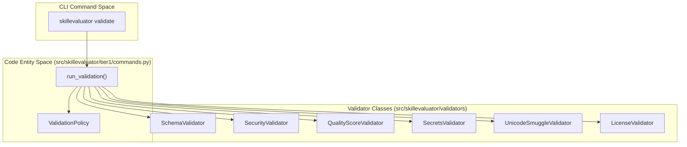
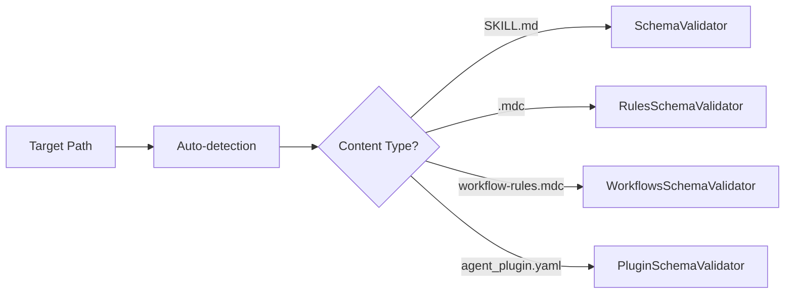

<!-- source: DeepWiki mcp.deepwiki.com · repo NVIDIA/SkillEvaluator · page 3 Tier 1: Validation · fetched 2026-10-26 -->

# Tier 1: Validation

Relevant source files

The following files were used as context for generating this wiki page:

- [README.md](README.md)
- [docs/ci-integration.mdx](docs/ci-integration.mdx)
- [docs/tier1-validation.mdx](docs/tier1-validation.mdx)
- [src/skillevaluator/tier1/commands.py](src/skillevaluator/tier1/commands.py)

Tier 1 serves as the deterministic quality gate for AI agent artifacts. It focuses on static analysis, security scanning, and schema compliance to ensure that a skill is safe, well-formed, and ready for more complex evaluation. Tier 1 checks generally run offline and do not require API keys unless optional LLM-backed features like rubric evaluation or LLM-verification of security findings are enabled [docs/tier1-validation.mdx:7-7]().

The primary entry point is the `skillevaluator validate` command, which orchestrates the sequence of checks and determines the final exit status of the evaluation [docs/tier1-validation.mdx:22-22]().

### The Validation Pipeline

The Tier 1 pipeline executes a series of validators in a canonical order. While users can select specific checks via the `--checks` flag, the system defaults to a comprehensive suite [src/skillevaluator/tier1/commands.py:51-61]().

| Sequence | Check Name | Description |
| :--- | :--- | :--- |
| 1 | `schema` | Validates `SKILL.md` frontmatter, directory structure, and naming conventions. |
| 2 | `version` | Ensures version strings follow semantic versioning. |
| 3 | `security` | Scans for vulnerabilities using Semgrep, SkillSpector, and Bandit. |
| 4 | `pii` | Detects secrets, credentials, and Personally Identifiable Information. |
| 5 | `license` | Verifies license headers and compliance with allowed license types. |
| 6 | `code-integrity` | Checks for risks in executable code and scripts. |
| 7 | `unicode` | Detects "Trojan Source" or BiDi override attacks in text files. |
| 8 | `quality` | Calculates a 0-100 score across Correctness, Discoverability, Reliability, and Efficiency. |
| 9 | `lint` | Performs AST-based advisory linting on Python scripts. |

**Sources:** [src/skillevaluator/tier1/commands.py:51-61](), [docs/tier1-validation.mdx:121-123]()

### System Architecture: Command to Validator Mapping

The following diagram bridges the CLI command space to the internal class entities responsible for execution.

**Tier 1 Validator Mapping**

**Sources:** [src/skillevaluator/tier1/commands.py:25-41](), [src/skillevaluator/tier1/commands.py:135-148]()

### Policy and Profile System

Validation behavior is governed by **Profiles** (predefined sets of rules) and **Policies** (runtime configurations that can override profiles). 

*   **Profiles**: The `external` profile is the default, designed for public-facing skills. It enforces rules like mandatory author attribution [docs/tier1-validation.mdx:92-93]().
*   **Policy Overlays**: Users can provide a `policy.yaml` to override severities (e.g., turning a `warning` into a `critical` failure) or restrict author email domains [docs/tier1-validation.mdx:104-115]().

**Sources:** [src/skillevaluator/validators/policy.py:31-31](), [docs/tier1-validation.mdx:90-102]()

### Exit Codes and Semantics

The `validate` command uses specific exit codes to signal the result to CI/CD pipelines. Tier 1 findings are "gating," meaning a failure here will cause a non-zero exit code [docs/ci-integration.mdx:19-19]().

| Exit Code | Meaning |
| :--- | :--- |
| `0` | **Success**: All gating checks passed. |
| `1` | **Failure**: One or more gating checks failed (e.g., a CRITICAL security finding). |
| `2` | **Config Error**: Invalid flags or unreadable target paths. |
| `3` | **Runtime Error**: Internal system crash. |

**Sources:** [docs/ci-integration.mdx:12-17]()

### Implementation Flow

The validation logic flows from the CLI through `run_validation`, which instantiates the necessary validator classes based on the detected content type (Skill, Plugin, Rules, or Workflow) [src/skillevaluator/tier1/commands.py:108-121]().

**Content Type Resolution**

**Sources:** [docs/tier1-validation.mdx:74-79](), [src/skillevaluator/tier1/commands.py:108-121]()

---

### Detailed Check Categories

For more information on specific validation areas, refer to the child pages:

*   **[Schema, Quality, and Rubric Checks](#3.1)**: Details on deterministic structure validation, the 4-dimension quality scoring algorithm, and LLM-as-judge rubric evaluations.
*   **[Security, PII, and Unicode Checks](#3.2)**: Deep dive into the security stack, including SkillSpector integration, secrets detection, and Unicode "Trojan Source" prevention.
*   **[Policy, Profiles, and Validation Reporting](#3.3)**: How to configure validation policies, use profiles, and interpret the various report formats (JSON, HTML, Markdown).

---

