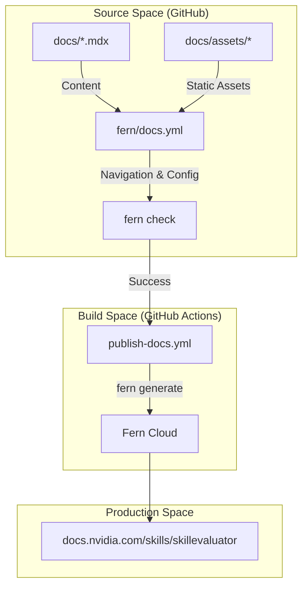
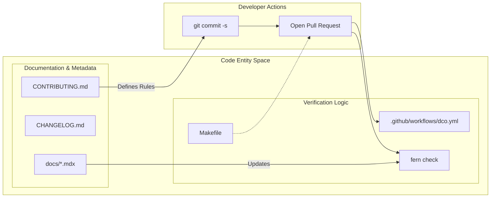

<!-- source: DeepWiki mcp.deepwiki.com · repo NVIDIA/SkillEvaluator · page 6.3 Contributing and Development Workflow · fetched 2026-10-26 -->

# Contributing and Development Workflow

<details>
<summary>Relevant source files</summary>

The following files were used as context for generating this wiki page:

- [.github/ISSUE_TEMPLATE/bug_report.yml](.github/ISSUE_TEMPLATE/bug_report.yml)
- [.github/ISSUE_TEMPLATE/feature_request.yml](.github/ISSUE_TEMPLATE/feature_request.yml)
- [.github/workflows/dco.yml](.github/workflows/dco.yml)
- [CODE_OF_CONDUCT.md](CODE_OF_CONDUCT.md)
- [CONTRIBUTING.md](CONTRIBUTING.md)
- [SUPPORT.md](SUPPORT.md)
- [docs/AGENTS.md](docs/AGENTS.md)
- [docs/README.md](docs/README.md)
- [fern/docs.yml](fern/docs.yml)

</details>


This page details the requirements and processes for contributing to SkillEvaluator. It covers the legal sign-off requirements, the local development lifecycle (linting, testing, building), documentation standards, and critical data sanitization rules to ensure the security and integrity of the project.

## Contribution Governance and DCO

SkillEvaluator follows a strict contribution policy to ensure all code is properly licensed under the [Apache License 2.0](CONTRIBUTING.md:19-19).

### Developer Certificate of Origin (DCO)
All contributors must "sign-off" on their commits. This certifies that the contribution is your original work or that you have the rights to submit it [CONTRIBUTING.md:23-25]().

*   **Mechanism**: Use the `--signoff` (or `-s`) flag when committing [CONTRIBUTING.md:31-32]().
*   **Result**: Appends a `Signed-off-by: Your Name <your@email.com>` trailer to the commit message [CONTRIBUTING.md:38-41]().
*   **Enforcement**: The `DCO Check` GitHub Action verifies every commit in a Pull Request [ .github/workflows/dco.yml:7-11](). If a commit is missing the trailer, the check fails [ .github/workflows/dco.yml:42-54]().
*   **Remediation**: If you forget to sign off, you must rebase your branch: `git rebase --signoff origin/main && git push --force-with-lease` [ .github/workflows/dco.yml:50-50]().

### Issue Reporting
*   **Bugs**: Use the Bug Report template to provide reproduction steps and environment details [.github/ISSUE_TEMPLATE/bug_report.yml:4-9]().
*   **Features**: Use the Feature Request template to describe the problem and proposed approach [.github/ISSUE_TEMPLATE/feature_request.yml:4-9]().
*   **Security**: Do **not** open public issues for vulnerabilities. Follow the instructions in `SECURITY.md` [CONTRIBUTING.md:84-84]().

**Sources:** [CONTRIBUTING.md:1-85](), [.github/workflows/dco.yml:1-57](), [.github/ISSUE_TEMPLATE/bug_report.yml:1-47](), [.github/ISSUE_TEMPLATE/feature_request.yml:1-38]()

## Development Lifecycle

Contributors are expected to validate changes locally using the project's `Makefile` before opening a Pull Request [CONTRIBUTING.md:11-11]().

### Makefile Targets
The following targets are the primary entry points for development:

| Target | Purpose |
| :--- | :--- |
| `make lint` | Runs static analysis and formatting checks to ensure code quality. |
| `make test` | Executes the full test suite (unit and integration tests). |
| `make build` | Verifies the package can be built successfully. |

### CHANGELOG.md Convention
If a change affects users (new features, bug fixes, or breaking changes), the `CHANGELOG.md` file must be updated [CONTRIBUTING.md:12-12](). This ensures that the user-visible history of the project remains accurate.

### Data Sanitization Rules
To protect the project and its users, certain types of data are strictly prohibited from being committed to the repository [CONTRIBUTING.md:8-9]():
1.  **Credentials**: Never include API keys (e.g., `NVIDIA_API_KEY`), tokens, or passwords.
2.  **Customer Data**: No proprietary or private data from users/customers.
3.  **Private Benchmarks**: Only public or synthetic benchmark data should be used for testing.

**Sources:** [CONTRIBUTING.md:5-13](), [.github/ISSUE_TEMPLATE/bug_report.yml:10-12](), [.github/ISSUE_TEMPLATE/feature_request.yml:25-28]()

## Documentation Workflow (Fern)

SkillEvaluator uses [Fern](https://buildwithfern.com) to publish long-form documentation to `docs.nvidia.com/skills/skillevaluator` [docs/AGENTS.md:6-7]().

### Documentation Structure
The `docs/` directory contains MDX files that represent the published pages [docs/README.md:6-10]().

*   **MDX Pages**: Located in `docs/*.mdx`. Every page requires YAML frontmatter with a `title` and `description` [docs/AGENTS.md:28-37]().
*   **Configuration**: `fern/docs.yml` defines the navigation structure, sidebar order, and URL slugs [fern/docs.yml:25-83]().
*   **Assets**: Images and logos are stored in `docs/assets/` [docs/AGENTS.md:18-18]().

### Local Documentation Build
Building documentation requires **Node.js 22+** and the Fern CLI [docs/README.md:29-33]().

```bash
# Install the Fern CLI
npm install -g fern-api

# Validate configuration and links
fern check

# Preview the site locally (http://localhost:3000)
fern docs dev
```

### Documentation Update Flow
The following diagram illustrates how documentation source files transition from the repository to the published site.

**Documentation Deployment Pipeline**


**Sources:** [docs/AGENTS.md:1-82](), [docs/README.md:1-55](), [fern/docs.yml:1-83]()

## Summary of Code Entities and Workflow

The following diagram maps the natural language "Contribution Workflow" to the specific files and GitHub Actions that implement them.

**Contribution Logic Flow**


**Sources:** [CONTRIBUTING.md:1-41](), [.github/workflows/dco.yml:7-31](), [docs/AGENTS.md:65-76]()

---

