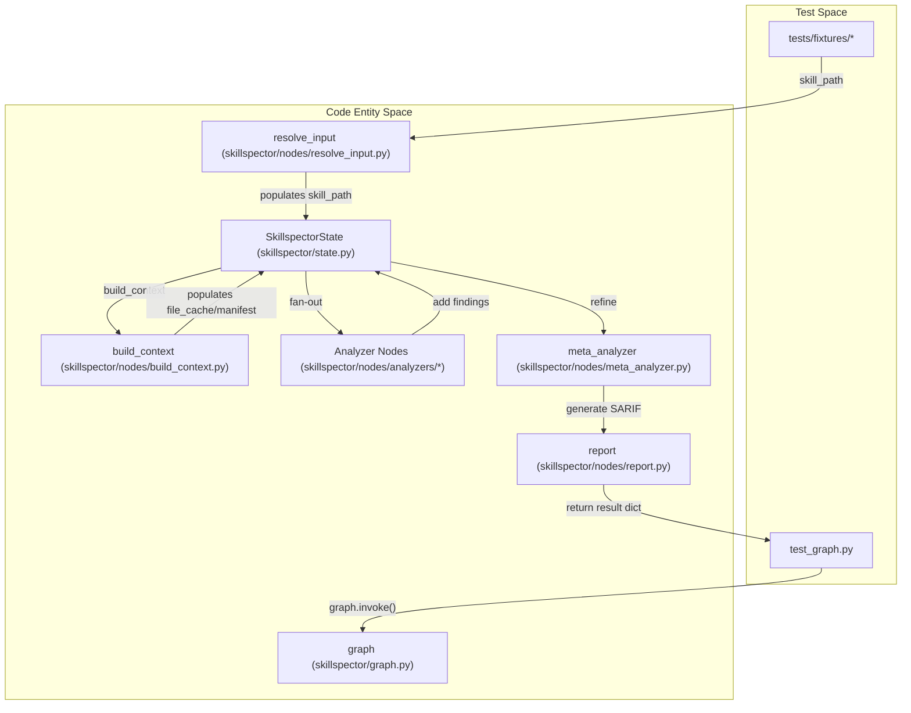
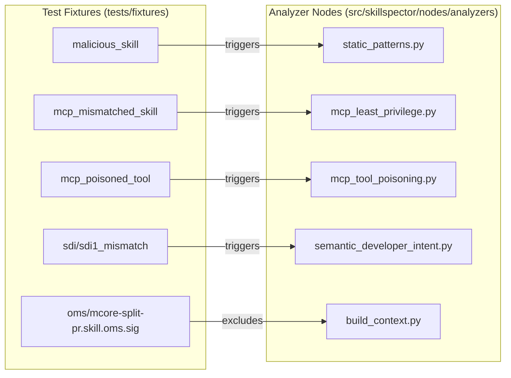

<!-- source: DeepWiki mcp.deepwiki.com · repo NVIDIA/SkillSpector · page 5.2 Integration Tests and Test Fixtures · fetched 2026-10-26 -->

# Integration Tests and Test Fixtures

Relevant source files

The following files were used as context for generating this wiki page:

- [docs/EVAL_DATASETS.md](docs/EVAL_DATASETS.md)
- [src/skillspector/nodes/analyzers/common.py](src/skillspector/nodes/analyzers/common.py)
- [src/skillspector/nodes/resolve_input.py](src/skillspector/nodes/resolve_input.py)
- [tests/fixtures/oms/mcore-split-pr.skill.oms.sig](tests/fixtures/oms/mcore-split-pr.skill.oms.sig)
- [tests/fixtures/pe3_bare_keyring/SKILL.md](tests/fixtures/pe3_bare_keyring/SKILL.md)
- [tests/fixtures/pe3_bare_keyring/issue-396-keyring.md](tests/fixtures/pe3_bare_keyring/issue-396-keyring.md)
- [tests/integration/test_graph.py](tests/integration/test_graph.py)
- [tests/nodes/test_resolve_input.py](tests/nodes/test_resolve_input.py)

## Purpose and Scope
This page documents the integration testing framework and the test fixture catalogue used in SkillSpector. Integration tests exercise the full LangGraph pipeline [src/skillspector/graph.py]() from input resolution to report generation. The test fixtures provide a curated suite of skill directories simulating both benign and malicious code patterns, supply chain vectors, MCP configurations, and semantic intents.

Sources: [tests/integration/test_graph.py:16-24]()

---

## Integration Test Suite

Integration tests reside in `tests/integration/` and evaluate end-to-end execution by invoking the compiled `graph` object (`StateGraph`) directly or through the CLI framework.

### Key Test Files and Invocation Patterns

*   **`test_graph.py`**: Exercises the complete graph execution path. It validates that invoking the graph with `output_format="json"` returns a valid JSON report containing `skill`, `risk_assessment`, and `components` keys [tests/integration/test_graph.py:26-43](). It also contains integration tests for recognizing signed skills via `skill.oms.sig` and verifying scope exclusions across formats [tests/integration/test_graph.py:45-127](), as well as degraded LLM stage recovery [tests/integration/test_graph.py:153-165]().
*   **`test_graph_scanner.py`**: Validates high-level scanning wrappers, initialization mechanics, and multi-skill recursive handling.
*   **`test_meta_analyzer_use_llm.py`**: Tests the `LLMMetaAnalyzer` node integration, verifying filtering and enrichment when LLM backends are active.
*   **`test_agent_cli_live.py`**: Provides optional live integration tests driving external agent CLI binaries through `run_agent_cli`.

### Data Flow in Integration Tests

The following diagram bridges the natural language test space to the concrete code entities within the pipeline:

**Integration Test Execution Flow**

Sources: [tests/integration/test_graph.py:26-56](), [src/skillspector/nodes/build_context.py:16-44](), [src/skillspector/nodes/build_context.py:83-94]()

Sources: [tests/integration/test_graph.py:1-217]()

---

## Catalogue of Fixture Skill Directories

SkillSpector maintains a comprehensive suite of fixture skill directories under `tests/fixtures/` to test specific analyzer capabilities and rule triggers.

### General Security Fixtures

| Fixture Path | Purpose | Key Vulnerability / Feature Tested |
|:---|:---|:---|
| `tests/fixtures/safe_skill` | Negative Control | Benign code and valid `SKILL.md` with zero findings. |
| `tests/fixtures/malicious_skill` | Multi-Vector Attack | Combines prompt injection and exfiltration patterns. |
| `tests/fixtures/pe3_bare_keyring` | False Positive Guard | Tests credential-store terminology references without code triggers [tests/fixtures/pe3_bare_keyring/SKILL.md:1-6](). |
| `tests/fixtures/oms/` | Cryptographic Signatures | Validates `oms_signature` handling and scope exclusions using `mcore-split-pr.skill.oms.sig` [tests/integration/test_graph.py:45-50](). |

### MCP (Model Context Protocol) Fixtures

*   **`mcp_clean_skill`**: Well-formed MCP server skill with consistent declarations.
*   **`mcp_mismatched_skill`**: Declares restricted permissions while containing code harvesting environment variables.
*   **`mcp_overprivileged_skill`**: Declares wildcard capabilities (e.g., `*`), triggering rule `LP2`.
*   **`mcp_poisoned_tool`**: Employs unicode obfuscation in tool names and hidden HTML comment instructions.
*   **`mcp_underdeclared_skill`**: Uses shell/network capabilities without manifest declarations, triggering rule `LP3`.
*   **`mcp_registry/`**: Tests registry posture scanning and metadata validation.

### Semantic and Quality Fixtures

Located across dedicated subdirectories, these fixtures validate LLM-powered and semantic analyzers:

*   **`sdi/` (Semantic Developer Intent)**: Tests `sdi1_mismatch`, `sdi2_inappropriate`, `sdi3_scope_creep`, and `sdi4_divergence`.
*   **`sqp/` (Semantic Quality Policy)**: Evaluates quality and policy adherence rules.
*   **`ssd/` (Semantic Security Discovery)**: Tests deep security discovery prompts and zero-day heuristic detection.

Sources: [tests/fixtures/pe3_bare_keyring/SKILL.md:1-6](), [tests/integration/test_graph.py:45-50]()

### Fixture to Analyzer Mapping

The following diagram maps specific test fixtures to their corresponding analyzer components in the codebase:

**Fixture to Analyzer Mapping**
Arguments and fixtures route directly into targeted analyzer modules:

Sources: [src/skillspector/nodes/build_context.py:76-80](), [tests/integration/test_graph.py:45-50]()

Sources: [tests/fixtures/pe3_bare_keyring/SKILL.md:1-6](), [tests/integration/test_graph.py:45-87]()

---

## Context Building and Evaluation Dataset Handling

Integration tests rely on the `build_context` node to ingest fixtures safely. The node handles file walking, manifest parsing, metadata generation, and signature handling [src/skillspector/nodes/build_context.py:49-94]().

Additionally, to prevent evaluation datasets from triggering false positives during accuracy testing, static pattern analyzers explicitly ignore designated evaluation files [docs/EVAL_DATASETS.md:1-21]().

Sources: [src/skillspector/nodes/build_context.py:49-94](), [docs/EVAL_DATASETS.md:1-21]()

---

