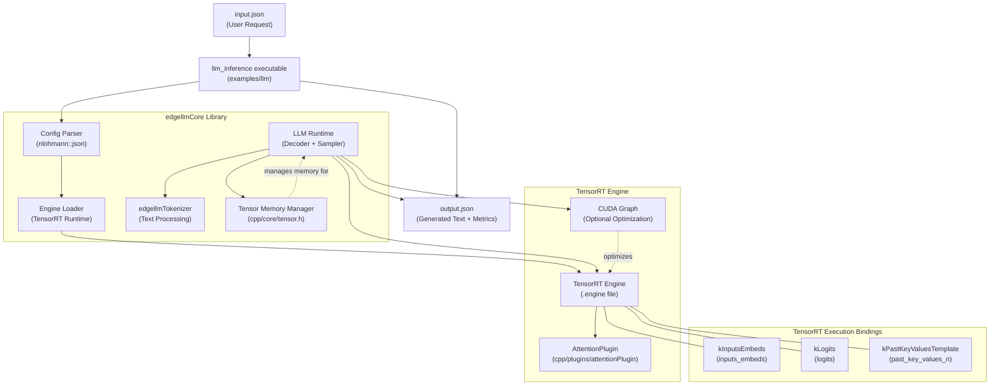
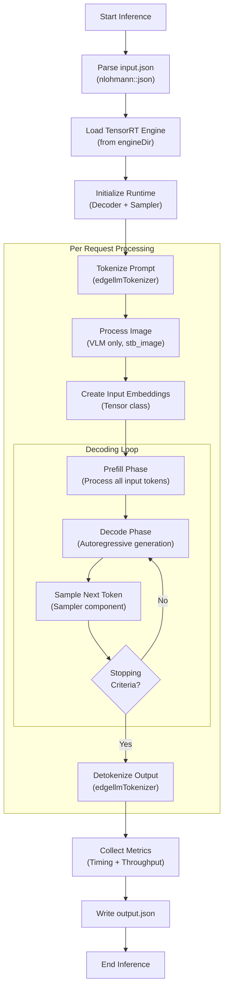
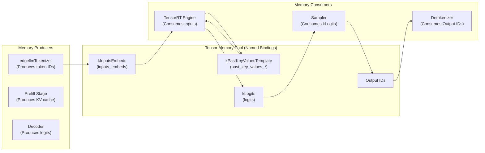
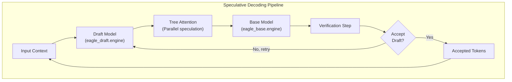

<!-- source: DeepWiki mcp.deepwiki.com · repo NVIDIA/TensorRT-Edge-LLM · page 3.3 Running Inference · fetched 2026-10-26 -->

# Running Inference

<details>
<summary>Relevant source files</summary>

The following files were used as context for generating this wiki page:

- [cpp/common/fileUtils.cpp](cpp/common/fileUtils.cpp)
- [cpp/common/fileUtils.h](cpp/common/fileUtils.h)
- [cpp/common/stringUtils.cpp](cpp/common/stringUtils.cpp)

</details>


## Purpose and Scope

This page documents the inference execution phase using the `llm_inference` executable, which is the primary entry point for running LLM and VLM inference on edge devices. This page covers command-line usage, JSON input/output formats, runtime configuration options, and the internal execution workflow.

For information about building TensorRT engines before inference, see [Engine Building](#3.2). For details on the underlying runtime architecture and components, see [Runtime Components](#4.3).

**Sources**: [.github/ISSUE_TEMPLATE/1_bug_report_runtime.md:22-27]()

---

## llm_inference Executable Overview

The `llm_inference` executable is the unified interface for executing inference on TensorRT engines created by `llm_build`. It accepts JSON-formatted inputs and produces JSON-formatted outputs, supporting both text-only (LLM) and multimodal (VLM) workloads.

### Command-Line Interface

```bash
./build/examples/llm/llm_inference \
  --engineDir <path_to_engine_directory> \
  --inputFile <path_to_input.json> \
  --outputFile <path_to_output.json>
```

| Argument | Required | Description |
|----------|----------|-------------|
| `--engineDir` | Yes | Directory containing TensorRT engine files and configuration |
| `--inputFile` | Yes | Path to JSON file containing inference requests |
| `--outputFile` | Yes | Path to JSON file for inference results |

**Sources**: [.github/ISSUE_TEMPLATE/1_bug_report_runtime.md:24-27]()

---

## System Architecture

The following diagram shows how `llm_inference` integrates with the runtime components and utilizes the unified binding names defined in the codebase.

### Inference Component Integration


**Sources**: [cpp/builder/llmBuilder.cpp:20-25](), [cpp/builder/llmBuilder.cpp:47-49](), [cpp/common/bindingNames.h:44-73](), [cpp/common/bindingNames.h:150-150]()

---

## JSON Input Format

The `llm_inference` executable expects a JSON file containing one or more inference requests. The structure varies based on whether you're running text-only (LLM) or multimodal (VLM) inference.

### Text-Only (LLM) Input Structure

```json
{
  "requests": [
    {
      "prompt": "What is the capital of France?",
      "max_tokens": 100,
      "temperature": 0.7,
      "top_p": 0.9,
      "top_k": 50
    }
  ]
}
```

### Multimodal (VLM) Input Structure

For vision-language models, the input includes image paths alongside text prompts. The runtime handles the embedding fusion for visual features.

```json
{
  "requests": [
    {
      "prompt": "Describe this image in detail.",
      "image_path": "/path/to/image.jpg",
      "max_tokens": 200,
      "temperature": 0.7
    }
  ]
}
```

### Input Field Specifications and Security Limits

The runtime enforces several security and resource limits defined in `cpp/common/inputLimits.h` to prevent Denial-of-Service (DoS) attacks.

| Field | Type | Required | Default | Security Limit | Description |
|-------|------|----------|---------|----------------|-------------|
| `prompt` | string | Yes | - | 1MB Text [cpp/common/inputLimits.h:66]() | Text prompt for the model |
| `image_path` | string | VLM only | - | - | Path to image file for multimodal models |
| `max_tokens` | integer | No | 512 | - | Maximum number of tokens to generate |
| `temperature` | float | No | 1.0 | - | Sampling temperature (0.0 = deterministic) |
| `top_p` | float | No | 1.0 | - | Nucleus sampling threshold |
| `top_k` | integer | No | 0 | - | Top-K sampling parameter (0 = disabled) |

**Sources**: [cpp/builder/llmBuilder.cpp:192-198](), [cpp/builder/llmBuilder.cpp:204-210](), [cpp/common/inputLimits.h:40-67]()

---

## JSON Output Format

The output JSON contains generated text, token information, and performance metrics.

### Output Structure

```json
{
  "responses": [
    {
      "generated_text": "The capital of France is Paris.",
      "num_tokens": 8,
      "finish_reason": "stop",
      "metrics": {
        "total_time_ms": 245.3,
        "time_to_first_token_ms": 52.1,
        "tokens_per_second": 32.6,
        "engine_load_time_ms": 1234.5
      }
    }
  ]
}
```

**Sources**: [.github/ISSUE_TEMPLATE/1_bug_report_runtime.md:26-27]()

---

## Inference Execution Workflow

The following diagram illustrates the internal execution flow within `llm_inference`:

### Execution Pipeline Flow


**Sources**: [cpp/builder/llmBuilder.cpp:45-54](), [cpp/builder/llmBuilder.cpp:143-147](), [cpp/builder/llmBuilder.cpp:169-172]()

---

## Runtime Components and Memory Management

### Tensor Class and Unified Bindings

The runtime uses a `Tensor` class to manage all inference memory. During execution, these tensors are bound to specific names required by the TensorRT engine, as defined in `cpp/common/bindingNames.h`.

### Code-to-System Memory Flow


**Sources**: [cpp/builder/llmBuilder.cpp:149-161](), [cpp/common/bindingNames.h:44-150]()

---

## Decoding Strategies

The runtime supports several decoding strategies through a pluggable interface:

### Vanilla and MTP Decoding
Standard autoregressive token generation (Vanilla) and Multi-Token Prediction (MTP) for models that predict multiple tokens per step.

### Speculative Decoding (EAGLE3 and DFlash)
Advanced strategies that use draft models to predict multiple tokens in parallel. EAGLE3 uses tree-based speculation, while DFlash supports hybrid models.



**Sources**: [cpp/builder/llmBuilder.cpp:123-135](), [cpp/common/bindingNames.h:66-87]()

---

## Runtime Optimizations

### CUDA Graph Optimization
The runtime supports capturing CUDA Graphs to reduce kernel launch overhead, especially beneficial for the decode phase where batch sizes and sequence lengths are small.

### Vocabulary Reduction and Logit Bias
The runtime can apply a `logit_bias` to specific tokens during sampling, subject to security guardrails (max 1024 tokens, range -100 to 100).

**Sources**: [cpp/builder/llmBuilder.cpp:138-142](), [cpp/common/inputLimits.h:46-49]()

---

## Engine Directory Structure

The `--engineDir` argument should point to a directory containing artifacts generated by `LLMBuilder::build()`:

```
engineDir/
├── config.json              # Model configuration [cpp/builder/llmBuilder.cpp:194]
├── llm.engine               # Main TensorRT engine [cpp/builder/llmBuilder.cpp:133]
├── tokenizer.json           # Tokenizer config [cpp/builder/llmBuilder.cpp:169]
├── ple_embedding.safetensors # Gemma4 sidecar [cpp/common/bindingNames.h:102]
├── eagle_draft.engine       # Optional EAGLE draft [cpp/builder/llmBuilder.cpp:125]
└── eagle_base.engine        # Optional EAGLE base [cpp/builder/llmBuilder.cpp:129]
```

**Sources**: [cpp/builder/llmBuilder.cpp:121-135](), [cpp/common/bindingNames.h:102-102]()

---

## File Utilities and Helper Functions

The inference runtime utilizes common utility functions for file management and string formatting to handle I/O operations and logging.

### File Operations
The `trt_edgellm::file_io` namespace provides robust file handling, such as `copyFile` [cpp/common/fileUtils.cpp:29-62](), which uses `std::filesystem` to safely move model artifacts or input/output files. It includes checks for existence [cpp/common/fileUtils.cpp:34-38]() and path equivalence [cpp/common/fileUtils.cpp:40-43]().

### String Formatting
For logging and JSON construction, the `trt_edgellm::format` namespace provides `fmtstr` [cpp/common/stringUtils.cpp:60-75](), a type-safe wrapper around `vsnprintf` [cpp/common/stringUtils.cpp:38-58]() that dynamically manages memory for formatted strings.

**Sources**: [cpp/common/fileUtils.cpp:29-62](), [cpp/common/fileUtils.h:22-38](), [cpp/common/stringUtils.cpp:38-75]()

---

## Error Handling and Validation

The runtime performs rigorous validation before starting inference:
1.  **Batch Size**: Checks against `kReasonableMaxBatchSize` (16) [cpp/common/inputLimits.h:40]().
2.  **Message Size**: Content items are limited to 128KB [cpp/common/inputLimits.h:43]().
3.  **Tokenization**: Input text is capped at 1MB to prevent excessive memory usage [cpp/common/inputLimits.h:66]().

**Sources**: [cpp/common/inputLimits.h:32-71](), [.github/ISSUE_TEMPLATE/1_bug_report_runtime.md:9-14]()

---

