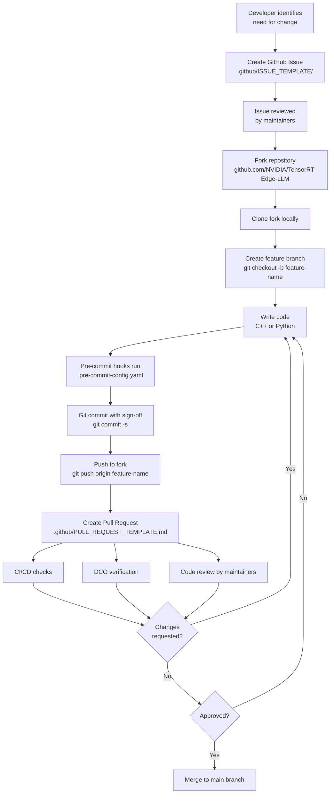
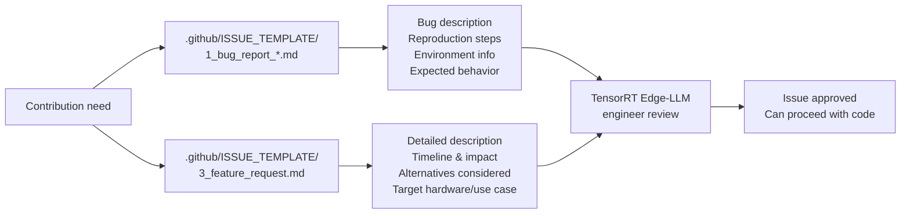
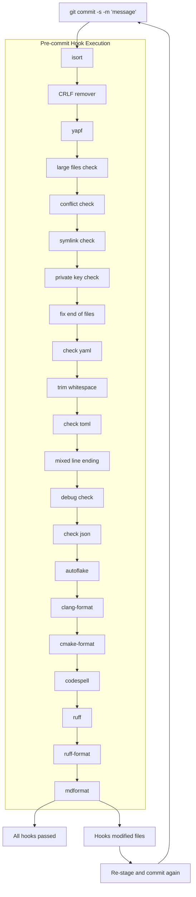
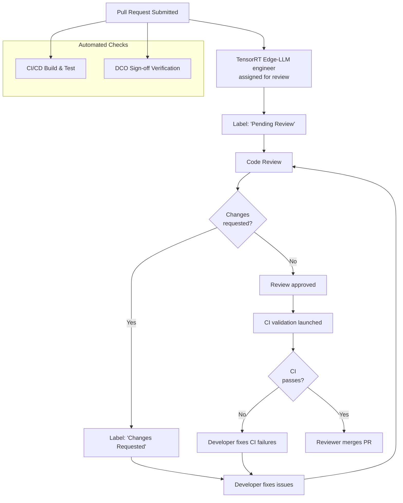

<!-- source: DeepWiki mcp.deepwiki.com · repo NVIDIA/TensorRT-Edge-LLM · page 6.3 Contributing Workflow · fetched 2026-10-26 -->

# Contributing Workflow

<details>
<summary>Relevant source files</summary>

The following files were used as context for generating this wiki page:

- [.github/PULL_REQUEST_TEMPLATE.md](.github/PULL_REQUEST_TEMPLATE.md)
- [CONTRIBUTING.md](CONTRIBUTING.md)

</details>


This page provides a step-by-step guide to the contribution process for TensorRT-Edge-LLM, from creating an issue to having your code merged into the main branch. The workflow emphasizes quality gates at multiple stages to ensure code quality and maintainability.

For information about setting up your development environment, see [Setting Up Development Environment](#6.1). For detailed coding standards, see [Coding Standards](#6.2). For specifics on automated quality tools, see [Code Quality Tools](#6.4).

## Workflow Overview

The contribution workflow follows a structured process with mandatory checkpoints to ensure code quality and proper review. All code contributions follow this path:



**Sources:** [CONTRIBUTING.md:1-175]()

## Mandatory Prerequisites

Before any code can be reviewed, three mandatory requirements must be satisfied:

| Requirement | Description | Enforced By | Reference |
|------------|-------------|-------------|-----------|
| **GitHub Issue** | All enhancements, bugfixes, or changes must begin with a GitHub issue | Manual review | [CONTRIBUTING.md:4-7]() |
| **Issue Approval** | Issue must be reviewed and approved by TensorRT Edge-LLM engineers | Manual review | [CONTRIBUTING.md:7]() |
| **DCO Sign-off** | All commits must be signed off certifying Developer Certificate of Origin | Automated check | [CONTRIBUTING.md:133-174]() |

**Sources:** [CONTRIBUTING.md:4-7](), [CONTRIBUTING.md:133-174]()

## Step-by-Step Workflow

### Step 1: Create and Get Issue Approved

All contributions begin with creating a GitHub issue. The repository provides structured templates for different issue types. For details on reporting bugs or requesting features, see [Creating Issues and Feature Requests](#6.3.1).



**Sources:** [CONTRIBUTING.md:4-7]()

### Step 2: Fork and Clone Repository

Once the issue is approved, fork the upstream repository and clone it locally:

```bash
# Fork at https://github.com/NVIDIA/TensorRT-Edge-LLM
# Then clone your fork
git clone https://github.com/YOUR_USERNAME/YOUR_FORK.git TensorRT-Edge-LLM
cd TensorRT-Edge-LLM
```

**Sources:** [CONTRIBUTING.md:82-91]()

### Step 3: Create Feature Branch

Create a descriptive branch name for your changes:

```bash
# Checkout the targeted branch (typically main)
git checkout main

# Create and switch to feature branch
git checkout -b <local-branch>
```

**Sources:** [CONTRIBUTING.md:86-91]()

### Step 4: Make Code Changes

Write your code following the project's coding standards. The codebase is partitioned by ownership to ensure specialized review:

**Conciseness principles** ([CONTRIBUTING.md:30-32]()):
- Avoid committing commented-out code.
- Each PR should address a single concern when possible.
- For complex changes, consider multiple dependent PRs to facilitate faster review.

**Code formatting** is handled automatically by pre-commit hooks:
- C++ code uses `.clang-format` configuration ([CONTRIBUTING.md:13-20]()).
- Python code uses `black` formatter ([CONTRIBUTING.md:22-28]()).

**Sources:** [CONTRIBUTING.md:9-33]()

### Step 5: Commit with Pre-commit Hooks

The project uses `pre-commit` to enforce code quality automatically. When you commit, multiple hooks execute to ensure formatting and quality standards are met.



**DCO sign-off requirement:** All commits must be signed off using the `-s` flag ([CONTRIBUTING.md:133-146]()):

```bash
git commit -s -m "feat: Add support for new model"
```

**Sources:** [CONTRIBUTING.md:36-75](), [CONTRIBUTING.md:133-146]()

### Step 6: Push Changes to Fork

Push your commits to a branch on your fork:

```bash
git push -u origin <local-branch>:<remote-branch>
```

**Sources:** [CONTRIBUTING.md:86-91]()

### Step 7: Create Pull Request

Create a Pull Request from your fork's branch to the upstream repository. For detailed submission guidelines, see [Pull Request Process](#6.3.2).

**PR Title Naming Convention:** Follow [Conventional Commits](https://www.conventionalcommits.org) format ([CONTRIBUTING.md:102]()):
- `feat: ...` for new features.
- `fix: ...` for bug fixes.
- `BREAKING CHANGE: ...` for API-breaking changes.
- `chore: ...` or `None: ...` for maintenance tasks.

**Sources:** [CONTRIBUTING.md:100-115]()

### Step 8: PR Description Requirements

The PR template ([.github/PULL_REQUEST_TEMPLATE.md:1-28]()) requires providing a background/motivation, summary of changes, and potential performance impacts ([CONTRIBUTING.md:117-123]()).

**Sources:** [.github/PULL_REQUEST_TEMPLATE.md:1-28](), [CONTRIBUTING.md:117-123]()

## Review and Merge Process

Once a PR is submitted, it enters the review process involving automated CI checks and manual engineer review. For a detailed breakdown of review criteria and labels, see [Pull Request Process](#6.3.2).



**Sources:** [CONTRIBUTING.md:93-98]()

## Special Considerations

### NVIDIA Internal Developers

NVIDIA developers must follow additional internal tracking procedures ([CONTRIBUTING.md:104-106](), [CONTRIBUTING.md:125-130]()):
- Include JIRA number or NVBUG ID in the PR title.
- Submit fixes to the specific branch indicated in the nvbug **Keywords** field (e.g., `release/0.4.0`).
- Mark critical PRs with the "release blocker" label.

**Sources:** [CONTRIBUTING.md:100-131]()

---

