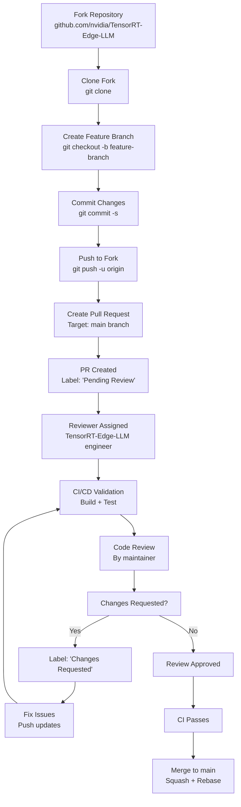
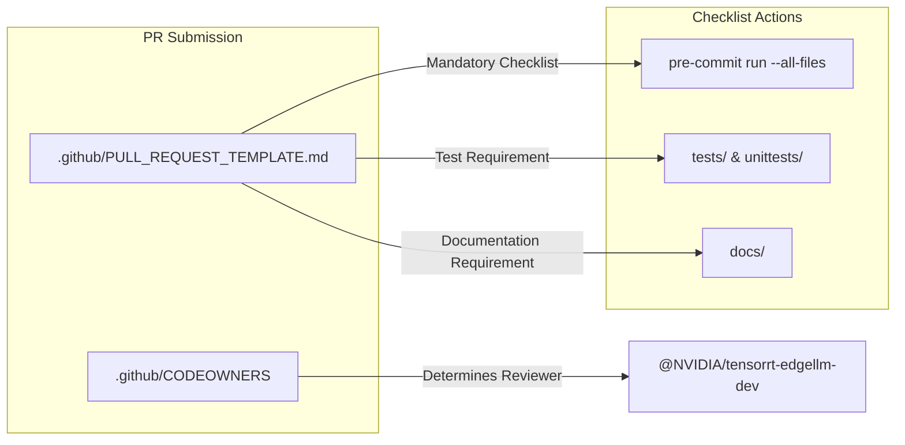
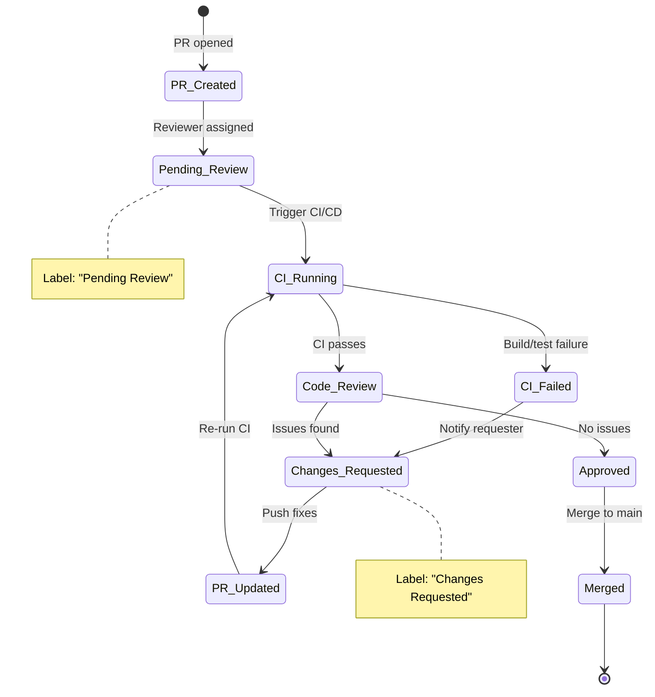

<!-- source: DeepWiki mcp.deepwiki.com · repo NVIDIA/TensorRT-Edge-LLM · extra page Pull Request Process · fetched 2026-10-26 -->

# Pull Request Process

<details>
<summary>Relevant source files</summary>

The following files were used as context for generating this wiki page:

- [.github/PULL_REQUEST_TEMPLATE.md](.github/PULL_REQUEST_TEMPLATE.md)
- [CONTRIBUTING.md](CONTRIBUTING.md)

</details>


This document provides detailed guidelines for submitting, reviewing, and merging Pull Requests (PRs) in the TensorRT-Edge-LLM project. It covers PR naming conventions, the structured PR template, review workflows, and mandatory requirements including Developer Certificate of Origin (DCO) sign-off and CI validation.

For information about setting up your development environment and installing pre-commit hooks, see [Setting Up Development Environment](#6.1). For details about the automated checks that run on commits, see [Pre-commit Hooks](#6.4.1).

## PR Submission Workflow

The Pull Request process follows a structured workflow from initial fork to final merge. All code contributions must go through this process.

### Developer Workflow Stages



**Sources**: [CONTRIBUTING.md:79-99]()

The workflow begins with developers forking the upstream repository. All changes are made on feature branches in the personal fork, then pushed to the fork's remote. Once ready, a PR is opened targeting the `main` branch of the upstream repository.

## Fork and Branch Setup

Developers must work from a personal fork of the TensorRT-Edge-LLM repository:

```bash
# Fork the repository on GitHub, then clone your fork
git clone https://github.com/YOUR_USERNAME/YOUR_FORK.git TensorRT-Edge-LLM
cd TensorRT-Edge-LLM

# Create a feature branch
git checkout -b feature/my-new-feature

# Make changes, then push to your fork
git push -u origin feature/my-new-feature
```

**Sources**: [CONTRIBUTING.md:82-91]()

## PR Naming Conventions

Pull Request titles must follow the [Conventional Commits](https://www.conventionalcommits.org/en/v1.0.0) specification. This standardized format enables automated changelog generation and clear communication of change types.

### PR Title Format

| Type | Usage | Example |
|------|-------|---------|
| `feat:` | New features | `feat: Add support for starcoder-v2 FP8 base + FP16/BF16 LoRA` |
| `fix:` | Bug fixes | `fix https://github.com/NVIDIA/TensorRT-Edge-LLM/issues/700: a Memory leak issue in C++ runtime` |
| `chore:` | Maintenance tasks | `chore: Remove version from plugins .so` |
| `BREAKING CHANGE:` | API breaking changes | `BREAKING CHANGE: Set default max batch size to 2048` |
| `None:` | Minor changes | `None: Stringized enums for better error msgs` |

For NVIDIA developers, PR titles should include the JIRA number or NVBUG ID when applicable. For feature or bug fixes, submit to the dedicated branch specified in the nvbug Keywords field (e.g., `release/0.4.0` instead of `main`). Additionally, add the "release blocker" label to any PRs that could potentially cause a release delay.

**Sources**: [CONTRIBUTING.md:100-130]()

## PR Template Structure

All Pull Requests must use the provided template structure in `.github/PULL_REQUEST_TEMPLATE.md` to ensure comprehensive documentation of changes.

### Code Entity Association

The following diagram maps the PR Template requirements to the specific repository locations and configuration files.



**Sources**: [.github/PULL_REQUEST_TEMPLATE.md:1-38](), [.github/CODEOWNERS:1-18]()

### Required PR Template Sections

#### 1. What does this PR do?

Specify the **Type of change** (Bug fix, new feature, new example, new tests, documentation) and provide a high-level **Overview** of the changes.

**Sources**: [.github/PULL_REQUEST_TEMPLATE.md:1-5]()

#### 2. Usage

Include a code snippet demonstrating how to use the new feature or changed functionality. For Python changes, use the provided code block format:

```python
# Add a code snippet demonstrating how to use this
```

**Sources**: [.github/PULL_REQUEST_TEMPLATE.md:7-12]()

#### 3. Pull Request Checklist

Before marking the PR as "Ready for review", verify all checklist items:

| Item | Requirement | File/Line |
|------|-------------|-----------|
| **Pre-commit Checks** | Run `pre-commit run --all-files` and fix issues | [.github/PULL_REQUEST_TEMPLATE.md:19-23]() |
| **Tests** | Added or updated; all passing | [.github/PULL_REQUEST_TEMPLATE.md:25-28]() |
| **Documentation** | Updated necessary documentation | [.github/PULL_REQUEST_TEMPLATE.md:31-32]() |
| **Compatibility** | Verify backward compatibility | [.github/PULL_REQUEST_TEMPLATE.md:34-35]() |

**Sources**: [.github/PULL_REQUEST_TEMPLATE.md:14-35]()

#### 4. Additional Information

Provide any relevant context such as related issues or NVBUG IDs. In the PR description, address the background/motivation, summarize changes in one paragraph, and explain why large PRs cannot be broken down.

**Sources**: [.github/PULL_REQUEST_TEMPLATE.md:37-38](), [CONTRIBUTING.md:117-124]()

## Code Ownership and Review Assignment

The project uses a `.github/CODEOWNERS` file to automatically assign reviewers based on the files modified in the PR. The `@NVIDIA/tensorrt-edgellm-dev` team is the primary owner for all core components.

| Component | Path | Owner |
|-----------|------|-------|
| C++ Core | `cpp/` | `@NVIDIA/tensorrt-edgellm-dev` |
| Python SDK | `tensorrt_edgellm/` | `@NVIDIA/tensorrt-edgellm-dev` |
| Build System | `CMakeLists.txt`, `cmake/` | `@NVIDIA/tensorrt-edgellm-dev` |
| Documentation | `docs/` | `@NVIDIA/tensorrt-edgellm-dev` |
| CI/CD Ops | `.github/` | `@NVIDIA/tensorrt-edgellm-dev` |

**Sources**: [.github/CODEOWNERS:1-18]()

## Developer Certificate of Origin (DCO)

All contributions must be signed-off to certify acceptance of the Developer Certificate of Origin (DCO). This certifies that the contribution is your original work or you have the rights to submit it under the same license.

### Signing Commits

Use the `--signoff` or `-s` flag when committing:

```bash
git commit -s -m "Add cool feature."
```

This appends the sign-off line to the commit message:

```
Signed-off-by: Your Name <your@email.com>
```

**Sources**: [CONTRIBUTING.md:133-146]()

## Review Process

The review process involves multiple stages with specific labels and actions.



**Sources**: [CONTRIBUTING.md:93-98]()

### Review Stages

#### 1. PR Creation and Assignment

When a PR is created:
- Reviewers are automatically assigned via `.github/CODEOWNERS` [.github/CODEOWNERS:1-18]().
- The label **"Pending Review"** is added to the PR.

**Sources**: [CONTRIBUTING.md:94-95]()

#### 2. Changes Requested

If the reviewer identifies issues:
- The label **"Changes Requested"** is added to the PR.
- The requester must address all feedback and push updates.

**Sources**: [CONTRIBUTING.md:96]()

#### 3. CI Validation

The CI pipeline runs automatically on each push:
- Build validation and unit test execution.
- If CI reports failures, the requester must fix all failures before requesting another review.
- Once changes are approved and CI passes, the reviewer will merge the PR.

**Sources**: [CONTRIBUTING.md:97-98]()

## PR Size and Scope

Keep PRs concise and focused to ensure timely reviews:

- **Single Concern**: Each PR should address a single issue or feature when possible.
- **No Commented Code**: Avoid committing commented-out code.
- **Dependencies**: If multiple changes are needed, open separate PRs and indicate dependencies in descriptions.
- **Impact Assessment**: Inform reviewers of potential performance or functional impacts and risks.

**Sources**: [CONTRIBUTING.md:30-32](), [CONTRIBUTING.md:122]()

## Issue Tracking Requirement

All PRs must be associated with a GitHub issue:

- Enhancement, bugfix, or change requests must begin with creation of a [TensorRT-Edge-LLM Issue Request](https://github.com/nvidia/TensorRT-Edge-LLM/issues).
- The issue must be reviewed and approved by TensorRT Edge-LLM engineers prior to code review.

**Sources**: [CONTRIBUTING.md:4-7]()

## Summary

The Pull Request process ensures code quality through:
1. **Structured workflow**: Fork → Branch → Commit (with DCO sign-off) → Push → PR.
2. **Standardized naming**: Conventional Commits format for clear change communication.
3. **Comprehensive documentation**: PR template covering purpose, usage, testing, and impact.
4. **Quality gates**: Pre-commit hooks, CI validation, and human review via `CODEOWNERS`.
5. **Legal compliance**: Mandatory DCO sign-off on all commits.

**Sources**: [CONTRIBUTING.md:1-146](), [.github/PULL_REQUEST_TEMPLATE.md:1-38](), [.github/CODEOWNERS:1-18]()

---

