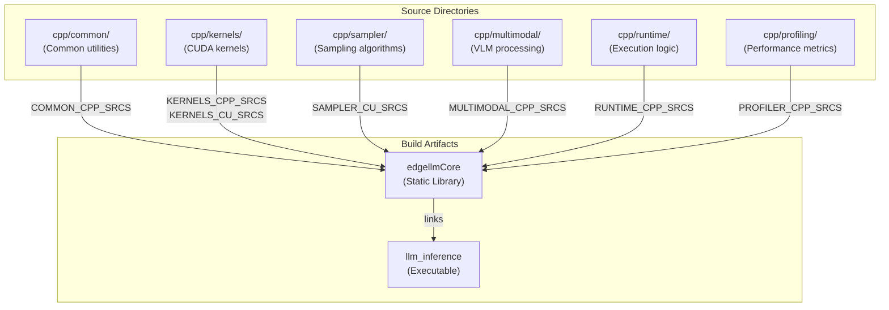
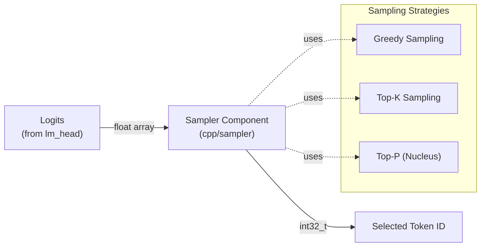
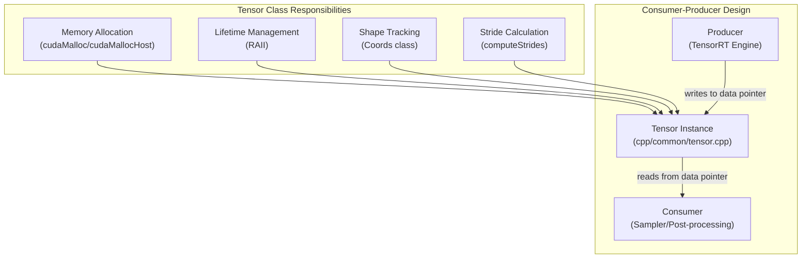
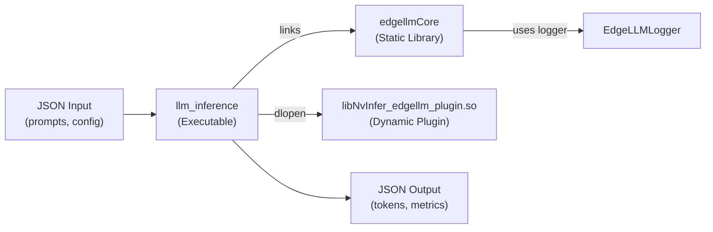

<!-- source: DeepWiki mcp.deepwiki.com · repo NVIDIA/TensorRT-Edge-LLM · extra page edgellmCore Library · fetched 2026-10-26 -->

# edgellmCore Library

<details>
<summary>Relevant source files</summary>

The following files were used as context for generating this wiki page:

- [cpp/common/tensor.cpp](cpp/common/tensor.cpp)
- [cpp/common/tensor.h](cpp/common/tensor.h)
- [cpp/common/tensorUtils.cpp](cpp/common/tensorUtils.cpp)
- [cpp/common/trtUtils.cpp](cpp/common/trtUtils.cpp)
- [cpp/common/trtUtils.h](cpp/common/trtUtils.h)

</details>


## Purpose and Scope

The `edgellmCore` library is the primary static library responsible for executing LLM and VLM inference at runtime. It aggregates all inference-critical components including runtime execution logic, CUDA kernels, sampling algorithms, multimodal processing, and performance profiling. This library is linked by the `llm_inference` executable and serves as the central orchestration layer for all inference operations.

For details on the CUDA kernels used by `edgellmCore`, see [edgellmKernels Library](#4.2.2). For tokenization functionality, see [edgellmTokenizer Library](#4.2.3). For engine building (separate from runtime execution), see [edgellmBuilder Library](#4.2.4). For deeper architectural details on runtime components, see [Runtime Components](#4.3).

## Library Composition

The `edgellmCore` library is built as a static library combining multiple subsystems. The CMake build configuration aggregates source files from six distinct directories within the `cpp/` folder.



**Sources**: [cpp/CMakeLists.txt:24-46]()

The library includes both C++ (`.cpp`) and CUDA (`.cu`) source files. The following table summarizes the file categories:

| Subsystem | Variable Name | File Types | Purpose |
|-----------|---------------|------------|---------|
| Common | `COMMON_CPP_SRCS`, `COMMON_CU_SRCS` | `.cpp`, `.cu` | Shared utilities and data structures |
| Kernels | `KERNELS_CPP_SRCS`, `KERNELS_CU_SRCS` | `.cpp`, `.cu` | CUDA kernel implementations |
| Sampler | `SAMPLER_CU_SRCS` | `.cu` | Token sampling CUDA kernels |
| Multimodal | `MULTIMODAL_CPP_SRCS` | `.cpp` | Vision-language model runners |
| Runtime | `RUNTIME_CPP_SRCS` | `.cpp` | Decoder and inference orchestration |
| Profiling | `PROFILER_CPP_SRCS` | `.cpp` | Performance monitoring |

**Sources**: [cpp/CMakeLists.txt:24-30](), [cpp/CMakeLists.txt:36-45]()

## Core Subsystems

### Runtime Subsystem

The runtime subsystem (`cpp/runtime/`) contains the core inference execution logic, implementing both vanilla autoregressive decoding and advanced speculative decoding strategies. The runtime uses a consumer-producer design pattern with the `Tensor` class managing all memory allocations [cpp/common/tensor.h:221-222]().

Key responsibilities:
- Orchestrate TensorRT engine execution using `nvinfer1::IExecutionContext` [cpp/common/trtUtils.h:102]().
- Manage inference state across decoding iterations.
- Coordinate between prefill and generation phases.
- Handle dynamic batch processing and auxiliary streams [cpp/common/trtUtils.h:107-168]().

The runtime implements several primary decoding strategies:
1. **Vanilla Decoding**: Standard autoregressive generation.
2. **Speculative Decoding**: Including EAGLE3 and DFlash strategies using tree attention.
3. **Non-Autoregressive Decoding**: Support for BlockDiffusion models.

**Sources**: [cpp/common/tensor.h:221-222](), [cpp/common/trtUtils.h:102-168]()

### Sampler Subsystem

The sampler subsystem (`cpp/sampler/`) implements token selection algorithms that run on GPU. The sampler processes logits from the language model head (`lm_head`) and selects the next token based on configured sampling strategies.



The sampler benefits from vocabulary reduction optimization which reduces `lm_head` computation time by limiting the active vocabulary.

**Sources**: [cpp/CMakeLists.txt:27-27]()

### Multimodal Subsystem

The multimodal subsystem (`cpp/multimodal/`) provides runtime support for Vision-Language Models (VLMs). This subsystem processes image embeddings alongside text tokens, enabling models like Qwen2.5-VL, Qwen3-VL, Phi-4-Multimodal, and InternVL3-1B.

Multimodal capabilities:
- Image embedding integration with text tokens.
- Vision Transformer (VIT) output processing with FP8 quantization.
- Deepstack template-based fusion.
- Support for multiple image inputs per inference request.

**Sources**: [cpp/CMakeLists.txt:28-28]()

### Profiling Subsystem

The profiling subsystem (`cpp/profiling/`) provides performance monitoring capabilities for measuring inference latency, throughput, and resource utilization. 

Key metrics tracked:
- Time-to-First-Token (TTFT).
- Inter-Token Latency (ITL).
- Tokens per second throughput.
- Memory bandwidth utilization.
- CUDA Graph execution overhead via `captureTRTCudaGraph` [cpp/common/trtUtils.h:101-102]().

**Sources**: [cpp/CMakeLists.txt:30-30](), [cpp/common/trtUtils.h:101-102]()

## Memory Management with Tensor Class

The `Tensor` class [cpp/common/tensor.h:221-222]() is the central memory management abstraction for `edgellmCore`. It manages all GPU and CPU memory allocations during inference, enabling a clean consumer-producer design pattern. It supports up to 8 dimensions using the `Coords` class [cpp/common/tensor.h:48-85]().



The consumer-producer pattern enables:
- **Clear ownership semantics**: Tensors can own memory (`ownMemory = true`) [cpp/common/tensor.cpp:159]() or wrap existing buffers [cpp/common/tensor.cpp:184]().
- **Zero-copy data flow**: Producers write directly to consumer-visible memory.
- **Simplified error handling**: RAII ensures cleanup via `releaseResource()` during destruction [cpp/common/tensor.cpp:203-216]().
- **Unified Interface**: Supports multiple data types including `kFLOAT`, `kHALF`, `kBF16`, `kINT32`, and `kFP8` [cpp/common/tensor.cpp:35-72]().

### Mathematical Safety in Tensor Ops
The library utilizes a `math::less` utility to perform safe integer comparisons across signed and unsigned types, avoiding common C++ pitfalls like sign-conversion errors during index or size calculations [cpp/common/mathUtils.h:132-137](). It also provides `math::cast<T>(S s)` for safe integer casting with explicit `OverflowError` and `UnderflowError` checks [cpp/common/mathUtils.h:145-215]().

**Sources**: [cpp/common/tensor.h:48-222](), [cpp/common/tensor.cpp:35-216](), [cpp/common/mathUtils.h:132-215]()

## Integration with Other Libraries

### Dependency on edgellmKernels

`edgellmCore` includes all source files from `edgellmKernels`, creating a superset relationship. This design allows `edgellmCore` to directly invoke CUDA kernels for operations like Attention computation support and RoPE calculation. The separation of `edgellmKernels` as a distinct library enables the TensorRT plugin (`NvInfer_edgellm_plugin`) to link only kernel code. The core library can load this plugin dynamically using `loadEdgellmPluginLib()` [cpp/common/trtUtils.h:65-97]().

**Sources**: [cpp/CMakeLists.txt:32-34](), [cpp/common/trtUtils.h:65-97]()

### Integration with TensorRT

`edgellmCore` interacts with TensorRT through several utility functions and the `EdgeLLMLogger` class [cpp/common/logger.h:69-70](), which implements the `nvinfer1::ILogger` interface.

Key integration points:
1. **Logging**: `EdgeLLMLogger` provides automatic source location tracking for TensorRT internal messages [cpp/common/logger.h:80-92]().
2. **CUDA Graphs**: `captureTRTCudaGraph` allows capturing TensorRT execution contexts into CUDA graphs for lower latency [cpp/common/trtUtils.h:101-102]().
3. **Engine Loading**: `deserializeCudaEngineFromFile` allows efficient deserialization of engine plans from disk without mapping the full plan into process memory [cpp/common/trtUtils.h:186-187]().
4. **Engine Inspection**: `printEngineInfo` and `isEngineInput` provide metadata about the loaded TensorRT engines [cpp/common/trtUtils.h:180-183]().

**Sources**: [cpp/common/logger.h:69-92](), [cpp/common/trtUtils.h:65-187]()

## Key Runtime Features

### CUDA Graph Support

CUDA Graph optimization reduces kernel launch overhead by capturing sequences of CUDA operations into a graph structure. This is facilitated by `captureTRTCudaGraph` which takes an `IExecutionContext` and a `cudaStream_t` [cpp/common/trtUtils.h:101-102]().

**Sources**: [cpp/common/trtUtils.h:101-102]()

### Precision Support

`edgellmCore` supports multiple precision formats via the `Tensor` class and `getTypeSize` utility [cpp/common/tensor.cpp:35-72]():
- **FP16/HALF**: 2 bytes per element.
- **BF16**: 2 bytes per element.
- **FP8**: 1 byte per element.
- **INT32/FLOAT**: 4 bytes per element.
- **INT64**: 8 bytes per element.

**Sources**: [cpp/common/tensor.cpp:35-72]()

### Debugging and Visualization
The library provides advanced string formatting for tensors through `utils::formatString(Tensor const& tensor)` [cpp/common/tensorUtils.cpp:211](). This utility uses a recursive approach (`buildStringRecursive`) to print PyTorch-style summaries of large tensors, showing head and tail elements while skipping intermediate values to prevent console flooding [cpp/common/tensorUtils.cpp:124-209]().

**Sources**: [cpp/common/tensorUtils.cpp:124-211](), [cpp/common/stringUtils.h:35]()

## Build Configuration

The `edgellmCore` library is built with specific compiler flags optimized for performance:

```cmake
set(CMAKE_CXX_FLAGS
    "${CMAKE_CXX_FLAGS} -Wfatal-errors -Wall -Wextra -Wno-unknown-pragmas -Wno-deprecated -fPIC"
)

set(CMAKE_CUDA_FLAGS "${CMAKE_CUDA_FLAGS} --expt-relaxed-constexpr -t 0 -fPIC")
set(CMAKE_CUDA_FLAGS_RELEASE
    "${CMAKE_CUDA_FLAGS_RELEASE} -lineinfo -res-usage --use_fast_math -Xptxas='${CUDA_PTXAS_FLAGS}'"
)
```

Key flags:
- `-fPIC`: Position-independent code for library linking.
- `--expt-relaxed-constexpr`: Enable extended `constexpr` usage in CUDA.
- `--use_fast_math`: Enable fast math approximations.
- `-lineinfo -res-usage`: Include profiling information for performance analysis.

**Sources**: [cpp/CMakeLists.txt:11-20]()

## Usage in Applications

The primary consumer of `edgellmCore` is the `llm_inference` executable. The application orchestrates:
1. Loading TensorRT engines from disk via `deserializeCudaEngineFromFile` [cpp/common/trtUtils.h:186]().
2. Initializing the global logger `gLogger` [cpp/common/logger.h:234]().
3. Loading custom plugins via `loadEdgellmPluginLib` [cpp/common/trtUtils.h:65]().
4. Invoking runtime components in `edgellmCore` to execute inference.



**Sources**: [cpp/common/logger.h:234](), [cpp/common/trtUtils.h:65-187]()

---

