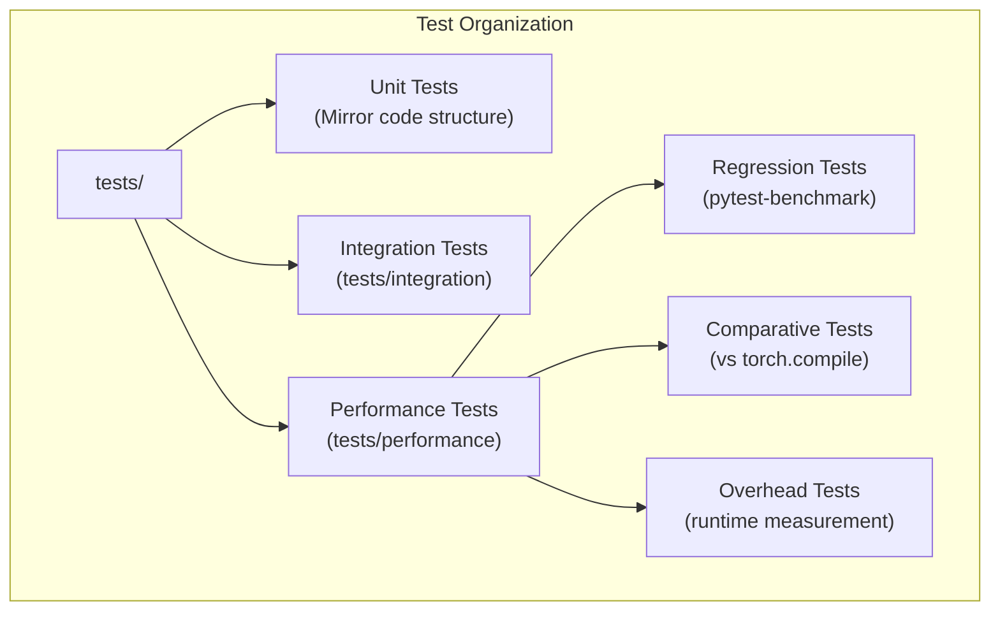
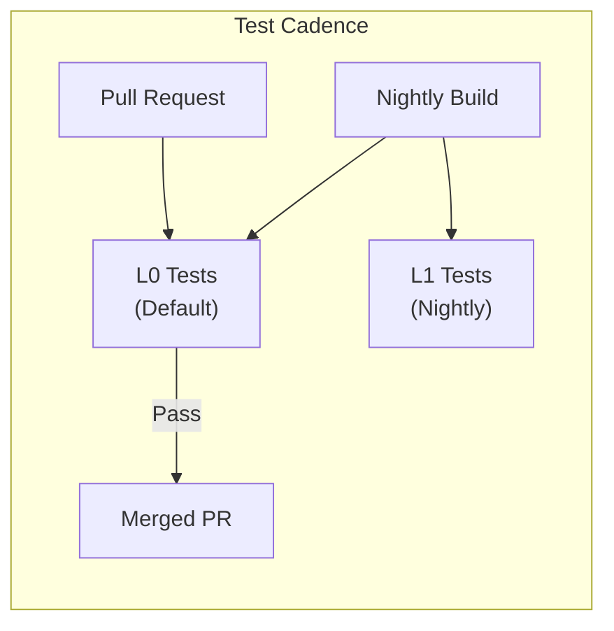
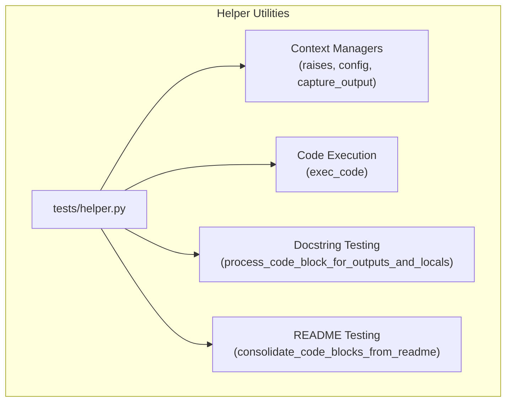
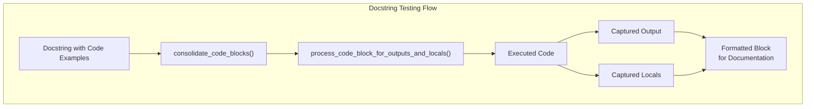
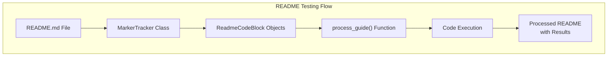

<!-- source: DeepWiki mcp.deepwiki.com · repo NVIDIA/TensorRT-Incubator · page 5.2 Testing Framework · fetched 2026-10-26 -->

# Testing Framework

<details>
<summary>Relevant source files</summary>

The following files were used as context for generating this wiki page:

- [tripy/docs/_static/style.css](tripy/docs/_static/style.css)
- [tripy/docs/_templates/layout.html](tripy/docs/_templates/layout.html)
- [tripy/docs/conf.py](tripy/docs/conf.py)
- [tripy/docs/generate_rsts.py](tripy/docs/generate_rsts.py)
- [tripy/tests/README.md](tripy/tests/README.md)
- [tripy/tests/helper.py](tripy/tests/helper.py)
- [tripy/tests/test_helper.py](tripy/tests/test_helper.py)

</details>


This document explains the testing infrastructure of the TensorRT-Incubator repository, covering the different test types, execution methods, and utilities provided for testing. For information about the CI/CD pipeline, see [CI/CD Pipeline](#5.4).

## Test Organization

The testing framework in TensorRT-Incubator is organized into three main categories of tests:



Sources: [tripy/tests/README.md:5-26]()

### Unit Tests

Unit tests mirror the structure of the codebase, making it easy to find tests for specific modules:

- Tests for a module in `nvtripy/frontend/tensor.py` will be located in `tests/frontend/test_tensor.py`
- These tests typically focus on testing individual functions or classes in isolation

### Integration Tests

Integration tests are located in the `tests/integration/` directory and test interactions between different components:

- These tests ensure that different parts of the system work correctly together
- They often involve testing complete workflows or scenarios

### Performance Tests

Performance tests are located in the `tests/performance/` directory and include:

1. **Regression Tests** - Using `pytest-benchmark` to detect performance regressions
   - Historical performance data is stored in the `benchmarks` branch
   - Charts can be viewed at `index.html` in the `benchmarks` branch

2. **Comparative Tests** - Compare Tripy performance against `torch.compile`
   - These tests help understand how Tripy performs relative to PyTorch

3. **Overhead Tests** - Measure runtime overheads compared to direct MLIR executable execution
   - These tests isolate the overhead introduced by Tripy's abstraction layers

Sources: [tripy/tests/README.md:5-26]()

## Test Execution

### Running Tests

The testing framework uses `pytest` for test discovery and execution:

```
# Run all tests
pytest tests/ -v

# Run L0 tests (faster, used in PR pipeline)
pytest tests/ -v -m "not l1 and not l1_release_package" -n 4 --dist worksteal --ignore tests/performance
pytest tests/performance -v -m "not l1 and not l1_release_package"
```

Note that performance tests are run separately and serially to avoid interference between tests.

Sources: [tripy/tests/README.md:28-44]()

### Test Cadence

Tests are categorized by when they should be executed in the CI/CD pipeline:



- **L0 Tests** (default): Run on every pull request
  - These are faster tests that provide quick feedback
  - All tests are L0 by default unless marked otherwise

- **L1 Tests**: Run in nightly builds
  - These may include slower or more exhaustive tests
  - Marked with `@pytest.mark.l1` decorator

Sources: [tripy/tests/README.md:46-64]()

## Testing Utilities

The testing framework provides various utilities to simplify test writing and execution through the `helper.py` module:



### Exception Testing

The `raises` context manager extends `pytest.raises` to also verify stack information:

```python
with helper.raises(ExcType, match="error pattern", has_stack_info_for=[tensor1, tensor2]):
    # Code that should raise an exception
```

### Configuration Context

The `config` context manager allows temporarily changing configuration options:

```python
with helper.config("name", value):
    # Code with temporary configuration
```

### Code Execution Utilities

The `exec_code` function executes code strings and returns the resulting locals/globals:

```python
locals_dict = helper.exec_code("a = tp.ones((2, 2))")  # Returns dict with 'a' tensor
```

Sources: [tripy/tests/helper.py:42-69](), [tripy/tests/helper.py:170-183]()

## Documentation Testing

A key feature of the testing framework is its integration with documentation. Code examples in docstrings and READMEs are automatically executed to ensure they're correct and up-to-date.

### Docstring Testing

The framework processes code blocks in docstrings to:
1. Verify they execute without errors
2. Format them with proper syntax highlighting
3. Show resulting local variables and outputs



Code blocks are extracted from docstrings and processed using `process_code_block_for_outputs_and_locals()` which:
- Executes the code
- Captures printed output
- Captures local variables (esp. Tripy objects)
- Formats everything for inclusion in documentation

Special control comments can be used in docstring code examples:
- `# doc: no-eval` - Don't execute this code block
- `# doc: no-output` - Don't show output
- `# doc: no-print-locals` - Don't show local variables
- `# doc: print-locals var1 var2` - Only show specific local variables

Sources: [tripy/tests/helper.py:114-163](), [tripy/tests/helper.py:403-622](), [tripy/docs/conf.py:158-274]()

### README Testing

Similar to docstring testing, code blocks in README files are also executed and verified:



READMEs use special markers for control:
- `<!-- Tripy: TEST: IGNORE Start -->` and `<!-- Tripy: TEST: IGNORE End -->` - Ignore blocks
- `<!-- Tripy: TEST: XFAIL Start -->` and `<!-- Tripy: TEST: XFAIL End -->` - Expected to fail
- Code blocks using triple backticks with language tags (```python)

This ensures that examples in documentation remain accurate as the codebase evolves.

Sources: [tripy/tests/helper.py:236-400](), [tripy/docs/generate_rsts.py:356-400]()

## Advanced Testing Topics

### Profiling

The testing framework supports profiling tests to identify performance bottlenecks:

```bash
# Profile L0 tests
pytest tests/ -v -m "not l1 and not l1_release_package" --ignore tests/performance --profile
```

This generates:
- A `.prof` file for each test
- A `combined.prof` file for all tests
- Can be visualized with tools like `snakeviz`

Sources: [tripy/tests/README.md:67-92]()

### Coverage Reports

Code coverage reports can be generated to identify untested code:

```bash
pytest --cov=nvtripy/ --cov-report=html --cov-config=.coveragerc tests/ -v
```

The resulting HTML report shows which parts of the codebase are covered by tests.

### Dead Code Detection

The framework recommends using `vulture` for detecting potentially dead code:

```bash
vulture . --sort-by-size
```

Note that this may include false positives and should be used as a guide rather than as a definitive indicator.

Sources: [tripy/tests/README.md:95-120]()

## Conclusion

The testing framework in TensorRT-Incubator provides comprehensive support for different types of tests, integration with documentation, and various utilities for test execution and verification. Following the provided guidelines ensures that code changes maintain correctness and performance.

By using this framework, developers can:
- Write effective unit, integration, and performance tests
- Ensure documentation examples remain correct
- Monitor performance regression
- Maintain code quality

For information about the CI/CD pipeline that runs these tests, see [CI/CD Pipeline](#5.4).

---

